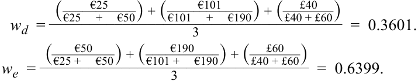

# Volume 3: Corporate Issuers
## Learning Module 6 Capital Structure
### Part 4/4: Optimal Capital Structure (PDF Pages 209–220)

---

<!-- PDF Page 209 -->

**C.** lower than **Solution:** 

B is correct. Since Company Y is an unlevered firm and has no debt in its capital structure, the cost of equity will be the same as WACC. Since the weighting of debt is zero, the WACC formula is simply 

WACC = Weighting of equity × Cost of equity. 

#### **OPTIMAL CAPITAL STRUCTURE** 

# **<mark>5</mark>** 

describe optimal and target capital structures 

While the Modigliani–Miller propositions offer an initial framework for capital structure decisions, a company’s managers facing capital structure choices must address trade-offs simultaneously while incorporating those factors outlined in prior lessons. For example, consider a more real-world-appropriate scenario with _both_ corporate taxes and bankruptcy/financial distress costs. The value-enhancing effect of the tax shield from leverage is offset by the value-reducing impact of the present value of expected (or probability-weighted) costs of financial distress or bankruptcy. We can show this trade-off by incorporating the potential cost of financial distress or bankruptcy into the value of a levered firm: 

_VL_ = _VU_ + _tD_ − _PV_ (Costs of financial distress). ~~(7)~~ 

Equation 7 represents what is sometimes referred to as the **static trade-off theory of capital structure** , which is illustrated in Exhibit 7. 

<!-- PDF Page 210 -->

**Exhibit 7: Static Trade-Off Theory of Capital Structure** 

<!-- Start of picture text -->
Value of firm ( V ) VL  =  VU  +  tD PV of financial Maximum distress costs firm value PV of tax V  = Actual firm value shield on debt VU  (no debt) 0 Debt ( D ) D * Optimal amount of debt <!-- End of picture text -->

_VU_ represents the value of an unlevered or all-equity firm. As debt is added to the capital structure, the new levered firm value is derived from Equation 7. At low debt levels, the tax benefit of debt usually outweighs potential financial distress costs, resulting in a higher firm value. However, as debt increases, the present value of expected financial distress costs begins to rise and offset the tax benefit of debt, with the optimal amount of debt _D_ * at the point at which the marginal benefit of the tax shield equals the marginal cost of expected financial distress. Beyond this point, greater leverage reduces firm value, as the increased present value of expected financial distress costs outweighs the marginal tax benefit. The debt level corresponding to _D_ *, which maximizes firm value, and the associated level of equity are referred to as the **optimal capital structure** . 

Managers cannot precisely estimate _D_ * in practice but, rather, establish a **target capital structure** based on these two considerations, as well as the internal and external factors outlined in earlier lessons. There are several reasons why a firm’s actual capital structure may differ from its target. For example, management may exploit short-term opportunities in a particular financing source. A company able to issue debt at attractive rates, for instance, may borrow more than planned in response to strong investor demand. Also, changing market values of the company’s debt and equity securities can cause the firm’s actual capital structure to deviate from a target. Transaction costs and minimum deal sizes make it impractical for firms to constantly align capital structure to a specific number. As a result, firm managers usually set an optimal capital range: for example, 30%–50% debt rather than 40%. 

While prior WACC calculations and debt and equity weights were made with the _market_ value of equity and debt, target capital structure is often expressed using the _book_ value of equity and debt for the following reasons: 

**1.** _Market values can fluctuate substantially and seldom impact the appropriate level of borrowing._ On the contrary, a company whose share price has risen rapidly may take advantage of this by raising equity capital rather than debt to maintain a certain debt-to-equity ratio. 

<!-- PDF Page 211 -->

**2.** _For management, the primary concern is the amount and types of capital invested_ by _the company, not_ in _the company._ This perspective includes how working capital and capital projects will be funded. It differs from that of a shareholder who has purchased shares at the prevailing market price seeking a return on that investment. 

**3.** _Capital structure policy is aligned to measures used by third parties._ Since lenders, debt investors, and rating agencies generally focus on the book value of debt and equity for their calculation measures, firm managers take this fact into account in determining their capital structure policies. 

Although it is common for target capital structures to be expressed in terms of book values, managers pay close attention to the price and market interest rates on their equity and debt outstanding to gauge when to raise capital and how much and what type to raise. 

##### **Target Weights and WACC** 

In the first lesson, when computing WACC, we used the current market values of debt and equity to compute the weights. An alternative approach would be to use the target capital structure, especially if management discloses it. Independent analysts unaware of the firm’s target may estimate it using one of several methods: 

**1.** Assume the company’s current capital structure, at market value weights for the components, represents the company’s target capital structure. 

**2.** Examine capital structure trends or management statements regarding capital structure policy to infer a company’s target capital structure. 

**3.** Use averages of comparable companies’ capital structures as the target. 

Note that a simple way of transforming a debt-to-equity ratio (D/E) into a weight— that is, _D_ /( _D_ + _E_ )—is to divide _D_ / _E_ by 1 + _D_ / _E_ . 

###### **KNOWLEDGE CHECK ESTIMATING PROPORTIONS OF CAPITAL FOR GERHARDT CORPORATION** 

A financial analyst seeks to estimate Gerhardt Corporation’s weighted-average cost of capital using the following information: 

- Market value of debt: EUR50 million 

- Market value of equity: EUR60 million 

Primary competitors and their capital structures (in millions): 

|**Competitor**|**Market Value of Debt**|**Market Value of Equity**|
|---|---|---|
|A|EUR25|EUR50|
|B|EUR101|EUR190|
|C|GBP40|GBP60|

1. Calculate the proportions of debt and equity for the WACC analysis using Gerhardt’s current capital structure. 

**Solution:** Current capital structure: 

_wd_ =  _____________________€50 million + €60 million€50 million= 0.4545. _we_ =  ______________________€50 million  +  €60 million€60 million= 0.5454. 

<!-- PDF Page 212 -->

2. Calculate the proportions of debt and equity for the WACC analysis using the capital structure of Gerhardt’s competitors. 

###### **Solution:** 

Competitors’ capital structure: 

<!-- Formula Text: w d  = ( €25 ___________ €25   +   €50 ) + ( €101 _____________ €101   +   €190 ) + ( £40 _ £40 + £60 ) ____________________________________ 3 =  0.3601. w e  = ( €50 _ €25 +   €50 ) + ( €190 ___________ €101 +   €190 ) + ( £60 _ £40 + £60 ) _________________________________ 3 =  0.6399. -->

3. Calculate the proportions of debt and equity for the WACC analysis if Gerhardt announces that a debt-to-equity ratio of 0.7 reflects its target capital structure. 

###### **Solution:** 

A debt-to-equity ratio of 0.7 represents a weight on debt of 0.7/1.7 = 0.4118, so _wd_ = 0.4118 and _we_ = 1 − 0.4118 = 0.5882. These would be the preferred weights to use in a cost-of-capital calculation. 

##### **Pecking Order Theory and Agency Costs** 

Investors and issuers have **asymmetric information** . Issuer management has access to more information about its business and its prospects than is publicly available, and managers are likely to use this information to their advantage when seeking financing. Debt and equity investors demand higher returns from companies with higher information asymmetry because they may be concerned that new securities are overpriced; that is, a company will either issue equity when its shares are expensive or issue new debt when the firm’s creditworthiness is about to deteriorate. 

Since investors often closely watch manager behavior for insight into a company’s prospects, managers consider what their actions might signal to outsiders. The signaling model of capital structure suggests a hierarchy (or pecking order) of methods for financing new investments. 

The **pecking order theory** , developed by Stewart C. Myers and Nicholas S. Majluf in 1984, suggests that managers give first preference to financing methods with the least potential information content (internally generated funds) and last preference to methods with the most potential information content (public equity offerings). Public equity offerings often raise skepticism among investors because existing owners would seem less likely to want to share ownership of a company with strong future prospects. As a result, managers prefer internal financing, and if external financing is needed, they prefer private debt to public debt and prefer equity issuance least of all. 

Another implication of the work of Myers and Majluf is that issuers tend to issue equity when management believes the stock is overvalued and are reluctant to issue equity if they believe the stock is undervalued, potentially choosing instead to repurchase shares. Thus, additional issuance of equity, usually to finance an acquisition, is often interpreted by investors as a negative signal. The issuance of debt commits the company to future interest and principal payments, which (along with recurring dividends) may be interpreted as a sign of management confidence in the company’s future ability to make such payments. These signals are considered too costly for poorly performing companies to afford. 

Alternatively, the signal of issuing equity at the bottom of the pecking order holds other clues. If, for instance, the company’s cost of capital increases after an equity issuance, we can interpret this effect as an indication that management needs capital beyond what comes cheaply; in other words, this is a negative signal regarding the 

<!-- PDF Page 213 -->

company’s prospects. Managers may hesitate to issue new equity when they believe the company’s shares are underpriced, because they wish to avoid signaling that they believe the shares are overpriced and also to avoid the cost and effort involved with new equity issuance. 

Agency costs were introduced in an earlier lesson as the incremental costs arising from conflicts of interest between managers, shareholders, and bondholders. In the case of capital structure decisions, savings in the agency costs of equity may arise with the increased use of debt. Similarly, the more financially leveraged a company, the less freedom for managers to either take on more debt or spend cash unwisely. This is the foundation of Michael Jensen’s (1986) **free cash flow hypothesis** : Higher debt levels discipline managers by forcing them to manage the company efficiently and use cash wisely so the company can make its interest and principal payments. 

###### **EXAMPLE 5** 

##### **Agency Costs, Asymmetric Information, and Signaling** 

CLP AG, a small, listed biopharmaceutical company, is conducting a clinical trial of its drug, which is already approved for treatment of an autoimmune disorder, to be used in a new application for which it was not originally intended: treatment of a type of viral infection. Management hopes this new application for the drug will result in a big increase in sales and the value of the company. The company has been consistently profitable and debt free. The following events occur: 

- In July, management receives notice from the clinical trial investigators that results look promising. Anticipating that it might have to scale up production quickly, the company negotiates and announces a large increase in its credit line. 

- In August, CLP announces successful test results by public press release. CLP shares increase by 35%. 

Explain how asymmetric information and signaling are represented here. 

1. Asymmetric information 

###### **Solution** 

Asymmetric information is represented by management's knowledge of the positive trial results in July, before they were publicly announced in August. Signaling is represented by the company's announcement in July that it was increasing its credit line. The announcement could reasonably be taken as a signal of management's confidence that the trial results will be positive and that the company will need to expand production capacity. This is true whether or not the signaling is intentional. 

###### **QUESTION SET** 

1. True or False: Under the pecking order theory, the firm has no optimal capital structure and a firm’s capital structure reflects its historic need for external financing. 

###### **A.** True 

<!-- PDF Page 214 -->

###### **B.** False **Solution:** 

A is correct. The pecking order theory is based on asymmetric information held by investors and issuers and the idea that managers consider what their actions may signal to investors. The signaling model suggests a hierarchy in methods in financing the firm. Internal funds are used first, then debt is used, and finally, reluctantly, firms use equity. There is no optimal capital structure, and a firm’s capital structure reflects its historic need for external financing. 

2. Company Z announces that a debt-to-equity ratio of 1.2 is consistent with its target capital structure. Given this value, the weight for equity in the WACC calculation is: 

**A.** 45%. 

- **B.** 55%. 

**C.** 83%. 

###### **Solution:** 

A is correct. A simple way of transforming a debt-to-equity ratio (D/E) into a weight—that is, _D_ /( _D_ + _E_ )—is to divide _D_ / _E_ by 1 + _D_ / _E_ . Therefore, a debt-to-equity ratio of 1.2 represents a weight on debt of 1.2/2.2 = 0.5455, so _wd_ = 0.5455 and _we_ = 1 − 0.5455 = 0.4545. Thus, the weight for equity in the WACC calculation is 45%. 

3. Match each of the following concepts on the left with a capital structure theory/hypothesis on the right: 

- **Concepts Capital Structure Theory/Hypothesis** 1. Optimal capital structure A. Free cash flow hypothesis 2. Agency costs B. Pecking order theory 

1. Optimal capital structure A. Free cash flow hypothesis 2. Agency costs B. Pecking order theory 3. Asymmetric information C. Static trade-off theory of capital structure 

###### **Solution:** 

   **1.** C. The static trade-off theory of capital structure determines the optimal capital structure. 

   **2.** A. The free cash flow hypothesis is based on agency costs and the idea that higher debt levels impose discipline on managers to avoid perks and non-value-adding acquisitions. 

   **3.** B. The pecking order theory is based on asymmetric information held by investors and issuers and the important role of signaling. 

4. The value-reducing impact of financial distress or bankruptcy increases if the firm has: 

   - **A.** higher business risk. 

   - **B.** lower operating and financial leverage. 

   - **C.** assets with a ready secondary market. 

###### **Solution:** 

A is correct. The probability and cost of financial distress rise for firms with higher business risk and more debt in the capital structure. In contrast, the cost of financial distress is lower for firms with lower operating and financial 

<!-- PDF Page 215 -->

|leverage and for firms with assets that have a secondary market and can be easily sold.|
|---|
|5. True or False: The target capital structure should be estimated using the market value of equity and debt in calculating WACC.|
|**A.**True|
|**B.**False|
|**Solution:**|
|B is correct. Target capital structure is often estimated using book values because market values can fluctuate significantly and are unlikely to impact borrowing capacity. Issuers will often aim for a certain credit rating, such as investment grade, which is strongly influenced by the issuer’s (book value) level of indebtedness relative to cash flows.|

<!-- PDF Page 216 -->

## **~~PRACTICE PROBLEMS~~** 

### **The following information relates to questions 1-4** 

A financial analyst is evaluating the capital structure for Boulder, Inc. Boulder, Inc., is a US-based unleveraged firm with a constant (perpetual) cash flow of $6 million per year before taxes. The firm has a market value of $45 million and a corporate tax rate of 30%. Boulder plans to issue $15 million in debt to retire an equivalent amount of equity. The debt will have a cost of 5.5%. 

The financial analyst notes that the tax shield advantage of debt is offset due to the risk of financial distress. He estimates the present value of the cost of financial distress at various debt levels as follows: 

|**Value of Debt**|**Present Value of Cost of Distress**|
|---|---|
|$5 million|$0.1 million|
|$10 million|$0.2 million|
|$15 million|$0.5 million|
|$20 million|$1.5 million|
|$25 million|$6.0 million|
|$30 million|$12.0 million|

**1.** The WACC of the unleveraged firm, prior to the debt issue, is closest to: 

   - **A.** 4.00%. 

   - **B.** 9.33%. 

   - **C.** 13.33%. 

**2.** The use of the $15 million of debt financing increases the value of Boulder by ____________ over its unlevered value. Ignore the costs of financial distress. 

   - **A.** $4.5 million 

   - **B.** $10.5 million 

   - **C.** $15 million 

**3.** Including the present value of the cost of distress, the value of Boulder is closest to: 

   - **A.** $49 million. 

   - **B.** $55 million. 

   - **C.** $59.5 million. 

**4.** The level of debt that will maximize the value of Boulder Inc. is closest to: **A.** $15 million. 

<!-- PDF Page 217 -->

- **B.** $20 million. 

**C.** $30 million. 

**5.** A financial analyst is evaluating the capital structure for Plover, Inc., a European-based unleveraged firm with a constant (perpetual) cash flow of EUR10.0 million per year before taxes. The firm has a market value of EUR100.0 million and a corporate tax rate of 20%. Plover plans to issue EUR35.0 million in debt to retire an equivalent amount of equity, so the size of the firm will remain unchanged. The debt will have a cost of 4.5%. Assume the cost of financial distress is close to zero. 

   - After the debt issuance and change in the capital structure, Plover’s WACC is closest to: 

**A.** 5.47%. 

**B.** 7.48%. 

**C.** 8.82%. 

<!-- PDF Page 218 -->

## **~~SOLUTIONS~~** 

1. B is correct. The after-tax cash flows for the company are $6 million × (1 – 0.30) = $4.2 million. Since the cash flows are assumed to be perpetual, WACC is calculated as follows: 

_rWACC_ = _CF_ (1 – _t_ )/ _V_ = $4.2/$45 = 9.33%. 

Since this is an all-equity firm, the cost of equity is equal to WACC. 

2. A is correct. According to MM Proposition I with corporate taxes, the value of the levered company is greater than that of the unlevered company by an amount equal to the tax rate multiplied by the value of the debt ( _tD_ ), defined as the present value of the debt tax shield. 

_VL_ = _VU_ + _tD_ = $45 million + 0.30($15million) = $49.5 million. 

Thus, the use of debt financing will increase the value of Boulder by $4.5 million over the unlevered firm. Note that the firm’s value increases continuously as additional debt is added to the capital structure, and the optimal capital structure is 100% debt. 

3. A is correct. With financial distress included, as debt is added to the capital structure, the levered value of the firm is given by: 

_VL_ = _VU_ + _tD_ − _PV_ (Costs of financial distress). 

The levered value of Boulder financed with $15 million in debt is 

_VL_ = $45 million + 0.30($15 million) – $0.5 million = $49 million. 

4. B is correct. With financial distress included, as debt is added to the capital structure, the levered value of the firm is given by: 

   - _VL_ = _VU_ + _tD_ − _PV_ (Costs of financial distress). 

The following shows calculations of the levered value of Boulder at various debt levels, in $millions. 

|**D**|**_PV_(Costs of financial** **distress)**|**_VL_ =****_VU_ +****_tD_ −****_PV_(Costs of financial distress).**|
|---|---|---|
|5|0.1|_VL_= 45 + 0.3(5) – 0.1 _VL_= 46.4|
|10|0.2|_VL_= 45 + 0.3(10) – 0.2 _VL_= 47.8|
|15|0.5|_VL_= 45 + 0.3(15) – 0.5 _VL_= 49|
|20|1.5|_VL_= 45 + 0.3(20) – 1.5 _VL_= 49.5|
|25|6.0|_VL_= 45 + 0.3(25) – 6.0 _VL_= 46.5|
|30|12.0|_VL_= 45 + 0.3(30) – 12.0 _VL_= 42|

Thus, the optimal amount of debt is $20 million, which maximizes the value of Boulder at a level of $49.5 million. Beyond $20 million in debt, greater leverage 

<!-- PDF Page 219 -->

reduces the firm value because the present value of financial distress costs more than the offsetting tax benefit. 

5. B is correct. The calculations to determine the WACC are as follows: The after-tax cash flows for the company are EUR10.0 million (1 – 0.20) = EUR8.0 million. Since the cash flows are assumed to be perpetual, WACC for the unlevered firm is calculated as 

_rWACC_ = _CF_ (1 – _t_ )/ _V_ = EUR8.0 million/EUR100.0 million = 8.0%. 

The market value of Plover with the debt financing is EUR107 million: 

_VL_ = _VU_ + _tD_ = EUR100.0 million + 0.20(EUR35.0 million) = EUR107.0 million. To find the cost of equity, we first need to find the market value of equity: 

_VL_ = _D_ + _E_ , where _D_ and _E_ are market values of debt and equity, respectively. 

_E_ = EUR107.0 million – EUR35.0 million = EUR72.0 million. The cost of equity is given by 

 re_ = _r_ 0 +  ( _r_ 0 − _rd_ )( 1 − _t_)_D_ _E_ 

= 8.0% + (8.0% – 4.5%)(0.80)(EUR35.0 million/EUR72.0 million) = 9.36%. Plover’s WACC is calculated as follows: 

WACC = (Weighting of debt × Cost of debt) + (Weighting of equity × Cost of equity) 

= (EUR35 million/EUR107.0 million)(4.5%)(1 – 0.2) + (EUR72.0 million/ EUR107.0 million)(9.36%) 

= 7.48%, which is lower than the 8.0% for the unlevered firm. 

<!-- PDF Page 220 -->

