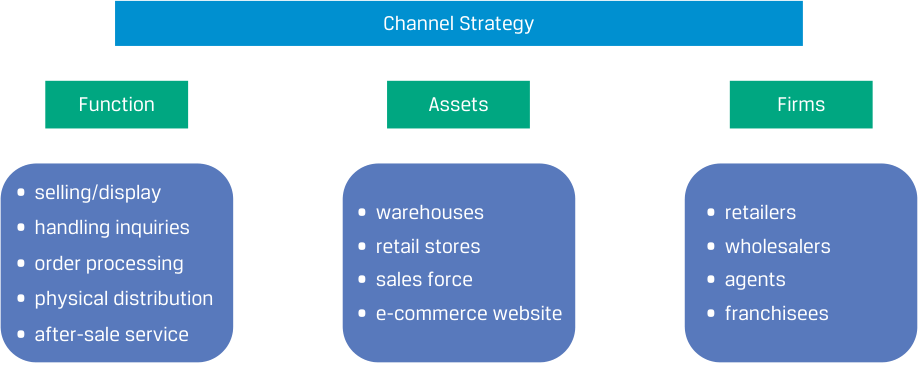

# Volume 3: Corporate Issuers
## Learning Module 7 Business Models
### Part 2/3: Defining the Business Model (PDF Pages 223–237)

---

<!-- PDF Page 223 -->

- **B.** fractional ownership; subscriptions 

- **C.** horizontal integration; network effects 

- **Solution:** 

A is correct. Companies often bundle complementary products and services by offering a discount for their combined purchase versus the sum of the individual prices, such as a product and a repair/maintenance package. A razor, razorblade model, named for Gillette’s business model of selling a razor with disposable razorblades, combines a durable good sold at near cost with high-margin, possibly proprietary consumables needed to use the durable good. Other examples include Nespresso and Keurig coffee machines, printers and toner/ink, and diagnostic instruments and reagents. 

5. ____________ refers to the increase in the value of a network to its users as more users join. 

   - **A.** “Value chain” 

   - **B.** “Network effects” 

   - **C.** “Value proposition” 

   - **Solution:** 

B is correct. A network in which participants interact or transact with one another increases in value as more participants join. Examples of companies or services with network effects include financial instrument exchanges, payment networks, social media, and phone and other communication networks. Network effects can be a strong barrier to new industry entrants. 

6. ____________ involves user communities that enable voluntary collaboration between users of a product with generally a small amount of moderation and oversight by the community host or operator. 

   - **A.** Franchising 

   - **B.** Crowdsourcing 

   - **C.** A loyalty program 

   - **Solution:** 

B is correct. Generically, crowdsourcing means obtaining contributions from multiple parties. Many digital business models incorporate or utilize crowdsourcing as their defining feature, whereby the company creates a service that users build, while the company simply creates rules and moderates user contributions. Common examples include social media, product reviews, open source software, and Wikis. 

# **DEFINING THE BUSINESS MODEL** 

<!-- Start of picture text -->
2 <!-- End of picture text -->

describe key features of business models 

Successful new businesses may be based on a new product or technology, but there are many success stories based on familiar products or services and a new **business model** . For example, IKEA successfully combines existing business concepts—low-cost self-assembly furniture, modernist Scandinavian design, and big box retailing—in a 

<!-- PDF Page 224 -->

unique and successful way. Similarly, Google did not invent online search but found a way to improve the accuracy of search results and to generate revenues through advertising based on user search data. 

Often, successful business models are neither new nor unique but proven. Many businesses, such as wholesalers, retailers, law firms, building contractors, banks, and insurers, have conventional business models. Success for these firms hinges not on business model innovation but on superior execution, skill, proprietary technology, a strong brand, scale, scope economies, or other factors. 

While there is no precise generally accepted definition of a business model, it is a description of how a business works and includes the following: 

- The customer base for the business (“who?”) 

- The product or service the business offers to customers (“what?” and often “why?”) 

- Where is the firm selling and how do its products and services reach customers (“where?”) 

- The pricing strategy (“how much?”) 

- 

- The key assets, partners, and suppliers the business requires (“how?”) 

A business model should provide enough detail so that the basic elements and relationships are clear, without providing so much detail as to become a business plan. A clear business model should have the elements included in Exhibit 1. 

### **Exhibit 1: Business Model** 

<!-- Start of picture text -->
What is the firm’s  value proposition  to its target customer(s)? What is the firm’s  value chain? Who  are the What  product(s), Where  is the How much How is the Does the firm firm’s target service(s), and firm selling? is offer pricing firm organized have customers? experience(s), How  does it relative to to execute? competitive How does the does the firm reach its competitors? capabilities? firm keep its offer? customer(s)? customers? What impact does the firm’s business model have on its: • Revenue model? What is the • Cost structure? firm’s profitability? • Asset profile? Financial structure? <!-- End of picture text -->

## **Business Model Features** 

Information needed to determine the business model of public corporate issuers is often provided in annual reports and presentations; management may even provide its own description of the issuer’s business model. The beginning of Tesla’s annual report provides a good example. 

<!-- PDF Page 225 -->

### **EXAMPLE 1** 

## **Tesla Management’s Description of its Business** 

“We design, develop, manufacture, sell and lease high-performance fully electric vehicles and energy generation and storage systems, and offer services related to our products. We generally sell our products directly to customers, including through our website and retail locations. We also continue to grow our customer-facing infrastructure through a global network of vehicle service centers, Mobile Service technicians, body shops, Supercharger stations and Destination Chargers to accelerate the widespread adoption of our products. We emphasize performance, attractive styling and the safety of our users and workforce in the design and manufacture of our products and are continuing to develop full self-driving technology for improved safety. We also strive to lower the cost of ownership for our customers through continuous efforts to reduce manufacturing costs and by offering financial and other services tailored to our products. Our mission to accelerate the world’s transition to sustainable energy, engineering expertise, vertically integrated business model and focus on user experience differentiate us from other companies.” 

We can identify two business model elements from this paragraph. 

_What_ : “high-performance fully electric vehicles and energy generation and storage systems, and offer services related to our products” and “emphasize performance, attractive styling and . . . safety . . . and are continuing to develop full self-driving technology.” 

_Where:_ “sell our products directly to customers, including through our website and retail locations. We also continue to grow our customer-facing infrastructure through a global network of vehicle service centers, Mobile Service technicians, body shops, Supercharger stations and Destination Chargers.” 

In the quote from Tesla, it describes its products and their attributes; venues in which it sells its products, known as sales channels or simply **channels** ; and its emphasis on innovation. Analysts use a business model to begin their evaluation of how effectively it has been implemented, the company’s prospects for future success, and understanding its implications for exposures to risks and opportunities. Management can change an issuer’s business model or launch new businesses with distinct models within the same company, so this must be an ongoing analysis. 

Let’s explore the features of a business model further. 

### **_The Customers and the Market (“Who”)_** 

A business model should identify target customers: 

- Are there specific types, or segments, of customers served? 

- Are customers other businesses (business-to-business or B2B model) or consumers (business-to-consumer or B2C model)? 

- What geographies will be served? 

Tesla management’s description is silent on which customer segments it is targeting, most likely because its target is shifting gradually toward the mass market with lower-cost and lower-price models. For an analyst, this type of inference can guide inputs for financial models, such as unit and price forecasts. 

<!-- PDF Page 226 -->

It is common in consumer markets to think of demographic segments, such as high-income suburban families. In many cases, segmentation is even narrower and is unique to the product or service category—for instance, “affluent early adopters of technology with homes that support plug-in charging in countries with EV subsidies.” 

Business opportunities often arise because established firms may not effectively serve—or even recognize—certain prospective customer segments. At the same time, choices made concerning a firm’s target customers may introduce other related considerations or risks to the firm, such as high barriers to entry, changes in customer segment(s), or greater competition. 

### **EXAMPLE 2** 

## **Segmenting Customers** 

Customers can be classified or segmented in numerous ways, including by their geography, demographics, seasonal or life-cycle timing, and behavior. Sophisticated market analytics can be used in **segmenting** to further break out smaller, homogeneous markets. Such analyses help such companies as Tesla to develop products and market them effectively. 

Tesla positioned its products as the “new technology for clean energy” and moved away from being a company that solely produced expensive, premium electric sports cars to a company that defined what a practical, attractive, electric vehicle could look like. By targeting aspirational middle- and upper-class consumers who not only thrive on status-seeking behavior but also seek to be perceived to be environmentally friendly, socially and environmentally progressive, and cost conscious, Tesla expanded its customer markets. 

Tesla and other companies can drill down to the postal code level for their customers and segment customers based on their social group, life-cycle stage, and wealth. This allows companies to identify customer cohorts across geographies and combine them into larger homogeneous markets that are easier to access and penetrate using targeted digital advertising. 

### **_Product or Service Offering (“What” and Often “Why”)_** 

The business model should define what product or service the firm offers and how, if at all, it is different from competitor offerings by referencing the needs of its target customers. This helps the analyst identify the addressable market for the business and to understand key opportunities and risks. For example, there may be a high risk of imitation or substitution. Understanding why customers buy the product or service, or the “job” that customers are “hiring” the product or service to fulfill, can help analysts identify current and potential competitors. While trucks and railroads do not seem like competitors, they both fulfill the same customer need: the transportation of goods. A more thoughtful analysis would identify which types of customers and in which scenarios customers would choose truck versus rail transportation (as well as air and marine transportation). 

Generally, business customers have straightforward needs (e.g., ship goods), are sophisticated buyers, and are motivated to earn a profit. Consumer customers have diverse needs that can be impossible to quantify. Some consumers purchase whichever car is the most economical on a cost per mile basis, while others look to purchase aesthetically pleasing, high-performance, or low-emission vehicles. Certain products can satisfy these needs, and companies can use advertising, promotions, and product placement in media to create these needs in the first place. 

<!-- PDF Page 227 -->

For Tesla, management describes its products quite precisely: “high-performance fully electric vehicles and energy generation and storage systems.” Some companies, however, will use overly broad terms in describing their offerings and addressable markets, overstate differentiation, or reference platforms and networks that may be very weakly developed—all in an attempt to convince investors that everyone could be a customer and inflate the value of the business. It is important for analysts to scrutinize management’s assertions and supplement them with independent research. 

### **EXAMPLE 3** 

## **Business Model Evolution: Netflix** 

Netflix’s evolution since its start in 1997 is a prime example of how the “what” evolves over time. It started as a DVD rental by mail business in 1998, when the home movie rental business was dominated by brick-and-mortar rental stores and only 2% of the US households owned a DVD player. Netflix created and operated a website for customers to select DVDs to rent and delivered them through the mail. Subsequently, the company introduced a subscription model, where customers could rent several DVDs at one time for a fixed monthly fee. This new service disrupted the entire video rental industry. 

Netflix’s direct rival at the time was Blockbuster, but it took Blockbuster years to offer the same service as Netflix. By that time, Netflix had launched a new business model: a subscription-based, online-streaming video platform, and began to de-emphasize its DVD rental business. Through substantial investment in video content and improving streaming technology, Netflix grew to millions of monthly subscribers. The monthly subscription fee is substantially lower than monthly cable service fees, though Netflix has increased prices significantly over time. Netflix has differentiated its platform by producing exclusive content. Blockbuster filed for bankruptcy in 2010 and ceased operations in 2014. 

### **_Channels (“Where”)_** 

A firm’s channel strategy refers to “where” the firm is selling its offering; that is, how does it reach its customers? Channel strategy usually includes two main functions: selling the firm’s products and services (“sales and marketing”) and delivering them to customers (“distribution” or “logistics”). 

In assessing a firm’s channel strategy, it is important to distinguish between what functions the firm can perform internally and what functions are better done by strategic partners and suppliers. For example, many business software companies do not install their software on customers’ systems. Instead, customers hire a third-party consulting firm, which often provides additional ongoing services. Exhibit 2 provides examples of the functions, assets, and firms that may be part of the channel strategy for a firm. 

<!-- PDF Page 228 -->

**Exhibit 2: Channel Strategy: Functions vs. Assets vs. Firms** 

<!-- Start of picture text -->
Channel Strategy Function Assets Firms • selling/display • warehouses  • retailers • handling inquiries • retail stores  • wholesalers • order processing • sales force • agents • physical distribution • e-commerce website • franchisees • after-sale service <!-- End of picture text -->

For companies that sell physical products, the traditional channel strategy is typically reflected in the flow of inventory through a series of intermediaries before reaching the final customer. Firms at each stage have their own physical facilities, and the product is purchased and then re-sold by the intermediaries at each stage until it is sold to the final customer. 

Some companies, however, employ a **direct sales** strategy, selling directly to the end customer. Direct sales is a common and longstanding channel strategy for complex or high-margin products or services, such as medical devices, industrial equipment, and luxury goods. It is common in B2B models where the universe of potential customers is relatively small and easily reached. Historically, direct sales involved a significant investment in salespeople, but this is increasingly either substituted or supplemented with digital sales capabilities. Exhibit 3 contrasts the interactions of a traditional channel strategy with a direct sales strategy. 

**Exhibit 3: Traditional Channel Strategy (Product) vs. Direct Sales Strategy** 

<!-- Start of picture text -->
from manufacturer finished good to wholesaler Direct sales strategy finished good to retailer finished good to end-customer Traditional channel strategy <!-- End of picture text -->

Often, channels are used in combination. A so-called **omnichannel** strategy, common for apparel and consumer packaged goods, relies on both digital and physical channels to complete a sale. For example, a customer might order an item online and pick it up in a store or select an item in a store and have it delivered. 

<!-- PDF Page 229 -->

### **EXAMPLE 4** 

## **Adidas** 

Adidas is the world’s second largest sportswear brand and combines four channels to distribute its products: retail shops, franchise outlets, wholesale business, and its own e-commerce. The following excerpt from its annual report summarizes its channel strategy: 

“With more than 2,500 own-retail stores, more than 15,000 mono-branded franchise stores and more than 150,000 wholesale doors, we have an unrivaled network of consumer touchpoints within our industry. In addition, through our own e-commerce channel, our single biggest store available to consumers in over 40 countries, we are leveraging a consistent global framework.” 

_Source:_ Adidas AG Annual Report 2019 https:// report .adidas -group .com/ 2019/ en/ group -management -report -our -company/ corporate -strategy/ sales -and -distribution -strategy .html 

The channels used by a business are material drivers of revenues and cost behavior, profitability, and sensitivity to internal and external risk factors. Companies that employ a direct sales strategy have the advantage of a close relationship to customers and do not risk their products being shown alongside competitors on a shelf. However, direct sales impose significant cost, an important portion of which is fixed salaries and benefits. 

How a firm’s channel strategy differs from those of its competitors is an important factor to consider. For example, Tesla references its direct sales strategy, which is different from its US competitors, which sell to franchised dealers. This difference will affect comparability of financial results between Tesla and US automakers. 

### **_Pricing (“How Much”)_** 

A business model needs to provide sufficient detail about pricing so that the logic of the business is clear. 

- Does the firm price at a premium, at parity, or at a discount relative to competitors? 

- How do prices and costs compare? 

- How is the firm’s pricing justified in its business model? 

Companies selling in markets with many competitors and little or no product differentiation are price takers that simply receive the market price determined by supply and demand; they are known as **commodity producers** . Examples of **commodities** include oil and gas, pharmaceuticals that are no longer patented, and many types of loans. Companies selling in markets with few competitors or with highly **differentiated products** enjoy more **pricing power** , or the ability to maintain prices above costs or increase prices without negatively impacting customer demand. A business that does not have pricing power is likely to pursue a cost leadership strategy, seeking to be the lowest-cost producer, such as discount retailers Costco and Lidl and the low-cost airline Ryanair. 

Companies charging premium prices may justify doing so by emphasizing cost savings for customers elsewhere or by adding services for a reduced price (or free). For example, while Tesla’s vehicles are priced at a premium, the annual report references a lower total cost of ownership, which refers to the aggregate direct and indirect costs associated with owning an asset over its life span. After considering government subsidies and the lower costs of electric charging compared with petroleum, the price is more competitive (though there is a risk of subsidies decreasing or ceasing in the 

<!-- PDF Page 230 -->

future). This value proposition— the reduced total cost of ownership through some combination of product capabilities, reliability, ease of maintenance and operation, training, and so on—is common to business models in many sectors. 

In some cases, however, companies do not “justify” premium pricing but, rather, establish strong brands and distinctiveness that customers value. While some of Tesla’s prices can be justified based on lower total costs of ownership, much of it is owed to the aesthetic, performance, and intangible characteristics valued by customers and created by the company and its advertising. The same is true for most premium and luxury goods and services. 

## **Pricing and Revenue Models** 

A pricing model describes how much money customers are billed for units of products or services. There are many models because there are many ways to specify a unit of product or service, and varying prices can be established, known as **price discrimination** , based on such factors as quality or grade, units sold, channel, customer size and type, and unit cost. The objective of price discrimination is to maximize profit in a situation where different customers have different willingness to pay. It may also be less costly to serve certain customer segments, such as large-volume buyers. 

Rather than changing list or published prices, companies often implement pricing strategies using variable discounting, promotions, and bundles. For example, a customer may be offered a discount that other customers are not offered, and companies may adjust prices by changing the generosity of promotions rather than changing list prices. Prices adjusted for these are typically referred to as net prices. 

Common pricing models include the following: 

- **Tiered pricing** : Charging different prices to different buyers, often based on volume purchased but also based on product features (e.g., base versus premium trims of vehicles) 

- **Dynamic pricing** : Charging different prices at different times and for different types of customers depending on such variables as available supply levels and demand. Specific examples include seasonal pricing for hotels, where prices may be high in the summer for beachfront properties and low in the winter, and surge pricing by ride-sharing companies Uber and Lyft, in which prices are raised in periods of exceptionally high demand. 

- **Value-based pricing** : Setting prices based on the value received by the customer, which often involves estimating opportunity cost. This approach is commonly attempted in pharmaceuticals, where, for example, the price of a new drug that reduces the risk of stroke by 33% would reflect the savings from avoided hospitalization and death. Such an approach leads to different prices for different drugs since drugs vary in effectiveness and the type of disease they treat, and the prices of hospitalizations, physician services, and so on, that may be avoided from their use also vary by country. 

- **Auction/reverse auction models** : These models establish prices through a bidding process. Digital technology enables this process to be automated, making these models feasible in new categories (e.g., Google and Baidu for digital advertising and eBay for consumer merchandise). 

Some pricing models are used by firms selling multiple or complex products: 

- **Bundling** refers to combining multiple products or services so that customers are incentivized or required to buy them together. Bundling can be effective, particularly for products that are complementary and that have high 

<!-- PDF Page 231 -->

incremental profit margins and high marketing costs relative to the cost of the product itself. Examples include phone, cable TV, and internet services or application software with cloud-based storage. 

- **Razor, razorblade pricing** combines a low price on an initial purchase of equipment (e.g., razor, printer, gaming console, diagnostic equipment) with high-margin prices on repeat-purchase consumables associated with the equipment (razorblades, printer ink, games, reagents). Often, companies design the equipment to work only with their proprietary consumables. Other companies selling generic consumables can render this pricing model unprofitable. 

- **Add-on pricing** applies when a customer buys additional but optional services or product features, either at the time of purchase or during product use. A common strategy is to seek profitable pricing on the add-on when the customer is “captive” after the initial purchase decision has been made, such as in-game or in-app purchases of content and features. Firms that take this strategy too far, however, can damage customer goodwill and their reputation. 

Businesses that seek to expand their footprint quickly may select an approach in which they use **penetration pricing** , or discounting willingly to build scale and market share, albeit at the cost of margins. It can be thought of as effectively a marketing expense to acquire customers. Examples include mobile phone providers discounting smartphones and Amazon discounting its Alexa-enabled tablets, e-readers, and speakers. However, penetration pricing can be controversial if implemented for a long period, because regulators may see the practice as unfair or anti-competitive and investors may question when or if the company will achieve profitability. 

For digital businesses, growing a user base is often a critical objective, since the incremental costs associated with one more customer subscription are often minimal and the benefits can be enormous, including promotion through word of mouth and, potentially, network effects. Trial and adoption can be encouraged through pricing strategies that include the following: 

- The pricing in a **freemium business model** allows customers a certain level of usage or functionality at no charge or with ads, for example with news content, a software application, or a game. This model is widely used in digital services with network effects when the company is seeking to scale up. 

- A **hidden revenue business model** provides services to users at no charge and generates revenues elsewhere. This is a common feature of both legacy and digital business models in the media sector, with “free” content and paid advertising. Examples can also be found in online marketplaces, where sellers pay and buyers do not, and financial services with debit cards, checking accounts, and security trading that appear free. 

Some business models create value by providing an alternative to ownership and provide use of the product without purchasing an asset or product. The simplicity of electronic invoicing and payments and the value that businesses and investors place on predictable, recurring revenue streams have driven the introduction of subscription pricing models in new areas. 

- Subscriptions deliver products or services—or access to them—in exchange for recurring fees. Traditionally, the subscription model is associated with media and utilities. However, subscription models have been extended broadly to many sectors, notably application software and cloud computing 

<!-- PDF Page 232 -->

infrastructure. Subscription fees can be fixed, discounted for promotional offers, tiered according to features, or based on customer usage, such as in utilities, payment processing, and cloud computing. 

- Leasing, licensing, and franchising, while all different, are also all like subscriptions but involve the transfer of property or access to it rather than a product. Leasing is typically used when the property is real estate or another physical asset, licensing is for intellectual property, and **franchising** is a more comprehensive form of licensing, in which the franchisor typically gives the franchisee the right to sell or distribute its product or service in a specified territory and to receive marketing and other support. Specifics on these important but complicated forms of recurring-revenue models will be covered in greater detail in later lessons. 

## **The Value Proposition (Who + What + Where + How Much)** 

A **value proposition** refers to the product or service attributes valued by customers that lead them to purchase the product and prefer one firm’s offering over those of its competitors, given relative pricing. These vary greatly and relate to factors such as the following: 

- Product and service itself—its capability, performance, features, and style 

- Service and support behind the product and service—whether it is “high-touch” or “low-touch” customer service, depending on the requirements of the customer and the type of product or service, access to repairs, spare parts, and so on 

- Sale process (e.g., purchasing convenience, no-hassle returns) 

- The pricing relative to competitors 

Crafting a compelling value proposition requires management to carefully consider these factors. For instance, Tesla’s value proposition goes beyond transportation: It emphasizes the benefits of its electric propulsion system, zero emissions, and high performance with strong and silent acceleration, as well as technological sophistication, including self-driving capabilities and other enhancements via ongoing software upgrades. Additionally, an important part of Tesla’s value proposition is its proprietary network of high-speed charging stations. It is a major undertaking for Tesla to build this network in multiple countries, but doing so can provide a competitive advantage against market entrants. Finally, Tesla has engendered significant customer loyalty from the aesthetics of its vehicles, the personality of its founder, and word-of-mouth marketing from customers and online influencers. 

### **EXAMPLE 5** 

## **HD Tools Business Model** 

The fictional firm HD Tools sells tools. It is considering two business models, A and B. Elements of each are presented in the following table. 

||**Business Model A**|**Business Model B**|
|---|---|---|
|Customer segment|■Apartment dwellers and new homeowners|■Do-it-yourself/professional trades|
|Products|■Simple, low-priced kit of tools|■A full assortment of high-quality tools for individual purchase|

<!-- PDF Page 233 -->

||**Business Model A**|**Business Model B**|
|---|---|---|
|Channel|■They do not shop at home improvement stores and are likely to buy a kit online or from a mass retailer.|■They frequent large home improvement stores and specialty trade distributers.|
|Customer profile, need|■They may not know what tools they need and may have none to start with. ■Occasional use to do everyday repairs|■Their time is valuable. ■They know and can differentiate between tools and brands. ■Heavy-use, high-quality requirement|
|Relative pricing|■Low and affordable price point|■Premium priced tools|
|Customer value|■A single kit contains several tools they are likely to need. ■A simple and compact toolbox given limited storage space|■Will pay a premium for a tool that they are confident will be durable and will perform|
|Service expectations|■After-sales support is not critical, provided there is an acceptable return policy|■After-sales support not critical, but pre- fers interacting with knowledgeable staff ■Product availability important|

Each of these business models is valid for its respective customer segment. Both require distribution to disparate customer bases. However, Model A (lowpriced kits) could potentially be established at a smaller scale online or by gaining shelf space at a handful of large retailers. 

With Model A, the challenge will be to have a low-enough product cost to generate an acceptable margin for the business. Differentiation against other kit providers might be also achievable through better online customer reviews, product aesthetics, a better selection of tools, or perhaps an extra feature not offered by competitors—for example, by bundling with a selection of common fasteners, aimed at maximizing customer convenience at a low price point. 

With Model B, the more critical factor is likely to be product quality, price, and distribution. The professional market requires tools that are of demonstrably high quality so that their customers, who are knowledgeable, will choose them over established rival brands. This might be difficult for a new brand, such as HD. However, HD might be able to overcome this, with objective statements about the quality of materials used in making the tools, their strength and durability, a lifetime warranty and generous return policy, marketing aimed at professionals, and working with specialist retailers to promote the product. 

Businesses can be constrained in their value proposition by regulations, customers that prioritize price above all other factors, or the firm selling a commodity product with thin margins. 

## **Business Organization and Capabilities** 

Evaluating a firm’s business model requires consideration not only of the value proposition but also “how” the firm is structured to deliver. Specifically, what labor and capital resources, relationships, intellectual property, and other capabilities and assets does the firm require to execute on its business model, and will the firm need to own them or can they be contracted for. If a firm is dependent on other firms for critical inputs, those supplier relationships can become key elements of its strategy and a potential risk. 

<!-- PDF Page 234 -->

### **EXAMPLE 6** 

## **Both a Key Supplier and Competitor** 

Netflix, the digital entertainment company, sells a streaming video service through its website and mobile applications. While it produces and licenses content, it relies on the services provided by internet service providers, such as broadband and wireless telecom companies, to reach its customers. Additionally, Netflix relies on digital infrastructure companies to enable the delivery of content to its more than 200 million subscribers globally whenever and wherever they want. One digital infrastructure company is Amazon, which, through its Prime Video streaming service, is also a significant competitor for Netflix. 

In its annual report, Netflix noted the following under its risk factors: 

“Amazon Web Services (“AWS”) provides a distributed computing infrastructure platform for business operations, or what is commonly referred to as a “cloud” computing service. We have architected our software and computer systems to utilize data processing, storage capabilities and other services provided by AWS. Currently, we run the vast majority of our computing on AWS. Given this, along with the fact that we cannot easily switch our AWS operations to another cloud provider, any disruption of or interference with our use of AWS would impact our operations and our business would be adversely impacted. While the retail side of Amazon competes with us, we do not believe that Amazon will use the AWS operation in such a manner as to gain competitive advantage against our service, although if it were to do so, it could harm our business.” 

The auto business has traditionally been organized with automakers supplied by networks of parts manufacturers. Parts manufacturers might supply very specific components, such as tires, or complete assemblies, such engines. There is generally a very close relationship between automakers and their suppliers because parts or assemblies are often custom designed for a particular vehicle. When the supplier becomes involved at the design stage and throughout the production stage, it improves quality and interoperability, though specificity of parts increases reliance on single manufacturers and the risk of supply interruptions. For instance, in the wake of the COVID-19 pandemic, undersupply of some semiconductor inputs resulted in significant supply disruptions and lost sales for automakers. In some cases, automakers outsource vehicle production entirely, as in the case of Porsche outsourcing to Valmet and Magna Steyr. 

Tesla’s business model is different because it emphasizes vertical integration, with in-house development and production of key components, such as batteries and software/electronics. This requires substantial capital and effort and is therefore an unusual choice for a new company but is consistent with Tesla’s strategy of proprietary technology. 

The “how” aspect of a business model is also referred to as a firm’s **value chain** —that is, the systems and processes in a firm that create value for its customers. The value chain includes only those functions performed by a single firm, including functions that are valued by customers but may not involve physical transformation or handling the product. Note that a firm’s value chain is different from its **supply chain** , which refers to the sequence of processes involved in the creation of a product, both within and external to a firm. A supply chain includes all the steps involved in producing and delivering a physical product to the end customer, regardless of whether those steps 

<!-- PDF Page 235 -->

are performed by a single firm. For businesses, where marketing and sales are strategically critical functions, the “value proposition” includes the channels used to reach customers, the value the firm might deliver through the sales and service functions. Value chain analysis provides a link between the firm’s value proposition for customers and its profitability, as Exhibit 4 shows, and was originally conceptualized by Porter in 1985. 

### **Exhibit 4: Business Value Chain Components: Support and Primary Activities** 

<!-- Start of picture text -->
Firm Infrastructure Human Resource Management Support Activities Technology Development Procurement Inbound Outbound Marketing Operations Service Logistics Logistics and Sales Primary Activities Margin Margin <!-- End of picture text -->

These activities are core to each firm, and the extent and significance each of these roles play in the day-to-day activities of firms depend on the scale of the business and its operations. Additionally, the firm’s four primary “support” activities include procurement, human resource management, technology development, and firm infrastructure. This provides a useful starting point for evaluating the value chain of a company, although dramatic advances in digital technology have radically changed the way that some of these functions are carried out in many businesses. When analyzing the value chain, each component should be evaluated by first identifying the specific activities carried out by the firm, then estimating the value added and costs associated with each activity, and finally identifying opportunities for competitive advantage. 

Finally, a business model should reveal how the firm expects to generate a profit. That is, how and why prices and volumes not only cover but exceed variable and fixed costs today or in the future at a greater scale. An analyst will want to examine margins, break-even points, and **unit economics** , which expresses revenues and costs on a per-unit basis. For example, Amazon Web Services and the cloud infrastructure business model is based on a _decline over time_ in both unit costs and unit prices as volumes increase and technology improves. This would be expected to create a virtuous cycle: Lower prices enable cloud computing providers to expand customers and usage, which in turn lowers costs because most costs are fixed; in fact, unit costs fall faster than prices, so profits increase. Overall, this is a considerable barrier to competition, because a new entrant that matched the prevailing price would suffer losses because they did not have the economies of scale to have low costs. 

In summary, a business model answers several key questions: 

- What is the firm selling? 

- To whom? 

- For how much? 

<!-- PDF Page 236 -->

- How is the company going to execute? 

- How much does it cost, and how will costs behave as size and conditions change? 

### **QUESTION SET** 

An analyst is evaluating two bicycle manufacturing companies: Winston Bikes and Carbondash. 

Winston Bikes manufactures inexpensive, mass-market bicycles and sells them through a variety of physical retailers. It uses the latest in robotic technology to do its manufacturing, and it leases the robotic equipment under an arrangement where it can easily increase or decrease the amount of equipment it uses. It uses conventional, established, common, and simple designs and uses materials that are inexpensive and widely available. 

Carbondash produces premium, high-quality, complex bicycles by hand. Its technicians are highly trained over long periods of time and are under long-term employment contracts. It uses unconventional, sophisticated, highly precise designs. It manufactures its frames with a proprietary and highly specialized variant of carbon fiber that is infused with a rare earth metal that is available from only one mine in the world. Everything is custom measured and custom fit to the rider by highly trained salespeople in retail outlets located in expensive, prestigious physical locations. It serves a loyal customer base that is relatively insensitive to price. 

1. If a sudden change in market demand happens, which company will be better able to handle it? 

### **Guideline solution:** 

If there is a sudden change in market demand, whether an increase or a decrease in demand, Winston Bikes will most likely be able to handle it better than Carbondash. Because of Winston Bikes’ flexible lease arrangements with its manufacturing robots, it can easily scale its manufacturing up or down in response to changes in market demand. Carbondash, however, has a heavy dependence on skilled human labor. It can’t scale up quickly because its technicians require long periods of training, and it can’t scale down easily because of its long-term labor contracts. 

2. Why might the risks of supplier disruption be lower for Winston Bikes than for Carbondash? 

### **Guideline solution:** 

Carbondash faces higher risk of supplier disruption because it single-sources its materials from one company, uses a proprietary design that requires specialized manufacturing techniques, and uses a special ingredient that is available from only one source in the world. Winston Bikes, in contrast, uses many suppliers and has simple designs and widely available materials that can be used by many suppliers. 

3. Why might the risks of increases in material costs be lower for Carbondash than for Winston Bikes? 

### **Guideline solution:** 

Winston Bikes is a low-cost business that competes on price and has thin margins. It is a price taker and so is unable to raise its prices without suffering a decrease in sales. Its thin margins mean that it can’t absorb cost 

<!-- PDF Page 237 -->

increases and remain profitable. Carbondash, in contrast, relies on differentiation of its products and has a loyal customer base that is less sensitive to price. Because its margins are higher, it is better able to absorb an increase in the cost of its materials, and because its customer base is loyal and less sensitive to price, it is able to raise its prices without a significant adverse impact on its sales. 

4. Which company will most likely: 

   - **a.** be larger? 

   - **b.** have higher prices? 

   - **c.** have higher costs? 

   - **Guideline solution to a:** 

Winston Bikes will most likely be larger than Carbondash, at least in terms of units sold. Winston Bikes operates on thin margins and so must have a high volume in order to generate sufficient profitability to survive. Carbondash, in contrast, is likely a high-price, low-volume manufacturer. Winston Bikes has omnichannel distribution, which puts its products in front of more customers. Carbondash uses direct sales in physical stores using salespeople to create relationships. 

### **Guideline solution to b:** 

Carbondash will most likely have higher prices. It pursues a product differentiation strategy, and it targets a customer base that is relatively price insensitive. Winston Bikes competes on price and so must have low prices. 

### **Guideline solution to c:** 

Carbondash most likely has higher costs per unit because of all the human labor involved throughout the manufacturing and sales process. The bikes are assembled by hand and are sold using direct sales in its own stores with its own sales staff. Winston Bikes uses the latest in software and robot manufacturing technology in order to keep costs as low as possible, and it uses distribution channels whereby it doesn’t need to pay for stores or sales staff. 

5. An analyst sits down for a meeting with the management team of Luggo Corporation, who is describing their business. The CEO makes the following statement: 

Luggo makes premium parts to secure wheels onto cars and trucks. We differentiate ourselves from our competitors by using premium designs and building our products from the finest titanium to ensure strength and light weight. We distribute our products through wholesalers that supply physical retail stores, and we price at parity with the market. 

What parts of the business model did the CEO not describe? 

### **Guideline solution:** 

The CEO did not describe the firm’s customers. This is one of the key attributes of a business model and describes how the firm segments its customer base and which segments it is targeting with its products. Customers can be segmented in numerous ways, including by their geography, demographics, seasonal or life-cycle timing, behavior, social group, and wealth. Segmenting allows companies to identify customer cohorts across geographies and combine them into larger homogeneous markets that are easier to access 

