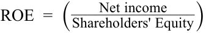

# Volume 4: Financial Statement Analysis
## Learning Module 2 Analyzing Income Statements
### Part 2/4: Expense Recognition (PDF Pages 57–74)

---

<!-- PDF Page 57 -->

assets and liabilities and significant changes in those balances, remaining performance obligations and transaction price allocated to those obligations, and any significant judgments and changes in judgments related to revenue recognition. These disclosures are typically provided in a note to the financial statements titled “Revenue” or similar. 

## **EXPENSE RECOGNITION** 

# **<mark>3</mark>** 

describe general principles of expense recognition, specific expense recognition applications, implications of expense recognition choices for financial analysis and contrast costs that are capitalized versus those that are expensed in the period in which they are incurred 

Assume a company purchased inventory for cash and sold the entire inventory in the same period. When the company paid for the inventory, absent indications to the contrary, it is clear that inventory cost was incurred and when that inventory is sold, it should be recognized as an expense (cost of goods sold). Assume also that the company paid all operating and administrative expenses in cash within each accounting period. In such a simple hypothetical scenario, no issues of expense recognition would arise. In practice, however, as with revenue recognition, determining when expenses should be recognized can be somewhat more complex. 

### **General Principles** 

In general, a company recognizes expenses in the period that it consumes (i.e., uses up) the economic benefits associated with the expenditure, or loses some previously recognized economic benefit. The three common expense recognition models are as follows: the matching principle, expensing as incurred, and capitalization with subsequent depreciation or amortization. 

Under matching, a company recognizes expenses (e.g., cost of goods sold) when associated revenues are recognized, and thus, expenses and revenues are matched. Associated revenues and expenses are those that result directly and jointly from the same transactions or events. Unlike the simple scenario in which a company purchases inventory and sells all of the inventory within the same accounting period, in practice, it is more likely that some of the current period’s sales are made from inventory purchased in a previous period or previous periods. It is also likely that some of the inventory purchased in the current period will remain unsold at the end of the current period and so will be sold in a following period. Matching requires that a company recognizes cost of goods sold in the same period as revenues from the sale of the goods. Strictly speaking, IFRS do not refer to a “matching principle” but rather to a “matching concept” or to a process resulting in “matching of costs with revenues.” 

Example 2 demonstrate matching applied to inventory and cost of goods sold. 

#### **EXAMPLE 2** 

### **The Matching of Inventory Costs with Revenues** 

Kahn Distribution Limited (KDL), a hypothetical company, purchases inventory items for resale. At the beginning of 20X1, Kahn had no inventory on hand. During 20X1, KDL had the following transactions: 

<!-- PDF Page 58 -->

##### **Inventory Purchases** 

|First quarter|2,000|units at USD40 per unit|
|---|---|---|
|Second quarter|1,500|units at USD41 per unit|
|Third quarter|2,200|units at USD43 per unit|
|Fourth quarter|1,900|units at USD45 per unit|
|Total|7,600|units at a total cost of USD321,600|

KDL sold 5,600 units of inventory during the year at USD50 per unit and received cash. KDL determines that there were 2,000 remaining units of inventory and specifically identifies that 1,900 were those purchased in the fourth quarter and 100 were purchased in the third quarter. 

1. What are the revenue and expense associated with these transactions during 20X1 based on specific identification of inventory items as sold or remaining in inventory? (Assume that the company does not expect any products to be returned.) 

#### **Solution:** 

The revenue for 20X1 would be USD280,000 (5,600 units × USD50 per unit). Initially, the total cost of the goods purchased would be recorded as inventory (an asset) in the amount of USD321,600. During 20X1, the cost of the 5,600 units sold would be expensed (matched against the revenue) while the cost of the 2,000 remaining unsold units would remain in inventory as follows: 

##### **Cost of Goods Sold** 

|From the first quarter|2,000 units at USD40 per unit =|USD80,000|
|---|---|---|
|From the second quarter|1,500 units at USD41 per unit =|USD61,500|
|From the third quarter|2,100 units at USD43 per unit =|USD90,300|
|Total cost of goods sold||USD231,800|

|**Cost of Goods Remaining in Inventory**||
|---|---|
|From the third quarter 100 units at USD43 per unit =|USD4,300|
|From the fourth quarter 1,900 units at USD45 per unit =|USD85,500|
|Total remaining (or ending) inventory cost|USD89,800|

To confirm that total costs are accounted for: USD231,800 + USD89,800 = USD321,600. The cost of the goods sold would be expensed against the revenue of USD280,000 as follows: 

|Revenue|USD280,000|
|---|---|
|Cost of Goods Sold|231,800|
|Gross Profit|48,200|

An alternative way to think about this is that the company created an asset (inventory) of USD321,600 as it made its purchases. At the end of the period, the value of the company’s inventory on hand is USD89,800. Therefore, the amount of the Cost of goods sold expense recognized for the period should be the difference: USD231,800. 

The remaining inventory amount of USD89,800 will be matched against revenue in a future year when the inventory items are sold. 

<!-- PDF Page 59 -->

**Period costs** , expenditures that less directly match revenues, are generally expensed as incurred (i.e., either when the company makes the expenditure in cash or incurs the liability to pay). Costs associated with administrative, managerial, information technology (IT), and research and development activities as well as the maintenance or repair of assets generally fit this model. For most companies, payroll expenses are accounted for this way, excluding employees whose compensation is considered a product cost and recognized as inventory and later cost of goods sold or items like sales commissions, which are capitalized and expensed systematically or with sales. 

### **Capitalization versus Expensing** 

Finally, certain expenditures are capitalized as assets on the balance sheet and typically appear as an investing cash outflow on the statement of cash flows. After initial recognition, a company expenses the capitalized amount over the asset’s useful life as depreciation or amortization expense (except assets that are not depreciated, i.e., land, or amortized, e.g., intangible assets with indefinite lives). This expense reduces net income on the income statement and reduces the value of the asset on the balance sheet. Depreciation and amortization are non-cash expenses and therefore, apart from their effect on taxable income and taxes payable, they have no impact on the cash flow statement. 

This model is a form of the matching principle, whereby expenses are recognized on the income statement over the expected useful life of the investment, so the costs and benefits are “matched.” Example 3 illustrates the impact on the financial statements of capitalizing versus expensing an expenditure. 

#### **EXAMPLE 3** 

### **General Financial Statement Impact of Capitalizing versus Expensing** 

Assume two identical (hypothetical) companies, CAP Inc. (CAP) and NOW Inc. (NOW), start with EUR1,000 cash and EUR1,000 common stock. Each year the companies recognize total revenues of EUR1,500 cash and make cash expenditures, excluding an equipment purchase, of EUR500. At the beginning of operations, each company pays EUR900 to purchase equipment. CAP estimates the equipment will have a useful life of three years and an estimated salvage value of EUR0 at the end of the three years. NOW estimates a much shorter useful life and expenses the equipment immediately. The companies have no other assets and make no other asset purchases during the three-year period. Assume the companies pay no dividends, earn zero interest on cash balances, have a tax rate of 30 percent, and use the same accounting method for financial and tax purposes. 

The left side of Exhibit 1 shows CAP’s financial statements—that is, with the expenditure capitalized and depreciated at EUR300 per year based on the straight-line method of depreciation (EUR900 cost minus EUR0 salvage value equals EUR900, divided by a three-year life equals EUR300 per year). The right side of the exhibit shows NOW’s financial statements, with the entire EUR900 expenditure treated as an expense in the first year. All amounts are in euro. 

<!-- PDF Page 60 -->

#### **Exhibit 1: Capitalizing versus Expensing** 

||**CAP**|**Inc.**||||**NOW**|**Inc.**|||
|---|---|---|---|---|---|---|---|---|---|
|**Capitalize E**|**UR900 as**|**Asset and D**|**epreciat**|**e**|**Expe**|**nse EUR9**|**00 Immedia**|**tely**||
|**For Year**|**1**|**2**||**3**|**For Year**|**1**|**2**||**3**|
|Revenue|1,500|1,500||1,500|Revenue|1,500|1,500||1,500|
|Cash Expenses|500|500||500|Cash expenses|1,400|500||500|
|Depreciation|300|300||300|Depreciation|0|0||0|
|Income before|700|700||700|Income before|100|1,000||1,000|
|Tax|||||Tax|||||
|Tax at 30%|210|210||210|Tax at 30%|30|300||300|
|Net Income|490|490||490|Net Income|70|700||700|
|Cash from|790|790||790|Cash from|70|700||700|
|Operations|||||Operations|||||
|Cash Used in Investing|(900)|0||0|Cash Used in Investing|0|0||0|
|Total Change in Cash|(110)|790||790|Total Change in Cash|70|700||700|
|**As of**|**Time 0**|**End of** **Year 1**|**End of** **Year 2**|**End of** **Year 3**|**Time**|**Time 0**|**End of** **Year 1**|**End of** **Year 2**|**End of** **Year 3**|
|Cash|1,000|890|1,680|2,470|Cash|1,000|1,070|1,770|2,470|
|PP&E (net)|—|600|300|—|PP & E (net)|—|—|—|—|
|Total Assets|1,000|1,490|1,980|2,470|Total Assets|1,000|1,070|1,770|2,470|
|Retained Earnings|0|490|980|1,470|Retained Earnings|0|70|770|1,470|
|Common Stock|1,000|1,000|1,000|1,000|Common Stock|1,000|1,000|1,000|1,000|
|Total Shareholders’ Equity|1,000|1,490|1,980|2,470|Total Shareholders’ Equity|1,000|1,070|1,770|2,470|

1. Which company reports higher net income over the three years? Total cash flow? Cash from operations? 

#### **Solution:** 

Neither company reports higher total net income or cash flow over the three years. The sum of net income over the three years is identical (EUR1,470 total) whether the EUR900 is capitalized or expensed. Also, the sum of the change in cash (EUR1,470 total) is identical under either scenario. CAP reports higher cash from operations by an amount of EUR900 because, under the capitalization scenario, the EUR900 purchase is treated as an investing cash flow. 

_Note_ : Because the companies use the same accounting method for both financial and taxable income, absent the assumption of zero interest on cash balances, expensing the EUR900 would have resulted in higher income and cash flow for NOW because the lower taxes paid in the first year (EUR30 versus EUR210) would have allowed NOW to earn interest income on the tax savings. 

<!-- PDF Page 61 -->

2. Based on ROE and net profit margin, how does the profitability of the two companies compare? 

#### **Solution:** 

In general, Ending shareholders’ equity = Beginning shareholders’ equity + Net income + Other comprehensive income – Dividends + Net capital contributions from shareholders. Because the companies in this example do not have other comprehensive income, did not pay dividends, and reported no capital contributions from shareholders, Ending retained earnings = Beginning retained earnings + Net income, and Ending shareholders’ equity = Beginning shareholders’ equity + Net income. 

ROE is calculated as Net income divided by Average shareholders’ equity, and Net profit margin is calculated as Net income divided by Total revenue. For example, CAP had Year 1 ROE of 39 percent (EUR490/[(EUR1,000 + EUR1,490)/2]), and Year 1 net profit margin of 33 percent (EUR490/ EUR1,500). 

||**CAP**|**Inc.**|||**NOW**|**Inc.**|||
|---|---|---|---|---|---|---|---|---|
|**Capitali**|**ze EUR9** **Depre**|**00 as A** **ciate**|**sset a**|**nd**|**Expense EUR9**|**00 Imm**|**ediate**|**ly**|
|**For Year**||**1**|**2**|**3**|**For Year**|**1**|**2**|**3**|
|ROE||39%|28%|22%|ROE|7%|49%|33%|
|Net Profit|i Margin|33%|33%|33%|Net Profit Margin|5%|47%|47%|

As shown, compared to expensing, capitalizing results in higher profitability ratios (ROE and net profit margin) in the first year, and lower profitability ratios in subsequent years. For example, CAP’s Year 1 ROE of 39 percent was higher than NOW’s Year 1 ROE of 7 percent, but in Years 2 and 3, NOW reports superior profitability. 

Note also that NOW’s superior growth in net income between Year 1 and Year 2 is not attributable to superior performance compared to CAP but rather to the accounting decision to recognize the expense sooner than CAP. In general, all else equal, accounting decisions that result in recognizing expenses sooner will give the appearance of greater subsequent growth. Comparison of the growth of the two companies’ net incomes without an awareness of the difference in accounting methods would be misleading. As a corollary, NOW’s income and profitability exhibit greater volatility across the three years, not because of more volatile performance but rather because of the different accounting decision. 

3. Why does NOW report change in cash of EUR70 in Year 1, while CAP reports total change in cash of (EUR110)? 

#### **Solution:** 

NOW reports an increase in cash of EUR70 in Year 1, while CAP reports a decrease in cash of EUR110 because NOW’s taxes were EUR180 lower than CAP’s taxes (EUR30 versus EUR210). 

_Note_ that this problem assumes the accounting method used by each company for its tax purposes is identical to the accounting method used by the company for its financial reporting. In many countries, companies are allowed to use different depreciation methods for financial reporting and taxes, which may give rise to deferred taxes. 

<!-- PDF Page 62 -->

As shown, discretion regarding whether to expense or capitalize expenditures can impede comparability across companies. Example 4 assumes the companies purchase a single asset in one year. Because the sum of net income over the three-year period is identical whether the asset is capitalized or expensed, it illustrates that although capitalizing results in higher profitability compared with expensing in the first year, it results in lower profitability in the subsequent years. Conversely, expensing results in lower profitability in the first year but higher profitability in later years, indicating a favorable trend. 

Similarly, shareholders’ equity for a company that capitalizes the expenditure will be higher in the early years because the initially higher profits result in initially higher retained earnings. Example 4 assumes the companies purchase a single asset in one year and report identical amounts of total net income over the three-year period, so shareholders’ equity (and retained earnings) for the firm that expenses will be identical to shareholders’ equity (and retained earnings) for the capitalizing firm at the end of the three-year period. 

Although Example 3 shows companies purchasing an asset only in the first year, if a company continues to purchase similar or increasing amounts of assets each year, the profitability-enhancing effect of capitalizing continues if the amount of the expenditures in a period continues to be more than the depreciation expense. Example 4 illustrates this point. 

#### **EXAMPLE 4** 

### **Impact of Capitalizing versus Expensing for Ongoing Purchases** 

A company buys a GBP300 computer in Year 1 and capitalizes the expenditure. The computer has a useful life of three years and an expected salvage value of GBP0, so the annual depreciation expense using the straight-line method is GBP100 per year. Compared with expensing the entire GBP300 immediately, the company’s pre-tax profit in Year 1 is GBP200 greater. 

1. Assume that the company continues to buy an identical computer each year at the same price. If the company uses the same accounting treatment for each of the computers, when does the profit-enhancing effect of capitalizing versus expensing end? 

#### **Solution:** 

The profit-enhancing effect of capitalizing versus expensing would end in Year 3. In Year 3, the depreciation expense on each of the three computers bought in Years 1, 2, and 3 would total GBP300 (GBP100 + GBP100 + GBP100). Therefore, the total depreciation expense for Year 3 will be exactly equal to the capital expenditure in Year 3. The expense in Year 3 would be GBP300, regardless of whether the company capitalized or expensed the annual computer purchases. 

2. If the company buys another identical computer in Year 4, using the same accounting treatment as the prior years, what is the effect on Year 4 profits of capitalizing versus expensing these expenditures? 

#### **Solution:** 

There is no impact on Year 4 profits. As in the previous year, the depreciation expense on each of the three computers bought in Years 2, 3, and 4 would total GBP300 (GBP100 + GBP100 + GBP100). Therefore, the total depreciation expense for Year 4 will be exactly equal to the capital expenditure 

<!-- PDF Page 63 -->

in Year 4. Pre-tax profits would be reduced by GBP300, regardless of whether the company capitalized or expensed the annual computer purchases. 

Compared with expensing an expenditure, capitalizing the expenditure typically results in greater amounts reported as cash from operations. Analysts should be alert to evidence of companies manipulating reported cash flow from operations by capitalizing expenditures that should be expensed. 

In summary, holding all else constant, capitalizing an expenditure enhances current profitability and increases reported cash flow from operations. The profitability-enhancing effect of capitalizing continues so long as capital expenditures exceed the depreciation expense. Profitability-enhancing motivations for decisions to capitalize should be considered when analyzing performance. For example, a company may choose to capitalize more expenditures (within the allowable bounds of accounting standards) to achieve earnings targets for a given period. Expensing a cost in the period reduces current period profits but enhances future profitability and thus enhances the profit trend. Profit trend-enhancing motivations should also be considered when analyzing performance. If the company is in a reporting environment that requires identical accounting methods for financial reporting and taxes (unlike the United States, which permits companies to use depreciation methods for reporting purposes that differ from the depreciation method required by tax purposes), then expensing will have a more favorable cash flow impact because paying lower taxes in an earlier period creates an opportunity to earn interest income on the cash saved. 

In contrast with these relatively simple examples, it is generally neither possible nor desirable to identify individual instances involving discretion about whether to capitalize or expense expenditures. An analyst can, however, typically identify significant items of expenditure treated differently across companies. The items of expenditure giving rise to the most relevant differences across companies will vary by industry. This cross-industry variation is apparent in the following discussion of the capitalization of expenditures. 

#### **CAPITALIZATION VERSUS EXPENSING** 

1. All else equal, in the fiscal year when long-lived equipment is purchased: 

   - **A.** depreciation expense increases. 

   - **B.** cash from operations decreases. 

   - **C.** net income is reduced by the amount of the purchase. 

   - **Solution:** 

A is correct. In the fiscal year when long-lived equipment is purchased, the assets on the balance sheet increase and depreciation expense on the income statement increases because of the new long-lived asset. 

2. Companies X and Z have the same beginning-of-the-year book value of equity and the same tax rate. The companies have identical transactions throughout the year and report all transactions similarly except for one. Both companies acquire a GBP300,000 printer with a three-year useful life and a salvage value of GBP0 on 1 January of the new year. Company X capitalizes the printer and depreciates it on a straight-line basis, and Company 

<!-- PDF Page 64 -->

Z expenses the printer. The year-end information in Exhibit 2 is gathered for Company X. 

#### **Exhibit 2: Company X Year-End Information** 

||**Company X as of 31 December**|
|---|---|
|Ending Shareholders’ Equity|GBP10,000,000|
|Tax Rate|25%|
|Dividends|GBP0.00|
|Net Income|GBP750,000|

Based on the information in Exhibit 2, Company Z’s return on equity using year-end equity will be _closest_ to: 

**A.** 5.4 percent. 

- **B.** 6.1 percent. 

**C.** 7.5 percent. 

#### **Solution:** 

B is correct. Company Z’s return on equity based on year-end equity value will be 6.1 percent. Company Z will have an additional GBP200,000 of expenses compared with Company X. Company Z expensed the printer for GBP300,000 rather than capitalizing the printer and having a depreciation expense of GBP100,000 like Company X. Company Z’s net income and shareholders’ equity will be GBP150,000 lower (= GBP200,000 × 0.75) than that of Company X. 

<!-- Formula Text: ROE  =  ( Net income _______________ Shareholders' Equity ) -->

- = _GBP_ 600,00/ _GBP_ 9,850,000 

- = 0.61 = 6.1%. 

The following information relates to questions 3-6. 

Melanie Hart, CFA, is a transportation analyst. Hart has been asked to write a research report on Altai Mountain Rail Company (AMRC). Like other companies in the railroad industry, AMRC’s operations are capital intensive, with significant investments in such long-lived tangible assets as property, plant, and equipment. In November 2008, AMRC’s board of directors hired a new team to manage the company. In reviewing the company’s 2009 annual report, Hart is concerned about some of the accounting choices that the new management has made. These choices differ from those of the previous management and from common industry practice. Hart has highlighted the following statements from the company’s annual report: 

- Statement 1 “In 2009, AMRC spent significant amounts on track replacement and similar improvements. AMRC expensed rather than capitalized a significant proportion of these expenditures.” 

- Statement 2 “AMRC uses the straight-line method of depreciation for both financial and tax reporting purposes to account for plant and equipment.” 

<!-- PDF Page 65 -->

Statement 3 “In 2009, AMRC recognized an impairment loss of EUR50 million on a fleet of locomotives. The impairment loss was reported as ‘other income’ in the income statement and reduced the carrying amount of the assets on the balance sheet.” Exhibit 3 and 4 contain AMRC’s 2009 consolidated income statement and balance sheet. AMRC prepares its financial statements in accordance with International Financial Reporting Standards. 

**Exhibit 3: Consolidated Statement of Income** 

|**For the Years Ended 31 December**|**20** **Euro Millions**|**09** **Revenues (%)**|**20** **Euro Millions**|**08** **Revenues (%)**|
|---|---|---|---|---|
|Operating revenues|2,600|100.0|2,300|100.0|
|Operating expenses|||||
|Depreciation|(200)|(7.7)|(190)|(8.3)|
|Other operating expense|(1,590)|(61.1)|(1,515)|(65.9)|
|Total operating expenses|(1,790)|(68.8)|(1,705)|(74.2)|
|Operating income|810|31.2|595|25.8|
|Other income|(50)|(1.9)|—|0.0|
|Interest expense|(73)|(2.8)|(69)|(3.0)|
|Income before taxes|687|26.5|526|22.8|
|Income taxes|(272)|(10.5)|(198)|(8.6)|
|Net income **Exhibit 4: Consolidated Balance**|415 **Sheet**|16|328|14.2|
|**As of 31 December**|**20**|**09**|**20**|**08**|
|**Assets**|**Euro Millions**|**Assets (%)**|**Euro Millions**||
|Current assets|500|9.4|450|8.5|
|Property and equipment:|||||
|Land|700|13.1|700|13.2|
|Plant and equipment|6,000|112.1|5,800|109.4|
|Total property and equipment|6,700|125.2|6,500|122.6|
|Accumulated depreciation|(1,850)|(34.6)|(1,650)|(31.1)|
|Net property and equipment|4,850|90.6|4,850|91.5|
|Total assets|5,350|100.0|5,300|100.0|
|**Liabilities and Shareholders’** **Equity**|||||
|Current liabilities|480|9.0|430|8.1|
|Long-term debt|1,030|19.3|1,080|20.4|
|Other long-term provisions and|1,240|23.1|1,440|27.2|
|liabilities|||||
|Total liabilities|2,750|51.4|2,950|55.7|

<!-- PDF Page 66 -->

|**Liabilities and Shareholders’** **Equity**|||||
|---|---|---|---|---|
|Shareholders’ equity|||||
|Common stock and paid-in-surplus|760|14.2|760|14.3|
|Retained earnings|1,888|35.5|1,600|30.2|
|Other comprehensive losses|(48)|(0.9)|(10)|(0.2)|
|Total shareholders’ equity|2,600|48.6|2,350|44.3|
|Total liabilities & shareholders’ equity|5,350|100.0|5,300|100.0|

3. With respect to Statement 1, which of the following is the _most likely_ effect of management’s decision to expense rather than capitalize these expenditures? 

   - **A.** 2009 net profit margin is higher than if the expenditures had been capitalized. 

   - **B.** 2009 total asset turnover is lower than if the expenditures had been capitalized. 

   - **C.** Future profit growth will be higher than if the expenditures had been capitalized. 

#### **Solution:** 

C is correct. Expensing rather than capitalizing an investment in long-term assets will result in higher expenses and lower net income and net profit margin in the current year. Future years’ incomes will not include depreciation expense related to these expenditures. Consequently, year-to-year growth in profitability will be higher. If the expenses had been capitalized, the carrying amount of the assets would have been higher and the 2009 total asset turnover would have been lower. 

4. With respect to Statement 2, what would be the _most likely_ effect in 2010 if AMRC were to switch to an accelerated depreciation method for both financial and tax reporting? 

   - **A.** Net profit margin would increase. 

   - **B.** Total asset turnover would decrease. 

   - **C.** Cash flow from operating activities would increase. 

   - **Solution:** 

C is correct. In 2010, switching to an accelerated depreciation method would increase depreciation expense and decrease income before taxes, taxes payable, and net income. Cash flow from operating activities would increase because of the resulting tax savings. 

5. With respect to Statement 3, what is the _most likely_ effect of the impairment loss? 

   - **A.** Net income in years prior to 2009 was likely understated. 

   - **B.** Net profit margins in years after 2009 will likely exceed the 2009 net <u>profit margin.</u> 

<!-- PDF Page 67 -->

|**C.**Cash flow from operating activities in 2009 was likely lower due to the impairment loss. **Solution:**|
|---|
|B is correct. 2009 net income and net profit margin are lower because of the impairment loss. Consequently, net profit margins in subsequent years are likely to be higher. An impairment loss suggests that insufficient deprecia- tion expense was recognized in prior years, and net income was overstated in prior years. The impairment loss is a non-cash item and will not affect operating cash flows.|
|6. Based on Exhibit 1 and 2, the_best estimate_of the average remaining useful life of the company’s plant and equipment at the end of 2009 is:|
|**A.**20.75 years.|
|**B.**24.25 years.|
|**C.**30.00 years. **Solution:**|
|A is correct. The estimated average remaining useful life is 20.75 years.|
|h Estimate of remaining useful life = Net plant and equipment ÷ Annual de- preciation expense|
|Net plant and equipment = Gross P & E – Accumulated depreciation = €6000 – €1850 = €4150|
|Estimate of remaining useful life = Net P & E ÷ Depreciation expense = €4150 ÷ €200 = 20.75|

### **Capitalization of Interest Costs** 

Companies generally must capitalize interest costs associated with acquiring or constructing an asset that requires a long period of time to get ready for its intended use 

As a consequence of this accounting treatment, a company’s interest costs for a period can appear either on the balance sheet (to the extent they are capitalized) or on the income statement (to the extent they are expensed). 

If the interest expenditure is incurred in connection with constructing an asset for the company’s own use, the capitalized interest appears on the balance sheet as a part of the relevant long-lived asset. The capitalized interest is expensed over time as the property is depreciated—and is thus part of depreciation expense rather than interest expense. If the interest expenditure is incurred in connection with constructing an asset to sell, for example, by a real estate construction company, the capitalized interest appears on the company’s balance sheet as part of inventory. The capitalized interest is then expensed as part of the cost of sales when the asset is sold. 

The treatment of capitalized interest poses certain issues that analysts should consider. First, capitalized interest appears as part of investing cash outflows, whereas expensed interest typically reduces operating cash flow. US GAAP–reporting companies are required to categorize interest in operating cash flow, and IFRS-reporting companies can categorize expensed interest in operating, or financing cash flows. Although the treatment is consistent with accounting standards, an analyst may want to examine the impact on reported cash flows. Second, interest coverage ratios are solvency indicators measuring the extent to which a company’s earnings (or cash flow) in a period covered its interest costs. To provide a true picture of a company’s interest coverage, the entire amount of interest expenditure, both the capitalized portion and 

<!-- PDF Page 68 -->

the expensed portion, should be used to calculate interest coverage ratios. Additionally, if a company is depreciating interest that it capitalized in a previous period, income should be adjusted to eliminate the effect of that depreciation. Example 5 illustrates the calculations. 

#### **EXAMPLE 5** 

### **Effect of Capitalized Interest Costs on Coverage Ratios and Cash Flow** 

Melco Resorts & Entertainment Limited (NASDAQ: MLCO), a Hong Kong SAR–based casino company, which is listed on the NASDAQ stock exchange and prepares financial reports under US GAAP, disclosed the following information in one of the footnotes to its 2017 financial statements: “Interest and amortization of deferred financing costs associated with major development and construction projects is capitalized and included in the cost of the project. . . . Total interest expenses incurred amounted to $267,065, $252,600, and $253,168, of which $37,483, $29,033, and $134,838 were capitalized during the years ended December 31, 2017, 2016, and 2015, respectively. Amortization of deferred financing costs of $26,182, $48,345, and $38,511, net of amortization capitalized of nil, nil, and $5,458, were recorded during the years ended December 31, 2017, 2016, and 2015, respectively” (Form 20-F filed 12 April 2018). Cash payments for deferred financing costs were reported in cash flows from financing activities. 

**Exhibit 5: Melco Resorts and Entertainment Limited Selected Data, as Reported (US dollar thousands)** 

||**2017**|**2016**|**2015**|
|---|---|---|---|
|EBIT (from income statement)|544,865|298,663|58,553|
|Interest expense (from income statement)|229,582|223,567|118,330|
|Capitalized interest (from footnote)|37,483|29,033|134,838|
|Amortization of deferred financing costs (from footnote)|26,182|48,345|38,511|
|Net cash provided by operating activities|1,162,500|1,158,128|522,026|
|Net cash from (used) in investing activities|(410,226)|280,604|(469,656)|
|Net cash from (used) in financing activities|(1,046,041)|(1,339,717)|(29,688)|

_Notes:_ EBIT represents “Income (Loss) Before Income Tax” plus “Interest expenses, net of capitalized interest” from the income statement. 

1. Calculate and interpret Melco’s interest coverage ratio with and without capitalized interest. 

#### **Solution:** 

Interest coverage ratios with and without capitalized interest were as follows: 

For 2017 

<!-- PDF Page 69 -->

2.37 (USD544,865 ÷ USD229,582) without adjusting for capitalized interest; and 

2.14 [(USD544,865 + USD26,182) ÷ (USD229,582 + USD37,483)], including an adjustment to EBIT for depreciation of previously capitalized interest and an adjustment to interest expense for the amount of interest capitalized in 2017. 

#### For 2016 

1.34 (USD298,663÷ USD223,567) without adjusting for capitalized interest; and 

1.37 [(USD298,663 + USD48,345) ÷ (USD223,567 + USD29,033)], including an adjustment to EBIT for depreciation of previously capitalized interest and an adjustment to interest expense for the amount of interest capitalized in 2016. 

#### For 2015 

0.49 (USD58,533÷ USD118,330) without adjusting for capitalized interest; and 

0.38 [(USD58,533 + USD38,511) ÷ (USD118,330+ USD134,838)], including an adjustment to EBIT for depreciation of previously capitalized interest and an adjustment to interest expense for the amount of interest capitalized in 2015. 

These calculations indicate that Melco’s interest coverage improved in 2017 compared with the previous two years. In both 2017 and 2015, the coverage ratio was lower when adjusted for capitalized interest. 

2. Calculate Melco’s percentage change in operating cash flow from 2016 to 2017. Assuming the financial reporting does not affect reporting for income taxes, what were the effects of capitalized interest on operating and investing cash flows? 

#### **Solution:** 

If the interest had been expensed rather than capitalized, operating cash flows would have been lower in all three years. On an adjusted basis, but not an unadjusted basis, the company’s operating cash flow declined in 2017 compared with 2016. On an unadjusted basis, for 2017 compared with 2016, Melco’s operating cash flow increased by 0.4 percent in 2017 [(USD1,162,500 ÷ USD1,158,128) – 1]. Including adjustments to expense all interest costs, Melco’s operating cash flow also decreased by 0.4 percent in 2017 {[USD1,162,500 – USD37,483) ÷ (USD1,158,128 – USD29,033)] – 1}. If the interest had been expensed rather than capitalized, financing cash flows would have been higher in all three years. 

The treatment of capitalized interest raises issues for consideration by an analyst. First, capitalized interest appears as part of investing cash outflows, whereas expensed interest reduces operating or financing cash flow under IFRS and operating cash flow under US GAAP. An analyst may want to examine the impact on reported cash flows of interest expenditures when comparing companies. Second, interest coverage ratios are solvency indicators measuring the extent to which a company’s earnings (or cash 

<!-- PDF Page 70 -->

flow) in a period covered its interest costs. To provide a true picture of a company’s interest coverage, the entire amount of interest, both the capitalized portion and the expensed portion, should be used in calculating interest coverage ratios. 

Generally, including capitalized interest in the calculation of interest coverage ratios provides a better assessment of a company’s solvency. In assigning credit ratings, rating agencies include capitalized interest in coverage ratios. For example, Standard & Poor’s calculates the EBIT interest coverage ratio as EBIT divided by gross interest (defined as interest prior to deductions for capitalized interest or interest income). 

Maintaining a minimum interest coverage ratio is a financial covenant often included in lending agreements (e.g., bank loans and bond indentures). The definition of the coverage ratio can be found in the company’s credit agreement. The definition is relevant because treatment of capitalized interest in calculating coverage ratios would affect an assessment of how close a company’s actual ratios are to the levels specified by its financial covenants and thus the probability of breaching those covenants. 

### **Capitalization of Internal Development Costs** 

Accounting standards require companies to capitalize software development costs after a product’s feasibility is established. Despite this requirement, judgment in determining feasibility means that companies’ capitalization practices may differ. For example, as illustrated in Exhibit 6, Microsoft judges product feasibility to be established very shortly before manufacturing begins and, therefore, effectively expenses—rather than capitalizes—research and development costs. 

#### **Exhibit 6: Disclosure on Software Development Costs** 

Excerpt from Management’s Discussion and Analysis (MD&A) of Microsoft Corporation, Application of Critical Accounting Policies, Research and Development Costs: 

Costs incurred internally in researching and developing a computer software product are charged to expense until technological feasibility has been established for the product. Once technological feasibility is established, all software costs are capitalized until the product is available for general release to customers. Judgment is required in determining when technological feasibility of a product is established. We have determined that technological feasibility for our software products is reached after all high-risk development issues have been resolved through coding and testing. Generally, this occurs shortly before the products are released to production. The amortization of these costs is included in cost of revenue over the estimated life of the products. 

_Source:_ Microsoft Corporation, _2017 Annual Report_ on Form 10-K, p. 45. 

Expensing rather than capitalizing development costs results in lower net income in the current period. Expensing rather than capitalizing will continue to result in lower net income so long as the amount of the current-period development expenses is higher than the amortization expense that would have resulted from amortizing prior periods’ capitalized development costs—the typical situation when a company’s development costs are increasing. On the statement of cash flows, expensing rather than capitalizing development costs results in lower net operating cash flows and higher net investing cash flows. This is because the development costs are reflected as operating cash outflows rather than investing cash outflows. 

<!-- PDF Page 71 -->

In comparing the financial performance of a company that expenses most or all software development costs, such as Microsoft, with another company that capitalizes software development costs, adjustments can be made to make the two comparable. For the company that capitalizes software development costs, an analyst can adjust (1) the income statement to include software development costs as an expense and to exclude amortization of prior years’ software development costs; (2) the balance sheet to exclude capitalized software (decrease assets and equity); and (3) the statement of cash flows to decrease operating cash flows and decrease cash used in investing by the amount of the current period development costs. Any ratios that include income, long-lived assets, or cash flow from operations—such as return on equity—also will be affected. 

#### **EXAMPLE 6** 

### **Software Development Costs** 

You are working on a project involving the analysis of JHH Software, a (hypothetical) software development company that established technical feasibility for its first product in 2017. Part of your analysis involves computing certain market-based ratios, which you will use to compare JHH to another company that expenses all of its software development expenditures. Relevant data and excerpts from the company’s annual report are included in Exhibit 7. 

**Exhibit 7: JHH SOFTWARE (US dollar thousands, except per share amounts)** 

|**Consolidated Statement of Earnings—Abbreviated**||||
|---|---|---|---|
|**For Year Ended 31 December:**|**2018**|**2017**|**2016**|
|Total revenue|USD91,424|USD91,134|USD96,293|
|Total operating expenses|78,107|78,908|85,624|
|Operating income|13,317|12,226|10,669|
|Provision for income taxes|3,825|4,232|3,172|
|Net income|USD9,492|USD7,994|USD7,479|
|Earnings per share (EPS)|USD1.40|USD0.82|USD0.68|
|**Statement of Cash Flows—Abbreviated**||||
|**For Year Ended 31 December:**|**2018**|**2017**|**2016**|
|Net cash provided by operating activities|USD15,007|USD14,874|USD15,266|
|Net cash used in investing activities*|(11,549)|(4,423)|(5,346)|
|Net cash used in financing activities|(8,003)|(7,936)|(7,157)|
|i Net change in cash and cash equivalents|(USD4,545)|USD2,515|USD2,763|
|_*Includes software development expenses of and_|_(USD6,000)_|_(USD4,000)_|_(USD2,000)_|
|_includes capital expenditures of_|_(USD2,000)_|_(USD1,600)_|_(USD1,200)_|
|**Additional Information:**||||
|**For Year Ended 31 December:**|**2018**|**2017**|**2016**|
|Market value of outstanding debt|0|0|0|
|Amortization of capitalized software development expenses|(USD2,000)|(USD667)|0|

<!-- PDF Page 72 -->

##### **Additional Information:** 

|**For Year Ended 31 December:**|**2018**|**2017**|**2016**|
|---|---|---|---|
|Depreciation expense|(USD2,200)|(USD1,440)|(USD1,320)|
|Market price per share of common stock|USD42|USD26|USD17|
|Shares of common stock outstanding (thousands)|6,780|9,765|10,999|

_Footnote disclosure of accounting policy for software development: Expenses that are related to the conceptual formulation and design of software products are expensed to research and development as incurred. The company capitalises expenses that are incurred to produce the finished product after technological feasibility has been established._ 

1. Compute the following ratios for JHH based on the reported financial statements for fiscal year ended 31 December 2018, with no adjustments. Next, determine the approximate impact on these ratios if the company had expensed rather than capitalized its investments in software. (Assume the financial reporting does not affect reporting for income taxes. There would be no change in the effective tax rate.) 

   - **A.** P/E: Price/Earnings per share 

   - **B.** P/CFO: Price/Operating cash flow per share 

   - **C.** EV/EBITDA: Enterprise value/EBITDA, where enterprise value is defined as the total market value of all sources of a company’s financing, including equity and debt, and EBITDA is earnings before interest, taxes, depreciation, and amortization. 

#### **Solution:** 

(US dollars are in thousands, except per share amounts.) JHH’s 2019 ratios are presented in the following table: 

||**Ratios**|**As reported**|**As adjusted**|
|---|---|---|---|
|A|P/E ratio|30.0|42.9|
|B|P/CFO|19.0|31.6|
|C|EV/EBITDA|16.3|24.7|

- **A.** Based on the information as reported, the P/E ratio was 30.0 (USD42 ÷ USD1.40). Based on EPS adjusted to expense software development costs, the P/E ratio was 42.9 (USD42 ÷ USD0.98). 

   - Price: Assuming that the market value of the company’s equity is based on its fundamentals, the price per share is USD42, regardless of a difference in accounting. 

EPS: As reported, EPS was USD1.40. Adjusted EPS was USD0.98. Expensing software development costs would have reduced JHH’s 2018 operating income by USD6,000, but the company would have reported no amortization of prior years’ software costs, which would have increased operating income by USD2,000. The net change of USD4,000 would have reduced operating income from the reported USD13,317 to USD9,317. The effective tax rate for 2018 (USD3,825 ÷ USD13,317) is 28.72%, and using this effective tax rate would give an adjusted net income of USD6,641 [USD9,317 × (1 – 0.2872)], 

<!-- PDF Page 73 -->

|compared to USD9,492 before the adjustment. The EPS would there- fore be reduced from the reported USD1.40 to USD0.98 (adjusted net income of USD6,641 divided by 6,780 shares).|
|---|
|**B.**Based on information as reported, the P/CFO was 19.0 (USD42 ÷ USD2.21). Based on CFO adjusted to expense software development costs, the P/CFO was 31.6 (USD42 ÷ USD1.33). Price: Assuming that the market value of the company’s equity is based on its fundamentals, the price per share is USD42, regardless of a difference in accounting.|
|f CFO per share, as reported, was USD2.21 (total operating cash flows USD15,007 ÷ 6,780 shares).|
|CFO per share, as adjusted, was USD1.33. The company’s USD6,000 expenditure on software development costs was reported as a cash outflow from investing activities, so expensing those costs would reduce cash from operating activities by USD6,000, from the reported USD15,007 to USD9,007. Dividing adjusted total operating cash flow of USD9,007 by 6,780 shares results in cash flow per share of USD1.33.|
|l **C.**Based on information as reported, the EV/EBITDA was 16.3 (USD284,760 ÷ USD17,517). Based on EBITDA adjusted to expense software development costs, the EV/EBITDA was 24.7 (USD284,760 ÷ USD11,517).|
|Enterprise Value: Enterprise value is the sum of the market value of the company’s equity and debt. JHH has no debt, and therefore the enterprise value is equal to the market value of its equity. The market value of its equity is USD284,760 (USD42 per share × 6,780 shares). EBITDA, as reported, was USD17,517 (earnings before interest and taxes of USD13,317 plus USD2,200 depreciation plus USD2,000 amortization).|
|EBITDA, adjusted for expensing software development costs by the inclusion of USD6,000 development expense and the exclusion of USD2,000 amortization of prior expense, would be USD11,517 (earn- ings before interest and taxes of USD9,317 plus USD2,200 deprecia- tion plus USD0 amortization).|
|2. Interpret the changes in the ratios. **Solution:**|

|Expensing software development costs would decrease historical profits,|
|---|
|i operating cash flow, and EBITDA, and would thus increase all market multi-|
|l ples. So JHH’s stock would appear to be more expensive if it expensed rather|
|than capitalized the software development costs.|
|If the unadjusted market-based ratios were used in the comparison of JHH|
|to its competitor that expenses all software development expenditures, then|
|JHH might appear to be under-priced when the difference is solely related|
|f to accounting factors. JHH’s adjusted market-based ratios provide a better|
|basis for comparison.|

For the company in Example 6, current period software development expenditures exceed the amortization of prior periods’ capitalized software development expenditures. As a result, expensing rather than capitalizing software development costs would have the effect of lowering income. If, however, software development expenditures 

<!-- PDF Page 74 -->

slowed such that current expenditures were lower than the amortization of prior periods’ capitalized software development expenditures, then expensing software development costs would have the effect of increasing income relative to capitalizing it. This section illustrated how decisions about capitalizing versus expensing affect financial statements and ratios. Earlier expensing lowers current profits but enhances trends, whereas capitalizing now and expensing later enhances current profits. Having described the accounting for acquisition of long-lived assets, we now turn to the topic of measuring long-lived assets in subsequent periods. 

### **Implications for Financial Analysts: Expense Recognition** 

As with revenue recognition policies, a company’s choice of expense recognition can be characterized by its relative conservatism. A policy that results in recognition of expenses later rather than sooner is considered less conservative. In addition, many items of expense require the company to make estimates that can significantly affect net income. Analysis of a company’s financial statements, and particularly comparison of one company’s financial statements with those of another, requires an understanding of differences in these estimates and their potential impact. 

If, for example, a company shows a significant year-to-year change in its estimates of uncollectible accounts as a percentage of sales, warranty expenses as a percentage of sales, or estimated useful lives of assets, the analyst should seek to understand the underlying reasons. Do the changes reflect a change in business operations (e.g., lower estimated warranty expenses reflecting recent experience of fewer warranty claims because of improved product quality)? Or are the changes seemingly unrelated to changes in business operations and thus possibly a signal that a company is manipulating estimates to achieve a particular effect on its reported net income? 

As another example, if two companies in the same industry have dramatically different estimates for uncollectible accounts as a percentage of their sales, warranty expenses as a percentage of sales, or estimated useful lives as a percentage of assets, it is important to understand the underlying reasons. Are the differences consistent with differences in the two companies’ business operations (e.g., lower uncollectible accounts for one company reflecting a different, more creditworthy customer base or possibly stricter credit policies)? Another difference consistent with differences in business operations would be a difference in estimated useful lives of assets if one of the companies employs newer equipment. Or, alternatively, are the differences seemingly inconsistent with differences in the two companies’ business operations, possibly signaling that a company is manipulating estimates? 

Information about a company’s accounting policies and significant estimates are described in the notes to the financial statements and in the management discussion and analysis section of a company’s annual report. 

When possible, the monetary effect of differences in expense recognition policies and estimates can facilitate more meaningful comparisons with a single company’s historical performance or across a number of companies. An analyst can use the monetary effect to adjust the reported expenses so that they are on a comparable basis. 

Even when the monetary effects of differences in policies and estimates cannot be calculated, it is generally possible to characterize the relative conservatism of the policies and estimates and, therefore, to qualitatively assess how such differences might affect reported expenses and thus financial ratios. 

