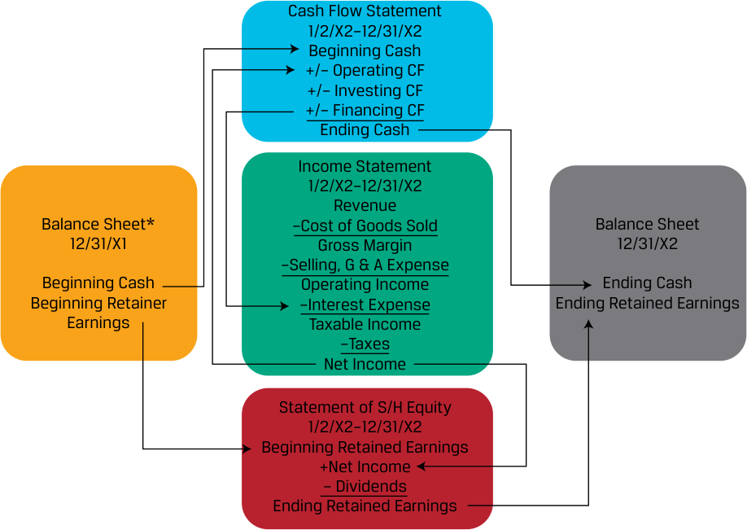

# Volume 4: Financial Statement Analysis
## Learning Module 4 Analyzing Statements of Cash Flows I
### Part 1/3: Introduction (PDF Pages 135–148)

---

<!-- PDF Page 135 -->

#### L E A R N I N G M O D U L E 

# **<mark>4</mark>** 

### **Analyzing Statements of Cash Flows I** 

**by Elaine Henry, PhD, CFA, Thomas R Robinson, PhD, CFA, CAIA, J. Hennie van Greuning, DCom, CFA, and Michael A Broihahn, CPA, CIA, CFA.** 

_Elaine Henry, PhD, CFA, is at Stevens Institute of Technology (USA). Thomas R. Robinson, PhD, CFA, CAIA, Robinson Global Investment Management LLC, (USA). J. Hennie van Greuning, DCom, CFA, is at BIBD (Brunei). Michael A. Broihahn, CPA, CIA, CFA, is at Barry University (USA)._ 

###### **<mark>LEARNING OUTCOMES</mark>** 

**_Mastery The candidate should be able to:_** describe how the cash flow statement is linked to the income statement and the balance sheet describe the steps in the preparation of direct and indirect cash flow statements, including how cash flows can be computed using income statement and balance sheet data demonstrate the conversion of cash flows from the indirect to direct method contrast cash flow statements prepared under International Financial Reporting Standards (IFRS) and US generally accepted accounting principles (US GAAP) 

The two major accounting standard setters are as follows: 1) the International Accounting Standards Board (IASB) who establishes International Financial Reporting Standards (IFRS) and 2) the Financial Accounting Standards Board (FASB) who establishes US GAAP. Throughout this learning module both standards are referred to and many, but not all, of these two sets of accounting rules are identified. Note: changes in accounting standards as well as new rulings and/or pronouncements issued after the publication of this learning module may cause some of the information to become dated. 

<!-- PDF Page 136 -->

## **<mark>1</mark>** 

##### **INTRODUCTION** 

The statement of cash flows provides important information about a company’s cash receipts and cash payments during an accounting period, reconciling the cash accounts between balance sheet dates. Although the income statement provides similar measures on an accrual basis, cash flows and their timing are crucial to valuation as payments to investors are made in cash. Investors also use statement of cash flows to evaluate the company’s liquidity, solvency, and financial flexibility. In this module, we discuss the components of the cash flow statement and its links to the other financial statements. 

###### **LEARNING MODULE OVERVIEW** 

- Understanding the interrelationships among the balance sheet, income statement, and cash flow statement is useful not only in evaluating the company’s financial health but also in detecting accounting irregularities. 

- The income statement and statement of cash flows provide key linkages between the current assets and current liabilities sections of the balance sheet. 

- Companies can use either the direct or the indirect method for reporting their operating cash flow: 

- The direct method discloses operating cash inflows by source (e.g., cash received from customers, cash received from investment income) and operating cash outflows by use (e.g., cash paid to suppliers, cash paid for interest) in the operating activities section of the cash flow statement. 

- The indirect method reconciles net income to operating cash flow by adjusting net income for all non-cash items and the net changes in working capital accounts. 

- Although the indirect method is most common, an analyst may desire to review direct-format operating cash flow to review trends in cash receipts and payments, such as cash received from customers or cash paid to suppliers. 

- Cash flows from operating activities reported under the indirect method can generally be converted to an approximation of the direct format by following a simple three-step process. 

- Cash flows from investing activities and from financing activities are both reported using a direct method, regardless of the method used for reporting operating cash flows. 

- Compared with US GAAP, the International Financial Reporting Standards (IFRS) allow more flexibility in the classification of items as operating, investing, or financing activities, such as interest paid or received and dividends paid or received and in how income tax expense is classified. 

<!-- PDF Page 137 -->

##### **LINKAGES BETWEEN THE FINANCIAL STATEMENTS** 

## **<mark>2</mark>** 

describe how the cash flow statement is linked to the income statement and the balance sheet 

###### **Primary Financial Statements** 

Recall that the four primary financial statements are interrelated and each provides specific information to analysts about an entity. The primary financial statements are as follows: 

**1.** Balance Sheet—shows the financial position of an entity _at a point in time_ , reporting the balances of “permanent” or “stock” accounts showing the entity’s assets and how those assets are financed. 

**2.** Income Statement—provides information about a company’s financial performance between balance sheet dates. The income statement is made up of revenue, expense, gain, and loss accounts. In contrast to the balance sheet, the income statement is a “flow” statement as it captures income activity between two balance sheet dates. Income statements prepared under IFRS or US GAAP are based on accrual accounting, so they do not necessarily reflect cash inflows and outflows. 

**3.** Statement of Cash Flows—reports the change in an entity’s cash, cash equivalents, and restricted cash between balance sheet dates. The statement classifies cash inflows and outflows during the period as operating, investing, or financing activities. Because the cash flow statement reports performance over a period of time, it is also a “flow” statement, like the income statement. 

**4.** Statement of Shareholder’s Equity—provides information about how a company’s equity has changed between balance sheet dates. The statement identifies the significant components of shareholders equity that are reported on the balance sheet (e.g., common stock and retained earnings) and the activities that occurred during the period that impacted these accounts (e.g., share issuance, net income or loss). Like the income statement and statement of cash flows, the statement of shareholders equity is also a “flow” statement. 

###### **Relationship between Financial Statements** 

As illustrated in Exhibit 1, the income statement, cash flow statement and statement of shareholders’ equity link the balance sheet from one period to the next. 

<!-- PDF Page 138 -->

**Exhibit 1: Relationship between the Financial Statements** 

<!-- Start of picture text -->
Period of Time Point in Time Point in Time Income Statement 1/1/X2–12/31/X2 Cash Flow Balance Sheet Balance Sheet Statement 12/31/X1 12/31/X2 1/1/X2–12/31/X2 Statement of S/H Equity 1/1/X2–12/31/X2 <!-- End of picture text -->

For example, the beginning and ending balances of cash are shown on the company’s 20X1 and 20X2 balance sheets, and the bottom of the 20X2 cash flow statement reconciles 20X1 cash to 20X2 cash. The relationship, stated in general terms, is as shown in Exhibit 2. 

**Exhibit 2: Beginning and Ending Balances** 

|**Balance Sheet at**|**Statement of Cash Flows for Year**|**Balance Sheet at**|
|---|---|---|
|**31 December 20X1**|**Ended 31 December 20X2**|**31 December 20X2**|
|**Beginning cash**|Plus: Cash inflows (from oper- i Less: Cash outflows (for oper- i|**Ending cash**|
|**(as of Year-end 31**|l ating, investing, and financing l ating, investing, and financing|**(as of Year-end 31**|
|**December 20x1)**|i activities) i activities)|**December 20x2)**|

Exhibit 3 adds greater detail to Exhibit 1, tracing specific linkages through the four financial statements. 

<!-- PDF Page 139 -->

**Exhibit 3: Interaction of Financial Statement Accounts** 

<!-- Start of picture text -->
Cash Flow Statement 1/2/X2–12/31/X2 Beginning Cash +/– Operating CF +/– Investing CF +/– Financing CF Ending Cash Income Statement 1/2/X2–12/31/X2 Revenue Balance Sheet* –Cost of Goods Sold Balance Sheet 12/31/X1 Gross Margin 12/31/X2 –Selling, G & A Expense Beginning Cash Operating Income Ending Cash Beginning Retainer –Interest Expense Ending Retained Earnings Earnings Taxable Income –Taxes Net Income Statement of S/H Equity 1/2/X2–12/31/X2 Beginning Retained Earnings +Net Income – Dividends Ending Retained Earnings <!-- End of picture text -->

For example, the 20X2 statement of shareholders’ equity reconciles the equity accounts reported on 20X1 balance sheet to the equity accounts reported on the 20X2 balance sheet, including additions (or subtractions) resulting from net income or loss reported on the income statement and dividends paid that are also reported on the statement of cash flows if made in cash. 

###### **Linkages Between Current Assets and Current Liabilities** 

The income statement and statement of cash flows also provide key linkages between the current assets and current liabilities sections of the balance sheet. Differences between the accrual and cash accounting recognition of operating activities result in an increase or decrease in a current asset or liability on the balance sheet. For example, accrual basis revenue in excess of cash collections will be accompanied by an increase in accounts receivable. If expenses reported using accrual accounting are lower than cash actually paid, the result will typically be a decrease in accounts payable or another accrued liability account. Finally, in situations in which a company is paid in advance for the delivery of a service or product in the future, it will recognize the cash received as an asset, but it also must recognize a liability for its obligation to deliver service or product in the future, typically referred to as deferred revenue. A deferred revenue liability account is derecognized upon the recognition of revenue when the entity satisfies its performance obligations. 

If an analyst knows beginning accounts receivable, revenues, and cash collected from customers, they can compute ending accounts receivable, as the accounts are linked as shown in Exhibit 4. 

<!-- PDF Page 140 -->

###### **Exhibit 4: Ending Accounts Receivable** 

|||**Statement of Cash Flows for**||
|---|---|---|---|
|**Beginning Balance Sheet at**|**Income Statement for Year**|**Year**|**Ending Balance Sheet at**|
|**31 December 20X1**|**Ended 31 December 20X2**|**Ended 31 December 20X2**|**31 December 20X2**|
|Beginning accounts|Plus: Revenues|Minus: Cash collected from|Equals: Ending accounts|
|receivable||customers|receivable|

Understanding the interrelationships among the balance sheet, income statement, and cash flow statement is useful not only in evaluating the company’s financial health but also in detecting accounting irregularities. Recall the extreme illustration of a hypothetical company that makes sales on account without regard to future collections and thus reports healthy sales and significant income on its income statement yet lacks cash inflow. Such a pattern would occur if a company improperly recognized revenue. 

Example 1–Example 4 demonstrate how common business transactions affect a company’s balance sheet, income statement, and statement of cash flows. Notice how all three financial statements are needed to fully account for the transactions. 

###### **EXAMPLE 1** 

###### **Inventory Purchase and Sale Impact on Financial Statements** 

Assume fictional company ABC, a retailer, purchases USD100 of inventory on 1 January 1, 20X1 on credit with payment due to its supplier in 30 days. On 1 February, ABC sells the product to Customer X for USD150 with payment due by 16 February, 20X1. Customer X pays for the product on 15 February, 20X1. 

This series of transaction would affect ABC’s financial statements as follows shown in Exhibit 5. 

###### **Exhibit 5: ABC’s Financial Statements** 

|**Date**|**Balance Sheet**|**Income Statement**|**Statement of Cash Flows**|
|---|---|---|---|
|1 January|Inventory (asset) increases by USD100 Accounts Payable (liability) increases by USD100|N/A|N/A|
|30 January|Cash (asset) decreases by USD100 Accounts Payable (liability) decreases by USD100|N/A|Cash flows from operating activities decreases by USD100|
|1 February|Accounts Receivable (asset) increases by USD150 Inventory (asset) decreases by USD100|Revenue increases by USD150 Cost of sales increases by USD100|N/A|
|15 February|Cash (asset) increases by USD150 Accounts receivable (asset) decreases byUSD150||Cash flows from operating activities increases by USD150|

Note the statement of cash flows is affected only when the company pays or receives cash, which differs from recognition on the income statement. 

<!-- PDF Page 141 -->

###### **EXAMPLE 2** 

###### **Depreciation Impact on Financial Statements** 

On 1 January, fictional company Notion Ltd, a manufacturing company, owns USD100 of equipment used in the production of a product that is sold to wholesale customers. The equipment has a 10-year life and no salvage value. Notion uses straight-line depreciation, so the annual depreciation expense is USD10. On 1 July, Notion Ltd. makes a new capital investment for a different piece of equipment with a purchase price of USD200 and annual depreciation expense of USD50. Notion Ltd. pays for the equipment in cash upon receipt. Depreciation expense is recorded at the end of the fiscal year. The impact on Notion Ltd.’s financial statements is summarized in Exhibit 6. 

**Exhibit 6: Notion Ltd. Financial Statement** 

|**Date**|**Balance Sheet**|**Income** **Statement**|**Statement of Cash** **Flows**|
|---|---|---|---|
|1 January|Equipment (asset) of USD100|N/A|N/A|
|1 July|Equipment (asset) increases by USD200 Cash (asset) decreases by USD200|N/A|Cash flows from investing activi- ties decreases by USD200|
|31|Accumulated|Depreciation|N/A|
|December|Depreciation (contra asset) increases by USD35|expense increases by USD35||

###### **EXAMPLE 3** 

###### **Borrowing Impact on Financial Statements** 

On 31 March, fictional Geneva Company borrows USD500 from Stockholm Bank (also fictional). The terms of the loan are interest accrues at 10 percent and payment is due along with principal upon maturity of the loan on 30 September. Accordingly, Geneva is to pay USD525 to Stockholm Bank on 30 September consisting of USD500 in loan principal and USD25 of interest (USD500 loan × 10% × ½ year.) The impact on Geneva’s financial statements is summarized in Exhibit 7. 

<!-- PDF Page 142 -->

**Exhibit 7: Geneva Financial Statement** 

|**Date**|**Balance Sheet**|**Income** **Statement**|**Statement of Cash** **Flows**|
|---|---|---|---|
|31 March|Cash (asset) increases by USD500 Loans payable (lia- bility) increases by USD500|N/A|Cash flows from financing activities increases by USD500|
|30 September|Cash (asset) decreases by USD525 Loans payable (lia-|Interest expense increases by|Cash flows from financing or operating activities decreases by|
||bility) decreases by USD500|USD25|USD25 Cash flows from financing activities decreases by USD500|

###### **EXAMPLE 4** 

###### **Equipment Purchase Impact on Financial Statements** 

Assume Mountain Company, a fictional manufacturer, agrees to produce a custom-made piece of equipment for Cirrus Corp. (another fictional company) in two months for a sales price of USD1,000. On 1 October, Cirrus provides Mountain with a down payment of USD300 from Cirrus and agrees to pay the balance of USD700 when the equipment is delivered on 30 November. Mountain Company recognizes deferred revenue when it receives the USD300 on 1 October, which will be derecognized when Mountain fulfills its obligation and delivers the equipment. The impact on Mountain Company’s financial statement is summarized in Exhibit 8. 

**Exhibit 8: Mountain Company Financial Statement** 

|**Date**|**Balance Sheet**|**Income** **Statement**|**Statement of Cash** **Flows**|
|---|---|---|---|
|1 October|Cash (asset) increases by USD300 Deferred revenue (liability) increases by USD300|N/A|Cash flows from operating activities increases by USD300|
|30 September|Cash (asset) increases by USD700 Deferred revenue (liability) decreases by USD300|Revenue increases by USD1,000|Cash flows from operating activities increases by USD700|

<!-- PDF Page 143 -->

##### **THE DIRECT METHOD FOR CASH FLOWS FROM OPERATING ACTIVITIES** 

## **<mark>3</mark>** 

describe the steps in the preparation of direct and indirect cash flow statements, including how cash flows can be computed using income statement and balance sheet data 

The first step in preparing the cash flow statement is to determine cash flows from operating activities, which can be presented using the direct or indirect method. The direct method uses the major categories of gross cash receipts and payments, and the indirect method reconciles net income to net cash flow. Cash flows from investing activities and from financing activities are identical regardless of whether the direct or indirect method is used to present operating cash flows. 

- Companies often disclose only indirect operating cash flow information but understanding how cash flow information is put together will enable you to take an indirect statement apart and reconfigure it to approximate a direct cash flow statement, which—while not perfectly accurate—can be useful. This lesson demonstrates the approximate preparation of a direct cash flow statement using the income statement and the comparative balance sheets for Acme Corporation (a fictitious retail company) shown in Exhibit 9 and Exhibit 10. 

###### **Exhibit 9: Acme Corporation Income Statement Year Ended 31 December 2018** 

|Revenue (net)||USD23,598|
|---|---|---|
|Cost of goods sold||11,456|
|Gross profit||12,142|
|i Salary and wage expense|USD4,123||
|Depreciation expense|1,052||
|Other operating expenses|3,577||
|Total operating expenses||8,752|
|Operating profit||3,390|
|i Other revenues (expenses):|||
|Gain on sale of equipment|205||
|Interest expense|(246)|(41)|
|Income before tax||3,349|
|Income tax expense||1,139|
|Net income||USD2,210|

###### **Exhibit 10: Acme Corporation Comparative Balance Sheets 31 December 2018 and 2017** 

||**2018**|**2017**|**Net Change**|
|---|---|---|---|
|Cash|USD1,011|USD1,163|USD(152)|

<!-- PDF Page 144 -->

|Accounts receivable|1,012|957|55|
|---|---|---|---|
|Inventory|3,984|3,277|707|
|Prepaid expenses|155|178|(23)|
|Total current assets|6,162|5,575|587|
|Land|510|510|—|
|Buildings|3,680|3,680|—|
|Equipment*|8,798|8,555|243|
|Less: accumulated depreciation|(3,443)|(2,891)|(552)|
|Total long-term assets|9,545|9,854|(309)|
|Total assets|USD15,707|USD15,429|USD278|
|Accounts payable|USD3,588|USD3,325|USD263|
|Salary and wage payable|85|75|10|
|Interest payable|62|74|(12)|
|Income tax payable|55|50|5|
|Other accrued liabilities|1,126|1,104|22|
|Total current liabilities|4,916|4,628|288|
|Long-term debt|3,075|3,575|(500)|
|Common stock|3,750|4,350|(600)|
|Retained earnings|3,966|2,876|1,090|
|Total liabilities and equity|USD15,707|USD15,429|USD278|

_* During 2018, Acme purchased new equipment for a total cost of $1,300. No items impacted retained earnings other than net income and dividends._ 

###### **Operating Activities: Direct Method** 

We first determine how much cash Acme received from its customers (sometimes referred to as “cash collections”), followed by how much cash was paid to suppliers and to employees, as well as how much cash was paid for other operating expenses, interest, and income taxes. 

###### **_Cash Received From Customers_** 

The income statement for Acme reported revenue of USD23,598 for the year ended 31 December 2018. To determine the approximate cash receipts from its customers, it is necessary to adjust this revenue amount by the net change in accounts receivable for the year. If accounts receivable increase during the year, revenue on an accrual basis is higher than cash receipts from customers, and vice versa. For Acme Corporation, accounts receivable increased by USD55, so cash received from customers was USD23,543, as shown in Exhibit 11. 

**Exhibit 11: Cash Received from Customers** 

|Revenue|USD23,598|
|---|---|
|Less: Increase in accounts receivable|(USD55)|
|Cash received from customers|**USD23,543**|

<!-- PDF Page 145 -->

Cash received from customers affects the accounts receivable account as shown in Exhibit 12. 

###### **Exhibit 12: Effect on Accounts Receivable, 1** 

|Beginning accounts receivable|957|
|---|---|
|Plus revenue|23,598|
|Minus cash collected from customers|**(23,543)**|
|Ending accounts receivable|USD1,012|

The accounts receivable account information can also be presented as shown in Exhibit 13. 

**Exhibit 13: Effect on Accounts Receivable, 2** 

|Beginning accounts receivable|USD957|
|---|---|
|Plus revenue|23,598|
|Minus ending accounts receivable|(1,012)|
|Cash collected from customers|**USD23,543**|

Acme did not have any deferred or unearned revenue. If it did, further adjustment would be required to arrive at cash collected from customers (a decrease in deferred revenue would be a negative adjustment and vice versa). 

###### **EXAMPLE 5** 

###### **Computing Cash Received from Customers** 

1. Blue Bayou, a fictitious advertising company, reported revenues of USD50 million, total expenses of USD35 million, and net income of USD15 million in the most recent year. If accounts receivable decreased by USD12 million, how much cash did the company receive from customers? 

   - **A.** USD38 million 

   - **B.** USD50 million 

   - **C.** USD62 million 

   - **Solution:** 

C is correct. Revenues of USD50 million plus the decrease in accounts receivable of USD12 million equals USD62 million cash received from customers. The decrease in accounts receivable means that the company received more in cash than the amount of revenue it reported. 

###### **_Cash Paid to Suppliers_** 

For Acme, the cash paid to suppliers was USD11,900, determined as shown in Exhibit 14. 

<!-- PDF Page 146 -->

**Exhibit 14: Cash Paid to Suppliers** 

|Cost of goods sold|USD11,456|
|---|---|
|Plus: Increase in inventory|707|
|Equals purchases from suppliers|USD12,163|
|Less: Increase in accounts payable|(263)|
|Cash paid to suppliers|**USD11,900**|

There are two pieces to this calculation: the amount of inventory purchased and the amount paid for it. To determine purchases from suppliers, cost of goods sold is adjusted for the change in inventory. If inventory increased during the year, then purchases during the year exceeded cost of goods sold, and vice versa. Acme reported cost of goods sold of USD11,456 for the year ended 31 December 2018. For Acme Corporation, inventory increased by USD707, so purchases from suppliers was USD12,163. Purchases from suppliers affect the inventory account, as shown in Exhibit 15. 

**Exhibit 15: Effect on Inventory** 

|Beginning inventory|USD3,277|
|---|---|
|Plus purchases|12,163|
|Minus cost of goods sold|(11,456)|
|Ending inventory|USD3,984|

Acme purchased USD12,163 of inventory from suppliers in 2018, but is this the amount of cash that Acme paid to its suppliers during the year? Not necessarily. Acme may not have yet paid for all of these purchases and may yet owe for some of the purchases made this year. In other words, Acme may have paid less cash to its suppliers than the amount of this year’s purchases, in which case Acme’s liability (accounts payable) will have increased by the difference. Alternatively, Acme may have paid even more to its suppliers than the amount of this year’s purchases, in which case Acme’s accounts payable will have decreased. 

Therefore, once purchases have been determined, cash paid to suppliers can be calculated by adjusting purchases for the change in accounts payable. If the company made all purchases with cash, then accounts payable would not change and cash outflows would equal purchases. If accounts payable increased during the year, then purchases on an accrual basis would be higher than they would be on a cash basis, and vice versa. In this example, Acme made more purchases than it paid in cash, so the balance in accounts payable increased. For Acme, the cash paid to suppliers was USD11,900, determined as shown in Exhibit 16. 

**Exhibit 16: Cash Paid to Suppliers** 

|Purchases from suppliers|USD12,163|
|---|---|
|Less: Increase in accounts payable|(263)|
|Cashpaid to suppliers|**USD11,900**|

The amount of cash paid to suppliers is reflected in the accounts payable account, as shown in Exhibit 17. 

<!-- PDF Page 147 -->

###### **Exhibit 17: Cash Paid to Suppliers** 

|Beginning accounts payable|USD3,325|
|---|---|
|Plus purchases|12,163|
|Minus cash paid to suppliers|**(11,900)**|
|Ending accounts payable|USD3,588|

###### **EXAMPLE 6** 

###### **Computing Cash Paid to Suppliers** 

1. Orange Beverages Plc., a fictitious manufacturer of tropical drinks, reported cost of goods sold for the year of USD100 million. Total assets increased by USD55 million, but inventory declined by USD6 million. Total liabilities increased by USD45 million, but accounts payable decreased by USD2 million. How much cash did the company pay to its suppliers during the year? 

   - **A.** USD96 million 

   - **B.** USD104 million 

   - **C.** USD108 million 

###### **Solution:** 

A is correct. Cost of goods sold of USD100 million less the decrease in inventory of USD6 million equals purchases from suppliers of USD94 million. The decrease in accounts payable of USD2 million means that the company paid USD96 million in cash (USD94 million plus USD2 million). 

###### **_Cash Paid to Employees_** 

To determine the cash paid to employees, it is necessary to adjust salary and wage expenses by the net change in salary and wages payable for the year. If salary and wages payable increased during the year, then salary and wage expenses on an accrual basis would be higher than the amount of cash paid for this expense, and vice versa. For Acme, salary and wages payable increased by USD10, so cash paid for salary and wages was USD4,113, as shown in Exhibit 18. 

###### **Exhibit 18: Salary and Wages** 

|Salary and wages expense|USD4,123|
|---|---|
|Less: Increase in salary and wages payable|(10)|
|Cash paid to employees|**USD4,113**|

The amount of cash paid to employees is reflected in the salary and wages payable account, as shown in Exhibit 19. 

###### **Exhibit 19: Cash Paid to Employees** 

|Beginning salary and wages payable|USD75|
|---|---|
|Plus salary and wages expense|4,123|

<!-- PDF Page 148 -->

|Minus cash paid to employees|**(4,113)**|
|---|---|
|Ending salary and wages payable|USD85|

###### **_Cash Paid for Other Operating Expenses_** 

To determine the cash paid for other operating expenses, it is necessary to adjust the other operating expense amounts on the income statement by the net changes in prepaid expenses and accrued expense liabilities for the year. If prepaid expenses increased during the year, other operating expenses on a cash basis would be higher than on an accrual basis, and vice versa. Likewise, if accrued expense liabilities increased during the year, other operating expenses on a cash basis would be lower than on an accrual basis, and vice versa. For Acme Corporation, the amount of cash paid for operating expenses in 2018 was USD3,532, as shown in Exhibit 20. 

**Exhibit 20: Cash Paid for Operating Expenses** 

|Other operating expenses|USD3,577|
|---|---|
|Less: Decrease in prepaid expenses|(23)|
|Less: Increase in other accrued liabilities|(22)|
|Cash paid for other operating expenses|**USD3,532**|

###### **EXAMPLE 7** 

###### **Computing Cash Paid for Other Operating Expenses** 

1. Black Ice, a fictitious sportswear manufacturer, reported other operating expenses of USD30 million. Prepaid insurance expense increased by USD4 million, and accrued utilities payable decreased by USD7 million. Insurance and utilities are the only two components of other operating expenses. How much cash did the company pay in other operating expenses? 

   - **A.** USD19 million 

   - **B.** USD33 million 

   - **C.** USD41 million 

   - **Solution:** 

C is correct. Other operating expenses of USD30 million plus the increase in prepaid insurance expense of USD4 million plus the decrease in accrued utilities payable of USD7 million equals USD41 million. 

###### **_Cash Paid for Interest_** 

The cash paid for interest is included in operating cash flows under US GAAP and may be included in operating or financing cash flows under IFRS. To determine the cash paid for interest, it is necessary to adjust interest expense by the net change in interest payable for the year. If interest payable increases during the year, then interest expense on an accrual basis will be higher than the amount of cash paid for interest, and vice versa. For Acme Corporation, interest payable decreased by USD12, and cash paid for interest was USD258, as shown in Exhibit 21. 

