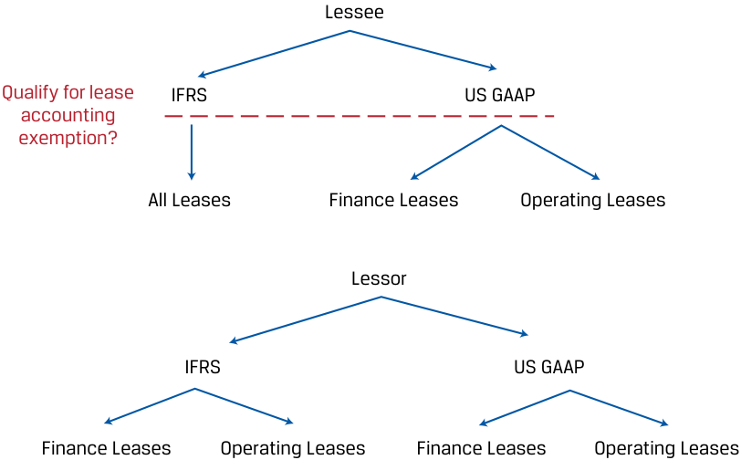

# Volume 4: Financial Statement Analysis
## Learning Module 8 Topics in Long-Term Liabilities and Equity
### Part 1/3: Introduction (PDF Pages 253–264)

---

<!-- PDF Page 253 -->

#### L E A R N I N G M O D U L E 

# **<mark>8</mark>** 

### **Topics in Long-Term Liabilities and Equity** 

###### **by Elizabeth A. Gordon, PhD, MBA, and Elaine Henrik, Phd, CFA.** 

_Elizabeth A. Gordon, PhD, MBA, CPA, is at Temple University (USA), and Elaine Henrik, Phd, CFA, is at Stevens Institute of Technology (USA)._ 

###### **<mark>LEARNING OUTCOMES</mark>** 

|**_Mastery_**|**_The candidate should be able to:_**|
|---|---|
||explain the financial reporting of leases from the perspectives of lessors and lessees|
||explain the financial reporting of defined contribution, defined benefit, and stock-based compensation plans|
||i describe the financial statement presentation of and disclosures relating to long-term liabilities and share-based compensation|

The two major accounting standard setters are as follows: 1) the International Accounting Standards Board (IASB) who establishes International Financial Reporting Standards (IFRS) and 2) the Financial Accounting Standards Board (FASB) who establishes US GAAP. Throughout this learning module both standards are referred to and many, but not all, of these two sets of accounting rules are identified. Note: changes in accounting standards as well as new rulings and/or pronouncements issued after the publication of this learning module may cause some of the information to become dated. 

<!-- PDF Page 254 -->

## **<mark>1</mark>** 

##### **INTRODUCTION** 

Non-current liabilities arise from different sources of financing and different types of creditors. While the financial reporting of bonds and loans is straightforward and is covered in the prerequisite materials, the reporting of leases and postemployment liabilities is more complex. Leases are an alternative to asset ownership and have become a common means of financing real estate and capital equipment. Postretirement and stock-based compensation are a large and growing share of employee compensation and operating expenses. Given their importance, this learning module introduces the reporting of leases, pension plans, and stock-based compensation under International Financial Reporting Standards (IFRS) and US GAAP. It concludes by reviewing the presentation and disclosure requirements for these items. 

###### **LEARNING MODULE OVERVIEW** 

- Leasing has several advantages over purchasing an asset outright: less upfront cash commitment, typically low financing costs, and lower risks associated with ownership, such as obsolescence. 

- Under IFRS and US GAAP, leases are classified as operating or finance leases. Finance leases resemble an asset purchase or sale while operating leases resemble a rental agreement. 

- The financial reporting of a lease depends on whether the party is the lessee or lessor, whether the party reports with IFRS or US GAAP, and the classification of the lease as finance or operating. 

- US GAAP and IFRS share the same accounting treatment for lessors but differ slightly for lessees. IFRS has a single accounting model for both operating leases and finance lease lessees, while US GAAP has an accounting model for each. 

- Two types of pension plans are defined contribution plans and defined benefits plans. In a defined contribution plan, the amount of employer contribution into the plan is specified (i.e., defined) and the amount of pension that is ultimately paid by the plan (received by the retiree) depends on the performance of the plan’s assets. In a defined benefit plan, the amount of pension that is ultimately paid by the plan (received by the retiree) is defined, usually according to a benefit formula. 

- In a defined contribution plan, employees bear investment risks (i.e., the potential for investment returns on plan assets to differ from expectations) and actuarial risks (i.e. the potential for retirement and death timing to differ from expectations). In a defined benefit plan, employers bear both investment and actuarial risks. 

- Under a defined contribution pension plan, the cash payment made into the plan is recognized as pension expense. 

- For defined benefit pension plans, companies must report the difference between the defined benefit pension obligation and the fair value of pension assets as an asset or liability on the balance sheet. An underfunded defined benefit pension plan is shown as a non-current liability. The change in the net asset or liability between balance sheet dates is recognized as a cost of the period, with service cost and net interest expense or income recognized in profit and loss and 

<!-- PDF Page 255 -->

- remeasurement changes recognized in other comprehensive income. There are modest differences in accounting treatment under US GAAP. 

- ■ Employee compensation packages are structured to fulfill various objectives, including satisfying employees’ needs for liquidity, retaining employees, and providing incentives to employees. 

- ■ Share-based compensation serves to align employees’ interests with those of the shareholders. It typically includes stock grants and stock options, which have the advantage of requiring no current-period cash outlays. Stock-based compensation is measured using fair value at the grant date and recognized as compensation expense over the vesting period. 

- ■ The valuation technique, or option pricing model, that a company uses is an important choice in determining fair value of options used in a compensation agreement and is disclosed in the notes to financial statements. Key inputs into option pricing models include such items as exercise price, stock price volatility, estimated life of each award, estimated number of options that will be forfeited, dividend yield, and the risk-free rate of interest. 

##### **LEASES** 

**<mark>2</mark>** 

explain the financial reporting of leases from the perspectives of lessors and lessees 

Firms typically acquire the rights to use assets by outright purchase. As an alternative, a lease is a contract that conveys the right to use an asset for a period of time in exchange for consideration. The party who uses the asset and pays the consideration is the **lessee** , and the party who owns the asset, grants the right to use the asset, and receives consideration is the **lessor** . 

Leasing is a way to obtain the benefits of the asset without purchasing it outright. From the perspective of a lessee, it is a form of financing that resembles acquiring an asset with a note payable. From the perspective of a lessor, a lease is a form of investment and can also be an effective selling strategy, because customers generally prefer to pay in installments. 

After reviewing the contractual requirements for a lease, this lesson examines the advantages and classification of leases and their financial reporting. 

###### **Requirements for Lease Accounting** 

For a contract to be a lease or contain a lease, it must 

- identify a specific underlying asset; 

- give the customer the right to obtain largely all of the economic benefits from the asset over the contract term; and 

- give the customer, not the supplier, the ability to direct how and for what objective the underlying asset is used. 

<!-- PDF Page 256 -->

For example, a contract between a customer and a trucking company is a lease if the contract identifies a specific truck, allows the customer exclusive use of it during the contract term, and lets the customer direct its use. If, however, the customer contracts with a trucking company to ship goods for a fee, the contract would not be a lease, because a specific truck is not identified nor does the customer obtain largely all of the economic benefits from the truck over the contract term. 

###### **Examples of Leases** 

Leasing is among the most prevalent forms of financing. Most companies are lessees of real estate and information technology assets. In 2014, the International Accounting Standards Board found that more than 14,000 publicly listed companies were lessees and that they owed more than USD3.3 trillion in future lease payments in aggregate.1 Exhibit 1 illustrates several examples of these arrangements. 

**Exhibit 1: Examples of Leases** 

|**Lessee**|**Lease Disclosure Excerpt**|
|---|---|
|Alibaba|“The Company entered into operating lease agreements pri- marily for shops and malls, offices, warehouses, and land.”|
|Copa Airlines|“The Company leases some aircraft under long-term lease agreements with an average duration of 10 years. Other leased assets include real estate, airport and terminal facili- ties, sales offices, maintenance facilities, and general offices.”|
|Meta (formerly Facebook)|“We have entered into various non-cancelable operating lease agreements for certain of our offices, data center, land, colocations, and equipment.”|
|Standard Bank|“The group leases various offices, branch space, and ATM space.”|

_Sources:_ Companies’ 2020 and 2019 annual reports. 

Lessors are often real estate investment companies or banks, although there are independent specialist leasing companies, such as AerCap Holdings N.V., which describes itself as “the global leader in aircraft leasing.” As of 30 June 2022, the company owned 1,557 passenger aircraft that are leased to airlines.2 

###### **Advantages of Leasing** 

There are several advantages to leasing an asset compared with purchasing it: 

- Less cash is needed up front. Leases typically require little, if any, down payment. 

- Cost effectiveness: Leases are a form of secured borrowing; in the event of non-payment, the lessor simply repossesses the leased asset. As a result, the effective interest rate for a lease is typically lower than what the lessee would pay on an unsecured loan or bond. 

> 1 IFRS, “IASB Shines Light on Leases by Bringing Them onto the Balance Sheet,” 13 January 2016, www .ifrs .org/ news -and -events/ 2016/ 01/ iasb -shines -light -on -leases -by -bringing -them -onto -the -balance -sheet. 2 AerCap Holdings N.V. annual report for the fiscal year ended 31 December 31 2019 on Form 20-F. 

<!-- PDF Page 257 -->

- Convenience and lower risks associated with asset ownership, such as obsolescence.3 

From the perspective of a lessor, leasing has advantages over selling outright, which include earning interest income over the lease term and increasing the addressable market for its product by offering customers the ability to use or control an asset while paying smaller amounts over time. 

###### **Lease Classification as Finance or Operating** 

Leases can resemble either the purchase of an asset or a rental contract. For example, a ten-year lease of an automobile with a ten-year useful life for monthly payments that, in aggregate, are equal to or greater than the fair value of the automobile is effectively a debt-financed purchase of that automobile. In contrast, a one-year lease of a machine with a twenty-year useful life resembles a rental contract. A lease that resembles a purchase is classified as a **finance lease** . All other leases are **operating leases** . 

More specifically, a lease is a finance lease if _any_ of the following five criteria are met. These criteria are the same for IFRS and US GAAP. If _none_ of the criteria are met, the lease is an operating lease. The same criteria are used by lessees and lessors in classifying a lease. 

**1.** The lease transfers ownership of the underlying asset to the lessee. 

**2.** The lessee has an option to purchase the underlying asset and is reasonably certain it will do so. 

**3.** The lease term is for a major part of the asset’s useful life. 

**4.** The present value of the sum of the lease payments equals or exceeds substantially all of the fair value of the asset. 

**5.** The underlying asset has no alternative use to the lessor. 

###### **EXAMPLE 1** 

###### **Lease Identification and Classification** 

Company C enters a contract with Company D that requires Company C to pay JPY100 million at the end of each of the next two years to Company D for exclusive use of a specific machine over that time period. The present value of the payments is JPY186 million. At the end of the contract, Company C will return the machine to Company D. The contract does not contain a purchase option. The machine can be used in many applications by many types of customers. The remaining useful life of the machine is four years, and its fair value is JPY190 million. 

1. This contract is: 

**A.** not a lease. 

**B.** an operating lease. 

**C.** a finance lease. 

###### **Solution:** 

C is correct. This contract is a lease because a specific asset is identified, Company C will exclusively use it, and Company C _will_ have the ability to direct its use. The contract is a finance lease because one of the five criteria 

<!-- PDF Page 258 -->

is met: The present value of the lease payments equals substantially all of the fair value (186/190 = 98%). 

2. If the fair value of the machine in question 1 was JPY300 million, would the classification of the contract change? 

**A.** No 

- **B.** Yes, from an operating lease to a finance lease 

- **C.** Yes, from a finance lease to an operating lease 

- **Solution:** 

C is correct. This change would result in the lease not meeting any of the five criteria for a finance lease. If a lease does not meet any of the five criteria, it is an operating lease. 

###### **Financial Reporting of Leases** 

The financial reporting of a lease depends on whether the party is the lessee or lessor, whether the party reports with IFRS or US GAAP, and the classification of the lease as finance or operating. Additionally, for lessees, there are lease accounting exemptions for certain lease contracts: If its term is 12 months or less (IFRS and US GAAP) or it is for a “low-value asset,” up to USD5,000 in sales price (IFRS only), then the lessee can elect to simply expense the lease payments on a straight-line basis. These exemptions are not available to lessors. Exhibit 2 illustrates the different permutations for lease accounting. 

**Exhibit 2: Lease Classifications for Lessee and Lessor** 

<!-- Start of picture text -->
Lessee Qualify for lease IFRS US GAAP accounting exemption? All Leases Finance Leases Operating Leases Lessor IFRS US GAAP Finance Leases Operating Leases Finance Leases Operating Leases <!-- End of picture text -->

Fortunately, lessor accounting under both IFRS and US GAAP is substantially identical, and the differences in treatment for lessees are modest. 

<!-- PDF Page 259 -->

###### **Lessee Accounting—IFRS** 

Under IFRS, there is a single accounting model for both finance and operating leases for lessees. At lease inception, the lessee records a lease payable liability and a right-of-use (ROU) asset on its balance sheet, both equal to the present value of future lease payments. The discount rate used in the present value calculation is either the rate implicit in the lease or an estimated secured borrowing rate. 

The lease liability is subsequently reduced by each lease payment using the effective interest method. Each lease payment is composed of interest expense, which is the product of the lease liability and the discount rate, and principal repayment, which is the difference between the interest expense and lease payment. 

The ROU asset is subsequently amortized, often on a straight-line basis, over the lease term. So, although the lease liability and ROU asset begin with the same carrying value on the balance sheet, they typically diverge in subsequent periods because the principal repayment that reduces the lease liability and the amortization expense that reduces the ROU asset are calculated differently. 

The following list shows how the transaction affects the financial statements: 

- The lease liability net of principal repayments and the ROU asset net of accumulated amortization are reported on the balance sheet. 

- Interest expense on the lease liability and the amortization expense related to the ROU asset are reported separately on the income statement. 

- The principal repayment component of the lease payment is reported as a cash outflow under financing activities on the statement of cash flows, and depending on the lessee’s reporting policies, interest expense is reported under either operating or financing activities on the statement of cash flows. 

###### **EXAMPLE 2** 

###### **Lease Impact on Balance Sheet and Income Statement** 

Proton Enterprises, a hypothetical manufacturer based in Germany, is offered the following terms to lease a machine: five-year lease with an implied interest rate of 10 percent and an annual lease payment of EUR100,000 per year payable at the end of each year. The present value of the machinery is therefore EUR379,079 (in Microsoft Excel, the formula is =PV(10%,5,-100,000). The asset will be amortized over the five-year lease term on a straight-line basis. Proton reports under IFRS. 

1. What would be the impact of this lease on Proton’s balance sheet at the beginning of the year? 

###### **Solution:** 

Proton would report a EUR379,079 lease liability and ROU asset. 

2. What would be the impact of this lease on Proton’s income statement during the following year? 

###### **Solution:** 

Interest expense and amortization expense are reported on the income statement. In Year 2, interest expense is EUR31,699 and amortization expense is EUR 75,816, as illustrated in the following tables: 

<!-- PDF Page 260 -->

||**Lease** **Payment**|**Interest Expense** **(10% × Lease** **Liability)**|**Principal Repayment** **(Payment – Interest)**|**Lease** **Liability**|
|---|---|---|---|---|
||FO.1|FO.2|FO.3|FO.4|
|Year 0||||379,079|
|Year 1|100,000|37,908|62,092|316,987|
|Year 2|100,000|31,699|68,301|248,685|
|Year 3|100,000|24,869|75,131|173,554|
|Year 4|100,000|17,355|82,645|90,909|
|Year 5|100,000|9,091|90,909|0|
|Total|500,000|120,921|379,079||

||**Amortization Expense**|**ROU Asset**|
|---|---|---|
||Straight-Line F.1|F.2|
|Year 0||379,079|
|Year 1|75,816|303,263|
|Year 2|75,816|227,447|
|Year 3|75,816|151,631|
|Year 4|75,816|75,816|
|Year 5|75,816|0|
|Total|379,079||

_Note:_ Totals may not sum due to rounding. 

3. What would be the impact of this lease on Proton’s statement of cash flows during the following year? 

###### **Solution:** 

Principal repayments are reported as a cash outflow under financing activities on the statement of cash flows, and depending on Proton’s reporting policies, interest expense is reported under operating or financing activities on the statement of cash flows. From the previous tables, Year 2 principal repayment is EUR68,301 and interest expense is EUR31,699, for a total of EUR100,000. 

###### **Lessee Accounting—US GAAP** 

Under US GAAP, there are two accounting models for lessees: one for finance leases and another for operating leases. The finance lease accounting model is identical to the lessee accounting model for IFRS. The operating lease accounting model is different. 

At operating lease inception, the lessee records a lease payable liability and a corresponding right-of-use asset on its balance sheet that are subsequently reduced by the principal repayment component of the lease payment and amortization, respectively, in the same manner that an IFRS lessee would. 

The key difference between an operating lease and a finance lease is how the amortization of the ROU asset is calculated. For an operating lease, the lessee’s ROU asset amortization expense is the lease payment minus the interest expense. The implication is that the total expense reported on the income statement (interest plus 

<!-- PDF Page 261 -->

amortization) will equal the lease payment and that the lease liability and the ROU asset will always equal each other because the principal repayment and amortization are calculated in an identical manner. 

The following list shows how the transaction appears on the financial statements: 

- The lease liability net of principal repayments and the ROU asset net of accumulated amortization are reported on the balance sheet. 

- Interest expense on the lease liability and the amortization expense related to the ROU asset are reported as a single line titled “lease expense” as an operating expense on the income statement. The interest and amortization components are _not_ reported separately, nor are they grouped with other types of interest and amortization expense (e.g., interest on a bond, amortization of an intangible asset). 

- The entire lease payment is reported as a cash outflow under operating activities on the statement of cash flows. The interest and principal repayment components are _not_ reported separately. 

###### **EXAMPLE 3** 

###### **Lessee Accounting—Operating Lease under US GAAP** 

Consider the differences in accounting if Proton Enterprises classified the lease of the machinery from Example 2 as an operating lease. 

1. How would its financial statements differ, if at all? 

###### **Solution:** 

The first step is to construct the lease liability and ROU asset amortization tables under an operating lease scenario. The lease liability amortization is the same as the finance lease columns FO.1–FO.4 in Example 2. 

||**Amortization Expense** **(Lease Payment – Interest)**|**ROU Asset**|**Lease Expense** **(Amortization + Interest)**|
|---|---|---|---|
||0.1|0.2|0.3|
|Year 0||379,079||
|Year 1|62,092|316,987|100,000|
|Year 2|68,301|248,685|100,000|
|Year 3|75,131|173,554|100,000|
|Year 4|82,645|90,909|100,000|
|Year 5|90,909|0|100,000|
|Total|379,078||500,000|

Now we can compare the financial statement impacts under both finance and operating lease scenarios. 

|**Balance Sheet**|**Year 1**|**Year 2**|**Year 3**|**Year 4**|**Year 5**|
|---|---|---|---|---|---|
|_Finance lease:_||||||
|ROU asset, net: F.2|303,263|227,447|151,631|75,816|0|
|Lease liability, net: FO.4|316,987|248,685|173,554|90,909|0|
|_Operating lease:_||||||

<!-- PDF Page 262 -->

|**Balance Sheet**|**Year 1**|**Year 2**|**Year 3**|**Year 4**|**Year 5**|
|---|---|---|---|---|---|
|ROU asset, net: O.2|316,987|248,685|173,554|90,909|0|
|Lease liability, net: FO.4|316,987|248,685|173,554|90,909|0|

The ROU asset is lower in each period under a finance lease because the amortization expense is higher. 

|**Income Statement**|**Year 1**|**Year 2**|**Year 3**|**Year 4**|**Year 5**|
|---|---|---|---|---|---|
|_Finance lease:_||||||
|Amortization: F.1|75,816|75,816|75,816|75,816|75,816|
|Interest: FO.2|37,908|31,699|24,869|17,355|9,091|
|Total|113,724|107,515|100,685|93,171|84,907|
|_Operating lease:_||||||
|Lease expense: O.3|100,000|100,000|100,000|100,000|100,000|

Total expense is higher for a finance lease in Years 1–3 but lower in Years 4 and 5. The largest difference is classification; amortization and interest are presented separately for a finance lease, whereas operating lease expense is an operating expense. 

|**Statement of** **Cash Flows**|**Year 1**|**Year 2**|**Year 3**|**Year 4**|**Year 5**|
|---|---|---|---|---|---|
|_Finance lease:_||||||
|Cash flow||||||
|l from operating activities|(37,908)|(31,699)|(24,869)|(17,355)|(9,091)|
|Cash flow from financing activities|(62,902)|(68,301)|(75,131)|(82,645)|(90,909)|
|i Total|(100,000)|(100,000)|(100,000)|(100,000)|(100,000)|
|_Operating lease:_||||||
|Cash flows||||||
|l from operating activities|(100,000)|(100,000)|(100,000)|(100,000)|(100,000)|

The difference on the statement of cash flows is only in classification, because in both cases the total cash outflow is equal to the lease payment. 

2. How would the classification, all else equal, affect EBITDA margin, total asset turnover, and cash flow per share? **Solution:** 

The following table shows how the classification affects the indicated financial ratios. 

<!-- PDF Page 263 -->

|**Ratio**|**Formula**|**Impact of Using an Operating** **Lease Instead of a Finance** **Lease**|
|---|---|---|
|EBITDA margin|EBITDA ___________ Total revenues|Lower: Lease expense is clas- sified as an operating expense rather than interest and amortization.|
|Asset turnover|Total revenues ___________ Total assets|Lower: Total assets are higher under an operating lease because the ROU asset is amortized at a slower pace in Years 1–3.|
|Cash flow per share|Cash flow from operations ____________________ Shares outstanding|Lower: Cash flow from operations is lower because the entire lease payment is included in operating activities versus solely interest expense for a finance lease.|

###### **Lessor Accounting** 

The accounting for lessors is substantially identical under IFRS and US GAAP. Under both accounting standards, lessors classify leases as finance or operating leases, which determines the financial reporting. Although lessors under US GAAP recognize finance leases as either “sales-type” or “direct financing,” the distinction is immaterial from an analyst’s perspective. 

At finance lease inception, the lessor recognizes a lease receivable asset equal to the present value of future lease payments and de-recognizes the leased asset, simultaneously recognizing any difference as a gain or loss. The discount rate used in the present value calculation is the rate implicit in the lease. 

The lease receivable is subsequently reduced by each lease payment using the effective interest method. Each lease payment is composed of interest income, which is the product of the lease receivable and the discount rate, and principal proceeds, which equals the difference between the interest income and cash receipt. 

The transaction affects the financial statements in the following ways: 

- Lease receivable net of principal proceeds is reported on the balance sheet. 

- Interest income is reported on the income statement. If leasing is a primary business activity for the entity, as it commonly is for financial institutions and independent leasing companies, it is reported as revenue. 

- The entire cash receipt is reported under operating activities on the statement of cash flows. 

The accounting treatment for an operating lease is different: because the contract is essentially a rental agreement, the lessor keeps the leased asset on its books and recognizes lease revenue on a straight-line basis. Interest revenue is not recognized because the transaction is not considered a financing. The transaction affects the financial statements in the following ways: 

- The balance sheet is not affected. The lessor continues to recognize the leased asset at cost net of accumulated depreciation. 

- Lease revenue is recognized on a straight-line basis on the income statement. Depreciation expense continues to be recognized. 

<!-- PDF Page 264 -->

- The entire cash receipt is reported under operating activities on the statement of cash flows. This is the same as a finance lease. 

###### **EXAMPLE 4** 

###### **Lessor Accounting** 

Let’s examine Proton’s machine lease from Example 2 and Example 3 from the perspective of the lessor. Assume that the carrying value of the asset immediately prior to the lease is EUR350,000, accumulated depreciation is zero, and the lessor elects to depreciate it on a straight-line basis over five years. 

1. How are the lessor’s financial statements affected by the classification of the lease as a finance or operating lease? 

###### **Solution:** 

The difference on the balance sheet is material, because a finance lease requires the lessor to de-recognize the asset and recognize a lease receivable, whereas an operating lease lessor continues to recognize the asset and depreciate it over its useful life. In this case, where the present value of the lease payments is well above the carrying value of the asset, the finance lease classification results in a significant increase in assets. 

|**Balance Sheet**|**Year 1**|**Year 2**|**Year 3**|**Year 4**|**Year 5**|
|---|---|---|---|---|---|
|_Finance lease:_||||||
|Lease receivable, net|316,987|248,685|173,554|90,909|0|
|_Operating lease:_||||||
|Property, plant, and equip- ment, net|280,000|210,000|140,000|70,000|0|

The difference on the income statement is also material, because a finance lease lessor recognizes interest revenue under the effective interest method whereas the operating lease lessor recognizes straight-line lease revenue. 

|**Income Statement**|**Year 1**|**Year 2**|**Year 3**|**Year 4**|**Year 5**|
|---|---|---|---|---|---|
|_Finance lease:_||||||
|Interest revenue|37,908|31,699|24,869|17,355|9,091|
|_Operating lease:_||||||
|Lease revenue|100,000|100,000|100,000|100,000|100,000|

The statement of cash flows, however, is no different for the lessor under a finance or operating lease: The entire cash inflow from the lease payment is recognized under operating activities. 

|**Statement of Cash** **Flows**|**Year 1**|**Year 2**|**Year 3**|**Year 4**|**Year 5**|
|---|---|---|---|---|---|
|_Finance lease:_||||||
|Cash flows from operat-||||||
|l ing activities|100,000|100,000|100,000|100,000|100,000|

