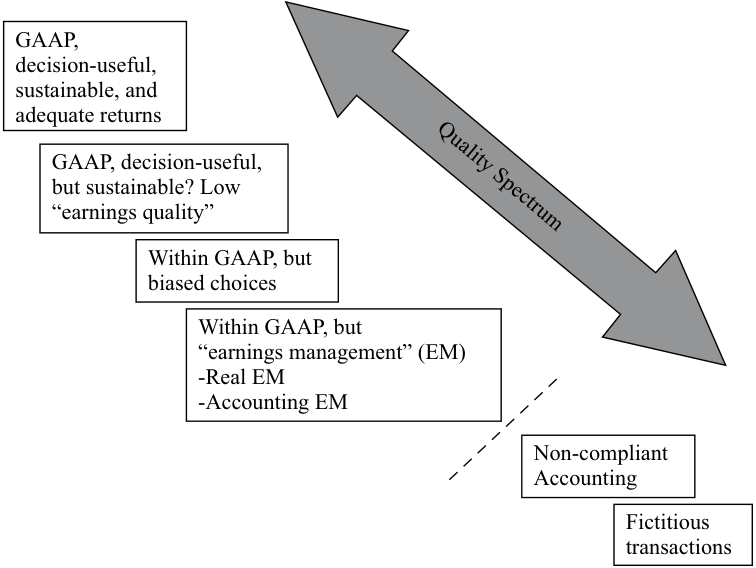

# Volume 4: Financial Statement Analysis
## Learning Module 10 Financial Reporting Quality
### Part 1/6: Introduction (PDF Pages 323–338)

---

<!-- PDF Page 323 -->

#### L E A R N I N G M O D U L E 

# **<mark>10</mark>** 

### **Financial Reporting Quality** 

**by Jack T. Ciesielski, CPA, CFA, Elaine Henry, PhD, CFA, and Thomas I. Selling, PhD, CPA.** 

_Jack T. Ciesielski, CPA, CFA, is at R.G. Associates, Inc., former publisher of The Analyst’s Accounting Observer (USA). Elaine Henry, PhD, CFA, is at Stevens Institute of Technology (USA). Thomas I. Selling, PhD, CPA, is at the Cox School of Business, Southern Methodist University (USA)._ 

###### **<mark>LEARNING OUTCOMES</mark>** 

|**_Mastery_**|**_The candidate should be able to:_**|
|---|---|
||compare financial reporting quality with the quality of reported results (including quality of earnings, cash flow, and balance sheet items)|
||describe a spectrum for assessing financial reporting quality|
||explain the difference between conservative and aggressive accounting i|
||describe motivations that might cause management to issue financial reports that are not high quality and conditions that are conducive to issuing low-quality, or even fraudulent, financial reports|
||describe mechanisms that discipline financial reporting quality and the potential limitations of those mechanisms|
||describe presentation choices, including non-GAAP measures, that could be used to influence an analyst’s opinion|
||describe accounting methods (choices and estimates) that could be used to manage earnings, cash flow, and balance sheet items|
||describe accounting warning signs and methods for detecting manipulation of information in financial reports|

The two major accounting standard setters are as follows: 1) the International Accounting Standards Board (IASB) who establishes International Financial Reporting Standards (IFRS) and 2) the Financial Accounting Standards Board (FASB) who establishes US GAAP. Throughout this learning module both standards are referred to and many, but not all, of these two sets of accounting rules are identified. Note: changes in accounting standards as well as new rulings and/or pronouncements issued after the publication of this learning module may cause some of the information to become dated. 

<!-- PDF Page 324 -->

## **<mark>1</mark>** 

##### **INTRODUCTION** 

Financial reporting quality varies across companies. The ability to assess the quality of a company’s financial reporting is an important skill for analysts. Indications of low-quality financial reporting can prompt an analyst to maintain heightened skepticism when reading a company’s reports, to review disclosures critically when undertaking financial statement analysis, and to incorporate appropriate adjustments in assessments of past performance and forecasts of future performance. 

###### **LEARNING MODULE OVERVIEW** 

- Financial reporting quality can be thought of as spanning a continuum. Reporting of the highest quality contains information that is relevant, correct, complete, and unbiased, whereas the lowest quality reporting contains information that is not just biased or incomplete but possibly pure fabrication. 

- Reporting quality, the focus of this module, pertains to the quality of the information disclosed. High-quality reporting represents the economic reality of the company’s activities during the reporting period and the company’s financial condition at the end of the period. 

- Results quality (commonly referred to as earnings quality) pertains to the earnings and cash generated by the company’s actual economic activities and the resulting financial condition, relative to expectations of current and future financial performance. Quality earnings can be regarded as more sustainable, providing a sound platform for forecasts. 

- An aspect of financial reporting quality is the degree to which accounting choices are conservative or aggressive. “Aggressive” typically refers to choices that aim to enhance the company’s reported performance and financial position by inflating the amount of revenues, earnings, and/or operating cash flow reported in the period; or by decreasing expenses for the period and/or the amount of debt reported on the balance sheet. 

- Conservatism in financial reports can result from either (1) accounting standards that specifically require a conservative treatment of a transaction or an event or (2) judgments made by managers when applying accounting standards that result in conservative results. 

- Managers may be motivated to issue less-than-high-quality financial reports to mask poor performance, boost the company’s stock price, to increase personal compensation, and/or to avoid violation of debt covenants. 

- Conditions that are conducive to the issuance of low-quality financial reports include a cultural environment that result in fewer or less transparent financial disclosures, book/tax conformity that shifts emphasis toward legal compliance and away from fair presentation, and limited capital markets regulation. 

- Mechanisms that discipline financial reporting quality include open capital markets and incentives for companies to minimize cost of capital, independent auditors, contract provisions specifically tailored to <u>penalize misreporting, and enforcement by regulatory entities.</u> 

<!-- PDF Page 325 -->

- Pro forma earnings (also commonly referred to as non-GAAP or non-IFRS earnings) adjust earnings as reported on the income statement. Pro forma earnings that exclude negative items are a hallmark of aggressive presentation choices. 

- ■ Companies are required to make additional disclosures when presenting any non-GAAP or non-IFRS metric. 

- ■ Managers’ considerable flexibility in choosing their companies’ accounting policies and in formulating estimates provides opportunities for aggressive accounting. 

- ■ Examples of accounting choices that affect earnings and balance sheets include inventory cost flow assumptions, estimates of uncollectible accounts receivable, estimated realizability of deferred tax assets, depreciation method, estimated salvage value of depreciable assets, and estimated useful life of depreciable assets. 

- ■ Cash flow from operations is an important metric for investors that can be enhanced by management’s operating choices, such as stretching accounts payable, and potentially by classification choices. 

##### **CONCEPTUAL OVERVIEW** 

**<mark>2</mark>** 

compare financial reporting quality with the quality of reported results (including quality of earnings, cash flow, and balance sheet items) 

Ideally, analysts would always have access to financial reports that are based on sound financial reporting standards, such as those from the International Accounting Standards Board (IASB) and the Financial Accounting Standards Board (FASB), and that are free from manipulation. But, in practice, the quality of financial reports can vary greatly. High-quality financial reporting provides information that is useful to analysts in assessing a company’s performance and prospects. Low-quality financial reporting contains inaccurate, misleading, or incomplete information. 

Extreme lapses in financial reporting quality have given rise to high-profile scandals that resulted not only in investor losses but also in reduced confidence in the financial system. Financial statement users who were able to accurately assess financial reporting quality were better positioned to avoid losses. These lapses illustrate the challenges analysts face as well as the potential costs of failing to recognize practices that result in misleading or inaccurate financial reports.1 Examples of misreporting can provide an analyst with insight into various signals that may indicate poor-quality financial reports. 

This module addresses _financial reporting quality_ , which pertains to the quality of information in financial reports, including disclosures in notes. High-quality reporting provides decision-useful information, which is relevant and faithfully represents the economic reality of the company’s activities during the reporting period as well as the company’s financial condition at the end of the period. A separate but interrelated 

> 1 In this module, the examples of misleading or inaccurate financial reports occurred in prior years— _not_ because there are no current examples of questionable financial reporting, but rather because it has been conclusively resolved that misreporting occurred in the historical examples. 

<!-- PDF Page 326 -->

attribute of quality is _quality of reported results_ or _earnings quality_ , which pertains to the earnings and cash generated by the company’s actual economic activities and the resulting financial condition. The term “earnings quality” is commonly used in practice and will be used broadly to encompass the quality of earnings, cash flow, or balance sheet items. High-quality earnings result from activities that a company likely will be able to sustain in the future and provide a sufficient return on the company’s investment. The concepts of earnings quality and financial reporting quality are interrelated because a correct assessment of earnings quality is possible only when there is some basic level of financial reporting quality. Beyond this basic level, as the quality of reporting increases, the ability of financial statement users to correctly assess earnings quality and to develop expectations for future performance also increases. 

After providing a conceptual overview of reporting quality, this module discusses motivations that might cause, and conditions that might enable, management to issue financial reports that are not high quality and mechanisms that aim to provide discipline to financial reporting quality. We also describe choices made by management that can affect financial reporting quality—presentation choices, accounting methods, and estimates—as well as warning signs of poor-quality financial reporting. 

###### **Conceptual Overview** 

Financial reporting quality and results or earnings quality are interrelated attributes of quality. Exhibit 1 illustrates this interrelationship and its implications. 

**Exhibit 1: Relationships between Financial Reporting Quality and Earnings Quality** 

|||**Financial Repo**|**rting Quality**|
|---|---|---|---|
|||**Low**|**High**|
|**Earnings** **Rl**|High|LOW financial reporting quality impedes assessment of|HIGH financialreporting quality enables assessment. HIGHearningsquality increases companyvalue.|
|**(esuts)** **Quality**|Low|earnings quality and impedes valuation.|HIGH financialreporting quality enables assessment. LOWearningsquality decreases company value.|

As shown in Exhibit 1, if financial reporting quality is low, the information provided is of little use in assessing the company’s performance, and thus in making investment and other decisions. 

Financial reporting quality varies across companies. High-quality reports contain information that is relevant, complete, neutral, and free from error. The lowest-quality reports contain information that is pure fabrication. Earnings (results) quality can range from high and sustainable to low and unsustainable. Providers of resources prefer high and sustainable earnings. Combining the two measures of quality—financial reporting and earnings—the overall quality of financial reports from a user perspective can be thought of as spanning a continuum from the highest to the lowest. Exhibit 2 presents a quality spectrum that provides a basis for evaluating better versus poorer quality reports. This spectrum ranges from reports that are of high financial reporting quality and reflect high and sustainable earnings quality to reports that are not useful because of poor financial reporting quality. 

<!-- PDF Page 327 -->

###### **Exhibit 2: Quality Spectrum of Financial Reports** 

<!-- Start of picture text -->
GAAP, decision-useful, sustainable, and adequate returns GAAP, decision-useful, but sustainable? Low “earnings quality” Within GAAP, but biased choices Within GAAP, but “earnings management” (EM) -Real EM -Accounting EM Non-compliant Accounting Fictitious transactions Quality Spectrum <!-- End of picture text -->

##### **GAAP, DECISION USEFUL FINANCIAL REPORTING** 

## **<mark>3</mark>** 

describe a spectrum for assessing financial reporting quality 

At the top of the spectrum, labeled in Exhibit 2 as “GAAP, decision-useful, sustainable, and adequate returns,” are high-quality reports that provide useful information about high-quality earnings. 

- High-quality financial reports conform to the generally accepted accounting principles (GAAP) of the jurisdiction, such as International Financial Reporting Standards (IFRS), US GAAP, or other home-country GAAP. The exhibit uses the term GAAP to refer generically to the accounting standards accepted in a company’s jurisdiction. 

- In addition to conforming to GAAP, high-quality financial reports also embody the characteristics of decision-useful information, such as those defined in the _Conceptual Framework_ .2 Recall that the fundamental characteristics of useful information are relevance and faithful representation. Relevant information is defined as information that can affect a decision and encompasses the notion of materiality. (Information is considered material if 

> 2 The characteristics of decision-useful information are identical under IFRS and US GAAP. In September 2010, the IASB adopted the _Conceptual Framework for Financial Reporting_ in place of the _Framework for the Preparation and Presentation of Financial Statements_ (1989). The _Conceptual Framework_ represents the partial completion of a joint convergence project between the IASB and FASB on an updated framework. The _Conceptual Framework_ (2010) contains two updated chapters: “The Objective of Financial Reporting” and “Qualitative Characteristics of Useful Financial Information.” The remainder of the material in the _Conceptual Framework_ is from the _Framework_ (1989) and will be updated as the project is completed. Also in September 2010, the FASB issued Concepts Statement 8, “Conceptual Framework for Financial Reporting,” to replace Concepts Statements 1 and 2. 

<!-- PDF Page 328 -->

“omitting it or misstating it could influence decisions that users make on the basis of the financial information of a specific reporting entity.”3 ) Faithful representation of economic events is complete, neutral, and free from error. 

The _Conceptual Framework_ also enumerates enhancing characteristics of useful information: comparability, verifiability, timeliness, and understandability. Of course, the desirable characteristics for financial information require trade-offs. For example, financial reports must balance the aim of providing information that is produced quickly enough to be timely and thus relevant, and yet not so quickly that errors occur. Financial reports must balance the aim of providing information that is complete but not so exhaustive that immaterial information is included. High-quality information results when these and other trade-offs are made in an unbiased, skillful manner. 

- High-quality earnings indicate an adequate level of return on investment and derive from activities that a company likely will be able to sustain in the future. An adequate level of return on investment exceeds the cost of the investment and also equals or exceeds the expected return. Sustainable activities and sustainable earnings are those expected to recur in the future. Sustainable earnings that provide a high return on investment contribute to higher valuation of a company and its securities. 

###### **GAAP, Decision-Useful, but Sustainable?** 

The next level down in Exhibit 2, “GAAP, decision-useful, but sustainable?” refers to circumstances in which high-quality reporting provides useful information, but that information reflects results or earnings that are not sustainable (lower earnings quality). The earnings may not be sustainable because the company cannot expect earnings that generate the same level of return on investment in the future or because the earnings, although replicable, will not generate sufficient return on investment to sustain the company. Earnings quality is low in both cases. Reporting can be high quality even when the economic reality being depicted is not of high quality. For example, consider a company that generates a loss, or earnings that do not provide an adequate return on investment, or earnings that resulted from non-recurring activities. The relatively undesirable economic reality could nonetheless be depicted in financial reporting that provides high-quality, decision-useful information. 

Exhibit 3 presents an excerpt from the fiscal year 2014 first-quarter results of Toyota Motor Corporation, a Japanese automobile company. As highlighted by a _Wall Street Journal_ article,4 the company sold fewer cars but reported an 88 percent increase in operating profits compared with the prior year, primarily because of the change in exchange rates. The weaker yen benefited Toyota both because the company manufactures more cars in Japan (compared with its competitors) and because the company sells a significant number of cars outside of Japan. Exchange rate weakening is a less sustainable source of profits than manufacturing and selling cars. In summary, this example is a case of high-quality financial reporting coupled with lower earnings quality. 

###### **Exhibit 3: Excerpt from Toyota Motor Corporation’s Consolidated Financial Results for FY2014 First Quarter Ending 30 June 2013** 

Consolidated vehicle unit sales in Japan and overseas decreased by 37 thousand units, or 1.6%, to 2,232 thousand units in FY2014 first quarter (the three months ended June 30, 2013) compared with FY2013 first quarter (the three months ended June 30, 2012). Vehicle unit sales in Japan decreased by 51 thousand units, 

> 3 Text from conceptual frameworks referenced in Note 4. 

> 4 Back Aaron 2013. “Toyota, What a Difference the Yen Makes.” _Wall Street Journal_ (4 August 2013). 

<!-- PDF Page 329 -->

or 8.8%, to 526 thousand units in FY2014 first quarter compared with FY2013 first quarter. Meanwhile, overseas vehicle unit sales increased by 14 thousand units, or 0.8%, to 1,706 thousand units in FY2014 first quarter compared with FY2013 first quarter. 

As for the results of operations, net revenues increased by 753.7 billion yen, or 13.7%, to 6,255.3 billion yen in FY2014 first quarter compared with FY2013 first quarter, and operating income increased by 310.2 billion yen, or 87.9%, to 663.3 billion yen in FY2014 first quarter compared with FY2013 first quarter. The factors contributing to an increase in operating income were the effects of changes in exchange rates of 260.0 billion yen, cost reduction efforts of 70.0 billion yen, marketing efforts of 30.0 billion yen and other factors of 10.2 billion yen. On the other hand, the factors contributing to a decrease in operating income were the increase in expenses and others of 60.0 billion yen. _Source:_ Back Aaron 2013. “Toyota, What a Difference the Yen Makes.” _Wall Street Journal_ (4 August 2013). 

##### **BIASED ACCOUNTING CHOICES** 

## **<mark>4</mark>** 

describe a spectrum for assessing financial reporting quality 

The next level down in the spectrum shown in Exhibit 2 is “Within GAAP, but biased choices.” Biased choices result in financial reports that do not faithfully represent the economic substance of what is being reported. The problem with bias in financial reporting, as with other deficiencies in reporting quality, is that it impedes an investor’s ability to correctly assess a company’s past performance, to accurately forecast future performance, and thus to appropriately value the company. 

Choices are deemed to be “aggressive” if they increase a company’s reported performance and financial position in the period under review. The choice can increase the amount of revenues, earnings, or operating cash flow reported for the period, or decrease expenses, or reduce the level of debt reported on the balance sheet. Aggressive choices may lead to a reduction in the company’s reported performance and in its financial position in later periods. In contrast, choices are deemed “conservative” if they decrease a company’s performance and financial position in the reporting period. This can include lowering the reported revenues, earnings, or operating cash flow reported or increasing expenses, or recording a higher level of debt on the balance sheet. Conservative choices may lead to a rise in the company’s reported performance and financial position in later periods. 

Another type of bias is understatement of earnings volatility, so-called earnings smoothing. Earnings smoothing can result from conservative choices to understate earnings in periods when a company’s operations are performing well, building up (often hidden) reserves that allow aggressive choices in periods when its operations are struggling. 

Biased choices can be made not only in the context of reported amounts but also in the context of how information is presented. For example, companies can disclose information transparently, which facilitates analysis, or they can disclose it in a manner that aims to obscure unfavorable or emphasize favorable information. 

<!-- PDF Page 330 -->

###### **EXAMPLE 1** 

###### **Quality of Financial Reports** 

PACCAR Inc. designs, manufactures, and distributes trucks and related aftermarket parts that are sold worldwide under the Kenworth, Peterbilt, and DAF nameplates. In 2013, the US SEC charged PACCAR for various accounting deficiencies that “clouded their financial reporting to investors in the midst of the financial crisis.” The SEC complaint cites the company’s 2009 segment reporting. Exhibit 4 presents an excerpt from the notes to PACCAR’s financial statements and an excerpt from the management discussion and analysis (MD&A) of PACCAR’s annual report. 

###### **Exhibit 4: PACCAR’S 2009 Financial Statements and Annual Report** 

###### **A. Excerpt from Notes** 

###### S. SEGMENT AND RELATED INFORMATION 

PACCAR operates in two principal segments, Truck and Financial Services. 

The Truck segment includes the manufacture of trucks and the distribution of related aftermarket parts, both of which are sold through a network of independent dealers. . . . The Financial Services segment is composed of finance and leasing products and services provided to truck customers and dealers … Included in All Other is PACCAR’s industrial winch manufacturing business. Also within this category are other sales, income and expenses not attributable to a reportable segment, including a portion of corporate expense. 

###### **Pre-tax Income by Business Segment (USD millions)** 

||**2009**|**2008**|**2007**|
|---|---|---|---|
|Truck|USD25.9|USD1,156.5|USD1,352.8|
|All other|42.2|6.0|32.0|
||68.1|1,162.5|1,384.8|
|Financial services|84.6|216.9|284.1|
|Investment||||
|income|22.3|84.6|95.4|
||USD175.0|USD1,464.0|USD1,764.3|

###### **B. Excerpt from MD&A** 

Net sales and revenues and gross margins for truck units and aftermarket parts are provided below. The aftermarket parts gross margin includes direct revenues and costs, but excludes certain truck segment costs. 

||**2009**|**2008**|**Change (%)**|
|---|---|---|---|
|**Net Sales and Reven**|**ues**|||
|Trucks|USD5,103.30|USD11,281.30|−55|
|Aftermarket parts|1,890.70|2,266.10|−17|
||USD6,994.00|USD13,547.40|−48|
|**Gross Margin**||||
|Trucks|−USD46.6|USD1,141.70|−104|

<!-- PDF Page 331 -->

||**2009**|**2008**|**Change (%)**|
|---|---|---|---|
|Aftermarket parts|625.7|795.20|−21|
||USD579.1|USD1,936.90|−70|

1. Based on the segment data excerpted from the notes to the financial statements, was PACCAR’s truck segment profitable in 2009? 

###### **Solution:** 

Yes, the segment data presented in the note to the financial statements indicates that the truck segment earned USD25.9 million in 2009. 

2. Based on the data about the truck’s gross margin presented in the MD&A, was PACCAR’s truck segment profitable in 2009? 

###### **Solution:** 

No, the segment data presented in the MD&A indicates that the truck segment had a negative gross margin. 

3. What is the main difference between the note presentation and the MD&A presentation? 

###### **Solution:** 

The main difference between the note presentation and the MD&A presentation is that the aftermarket parts business is combined with the trucks business in the notes but is separated in the MD&A. Although the data are not exactly comparable in the two disclosures (because the note shows income before taxes and the MD&A shows gross profit), the two disclosures present a different picture of PACCAR’s profits from truck sales. 

4. The SEC complaint stated that “PACCAR failed to report the operating results of its aftermarket parts business separately from its truck sales business as required under segment reporting requirements, which are in place to ensure that investors gain the same insight into a company as its executives.” Is the PACCAR situation an example of issues with financial reporting quality, earnings quality, or both? 

###### **Solution:** 

The PACCAR situation appears to be an example of issues with both financial reporting quality and earnings quality. The substantial decrease in truck sales and the negative gross margin reflect poor earnings quality. The failure to disclose clear segment information is an instance of poor financial reporting quality. 

Although choices exist within GAAP for the presentation of a desired economic picture, non-GAAP reporting adds yet another dimension of management discretion. Non-GAAP reporting of financial metrics not in compliance with generally accepted accounting principles, such as US GAAP and IFRS, includes both financial metrics and operating metrics.5 Non-GAAP financial metrics relate directly to the financial statements. A common non-GAAP financial metric is “non-GAAP earnings,” which are created by companies “that adjust standards-compliant earnings to _exclude items_ 

<!-- PDF Page 332 -->

_required_ by accounting standards or to _include items not permitted_ by accounting standards” (Ciesielski and Henry, 2017). In contrast, non-GAAP operating metrics do not relate directly to the financial statements and include metrics that are typically industry-driven, such as subscriber numbers, active users, and occupancy rates. 

Non-GAAP financial reporting has become increasingly common, presenting challenges to analysts. An important challenge is that non-GAAP financial reporting diminishes comparability across financial statements. The adjustments that companies make to create non-GAAP earnings, for example, are generally ad hoc and thus differ significantly. When evaluating non-GAAP metrics, investors must decide the extent to which specific adjustments should be incorporated into their analyses and forecasts.6 

Another challenge arises from differences in terminology. Non-GAAP earnings are sometimes referred to as underlying earnings, adjusted earnings, recurring earnings, core earnings, or similar. Exhibit 5 provides an example from Jaguar Land Rover Automotive plc (JLR), a subsidiary of Tata Motors Ltd. The company prepares its financial reports under IFRS. The exhibit is an excerpt from JLR’s 2016/17 annual report and uses the term “alternative performance measures.” Exhibit 6 is from Tata Motors Ltd.’s Form 6-K filed with the US SEC, containing supplemental information regarding JLR and using the term “non-IFRS Financial Measures.” The information in the two exhibits is essentially identical, but the terminology and formatting differ. 

###### **Exhibit 5: Excerpt from JLR’s 2016/17 Annual Report: Footnote 3** 

###### **3) ALTERNATIVE PERFORMANCE MEASURES** 

Many companies use alternative performance measures (APMs) to provide helpful additional information for users of their financial statements, telling a clearer story of how the business has performed over the period. . . . These measures exclude certain items that are included in comparable statutory measures…. 

Reconciliations between these alternative performance measures and statutory reported measures are shown below. 

|**Fiscal year ended 31 March 2017**|**GBP millions**|
|---|---|
|**EBITDA**|**2,955**|
|Depreciation and amortization|–1,656|
|Share of profit/(loss) of equity accounted investments|159|
|**EBIT**|**1,458**|
|Foreign exchange (loss)/gain on derivatives|–11|
|Unrealised gain/(loss) on commodities|148|
|Foreign exchange loss on loans|–101|
|Finance income|33|
|Finance expense (net)|–68|
|**Exceptional item**|**151**|
|**Profit before tax**|**1,610**|

> 6 A survey of non-GAAP earnings in the S&P 500 is presented in Ciesielski and Henry (2017) . Some observers even recommend that investors shift their focus from a company’s earnings to a company’s “strategic assets” and the contribution of these assets to its competitive edge (Gu and Lev, 2017). 

<!-- PDF Page 333 -->

###### **Exhibit 6: Excerpt from Tata Motors Ltd. SEC Form 6-K** 

###### **Non-IFRS Financial Measures** 

This Report includes references to certain non-IFRS measures, including EBITDA, EBIT . . . [These measures] and related ratios should not be considered in isolation and are not measures of JLR’s financial performance or liquidity under IFRS and should not be considered as an alternative to profit or loss for the period or any other performance measures derived in accordance with IFRS or as an alternative to cash flow from operating, investing or financing activities or any other measure of JLR’s liquidity derived in accordance with IFRS. . . . In addition, EBITDA, EBIT… as defined, may not be comparable to other similarly titled measures used by other companies. 

###### **Form 6-K Supplemental Information Regarding the Jaguar and Land Rover Business of Tata Motors Limited** 

The reconciliation of JLR’s EBIT and EBITDA to profit for the period line item is: 

|**Fiscal year ended 31 March 2017**|**GBP millions**|
|---|---|
|Profit for the period|1,272|
|Add back taxation|338|
|Add/(less) back exceptional charge/(credit)|–151|
|Add back/(less) foreign exchange (gains)/loss – financing|101|
|Add back/(less) foreign exchange (gains)/loss – derivatives|11|
|Add back/(less) unrealized commodity losses/(gains) – unrealized derivatives|–148|
|Less finance income|–33|
|Add back finance expense (net)|68|
|**EBIT**|**1,458**|
|Add back depreciation and amortization|1,656|
|Add/(less) back share of loss/(profit) from equity accounted investees|–159|
|**EBITDA**|**2,955**|

Management emphasis on non-GAAP financial measures to deflect attention from less-than-desirable GAAP financial results is an example of an aggressive presentation choice. Since 2003, if a company uses a non-GAAP financial measure7 in an SEC filing, it is required to display the most directly comparable GAAP measure with equal prominence and to provide a reconciliation between the non-GAAP measure and the equivalent GAAP measure. In other words, a company is not allowed to give more prominence to a non-GAAP financial measure in an SEC filing. 

Similarly, the IFRS Practice Statement “Management Commentary,” issued December 2010, requires disclosures when non-IFRS measures are included in financial reports: 

If information from the financial statements has been adjusted for inclusion in management commentary, that fact should be disclosed. If financial performance measures that are not required or defined by IFRSs are included 

> 7 Non-domestic private issuers can file financial statements prepared in accordance with IFRS without reconciliation to US GAAP. The SEC recognizes US GAAP and IFRS as GAAP. 

<!-- PDF Page 334 -->

within management commentary, those measures should be defined and explained, including an explanation of the relevance of the measure to users. When financial performance measures are derived or drawn from the financial statements, those measures should be reconciled to measures presented in the financial statements that have been prepared in accordance with IFRSs. (page 17) 

The reconciliation between as-reported measures (GAAP financial measures presented in the financial statements) and as-adjusted measures (non-GAAP financial measures presented in places other than the financial statements) can provide important information. 

The European Securities and Markets Authority (ESMA) published guidelines in October 2015 ( _ESMA Guidelines on Alternative Performance Measures_ ) covering such points as the definition of APMs, reconciliation to GAAP, explanation of the metrics’ relevance, and consistency over time. We discuss ESMA in more detail later in this module. 

###### **EXAMPLE 2** 

###### **Presentation of Non-GAAP Financial Measures** 

Convatec Group PLC (Convatec), a global medical products manufacturer, raised USD1.8 billion through an initial public offering (IPO) on the London Stock Exchange in 2016. The company had been purchased by private equity firms from Bristol-Myers Squibb in 2008 for USD4.1 billion. Exhibit 7 presents excerpts from the company’s regulatory filing at the London Stock Exchange announcing its full year 2016 results. 

###### **Exhibit 7: Excerpt from Convatec’s Press Release for Full Year 2016 Results** 

###### **A. Strong results, delivering on strategy** 

###### CEO Review 

At constant currency, revenue grew 4% to $1,688 million and adjusted EBITDA was $508 million, up 6.5% at constant currency. . . 

[Footnote] Constant currency growth ‘CER’ is calculated by restating 2016 results using 2015 foreign exchange rates for the relevant period. 

###### **Consolidated Statement of Profit or Loss for the year ended 31 December 2016 (USD millions)** 

||**2016**|**2015**|
|---|---|---|
|Revenue|1,688.3|1,650.4|
|Cost of goods sold|–821.0|–799.9|
|Gross profit|867.3|850.5|
|Selling and distribution expenses|–357.0|–346.7|
|General and administrative expenses|–318.2|–233.1|
|Research and development expenses|–38.1|–40.3|
|Operating profit|154.0|230.4|
|Finance costs|–271.4|–303.6|
|Other expense, net|–8.4|–37.1|
|Loss before income taxes|–125.8|–110.3|

<!-- PDF Page 335 -->

||**2016**|**2015**|
|---|---|---|
|Income tax (expense) benefit|–77.0|16.9|
|Net loss|–202.8|–93.4|

###### **B. Non-IFRS Financial Information** 

This release contains certain financial measures that are not defined or recognised under IFRS. These measures are referred to as "Adjusted" measures. . . . These measures are not measurements of financial performance or liquidity under IFRS and should not replace measures of liquidity or operating profit that are derived in accordance with IFRS. 

###### **C. Reconciliation to adjusted earnings** 

|**2016**|**Reported**|**(a)**|**(b)**|**(c)**|**(d)**|**(e)**|**(f)**|**(g)**|**Adjusted**|
|---|---|---|---|---|---|---|---|---|---|
|Revenue ⁝|1,688.3|—|—|—|—|—|—|—|1,688.3|
|**Operating profit** |**154.0**|**155.1**|**30.9**|**11.7**|**0.8**|**—**|**90.2**|**29.5**|**472.2**|
|⁝ (Loss) profit before income taxes|–125.8|155.1|30.9|11.7|0.8|37.6|90.2|29.5|230.0|
|Income tax expense(h)|–77.0||||||||–51.2|
|Net (loss) profit|–202.8||||||||178.8|

_(a) Represents an adjustment to exclude (i) acquisition-related amortisation expense ... (ii) accelerated depreciation ... related to the closure of certain manufacturing facilities, and (iii) impairment charges and assets write offs related to property, plant and equipment and intangible assets ...._ 

_(b) Represents restructuring costs and other related costs ..._ 

_(c) Represents remediation costs which include regulatory compliance costs related to FDA activities, IT enhancement costs, and professional service fees associated with activities that were undertaken in respect of the Group’s compliance function and to strengthen its control environment within finance._ 

_(d) Represents costs primarily related to (i) corporate development activities and (ii) a settlement of ordinary course multi-year patent-related litigations in 2015 ...._ 

_(e) Represents adjustments to exclude (i) loss on extinguishment of debt and write off of deferred financing fees … and (ii) foreign exchange related transactions._ 

_(f) Represents an adjustment to exclude (i) share-based compensation expense ... arising from pre-IPO employee equity grants and (ii) pre-IPO ownership structure related costs, including management fees to Nordic Capital and Avista (refer to Note 6 Related Party Transactions for further information)._ 

_(g) Represents IPO related costs, primary advisory fees._ 

_(h) Adjusted income tax expense/benefit is income tax (expense) benefit net of tax adjustments._ 

###### **D. Adjusted EBITDA** 

Adjusted EBITDA is defined as Adjusted EBIT . . . further adjusted to exclude (i) software and R&D amortisation, (ii) depreciation and (iii) post-IPO share-based compensation. 

The following table reconciles the Group’s Adjusted EBIT to Adjusted EBITDA. 

<!-- PDF Page 336 -->

||**2016 (USD millions)**|
|---|---|
|Adjusted EBIT|472.2|
|Software and R&D amortization|6.7|
|Depreciation|27.9|
|Post-IPO share-based compensation|0.8|
|Adjusted EBITDA|507.6|

1. Based on the information provided in Exhibit 7, explain the differences between the following two disclosures contained in Convatec’s press release: 

   - **A.** CEO Review of 2016 results states that revenue grew 4 percent to USD1,688 million. 

   - **B.** Convatec’s Consolidated Statement of Profit or Loss shows 2016 revenues of USD1,688.3 million and 2015 revenues of USD1,650.4 million. 

   - **Solution:** 

The amount of revenue reported on the company’s income statement conforms to International Financial Reporting Standards (IFRS). Using the amounts from the income statement, the company’s total revenue increased by 2.3% (= USD1,688.3/USD1,650.4 – 1). The revenue growth rate of 4 percent in the CEO review is a non-IFRS measure, calculated on a “constant currency” basis, which the footnote describes as a comparison using 2016 revenues restated at 2015 foreign exchange rates. 

2. Based on the information provided, explain the differences between the following two disclosures contained in Convatecs’s earnings release: 

   - **A.** The CEO Review of 2016 results states that adjusted EBITDA was USD508 million, up 6.5 percent at constant currency. 

   - **B.** Convatec’s Consolidated Statement of Profit or Loss shows 2016 net loss of USD202.8 million and 2015 net loss of USD93.4 million. 

   - **Solution:** 

The amounts reported on the company’s income statement conform to IFRS. Using amounts from the income statement, the company reported a loss in 2016 of USD202.8 million, which was more than twice as large a loss as the USD93.4 million loss reported in 2015. Also referring to the income statement, the company reported 2016 operating profit (referred to elsewhere as EBIT) of USD154.0 million, a decline of 33.2 percent from the USD230.4 million operating profit reported in 2016. 

In contrast, the adjusted EBITDA amount highlighted in the CEO Review is neither defined nor recognized under IFRS. It is a non-IFRS measure. To create the adjusted EBITDA, the company first begins with EBIT (called Operating profit in excerpts II and III) of USD154.0 and creates adjusted EBIT (USD472.2 million) by adding back eight different expenses that IFRS requires the company to recognize. These adjustments are listed beneath the first tabular reconciliation in items (a) through (g). After developing Adjusted EBIT, the company creates adjusted EBITDA (USD507.6 million) by adding back a further three different expenses that IFRS requires the company to recognize. Overall, there are three key differences between Disclosures A and B: (1) Most important, disclosure A refers to a non-IFRS metric rather than an IF- 

<!-- PDF Page 337 -->

RS-compliant metric; (2) Disclosure A refers to operating profit, which was positive, rather than to net income, which was negative; and (3) Disclosure A highlights a positive economic outcome—that is, an increase, on a currency-adjusted basis. An analyst should be aware of the alternative means by which earnings announcements can paint a positive picture of companies’ results. 

Often, poor reporting quality occurs simultaneously with poor earnings quality; for example, aggressive accounting choices are made to obscure poor performance. It is also possible, of course, for poor reporting quality to occur with high-quality earnings. Although a company with good performance would not require aggressive accounting choices to obscure poor performance, it might nonetheless produce poor-quality reports for other reasons. A company with good performance might not be able to produce high-quality reports because of inadequate internal systems. 

Another scenario in which poor reporting quality might occur simultaneously with high-quality earnings is that a company with good performance might deliberately produce reports based on “conservative” rather than aggressive accounting choices— that is, choices that make current performance look worse. One motivation might be to avoid unwanted political attention. Another motivation could arise in a period in which management had already exceeded targets before the end of the period and thus made conservative accounting choices that would delay reporting profits until the following period (so-called hidden reserves). Similar motivations might also contribute to accounting choices that create the appearance that the trajectory of future results would appear more attractive. For example, a company might make choices to accelerate losses in the first year of an acquisition or the first year of a new CEO’s tenure so that the trajectory of future results would appear more attractive. 

Overall, _unbiased_ financial reporting is optimal. Some investors may prefer conservative choices rather than aggressive ones, however, because a positive surprise is easier to tolerate than a negative surprise. Biased reporting, whether conservative or aggressive, adversely affects a user’s ability to assess a company. 

The quality spectrum considers the more intuitive situation in which less-than-desired underlying economics are the central motivation for poor reporting quality. In addition, it is necessary to have some degree of reporting quality in order to evaluate earnings quality. Proceeding down the spectrum, therefore, the concepts of reporting quality and earnings quality become progressively less distinguishable. 

###### **Within GAAP, but “Earnings Management”** 

The next level down on the spectrum shown in Exhibit 2 is labeled “Within GAAP, but ‘earnings management.’” The term “earnings management” is defined as making intentional choices that create biased financial reports.8 The distinction between earnings management and biased choices is subtle and, primarily, a matter of intent. Earnings management represents “deliberate actions to influence reported earnings and their interpretation” (Ronen and Yaari, 2008). Earnings can be “managed” upward (increased) by taking _real_ actions, such as deferring research and development (R&D) expenses into the next reporting period. Alternatively, earnings can be increased by _accounting_ choices, such as changing accounting estimates. For example, the amount of 

> 8 Various definitions have appeared in academic research. Closest to the discussion is Schipper (1989), which uses the term “earnings management” to mean “‘disclosure management’ in the sense of a purposeful intervention in the external financial reporting process, with the intent of obtaining some private gain (as opposed to, say, merely facilitating the neutral operation of the process).” 

<!-- PDF Page 338 -->

estimated product returns, bad debt expense, or asset impairment could be decreased to create higher earnings. Because it is difficult to determine intent, we include earnings management under the biased choices discussion. 

## **<mark>5</mark>** 

##### **DEPARTURES FROM GAAP** 

describe a spectrum for assessing financial reporting quality 

The next levels down on the spectrum shown in Exhibit 2 mark departures from GAAP. Financial reporting that departs from GAAP generally can be considered to be low quality. In such situations, earnings quality is likely difficult or impossible to assess because comparisons with earlier periods and/or other entities cannot be made. An example of improper accounting was Enron (accounting issues revealed in 2001), whose inappropriate use of off-balance-sheet structures and other complex transactions resulted in vastly understated indebtedness as well as overstated profits and operating cash flow. Another notorious example of improper accounting was WorldCom (accounting issues discovered in 2002), a company that by improperly capitalizing certain expenditures dramatically understated its expenses and thus overstated its profits. New Century Financial (who accounting issues were revealed in 2007) issued billions of dollars of subprime mortgages and improperly reserved only minimal amounts for loan repurchase losses. Each of these companies subsequently filed for bankruptcy. 

In the 1980s, Polly Peck International (PPI) reported currency losses, incurred in the normal course of operations, directly through equity rather than in its profit and loss statements. In the 1990s, Sunbeam improperly reported revenues from “bill-and-hold” sales and also manipulated the timing of expenses in an effort to falsely portray outstanding performance of its then-new chief executive. 

At the bottom of the quality spectrum, fabricated reports portray fictitious events, either to deceive investors by misrepresenting the company’s performance or to obscure fraudulent misappropriation of the company’s assets. Examples of fraudulent reporting are unfortunately easy to find, although they were not necessarily easy to identify at the time. In the 1970s, Equity Funding Corp. created fictitious revenues and even fictitious policyholders. In the 1980s, Crazy Eddie’s reported fictitious inventory as well as fictitious revenues supported by fake invoices. In 2004, Parmalat reported fictitious bank balances. 

###### **EXAMPLE 3** 

###### **Spectrum for Assessing Quality of Financial Reports** 

Jake Lake, a financial analyst, has identified several items in the financial reports of several (hypothetical) companies. Describe each of these items in the context of the financial reporting quality spectrum. 

1. ABC Co.’s 2018 earnings totaled USD233 million, including a USD100 million gain from selling one of its less profitable divisions. ABC’s earnings for the prior three years totaled USD120 million, USD107 million, and USD111 million. The company’s financial reports are extremely clear and detailed, 

