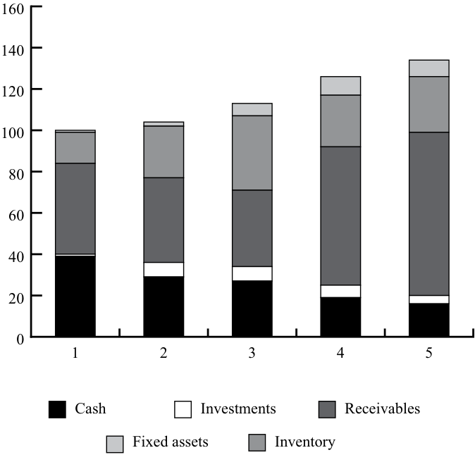

# Volume 4: Financial Statement Analysis
## Learning Module 11 Financial Analysis Techniques
### Part 2/5: Cross-Sectional, Trend Analysis, and Relationships in Financial Statements (PDF Pages 409–422)

---

<!-- PDF Page 409 -->

(= 8/34). Is Service A, which in Period 2 is a greater percentage of total revenue, provided in a jurisdiction with lower tax rates? If not, what is the explanation for the change in effective tax rate? 

The observations based on Exhibit 7 summarize the issues that can be raised through analysis of the vertical common-size income statement. 

**Exhibit 7: Vertical Common-Size Income Statement for Hypothetical Company** 

||**Period 1Percent of** **Total Revenue**|**Period 2Percent of** **Total Revenue**|
|---|---|---|
|Revenue source: Service A|30|45|
|Revenue source: Service B|23|20|
|Revenue source: Service C|30|30|
|Revenue source: Service D|17|5|
|Total revenue|**100**|**100**|
|Operating expenses (excluding dep|reciation)||
|Salaries and employee benefits|15|25|
|i Administrative expenses|22|20|
|Rent expense|10|10|
|EBITDA|**53**|**45**|
|Depreciation and amortization|4|4|
|EBIT|**49**|**41**|
|Interest paid|7|7|
|EBT|**42**|**34**|
|Income tax provision|15|8|
|Net income|**27**|**26**|

_EBIT = earnings before interest and tax._ 

## **CROSS-SECTIONAL, TREND ANALYSIS, AND RELATIONSHIPS IN FINANCIAL STATEMENTS** 

describe tools and techniques used in financial analysis, including their uses and limitations 

As noted previously, ratios and common-size statements derive their utility through comparison. **Cross-sectional analysis** (sometimes called “relative analysis”) compares a specific metric for one company with the same metric for another company or group of companies measured at the same point in time or over the same range of time, allowing comparisons even though the companies might be of significantly different sizes or operate in different currencies. This is illustrated in Exhibit 8. 

<!-- PDF Page 410 -->

**Exhibit 8: Vertical Common-Size (Partial) Balance Sheet for Two Hypothetical Companies** 

|**Assets**|**Company 1** **Percent of Total Assets**|**Company 2** **Percent of Total Assets**|
|---|---|---|
|Cash|38|12|
|Receivables|33|55|
|Inventory|27|24|
|Fixed assets net of depreciation|1|2|
|Investments|1|7|
|**Total Assets**|**100**|**100**|

Exhibit 8 presents a vertical common-size (partial) balance sheet for two hypothetical companies at the same point in time. Company 1 is clearly more liquid (liquidity is a function of how quickly assets can be converted into cash) than Company 2, which has only 12 percent of assets available as cash, compared with the highly liquid Company 1, which has 38 percent of assets available as cash. Given that cash is generally a relatively low-yielding asset and thus not a particularly efficient use of excess funds, why does Company 1 hold such a large percentage of total assets in cash? Perhaps the company is preparing for an acquisition, or maintains a large cash position as insulation from a particularly volatile operating environment. Another issue highlighted by the comparison in this example is the relatively high percentage of receivables in Company 2’s assets, which may indicate a greater proportion of credit sales, overall changes in asset composition, lower credit or collection standards, or aggressive accounting policies. 

### **Trend Analysis** 

When looking at financial statements and ratios, trends in the data, whether they are improving or deteriorating, are as important as the current absolute or relative levels. Trend analysis provides important information regarding historical performance and growth and, given a sufficiently long history of accurate seasonal information, can be of great assistance as a planning and forecasting tool for management and analysts. 

Exhibit 9 presents a partial balance sheet for a hypothetical company over five periods. The last two columns of the table show the changes for Period 5 compared with Period 4, expressed both in absolute currency (in this case, dollars) and in percentages. A small percentage change could hide a significant currency change and vice versa, prompting the analyst to investigate the reasons despite one of the changes being relatively small. In this example, the largest percentage change was in investments, which decreased by 33.3 percent. However, an examination of the absolute currency amount of changes shows that investments changed by only USD2 million, and the more significant change was the USD12 million increase in receivables. 

Another way to present data covering a period of time is to show each item in relation to the same item in a base year (i.e., a horizontal common-size balance sheet). Exhibit 10 and Exhibit 11 illustrate alternative presentations of horizontal common-size balance sheets. Exhibit 10 presents the information from the same partial balance sheet as in Exhibit 9, but indexes each item relative to the same item in Period 1. For example, in Period 2, the company had USD29 million cash, which is 74 percent or 0.74 of the amount of cash it had in Period 1. Expressed as an index relative to Period 1, where each item in Period 1 is given a value of 1.00, the value in Period 2 would be 0.74 (USD29/USD39 = 0.74). In Period 3, the company had USD27 million cash, which is 69 percent of the amount of cash it had in Period 1 (USD27/USD39 = 0.69). 

<!-- PDF Page 411 -->

Exhibit 11 presents the percentage change in each item, relative to the previous year. For example, the change in cash from Period 1 to Period 2 was –25.6 percent (USD29/ USD39 – 1 = –0.256), and the change in cash from Period 2 to Period 3 was –6.9 percent (USD27/USD29 – 1 = –0.069). An analyst will select the horizontal common-size balance that addresses the particular period of interest. Exhibit 10 clearly highlights that in Period 5 compared to Period 1, the company has less than half the amount of cash, four times the amount of investments, and eight times the amount of property, plant, and equipment. Exhibit 11 highlights year-to-year changes: For example, cash has declined in each period. Presenting data this way highlights significant changes. Again, note that a mathematically big change is not necessarily an important change. For example, fixed assets increased 100 percent (i.e., doubled between Period 1 and 2); however, as a proportion of total assets, fixed assets increased from 1 percent of total assets to 2 percent of total assets. The company’s working capital assets (receivables and inventory) are a far higher proportion of total assets and would likely warrant more attention from an analyst. 

An analysis of horizontal common-size balance sheets highlights structural changes that have occurred in a business. Past trends are obviously not necessarily an accurate predictor of the future, especially when the economic or competitive environment changes. An examination of past trends is more valuable when the macroeconomic and competitive environments are relatively stable and when the analyst is reviewing a stable or mature business. However, even in less stable contexts, historical analysis can serve as a basis for developing expectations. Understanding of past trends is helpful in assessing whether these trends are likely to continue or if the trend is likely to change direction. 

**Exhibit 9: Partial Balance Sheet for a Hypothetical Company over Five Periods** 

||||**Period**|||**Change**||
|---|---|---|---|---|---|---|---|
|**Assets (US**||||||**4 to 5** **(US dollar**|**Change** **4 to 5**|
|**dollar millions)**|**1**|**2**|**3**|**4**|**5**|**millions)**|**(%)**|
|Cash|39|29|27|19|16|–3|–15.8|
|Investments|1|7|7|6|4|–2|–33.3|
|Receivables|44|41|37|67|79|12|17.9|
|Inventory|15|25|36|25|27|2|8.0|
|Fixed assets net||||||||
|of depreciation|1|2|6|9|8|–1|–11.1|
|**Total assets**|100|104|113|126|134|8|6.3|

**Exhibit 10: Horizontal Common-Size (Partial) Balance Sheet for a Hypothetical Company over Five Periods, with Each Item Expressed Relative to the Same Item in Period One** 

||||**Period**|||
|---|---|---|---|---|---|
|**Assets**|**1**|**2**|**3**|**4**|**5**|
|Cash|1.00|0.74|0.69|0.49|0.41|
|Investments|1.00|7.00|7.00|6.00|4.00|
|Receivables|1.00|0.93|0.84|1.52|1.80|

<!-- PDF Page 412 -->

||||**Period**|||
|---|---|---|---|---|---|
|**Assets**|**1**|**2**|**3**|**4**|**5**|
|Inventory|1.00|1.67|2.40|1.67|1.80|
|Fixed assets net of|1.00|2.00|6.00|9.00|8.00|
|depreciation||||||
|**Total assets**|1.00|1.04|1.13|1.26|1.34|

**Exhibit 11: Horizontal Common-Size (Partial) Balance Sheet for a Hypothetical Company over Five Periods, with Percent Change in Each Item Relative to the Prior Period** 

|||**Per**|**iod**||
|---|---|---|---|---|
|**Assets**|**2 (%)**|**3 (%)**|**4 (%)**|**5 (%)**|
|Cash|–25.6|–6.9|–29.6|–15.8|
|Investments|600.0|0.0|–14.3|–33.3|
|Receivables|–6.8|–9.8|81.1|17.9|
|Inventory|66.7|44.0|–30.6|8.0|
|Fixed assets net of|100.0|200.0|50.0|–11.1|
|depreciation|||||
|**Total assets**|4.0|8.7|11.5|6.3|

One measure of success is for a company to grow at a rate greater than the rate of the overall market in which it operates. Companies that grow slowly may find themselves unable to attract equity capital. Conversely, companies that grow too quickly may find that their administrative and management information systems cannot keep up with the rate of expansion. 

### **Relationships Among Financial Statements** 

Trend data generated by a horizontal common-size analysis can be compared across financial statements. For example, the growth rate of assets for the hypothetical company in Exhibit 12 can be compared with the company’s growth in revenue over the same period of time. If revenue is growing more quickly than assets, the company may be increasing its efficiency (i.e., generating more revenue for every dollar invested in assets). 

As another example, consider the following year-over-year percentage changes for a hypothetical company: 

**Exhibit 12: Year-over-Year Percentage Changes** 

|**Revenue**|**+20%**|
|---|---|
|Net income|+25%|
|Operating cash flow|–10%|
|l Total assets|+30%|

<!-- PDF Page 413 -->

Net income is growing faster than revenue, which indicates increasing profitability. However, the analyst would need to determine whether the faster growth in net income resulted from continuing operations or from non-operating, non-recurring items. In addition, the 10 percent decline in operating cash flow despite increasing revenue and net income clearly warrants further investigation because it could indicate a problem with earnings quality (perhaps aggressive reporting of revenue). Lastly, the fact that assets have grown faster than revenue indicates the company’s efficiency may be declining. The analyst should examine the composition of the increase in assets and the reasons for the changes. Example 5 illustrates a historical example of a company for which comparisons of trend data from different financial statements were actually indicative of aggressive accounting policies. 

#### **EXAMPLE 5** 

### **Use of Comparative Growth Information****1** 

In July 1996, Sunbeam, a US company, brought in new management to turn the company around. In the following year, 1997, using 1996 as the base, the following was observed based on reported numbers: 

**Exhibit 13: Sunbeam Revenue** 

|**Revenue**|**+19 percent**|
|---|---|
|Inventory|+58 percent|
|Receivables|+38 percent|

It is generally more desirable to observe inventory and receivables growing at a slower (or similar) rate than revenue growth. Receivables growing faster than revenue can indicate operational issues, such as lower credit standards or aggressive accounting policies for revenue recognition. Similarly, inventory growing faster than revenue can indicate an operational problem with obsolescence or aggressive accounting policies, such as an improper overstatement of inventory to increase profits. 

In this case, the explanation lay in aggressive accounting policies. Sunbeam was later charged by the US Securities and Exchange Commission with improperly accelerating the recognition of revenue and engaging in other practices, such as billing customers for inventory prior to shipment. 

## **THE USE OF GRAPHS AND REGRESSION ANALYSIS** 

# **<mark>7</mark>** 

describe tools and techniques used in financial analysis, including their uses and limitations 

<!-- PDF Page 414 -->

Graphs facilitate comparison of performance and financial structure over time, highlighting changes in significant aspects of business operations. In addition, graphs provide the analyst (and management) with a visual overview of risk trends in a business. Graphs may also be used effectively to communicate the analyst’s conclusions regarding financial condition and risk management aspects. 

Exhibit 14 presents the information from Exhibit 9 in a stacked column format. The graph makes the significant decline in cash and growth in receivables (both in absolute terms and as a percentage of assets) readily apparent. In Exhibit 14, the vertical axis shows US dollar millions and the horizontal axis denotes the period. 

Choosing the appropriate graph to communicate the most significant conclusions of a financial analysis is a skill. In general, pie graphs are most useful to communicate the composition of a total value (e.g., assets over a limited amount of time, say one or two periods). Line graphs are useful when the focus is on the change in amount for a limited number of items over a relatively longer time period. When the composition and amounts, as well as their change over time, are all important, a stacked column graph can be useful. 

#### **Exhibit 14: Stacked Column Graph of Asset Composition of Hypothetical Company over Five Periods** 

<!-- Start of picture text -->
160 140 120 100 80 60 40 20 0 1 2 3 4 5 Cash Investments Receivables Fixed assets Inventory <!-- End of picture text -->

When comparing Period 5 with Period 4, the growth in receivables appears to be within normal bounds; but when comparing Period 5 with earlier periods, the dramatic growth becomes apparent. In the same manner, a simple line graph will also illustrate the growth trends in key financial variables. Exhibit 15 presents the information from Exhibit 9A as a line graph, illustrating the growth of assets of a hypothetical company over five periods. The steady decline in cash, volatile movements of inventory, and dramatic growth of receivables is clearly illustrated. Again, the vertical axis is shown in US dollar millions and the horizontal axis denotes periods. 

<!-- PDF Page 415 -->

#### **Exhibit 15: Line Graph of Growth of Assets of Hypothetical Company over Five Periods** 

<!-- Start of picture text -->
90 80 70 60 50 40 30 20 10 0 1 2 3 4 5 Cash Investments Receivables Fixed assets Inventory <!-- End of picture text -->

### **Regression Analysis** 

When analyzing the trend in a specific line item or ratio, frequently it is possible simply to visually evaluate the changes. For more complex situations, regression analysis can help identify relationships (or correlation) between variables. For example, a regression analysis could relate a company’s sales to GDP over time, providing insight into whether the company is cyclical. In addition, the statistical relationship between sales and GDP could be used as a basis for forecasting sales. 

Other examples in which regression analysis may be useful include the relationship between a company’s sales and inventory over time, or the relationship between hotel occupancy and a company’s hotel revenues. In addition to providing a basis for forecasting, regression analysis facilitates identification of items or ratios that are not behaving as expected, given historical statistical relationships. 

## **COMMON RATIO CATEGORIES, INTERPRETATION, AND CONTEXT** 

calculate and interpret activity, liquidity, solvency, and profitability ratios 

In the previous lesson, we focused on ratios resulting from common-size analysis. In this lesson, we expand the discussion to include other commonly used financial ratios and the broad classes into which they are categorized. There is some overlap 

<!-- PDF Page 416 -->

with common-size financial statement ratios. For example, a common indicator of profitability is the net profit margin, which is calculated as net income divided by sales. This ratio appears on a vertical common-size income statement. Other ratios involve information from multiple financial statements or even data from outside the financial statements. 

Because of the large number of ratios, it is helpful to think about ratios in terms of broad categories based on what aspects of performance a ratio is intended to detect. Financial analysts and data vendors use a variety of categories to classify ratios. The category names and the ratios included in each category can differ. Common ratio categories include activity, liquidity, solvency, and profitability, which were introduced in earlier modules in Corporate Issuers. These categories are summarized in Exhibit 16. Each category measures a different aspect of the company’s business, but all are useful in evaluating a company’s overall ability to generate cash flows from operating its business and the associated risks. 

**Exhibit 16: Categories of Financial Ratios** 

|**Category**|**Description**|
|---|---|
|Activity|**Activity ratios**measure the efficiency of a company’s operations, such as the collection of receivables and management of inventory.|
|Liquidity|**Liquidity ratios**measure the company’s ability to meet its short-term obligations.|
|Solvency|**Solvency ratios**measure a company’s ability to meet long-term obliga- tions. Subsets of these ratios are also known as “leverage” and “long-term debt” ratios.|
|Profitability|**Profitability ratios**measure the company’s ability to generate profits from its resources (assets) or sales.|

### **Interpretation and Context** 

Financial ratios can be interpreted only in the context of other information. In general, the financial ratios of a company are compared with those of its major competitors (cross-sectional and trend analysis) and to the company’s prior periods (trend analysis). The goal is to understand the underlying causes of divergence between a company’s ratios and those of the industry. Even ratios that remain consistent require understanding because consistency can sometimes indicate accounting policies selected to smooth earnings. An analyst should evaluate financial ratios in the context of the following: 

**1.** _Prior period results_ . Trend analysis can reveal whether a company’s performance and position are weakening or strengthening. 

**2.** _Expectations_ . These are point or range estimates for key values, such as sales growth, profit margins, and leverage ratios, that are specified by the analyst or external analysts before results are published. Differences from expectations should be scrutinized for setting expectations in subsequent periods. 

**3.** _Industry peers and competitors_ ( _cross-sectional analysis_ ). A company can be compared with others in its industry by relating its financial ratios to industry norms or to a subset of the companies in an industry. When industry norms are used to make judgments, care must be taken for the following reasons: 

<!-- PDF Page 417 -->

   - Companies may have several different lines of business. This will cause aggregate financial ratios to be distorted. It is better to examine industry-specific ratios by lines of business. 

   - Differences in business model and corporate strategies can affect certain financial ratios. 

   - Some ratios are industry specific, and not all ratios are important to all industries. 

   - Differences in accounting methods used by companies can distort financial ratios. 

**4.** _Company goals and strategy_ . Actual ratios can be compared with company objectives to determine whether objectives are being attained and whether the results are consistent with the company’s strategy. 

**5.** _Economic conditions_ . For cyclical companies, financial ratios tend to improve when the economy is strong and weaken during recessions. Therefore, financial ratios should be examined in light of the current phase of the business cycle. 

The following lessons discuss the calculation and interpretation of activity, liquidity, solvency, and profitability ratios using a company’s financial statements. 

## **ACTIVITY RATIOS** 

# **<mark>9</mark>** 

calculate and interpret activity, liquidity, solvency, and profitability ratios 

Activity ratios, also known as **asset utilization ratios** or **operating efficiency ratios** , are measures of operational performance—how effectively the company is using working capital and longer term assets. Since working capital efficiency has a direct impact on liquidity, some activity ratios are also useful in assessing liquidity. 

### **Calculation of Activity Ratios** 

Exhibit 17 presents commonly used activity ratios. 

**Exhibit 17: Definitions of Commonly Used Activity Ratios** 

|**Activity Ratios**|**Numerator**|**Denominator**|
|---|---|---|
|Inventory turnover|Cost of sales or cost of goods sold|Average inventory|
|Days of inventory on hand (DOH)|Number of days in period|Inventory turnover|
|Receivables turnover|Revenue|Average receivables|
|Days of sales outstanding (DSO)|Number of days in period|Receivables turnover|
|Payables turnover|Cost of sales or cost of goods sold|Average trade payables|
|Number of days of payables|Number of days in period|Payables turnover|

<!-- PDF Page 418 -->

|**Activity Ratios**|**Numerator**|**Denominator**|
|---|---|---|
|Working capital turnover|Revenue|Average working capital|
|Fixed asset turnover|Revenue|Average net fixed assets|
|Total asset turnover|Revenue|Average total assets|

Activity ratios generally combine information from the income statement in the numerator with balance sheet items in the denominator. Because the income statement measures what happened _during_ a period, whereas the balance sheet shows the condition only at the end of the period, average balance sheet figures are normally used for consistency. 

Activity ratios can be computed for any annual or interim period, but care must be taken in the interpretation and comparison across periods. For example, if the same company had cost of goods sold for the first quarter (90 days) of the following year of EUR35,000 and average inventory of EUR11,000, the inventory turnover would be 3.18 times. However, this turnover rate is 3.18 times per quarter, which is not directly comparable to the 12 times per year in the preceding year. In this case, we can annualize the quarterly inventory turnover rate by multiplying the quarterly turnover by 4 (12 months/3 months; or by 4.06, using 365 days/90 days) for comparison to the annual turnover rate. So, the quarterly inventory turnover is equivalent to a 12.72 annual inventory turnover (or 12.90 if we annualize the ratio using a 90-day quarter and a 365-day year). To compute the DOH using quarterly data, we can use the quarterly turnover rate and the number of days in the quarter for the numerator—or, we can use the annualized turnover rate and 365 days; either results in DOH of around 28.3, with slight differences due to rounding (90/3.18 = 28.30 and 365/12.90 = 28.29). Another time-related computational detail is that for companies using a 52/53-week annual period and for leap years, the actual days in the year should be used rather than 365. 

In some cases, an analyst may want to know how many days of inventory are on hand at the end of the year rather than the average for the year. In this case, it would be appropriate to use the year-end inventory balance in the computation rather than the average. If the company is growing rapidly or if costs are increasing rapidly, analysts should consider using cost of goods sold just for the fourth quarter in this computation because the cost of goods sold of earlier quarters may not be relevant. Example 6 further demonstrates computation of activity ratios using Hong Kong Stock Exchange (HKEX)–listed Lenovo Group Limited. 

<!-- PDF Page 419 -->

#### **EXAMPLE 6** 

### **Computation of Activity Ratios** 

1. An analyst would like to evaluate Lenovo Group’s efficiency in collecting its trade accounts receivable during the fiscal year ended 31 March 2018 (FY2017). The analyst gathers the following information in Exhibit 18 from Lenovo’s annual and interim reports: 

#### **Exhibit 18: Lenovo** 

||**US dollar thousands**|
|---|---|
|Trade receivables as of 31 March 2017|4,468,392|
|Trade receivables as of 31 March 2018|4,972,722|
|Revenue for year ended 31 March 2018|45,349,943|

Calculate Lenovo’s receivables turnover and number of days of sales outstanding (DSO) for the fiscal year ended 31 March 2018. 

**Solution:** 

|**Receivables turnover**|**=**|**Revenue/Average receivables**|
|---|---|---|
||=|45,349,943/[(4,468,392 + 4,972,722)/2]|
||=|45,349,943/4,720,557|
||=|9.6069 times, or 9.6 rounded|
|DSO|=|Number of days in period/Receivables turnover|
||=|365/9.6|
||=|38.0 days|

On average, it took Lenovo 38 days to collect receivables during the fiscal year ended 31 March 2018. 

### **Interpretation of Activity Ratios** 

#### **_Inventory Turnover and DOH_** 

Inventory turnover indicates the resources tied up in inventory (i.e., the carrying costs) and, therefore, can be used to indicate inventory management effectiveness. In general, inventory turnover and DOH (days of inventory on hand) should be benchmarked against industry norms. 

A high inventory turnover ratio relative to industry norms might indicate highly effective inventory management. Alternatively, a high inventory turnover ratio (and commensurately low DOH) could possibly indicate the company does not carry adequate inventory, so shortages could potentially hurt revenue. To assess which explanation is more likely, the analyst can compare the company’s revenue growth with that of the industry. Slower growth combined with higher inventory turnover could indicate inadequate inventory levels. Revenue growth at or above the industry’s growth supports the interpretation that the higher turnover reflects greater inventory management efficiency. 

<!-- PDF Page 420 -->

A low inventory turnover ratio (and commensurately high DOH) relative to the rest of the industry could be an indicator of slow-moving inventory, perhaps because of technological obsolescence or a change in fashion. Again, comparing the company’s sales growth with the industry can offer insight. 

#### **_Receivables Turnover and DSO_** 

The number of DSO (days of sales outstanding) reflects how fast the company collects cash from customers to whom it offers credit. Although limiting the numerator to sales made on credit in the receivables turnover would be more appropriate, credit sales information is usually not available to analysts; therefore, revenue as reported in the income statement is generally used. 

As with inventory management, comparison of the company’s sales growth relative to the industry can help the analyst assess whether sales are being lost due to stringent credit policies. In addition, comparing the company’s estimates of uncollectible accounts receivable and actual credit losses with past experience and with peer companies can help assess whether low turnover reflects credit management issues. Companies often provide details of receivables aging (how much receivables have been outstanding by age). This can be used along with DSO to understand trends in collection, as demonstrated in Example 7. 

#### **EXAMPLE 7** 

### **Evaluation of an Activity Ratio** 

An analyst has computed the average DSO for Lenovo for fiscal years ended 31 March 2018 and 2017: 

**Exhibit 19: Average DSO** 

||**FY2017**|**FY2016**|
|---|---|---|
|Days of sales outstanding|38.0|37.6|

Revenue increased from USD43.035 billion for fiscal year ended 31 March 2017 (FY2016) to USD45.350 billion for fiscal year ended 31 March 2018 (FY2017). The analyst would like to better understand the change in the company’s DSO from FY2016 to FY2017 and whether the increase is indicative of any issues with the customers’ credit quality. The analyst collects accounts receivable aging information from Lenovo’s annual reports and computes the percentage of accounts receivable by days outstanding. This information is presented in Exhibit 20: 

#### **Exhibit 20: Accounts Receivable** 

||**FY20**|**17**|**FY20**|**16**|**FY20**|**15**|
|---|---|---|---|---|---|---|
||**USD000**|**Percent**|**USD000**|**Percent**|**USD000**|**Percent**|
|Accounts receivable|||||||
|0–30 days|3,046,240|59.95|2,923,083|63.92|3,246,600|71.99|
|31–60 days|1,169,286|23.01|985,251|21.55|617,199|13.69|
|61–90 days|320,183|6.30|283,050|6.19|240,470|5.33|
|Over 90 days|545,629|10.74|381,387|8.34|405,410|8.99|
|Total|5,081,338|100.00|4,572,771|100.00|4,509,679|100.00|

<!-- PDF Page 421 -->

||**FY201**|**7**|**FY201**|**6**|**FY20**|**15**|
|---|---|---|---|---|---|---|
||**USD000**|**Percent**|**USD000**|**Percent**|**USD000**|**Percent**|
|Less: Provision for|–108,616|–2.14|–104,379|–2.28|–106,172|–2.35|
|impairment|||||||
|Trade receivables, net|4,972,722|97.86|4,468,392|97.72|4,403,507|97.65|
|_Total sales_|_45,349,943_||_43,034,731_||_44,912,097_||

_Note:_ Lenovo’s footnotes disclose that general trade customers are provided with credit terms ranging from 0 to 120 days. 

These data indicate that total accounts receivable increased by 11 percent (net, after impairment) in FY2017 versus FY2016, while total sales increased by only 5.4 percent. Further, the percentage of receivables in all categories older than 30 days has increased over the three-year period, indicating that customers are indeed taking longer to pay. Conversely, the provision for impairment (estimate of uncollectible accounts) has declined as a percent of total receivables. Considering all this information, the company may be increasing customer financing purposely to drive its sales growth. They also may be underestimating the impairment. This should be investigated further by the analyst. 

#### **_Payables Turnover and the Number of Days of Payables_** 

The number of days of payables reflects the average number of days the company takes to pay its suppliers, and the payables turnover ratio measures how many times per year the company theoretically pays off all its creditors. A payables turnover ratio that is high (low days payable) relative to the industry could indicate that the company is not making full use of available credit facilities; alternatively, it could result from a company taking advantage of early payment discounts. An excessively low turnover ratio (high days payable) could indicate trouble making payments on time, or alternatively, exploitation of lenient supplier terms. This is another example in which it is useful to look simultaneously at other ratios. If liquidity ratios indicate that the company has sufficient cash and other short-term assets to pay obligations and yet the days payable ratio is relatively high, the analyst would favor the lenient supplier credit and collection policies as an explanation. 

#### **_Working Capital Turnover_** 

Working capital turnover indicates how efficiently the company generates revenue with its working capital. For example, a working capital turnover ratio of 4.0 indicates that the company generates EUR4 of revenue for every EUR1 of working capital. A high working capital turnover ratio indicates greater efficiency (i.e., the company is generating a high level of revenues relative to working capital). For some companies, working capital can be near zero or negative, rendering this ratio incapable of being interpreted. The following two ratios are more useful in those circumstances. 

#### **_Fixed Asset Turnover_** 

This ratio measures how efficiently the company generates revenues from its investments in fixed assets. Generally, a higher fixed asset turnover ratio indicates more efficient use of fixed assets in generating revenue. A low ratio can indicate inefficiency, a capital-intensive business environment, or a new business not yet operating at full capacity—in which case the analyst will not be able to link the ratio directly to efficiency. In addition, asset turnover can be affected by factors other than a company’s efficiency. The fixed asset turnover ratio would be lower for a company whose assets are newer (and, therefore, less depreciated and so reflected in the financial statements 

<!-- PDF Page 422 -->

at a higher carrying value) than the ratio for a company with older assets (that are thus more depreciated and so reflected at a lower carrying value). The fixed asset ratio can be erratic because, although revenue may have a steady growth rate, increases in fixed assets may not follow a smooth pattern; so, every year-to-year change in the ratio does not necessarily indicate important changes in the company’s efficiency. 

#### **_Total Asset Turnover_** 

The total asset turnover ratio measures the company’s overall ability to generate revenues with a given level of assets. A ratio of 1.20 would indicate that the company is generating EUR1.20 of revenues for every EUR1 of average assets. A higher ratio indicates greater efficiency. Because this ratio includes both fixed and current assets, inefficient working capital management can distort overall interpretations. It is therefore helpful to analyze working capital and fixed asset turnover ratios separately. A low asset turnover ratio can be an indicator of inefficiency or of relative capital intensity of the business. The ratio also reflects strategic decisions by management—for example, the decision whether to use a more labor-intensive (and less capital-intensive) approach to its business or a more capital-intensive (and less labor-intensive) approach. 

When interpreting activity ratios, the analysts should examine not only the individual ratios but also the collection of relevant ratios to determine the overall efficiency of a company. Example 8 demonstrates the evaluation of activity ratios, both narrow (e.g., days of inventory on hand) and broad (e.g., total asset turnover) for a hypothetical manufacturer. 

#### **EXAMPLE 8** 

### **Evaluation of Activity Ratios** 

ZZZ Company is a hypothetical manufacturing company. As part of an analysis of management’s operating efficiency, an analyst collects the following activity ratios from a data provider: 

**Exhibit 21: Operating Efficiency** 

|**Ratio**|**2018**|**2017**|**2016**|**2015**|
|---|---|---|---|---|
|DOH|35.68|40.70|40.47|48.51|
|DSO|45.07|58.28|51.27|76.98|
|Total asset turnover|0.36|0.28|0.23|0.22|

These ratios indicate that the company has improved on all three measures of activity over the four-year period. The company appears to be managing its inventory more efficiently, is collecting receivables faster, and is generating a higher level of revenues relative to total assets. The overall trend appears good, but thus far, the analyst has only determined _what_ happened. A more important question is _why_ the ratios improved, because understanding good changes as well as bad ones facilitates judgments about the company’s future performance. To answer this question, the analyst examines company financial reports as well as external information about the industry and economy. In examining the annual report, the analyst notes that in the fourth quarter of 2018, the company experienced an “inventory correction” and that the company recorded an allowance for the decline in market value and obsolescence of inventory of about 15 percent of year-end inventory value (compared with about a 6 percent allowance in the prior year). This reduction in the value of inventory accounts for a large portion of the decline in DOH from 40.70 in 2017 to 35.68 in 2018. Management claims 

