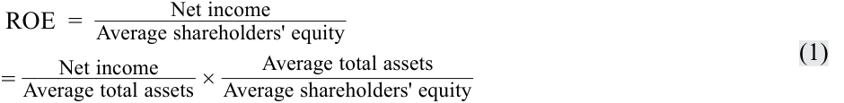
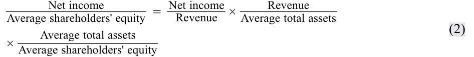
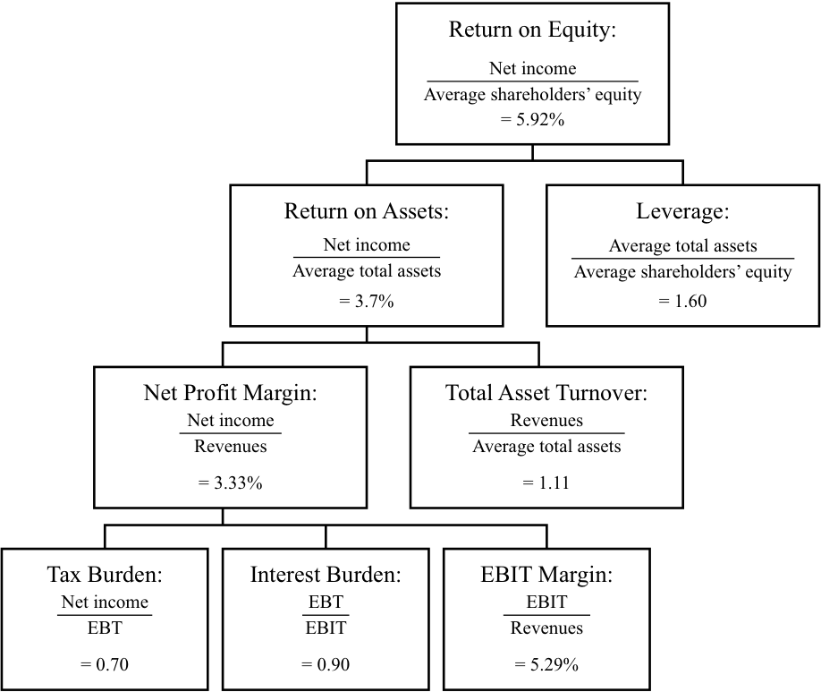

# Volume 4: Financial Statement Analysis
## Learning Module 11 Financial Analysis Techniques
### Part 4/5: DuPont Analysis—The Decomposition of ROE (PDF Pages 438–447)

---

<!-- PDF Page 438 -->

|||**Fisca** |**l Year** ||
|---|---|---|---|---|
|**Anson Industries**|**5**|**4**|**3**|**2**|
|||**Fiscal**|**Year**||
|**Clarence Corporation**|**5**|**4**|**3**|**2**|
|Inventory turnover|9.19|9.08|7.52|14.84|
|DOH|39.73|40.20|48.51|24.59|
|Receivables turnover|8.35|7.01|6.09|5.16|
|DSO|43.73|52.03|59.92|70.79|
|Accounts payable turnover|6.47|6.61|7.66|6.52|
|Days payable|56.44|55.22|47.64|56.00|
|Cash from operations/Total liabilities|13.19%|16.39%|15.80%|11.79%|
|ROE|9.28%|6.82%|–3.63%|–6.75%|
|ROA|4.64%|3.48%|–1.76%|–3.23%|
|Net profit margin (Net income/ Revenue)|4.38%|3.48%|–1.60%|–2.34%|
|Total asset turnover (Revenue/ Average assets)|1.06|1.00|1.10|1.38|
|Leverage (Average assets/Average equity)|2.00|1.96|2.06|2.09|

_Note:_ Ratios are expressed in terms of two decimal places and are rounded. Therefore, expected relationships may not hold perfectly. 

1. Which of the following choices best describes reasonable conclusions an analyst might make about the companies’ efficiency? 

   - **A.** In FY5, Anson’s DOH of only 4.76 indicated that it was less efficient at inventory management than Clarence, which had DOH of 39.73. 

   - **B.** Over the past four years, Anson has shown greater improvement in efficiency than Clarence, as indicated by its total asset turnover ratio increasing from 0.84 to 1.11. 

   - **C.** In FY5, Clarence’s receivables turnover of 8.35 times indicated that it was more efficient at receivables management than Anson, which had receivables turnover of 10.75. 

##### **Solution:** 

B is correct. Over the past four years, Anson has shown greater improvement in efficiency than Clarence, as indicated by its total asset turnover ratio increasing from 0.84 to 1.11. Over the same period of time, Clarence’s total asset turnover ratio has declined from 1.38 to 1.06. Choices A and C are incorrect because DOH and receivables turnover are misinterpreted. 

# **<mark>14</mark>** 

### **DUPONT ANALYSIS—THE DECOMPOSITION OF ROE** 

demonstrate the application of DuPont analysis of return on equity and calculate and interpret effects of changes in its components 

<!-- PDF Page 439 -->

As noted earlier, ROE measures the return a company generates on its equity capital. To understand what drives a company’s ROE, a useful technique is to decompose ROE into its component parts. (Decomposition of ROE is sometimes referred to as **DuPont analysis** because it was developed originally at that company.) Decomposing ROE involves expressing the basic ratio (i.e., net income divided by average shareholders’ equity) as the product of component ratios. Because each of these component ratios is an indicator of a distinct aspect of a company’s performance that affects ROE, the decomposition allows us to evaluate how these different aspects of performance affected the company’s profitability as measured by ROE. 

Decomposing ROE is useful in determining the reasons for changes in ROE over time for a given company and for differences in ROE for different companies in a given time period. The information gained can also be used by management to determine which areas they should focus on to improve ROE. This decomposition will also show why a company’s overall profitability, measured by ROE, is a function of its efficiency, operating profitability, taxes, and use of financial leverage. DuPont analysis shows the relationship between the various categories of ratios discussed in this module and how they all influence the return to the investment of the owners. 

Analysts have developed several different methods of decomposing ROE. The decomposition presented here is one of the most commonly used and the one found in popular research databases, such as Bloomberg. Return on equity is calculated as follows: 

ROE = Net income/Average shareholders’ equity. 

The decomposition of ROE makes use of simple algebra and illustrates the relationship between ROE and ROA. Expressing ROE as a product of only two of its components, we can write: 

<!-- Formula Text: ROE  = Net income ____________________ Average shareholders' equity = Net income ______________ Average total assets  × Average total assets ____________________ Average shareholders' equity (1) -->

which can be interpreted as follows: 

ROE = ROA × Leverage. 

In other words, ROE is a function of a company’s ROA and its use of financial leverage (“leverage” for short, in this discussion). A company can improve its ROE by improving ROA or by increasing leverage. Consistent with the definition given earlier, leverage is measured as average total assets divided by average shareholders’ equity. If a company had no leverage (no liabilities), its leverage ratio would equal 1.0 and ROE would exactly equal ROA. As a company takes on liabilities, its leverage increases. As long as a company is able to borrow at a rate lower than the marginal rate it can earn investing the borrowed money, the company is making an effective use of leverage and ROE would increase as leverage increases. If a company’s borrowing cost exceeds the marginal rate it can earn on investing in the business, ROE would decline as leverage increased because the effect of borrowing would be to depress ROA. 

Using the data from Example 14 for Anson Industries, an analyst can examine the trend in ROE and determine whether the increase from an ROE of –0.625 percent in FY2 to 5.925 percent in FY5 is a function of ROA or the use of leverage: 

<!-- PDF Page 440 -->

**Exhibit 32: Anson Industries** 

||**ROE**|**=**|**ROA**|**×**|**Leverage**|
|---|---|---|---|---|---|
|FY5|5.92%||3.70%||1.60|
|FY4|1.66%||1.05%||1.58|
|FY3|1.62%||1.05%||1.54|
|FY2|–0.62%||–0.39%||1.60|

Over the four-year period, the company’s leverage factor was relatively stable. The primary reason for the increase in ROE is the increase in profitability measured by ROA. 

Just as ROE can be decomposed, the individual components such as ROA can be decomposed. Further decomposing ROA, we can express ROE as a product of three component ratios: 

<!-- Formula Text: Net income ____________________ Average shareholders' equity   =   Net income _ Revenue   × Revenue ______________ Average total assets × Average total assets ____________________ Average shareholders' equity (2) -->

which can be interpreted as follows: 

ROE = Net profit margin × Total asset turnover × Leverage. 

The first term on the right-hand side of this equation is the net profit margin, an indicator of profitability: how much income a company derives per one monetary unit (e.g., euro or US dollar) of sales. The second term on the right is the asset turnover ratio, an indicator of efficiency: how much revenue a company generates per one money unit of assets. Note that ROA is decomposed into these two components: net profit margin and total asset turnover. A company’s ROA is a function of profitability (net profit margin) and efficiency (total asset turnover). The third term on the right-hand side of the equation is a measure of financial leverage, an indicator of solvency: the total amount of a company’s assets relative to its equity capital. This decomposition illustrates that a company’s ROE is a function of its net profit margin, its efficiency, and its leverage. Again, using the data from Example 14 for Anson Industries, the analyst can evaluate in more detail the reasons behind the trend in ROE: 

**Exhibit 33: Anson Industries** 

||||**Net profit**||**Total asset**||
|---|---|---|---|---|---|---|
||**ROE**|**=**|**margin**|**×**|**turnover**|**×** **Leverage**|
|FY5|5.92%||3.33%||1.11|1.60|
|FY4|1.66%||1.11%||0.95|1.58|
|FY3|1.62%||1.13%||0.93|1.54|
|FY2|–0.62%||–0.47%||0.84|1.60|

This further decomposition confirms that increases in profitability (measured here as net profit margin) are indeed an important contributor to the increase in ROE over the four-year period. However, Anson’s asset turnover has also increased steadily. The increase in ROE is, therefore, a function of improving profitability and improving efficiency. As noted earlier, ROE decomposition can also be used to compare the ROEs of peer companies, as demonstrated in Example 15. 

<!-- PDF Page 441 -->

##### **EXAMPLE 15** 

#### **A Comparison of Two Companies (2)** 

1. Referring to the data for Anson Industries and Clarence Corporation in Example 14, which of the following choices best describes reasonable conclusions an analyst might make about the companies’ ROE? **A.** Anson’s inventory turnover of 76.69 indicates it is more profitable than Clarence. 

   - **B.** The main driver of Clarence’s superior ROE in FY5 is its more efficient use of assets. 

   - **C.** The main drivers of Clarence’s superior ROE in FY5 are its greater use of debt financing and higher net profit margin. 

   - **Solution:** 

C is correct. The main driver of Clarence’s superior ROE (9.28 percent compared with only 5.92 percent for Anson) in FY5 is its greater use of debt financing (leverage of 2.00 compared with Anson’s leverage of 1.60) and higher net profit margin (4.38 percent compared with only 3.33 percent for Anson). A is incorrect because inventory turnover is not a direct indicator of profitability. An increase in inventory turnover may indicate more efficient use of inventory which in turn could affect profitability; however, an increase in inventory turnover would also be observed if a company was selling more goods even if it was not selling those goods at a profit. B is incorrect because Clarence has less efficient use of assets than Anson, indicated by turnover of 1.06 for Clarence compared with Anson’s turnover of 1.11. 

To separate the effects of taxes and interest, we can further decompose the net profit margin and write: 

<!-- Formula Text: Net income ____________________ Average shareholders' equity   =   Net income _ EBT ×  EBT _ EBIT  ×   EBIT _ Revenue × Revenue ______________ Average total assets  × Average total assets ____________________ Average shareholders' equity (3) -->

which can be interpreted as follows: 

ROE = Tax burden × Interest burden × EBIT margin × Total asset turnover × Leverage. 

This five-way decomposition is the one found in financial databases such as Bloomberg. The first term on the right-hand side of this equation measures the effect of taxes on ROE. Essentially, it reflects one minus the average tax rate, or how much of a company’s pretax profits it gets to keep. This can be expressed in decimal or percentage form. So, a 30 percent tax rate would yield a factor of 0.70 or 70 percent. A higher value for the tax burden implies that the company can keep a higher percentage of its pretax profits, indicating a lower tax rate. A decrease in the tax burden ratio implies the opposite (i.e., a higher tax rate leaving the company with less of its pretax profits). 

The second term on the right-hand side captures the effect of interest on ROE. Higher borrowing costs reduce ROE. Some analysts prefer to use operating income instead of EBIT for this term and the following term. Either operating income or EBIT is acceptable as long as it is applied consistently. In such a case, the second term would measure both the effect of interest expense and non-operating income on ROE. 

The third term on the right-hand side captures the effect of operating margin (if operating income is used in the numerator) or EBIT margin (if EBIT is used) on ROE. In either case, this term primarily measures the effect of operating profitability on ROE. 

<!-- PDF Page 442 -->

The fourth term on the right-hand side is again the total asset turnover ratio, an indicator of the overall efficiency of the company (i.e., how much revenue it generates per unit of total assets). The fifth term on the right-hand side is the financial leverage ratio described above—the total amount of a company’s assets relative to its equity capital. 

This decomposition expresses a company’s ROE as a function of its tax rate, interest burden, operating profitability, efficiency, and leverage. An analyst can use this framework to determine what factors are driving a company’s ROE. The decomposition of ROE can also be useful in forecasting ROE based upon expected efficiency, profitability, financing activities, and tax rates. The relationship of the individual factors, such as ROA to the overall ROE, can also be expressed in the form of an ROE tree to study the contribution of each of the five factors, as shown in Exhibit 34 for Anson Industries. 

Exhibit 34 shows that Anson’s ROE of 5.92 percent in FY5 can be decomposed into ROA of 3.70 percent and leverage of 1.60. ROA can further be decomposed into a net profit margin of 3.33 percent and total asset turnover of 1.11. Net profit margin can be decomposed into a tax burden of 0.70 (an average tax rate of 30 percent), an interest burden of 0.90, and an EBIT margin of 5.29 percent. Overall ROE is decomposed into five components. 

**Exhibit 34: DuPont Analysis of Anson Industries’ ROE: Fiscal Year 5** 

<!-- Start of picture text -->
Return on Equity: Net income Average shareholders’ equity = 5.92% Return on Assets: Leverage: Net income Average total assets Average total assets Average shareholders’ equity = 3.7% = 1.60 Net Profit Margin: Total Asset Turnover: Net income Revenues Revenues Average total assets = 3.33% = 1.11 Tax Burden: Interest Burden: EBIT Margin: Net income EBT EBIT EBT EBIT Revenues = 0.70 = 0.90 = 5.29% <!-- End of picture text -->

Example 16 demonstrates how the five-component decomposition can be used to determine reasons behind the trend in a company’s ROE. 

<!-- PDF Page 443 -->

##### **EXAMPLE 16** 

#### **Five-Way Decomposition of ROE** 

An analyst examining Amsterdam PLC (a hypothetical company) wishes to understand the factors driving the trend in ROE over a four-year period. The analyst obtains and calculates the following data from Amsterdam’s annual reports: 

**Exhibit 35: Amsterdam’s Annual Reports** 

||**2017**|**2016**|**2015**|**2014**|
|---|---|---|---|---|
|ROE|9.53%|20.78%|26.50%|24.72%|
|Tax burden|60.50%|52.10%|63.12%|58.96%|
|Interest burden|97.49%|97.73%|97.86%|97.49%|
|EBIT margin|7.56%|11.04%|13.98%|13.98%|
|Asset turnover|0.99|1.71|1.47|1.44|
|Leverage|2.15|2.17|2.10|2.14|

1. What might the analyst conclude? 

##### **Solution:** 

The tax burden measure has varied, with no obvious trend. In the most recent year, 2017, taxes declined as a percentage of pretax profit. (Because the tax burden reflects the relation of after-tax profits to pretax profits, the increase from 52.10 percent in 2016 to 60.50 percent in 2017 indicates that taxes declined as a percentage of pretax profits.) This decline in average tax rates could be a result of lower tax rates from new legislation or revenue in a lower tax jurisdiction. The interest burden has remained fairly constant over the four-year period indicating that the company maintains a fairly constant capital structure. Operating margin (EBIT margin) declined over the period, indicating the company’s operations were less profitable. This decline is generally consistent with declines in oil prices in 2017 and declines in refining industry gross margins in 2016 and 2017. The company’s efficiency (asset turnover) decreased in 2017. The company’s leverage remained constant, consistent with the constant interest burden. Overall, the trend in ROE (declining substantially over the recent years) resulted from decreases in operating profits and a lower asset turnover. Additional research on the causes of these changes is required to develop expectations about the company’s future performance. 

The most detailed decomposition of ROE that we have presented is a five-way decomposition. Nevertheless, an analyst could further decompose individual components of a five-way analysis. For example, EBIT margin (EBIT/Revenue) could be further decomposed into a non-operating component (EBIT/Operating income) and an operating component (Operating income/Revenue). The analyst can also examine which other factors contributed to these five components. For example, an improvement in efficiency (total asset turnover) may have resulted from better management of inventory (DOH) or better collection of receivables (DSO). 

<!-- PDF Page 444 -->

# **<mark>15</mark>** 

### **INDUSTRY-SPECIFIC FINANCIAL RATIOS** 

describe the uses of industry-specific ratios used in financial analysis 

As stated earlier, a universally accepted definition and classification of ratios does not exist. The purpose of ratios is to serve as indicators of important aspects of a company’s performance and value. Aspects of performance that are considered important in one industry may be irrelevant in another, and industry-specific ratios reflect these differences. For example, companies in the retail industry may report same-store sales changes because, in the retail industry, it is important to distinguish between growth that results from opening new stores and growth that results from generating more sales at existing stores. Industry-specific metrics can be especially important to the value of equity in early-stage industries, where companies are not yet profitable. 

In addition, regulated industries—especially in the financial sector—often are required to comply with specific regulatory ratios. For example, the banking sector’s liquidity and cash reserve ratios provide an indication of banking liquidity and reflect monetary and regulatory requirements. Banking capital adequacy requirements attempt to relate banks’ solvency requirements directly to their specific levels of risk exposure. Exhibit 36 presents, for illustrative purposes only, some industry-specific ratios. 

**Exhibit 36: Definitions of Some Common Industry-Specific Ratios** 

|**Ratio**|**Numerator**|**Denominator**|
|---|---|---|
|**Business Risk**|||
|Coefficient of variation of operating income|Standard deviation of operating income|Average operating income|
|Coefficient of variation of net income|Standard deviation of net income|Average net income|
|Coefficient of variation of revenues|Standard deviation of revenue|Average revenue|
|**Financial Sector Ratios**|**Numerator**|**Denominator**|
|Capital adequacy—banks|Various components of capital|Various measures such as risk-weighted assets, market risk exposure, or level of operational risk assumed|
|Monetary reserve requirement (Cash reserve ratio)|Reserves held at central bank|Specified deposit liabilities|

<!-- PDF Page 445 -->

|**Financial Sector Ratios**|**Numerator**|**Denominator**|
|---|---|---|
|Liquid asset requirement|Approved “readily marketable” securities|Specified deposit liabilities|
|Net interest margin|Net interest income|i Total interest-earning assets|
|**Retail Ratios**|**Numerator**|**Denominator**|
|Same (or comparable) store sales|Average revenue growth year over year for stores open in both periods|Not applicable|
|Sales per square meter (or square foot)|Revenue|Total retail space in square meters (or square feet)|
|**Service Companies**|**Numerator**|**Denominator**|
|Revenue per employee|Revenue|Total number of employees|
|Net income per employee|Net income|Total number of employees|
|**Hotel**|**Numerator**|**Denominator**|
|Average daily rate|Room revenue|Number of rooms sold|
|Occupancy rate|Number of rooms sold|Number of rooms available|
|**Subscription or Relationship-Based**|||
|**Businesses**|**Numerator**|**Denominator**|
|Average revenue per user (ARPU)|Revenue|Average number of subscribers or users|

_Note:_ Many other industry-specific ratios are outside the scope of this module. Resources such as Standard and Poor’s Industry Surveys present useful ratios for each industry. Industry organizations may present useful ratios for the industry or a task specific to the industry. 

# **MODEL BUILDING AND FORECASTING** **<mark>16</mark>** 

describe how ratio analysis and other techniques can be used to model and forecast earnings 

Analysts often need to forecast future financial performance. For example, analysts’ EPS forecasts and related equity valuations are widely followed by Wall Street. Analysts use data about the economy, industry, and company in arriving at a company’s forecast. The results of an analyst’s financial analysis, including common-size and ratio analyses, are integral to this process, along with the judgment of the analysts. 

Based upon forecasts of growth and expected relationships among the financial statement data, the analyst can build a model to forecast future performance, which will be covered in later modules. In addition to budgets, pro forma financial statements are widely used in financial forecasting within companies, especially for use by senior executives and boards of directors. Last but not least, these budgets and forecasts are also used in presentations to credit analysts and others in obtaining external financing. 

<!-- PDF Page 446 -->

For example, based on a revenue forecast, an analyst may budget expenses based on expected common-size data. Forecasts of balance sheet and cash flow statements can be derived from expected ratio data, such as DSO. Forecasts are not limited to a single point estimate but should involve a range of possibilities. This can involve several techniques: 

- **Sensitivity analysis** : Also known as “what if” analysis, sensitivity analysis shows the range of possible outcomes as specific assumptions are changed; this could, in turn, influence financing needs or investment in fixed assets. 

- **Scenario analysis** : This type of analysis shows the changes in key financial quantities that result from given (economic) events, such as the loss of customers, the loss of a supply source, or a catastrophic event. If the list of events is mutually exclusive and exhaustive and the events can be assigned probabilities, the analyst can evaluate not only the range of outcomes but also standard statistical measures such as the mean and median value for various quantities of interest. 

- **Simulation** : This is computer-generated sensitivity or scenario analysis based on probability models for the factors that drive outcomes. Each event or possible outcome is assigned a probability. Multiple scenarios are then run using the probability factors assigned to the possible values of a variable to determine an expected outcome for that variable. 

<!-- PDF Page 447 -->

## **~~REFERENCES~~** 

Abarbanell, J. S. and B. J. Bushee. 1998. “Abnormal Returns to a Fundamental Analysis Strategy.” _Accounting Review_ 73 (1): 19–45. 

- Altman, E. 1968. “Financial Ratios, Discriminant Analysis and the Prediction of Corporate Bankruptcy.” _Journal of Finance_ 23 (4): 589–609. doi:10.2307/2978933 

- Hopwood, William, James C. McKeown, and Jane F. Mutchler. 1994. “A Reexamination of Auditor versus Model Accuracy within the Context of the Going-Concern Opinion Decision.” _Contemporary Accounting Research_ 10 (2): 409–31. 

- Ohlson, James A. 1980. “Financial Ratios and the Probabilistic Prediction of Bankruptcy.” _Journal of Accounting Research_ 18 (1): 109–31. 

- Ou, J. A. and S. H. Penman. 1989. “Financial Statement Analysis and the Prediction of Stock Returns.” _Journal of Accounting and Economics_ 11 (4): 295–329. doi:10.1016/0165-4101(89)90017-7 

- Robinson, T. and P. Munter. 2004. “Financial Reporting Quality: Red Flags and Accounting Warning Signs.” _Commercial Lending Review_ 19 (1): 2–15. 

