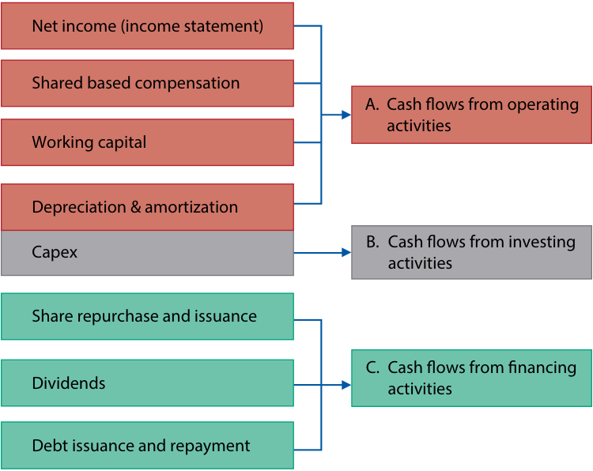

# Volume 4: Financial Statement Analysis
## Learning Module 12 Introduction to Financial Statement Modeling
### Part 1/4: Introduction (PDF Pages 459–473)

---

<!-- PDF Page 459 -->

# L E A R N I N G M O D U L E **<mark>12</mark>** 

### **Introduction to Financial Statement Modeling** 

##### **<mark>LEARNING OUTCOMES</mark>** 

|**_Mastery_**|**_The candidate should be able to:_**|
|---|---|
||demonstrate the development of a sales-based pro forma company model|
||explain how behavioral factors affect analyst forecasts and recommend remedial actions for analyst biases|
||explain how the competitive position of a company based on a Porter’s five forces analysis affects prices and costs|
||explain how to forecast industry and company sales and costs when they are subject to price inflation or deflation|
||explain considerations in the choice of an explicit forecast horizon and an analyst’s choices in developing projections beyond the short-term forecast horizon|

The two major accounting standard setters are as follows: 1) the International Accounting Standards Board (IASB) who establishes International Financial Reporting Standards (IFRS) and 2) the Financial Accounting Standards Board (FASB) who establishes US GAAP. Throughout this learning module both standards are referred to and many, but not all, of these two sets of accounting rules are identified. Note: changes in accounting standards as well as new rulings and/or pronouncements issued after the publication of this learning module may cause some of the information to become dated. 

<!-- PDF Page 460 -->

## **<mark>1</mark>** 

#### **INTRODUCTION** 

Financial statement modeling is a key step in the process of valuing companies and the securities they have issued. We begin our discussion with an overview of developing a revenue forecast. We then describe the general approach to forecasting each of the financial statements and demonstrate the construction of a financial statement model, including forecasted income statements, balance sheets, and statements of cash flows. Then, we describe key behavioral biases that can influence the modeling process and strategies to mitigate them. We then turn to several important topics on the effects of micro- and macroeconomic conditions on financial statement models: the impact of competitive factors on prices and costs, the effects of inflation and deflation, technological developments, and long-term forecasting considerations. 

Most of the examples and exhibits used throughout the reading can be downloaded as a Microsoft Excel workbook. Each worksheet in the workbook is labeled with the corresponding example or exhibit number in the text. 

###### **LEARNING MODULE OVERVIEW** 

- A financial statement model is the starting point for most valuation models, and valuation estimates can be made based on a variety of metrics, including free cash flow, EPS, EBITDA, and EBIT. 

- Some balance sheet line items, such as retained earnings, flow directly from the income statement, whereas accounts receivable, accounts payable, and inventory are very closely linked to income statement projections. 

- Working capital accounts are modeled by projecting working capital ratios (e.g., days of inventory, days sales outstanding, days payable outstanding) which are combined with the sales and cost of sales forecast to produce projected working capital accounts on the balance sheet. 

- Five key behavioral biases that influence analyst forecasts are overconfidence, illusion of control, conservatism, representativeness, and confirmation bias. 

- Illusion of control, a bias linked to overconfidence, is a tendency to overestimate the ability to control what cannot be controlled and to take ultimately fruitless actions in pursuit of control. 

- A common manifestation of confirmation bias among investment analysts is to structure the research process in pursuit of only positive news or certain criteria, or with a narrow scope. 

- Competitive factors affect a company’s ability to negotiate lower input prices with suppliers and to raise prices for products and services. Porter’s five forces framework can be used as a basis for identifying such factors. 

- Porter’s five forces are Threat of substitutes, Rivalry, Bargaining power of suppliers, Bargaining power of buyers, and Threat of new entrants. 

- Return on invested capital, ROIC, defined as net operating profit less adjusted taxes divided by the difference between operating assets and operating liabilities, is an after-tax measure of profitability. High and persistent levels of ROIC are often associated with having a competitive advantage. 

- Inflation and deflation can significantly affect the accuracy of forecasts for a company’s future revenue, <u>profit, and cash flow.</u> 

<!-- PDF Page 461 -->

- Forecasting revenue for a company faced with inflation in input costs requires an understanding of the price elasticity of the products, the different rates of cost inflation in the countries where the company is active, and the likely inflation in costs relevant to a company’s individual product categories. 

- ■ Faced with rising input prices, a company might decide to preserve its margins by passing on the costs to its customers, or it might decide to accept some margin reduction to increase its market share. 

- ■ The choice of the forecast time horizon can be influenced by certain factors, including the investment strategy for which the security is being considered, the cyclicality of the industry, company-specific factors, and the analyst’s employer’s preferences. 

- ■ Normalized earnings are the expected level of mid-cycle earnings for a company in the absence of any unusual or temporary factors that affect profitability. 

- ■ One of the greatest challenges facing the analyst is anticipating inflection points, such as from economic disruption, regulation, and technology, when the future will look significantly different from the recent past. 

#### **BUILDING A FINANCIAL STATEMENT MODEL** 

## **<mark>2</mark>** 

- demonstrate the development of a sales-based pro forma company model 

In this module, we apply the principles covered in earlier modules in Financial Statement Analysis and Corporate Issuers in a demonstration of building a financial statement model. The subject company is the Rémy Cointreau Group (Rémy), a French company that primarily sells spirits. After providing a brief overview of the company, we will focus primarily on the mechanics of constructing pro forma income statements, statements of cash flows, and balance sheets. Data sources for this example include the company’s fiscal year ended 31 March 2021 and 2020 annual reports, the company’s interim reports, and corresponding investor presentations for additional information on the underlying results of the respective divisions. While forecasts are described in some detail here, later modules in company analysis in the Equity topic area will discuss forecasting in much greater detail. 

##### **Company Overview** 

Rémy, whose reporting year ends 31 March, operates and reports three business segments: 

**1.** Cognac. This division, composed primarily of Rémy Martin brand cognac, represented approximately 73 percent of FY2021 (year-end 31 March 2021) revenue and 94 percent of total current operating profit. Current operating profit is a non-IFRS measure reported by Rémy equal to IFRS operating profit excluding items related to discontinued brands or items deemed infrequent or immaterial, such as impairment or litigation provisions. 

<!-- PDF Page 462 -->

**2.** Liqueurs & Spirits. A diverse portfolio of spirits brands, the main brands in this segment are Cointreau, Metaxa, St-Rémy, Mount Gay, Bruichladdich, and The Botanist. The segment represented approximately 25 percent of FY2021 revenue and 14 percent of current operating profits. 

**3.** Partner Brands. This segment includes other companies’ brands that are marketed through Rémy’s distribution network. They represented approximately 3 percent of FY2021 revenue and just under 0 percent of current operating profit, earning a slight operating loss in FY2021 of –EUR0.8 million. This division’s importance has declined significantly over time as the company discontinued distribution (“partner brand”) contracts. 

Segment financial information is summarized in Exhibit 1. As shown, the company’s largest business segment is also its most profitable: The Cognac segment earned a current operating profit margin of approximately 30 percent (= EUR221 million/ EUR735 million) in fiscal year 2021. Exhibits are in the downloadable Microsoft Excel workbook in a single worksheet titled “Rémy.” We strongly recommend following along with the Excel workbook and exploring the model construction in detail. 

**Exhibit 1: Analysis of Rémy’s Turnover and Operating Profit** 

|**_Revenue (euro millions)_**|**FY2019**|**FY2020**|**FY2021**|
|---|---|---|---|
|Cognac|774|736|735|
|Liqueurs and spirits|264|262|248|
|Partner brands|87|28|27|
|Total revenues|1,126|1,025|1,010|
|_Current Operating Profit (euro millions)_||||
|_i_ Cognac|236|200|221|
|Liqueurs and spirits|39|38|33|
|Partner brands|5|–2|–1|
|Holding/Corporate-level costs|–15|–20|–17|
|Total current operating profit|264|215|236|
|_Current Operating Profit Margins_||||
|Cognac|30.4%|27.1%|30.1%|
|Liqueurs and spirits|14.7%|14.3%|13.3%|
|Partner brands|5.6%|–6.2%|–3.0%|
|Holding/Corporate-level costs (percent of total revenue)|–1.3%|–2.0%|–1.7%|
|Total current operating margin|23.5%|21.0%|23.4%|

Construction of pro forma income statements, as Exhibit 2 illustrates, is composed of four forecasting steps: revenue, COGS, other operating expenses, and, finally, non-operating items. 

<!-- PDF Page 463 -->

**Exhibit 2: Income Statement Forecast Process** 

<!-- Start of picture text -->
1.  Revenue forecast 2.  Operating i.  COGS forecast expense forecast ii.  SG&A forecast 3.  Pro forma Segments EBIT forecast forecast check i.  Interest expense 4.  Non-operating forecast iii.  Shares outstanding expense forecast ii.  Income tax forecast expense forecast 5.  Pro forma income statement forecast <!-- End of picture text -->

##### **Revenue Forecast** 

For each segment, the change in revenue is driven by volume, price, and foreign currency estimates that are based on historical trends as adjusted for expected deviations from trend. Price changes refer not only to price changes for a single product but also to changes in mix, which are defined as changes resulting from selling varying quantities of higher- and lower-priced products. Changes in revenue attributable to volume or price/mix are organic growth and are shown separately from the impact of acquisitions and divestitures (scope change) and foreign exchange (forex impact in the model). 

In the Cognac segment, historical volume growth is usually in the 4 to –6 percent range. For future years, volume growth is expected to remain robust but slower than the 9.1 percent achieved in 2021 as the global recovery from the COVID-19 pandemic and associated recession fades (volumes were down 10.1 percent in FY2020). The growing number of affluent Asian consumers will likely keep demand high, while developed market consumption is likely to be rather flat. In the model, the assumption is for 7 percent volume growth in 2022, declining to 6 percent in 2023 and 2024. 

Price/mix contributed approximately 6.0 percent, 2.6 percent, and –5.4 percent to the Cognac segment revenue growth in FY2019, FY2020, and FY2021, respectively. Although the impact of price/mix on revenue growth has fluctuated in recent years, price/mix will likely remain a relatively significant contributor to revenue growth in the future given the favorable structure of the industry and the company’s efforts to increase the share of revenues accounted for by what it calls “exceptional spirits” (those that cost more than USD50 per bottle and are seeing a 10 percent annual demand growth). A 4 percent price/mix contribution to revenue growth is assumed in 2022, with the trend maintained into 2023 and 2024. The combined projections for 2022 of 7 percent volume growth and 4 percent price/mix impact results in overall organic revenue growth of 11.3 percent, calculated as [(1 + 0.07) × (1 + 0.04)] – 1. 

In addition to the impact of volume and price/mix, Rémy’s revenues are affected by movements in exchange rates. Company disclosures indicate that more than 70 percent of revenues are realized outside the eurozone, whereas most of Rémy’s production occurs within the eurozone. The model forecasts no foreign currency impact on revenue in the 2022–24 forecast period. 

<!-- PDF Page 464 -->

Exhibit 3 summarizes historical and projected information for the Cognac segment’s revenue. 

**Exhibit 3: Historical and Projected Information for Cognac Segment Revenue** 

||**FY2018**|**FY2019**|**FY2020**|**FY2021**|**FY2022E**|**FY2023E**|**FY2024E**|
|---|---|---|---|---|---|---|---|
|Cognac Segment Revenues (euro millions)|760|774|736|735|818|902|994|
|YoY%|7.4%|1.9%|–5.0%|–0.1%|11.3%|10.2%|10.2%|
|Volume growth (%)|6.0%|5.9%|–10.1%|9.1%|7.0%|6.0%|6.0%|
|Price/mix (%)|7.2%|6.0%|2.6%|–5.4%|4.0%|4.0%|4.0%|
|Organic growth (%)|13.6%|12.3%|–7.8%|3.2%|11.3%|10.2%|10.2%|
|Forex impact and scope change||||||||
|(%)|−5.8%|−4.0%|2.5%|–3.8%|0.0%|0.0%|0.0%|
|Effect of IFRS 15 adoption|0.0%|–6.0%|0.0%|0.0%|0.0%|0.0%|0.0%|
|YoY%|7.8%|2.3%|–5.3%|–0.6%|11.3%|10.2%|10.2%|

A similar analysis can be performed to project revenue for the other segments. Then, the amounts can be summed to derive projected consolidated revenue. 

##### **COGS** 

Rémy’s gross margin has remained roughly flat from FY2018 (67.5 percent) to FY2021 (67.3 percent) as total sales have decreased modestly. Going forward, we project gross margin to increase by 100 bps in each of the next three years based on increasing total revenues, particularly from price/mix, which is strongly accretive to gross margin (see the previous section on “Revenue Forecast”). Management has set a FY2030 objective of a 72.0 percent gross margin, largely in line with our forecasts. Should revenue growth prove more (less) robust than our forecast, we expect more (less) gross margin accretion. 

##### **SG&A Expenses and Other Operating Expenses** 

Distribution costs increased significantly over time, from 26.1 percent of revenue in FY2009 (not shown in the exhibits) to 38 percent in FY2018, and thereafter decreasing to 33.8 percent in FY2021. In particular, the setup of Rémy’s distribution network in Asia increased the cost base. Rémy is very committed to its brand building and is also diversifying geographically. We estimate modest increases in distribution costs as a percentage of revenue, of 20 bps per year. Administrative costs as a percentage of revenue have increased from 8.1 percent to 10.1 percent as revenues have fallen, owing to the COVID-19 pandemic. However, the growth in absolute euro amounts has been modest, with costs of approximately EUR100 million in FY2019–FY2021. We expect 1 percent growth in administrative costs per year through FY2024E. 

Other operating expenses (income), composed primarily of provisions for impairments of intangible assets, restructurings, and divestiture gains, has fluctuated from –EUR2 million to EUR20 million from FY2018 to FY2021. Because we do not anticipate any transactions that would result in other operating expenses or income, we forecast zero for this line in the model. 

Exhibit 4 provides a consolidated income statement for Rémy through the EBIT and EBIT margin line. 

<!-- PDF Page 465 -->

**Exhibit 4: Consolidated Historical and Projected Income Statement (Operating) for Rémy Cointreau Group (euro millions, unless noted)** 

||**FY2018**|**FY2019**|**FY2020**|**FY2021**|**FY2022E**|**FY2023E**|**FY2024E**|
|---|---|---|---|---|---|---|---|
|Sales|1,127|1,126|1,025|1,010|1,095|1,181|1,275|
|Cost of sales|366|415|348|330|347|362|379|
|Gross profit|761|711|677|680|748|819|897|
|Gross margin|67.5%|63.1%|66.1%|67.3%|68.3%|69.3%|70.3%|
|Change in gross margin|0.8%|–4.4%|2.9%|1.3%|1.0%|1.0%|1.0%|
|Distribution costs|433|346|355|342|373|404|439|
|Distribution costs as percent||||||||
|of sales|38.4%|30.7%|34.6%|33.8%|34.0%|34.2%|34.4%|
|Administrative expenses|92|101|107|103|104|105|106|
|Administrative expenses as % of sales|8.1%|8.9%|10.4%|10.1%|9.5%|8.9%|8.3%|
|Other operating expenses (income)|13|–2|20|0|0|0|0|
|EBIT|223|266|196|236|272|310|352|
|EBIT margin|19.8%|23.6%|19.1%|23.3%|24.8%|26.2%|27.6%|

##### **Operating Profit by Segment** 

In this section, we alternatively estimate operating profit and margin using a segment approach. Rémy discloses current operating profit for each of its segments as well as an operating cost at the corporate or holding company level. Recall that current operating profit is a non-IFRS measure that excludes certain items. These certain items are disclosed on Rémy’s income statement as “Other operating expenses (income).” Therefore, the sum of the segment current operating profit equals consolidated EBIT before other operating expenses (income). 

For the Cognac segment, the forecast of higher revenue growth, based partially on strong price/mix growth, assumes an improving product mix that will also result in a higher gross margin. But the benefit to gross margin will be somewhat mitigated by higher distribution costs. Thus, the expectation is that the Cognac segment’s operating margin will increase to 33.4 percent by FY2024. As a benchmark, this forecast can be compared with the financial results reported by Hennessy (part of LVMH), another cognac brand. That company’s operating margin in its Wine & Spirits segment in FY2017–2019 was 30–32 percent, though that business has a significantly higher mix of lower-priced products with lower gross margins. 

For the other segments, there is not much upside. In the Liqueurs & Spirits division, we assume operating margin to increase modestly to 13.6 percent. In total, Rémy Cointreau Group’s consolidated operating margin is forecast to improve from 23.4 percent in FY2021 to 27.6 percent in FY2024, largely because of growth and margin improvement in the Cognac segment, the most profitable division, and leverage from that sales growth on corporate-level costs. 

While a segment approach like Exhibit 5 can be used instead of a consolidated approach to forecasting revenue and operating profit, it is also commonly used as a “check” on the consolidated forecasts. This analysis revealed, for example, that the model relies significantly on margin improvement in the Cognac segment. 

<!-- PDF Page 466 -->

**Exhibit 5: Historical and Projected Operating Profit by Segment for Rémy Cointreau Group** 

|**Revenue (euro millions)**|**FY2018**|**FY2019**|**FY2020**|**FY2021**|**FY2022E**|**FY2023E**|**FY2024E**|
|---|---|---|---|---|---|---|---|
|Cognac|760|774|736|735|818|902|994|
|Liqueurs and spirits|267|264|262|248|251|253|256|
|Partner brands|100|87|28|27|26|26|26|
|Total revenues|1,127|1,126|1,025|1,010|1,095|1,181|1,275|

|**Current Operating Profit** **(euro millions)**|**FY2018**|**FY2019**|**FY2020**|**FY2021**|**FY2022E**|**FY2023E**|**FY2024E**|
|---|---|---|---|---|---|---|---|
|Cognac|204|236|200|221|255|291|332|
|Liqueurs and spirits|43|39|38|33|34|34|35|
|Partner brands|5|5|–2|–1|–1|–1|–1|
|Holding/Corporate-level costs|–16|–15|–20|–17|–16|–15|–14|
|Total current operating profit|237|264|215|236|271|309|352|
|**Current Operating Profit** **Margins**|**FY2018**|**FY2019**|**FY2020**|**FY2021**|**FY2022E**|**FY2023E**|**FY2024E**|
|Cognac|26.9%|30.4%|27.1%|30.1%|31.2%|32.3%|33.4%|
|Liqueurs and spirits|16.0%|14.7%|14.3%|13.3%|13.4%|13.5%|13.6%|
|Partner brands|5.3%|5.6%|–6.2%|–3.0%|–3.0%|–3.0%|–3.0%|
|Holding/Corporate-level costs|–1.4%|–1.3%|–2.0%|–1.7%|–1.5%|–1.3%|–1.1%|
|Total current operating profit|21.0%|23.5%|21.0%|23.4%|24.8%|26.2%|27.6%|

##### **Non-Operating Items** 

Three types of non-operating line items are included in the model: finance expenses (i.e., interest expenses), income taxes, and shares outstanding. 

Net finance cost on Rémy’s income statement is interest expense on debt less interest income earned on cash and investments. Forecasting net finance cost, therefore, requires estimating the debt and cash positions and interest rates paid and earned. 

Companies pay a fixed or variable interest rate on debt. If the interest rate is variable, the rate is typically determined by a market reference rate plus a credit spread. As shown in Exhibit 6, Rémy’s interest expenses are fixed and calculated as 1.7 percent incurred on gross debt at the beginning of the period (EUR720 million at end of FY2020). Other financial expenses are assumed to be zero. Gross debt and the interest rate paid on it are estimated to remain flat from the year ended FY2021 level 

Although interest income is typically forecasted after forecasting the cash position from the forecasted statement of cash flows, in this case we have simply estimated EUR0 in interest income through the model period; in each of FY2018–FY2021, annual interest income was EUR0, EUR0, EUR0.1, and EUR0.2 million, respectively, because Rémy maintains its liquidity in assets with zero or very low yields. For companies that 

<!-- PDF Page 467 -->

own liquid assets with higher interest rates, or in higher interest rate environments, interest income should be forecast in the same manner as interest expense: forecasted cash and investments multiplied by a forecasted interest rate. 

**Exhibit 6: Debt Position and Financial Costs and Income for Rémy (EUR millions, unless noted)** 

||**FY2018**|**FY2019**|**FY2020**|**FY2021**|**FY2022E**|**FY2023E**|**FY2024E**|
|---|---|---|---|---|---|---|---|
|Long-term financial debt|397|424|452|424|424|424|424|
|Short-term financial debt and accrued interest|73|98|268|92|92|92|92|
|Gross debt|470|522|720|515|515|515|515|
|Interest expense|14.5|13.7|12.9|12.1|8.7|8.7|8.7|
|Interest rate (on beginning||||||||
|balance)||2.9%|2.5%|1.7%|1.7%|1.7%|1.7%|
|Interest income|0.0|0.0|0.1|0.2|0.0|0.0|0.0|
|Net finance cost|14.5|13.7|12.8|11.9|8.7|8.7|8.7|

##### **Corporate Income Tax Forecast** 

The French statutory corporate income tax rate at the time of analysis is 32 percent. Rémy Cointreau Group’s effective tax rate has, over the longer run, been close to the statutory rate. Therefore, an estimated 32 percent effective tax rate is used in the forecast period. Rémy has no material minority interests in any of its subsidiaries. 

##### **Shares Outstanding** 

Shares outstanding to compute earnings per share (EPS) on the income statement are disclosed in two ways, both weighted averages throughout the fiscal year: basic and diluted. Basic shares outstanding includes common equity securities outstanding, while diluted shares outstanding is a type of what-if analysis; it is basic shares outstanding plus the number of shares from the exercise or conversion of in-the-money instruments, less an assumed repurchase of those if-issued shares. 

Typically, the two major factors that affect shares outstanding over time are share issuance related to equity-based compensation of employees (increases shares outstanding) and share repurchases (decreases shares outstanding). Less common but sometimes significant transactions that also affect shares outstanding include acquisitions financed with stock, secondary issuance, and conversions of preferred stock or other instruments to common stock. 

Exhibit 7 shows beginning and ending basic shares outstanding for the past six fiscal years as well as the annual net amount of share repurchases and issuance, which were gathered from the statements of stockholders’ equity and notes to financial statements. Additionally, the basic and diluted shares outstanding on the income statement used to calculate basic and diluted EPS (weighted averages) are shown and differed by approximately 2.6 million shares in each of the past five years. 

<!-- PDF Page 468 -->

**Exhibit 7: Shares Outstanding for Rémy (euro millions, unless noted)** 

||**FY2016**|**FY2017**|**FY2018**|**FY2019**|**FY2020**|**FY2021**|
|---|---|---|---|---|---|---|
|Beginning basic|||||||
|shares outstanding|48.6|48.6|49.6|50.0|49.8|49.8|
|Share repurchases|–0.0|0.0|–0.3|–1.0|–0.0|0.0|
|Share issuance|0.0|1.0|0.7|0.8|0.1|0.4|
|Ending basic shares outstanding|48.6|49.6|50.0|49.8|49.8|50.3|
|Weighted average|||||||
|basic shares|48.6|49.1|49.8|50.1|49.8|50.1|
|Dilutive|||||||
|securities|0.1|2.7|2.6|2.6|2.6|2.6|
|Weighted average diluted shares|48.7|51.8|52.4|52.7|52.4|53.1|

As evident in Exhibit 7, shares outstanding for Rémy have not changed materially in six years because the company does not pay significant share-based compensation nor has it repurchased shares. Additionally, management has not disclosed an intention to repurchase shares in the near term. Therefore, the model assumes that weighted average basic and diluted shares outstanding on the income statement remain flat at the FY2021 level. 

##### **Pro Forma Income Statement** 

Now with the forecast components in place, a consolidated pro forma income statement can be constructed, as shown in Exhibit 8. Although not presented on the face of the income statement as disclosed by the company, the calculation of EBITDA is shown after EBIT by adding depreciation and amortization expense from the statement of cash flows. It is not linked to other quantities on the income statement but merely shown as a useful profitability measure. 

**Exhibit 8: Consolidated Historical and Projected Income Statement for Rémy Cointreau Group (euro millions, unless noted)** 

||**FY2018**|**FY2019**|**FY2020**|**FY2021**|**FY2022E**|**FY2023E**|**FY2024E**|
|---|---|---|---|---|---|---|---|
|Sales|1,127|1,126|1,025|1,010|1,095|1,181|1,275|
|Cost of sales|366|415|348|330|347|362|379|
|Gross profit|761|711|677|680|748|819|897|
|Gross margin|67.5%|63.1%|66.1%|67.3%|68.3%|69.3%|70.3%|
|Change in gross margin|0.8%|–4.4%|2.9%|1.3%|1.0%|1.0%|1.0%|
|Distribution costs|433|346|355|342|373|404|439|
|Distribution costs as percent of sales|38.4%|30.7%|34.6%|33.8%|34.0%|34.2%|34.4%|

<!-- PDF Page 469 -->

||**FY2018**|**FY2019**|**FY2020**|**FY2021**|**FY2022E**|**FY2023E**|**FY2024E**|
|---|---|---|---|---|---|---|---|
|Administrative expenses|92|101|107|103|104|105|106|
|Administrative||||||||
|expenses as percent of sales|8.1%|8.9%|10.4%|10.1%|9.5%|8.9%|8.3%|
|Other operating expenses||||||||
|(income)|13|–2|20|0|0|0|0|
|EBIT|223|266|196|236|272|310|352|
|EBIT margin|19.8%|23.6%|19.1%|23.3%|24.8%|26.2%|27.6%|
|Depreciation and||||||||
|amortization (add-back)|22|30|33|34||||
|Depreciation and||||||||
|amortization as percent of||||||||
| sales|1.9%|2.7%|3.3%|3.4%||||
|EBITDA|245|296|229|270||||
|EBITDA margin|21.7%|26.3%|22.3%|26.7%||||
|Net finance costs|15|14|13|12|9|9|9|
|i Other financial expenses i|8|19|15|3|0|0|0|
|Total financial||||||||
|i expenses|22|33|28|15|9|9|9|
|Profit before tax|201|233|167|221|263|301|344|
|i Income tax|54|68|61|78|84|96|110|
|Effective tax rate|26.6%|29.0%|36.4%|35.1%|32.0%|32.0%|32.0%|
|f Income from associates|1|–7|0|1|0|0|0|
|Profit from continuing||||||||
|i operations|148|159|107|144|179|205|234|
|Profit from discontinued||||||||
|i operations|0|0|6|0|0|0|0|
|Net profit for the year|148|159|113|144|179|205|234|
|YoY%||8%|–29%|27%|24%|14%|14%|
|EPS basic continuing||||||||
|operations|2.97|3.18|2.14|2.88|3.58|4.09|4.67|
|EPS diluted continuing operations|2.82|3.02|2.04|2.74|3.40|3.89|4.44|
|EPS basic total|2.97|3.18|2.27|2.88|3.58|4.09|4.67|
|EPS diluted total|2.82|3.02|2.16|2.74|3.40|3.89|4.44|
|Average number of shares,||||||||
|basic (millions)|49.8|50.1|49.8|50.1|50.1|50.1|50.1|
|Average number of shares||||||||
|, diluted (millions)|52.4|52.7|52.4|52.6|52.6|52.6|52.6|

<!-- PDF Page 470 -->

##### **Pro Forma Statement of Cash Flows** 

The forecast statements of cash flows begin with forecasted net income and other amounts from the forecast income statement, and then typically require estimates for capital expenditures, depreciation and amortization, working capital, share-based compensation, dividends, and share repurchases. Once the forecasted income statements and statements of cash flows are completed, forecasting the balance sheet is largely a matter of properly linking the spreadsheet, as illustrated in Exhibit 9. 

**Exhibit 9: Statement of Cash Flows Projection Process** 

<!-- Start of picture text -->
Net income (income statement) Shared based compensation A. Cash flows from operating activities Working capital Depreciation & amortization B. Cash flows from investing Capex activities Share repurchase and issuance C. Cash flows from financing Dividends activities Debt issuance and repayment <!-- End of picture text -->

##### **Capital Investments and Depreciation Forecasts** 

Capital investment, or capex, as a percentage of revenue was 5.3 percent in FY2021. Given the healthy volume growth prospects, we expect capex to remain at a modestly above historical average level of 5.0 percent of sales through FY2024. With Rémy’s growing fixed asset base, it is logical that depreciation will increase. The model assumes that depreciation and amortization (D&A) is equal to 4.2 percent of prior year fixed assets, the average of the past three years. The breakdowns of capex and D&A are shown in Exhibit 10. 

**Exhibit 10: Capex, D&A Breakdowns** 

||**2018**|**2019**|**2020**|**2021**|**2022E**|**2023E**|**2024E**|
|---|---|---|---|---|---|---|---|
|D&A (euro millions)|22|30|33|34|36|36|37|
|As percent of prior year i||||||||
|fixed assets||4.0%|4.3%|4.2%|4.2%|4.2%|4.2%|
|Capex, PP&E, and intangi-||||||||
|bles (euro millions)|34|45|65|54|55|59|64|

<!-- PDF Page 471 -->

||**2018**|**2019**|**2020**|**2021**|**2022E**|**2023E**|**2024E**|
|---|---|---|---|---|---|---|---|
|Capex as % of sales|3.0%|4.0%|6.3%|5.3%|5.0%|5.0%|5.0%|
|Capex/D&A ratio|1.6|1.5|1.9|1.6|1.5|1.6|1.7|

##### **Working Capital Forecasts** 

We have assumed that working capital ratios will remain similar to what the company experienced in the FY2018–21 period. In Exhibit 11, we include only the relevant balance sheet items related to revenues and costs (i.e., inventories, accounts receivable, and accounts payable) and keep the other items constant. Rémy Cointreau Group had positive net working capital of 105 percent of its sales in fiscal year 2021. The largest working capital component is inventory because much of Rémy’s cognac requires years of aging. Inventory days on hand in FY2021 was 1,493, which reflects an approximate 300-day increase owing to the volume slowdown during the COVID-19 pandemic. Inventory days are partially mitigated by extended payment terms to suppliers; days payable outstanding has averaged around 500 days since FY2018. 

We model the working capital accounts by projecting working capital ratios (days of inventory, days sales outstanding, days payable outstanding) which are combined with the sales and cost of sales forecast to produce projected working capital accounts on the balance sheet. We expect inventory days to decline through FY2024 as the inventory increase that occurred during the COVID-19 pandemic is worked through, days sales outstanding to remain at FY2021 levels, and for model days payable outstanding to decline back to an average level, again reflecting a normalization after the COVID-19 pandemic. As a result of the decrease in inventory days, the model projects a net positive contribution from working capital to the reconciliation of net income to cash flows from operations on the statement of cash flows, which is in stark contrast to prior years’ negative contribution. 

**Exhibit 11: Working Capital Development for Rémy** 

||**FY2018**|**FY2019**|**FY2020**|**FY2021**|**FY2022E**|**FY2023E**|**FY2024E**|
|---|---|---|---|---|---|---|---|
|Inventories (euro||||||||
|millions)|1,170|1,246|1,364|1,493|1,426|1,340|1,245|
|Accounts receivable|210|271|199|158|171|185|200|
|Accounts payable|517|544|534|586|597|604|610|
|Working capital, net|863|973|1,029|1,065|1,000|922|835|
|Percent of sales|77%|86%|100%|105%|91%|78%|65%|
|Change in working capital||–110|–56|–36|64|79|87|
|Days inventories on hand|1,166|1,095|1,431|1,650|1,500|1,350|1,200|
|Days sales outstanding|68|88|71|57|57|57|57|
|Dayspayable outstanding|515|478|561|648|628|608|588|

<!-- PDF Page 472 -->

##### **Forecasted Cash Flow Statement** 

With net income, D&A, change in working capital, capex, and debt estimates already in place, the cash flow statement shown in Exhibit 12 is almost automatically generated by linking the relevant lines on a spreadsheet. The three significant items left to forecast are share-based compensation, share repurchases or issuance, and dividends. Going forward, the model assumes flat share-based compensation, no share repurchases or issuance, and dividends paid equal to the FY2021 level through FY2024. Lines labeled “other” are aggregated and zeroed out going forward because they are immaterial, difficult to forecast, or both. 

**Exhibit 12: Projected Statement of Cash Flows for Rémy (euro millions)** 

||**FY2018**|**FY2019**|**FY2020**|**FY2021**|**FY2022E**|**FY2023E**|**FY2024E**|
|---|---|---|---|---|---|---|---|
|Net income||||||||
|(loss)|148|159|113|144|179|205|234|
|D&A|22|30|33|34|36|36|37|
|Share-based||||||||
|compensation|3|3|4|2|2|2|2|
|Investment in||||||||
|working capital|–7|–162|–72|–13|64|79|87|
|Other non-cash amounts|20|22|3|10|0|0|0|
|Cash flows from operations|185|53|81|177|281|322|360|
|Capex (PP&E and intangibles)|–34|–45|–65|–54|–55|–59|–64|
|Other investing activities|2|92|12|62|0|0|0|
|Cash flows from investments|–32|47|–53|8|–55|–59|–64|
|Debt issuance||||||||
|(repayment)|0|11|196|–246|0|0|0|
|Share issuance||||||||
|(repurchases)|–27|–104|–2|2|0|0|0|
|Dividends paid|–25|–9|–132|–10|–10|–10|–10|
|Cash flows from||||||||
|l financing|–52|–102|62|–253|–10|–10|–10|
|FX translation effects|8|–6|1|–1|0|0|0|
|Net change in||||||||
| cash|109|–8|91|–68|217|254|287|

<!-- PDF Page 473 -->

||**FY2018**|**FY2019**|**FY2020**|**FY2021**|**FY2022E**|**FY2023E**|**FY2024E**|
|---|---|---|---|---|---|---|---|
|Cash and equivalents,||||||||
|beginning|78|187|179|269|201|418|671|
|Cash and equiv- alents, end|187|179|269|201|418|671|958|

##### **Forecasted Balance Sheet** 

The forecasted balance sheet is given in Exhibit 13 and is based on the combination of the projected income statement (Exhibit 8), the projected statement of cash flows (Exhibit 12), and the historical starting balance sheet. The balance sheet items that were not specifically discussed are held constant, which preserves the accounting identity. For ease of presentation, the stockholders’ equity lines (e.g., common stock, additional paid in capital, retained earnings, treasury shares, accumulated other comprehensive income) are aggregated. For each forecast period, common stockholders’ equity is the prior year value plus net income and share-based compensation less dividends. 

If each of the discussed lines is linked properly—and other lines are held constant from FY2021—the forecasted balance sheet should balance each year. Consult the Rémy worksheet in the downloadable Microsoft Excel workbook for greater detail. 

**Exhibit 13: Projected Balance Sheet for Rémy (euro millions)** 

||**FY2018**|**FY2019**|**FY2020**|**FY2021**|**FY2022E**|**FY2023E**|**FY2024E**|
|---|---|---|---|---|---|---|---|
|Cash and equivalents|186.8|178.6|269.4|201.0|418|671|958|
|Accounts receivable|210|271|199|158|171|185|200|
|Inventories|1,170|1,246|1,364|1,493|1,426|1,340|1,245|
|Other current assets|16|5|16|10|10|10|10|
|Total current assets|1,583|1,700|1,848|1,861|2,025|2,206|2,412|
|PP&E, intangibles, goodwill, net|752|785|808|845|864|887|913|
|Investment in associates|20|1|1|2|2|2|2|
|Other non-current assets|186|139|131|73|73|73|73|
|Total assets|2,542|2,625|2,789|2,781|2,964|3,168|3,400|
|Short-term/current debt|73|98|268|92|92|92|92|
|Accounts payable|517|544|534|586|597|604|610|
|Other current liabilities and accrued||||||||
|expenses|26|31|39|42|42|42|42|
|Total current liabilities|616|673|842|720|731|737|744|
|Long-term/non-current debt|397|424|452|424|424|424|424|
|Other non-current liabilities|121|102|92|88|88|88|88|
|Total common equity|1,407|1,425|1,403|1,548|1,720|1,918|2,144|
|NCI (Non-Controlling Interest)|1|1|1|1|1|1|1|
|Total equityand liabilities|2,542|2,625|2,789|2,781|2,964|3,168|3,400|

