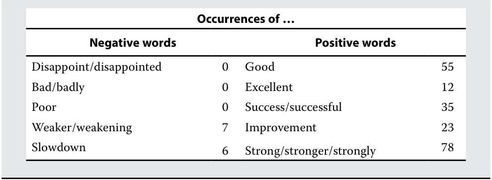

# Volume 4: Financial Statement Analysis
## Learning Module 12 Introduction to Financial Statement Modeling
### Part 2/4: Behavioral Finance and Analyst Forecasts (PDF Pages 474–489)

---

<!-- PDF Page 474 -->

### **Valuation Model Inputs** 

A financial statement model is the starting point for most valuation models. Valuation estimates can be made based on a variety of metrics, including free cash flow, EPS, EBITDA, and EBIT. The company-specific inputs needed to build a discounted cash flow (DCF) to the firm model (to estimate enterprise value) are shown in Exhibit 14. All the variables are sourced from the forecasted income statements and statements of cash flows. 

**Exhibit 14: Calculating Free Cash Flow to the Firm as Basis for a DCF Valuation Model (euro millions)** 

||**FY2021**|**FY2022E**|**FY2023E**|**FY2024E**|
|---|---|---|---|---|
|EBIT|236|272|310|352|
|Taxes (32% tax rate)|–75|–87|–99|–113|
|After-tax EBIT|160|185|211|240|
|D&A|34|36|36|37|
|Change in working capital|–13|64|79|87|
|Capital expenditures|–54|–55|–59|–64|
|Free cash flow to the firm|127|230|267|300|

# **<mark>3</mark>** 

## **BEHAVIORAL FINANCE AND ANALYST FORECASTS** 

explain how behavioral factors affect analyst forecasts and recommend remedial actions for analyst biases 

Studies have shown that experts in many fields persistently make forecasting errors arising from behavioral biases, and investment analysts’ models of financial statements are in no way immune. To improve forecasts and the investment decisions based on them, analysts must be aware of the impact of biases and potential remedies for them. Five key behavioral biases that influence analyst forecasts are overconfidence, illusion of control, conservatism, representativeness, and confirmation bias. 

### **Overconfidence in Forecasting** 

Overconfidence bias occurs when people demonstrate unwarranted faith in their own abilities. Studies have identified that 90 percent _confidence intervals_ for forecasts, which should leave only 10 percent error rates, turn out to be wrong as much as 40 percent of the time (Russo and Schoemaker 1992). Studies have also suggested that individuals are more confident when making contrarian predictions that counter the consensus. That is, overconfidence arises more frequently when forecasting what others do not expect (Dunning, Griffin, Milojkovic, and Ross 1990). 

To mitigate overconfidence bias, analysts should record and share their forecasts and review them regularly, identifying _both_ the correct and incorrect forecasts they have made. Given the wide range of outcomes for most financial variables, an analyst will likely find that they have been wrong as much or more often than they have been right. The goal is to recognize that forecast error rates are high, so mitigating actions 

<!-- PDF Page 475 -->

that widen the confidence interval of forecasts should be taken. One such action is **scenario analysis** . By asking, “Where could I be wrong and by how much?,” an analyst can generate different forecast scenarios. 

#### **EXAMPLE 1** 

### **Mitigating Overconfidence: Scenario Analysis for Rémy** 

In the prior lesson, a financial statement model was constructed for Rémy Cointreau Group that includes only one set of forecasted numbers, or one scenario. Creating several more scenarios is an important modeling step because the range of outcomes for the most important variable is wider than a single point. 

Three important variables in the forecast of free cash flow are organic sales growth in the Cognac segment, EBIT margin, and net working capital as a percentage of sales. A benefit of the spreadsheet-driven model is that the forecasts can be easily modified to calculate different free cash flow estimates. The base case inputs and forecast for 2024E free cash flow to the firm, as well as figures for two different scenarios, are shown in Exhibit 15. 

Alternative Scenario 1 assumes that the Cognac segment’s organic growth remains the same as its FY2021 rate, an EBIT margin of 23.6 percent, where it was before the COVID-19 pandemic, and working capital of 86 percent of sales, also the pre-pandemic level from FY2019. Alternative Scenario 2 assumes the same Cognac segment organic growth rate as the base case but an EBIT margin of 25.0 percent and working capital of 90 percent of sales. This scenario reflects strong growth but a high level of reinvestment in sales and marketing costs and aged cognac inventory to support that growth. 

As Exhibit 15 demonstrates, there is a wide range of free cash flow estimates for 2022E–2024E because of a wide range of reasonable inputs for key variables. 

**Exhibit 15: Calculating Free Cash Flow to the Firm as Basis for a DCF Valuation Model (euro millions)** 

|**Base Case**|**2022E**|**2023E**|**2024E**|
|---|---|---|---|
|Cognac segment organic growth|11.3%|10.2%|10.2%|
|EBIT margin|24.8%|26.2%|27.6%|
|Working capital as percent of sales|91%|78%|65%|
|Free cash flow to the firm est.|230|267|300|
|**Alternative Scenario 1**|**2022E**|**2023E**|**2024E**|
|Cognac segment organic growth|4.0%|4.0%|4.0%|
|EBIT margin|23.6%|23.6%|23.6%|
|Working capital as percent of sales|86%|86%|86%|
|Free cash flow to the firm est.|318|133|129|
|**Alternative Scenario 2**|**2022E**|**2023E**|**2024E**|
|Cognac segment organic growth|11.3%|10.2%|10.2%|
|EBIT margin|25.0%|25.0%|25.0%|
|Working capital as percent of sales|90%|90%|90%|
|Free cash flow to the firm est.|240|109|105|

<!-- PDF Page 476 -->

### **Illusion of Control** 

A bias often linked to overconfidence, illusion of control is a tendency to overestimate the ability to control what cannot be controlled and to take ultimately fruitless actions in pursuit of control. This bias often manifests in analysts’ beliefs that forecasts can be rendered more accurate in two ways: by acquiring more information and opinions from experts and by creating more granular and complex models. Although additional information and complexity in model specification can improve forecasting accuracy, there are diminishing marginal returns. The amount of material information available for an investment is finite and adding immaterial information will mislead. Complex models tend to be overfitted to historical data sets which do not prove robust in a range of environments that include never-before-seen outliers. Excessive breadth of data and model complexity can also conceal assumptions and make updating forecasts upon the receipt of new information difficult. Finally, analysts face significant opportunity costs; additional hours modeling one company could mean that the analyst will examine fewer opportunities in total. 

Beyond awareness of the bias and the recognition that uncertainty is an inherent characteristic in investments, illusion of control can be mitigated by restricting modeling variables to those that are regularly disclosed by the company, focusing on the most important or impactful variables, and speaking only with those who are likely to have unique or significant perspectives. 

#### **EXAMPLE 2** 

### **Illusion of Control: How Much Model Complexity?** 

Rémy Cointreau Group regularly reports revenues by segment and by geographic region (Europe/Middle East/Africa, the Americas, and Asia Pacific). It does not disclose segment revenue by geographic region (e.g., the Cognac segment revenue in the Asia Pacific region), nor does it disclose revenue by sales channel, such as retailers versus bars and restaurants, travel retail, and so on. In its quarterly earnings calls, however, the company often makes numerous references to segment growth rates in specific regions and growth rates of specific channels, even though the actual numbers are not disclosed. Such a practice is common, especially during the COVID-19 pandemic because large sales channel shifts occurred: travel retail in most regions experienced declines >90 percent, sales shifted from bars and restaurants to retailers for at-home consumption, and different geographies were affected by the pandemic at different times. 

An analyst might be tempted to collect all these growth rates and other anecdotal figures that management discloses on its earnings calls and, perhaps by combining them with third-party estimates of sales, to build an extensive revenue model for Rémy in which each segment is broken out into geographic regions and sales channels. 

Although such an endeavor might be useful to set expectations and to monitor over time, building the revenue forecast in this way would introduce several problems and probably not materially improve accuracy. First, because the data used in the model are not regularly disclosed, there is no way to check actuals versus estimates. Second, model construction would take dozens of hours. Finally, and perhaps most importantly, whether the constituent small parts of such a model would be accurate is unclear, which would not make the consolidated revenue forecast any more accurate than a simpler model. 

<!-- PDF Page 477 -->

### **Conservatism Bias** 

Conservatism bias is a bias in which people maintain their prior views or forecasts by inadequately incorporating new information. This often happens in forecasting when an analyst does not update their forecasting after receiving conflicting information, such as disappointing earnings results or a competitor action. Although the most common form of conservatism is the reluctance to incorporate new negative information into a forecast, analysts could also fail to adequately incorporate positive information and thus have estimates that are too low. A different name for conservatism bias in this context is anchoring and adjustment, referring to an analyst using their prior estimates as an “anchor” that is subsequently adjusted. Although nothing is wrong with modifying a previous forecast, the previous forecast or anchor tends to exert significant influence; in other words, the adjustment is too small, and the updated forecast is too close to the previous forecast. 

Conservatism bias can be mitigated by reviews of forecasts and models by an investment team at a regular interval, such as each quarter, and by creating flexible models with fewer variables, to make changing assumptions easier. Because conservatism bias is related to overconfidence and the illusion of control, mitigating those biases can also serve to mitigate conservatism. 

#### **EXAMPLE 3** 

### **Conservatism Bias: Rémy Management Guidance for FY2022** 

The base case forecasts in the Rémy Cointreau Group model call for organic revenue growth of 11.3 percent and net income growth of 24 percent in FY2022E over FY2021. However, during the earnings call for the fourth quarter of FY2021, Rémy management gave the following guidance for FY2022: 

- “Fiscal year 2022 will be a strong year of growth and investment, and we are on track to achieve our 2030 [objectives of a 72% gross margin and 33% operating margin].” 

- “Being ahead of [our] 2030 strategic plan and given the favorable environment, [we] have decided to revise up [our] strategic investments [in sales and marketing] to support brands through the recovery and boost their medium-term growth potential by developing brand awareness and attractiveness.” 

- Fiscal year 2022 will have “top-line and bottom-line growth in the mid-teens in organic terms.” 

Based on these comments, your colleague suggests revising the Rémy model slightly by reducing the operating margin forecast to reduce net income growth from 24 percent to 20 percent. 

1. What behavioral bias does your colleague’s suggestion exhibit, and what research or steps should be taken, if any, with respect to revising the Rémy model? Explain your answer. 

#### **Solution:** 

Your colleague is exhibiting conservatism bias or anchoring and adjustment; they are anchored to the prior forecast of 24 percent net income growth and not fully considering management’s guidance on profitability. Changing the model to follow the guidance without further consideration is not necessarily appropriate because results can and often do under- or 

<!-- PDF Page 478 -->

outperform guidance. However, in this case, management guidance differs quite significantly from the FY2022E forecast on both sales growth and net income growth. As a first step, management’s credibility should be assessed by examining the company’s performance against management guidance in the past. Second, the guidance should be considered as a scenario in the scenario analysis, and the investment implications of that scenario should be examined; for example, if the company will in fact increase sales and profits at a mid-teens rate in FY2022, does that result in an investment decision? Finally, the performance of, and guidance provided by, other alcohol and spirits companies should be compared to these figures as a check for reasonableness. 

### **Representativeness Bias** 

Representativeness bias refers to the tendency to classify information based on past experiences and known classifications. New information might resemble or seem representative of familiar elements already classified but can in fact be very different and is better viewed from a different perspective. In these instances, the classification reflex can deceive, producing an incorrect understanding that biases all future thinking about the information. Base-rate neglect is a common form of representativeness bias in forecasting. In base-rate neglect, a phenomenon’s rate of incidence in a larger population, or characteristics of a larger class to which a specific member belongs—its base rate—is neglected in favor of situation- or member-specific information. Considering the base rate is sometimes known as the “outside view,” while the situation-specific is known as the “inside view.” 

For example, an analyst is modeling operating costs and margins for a biopharmaceutical company. The “inside view” approach would consider company-specific factors such as the types of drugs the company sells, the number of salespeople needed in each geographic region for each drug, and so on. The “outside view” approach would view the company as a member of the “biopharmaceuticals” industry, of which there are many others, and use industry or sector averages for gross margin, R&D expense as percentage of sales, and so on in the model. 

Neither the outside nor inside view is superior; what makes for a superior forecast is considering both. One way of doing so is by starting with the base rate but determining which factors make the target company different from the base rate or class average and what the implications of those differences are, if any. For example, the analyst modeling the biopharmaceuticals company might start with industry averages in the model but change some of the variables to account for factors such as royalties versus product sales revenues, geographic composition of revenues, and whether the company is likely to face patent expirations on its products over the forecast period. 

#### **EXAMPLE 4** 

### **Considering Base Rates for Rémy** 

While constructing the Rémy model in the prior lesson, little attention was given to comparable companies or to the broader industry to which Rémy belongs. In other words, the model was constructed primarily with the “inside view.” In this example, Rémy is put in the context of six other spirits-focused alcohol companies: Brown-Forman Corporation, Pernod Ricard SA, Davide Campari-Milano N.V., Diageo plc, Becle S.A.B de C.V. (Cuervo), and the Wine & Spirits segment of LVMH (LVMH W&S) for the five most recently reported fiscal years at the time of analysis. The variable used for the industry comparison is the five-year 

<!-- PDF Page 479 -->

average of EBIT margin because it is a key model input, and the profitability of an individual company is strongly influenced by industry profitability. Many of these peer companies are significantly larger by revenue than Rémy, which is useful because we have modeled Rémy becoming larger over time. The analysis for Exhibit 16 is included in the Exhibit 16 worksheet in the downloadable Microsoft Excel workbook. 

#### **Exhibit 16: EBIT Margin Comparison of Spirits Companies, Last Five Reported Fiscal Years (euro millions)** 

|**EBIT margin**|**MRY-4**|**MRY-3**|**MRY-2**|**MRY-1**|**Most** **Recent** **Year (MRY)**|
|---|---|---|---|---|---|
|Rémy|20%|20%|24%|19%|23%|
|Brown Forman|34%|32%|34%|32%|34%|
|Pernod|24%|25%|26%|26%|12%|
|Campari|22%|26%|25%|25%|17%|
|Diageo|27%|30%|30%|31%|18%|
|Cuervo|23%|26%|20%|18%|20%|
|LVMH W&S|31%|31%|32%|31%|29%|
|Peer average (ex Rémy)|27%|28%|28%|27%|22%|
|Peer five-year average (ex Rémy)|26%|||||

1. Evaluate the base case forecasts in the Rémy model as well as Rémy’s management’s FY2030 objective of a 33 percent operating margin considering the analysis in Exhibit 16. 

#### **Solution:** 

The base case forecasts in the Rémy model are for EBIT margins of 24.8 percent, 26.2 percent, and 27.6 percent in FY2022E, FY2023E, and FY2024E, respectively. The most recently reported fiscal year(s) for most of the peer companies include the effect of deleveraging from sales declines associated with the COVID-19 pandemic. Aside from that, the base case forecasts are close to the peer average and by that measure appear reasonable, though they are substantially higher than the past five years of profitability for Rémy itself. 

Rémy management’s objective of 33 percent operating margin in 2030 appears high relative to those of its peers; only one company, Brown Forman, has achieved that level of profitability, on annual revenues ~3.0× that of Rémy. Industry-leading growth and profitability of Rémy’s Cognac segment will be required to meet this objective. 

### **Confirmation Bias** 

Confirmation bias is the tendency to look for and notice what confirms prior beliefs and to ignore or undervalue whatever contradicts them. A common manifestation of this bias among investment analysts is to structure the research process in pursuit of only positive news or certain criteria, or with a narrow scope. For example, an analyst might research a particular company but conduct only cursory research on 

<!-- PDF Page 480 -->

its competitors and companies that offer substitute products. An analyst who has a positive view on a company might speak only to other analysts who share that view and the company’s management, all of whom will likely tell the analyst what they want to hear and already know. Confirmation bias is closely related to overconfidence and representativeness biases. 

The extent to which company management can be excessively optimistic is shown in Exhibit 17, which analyzes the annual report of a major European bank for 2007, published mere months before it entered bankruptcy and was nationalized. 

Speaking with management is valuable given their role and should not be excluded from the research process, but analysts must be aware of management’s inherent bias and seek differing perspectives, especially when examining a company with significant controversy. Two approaches to mitigating confirmation bias in the forecasting process are to speak to or read research from analysts with a negative opinion on the security under scrutiny and to seek perspectives from colleagues who are not economically or psychologically invested in the subject security. 

#### **EXAMPLE 5** 

### **Management Optimism** 

Consider this text analysis of the chairman’s statement and business review in the 2007 annual report of a major European bank published in 2008, a few months before the bank was rescued by the government. 

#### **Exhibit 17: Text Analysis** 

<!-- Start of picture text -->
Occurrences of … Negative words Positive words Disappoint/disappointed 0 Good 55 Bad/badly 0 Excellent 12 Poor 0 Success/successful 35 Weaker/weakening 7 Improvement 23 Slowdown 6 Strong/stronger/strongly 78 <!-- End of picture text -->

# **<mark>4</mark>** 

## **THE IMPACT OF COMPETITIVE FACTORS IN PRICES AND COSTS** 

explain how the competitive position of a company based on a Porter’s five forces analysis affects prices and costs 

One of the tools that analysts can use to think about how competition will affect financial results is Michael Porter’s widely used “five forces” framework (see Porter 1980) introduced in earlier learning modules. 

<!-- PDF Page 481 -->

### **Cognac Industry Overview** 

The cognac segment is Rémy Cointreau Group’s most important business segment, accounting for over 90 percent of total operating profit. An important feature of the cognac market is that supply is limited and demand is growing. Supply is limited because the production of cognac, like that of champagne, is highly regulated, in this case through The Bureau National Interprofessionnel du Cognac. By regulation, cognac can be produced only in a limited geographic area, in and around the town of Cognac in southwest France. Furthermore, within the region, production volume is capped each year. Approximately 98 percent of production is exported. The cognac market is highly concentrated, with the top four players controlling 78 percent of world volume and 84 percent of global value. Rémy’s market share is approximately 16 percent and 18 percent of global volume and value, respectively ( _The Spirits Business,_ June 2018). Demand for cognac has been growing because of increasing demand from Asia, particularly China and Singapore, more than offsetting a weakening European market. The global spirits market has grown more than 5 percent annually during the 2000–17 period ( _Source:_ IWSR drinks market analysis). Simultaneously, Rémy has also seen a product mix improvement because consumers increasingly prefer superior quality and more expensive cognac. Exhibit 18 summarizes Porter’s five forces analysis of the cognac industry. 

**Exhibit 18: Porter’s Five Forces Analysis of the Cognac Industry** 

|**Force**|**Degree**|**Factors to Consider**|
|---|---|---|
|Threat of substitutes|Low|■Cognac consumers show brand loyalty and do not easily shift to other beverages or high-end spirits.|
|Rivalry|Low|■The market is consolidated, with four players con- trolling 78 percent of the world market in volume and 84 percent of global value. ■Only the European market is fragmented, with less than half of the market controlled by the top four.|
|Bargaining power of|Low/medium|■A large number of small independent vineyards supply inputs.|
|suppliers||■Most of the distillation is carried out by a large body of independent distillers that sell to the big houses.|
|Bargaining power of buyers|Low|■Premium beverages are sold primarily to wine and spirits retail outlets that do not coordinate purchasing. ■Premium beverages are consumed primarily in small and fragmented on-premises outlets (restaurants, etc.).|
|Threat of new entrants|Low|■Producers have long-term contracts with suppliers in the Cognac area. ■Barriers to entry are high. ●Building brands is difficult because they must have heritage/pedigree. ●A large capital investment is required to build an inventory with “aged” cognac and set up a distri- bution network.|

<!-- PDF Page 482 -->

In summary, the cognac market, Rémy’s largest and most profitable operating segment, exhibits a favorable profitability profile. In addition to limited supply and growing demand, the industry faces a generally favorable situation with respect to substitutes, rivalry, suppliers, buyers, and potential new entrants. 

#### **EXAMPLE 6** 

### **Analysis of Anheuser-Busch InBev Using Porter’s Five Forces** 

The competitive structure a company faces can vary among countries, with implications for modeling revenue growth, profit margins, capital expenditures, and return on investments. For example, Anheuser-Busch (AB) InBev, the largest global brewer, operates in many countries, two of which are the United Kingdom and Brazil, the world’s third largest beer market. AB InBev’s competitive position and prospects in the highly consolidated and growing Brazilian market are much more favorable than in the fragmented and declining UK market. 

The Brazilian beer market is divided among four players. AmBev (AB InBev’s subsidiary in Brazil, of which it owns a 61.9 percent stake) is the dominant brewer with an estimated 65 percent market share in 2018 versus 20 percent for Heineken and 12 percent for Petropolis, Brazil’s largest privately owned brewing group. Helped by its dominant market position and strong distribution network, AmBev was able to report an EBITDA margin of nearly 50.4 percent in 2018 (ri.ambev. com.br), the highest in the global beer industry. The industry participants focus less on price competition and more on expanding distribution and “premiumization” (i.e., selling more expensive beers.) Although the 2015–18 time period saw challenging trading conditions due to subdued consumer demand, causing years of decline in the market by volume, Brazil is still considered a promising market. In this environment, an analyst would likely forecast solid revenue growth for AmBev. Exhibit 19 presents an analysis of the Brazilian beer market using Porter’s five forces framework. Most of the competitive forces represent a low threat to profitability (consistent with AmBev’s historical profitability), implying that analysts would most likely forecast continued above-average profitability. 

**Exhibit 19: Analysis of the Brazilian Beer Market Using Porter’s Five Forces** 

|**Force**|**Degree**|**Factors to Consider**|
|---|---|---|
|Threat of substitutes|Medium|■Beer consumers do not easily shift to other beverages, but such alternatives as wine and spirits are available. ■Unlike in many other countries, the range of beers is relatively limited.|
|Rivalry|Low|■AmBev dominates the market with a 65% mar- ket share. Its economies of scale in production and distribution yield significant cost advan- tages relative to competition. ■Price competition is limited because of AmBev’s cost advantages and because of typi- cally increasing beer volumes.|
|Bargaining power of suppliers|Low|■The primary inputs (water, hops, barley, and packaging) are basically commodities.|

<!-- PDF Page 483 -->

|**Force**|**Degree**|**Factors to Consider**|
|---|---|---|
|Bargaining power of buyers|Low|■Beer is mostly consumed in bars and restau- rants. The owners of these outlets represent a large and highly fragmented group of beer buyers. ■The supermarket industry in Brazil is relatively fragmented, and supermarkets are less likely to offer alternatives, such as private labels.|
|Threat of new entrants|Low|f ■New entrants face relatively high barriers to entry because of the high costs of building a brewery, establishing a national distribution network, and establishing a nationally known brand name.|

The UK beer market is also divided among four players, but the competitive structure is totally different than in Brazil. The market is more fragmented, with smaller market shares held by the largest players. Heineken, MolsonCoors, AB InBev, and Carlsberg had market shares of 24 percent (adbrands.net), 18 percent, 18 percent (www .ab -inbev .com), and 11 percent (carlsberggroup. com), respectively, in 2018. Consequently, the British market has no dominant brewer. Given the high fixed costs of a brewery, declining volumes of UK beer consumption, and the highly consolidated customer base, which provides the clients with substantial purchasing power (particularly in the retail channels), price competition is usually intense. A gradual switch from drinking beer in pubs and restaurants (“on-trade”) to consumption at home (“off-trade”) is making brewers even more exposed to the bargaining power of the dominant retail supermarket (grocers) chains. Increasing taxes on beer and rents faced by pub landlords add to the burden faced by the industry, leading to a steady decline of Britain’s pub industry. Profitability has been lower than the beer industry’s global average; operating margins are believed to be less than 10 percent. In this kind of environment, analysts would most likely forecast only very cautious revenue growth, if any. Exhibit 20 presents an analysis of the UK beer market using Porter’s five forces framework. 

**Exhibit 20: Analysis of the UK Beer Market Using Porter’s Five Forces** 

|**Force**|**Degree**|**Factors to Consider**|
|---|---|---|
|Threat of substitutes|Medium|Beer consumers do not easily shift to other bev- erages, but such alternatives as wine, spirits, and cider are available.|
|Rivalry|High|The market is relatively fragmented with no dom- inant market leader and large numbers of small breweries. Declining beer volumes make price wars more likely.|
|||Brand loyalty is less developed because of the extensive range of alternative beers.|
|Bargaining power of suppliers|Low|The primary inputs (water, hops, barley, and pack- aging) are basically commodities.|

<!-- PDF Page 484 -->

|**Force**|**Degree**|**Factors to Consider**|
|---|---|---|
|Bargaining power of buyers|High|The large supermarket chains that dominate the grocery sector have significant bargaining power. Large pub chains in the “on-trade” business (where beer is sold in pubs and restaurants) also have strong bargaining power.|
|Threat of new entrants|Low|Barriers to entry are relatively high because of the high costs of building a brewery, establishing a national distribution network (particularly given the history of brewers owning pubs and bars), and establishing a nationally known brand. Because the United Kingdom consists of islands, companies with breweries in other countries face higher transportation costs than existing participants.|

There is a distinction between Porter’s five forces and other factors that can affect profitability, such as government regulation and taxes: 

Industry structure, as manifested in the strength of the five competitive forces, determines the industry’s long-run profit potential because it determines how the economic value created by the industry is divided. Government is not best understood as a sixth force because government involvement is neither inherently good nor bad for industry profitability. The best way to understand the influence of government on competition is to analyze how specific government policies affect the five competitive forces. (Porter 2008, page 10) 

#### **EXAMPLE 7** 

### **EuroAlco Case** 

In 20X2, EuroAlco was the beer market leader in Eurolandia (a fictional country) with 35 percent market share. The other four large brewers held 15 percent, 15 percent, 10 percent, and 7 percent share, respectively. The Eurolandia market is considered a growth market. It historically had high overall alcohol consumption but a relatively low per capita consumption of beer, a product that is attracting interest from the growing, younger population and is further supported by increasing disposable incomes. 

At the start of year 20X1, the Eurolandia government, in its fight to curb alcohol consumption, tripled the excise duty (a special tax) on beer from EUR0.3 per liter to EUR0.9 and announced that excise duty will further increase by EUR0.1 per liter. 

In the following year, 20X2, EuroAlco made efforts to strengthen the position of the more expensive brands in its portfolio. These efforts led to a 20 percent increase in selling costs. Similar to most consumer staple companies, EuroAlco experienced higher production costs. Poor grain harvests put price pressure on buyers of almost all feedstocks, and rising oil prices resulted in higher packaging costs. In 20X2, competing companies were much more cautious with A&P spending than EuroAlco. 

<!-- PDF Page 485 -->

Two analysts research EuroAlco at the start of year 20X3. In making their EuroAlco forecasts, both analysts use market data and the published annual report from EuroAlco (see Exhibit 21 and/or the Example 7 worksheet in the downloadable Microsoft Excel workbook). Based on the published data, they consider a number of scenarios and reach different conclusions. 

**Exhibit 21: EuroAlco Key Financial and Operational Data** 

|||||**% ch**|**ange**|
|---|---|---|---|---|---|
|**€ millions**|**20X2**|**20X1**|**20X0**|**20X2/20X1**|**20X1/20X0**|
|Retailer gross sales|11,504|10,248|9,180|12%|12%|
|Excise duty|2,900|2,520|900|15%|180%|
|As % of retail revenues|25%|25%|10%|||
|Value-Added-Tax, VAT (20%)|1,434|1,288|1,380|11%|–7%|
|Retailer net sales|7,170|6,440|6,900|11%|–7%|
|Typical retailer profit|935|840|900|11%|–7%|
|i As % of retailer net sales|13%|13%|13%|||
|Brewer net sales|6,235|5,600|6,000|11%|–7%|

|**Key Financial**||||**% ch**|**ange**|
|---|---|---|---|---|---|
|**Indicators**|**20X2**|**20X1**|**20X0**|**20X2/20X1**|**20X1/20X0**|
|Volume (mln hectoliters)|29|28|30|4%|–7%|
|Net sales|6,235|5,600|6,000|11%|–7%|
|Cost of sales|3,190|2,800|3,150|14%|–11%|
|Gross profit|3,045|2,800|2,850|9%|–2%|
|i Selling expenses|2,088|1,680|1,650|24%|2%|
|Administrative expenses|145|140|150|4%|–7%|
|Operating profit|812|980|1,050|–17%|–7%|
|Average invested capital|3,000|3,000|3,100|0%|–3%|
|Gross margin|48.8%|50.0%|47.5%|||
|Selling expense %|33.5%|30.0%|27.5%|||
|Operating margin|13.0%|17.5%|17.5%|||
|Return on invested capi- tal (pre-tax)|27%|33%|34%|||

|||||**% ch** |**ange** |
|---|---|---|---|---|---|
|**€ per hectoliter (hl)**|**20X2**|**20X1**|**20X0**|**20X2/20X1**|**20X1/20X0**|
|Retail price|397|366|306|8%|20%|
|Excise duty|100|90|30|11%|200%|
|VAT|49|46|46|7%|0%|
|Typical distributor profit|32|30|30|7%|0%|

<!-- PDF Page 486 -->

|||||**% ch** |**ange** |
|---|---|---|---|---|---|
|**€ per hectoliter (hl)**|**20X2**|**20X1**|**20X0**|**20X2/20X1**|**20X1/20X0**|
|Brewer net sales|215|200|200|8%|0%|
|Cost of sales|110|100|105|10%|–5%|
|Gross profit|105|100|95|5%|5%|
|Selling expenses|72|60|55|20%|9%|
|Administrative expenses|5|5|5|0%|0%|
|Operating profit|28|35|35|–20%|0%|

Both analysts assume that the government will impose a further increase in the excise duty (special tax on beer). They also assume that the excise duty increase will be borne by the consumers, who will face a 10 percent price increase that will allow the brewers to maintain their net (after-tax) revenues per hectoliter (hl). They assume that half the cost of sales is fixed per hectoliter and half is variable based on volume, that selling expenses will remain unchanged as a percentage of sales, and that administrative expenses are fixed. 

1. Analyst A expects price elasticity of 0.8, indicating that volume will fall by 8 percent given the 10 percent retail price increase. Calculate the impact on operating profit and operating profit margin in 20X3 using Exhibit 22, which is also in the Example 7 sheet in the downloadable Microsoft Excel workbook. 

**Exhibit 22: EuroAlco’s Costs Structure for 20X2–20X3E (euro millions, unless noted)** 

|||**Analy**|**st A**|**Anal**|**yst B**|
|---|---|---|---|---|---|
||**20X2**|**20X3E**|**YoY%**|**20X3E**|**YoY%**|
|Volume (millions of hl)|29|26.7|−8.0%|27.6|−5.0%|
|Brewer net sales (€ per hl)|215|||||
|Net sales|6,235|||||
|Cost of sales|3,190|||||
|Gross profit|3,045|||||
|Gross margin|48.8%|||||
|Selling expenses|2,088|||||
|Administrative expenses|145|145||145||
|Operating profit|812|||||
|Operating profit margin|13.0%|||||
|Cost of sales (fixed)|1,595|1,595||1,595||
|i Cost of sales (variable)|1,595|||||
|Cost of sales (variable) per hl|55|55||55||
|Selling expenses as % of sales|33.5%|33.5%||33.5%||

#### **Solution:** 

Exhibit 23 (see the Example 7 worksheet in the downloadable Microsoft Excel workbook) shows the results for both analysts’ projections. Analyst A predicts that operating profit will decrease by 25 percent to EUR608 in 

<!-- PDF Page 487 -->

20X3, resulting in an operating margin decline from 13.0 percent in 20X2 to 10.6 percent in 20X3. Analyst A calculates a revenue decline of 8 percent to EUR5,736 based on volume dropping by 8 percent and a constant price per hectoliter of EUR215. The decrease in volume reflects the price elasticity of 0.8 and the price increase of 10 percent as a result of the excise duty increase. COGS sold fell only 4 percent because part of the costs are fixed. COGS as the sum of fixed and variable costs is EUR1,595 + [26.68 (hl volume) × 55 (hl cost)] = EUR1,595 + 1,467 (ignoring rounding error) or EUR3,062. Analyst A predicts selling expenses will decline in line with sales by 8 percent and administrative costs will remain unchanged because of their fixed character in the short term. 

2. Analyst B expects price elasticity of 0.5, indicating that volume will fall by 5 percent given the 10 percent retail price increase. Calculate the impact on operating profit and operating profit margin in 20X3 using Exhibit 22, which is also in the Example 7 sheet in the downloadable Microsoft Excel workbook. 

#### **Solution:** 

Analyst B forecasts that operating profit will decline by 16 percent to EUR684. Analyst B’s calculations follow the same pattern as those of Analyst A, but Analyst B predicts a smaller, 5 percent, decline in volume. Analyst A’s estimates are more pessimistic than those of Analyst B. Note that the net price per hectoliter for the brewer is held constant while the price for the consumer increased 10 percent as a result of the excise duty increase. Because of Analyst B’s more optimistic volume forecast, fixed costs are spread over a higher level of sales than is the case for Analyst A. Consequently, Analyst B will have a higher operating margin estimate than Analyst A. However, both analysts are predicting a decline in operating margin in 20X3. 

**Exhibit 23: Analysts’ Results for EuroAlco’s Cost Structure and Projection (euro millions, unless noted)** 

|||**Analy**|**st A**|**Anal**|**yst B**|
|---|---|---|---|---|---|
||**20X2**|**20X3E**|**YoY%**|**20X3E**|**YoY%**|
|Volume (millions of hl)|29|26.7|–8%|27.6|–5%|
|Brewer net sales per hl|215|215|0%|215|0%|
|Net sales|6,235|5,736|–8%|5,923|–5%|
|Cost of sales|3,190|3,062|–4%|3,110|–3%|
|Gross profit|3,045|2,674|–12%|2,813|–8%|
|Gross margin|48.8%|46.6%|–5%|47.5%|–3%|
|Selling expenses|2,088|1,921|–8%|1,984|–5%|
|Administrative expenses|145|145|0%|145|0%|
|Operating profit|812|608|–25%|684|–16%|
|Operating profit margin|13.0%|10.6%|–19%|11.6%|–11%|
|Cost of sales (fixed)|1,595|1,595|0%|1,595|0%|
|Cost of sales (variable)|1,595|1,467|–8%|1,515|–5%|

<!-- PDF Page 488 -->

|||**Analy**|**st A**|**Anal**|**yst B**|
|---|---|---|---|---|---|
||**20X2**|**20X3E**|**YoY%**|**20X3E**|**YoY%**|
|Cost of sales (variable)||||||
|per hl|55|55|0%|55|0%|
|Selling expenses as % of net sales|33.5%|33.5%|0%|33.5%|0%|

3. Gross margin improved in 20X1 (50.0 percent) but fell in 20X2 (48.8 percent). Cost of sales was relatively high in 20X2 because of high barley costs, an important ingredient for brewing beer. Assume that in 20X2, half of the cost of sales is fixed and half is based on volume. Of the variable part of the cost of sales, assume that half the amount is related to the barley price in 20X2. Barley prices increased 25 percent in 20X2. Consider a scenario where no additional taxes are imposed in 20X3, revenues and volumes remain stable, and barley prices return to their 20X1 level. Calculate EuroAlco’s estimated gross margin for 20X3. 

#### **Solution:** 

If barley prices return to their 20X1 level, they will decline 20 percent in 20X3. Because volumes are assumed to remain constant, other variable costs will not change. Gross profit in 20X2 was 48.8 percent of sales, which indicates the cost of sales was 51.2 percent (100% ‒ 48.8%). Barley is 25 percent of the cost of sales (because barley represents half of variable costs, and variable cost of sales represents half of total cost of sales). Cost of sales is predicted to decline by 25% × 20% = 5%. New cost of sales will be 51.2% ‒ (5% × 51.2%) or 48.6 percent. Consequently, gross margin is predicted to be 100% ‒ 48.6% = 51.4% in 20X3. Compared with the gross margin of 48.8 percent in 20X2, gross margin is predicted to increase by 260 bps. 

**Exhibit 24: Gross Margin Analysis** 

||**20X3**|**20X2**|**YoY%**|
|---|---|---|---|
|Volume|29|29|0%|
|Revenue|6,235|6,235|0%|
|Cost of sales|3,031|3,190|–5%|
|Variable|1,436|1,595|–10%|
|Barley related|638|798|–20%|
|Not barley related|798|798|0%|
|Fixed|1,595|1,595|0%|
|Gross profit|3,205|3,045|5%|
|Gross margin|51.4%|48.8%|5%|

4. EuroAlco’s selling expenses increased from 30 percent of sales in 20X1 to 33.5 percent of sales in 20X2. Which competitive forces most likely influenced EuroAlco’s significant increase in selling expenses? 

#### **Solution:** 

Intra-industry rivalry and threat of substitutes most likely influenced EuroAlco’s significant increase in selling costs. By spending more on adver- 

<!-- PDF Page 489 -->

tising, EuroAlco wanted to enhance the brand loyalty of its products, thus improving its competitive position versus its brewer rivals and makers of other alcoholic beverages. Furthermore, buyers’ bargaining power probably also influenced EuroAlco’s increased spending to the extent that advertising creates demand by the ultimate consumer. Strong demand at the ultimate consumer level for EuroAlco’s specific brands could enhance the company’s bargaining position with its direct customers, the distributors who serve as intermediaries. 

5. Retailers are the direct customers of brewers. They buy directly from the brewer and sell to the ultimate consumer. Analyst A expects that the increase in mass retailers in Eurolandia will cause brewers’ margins to decline. He expects EuroAlco’s operating margin will decrease from 13 percent in 20X2 to 8 percent in 20X6, with stable sales (EUR6,235 million) and an unchanged amount of average invested capital (EUR3,000 million). Analyst B also sees the increasing importance of the larger food retailers but expects that EuroAlco can offset potential pricing pressure by offering more attractive trade credit (e.g., allowing the retailers longer payment terms). He thinks operating margin can remain stable at 13 percent with no sales growth. Average invested capital (EUR3,000 million), however, will double because of the extra investments in inventory and receivables. Describe the analysts’ expectations about the impact of large retailers on brewers in terms of Porter’s five forces and return on invested capital (ROIC; pre-tax). Which of the two scenarios would be better for EuroAlco? 

#### **Solution:** 

The increase in mass retailers in EuroAlco is expected to strengthen the bargaining power of buyers relative to brewers. According to Analyst A, this will lead to a lower operating margin of 8 percent, while Analyst B believes margins can be maintained if the company offers much more favorable credit terms reflected in doubling of invested capital. Analyst A expects operating profit on invested capital to fall from 27.1 percent (13 percent × EUR6,235/EUR3,000) to 16.6 percent (8 percent × EUR6,235/EUR3,000). Analyst B’s assumptions indicate that the ROIC (operating profit divided by invested capital) in 20X2 of 27 percent will fall by half to 13.5 percent as the operating profit is earned on double the amount of invested capital (i.e., 13 percent × EUR6,235/EUR6,000). The scenario envisioned by Analyst A is better for EuroAlco. Full supporting calculations are in the Example 7 worksheet in the downloadable Microsoft Excel workbook. 

Porter’s five forces framework and similar analytical tools can help analysts assess the relative profit potential of a company by helping them understand the company’s industry and its position within that industry. Understanding the industry and competitive contexts of a company helps analysts estimate whether, for example, sales growth is likely to be relatively high or low (relative to history, relative to the overall growth in the economy or a sector, and/or relative to competing companies) and whether profit margins are likely to be relatively high or low (relative to historical profit margins and relative to competing companies). The process of incorporating an industry and competitive analysis into expectations for future financial performance requires judgment. Suppose analysts observe that a given company is the market leader in a moderately competitive industry with limited buyer and supplier power and relatively high barriers to entry. In broad terms, analysts might project that the company’s future revenue growth will be in line with that of the overall industry and that its profit margins and ROIC might be somewhat higher than those of other companies 

