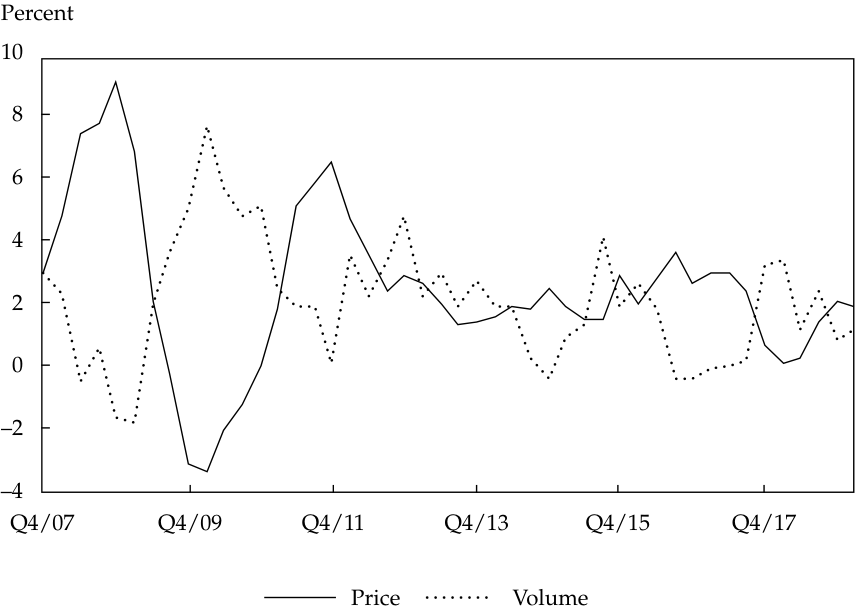
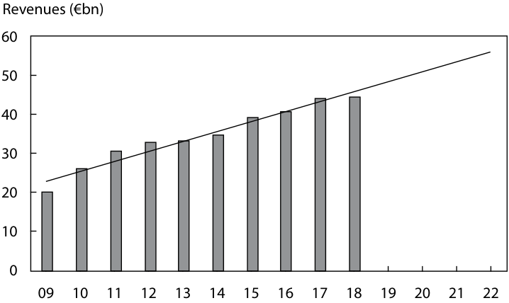

# Volume 4: Financial Statement Analysis
## Learning Module 12 Introduction to Financial Statement Modeling
### Part 3/4: Modeling Inflation and Deflation (PDF Pages 490–504)

---

<!-- PDF Page 490 -->

in the industry. But there is no mechanical link between the analysts’ observations and projecting the company’s future sales growth and profit margin. Instead, the link is more subjective and probabilistic. 

# **<mark>5</mark>** 

### **MODELING INFLATION AND DEFLATION** 

explain how to forecast industry and company sales and costs when they are subject to price inflation or deflation 

Inflation and deflation (i.e., general increase and decrease in the prices of goods and services) can significantly affect the accuracy of forecasts for a company’s future revenue, profit, and cash flow. The impact of inflation or deflation on revenue and expenses differs from company to company. Even within a single company, the impact of inflation or deflation is generally different for revenue and expenses categories. 

Some companies are better able to pass on higher input costs by raising the prices at which they sell their output. The ability to pass on price increases can be the result of, for example, strong branding (Coca-Cola) or proprietary technology (Apple). Companies that are well positioned to pass on price increases are, in turn, more likely to have higher and more stable profits and cash flow, relative to competitors. We first consider the impact of inflation on sales and then on costs. 

#### **Sales Projections with Inflation and Deflation** 

The following analysis addresses the projection of industry sales and company sales in the presence of inflation. 

##### **_Industry Sales and Inflation or Deflation_** 

Most increases in the cost of inputs, such as commodities or labor, will eventually result in higher prices for end products. Industry structure can be an important factor in determining the relationship between increases in input costs and increases in the price of end products. For example, in the United States, the beer market is an oligopoly, with one player, AB InBev, controlling almost half of the market. Moreover, the three-tier structure of the US beer market, in which the producers (the brewers) must use a third party (the wholesalers) to get their products (beer) to the consumers (bars, restaurants, and retailers) results in a fragmented customer base because brewers are not allowed to deliver directly to the end consumer but rather must use wholesale distributors. These wholesalers often differ state by state. Large nationwide retailers, such as Walmart, still must negotiate with several different wholesalers instead of using their dominant national market position to negotiate directly with the brewers. The industry structure in the United States has likely contributed to increases in beer prices roughly in line with the US Consumer Price Index. In other words, beer prices have generally risen during years of inflation in input costs and decreased when costs have eased (though there have been brief exceptional periods where the opposite has occurred). If necessary, US brewers have been able to increase prices to compensate for costs of inflation. In contrast, European beer companies distribute through a more concentrated customer base—namely, such dominant retail outlets as Carrefour, Tesco, and Ahold—which results in a weaker pricing position for the brewers. Also, the European market lacks an overall dominant brewer. As a result of the industry structure and the lack of underlying volume growth, changes in beer prices in Europe have been on average 100 bps less than customer inflation. 

<!-- PDF Page 491 -->

##### **Exhibit 25: US General Inflation and Inflation in Beer Prices** 

<!-- Start of picture text -->
Percent 10 8 6 4 2 0 –2 –4 –6 1/Mar/95 1/Nov/98 1/Jul/02 1/Mar/06 1/Nov/09 1/Jul/13 1/Mar/17 Beer Prices CPI <!-- End of picture text -->

_Source:_ US Bureau of Labor Statistics. 

A company’s efforts to pass on inflation through higher prices can have a negative impact on volume if the demand is price elastic, which is the case if cheaper substitutes are available. If selling prices could be increased 10 percent while maintaining unit sales volume to offset an increase of 10 percent in input costs, gross profit margin percentage would be the same but the absolute amount of gross profit would increase. In the short term, however, volumes will usually decline as result of a price increase. The decline would depend not only on the price elasticity of demand but also on the reaction of competitors and the availability of substitutes. Lower input costs also make lower consumer prices possible. The first competitor to lower prices will usually benefit with an uptick in volume. Competitors react quickly, however, resulting in a short-term benefit. The price–volume trade-off can make accurate revenue projections difficult. In an inflationary environment, raising prices too late will result in a profit margin squeeze but acting too soon could result in volume losses. In a deflationary environment, lowering prices too soon will result in a lower gross margin, but waiting too long will result in volume losses. 

In the highly competitive consumer goods market, pricing is strongly influenced by movements in input prices, which can account for half of the COGS. In some time periods, customers’ price sensitivity has resulted in a strong inverse relationship between volume and pricing. For example, Exhibit 26 illustrates Unilever’s annual underlying volume and price growth from 2001 to 2020. Increased input prices for packaging, wheat, and milk forced Anglo-Dutch consumer staple company Unilever to increase prices for its products significantly in 2008. Consequently, volumes deteriorated. But as raw material prices fell in 2009–2010, the company’s prices were lowered and volumes recovered strongly. As the company started to increase prices in 2011, volume growth once again slowed. In 2016, the company faced challenging conditions in several emerging markets as currency-devaluation-led cost increases led to weaker volumes. Both volume and price growth have moderated to low-single digit growth rates, also exhibiting lower volatility. 

<!-- PDF Page 492 -->

##### **Exhibit 26: Unilever Overall Revenue Growth by Percentage Change in Volume and Price** 

<!-- Start of picture text -->
Percent 10 8 6 4 2 0 –2 –4 Q4/07 Q4/09 Q4/11 Q4/13 Q4/15 Q4/17 Price Volume <!-- End of picture text -->

_Sources_ : Unilever PLC filings. 

##### **_Company Sales and Inflation or Deflation_** 

Revenue projections in a model are based on the expected volume and price development. Forecasting revenue for a company faced with inflation in input costs requires some understanding of the price elasticity of the products, the different rates of cost inflation in the countries where the company is active, and, if possible, the likely inflation in costs relevant to a company’s individual product categories. Pricing strategy and market position are also important. 

The impact of higher prices on volume depends on the price elasticity of demand (i.e., how the quantity demanded varies with price). If demand is relatively price inelastic, revenues will benefit from inflation. If demand is relatively price elastic (i.e., elasticity is greater than unit price elasticity), revenue can decline even if unit prices are raised. For example, a regression of volume on food inflation in UK food stores from 1989 to 2012 (shown in Exhibit 27) gives a regression slope coefficient of −0.398. (For every increase by 1 percentage point in year-on-year food prices, year-on-year sales decreased by approximately 0.4 percent.) 

An analyst covering UK food retailers can use this information when building forecast profit models. By assuming an expected level of food inflation, volume growth can be estimated and revenue calculated. 

<!-- PDF Page 493 -->

##### **Exhibit 27: UK Relationship between Food Inflation and Volume, January 1989–February 2012** 

<!-- Start of picture text -->
Volume of Sales at Food Stores (%) 6 t-Stat = –10 5 4 3 2 Apr 2011 Dec 2011 1 Jan 2012 Oct 2011 0 Sep 2011 Aug 2011 Mar 2011 –1 Nov 2011 Jul 2011 –2 Feb 2012 –3 May 2011 Black observations those –4 in last 12 months Jun 2011 –5 –2 0 2 4 6 8 10 Year-on-Year Inflation at Food Stores (%) <!-- End of picture text -->

_Source:_ Based on data from Datastream. Analysis is the authors’. 

The expected pricing component for an international company should consider the geographic mix of its revenues to reflect different rates of inflation among countries. Of course, strategy and competitive factors, in addition to inflation in input costs, play roles in price setting. 

AB InBev’s volume growth and pricing have been more robust in emerging markets, for example, thanks to strong demand for its new beer products. The impact of inflation is also an important factor. In its Latin America South division, which then mainly consisted of Argentina, the brewer reported strong 24.7 percent organic revenue growth in 2011, of which only 2.1 percent was driven by volume and the remainder by price. As costs increased in line with revenues, operating margin remained more or less stable, and organic operating profit growth was high at 27 percent. With only a limited negative currency impact, reported operating profit increased 24 percent in US dollars. 

High inflation in a company’s export market relative to a company’s domestic inflation rate generally implies that the export country’s currency will come under pressure and any pricing gain could be wiped out by the currency losses. The strong pricing increases AB InBev reported in its Latin America South division were clearly driven by input price inflation. The absence of a negative currency impact should be seen as a positive surprise but not as a typical outcome. A country’s currency will usually come under pressure and depreciate if high rates of inflation persist for an extended period. 

Most analysts adjust for recent high inflation in foreign countries by assuming a normalized growth rate for both revenues and costs after one or two years. This constant currency growth rate is based on an underlying growth rate assumption for the business. This approach can understate revenues in the short term. Other analysts 

<!-- PDF Page 494 -->

reflect in their forecasts the high impact of inflation on revenues and expenses and adjust growth rates for the expected currency (interest rate parity) impact. This approach is also imperfect given the difficulty in projecting currency rates. 

Identifying a company’s major input costs provides an indication of likely pricing. For a specialist retail bakery chain, for example, the impact of increased grain prices will be more significant than for a diversified standard supermarket chain. Consequently, it seems logical that the bakery is likely to increase its prices by a higher percentage than the grocer in response to increased grain prices. 

Company strategy is also an important factor. Faced with rising input prices, a company might decide to preserve its margins by passing on the costs to its customers, or it might decide to accept some margin reduction to increase its market share. In other words, the company could try to gain market share by not fully increasing prices to reflect increased costs. On the one hand, Sysco Company (the largest food distributor to restaurants and institutions in North America) has sometimes not passed on food price increases in recessionary conditions out of concern of not financially weakening already recession-affected customers (e.g., restaurants, private clubs, schools, nursing homes). On the other hand, in 2011 and 2012, the large French cognac houses substantially increased the prices of their products in China to reduce strong demand. Because older cognac generates a higher price, it can be more profitable to build an inventory of vintage cognac rather than maximizing short-term volumes. 

##### **EXAMPLE 8** 

#### **Passing on Input Cost Increases or Not** 

Four food retail analysts are assessing the impact of a potential increase in input costs on the global supermarket chain Carrefour. In this hypothetical scenario, they believe that rising oil prices and packaging prices will affect many of the company’s suppliers. They believe that Carrefour is likely to be confronted with 4 percent inflation in its COGS (with stable volume). The analysts have their own expectations about how the company will react. Exhibit 28 shows Carrefour’s 2020 results, and Exhibit 29 shows the four analysts’ estimates of input prices, volume growth, and pricing for the following year. Both exhibits are in the Example 8 worksheet in the downloadable Microsoft Excel workbook. 

**Exhibit 28: Carrefour Data (euro millions, unless noted)** 

||**2020**|
|---|---|
|Total revenue|72,150|
|COGS|56,705|
|Gross profit|15,445|
|Gross margin|21.4%|

##### **Exhibit 29: Four Analysts’ Estimates of Carrefour’s Reaction to Inflation** 

||**A**|**B**|**C**|**D**|
|---|---|---|---|---|
|Price increase for revenues|0.00%|2.00%|3.00%|4.00%|
|Volume growth|5.00%|2.00%|1.00%|−4.00%|

<!-- PDF Page 495 -->

||**A**|**B**|**C**|**D**|
|---|---|---|---|---|
|Total revenue growth|5.00%|4.04%|4.03%|−0.16%|
|Input costs increase|4.00%|4.00%|4.00%|4.00%|

1. What are each analyst’s predictions for gross profit and gross margin? 

##### **Solution:** 

The results for each analyst are shown in Exhibit 30 and the Example 8 worksheet in the downloadable Microsoft Excel workbook. For Analyst B, revenues increase 4 percent [= (1.02 × 1.02) ‒ 1] and COGS 6.1 percent [= (1.02 × 1.04) ‒ 1]. The difference between the calculated revenue and COGS is the new gross profit and gross margin is gross profit as a percentage of revenue. 

**Exhibit 30: Results for Analysts’ Predictions (EUR millions, unless noted)** 

|||**Analyst A**||**Analyst B**||**Analyst C**||**Analyst D**||
|---|---|---|---|---|---|---|---|---|---|
||**2020**|**2021E**|**YoY%**|**2021E**|**YoY%**|**2021E**|**YoY%**|**2021E**|**YoY%**|
|Total revenue|72,150|75,758|5.0%|75,065|4%|75,058|4.0%|72,035|–0.2%|
|COGS|56,705|61,922|9.2%|60,153|6%|59,563|5.0%|56,614|–0.2%|
|Gross profit|15,445|13,836|–10%|14,912|–3%|15,495|0%|15,420|–0.2%|
|Gross margin|21.4%|18.3%||19.9%||20.6%||21.4%||

2. Which analyst has the highest forecast for gross margin? 

##### **Solution:** 

The highest gross margin is projected by Analyst D, who assumes that selling prices would increase by 4 percent to offset rising input costs and keep gross margin stable from the 2020 level. 

3. Which analyst has the highest forecast for gross profit? 

##### **Solution:** 

The highest gross profit is projected by Analyst C. 

#### **Cost Projections with Inflation and Deflation** 

The following analysis addresses the forecasting of industry and company costs in the presence of inflation and deflation. 

##### **_Industry Costs and Inflation or Deflation_** 

Familiarity with the specific purchasing characteristics of an industry can also be useful in forecasting costs. For example, long-term price-fixed forward contracts and hedges can delay the impact of price increases. Thus, an analyst forecasting costs for an industry in which companies customarily use such purchasing practices would incorporate any expected input price fluctuations more slowly than they would for an industry in which the participants do not use long-term contracts or hedges. 

<!-- PDF Page 496 -->

Monitoring the underlying drivers of input prices can also be useful in forecasting costs. For example, weather conditions can have a dramatic impact on the price of agricultural products and consequently on the cost base of industries that rely on them. An analyst observing a particular weather pattern might thus be able to incorporate this information into forecasts of costs. 

How inflation or deflation affects an industry’s cost structure depends on its competitive environment. For example, if the participants within the industry have access to alternative inputs or are vertically integrated, the impact of volatility in input costs can be mitigated. Jacobs Douwe Egberts (JDE) is a coffee company that has been facing high and volatile coffee prices. However, its coffee is a blend of different kinds of beans. By shifting the mix slightly, JDE can keep both taste and costs constant by reducing the amount of the more expensive types of coffee beans in the blend. But if all supplier countries significantly increase the price of coffee simultaneously, JDE cannot use blending as an offset and will be confronted with overall higher input costs. To sustain its profitability, JDE will have to increase its prices to its clients. But if competition from other companies, such as Nestlé (Nespresso, Dolce Gusto, Nescafe) makes it difficult to increase prices, JDE will have to look for alternatives if it wants to keep its profit margins stable. An easy solution for the short term could be reducing advertising and promotional (A&P) spending, which usually improves profit. For the longer term, however, it could be harmful for revenues because the company’s brand position could be weakened. 

For example, in 2010, Russia experienced a heat wave that destroyed large parts of its grain harvest, causing prices for malting barley, a major input for beer, to increase significantly. Carlsberg, as the largest Russian brewer at that time, was particularly hard hit because it had to pay more for its Russian barley and also needed to import grain into the country, incurring additional transportation costs. By increasing imports from Western Europe, Carlsberg also pushed up barley prices in this region, affecting the cost base of other Western European brewers. 

##### **_Company Costs and Inflation or Deflation_** 

In forecasting a company’s costs, it is often helpful to segment the cost structure by category and geography. For each item of cost, an assessment should be made about the impact of potential inflation and deflation on input prices. This assessment should take into account the company’s ability to substitute cheaper alternatives for expensive inputs or to increase efficiency to offset the impact of increases in input prices. For example, although a jump in raw material prices in 2011 caused Unilever’s and Nestlé’s gross margins to fall sharply (by 110−170 bps), increases in operational efficiencies, such as reducing advertising spending, enabled both companies to achieve slightly higher overall operating profit margins that year. Example 9 shows the use of common size (percent-of-sales) analysis of inflation in input costs. 

##### **EXAMPLE 9** 

#### **Inflation in Input Costs** 

Two fictional consumer staple companies—chocolate and sweets specialist “Choco A” and a food producer “Sweet B”—have costs that are constantly affected by inflation and deflation. Exhibit 31 (see the Example 9 worksheet in the downloadable Microsoft Excel workbook) presents a common size analysis. 

<!-- PDF Page 497 -->

**Exhibit 31: Common Size Analysis for Sweet B and Choco A** 

||**Sweet B**|**Choco A**|
|---|---|---|
|Net sales|100%|100%|
|COGS|50%|36%|
|Gross margin|50%|64%|
|SG&A|31%|47%|
|Depreciation|3%|4%|
|EBIT|16%|13%|
|Raw materials|22%|22%|
|Packaging|12%|10%|
|Other COGS|16%|4%|
|Total COGS|50%|36%|

Assume inflation of 10 percent for all costs (except depreciation) and that the companies are not able to pass on this increase through higher prices (total revenues will remain constant). 

1. Calculate the gross profit margin for each company. Which company will experience the greater reduction in gross profit margin? 

##### **Solution:** 

The company with the higher COGS as a percent of net sales—equivalently, the lower gross margin—will experience the greater negative impact. Sweet B has a lower gross margin than Choco A: 50 percent compared with 64 percent, as shown in Exhibit 31. After the 10 percent increase in COGS to 1.10 × 50% = 55%, Sweet B’s gross margin will fall to 45 percent, as shown in Exhibit 32. Sweet B’s resulting gross margin of 45 percent represents a proportional decline of 10 percent from the initial value of 50 percent. In contrast, the proportional decline in Choco A’s gross margin is approximately 4%/64% = 6%. 

**Exhibit 32: Effect of Cost Inflation** 

||**All Costs (Exce** **tion) +**|**pt Deprecia-** **10%**|**Raw Mate**|**rials + 10%**|
|---|---|---|---|---|
||**Sweet B**|**Choco A**|**Sweet B**|**Choco A**|
|Net sales|100%|100%|100%|100%|
|COGS|55%|40%|52%|38%|
|Gross margin|45%|60%|48%|62%|
|SG&A|34%|52%|31%|47%|
|Depreciation|3%|4%|3%|4%|
|EBIT|8%|5%|14%|11%|

<!-- PDF Page 498 -->

2. Calculate the operating profit margin for each company. Which company will experience the greater reduction in operating profit (EBIT) margin? **Solution:** 

Choco A has higher overall costs than Sweet B, primarily as a consequence of its high SG&A expenses. Choco A’s operating profit margin will drop to approximately 5 percent, as shown in Exhibit 32, representing a proportional decline of approximately 62 percent compared with a proportional decline of approximately 8%/16% = 50% for Sweet B. 

3. Assume inflation of 10 percent only for the raw material costs (reflected in COGS) and that the companies are not able to pass on this increase through higher prices. Which company will be more affected negatively in terms of gross profit margin and operating profit margin? 

   - **Solution:** 

The company with the higher raw material expense component will experience the more negative effect. In this case, raw materials represent 22 percent of net sales for both Sweet B and Choco A. Gross margin and operating margin will decline by 220 bps for both. This impact is more severe on gross margin on a relative basis for Sweet B (2.2%/50% = 4.4% decline) than for Choco A (2.2%/64% = 3.4% decline). But the relative effect on operating margin will be more severe for Choco A (2.2%/13% = 16.9% decline) than for Sweet B (2.2%/16% = 13.8%). 

# **<mark>6</mark>** 

### **THE FORECAST HORIZON AND LONG-TERM FORECASTING** 

explain considerations in the choice of an explicit forecast horizon and an analyst’s choices in developing projections beyond the short-term forecast horizon 

The choice of the forecast time horizon can be influenced by certain factors, including the investment strategy for which the security is being considered, the cyclicality of the industry, company-specific factors, and the analyst’s employer’s preferences. Most professionally managed investment strategies describe the investment time frame, or average holding period, in the stated investment objectives of the strategy; the time frame should ideally correspond with average annual turnover of the portfolio. For example, a stated investment time horizon of three to five years would imply average annual portfolio turnover between 20 percent and 33 percent (average holding period is calculated as one/portfolio turnover). The cyclicality of the industry could also influence the analyst’s choice of time frame because the forecast period should be long enough to allow the business to reach an expected mid-cycle level of sales and profitability. Similar to cyclicality, various company-specific factors, including recent acquisition or restructuring activity, can influence the selection of the forecast period to allow enough time for the realization of the expected benefits from such activity to be reflected in the financial statements. In other cases, there might be no individual analyst choice in the sense that the analyst’s employer has specified more or less fixed parameters. Much of the discussion so far has focused on various methods of forecasting a company’s income statement, balance sheet, and cash flow for an explicit 

<!-- PDF Page 499 -->

short-term forecast period. Although the underlying principles remain the same if one extends the time horizon, certain considerations and choices are available to the analyst when developing longer-term projections. 

Longer-term projections often provide a better representation of the normalized earnings potential of a company than a short-term forecast, especially when certain temporary factors are present. **Normalized earnings** are the expected level of mid-cycle earnings for a company in the absence of any unusual or temporary factors that affect profitability (either positively or negatively). For example, at any given point in time, a company’s profitability can be influenced by a number of temporary factors, including the stage in the business cycle, recent merger and acquisition activity, and restructuring activity. Similarly, normalized free cash flow can be defined as the expected level of mid-cycle cash flow from operations adjusted for unusual items just described less recurring capital expenditures. By extending the forecast period, an analyst is able to adjust for these unusual or temporary factors and derive an estimate of earnings that the company is likely to earn in a normal year. We will consider various alternatives for two aspects of long-term forecasting: revenue forecasts and terminal value. 

As with most income statement projections, a long-term forecast begins with a revenue projection, with most of the remaining income statement items subsequently derived from the level or change in revenue. Revenue projection methods were covered earlier. 

#### **Case Study: Estimating Normalized Revenue** 

Exhibit 33 contains 10 years of historical revenue data and four years of estimated normalized data for Continental AG, a global automotive supplier. The accompanying bar chart in Exhibit 34 graphically depicts the data and includes a trend line based on a linear regression of the data. The numerical values for each point along the trend line can be found by using the TREND formula in Microsoft Excel. The TREND formula uses observations on the dependent variable (in this case revenue) and observations on the explanatory (time) variable to perform a linear regression by using least squares criterion to find the best fit. After computing the best fit regression model, the TREND formula returns predicted values associated with new points in time. The worksheet for Exhibit 33 and Exhibit 34 in the downloadable Microsoft Excel workbook demonstrates the calculations used in the exhibits. 

**Exhibit 33: Historical and Estimated Revenue Data for Continental AG, 2011–2024E (euro billions)** 

||**2011**|**2012**|**2013**|**2014**|**2015**|**2016**|**2017**|**2018**|**2019**|**2020**|**2021**|**2022**|**2023**|**2024**|
|---|---|---|---|---|---|---|---|---|---|---|---|---|---|---|
|Revenue|30.5|32.7|33.3|34.5|39.2|40.6|44.0|44.4|44.5|37.7|||||
|Normalized|||||||||||||||
|revenue|31.8|33.2|34.6|36.0|37.4|38.9|40.3|41.7|43.1|44.5|45.9|47.3|48.7|50.1|
|Percent|||||||||||||||
|above/below|||||||||||||||
|trend|–4.1%|–1.4%|–3.7%|–4.2%|4.8%|4.4%|9.3%|–6.6%|3.3%|–15.2%|||||

<!-- PDF Page 500 -->

##### **Exhibit 34: Historical and Estimated Revenue for Continental AG, 2011– 2024E** 

<!-- Start of picture text -->
Revenues (€bn) 60 50 40 30 20 10 0 09 10 11 12 13 14 15 16 17 18 19 20 21 22 <!-- End of picture text -->

The “growth relative to GDP growth” and “market growth and market share” methods discussed earlier can also be applied to developing longer-term projections. Once a revenue projection has been established, previously described methods of forecasting costs can be used to complete the income statement, balance sheet, and cash flow statement. 

If an analyst is creating a valuation model such as a DCF model, estimating a terminal value is required to capture the going-concern value of the company after the explicit forecast period. Certain considerations should be kept in mind when deriving the terminal value based on long-term projections. 

First, an analyst should consider whether the terminal year free cash flow projection should be normalized before that cash flow is incorporated into a long-term projection. For example, if the explicitly forecasted terminal year free cash flow is “low” (e.g., because of business cycle reasons or capital investment projects), an adjustment to normalize the amount might be warranted. Second, an analyst should consider whether and how the future long-term growth rate will differ from the historical growth rate. For example, even some mature companies might be able to accelerate their long-term growth rate through product innovation and/or market expansion (e.g., Apple), whereas other seemingly well-protected “growers” could experience an unanticipated decline in their business as a result of technological change (e.g., Eastman Kodak Company, a global commercial printing and imaging company). 

One of the greatest challenges facing the analyst is anticipating inflection points, when the future will look significantly different from the recent past. Most DCF models rely on a perpetuity calculation, which assumes that the cash flows from the last year of an explicit forecast grow at a constant rate forever. Because the perpetuity can account for a relatively large portion of the overall valuation of the company, it is critical that the cash flow used is representative of a “normalized” or “mid-cycle” result. If the analyst is examining a cyclical company, using a boom year as the starting point for the perpetuity could result in a grossly overstated valuation. Similarly, using a trough year could result in a valuation that is much too low. 

Another important consideration is economic disruption. The economy can occasionally experience sudden, unprecedented changes that affect a wide variety of companies, such as the 2008 global financial crisis or the COVID-19 pandemic. Even a company with a sound strategy and solid operations can be thrown far off course by a sudden economic disruption, particularly if the company has a high degree of financial leverage. 

<!-- PDF Page 501 -->

Regulation and technology are also potential drivers of inflection points, and it is important for the analyst to keep a close eye on both. Government actions can have extreme, sudden, and unpredictable impacts on some businesses. Technological advances can turn fast-growing innovators obsolete in a matter of months. Both regulation and technology affect some industries more than others. Utilities experience intense regulation but might not see a significant technological change for decades. Semiconductor manufacturers must constantly keep up with new technology but experience relatively light regulation. Pharmaceutical manufacturers are heavily exposed to both regulation and technological advances. 

Finally, long-term growth is a key input in the perpetuity calculation. Some companies and industries can grow faster than the overall economy for long periods of time, causing them to account for an increasing share of overall output. Examples include some technology companies, such as Tencent, Amazon, and Google. Other companies, such as those in the print media sector, are likely to grow slower than the overall economy or even shrink over time. Using an unrealistic long-term growth rate can put the analyst’s valuation far off the mark. 

##### **EXAMPLE 10** 

#### **Important Considerations When Making Assumptions** 

1. Turkish Airlines (THYAO.IS) operates in the highly cyclical global airline industry. Operating margins for 2011–2019 are shown in the following table and in the Example 10 worksheet in the downloadable Microsoft Excel workbook. 

||**2011**|**2012**|**2013**|**2014**|**2015**|**2016**|**2017**|**2018**|**2019**|
|---|---|---|---|---|---|---|---|---|---|
|Operating margin|1.0%|10.8%|6.5%|5.6%|8.6%|−2.9%|9.0%|9.9%|7.9%|

On the basis of only the information in the table, which of the following operating margins would _most likely_ be appropriate to use in a perpetuity calculation for Turkish Airlines to arrive at a reasonable intrinsic value estimate? 

- **A.** 6.0 percent 

- **B.** 9.0 percent 

**C.** 9.9 percent 

##### **Solution:** 

A is correct. Because the airline industry is cyclical, an estimate of “mid-cycle” or “normalized” operating margin is necessary to estimate a perpetuity value. The nine-year average operating margin was 6.3 percent. 

For each of the companies in the following problems, indicate which of the choices is _least likely_ to cause a change in the company’s outlook. 

2. ABC Diesel (hypothetical company), a manufacturer of diesel-power trucks 

   - **A.** Consumers have started switching to trucks with electric engines, threatening ABC’s historic strength in diesel engine trucks. 

   - **B.** ABC Diesel has formed a partnership with Electrico (hypothetical), a company involved in research and innovation in electric engines. 

<!-- PDF Page 502 -->

- **C.** Environmental regulations have been getting tighter in most regions, and consistent with prior experience, this need to make the engines less polluting is expected to continue over the next several years. 

##### **Solution:** 

C is correct. Although it is important that environmental regulations have been getting stricter, this is consistent with past experience and so does not represent a turning point. 

3. Abbott Laboratories, a diversified manufacturer of health care products, including medical devices 

   - **A.** Management reiterates its long-standing approach to capital deployment. 

   - **B.** A competitor has demonstrated favorable efficacy data on a medical device candidate that will compete with an important Abbott product. 

   - **C.** It has become more difficult for medical device manufacturers to receive regulatory approval for new products because of heightened safety concerns. 

##### **Solution:** 

A is correct. Management is sticking with its historical approach to capital deployment, so this does not represent a turning point. 

4. Grupo Aeroportuario del Sureste, operator of nine airports in Mexico, especially in the tourist-heavy southeast 

   - **A.** Global economic disruption has caused a sharp decline in international travel. 

   - **B.** Regulators will allow the construction of a new airport by a competitor in Grupo Aeroportuario del Sureste’s service territory. 

   - **C.** A technological advance will allow airlines to save 5 percent on fuel costs, but it is not expected to meaningfully alter passenger volumes. Similar developments in the past have benefited airlines but not airports, whose price per passenger is regulated. 

##### **Solution:** 

C is correct. Although the technological advance is good for the airlines, it will not have a meaningful effect on passenger volumes, which will likely prevent the airports from sharing in that benefit. In contrast, both A and B could have a significant impact on the long-run earnings power of Mexican airports. 

5. LinkedIn, operator of an online social network for professionals and part of Microsoft Corporation, with limited investment needs and no debt 

   - **A.** Facebook, another online social network, announces a plan to enhance its offerings in the professional category. 

   - **B.** Regulators announce an investigation of LinkedIn’s privacy practices, which could result in significant changes to the service. 

<!-- PDF Page 503 -->

- **C.** The US Federal Reserve has just increased interest rates. Although this will raise borrowing costs, the rate increase is not expected to have a negative impact on the economy. 

- **Solution:** 

C is correct. Because LinkedIn carries no debt, it is unlikely that higher interest rates will cause a change in the company’s outlook. 

<!-- PDF Page 504 -->

## **~~REFERENCES~~** 

- Dunning, D., D. W. Griffin, J. D. Milojkovic, and L. Ross. 1990. “The Overconfidence Effect in Social Prediction.” _Journal of Personality and Social Psychology_ 58 (4): 568–81. https:// psycnet .apa .org/ record/ 1990 -22524 -00110 .1037/ 0022 -3514 .58 .4 .568 

- Porter, Michael E. 1980. _Competitive Strategy: Techniques for Analyzing Industries and Competitors_ . New York: Free Press. 

- Porter, Michael E. 2008. “ _The Five Competitive Forces That Shape Strategy._ ” (January). https:// hbr .org/ 2008/ 01/ the -five -competitive -forces -that -shape -strategy 

- Russo, J. Edward and Paul J. H. Schoemaker. 1992. “Managing Overconfidence.” _MIT Sloan Management Review_ 15 (January). https:// sloanreview .mit .edu/ article/ managing -overconfidence/ 

