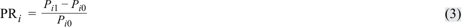
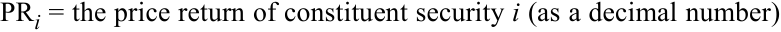
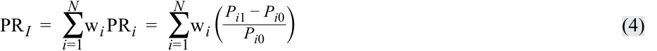
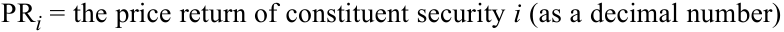
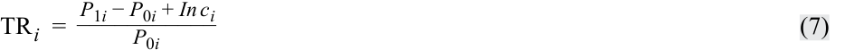
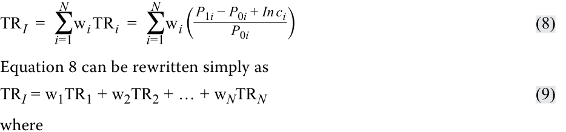
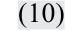
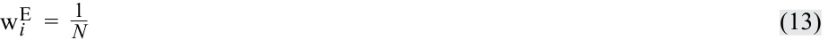

# Volume 5: Equity Investments
## Learning Module 2 Security Market Indexes
### Part 1/3: Introduction (PDF Pages 91–106)

---

<!-- PDF Page 91 -->

# L E A R N I N G M O D U L E **<mark>2</mark> Security Market Indexes** 

**by Paul D. Kaplan, PhD, CFA, and Dorothy C. Kelly, CFA.** 

_Paul D. Kaplan, PhD, CFA, is at Morningstar (Canada). Dorothy C. Kelly, CFA, is at McIntire School of Commerce, University of Virginia (USA)._ 

|**LEARNI** |**NG OUTCOMES** |
|---|---|
|**_Mastery_**|**_The candidate should be able to:_**|
||describe a security market index|
||calculate and interpret the value, price return, and total return of an index|
||describe the choices and issues in index construction and management|
||compare the different weighting methods used in index construction|
||calculate and analyze the value and return of an index given its weighting method|
||describe rebalancing and reconstitution of an index|
||describe uses of security market indexes|
||describe types of equity indexes|
||compare types of security market indexes|
||describe types of fixed-income indexes|
||describe indexes representing alternative investments|

### **INTRODUCTION** 

Investors gather and analyze vast amounts of information about security markets on a continual basis. Because this work can be both time consuming and data intensive, investors often use a single measure that consolidates this information and reflects the performance of an entire security market. 

<!-- PDF Page 92 -->

Security market indexes were first introduced as a simple measure to reflect the performance of the US stock market. Since then, security market indexes have evolved into important multi-purpose tools that help investors track the performance of various security markets, estimate risk, and evaluate the performance of investment managers. They also form the basis for new investment products. 

**in·dex** , _noun_ ( _pl._ **in·dex·es** _or_ **in·di·ces** ) Latin _indic-, index,_ from _indicare_ to indicate: an indicator, sign, or measure of something. 

##### **ORIGIN OF MARKET INDEXES** 

Investors had access to regularly published data on individual security prices in London as early as 1698, but nearly 200 years passed before they had access to a simple indicator to reflect security market information. To give readers a sense of how the US stock market in general performed on a given day, publishers Charles H. Dow and Edward D. Jones introduced the Dow Jones Average, the world’s first security market index, in 1884. The index, which appeared in _The Customers’ Afternoon Letter_ , consisted of the stocks of nine railroads and two industrial companies. It eventually became the Dow Jones Transportation Average. Convinced that industrial companies, rather than railroads, would be “the great speculative market” of the future, Dow and Jones introduced a second index in May 1896—the Dow Jones Industrial Average (DJIA). It had an initial value of 40.94 and consisted of 12 stocks from major US industries. Today, investors can choose from among thousands of indexes to measure and monitor different security markets and asset classes. 

This reading is organized as follows. Section 2 defines a security market index and explains how to calculate the price return and total return of an index for a single period and over multiple periods. Section 3 describes how indexes are constructed and managed. Section 4 discusses the use of market indexes. Sections 5, 6, and 7 discuss various types of indexes, and the final section summarizes the reading. Practice problems follow the conclusions and summary. 

## **<mark>2</mark> INDEX DEFINITION AND CALCULATIONS OF VALUE AND RETURNS** 

describe a security market index 

calculate and interpret the value, price return, and total return of an index 

A **security market index** represents a given security market, market segment, or asset class. Most indexes are constructed as portfolios of marketable securities. 

The value of an index is calculated on a regular basis using either the actual or estimated market prices of the individual securities, known as **constituent securities** , within the index. For each security market index, investors may encounter two versions 

<!-- PDF Page 93 -->

of the same index (i.e., an index with identical constituent securities and weights): one version based on price return and one version based on total return. As the name suggests, a **price return index** , also known as a **price index** , reflects _only_ the prices of the constituent securities within the index. A **total return index** , in contrast, reflects not only the prices of the constituent securities but also the reinvestment of all income received since inception. 

At inception, the values of the price and total return versions of an index are equal. As time passes, however, the value of the total return index, which includes the reinvestment of all dividends and/or interest received, will exceed the value of the price return index by an increasing amount. A look at how the values of each version are calculated over multiple periods illustrates why. 

The value of a price return index is calculated as: 

<!-- Formula Text: V PRI  = ∑ i=1 N n i P i _ D (1) -->

where 

_VPRI_ = the value of the price return index 

- _ni_ = the number of units of constituent security _i_ held in the index portfolio 

- _N_ = the number of constituent securities in the index 

- _Pi_ = the unit price of constituent security _i_ 

- _D_ = the value of the divisor 

The **divisor** is a number initially chosen at inception. It is frequently chosen so that the price index has a convenient initial value, such as 1,000. The index provider then adjusts the value of the divisor as necessary to avoid changes in the index value that are unrelated to changes in the prices of its constituent securities. For example, when changing index constituents, the index provider may adjust the divisor so that the value of the index with the new constituents equals the value of the index prior to the changes. 

Index return calculations, like calculations of investment portfolio returns, may measure price return or total return. **Price return** measures only price appreciation or percentage change in price. **Total return** measures price appreciation plus interest, dividends, and other distributions. 

#### **Calculation of Single-Period Returns** 

For a security market index, price return can be calculated in two ways: either the percentage change in value of the price return index, or the weighted average of price returns of the constituent securities. The price return of an index can be expressed as: 

<!-- Formula Text: PR I  = V PRI1 − V PRI0 _ V PRI0 (2) -->

where 

- PR _I_ = the price return of the index portfolio (as a decimal number, i.e., 12 percent is 0.12) 

_VPRI_ 1 = the value of the price return index at the end of the period 

_VPRI_ 0 = the value of the price return index at the beginning of the period 

Similarly, the price return of each constituent security can be expressed as: 

<!-- PDF Page 94 -->

<!-- Formula Text: PR i  = P i1 − P i0 _ P i0 (3) -->

##### where 

<!-- Formula Text: PRi = the price return of constituent security i (as a decimal number) -->

<!-- Formula Text: Pi1 = the price of constituent security i at the end of the period -->

<!-- Formula Text: Pi0 = the price of constituent security i at the beginning of the period -->

Because the price return of the index equals the weighted average of price returns of the individual securities, we can write: 

<!-- Formula Text: PR I  =  ∑ i=1 N w i PR i  =  ∑ i=1 N w i ( P i1 − P i0 _ P i0  ) (4) -->

##### where: 

<!-- Formula Text: PRI = the price return of index portfolio (as a decimal number) -->

<!-- Formula Text: PRi = the price return of constituent security i (as a decimal number) -->

- _N_ = the number of individual securities in the index 

- w _i_ = the weight of security _i_ (the fraction of the index portfolio allocated to security _i_ ) 

- _Pi_ 1 = the price of constituent security _i_ at the end of the period 

- _Pi_ 0 = the price of constituent security _i_ at the beginning of the period 

Equation 4 can be rewritten simply as: 

<!-- Formula Text: PRI = w1PR1 + w2PR2 + … + wNPRN (5) -->

where 

- PR _I_ = the price return of index portfolio (as a decimal number) 

- PR _i_ = the price return of constituent security _i_ (as a decimal number) 

- w _i_ = the weight of security _i_ (the fraction of the index portfolio allocated to security _i_ ) 

- _N_ = the number of securities in the index 

Total return measures price appreciation plus interest, dividends, and other distributions. Thus, the **total return** of an index is the price appreciation, or change in the value of the price return index, plus income (dividends and/or interest) over the period, expressed as a percentage of the beginning value of the price return index. The total return of an index can be expressed as: 

<!-- Formula Text: TR I  = V PRI1 − V PRI0 + In c I _______________ V PRI0 (6) -->

##### where 

<!-- Formula Text: TRI = the total return of the index portfolio (as a decimal number) -->

- _VPRI_ 1= the value of the price return index at the end of the period 

- _VPRI_ 0 = the value of the price return index at the beginning of the period 

- Inc _I_ = the total income (dividends and/or interest) from all securities in the index held over the period 

<!-- PDF Page 95 -->

The total return of an index can also be calculated as the weighted average of total returns of the constituent securities. The total return of each constituent security in the index is calculated as: 

<!-- Formula Text: TR i  = P 1i − P 0i + In c i ___________ P 0i (7) -->

where 

TR _i_ = the total return of constituent security _i_ (as a decimal number) 

<!-- Formula Text: P1i = the price of constituent security i at the end of the period -->

_P_ 0 _i_ = the price of constituent security _i_ at the beginning of the period 

Inc _i_ = the total income (dividends and/or interest) from security _i_ over the period 

Because the total return of an index can be calculated as the weighted average of total returns of the constituent securities, we can express total return as: 

<!-- Formula Text: TR I  =  ∑ i=1 N w i TR i  =  ∑ i=1 N w i ( P 1i − P 0i + In c i ___________ P 0i ) (8) Equation 8 can be rewritten simply as TRI = w1TR1 + w2TR2 + … + wNTRN (9) where -->

TR _I_ = the total return of the index portfolio (as a decimal number) 

- TR _i_ = the total return of constituent security _i_ (as a decimal number) 

- w _i_ = the weight of security _i_ (the fraction of the index portfolio allocated to security _i_ ) 

- _N_ = the number of securities in the index 

#### **Calculation of Index Values over Multiple Time Periods** 

The calculation of index values over multiple time periods requires geometrically linking the series of index returns. With a series of price returns for an index, we can calculate the value of the price return index with the following equation: 

V _PRIT_ = V _PRI_ 0(1 + PR _I_ 1)(1 + PR _I_ 2)…(1 + PR _IT_ ) 

<!-- Formula Text: (10) -->

where 

- V _PRI_ 0 = the value of the price return index at inception 

- V _PRIT_ = the value of the price return index at time _t_ 

- PR _IT_ = the price return (as a decimal number) on the index over period _t_ , _t_ = 1, 2, …, _T_ 

For an index with an inception value set to 1,000 and price returns of 5 percent and 3 percent for Periods 1 and 2 respectively, the values of the price return index would be calculated as follows: 

|**Period**|**Return (%)**|**Calculation**|**Ending Value**|
|---|---|---|---|
|0||1,000(1.00)|1,000.00|
|1|5.00|1,000(1.05)|1,050.00|
|2|3.00|1,000(1.05)(1.03)|1,081.50|

<!-- PDF Page 96 -->

Similarly, the series of total returns for an index is used to calculate the value of the total return index with the following equation: 

V _TRIT_ = V _TRI_ 0(1 + TR _I_ 1)(1 + TR _I_ 2)…(1 + TR _IT_ ) ~~(11)~~ 

where 

- V _TRI_ 0 = the value of the index at inception 

- V _TRIT_ = the value of the total return index at time _t_ 

- TR _IT_ = the total return (as a decimal number) on the index over period _t_ , _t_ = 1, 2, …, _T_ 

Suppose that the same index yields an additional 1.5 percent return from income in Period 1 and an additional 2.0 percent return from income in Period 2, bringing the total returns for Periods 1 and 2, respectively, to 6.5 percent and 5 percent. The values of the total return index would be calculated as follows: 

|**Period**|**Return (%)**|**Calculation**|**Ending Value**|
|---|---|---|---|
|0||1,000(1.00)|1,000.00|
|1|6.50|1,000(1.065)|1,065.00|
|2|5.00|1,000(1.065)(1.05)|1,118.25|

As illustrated above, as time passes, the value of the total return index, which includes the reinvestment of all dividends and/or interest received, exceeds the value of the price return index by an increasing amount. 

## **<mark>3</mark>** 

### **INDEX CONSTRUCTION** 

describe the choices and issues in index construction and management 

compare the different weighting methods used in index construction calculate and analyze the value and return of an index given its weighting method 

Constructing and managing a security market index is similar to constructing and managing a portfolio of securities. Index providers must decide the following: 

**1.** Which target market should the index represent? 

**2.** Which securities should be selected from that target market? 

**3.** How much weight should be allocated to each security in the index? 

**4.** When should the index be rebalanced? 

**5.** When should the security selection and weighting decision be re-examined? 

#### **Target Market and Security Selection** 

The first decision in index construction is identifying the target market, market segment, or asset class that the index is intended to represent. The target market may be defined very broadly or narrowly. It may be based on asset class (e.g., equities, fixed income, real estate, commodities, hedge funds); geographic region (e.g., Japan, 

<!-- PDF Page 97 -->

South Africa, Latin America, Europe); the exchange on which the securities are traded (e.g., Shanghai, Toronto, Tokyo), and/or other characteristics (e.g., economic sector, company size, investment style, duration, or credit quality). 

The target market determines the investment universe and the securities available for inclusion in the index. Once the investment universe is identified, the number of securities and the specific securities to include in the index must be determined. The constituent securities could be nearly all those in the target market or a representative sample of the target market. Some equity indexes, such as the S&P 500 Index and the FTSE 100, fix the number of securities included in the index and indicate this number in the name of the index. Other indexes allow the number of securities to vary to reflect changes in the target market or to maintain a certain percentage of the target market. For example, the Tokyo Stock Price Index (TOPIX) represents and includes all of the largest stocks, known as the First Section, listed on the Tokyo Stock Exchange. To be included in the First Section—and thus the TOPIX—stocks must meet certain criteria, such as the number of shares outstanding, the number of shareholders, and market capitalization. Stocks that no longer meet the criteria are removed from the First Section and also the TOPIX. Objective or mechanical rules determine the constituent securities of most, but not all, indexes. The S&P Bombay Stock Exchange Sensitive Index, also called the S&P BSE SENSEX and the S&P 500, for example, use a selection committee and more subjective decision-making rules to determine constituent securities. 

#### **Index Weighting** 

The weighting decision determines how much of each security to include in the index and has a substantial impact on an index’s value. Index providers use a number of methods to weight the constituent securities in an index. Indexes can be price weighted, equal weighted, market-capitalization weighted, or fundamentally weighted. Each weighting method has its advantages and disadvantages. 

##### **_Price Weighting_** 

The simplest method to weight an index and the one used by Charles Dow to construct the Dow Jones Industrial Average is **price weighting** . In price weighting, the weight on each constituent security is determined by dividing its price by the sum of all the prices of the constituent securities. The weight is calculated using the following formula: 

<!-- Formula Text: w i P  = P i _ ∑ i=1 N P i (12) -->

Exhibit 1 illustrates the values, weights, and single-period returns following inception of a price-weighted equity index with five constituent securities. The value of the price-weighted index is determined by dividing the sum of the security values (101.50) by the divisor, which is typically set at inception to equal the initial number of securities in the index. Thus, in our example, the divisor is 5 and the initial value of the index is calculated as 101.50 ÷ 5 = 20.30. 

As illustrated in this exhibit, Security A, which has the highest price, also has the highest weighting and thus will have the greatest impact on the return of the index. Note how both the price return and the total return of the index are calculated on the basis of the corresponding returns on the constituent securities. 

<!-- PDF Page 98 -->

|**EOP** **Weight** **(%)**|52.38|20.95|7.62|13.33|5.72|**100.00**|||||
|---|---|---|---|---|---|---|---|---|---|---|
|**BOP** **Weight** **× Total** **Return** **(%)**|5.66|−2.86|−4.43|3.99|1.97|**4.33**|||||
|**BOP** **Weight** **× Price** **Return** **(%)**|4.93|−2.96|−4.43|3.94|1.97|**3.45**|||||
|**Total** **Return** **(%)**|11.50|−11.60|−36.00|40.50|50.00||**4.33**||||
|**Price** **Return** **(%)**|10.00|−12.00|−36.00|40.00|50.00||**3.45**||||
|**Total** **Dividends**|0.75|0.10|0.00|0.05|0.00|**0.90**|**0.18**||||
|**Value** **(Shares** **× EOP** **Price)**|55.00|22.00|8.00|14.00|6.00|**105.00**|**21.00**||||
|**Dividends** **Per Share**|0.75|0.10|0.00|0.05|0.00||||||
|**EOP Price**|55.00|22.00|8.00|14.00|6.00||||||
|**BOP** **Weight** **(%)**|49.26|24.63|12.32|9.85|3.94|**100.00**|||||
|**Value** **(Shares** **× BOP** **Price)**|50.00|25.00|12.50|10.00|4.00|**101.50**|**20.30**||**EOP** **Value**|21.00 21.18|
| **BOP Price**|50.00|25.00|12.50|10.00|4.00|||riod|**Return** **(%)**|3.45 4.33|
|**Shares in** **Index**|1|1|1|1|1|||5 ginning of pe d of period|**BOP** **Value**|20.30 20.30|
|**Security**|A|B|C|D|E|**Total**|**Index** **Value**|Divisor = BOP = Be EOP = En|**Type of** **Index**|**Price** **Return** **Total** **Return**|

<!-- PDF Page 99 -->

A property unique to price-weighted indexes is that a stock split on one constituent security changes the weights on all the securities in the index.1 To prevent the stock split and the resulting new weights from changing the value of the index, the index provider must adjust the value of the divisor as illustrated in Exhibit 2. Given a 2-for-1 split in Security A, the divisor is adjusted by dividing the sum of the constituent prices _after_ the split (77.50) by the value of the index _before_ the split (21.00). This adjustment results in changing the divisor from 5 to 3.69 so that the index value is maintained at 21.00. 

The primary advantage of price weighting is its simplicity. The main disadvantage of price weighting is that it results in arbitrary weights for each security. In particular, a stock split in any one security causes arbitrary changes in the weights of all the constituents’ securities. 

**Exhibit 2: Impact of 2-for-1 Split in Security A** 

|**Security**|**Price before Split**|**Weight before Split (%)**|**Price after Split**|**Weight after Split (%)**|
|---|---|---|---|---|
|A|55.00|52.38|27.50|35.48|
|B|22.00|20.95|22.00|28.39|
|C|8.00|7.62|8.00|10.32|
|D|14.00|13.33|14.00|18.07|
|E|6.00|5.72|6.00|7.74|
|Total|105.00|100.00|77.50|100.00|
|Divisor|5.00||3.69||
|Index Value|21.00||21.00||

##### **_Equal Weighting_** 

Another simple index weighting method is **equal weighting** . This method assigns an equal weight to each constituent security at inception. The weights are calculated as: 

<!-- Formula Text: w i E  =   1 _ N (13) -->

where 

w _i_ = fraction of the portfolio that is allocated to security _i_ or weight of security _i_ 

_N_ = number of securities in the index 

To construct an equal-weighted index from the five securities in Exhibit 1, the index provider allocates one-fifth (20 percent) of the value of the index (at the beginning of the period) to each security. Dividing the value allocated to each security by each security’s individual share price determines the number of shares of each security to include in the index. Unlike a price-weighted index, where the weights are arbitrarily determined by the market prices, the weights in an equal-weighted index are arbitrarily assigned by the index provider. 

> 1 A stock split is an increase in the number of shares outstanding and a proportionate decrease in the price per share such that the total market value of equity, as well as investors’ proportionate ownership in the company, does not change. 

<!-- PDF Page 100 -->

Exhibit 3 illustrates the values, weights, and single-period returns following inception of an equal-weighted index with the same constituent securities as those in Exhibit 1. This example assumes a beginning index portfolio value of 10,000 (i.e., an investment of 2,000 in each security). To set the initial value of the index to 1,000, the divisor is set to 10 (10,000 ÷ 10 = 1,000). 

Exhibit 1 and Exhibit 3 demonstrate how different weighting methods result in different returns. The 10.4 percent price return of the equal-weighted index shown in Exhibit 3 differs significantly from the 3.45 percent price return of the price-weighted index in Exhibit 1. 

Like price weighting, the primary advantage of equal weighting is its simplicity. Equal weighting, however, has a number of disadvantages. First, securities that constitute the largest fraction of the target market value are underrepresented, and securities that constitute a small fraction of the target market value are overrepresented. Second, after the index is constructed and the prices of constituent securities change, the index is no longer equally weighted. Therefore, maintaining equal weights requires frequent adjustments (rebalancing) to the index. 

##### **_Market-Capitalization Weighting_** 

In **market-capitalization weighting** , or value weighting, the weight on each constituent security is determined by dividing its market capitalization by the total market capitalization (the sum of the market capitalization) of all the securities in the index. Market capitalization or value is calculated by multiplying the number of shares outstanding by the market price per share. 

The market-capitalization weight of security _i_ is: 

<!-- Formula Text: w i M  = Q i P i _ ∑ j=1 N Q j P j (14) -->

where 

- w _i_ = fraction of the portfolio that is allocated to security _i_ or weight of security _i_ 

- Q _i_ = number of shares outstanding of security _i_ 

- P _i_ = share price of security _i_ 

- _N_ = number of securities in the index 

Exhibit 4 illustrates the values, weights, and single-period returns following inception of a market-capitalization-weighted index for the same five-security market. Security A, with 3,000 shares outstanding and a price of 50 per share, has a market capitalization of 150,000 or 26.29 percent (150,000/570,500) of the entire index portfolio. The resulting index weights in the exhibit reflect the relative value of each security as measured by its market capitalization. 

As shown in Exhibit 1, Exhibit 3, and Exhibit 4, the weighting method affects the index’s returns. The price and total returns of the market-capitalization index in Exhibit 4 (1.49 percent and 2.13 percent, respectively) differ significantly from those of the price-weighted (3.45 percent and 4.33 percent, respectively) and equal-weighted (10.40 percent and 10.88 percent respectively) indexes. To understand the source and magnitude of the difference, compare the weights and returns of each security under each of the weighting methods. The weight of Security A, for example, ranges from 49.26 percent in the price-weighted index to 20 percent in the equal-weighted index. With a price return of 10 percent, Security A contributes 4.93 percent to the price return of the price-weighted index, 2.00 percent to the price return of the equal-weighted index, and 2.63 percent to the price return of the market-capitalization-weighted index. With 

<!-- PDF Page 101 -->

|**EOP** **Weight** **(%)**|19.93|15.94|11.60|25.36|27.17|**100.00**|||||
|---|---|---|---|---|---|---|---|---|---|---|
|**Weight** **× Total** **Return** **(%)**|2.30|−2.32|−7.20|8.10|10.00|**10.88**|||||
|**Weight** **× Price** **Return** **(%)**|2.00|−2.40|−7.20|8.00|10.00|**10.40**|||||
|**Total** **Return** **(%)**|11.50|−11.60|−36.00|40.50|50.00||**10.88**||||
|**Price** **Return** **(%)**|10.00|−12.00|−36.00|40.00|50.00||**10.40**||||
|**Total** **Dividends**|30|8|0|10|0|**48**|**4.80**||||
|**Value** **(Shares** **× EOP** **Price)**|2,200|1,760|1,280|2,800|3,000|**11,040**|**1,104**||||
|**Dividends** **Per Share**|0.75|0.10|0.00|0.05|0.00||||||
|**EOP** **Price**|55.00|22.00|8.00|14.00|6.00||||||
|**Weight (%)**|20.00|20.00|20.00|20.00|20.00|**100.00**|||||
|**Value** **(Shares ×** **BOP Price)**|2,000|2,000|2,000|2,000|2,000|**10,000**|**1,000**||**EOP Value**|1,104.00 1,108.80|
|**BOP** **Price**|50.00|25.00|12.50|10.00|4.00|||od|**Return** **(%)**|10.40 10.88|
|**Shares in** **Index**|40|80|160|200|500|||10 ginning of peri d of period|**BOP Value**|1,000.00 1,000.00|
|**Security**|A|B|C|D|E|**Total**|**Index** **Value**|Divisor = BOP = Be EOP = En|**Type of** **Index**|**Price** **Return** **Total** **Return**|

<!-- PDF Page 102 -->

|**EOP** **Weight** **(%)**|28.50|38.00|6.91|19.34|7.25|**100.00**|||||
|---|---|---|---|---|---|---|---|---|---|---|
|**BOP** **Weight** **× Total** **Return** **(%)**|3.02|−5.08|−3.95|5.68|2.46|**2.13**|||||
|**BOP** **Weight** **× Price** **Return** **(%)**|2.63|−5.26|−3.95|5.61|2.46|**1.49**|||||
|**Total** **Return** **(%)**|11.50|−11.60|−36.00|40.50|50.00||**2.13**||||
|**Price** **Return** **(%)**|10.00|−12.00|−36.00|40.00|50.00||**1.49**||||
|**Total** **Dividends**|2,250|1,000|0|400|0|**3,650**|**6.40**||||
| **EOP Mar-** **ket Cap**|165,000|220,000|40,000|112,000|42,000|**579,000**|**1,014.90**||||
|**Dividends Per** **Share**|0.75|0.10|0.00|0.05|0.00||||||
|**EOP** **Price**|55.00|22.00|8.00|14.00|6.00||||||
|**BOP** **Weight** **(%)**|26.29|43.82|10.96|14.02|4.91|**100.00**|||||
|**BOP Mar-** **ket Cap**|150,000|250,000|62,500|80,000|28,000|**570,500**|**1,000**||**EOP** **Value**|1,014.90 1,021.30|
|**BOP** **Price**|50.00|25.00|12.50|10.00|4.00|||eriod|**Return** **(%)**|1.49 2.13|
|**Shares** **Out-standing**|3,000|10,000|5,000|8,000|7,000|||= 570.50 eginning of p nd of period|**BOP** **Value**|1,000.00 1,000.00|
|**Stock** |A|B|C|D|E|**Total**|**Index** **Value**|Divisor BOP = B EOP = E|**Type** **of** **Index**|**Price** **Return** **Total** **Return**|

<!-- PDF Page 103 -->

a total return of 11.50 percent, Security A contributes 5.66 percent to the total return of the price-weighted index, 2.30 percent to the total return of the equal-weighted index, and 3.02 percent to the total return of the market-capitalization-weighted index. 

##### **Float-Adjusted Market-Capitalization Weighting** 

In **float-adjusted market-capitalization weighting** , the weight on each constituent security is determined by adjusting its market capitalization for its **market float** . Typically, market float is the number of shares of the constituent security that are available to the investing public. For companies that are closely held, only a portion of the shares outstanding are available to the investing public (the rest are held by a small group of controlling investors). In addition to excluding shares held by controlling shareholders, most float-adjusted market-capitalization-weighted indexes also exclude shares held by other corporations and governments. Some providers of indexes that are designed to represent the investment opportunities of global investors further reduce the number of shares included in the index by excluding shares that are not available to foreigner investors. The index providers may refer to these indexes as “free-float-adjusted market-capitalization-weighted indexes.” 

Float-adjusted market-capitalization-weighted indexes reflect the shares available for public trading by multiplying the market price per share by the number of shares available to the investing public (i.e., the float-adjusted market capitalization) rather than the total number of shares outstanding (total market capitalization). Currently, most market-capitalization-weighted indexes are float adjusted. Therefore, unless otherwise indicated, for the remainder of this reading, “market-capitalization” weighting refers to float-adjusted market-capitalization weighting. 

The float-adjusted market-capitalization weight of security _i_ is calculated as: 

<!-- Formula Text: w i M  = f i Q i P i _ ∑ j=1 N f j Q j P j (15) -->

where 

f _i_ = fraction of shares outstanding in the market float 

- w _i_ = fraction of the portfolio that is allocated to security _i_ or weight of security _i_ 

- Q _i_ = number of shares outstanding of security _i_ 

- P _i_ = share price of security _i_ 

- _N_ = number of securities in the index 

Exhibit 5 illustrates the values, weights, and single-period returns following inception of a float-adjusted market-capitalization-weighted equity index using the same five securities as before. The low percentage of shares of Security D in the market float compared with the number of shares outstanding indicates that the security is closely held. 

The primary advantage of market-capitalization weighting (including float adjusted) is that constituent securities are held in proportion to their value in the target market. The primary disadvantage is that constituent securities whose prices have risen the most (or fallen the most) have a greater (or lower) weight in the index (i.e., as a security’s price rises relative to other securities in the index, its weight increases; and as its price decreases in value relative to other securities in the index, its weight decreases). This weighting method leads to overweighting stocks that have risen in price (and may be overvalued) and underweighting stocks that have declined in price (and may be undervalued). The effect of this weighting method is similar to a momentum investment strategy in that over time, the securities that have risen in price the most will have the largest weights in the index. 

<!-- PDF Page 104 -->

|**EOP** **Weight** **(%)**|39.61|36.97|8.64|6.72|8.06|**100.00**|||||
|---|---|---|---|---|---|---|---|---|---|---|
|**BOP** **Weight** **× Total** **Return** **(%)**|4.07|−4.79|−4.78|1.91|2.65|**−0.94**|||||
|**BOP** **Weight** **× Price** **Return** **(%)**|3.54|−4.96|−4.78|1.89|2.65|**−1.66**|||||
|**Total** **Return** **(%)**|11.50|−11.60|−36.00|40.50|50.00||**−0.94**||||
|**Price** **Return** **(%)**|10.00|−12.00|−36.00|40.00|50.00||**−1.66**||||
|**Total** **Dividends**|2,250|700|0|100|0|**3,050**|**7.20**||||
|**Ending** **Float-** **Adjusted** **Market Cap**|165,000|154,000|36,000|28,000|33,600|**416,600**|**983.36**||||
|**Divi-** **dends** **Per** **Share**|0.75|0.10|0.00|0.05|0.00||||||
|**EOP** **Price**|55.00|22.00|8.00|14.00|6.00||||||
|**BOP** **Weight** **(%)**|35.40|41.31|13.28|4.72|5.29|**100.00**|||||
|**BOP Float-** **Adjusted** **Market Cap**|150,000|175,000|56,250|20,000|22,400|**423,650**|**1,000**||||
|**BOP** **Price**|50.00|25.00|12.50|10.00|4.00||||||
|**Shares** **in** **Index**|3,000|7,000|4,500|2,000|5,600||||**Ending** **Value**|983.36 990.56|
|**g** **%** **Shares** **in** **Market** **Float**|100|70|90|25|80|||period|**Return** **(%)**|−1.66 −0.94|
|**Shares** **Out-standin**|3,000|10,000|5,000|8,000|7,000|||= 423.65 eginning of nd of period|**Initial** **Value**|1,000.00 1,000.00|
|**Stock**|A|B|C|D|E|**Total**|**Index** **Value**|Divisor BOP = B EOP = E|**Type** **of** **Index**|**Price** **Return** **Total** **Return**|

<!-- PDF Page 105 -->

##### **_Fundamental Weighting_** 

**Fundamental weighting** attempts to address the disadvantages of market-capitalization weighting by using measures of a company’s size that are independent of its security price to determine the weight on each constituent security. These measures include book value, cash flow, revenues, earnings, dividends, and number of employees. 

Some fundamental indexes use a single measure, such as total dividends, to weight the constituent securities, whereas others combine the weights from several measures to form a composite value that is used for weighting. 

Letting F _i_ denote a given fundamental size measure of company _i_ , the fundamental weight on security _i_ is: 

<!-- Formula Text: w i F  = F i _ ∑ j=1 N F j (16) -->

Relative to a market-capitalization-weighted index, a fundamental index with weights based on such an item as earnings will result in greater weights on constituent securities with earnings yields (earnings divided by price) that are higher than the earnings yield of the overall market-weighted portfolio. Similarly, stocks with earnings yields less than the yield on the overall market-weighted portfolio will have lower weights. For example, suppose there are two stocks in an index. Stock A has a market capitalization of €200 million, Stock B has a market capitalization of €800 million, and their aggregate market capitalization is €1 billion (€1,000 million). Both companies have earnings of €20 million and aggregate earnings of €40 million. Thus, Stock A has an earnings yield of 10 percent (20/200) and Stock B has an earnings yield of 2.5 percent (20/800). The earnings weight of Stock A is 50 percent (20/40), which is higher than its market-capitalization weight of 20 percent (200/1,000). The earnings weight of Stock B is 50 percent (20/40), which is less than its market-capitalization weight of 80 percent (800/1,000). Relative to the market-cap-weighted index, the earnings-weighted index over-weights the high-yield Stock A and under-weights the low-yield Stock B. 

The most important property of fundamental weighting is that it leads to indexes that have a “value” tilt. That is, a fundamentally weighted index has ratios of book value, earnings, dividends, etc. to market value that are higher than its market-capitalization-weighted counterpart. Also, in contrast to the momentum “effect” of market-capitalization-weighted indexes, fundamentally weighted indexes generally will have a contrarian “effect” in that the portfolio weights will shift away from securities that have increased in relative value and toward securities that have fallen in relative value whenever the portfolio is rebalanced. 

### **INDEX MANAGEMENT: REBALANCING AND RECONSTITUTION** 

<!-- Start of picture text -->
4 <!-- End of picture text -->

describe rebalancing and reconstitution of an index 

So far, we have discussed index construction. Index management entails the two remaining questions: 

- When should the index be rebalanced? 

- When should the security selection and weighting decisions be re-examined? 

<!-- PDF Page 106 -->

#### **Rebalancing** 

**Rebalancing** refers to adjusting the weights of the constituent securities in the index. To maintain the weight of each security consistent with the index’s weighting method, the index provider rebalances the index by adjusting the weights of the constituent securities on a regularly scheduled basis (rebalancing dates)—usually quarterly. Rebalancing is necessary because the weights of the constituent securities change as their market prices change. Note, for example, that the weights of the securities in the equal-weighted index (Exhibit 3) at the end of the period are no longer equal (i.e., 20 percent): 

|Security A|19.93%|
|---|---|
|Security B|15.94|
|Security C|11.60|
|Security D|25.36|
|Security E|27.17|

In rebalancing the index, the weights of Securities D and E (which had the highest returns) would be decreased and the weights of Securities A, B, and C (which had the lowest returns) would be increased. Thus, rebalancing creates turnover within an index. 

Price-weighted indexes are not rebalanced because the weight of each constituent security is determined by its price. For market-capitalization-weighted indexes, rebalancing is less of a concern because the indexes largely rebalance themselves. In our market-capitalization index, for example, the weight of Security C automatically declined from 10.96 percent to 6.91 percent, reflecting the 36 percent decline in its market price. Market-capitalization weights are only adjusted to reflect mergers, acquisitions, liquidations, and other corporate actions between rebalancing dates. 

#### **Reconstitution** 

Reconstitution is the process of changing the constituent securities in an index. It is similar to a portfolio manager deciding to change the securities in his or her portfolio. Reconstitution is part of the rebalancing cycle. The reconstitution date is the date on which index providers review the constituent securities, re-apply the initial criteria for inclusion in the index, and select which securities to retain, remove, or add. Constituent securities that no longer meet the criteria are replaced with securities that do meet the criteria. Once the revised list of constituent securities is determined, the weighting method is re-applied. Indexes are reconstituted to reflect changes in the target market (bankruptcies, de-listings, mergers, acquisitions, etc.) and/or to reflect the judgment of the selection committee. 

Reconstitution creates turnover in a number of different ways, particularly for market-capitalization-weighted indexes. When one security is removed and another is added, the index provider has to change the weights of the other securities in order to maintain the market-capitalization weighting of the index. 

The frequency of reconstitution is a major issue for widely used indexes and their constituent securities. The Russell 2000 Index, for example, reconstitutes annually. It is used as a benchmark by numerous investment funds, and each year, prior to the index’s reconstitution, the managers of these funds buy stocks they think will be added to the index—driving those stocks’ prices up—and sell stocks they think will be deleted from the index—driving those stocks’ prices down. Exhibit 6 illustrates a historical example of the potential impact of these decisions. Beginning in late April 2009, some managers began acquiring and bidding up the price of Uranium Energy Corporation (UEC) because they believed that it would be included in the reconstituted Russell 2000 Index. On 12 June, Russell listed UEC as a preliminary addition to 

