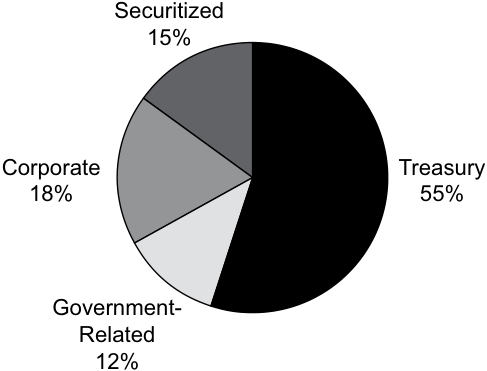
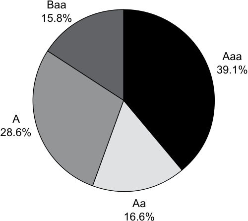
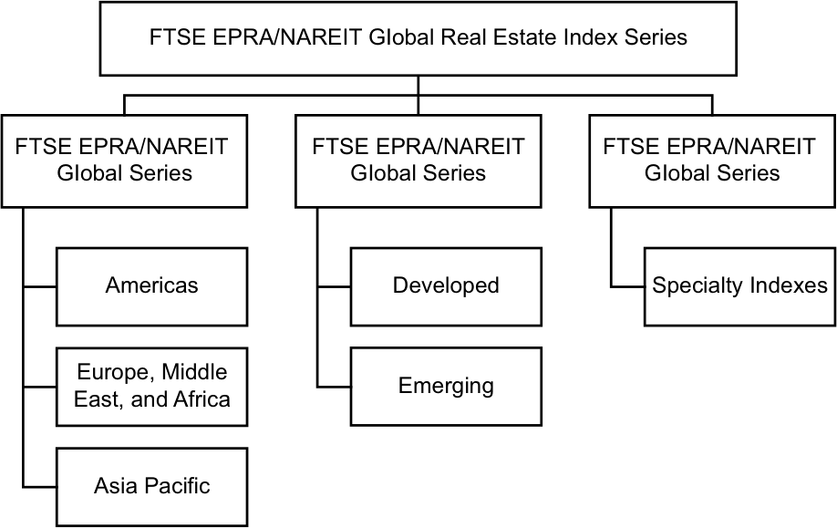

# Volume 5: Equity Investments
## Learning Module 2 Security Market Indexes
### Part 2/3: Uses of Market Indexes (PDF Pages 107–120)

---

<!-- PDF Page 107 -->

the Russell 2000 Index and the Russell 3000 Index.2 By that time, the stock value had increased by more than 300 percent. Investors continued to bid up the stock price in the weeks following the announcement, and the stock closed on the reconstitution date of 30 June at USD2.90, up nearly 400 percent for the quarter. 

**Exhibit 6: Three-Month Performance of Uranium Energy Corporation and NASDAQ April through June 2009** 

<!-- Start of picture text -->
URANIUM ENERGY CORP as of 12–Aug–2009 +600% +400% UEC +200% ^IXIC 0% Mar09 Apr09 May09 Jun09 Jul09 Aug09 8.0 6.0 Volume 4.0 2.0 0.0 Millions <!-- End of picture text -->

_Source_ : Yahoo! Finance and Capital IQ. 

### **USES OF MARKET INDEXES** 

# **<mark>5</mark>** 

describe uses of security market indexes 

Indexes were initially created to give a sense of how a particular security market performed on a given day. With the development of modern financial theory, their uses in investment management have expanded significantly. Some of the major uses of indexes include: 

- gauges of market sentiment; 

- proxies for measuring and modeling returns, systematic risk, and risk-adjusted performance; 

- proxies for asset classes in asset allocation models; 

- benchmarks for actively managed portfolios; and 

- model portfolios for such investment products as index funds and exchange-traded funds (ETFs). 

<!-- PDF Page 108 -->

Investors using security market indexes must be familiar with how various indexes are constructed in order to select the index or indexes most appropriate for their needs. 

#### **Gauges of Market Sentiment** 

The original purpose of stock market indexes was to provide a gauge of investor confidence or market sentiment. As indicators of the collective opinion of market participants, indexes reflect investor attitudes and behavior. The Dow Jones Industrial Average has a long history, is frequently quoted in the media, and remains a popular gauge of market sentiment. It may not accurately reflect the overall attitude of investors or the “market,” however, because the index consists of only 30 of the thousands of US stocks traded each day. 

#### **Proxies for Measuring and Modeling Returns, Systematic Risk, and Risk-Adjusted Performance** 

The capital asset pricing model (CAPM) defines beta as the systematic risk of a security with respect to the entire market. The market portfolio in the CAPM consists of all risky securities. To represent the performance of the market portfolio, investors use a broad index. For example, the Tokyo Price Index (TOPIX) and the S&P 500 often serve as proxies for the market portfolio in Japan and the United States, respectively, and are used for measuring and modeling systematic risk and market returns. 

Security market indexes also serve as market proxies when measuring risk-adjusted performance. The beta of an actively managed portfolio allows investors to form a passive alternative with the same level of systematic risk. For example, if the beta of an actively managed portfolio of global stocks is 0.95 with respect to the MSCI World Index, investors can create a passive portfolio with the same systematic risk by investing 95 percent of their portfolio in a MSCI World Index fund and holding the remaining 5 percent in cash. Alpha, the difference between the return of the actively managed portfolio and the return of the passive portfolio, is a measure of risk-adjusted return or investment performance. Alpha can be the result of manager skill (or lack thereof), transaction costs, and fees. 

#### **Proxies for Asset Classes in Asset Allocation Models** 

Because indexes exhibit the risk and return profiles of select groups of securities, they play a critical role as proxies for asset classes in asset allocation models. They provide the historical data used to model the risks and returns of different asset classes. 

#### **Benchmarks for Actively Managed Portfolios** 

Investors often use indexes as benchmarks to evaluate the performance of active portfolio managers. The index selected as the benchmark should reflect the investment strategy used by the manager. For example, an active manager investing in global small-capitalization stocks should be evaluated using a benchmark index, such as the FTSE Global Small Cap Index, which includes approximately 4,400 liquid small-capitalization stocks across 47 countries as of August 2018. 

The choice of an index to use as a benchmark is important because an inappropriate index could lead to incorrect conclusions regarding an active manager’s investment performance. Suppose that the small-cap manager underperformed the small-cap index but outperformed a broad equity market index. If investors use the broad market 

<!-- PDF Page 109 -->

index as a benchmark, they might conclude that the small-cap manager is earning his or her fees and should be retained or given additional assets to invest. Using the small-cap index as a benchmark might lead to a very different conclusion. 

#### **Model Portfolios for Investment Products** 

Indexes also serve as the basis for the development of new investment products. Using indexes as benchmarks for actively managed portfolios has led some investors to conclude that they should invest in the benchmarks instead. Based on the CAPM’s conclusion that investors should hold the market portfolio, broad market index funds have been developed to function as proxies for the market portfolio. 

Investment management firms initially developed and managed index portfolios for institutional investors. Eventually, mutual fund companies introduced index funds for individual investors. Subsequently, investment management firms introduced exchange-traded funds, which are managed the same way as index mutual funds but trade like stocks. 

The first ETFs were based on existing indexes. As the popularity of ETFs increased, index providers created new indexes for the specific purpose of forming ETFs, leading to the creation of numerous narrowly defined indexes with corresponding ETFs. The VanEck Vectors Vietnam ETF, for example, allows investors to invest in the equity market of Vietnam. 

The choice of indexes to meet the needs of investors is extensive. Index providers are constantly looking for opportunities to develop indexes to meet the needs of investors. 

### **EQUITY INDEXES** 

**<mark>6</mark>** 

describe types of equity indexes 

compare types of security market indexes 

A wide variety of equity indexes exist, including broad market, multi-market, sector, and style indexes. 

#### **Broad Market Indexes** 

A broad equity market index, as its name suggests, represents an entire given equity market and typically includes securities representing more than 90 percent of the selected market. For example, the Shanghai Stock Exchange Composite Index (SSE) is a market-capitalization-weighted index of all shares that trade on the Shanghai Stock Exchange. In the United States, the Wilshire 5000 Total Market Index is a market-capitalization-weighted index that includes all US equities with readily available prices and is designed to represent the entire US equity market.3 The Russell 3000, consisting of the largest 3,000 stocks by market capitalization, represents approximately 98 percent of the US equity market. 

> 3 Despite its name, the Wilshire 5000 has no constraint on the number of securities that can be included. It included approximately 5,000 securities at inception. 

<!-- PDF Page 110 -->

#### **Multi-Market Indexes** 

**Multi-market indexes** usually comprise indexes from different countries and regions and are designed to represent multiple security markets. Multi-market indexes may represent multiple national markets, geographic regions, economic development groups, and, in some cases, the entire world. World indexes are of importance to investors who take a global approach to equity investing without any particular bias toward a particular country or region. A number of index providers publish families of multi-market equity indexes. 

MSCI offers a number of multi-market indexes. As shown in Exhibit 7, MSCI classifies countries and regions along two dimensions: level of economic development and geographic region. Developmental groups, which MSCI refers to as market classifications, include developed markets, emerging markets, and frontier markets. The geographic regions are largely divided by longitudinal lines of the globe: the Americas, Europe with Africa, and Asia with the Pacific. MSCI provides country- and region-specific indexes for each of the developed and emerging markets within its multi-market indexes. MSCI periodically reviews the classifications of markets in its indexes for movement from frontier markets to emerging markets and from emerging markets to developed markets and reconstitutes the indexes accordingly. 

**Exhibit 7: MSCI Global Investable Market Indexes (as of October 2018)** 

|**Developed Markets**|||||
|---|---|---|---|---|
|**Americas**|**Europe and Middle East**||**Pacific**||
|Canada, United States|Austria, Belgium, Denmark, Fin France, Germany, Ireland, Israe Netherlands, Norway, Portugal Sweden, Switzerland, United K|land, l, Italy, , Spain, ingdom|Australia, Ho Zealand, Sing|ng Kong SAR, Japan, New apore|
|**Emerging Markets**|||||
|**Americas**|**Europe, Middle East, Africa**||**Asia**||
|Brazil, Chile, Colombia,|Mexico, Peru Czech Republic, Egypt, Greece, Hungary, Poland, Qatar, Russia Africa, Turkey, United Arab Em| , South irates|Chinese mai South Korea, Philippines,   h|nland, India, Indonesia, Malaysia, Pakistan, Taiwan region, Thailand|
|**Frontier Markets**|||||
|**Americas**|**Europe & CIS** **Africa**|**Middle**|**East**|**Asia**|
|Argentina|Croatia, Estonia, Lithuania, Kazakhstan, Romania, Serbia, Slovenia Kenya, Mauritius, Morocco, Nigeria, Tunisia, WAEMU1|Bahrai Kuwait Oman|n, Jordan, , Lebanon,|Bangladesh, Sri Lanka, Vietnam|
||**MSCI Standalone Market In**|**dexes****2**|||
|**Europe, Middle East,** **and Africa**|**Americas** **Europe and CIS**|**Africa**||**Middle East**|
|Saudi Arabia|Jamaica, Panama,3 Trinidad & Tobago Bosnia Herzegovina, Bulgaria, Ukraine|Botswa Zimba|na, Ghana, bwe|Palestine|

1 _The West African Economic and Monetary Union (WAEMU) consists of the following countries:_ Benin, Burkina Faso, Ivory Coast, Guinea-Bissau, Mali, Niger, Senegal, and Togo. Currently the MSCI WAEMU Indexes include securities classified in Senegal, Ivory Coast, and Burkina Faso. 

2 _The MSCI Standalone Market Indexes are not included in the MSCI Emerging Markets Index or MSCI Frontier Markets Index. However, these indexes use either the Emerging Markets or the Frontier Markets_ 

<!-- PDF Page 111 -->

_methodological criteria concerning size and liquidity._ 3 _MSCI Panama Index has been launched as a Standalone Market Index. Source:_ adapted from MSCI (https:// www .msci .com/ en/ market -cap -weighted -indexes), October 2018. 

##### **_Fundamental Weighting in Multi-Market Indexes_** 

Some index providers weight the securities within each country/region by market capitalization and then weight each country/region in the overall index in proportion to its relative GDP, effectively creating fundamental weighting in multi-market indexes. GDP-weighted indexes were some of the first fundamentally weighted indexes created. Introduced in 1987 by MSCI to address the 60 percent weight of Japanese equities in the market-capitalization-weighted MSCI EAFE Index at the time, GDP-weighted indexes reduced the allocation to Japanese equities by half.4 

#### **Sector Indexes** 

**Sector indexes** represent and track different economic sectors—such as consumer goods, energy, finance, health care, and technology—on either a national, regional, or global basis. Because different sectors of the economy behave differently over the course of the business cycle, some investors may seek to overweight or underweight their exposure to particular sectors. 

Sector indexes are organized as families; each index within the family represents an economic sector. Typically, the aggregation of a sector index family is equivalent to a broad market index. Economic sector classification can be applied on a global, regional, or country-specific basis, but no universally agreed upon sector classification method exists. 

Sector indexes play an important role in performance analysis because they provide a means to determine whether a portfolio manager is more successful at stock selection or sector allocation. Sector indexes also serve as model portfolios for sector-specific ETFs and other investment products. 

#### **Style Indexes** 

Style indexes represent groups of securities classified according to market capitalization, value, growth, or a combination of these characteristics. They are intended to reflect the investing styles of certain investors, such as the growth investor, value investor, and small-cap investor. 

##### **_Market Capitalization_** 

Market-capitalization indexes represent securities categorized according to the major capitalization categories: large cap, midcap, and small cap. With no universal definition of these categories, the indexes differ on the distinctions between large cap and midcap and between midcap and small cap, as well as the minimum market-capitalization size required to be included in a small-cap index. Classification into categories can be based on absolute market capitalization (e.g., below €100 million) or relative market capitalization (e.g., the smallest 2,500 stocks). 

##### **_Value/Growth Classification_** 

Some indexes represent categories of stocks based on their classifications as either value or growth stocks. Different index providers use different factors and valuation ratios (low price-to-book ratios, low price-to-earnings ratios, high dividend yields, etc.) to distinguish between value and growth equities. 

<!-- PDF Page 112 -->

##### **_Market Capitalization and Value/Growth Classification_** 

Combining the three market-capitalization groups with value and growth classifications results in six basic style index categories: 

- Large-Cap Value ■ Large-Cap Growth 

- ■ Mid-Cap Value ■ Mid-Cap Growth ■ Small-Cap Value ■ Small-Cap Growth 

Because indexes use different size and valuation classifications, the constituents of indexes designed to represent a given style, such as small-cap value, may differ— sometimes substantially. 

Because valuation ratios and market capitalizations change over time, stocks frequently migrate from one style index category to another on reconstitution dates. As a result, style indexes generally have much higher turnover than do broad market indexes. 

# **<mark>7</mark>** 

### **FIXED-INCOME INDEXES** 

- describe types of fixed-income indexes compare types of security market indexes 

A wide variety of fixed-income indexes exists, but the nature of the fixed-income markets and fixed-income securities leads to some very important challenges to fixed-income index construction and replication. These challenges are the number of securities in the fixed-income universe, the availability of pricing data, and the liquidity of the securities. 

#### **Construction** 

The fixed-income universe includes securities issued by governments, government agencies, and corporations. Each of these entities may issue a variety of fixed-income securities with different characteristics. As a result, the number of fixed-income securities is many times larger than the number of equity securities. To represent a specific fixed-income market or segment, indexes may include thousands of different securities. Over time, these fixed-income securities mature, and issuers offer new securities to meet their financing needs, leading to turnover in fixed-income indexes. 

Another challenge in index construction is that fixed-income markets are predominantly dealer markets. This means that firms (dealers) are assigned to specific securities and are responsible for creating liquid markets for those securities by purchasing and selling them from their inventory. In addition, many securities do not trade frequently and, as a result, are relatively illiquid. As a result, index providers must contact dealers to obtain current prices on constituent securities to update the index or they must estimate the prices of constituent securities using the prices of traded fixed-income securities with similar characteristics. 

These challenges can result in indexes with dissimilar numbers of bonds representing the same markets. The large number of fixed-income securities—combined with the lack of liquidity of some securities—has made it more costly and difficult, compared with equity indexes, for investors to replicate fixed-income indexes and duplicate their performance. 

<!-- PDF Page 113 -->

#### **Types of Fixed-Income Indexes** 

The wide variety of fixed-income securities, ranging from zero-coupon bonds to bonds with embedded options (i.e., callable or putable bonds), results in a number of different types of fixed-income indexes. Similar to equities, fixed-income securities can be categorized according to the issuer’s economic sector, the issuer’s geographic region, or the economic development of the issuer’s geographic region. Fixed-income securities can also be classified along the following dimensions: 

- type of issuer (government, government agency, corporation); 

- type of financing (general obligation, collateralized); 

- currency of payments; 

- maturity; 

- credit quality (investment grade, high yield, credit agency ratings); and 

- absence or presence of inflation protection. 

Fixed-income indexes are based on these various dimensions and can be categorized as follows: 

- aggregate or broad market indexes; 

- market sector indexes; 

- style indexes; 

- economic sector indexes; and 

- specialized indexes such as high-yield, inflation-linked, and emerging market indexes. 

The first fixed-income index created, the Bloomberg Barclays US Aggregate Bond Index (formerly the Barclays Capital Aggregate Bond Index), is an example of a single-country aggregate index. Designed to represent the broad market of US fixed-income securities, it comprises approximately 8,000 securities, including US Treasury, government-related, corporate, mortgage-backed, asset-backed, and commercial mortgage-backed securities. 

Aggregate indexes can be subdivided by market sector (government, government agency, collateralized, corporate); style (maturity, credit quality); economic sector, or some other characteristic to create more narrowly defined indexes. A common distinction reflected in indexes is between investment grade (e.g., those with a Standard & Poor’s credit rating of BBB– or better) and high-yield securities. Investment-grade indexes are typically further subdivided by maturity (i.e., short, intermediate, or long) and by credit rating (e.g., AAA, BBB, etc.).5 The wide variety of fixed-income indexes reflects the partitioning of fixed-income securities on the basis of a variety of dimensions. 

Exhibit 8 illustrates how the major types of fixed-income indexes can be organized on the basis of various dimensions. 

**Exhibit 8: Dimensions of Fixed-Income Indexes** 

||Global|
|---|---|
|**Market**|Regional|
||Countryor currencyzone|

<!-- PDF Page 114 -->

|**Type**|Corporate|Collateralized _Securitized_ _Mortgage-backed_|Government agency|Government|
|---|---|---|---|---|
|**Maturity**|For example, or long-term|1–3, 3–5, 5–7, 7–10, 10|+ years; short-term|, medium-term,|
|**Credit quality**|For example, grade, high y|AAA, AA, A, BBB, etc.; ield|Aaa, Aa, A, Baa, et|c.; investment|

All aggregate indexes include a variety of market sectors and credit ratings. The breakdown of the Bloomberg Barclays Global Aggregate Bond Index by market sectors and by credit rating is shown in Exhibit 9 and Exhibit 10, respectively. 

##### **Exhibit 9: Market Sector Breakdown of the Bloomberg Barclays Global Aggregate Bond Index** 

<!-- Start of picture text -->
Sector Breakdown as of June 30, 2016 <!-- End of picture text -->

<!-- Start of picture text -->
Securitized 15% Corporate Treasury 18% 55% Government- Related 12% <!-- End of picture text -->

_Source_ : Bloomberg Barclays Indices, Global Aggregate Index Factsheet, August 24, 2016. https:// data .bloomberglp .com/ indices/ sites/ 2/ 2016/ 08/ Factsheet -Global -Aggregate .pdf. 

<!-- PDF Page 115 -->

##### **Exhibit 10: Credit Breakdown of the Bloomberg Barclays Global Aggregate Bond Index** 

<!-- Start of picture text -->
Quality Breakdown as of June 30, 2016 <!-- End of picture text -->

<!-- Start of picture text -->
Baa 15.8% Aaa 39.1% A 28.6% Aa 16.6% <!-- End of picture text -->

_Source_ : Bloomberg Barclays Indices, Global Aggregate Index Factsheet, August 24, 2016. https:// data .bloomberglp .com/ indices/ sites/ 2/ 2016/ 08/ Factsheet -Global -Aggregate .pdf. 

### **INDEXES FOR ALTERNATIVE INVESTMENTS** 

# **<mark>8</mark>** 

describe indexes representing alternative investments compare types of security market indexes 

Many investors seek to lower the risk or enhance the performance of their portfolios by investing in assets classes other than equities and fixed income. Interest in alternative assets and investment strategies has led to the creation of indexes designed to represent broad classes of alternative investments. Three of the most widely followed alternative investment classes are commodities, real estate, and hedge funds. 

#### **Commodity Indexes** 

Commodity indexes consist of futures contracts on one or more commodities, such as agricultural products (rice, wheat, sugar), livestock (cattle, hogs), precious and common metals (gold, silver, copper), and energy commodities (crude oil, natural gas). 

Although some commodity indexes may include the same commodities, the returns of these indexes may differ because each index may use a different weighting method. Because commodity indexes do not have an obvious weighting mechanism, such as market capitalization, commodity index providers create their own weighting methods. Some indexes, such as the Thomson Reuters/Core Commodity CRB Index (TR/CC CRB Index), formerly known as the Commodity Research Bureau (CRB) Index, contain a fixed number of commodities that are weighted equally. The S&P 

<!-- PDF Page 116 -->

GSCI uses a combination of liquidity measures and world production values in its weighting scheme and allocates more weight to commodities that have risen in price. Other indexes have fixed weights that are determined by a committee. 

The different weighting methods can also lead to large differences in exposure to specific commodities. The S&P GSCI in 2018, for example, weights the energy-sector approximately 50% higher and the agriculture sector 40% lower than the CRB Index. These differences result in indexes with very different risk and return profiles. Unlike commodity indexes, broad equity and fixed-income indexes that target the same markets share similar risk and return profiles. 

The performance of commodity indexes can also be quite different from their underlying commodities because the indexes consist of futures contracts on the commodities rather than the actual commodities. Index returns are affected by factors other than changes in the prices of the underlying commodities because futures contracts must be continually “rolled over” (i.e., replacing a contract nearing expiration with a new contract). Commodity index returns reflect the risk-free interest rate, the changes in future prices, and the roll yield. Therefore, a commodity index return can be quite different from the return based on changes in the prices of the underlying commodities. 

#### **Real Estate Investment Trust Indexes** 

Real estate indexes represent not only the market for real estate securities but also the market for real estate—a highly illiquid market and asset class with infrequent transactions and pricing information. Real estate indexes can be categorized as appraisal indexes, repeat sales indexes, and real estate investment trust (REIT) indexes. 

REIT indexes consist of shares of publicly traded REITs. REITS are public or private corporations organized specifically to invest in real estate, either through ownership of properties or investment in mortgages. Shares of public REITs are traded on the world’s various stock exchanges and are a popular choice for investing in commercial real estate properties. Because REIT indexes are based on publicly traded REITs with continuous market pricing, the value of REIT indexes is calculated continuously. 

The FTSE EPRA/NAREIT global family of REIT indexes shown in Exhibit 11 seeks to represent trends in real estate stocks worldwide and includes representation from the European Public Real Estate Association (EPRA) and the National Association of Real Estate Investment Trusts (NAREIT). 

<!-- PDF Page 117 -->

##### **Exhibit 11: The FTSE EPRA/NAREIT Global REIT Index Family** 

<!-- Start of picture text -->
FTSE EPRA/NAREIT GIobal Real Estate Index Series FTSE EPRA/NAREIT  FTSE EPRA/NAREIT FTSE EPRA/NAREIT GIobal Series GIobal Series GIobal Series Americas Developed Specialty Indexes Europe, Middle Emerging East, and Africa Asia Pacific <!-- End of picture text -->

_Source_ : FTSE International, “FTSE EPRA/NAREIT Global & Global Ex US Indices” Factsheet 2009). “FTSE®” is a trade mark of the London Stock Exchange Plc, “NAREIT®” is a trade mark of the National Association of Real Estate Investment Trusts (“NAREIT”) and “EPRA®” is a trade mark of the European Public Real Estate Association (“EPRA”) and all are used by FTSE International Limited (“FTSE”) under license. 

#### **Hedge Fund Indexes** 

Hedge fund indexes reflect the returns on hedge funds. **Hedge funds** are private investment vehicles that typically use leverage and long and short investment strategies. 

A number of research organizations maintain databases of hedge fund returns and summarize these returns into indexes. These database indexes are designed to represent the performance of the hedge funds on a very broad global level (hedge funds in general) or the strategy level. Most of these indexes are equal weighted and represent the performance of the hedge funds within a particular database. 

Most research organizations rely on the voluntary cooperation of hedge funds to compile performance data. As unregulated entities, however, hedge funds are not required to report their performance to any party other than their investors. Therefore, each hedge fund decides to which database(s) it will report its performance. As a result, rather than index providers determining the constituents, the constituents determine the index. 

Frequently, a hedge fund reports its performance to only one database. The result is little overlap of funds covered by the different indexes. With little overlap between their constituents, different global hedge fund indexes may reflect very different performance for the hedge fund industry over the same period of time. 

Another consequence of the voluntary performance reporting is the potential for survivorship bias and, therefore, inaccurate performance representation. This means that hedge funds with poor performance may be less likely to report their performance to the database or may stop reporting to the database, so their returns may be excluded when measuring the return of the index. As a result, the index may not accurately reflect actual hedge fund performance so much as the performance of hedge funds that are performing well. 

<!-- PDF Page 118 -->

##### **REPRESENTATIVE INDEXES WORLDWIDE** 

As indicated in this reading, the choice of indexes to meet the needs of investors is extensive. Investors using security market indexes must be careful in their selection of the index or indexes most appropriate for their needs. The following table illustrates the variety of indexes reflecting different asset classes, markets, and weighting methods. 

|**Index**|**Representing**|**Number of** **Securities**|**Weighting Method**|**Comments**|
|---|---|---|---|---|
|Dow Jones Industrial Average|US blue chip companies|30|Price|The oldest and most widely known US equity index. _Wall Street Journal_editors choose 30 stocks from among large, mature blue-chipcompanies.|
|Nikkei Stock Average|Japanese blue chip companies|225|Modified price|Known as the Nikkei 225 and originally formulated by Dow Jones & Company. Because of extreme variation in price levels of compo- nent securities, some high-priced shares are weighted as a fraction of shareprice.|
|TOPIX|All companies listed on the Tokyo Stock Exchange First Section|Varies|Float-adjusted mar- ket cap|Represents about 93 percent of the market value of all Japanese equities. Contains a large number of very small, illiquid stocks, making exact replication difficult.|
|MSCI All Country World Index|Stocks of 23 developed and 24 emerging markets|Varies|Free-float-adjusted market cap|fi Composed of companies represen- tative of the market structure of developed and emerging market countries in the Americas, Europe/ Middle East, and Asia/Pacific regions. Price return and total return versions available in both USD and local currencies.|
|S&P Developed Ex-US BMI Energy Sector Index|Energy sector of devel- oped global markets outside the United States|Varies|Float-adjusted mar- ket cap|Serves as a model portfolio for the SPDR®S&P Energy Sector Exchange-Traded Fund (ETF).|
|Bloomberg Barclays Global Aggregate Bond Index|Investment-grade bonds in the North American, European, and Asian markets|Varies|Market cap|Formerly known as Lehman Brothers Global Aggregate Bond Index.|
|Markit iBoxx Euro High-Yield Bond Indexes|Sub-investment-grade euro-denominated corpo- rate bonds|Varies|Market cap and variations|Rebalanced monthly. Represents tradable part of market. Price and total return versions available with such analytical values as yield, duration, modified duration, and convexity. Provides platform for research and structuredproducts.|
|FTSE EPRA/NAREIT Global Real Estate Index|Real estate securities in the North American, European, and Asian markets|Varies|Float-adjusted mar- ket cap|The stocks of REITs that constitute the index trade on public stock exchanges and may be constituents of equitymarket indexes.|

<!-- PDF Page 119 -->

|**Index**|**Representing**|**Number of** **Securities**|**Weighting Method**|**Comments**|
|---|---|---|---|---|
|HFRX Global Hedge Fund Index|Overall composition of the HFR database|Varies|Asset weighted|Comprises all eligible hedge fund strategies. Examples include convertible arbitrage, distressed securities, market neutral, event driven, macro, and relative value arbitrage. Constituent strategies are asset weighted on the basis of asset distribution within the hedge fund industry.|
|HFRX Equal Weighted Strategies EUR Index|Overall composition of the HFR database|Varies|Equal weighted|Denominated in euros and is con- structed from the same strategies as the HFRX Global Hedge Fund Index.|
|Morningstar Style Indexes|US stocks classified by market cap and value/ growth orientation|Varies|Float-adjusted mar- ket cap|The nine indexes defined by com- binations of market cap (large, mid, and small) and value/growth ori- entation (value, core, growth) have mutually exclusive constituents and are exhaustive with respect to the Morningstar US Market Index. Each is a model portfolio for one of the iShares Morningstar ETFs.|

## **~~SUMMARY~~** 

This reading explains and illustrates the construction, management, and uses of security market indexes. It also discusses various types of indexes. Security market indexes are invaluable tools for investors, who can select from among thousands of indexes representing a variety of security markets, market segments, and asset classes. These indexes range from those representing the global market for major asset classes to those representing alternative investments in specific geographic markets. To benefit from the use of security market indexes, investors must understand their construction and determine whether the selected index is appropriate for their purposes. Frequently, an index that is well suited for one purpose may not be well suited for other purposes. Users of indexes must be familiar with how various indexes are constructed in order to select the index or indexes most appropriate for their needs. 

Among the key points made in this reading are the following: 

- Security market indexes are intended to measure the values of different target markets (security markets, market segments, or asset classes). 

- The constituent securities selected for inclusion in the security market index are intended to represent the target market. 

- A price return index reflects only the prices of the constituent securities. 

- A total return index reflects not only the prices of the constituent securities but also the reinvestment of all income received since the inception of the index. 

<!-- PDF Page 120 -->

- Methods used to weight the constituents of an index range from the very simple, such as price and equal weightings, to the more complex, such as market-capitalization and fundamental weightings. 

- Choices in index construction—in particular, the choice of weighting method—affect index valuation and returns. 

- Index management includes 1) periodic rebalancing to ensure that the index maintains appropriate weightings and 2) reconstitution to ensure the index represents the desired target market. 

- Rebalancing and reconstitution create turnover in an index. Reconstitution can dramatically affect prices of current and prospective constituents. 

- Indexes serve a variety of purposes. They gauge market sentiment and serve as benchmarks for actively managed portfolios. They act as proxies for measuring systematic risk and risk-adjusted performance. They also serve as proxies for asset classes in asset allocation models and as model portfolios for investment products. 

- Investors can choose from security market indexes representing various asset classes, including equity, fixed-income, commodity, real estate, and hedge fund indexes. 

- Within most asset classes, index providers offer a wide variety of indexes, ranging from broad market indexes to highly specialized indexes based on the issuer’s geographic region, economic development group, or economic sector or other factors. 

- Proper use of security market indexes depends on understanding their construction and management. 

