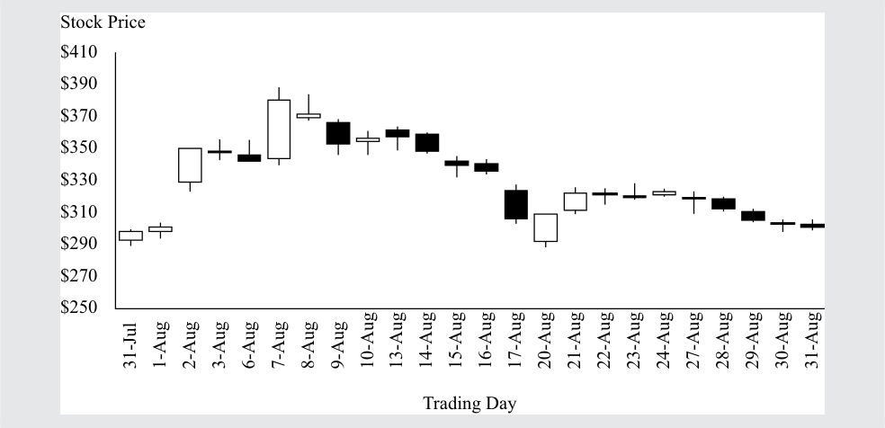

# Volume 5: Equity Investments
## Learning Module 3 Market Efficiency
### Part 1/3: Introduction (PDF Pages 133–148)

---

<!-- PDF Page 133 -->

#### L E A R N I N G M O D U L E 

# **<mark>3</mark>** 

### **Market Efficiency** 

**by Sean Cleary, PhD, CFA, Howard J. Atkinson, CIMA, ICD.D, CFA, and Pamela Peterson Drake, PhD, CFA.** 

_Sean Cleary, PhD, CFA, is at Queen’s University (Canada). Howard J. Atkinson, CIMA, ICD.D, CFA, is at Horizons ETF Management (Canada) Inc. (Canada). Pamela Peterson Drake, PhD, CFA, is at James Madison University (USA)._ 

###### **<mark>LEARNING OUTCOMES</mark>** 

**_Mastery The candidate should be able to:_** describe market efficiency and related concepts, including their importance to investment practitioners contrast market value and intrinsic value explain factors that affect a market’s efficiency contrast weak-form, semi-strong-form, and strong-form market efficiency explain the implications of each form of market efficiency for fundamental analysis, technical analysis, and the choice between active and passive portfolio management describe market anomalies describe behavioral finance and its potential relevance to understanding market anomalies 

<!-- Start of picture text -->
1 <!-- End of picture text -->

##### **INTRODUCTION** 

Market efficiency concerns the extent to which market prices incorporate available information. If market prices do not fully incorporate information, then opportunities may exist to make a profit from the gathering and processing of information. The subject of market efficiency is, therefore, of great interest to investment managers, as illustrated in Example 1. 

<!-- PDF Page 134 -->

###### **EXAMPLE 1** 

###### **Market Efficiency and Active Manager Selection** 

1. The chief investment officer (CIO) of a major university endowment fund has listed eight steps in the active manager selection process that can be applied both to traditional investments (e.g., common equity and fixed-income securities) and to alternative investments (e.g., private equity, hedge funds, and real assets). The first step specified is the evaluation of market opportunity: 

What is the opportunity and why is it there? To answer this question, we start by studying capital markets and the types of managers operating within those markets. We identify market inefficiencies and try to understand their causes, such as regulatory structures or behavioral biases. We can rule out many broad groups of managers and strategies by simply determining that the degree of market inefficiency necessary to support a strategy is implausible. Importantly, we consider the past history of active returns meaningless unless we understand why markets will allow those active returns to continue into the future.1 

The CIO’s description underscores the importance of not assuming that past active returns that might be found in a historical dataset will repeat themselves in the future. **Active returns** refer to returns earned by strategies that do _not_ assume that all information is fully reflected in market prices. 

Governments and market regulators also care about the extent to which market prices incorporate information. Efficient markets imply informative prices—prices that accurately reflect available information about fundamental values. In market-based economies, market prices help determine which companies (and which projects) obtain capital. If these prices do not efficiently incorporate information about a company’s prospects, then it is possible that funds will be misdirected. By contrast, prices that are informative help direct scarce resources and funds available for investment to their highest-valued uses.2 Informative prices thus promote economic growth. The efficiency of a country’s capital markets (in which businesses raise financing) is an important characteristic of a well-functioning financial system. 

The remainder of this reading is organized as follows. Section 2 provides specifics on how the efficiency of an asset market is described and discusses the factors affecting (i.e., contributing to and impeding) market efficiency. Section 3 presents an influential three-way classification of the efficiency of security markets and discusses its implications for fundamental analysis, technical analysis, and portfolio management. Section 4 presents several market anomalies (apparent market inefficiencies that have received enough attention to be individually identified and named) and describes how these anomalies relate to investment strategies. Section 5 introduces behavioral finance and how that field of study relates to market efficiency. A summary concludes the reading. 

> 1 The CIO is Christopher J. Brightman, CFA, of the University of Virginia Investment Management Company, as reported in Yau, Schneeweis, Robinson, and Weiss (2007, pp. 481–482). 2 This concept is known as allocative efficiency. 

<!-- PDF Page 135 -->

##### **THE CONCEPT OF MARKET EFFICIENCY** 

## **<mark>2</mark>** 

describe market efficiency and related concepts, including their importance to investment practitioners 

contrast market value and intrinsic value 

###### **The Description of Efficient Markets** 

An **informationally efficient market** (an **efficient market** ) is a market in which asset prices reflect new information quickly and rationally. An efficient market is thus a market in which asset prices reflect all past and present information.3 

In this section we expand on this definition by clarifying the time frame required for an asset’s price to incorporate information as well as describing the elements of information releases assumed under market efficiency. We discuss the difference between market value and intrinsic value and illustrate how inefficiencies or discrepancies between these values can provide profitable opportunities for active investment. As financial markets are generally not considered being either completely efficient or inefficient, but rather falling within a range between the two extremes, we describe a number of factors that contribute to and impede the degree of efficiency of a financial market. Finally, we conclude our overview of market efficiency by illustrating how the costs incurred by traders in identifying and exploiting possible market inefficiencies affect how we interpret market efficiency. 

Investment managers and analysts, as noted, are interested in market efficiency because the extent to which a market is efficient affects how many profitable trading opportunities (market inefficiencies) exist. Consistent, superior, risk-adjusted returns (net of all expenses) are not achievable in an efficient market.4 In an efficient market, a **passive investment** strategy (i.e., buying and holding a broad market portfolio) that does not seek superior risk-adjusted returns can be preferred to an **active investment** strategy because of lower costs (for example, transaction and information-seeking costs). By contrast, in a very inefficient market, opportunities may exist for an active investment strategy to achieve superior risk-adjusted returns (net of all expenses in executing the strategy) as compared with a passive investment strategy. In inefficient markets, an active investment strategy may outperform a passive investment strategy on a risk-adjusted basis. Understanding the characteristics of an efficient market and being able to evaluate the efficiency of a particular market are important topics for investment analysts and portfolio managers. 

An efficient market is a market in which asset prices reflect information quickly. But what is the time frame of “quickly”? Trades are the mechanism by which information can be incorporated into asset transaction prices. The time needed to execute trades to exploit an inefficiency may provide a baseline for judging speed of adjustment.5 

> 3 This definition is convenient for making several instructional points. The definition that most simply explains the sense of the word _efficient_ in this context can be found in Fama (1976): “An efficient capital market is a market that is efficient in processing information” (p. 134). 

> 4 The technical term for _superior_ in this context is _positive abnormal_ in the sense of higher than expected given the asset’s risk (as measured, according to capital market theory, by the asset’s contribution to the risk of a well-diversified portfolio). 

> 5 Although the original theory of market efficiency does not quantify this speed, the basic idea is that it is sufficiently swift to make it impossible to consistently earn abnormal profits. Chordia, Roll, and Subrahmanyam (2005) suggest that the adjustment to information on the New York Stock Exchange (NYSE) is between 5 and 60 minutes. 

<!-- PDF Page 136 -->

The time frame for an asset’s price to incorporate information must be at least as long as the shortest time a trader needs to execute a transaction in the asset. In certain markets, such as foreign exchange and developed equity markets, market efficiency relative to certain types of information has been studied using time frames as short as one minute or less. If the time frame of price adjustment allows many traders to earn profits with little risk, then the market is relatively inefficient. These considerations lead to the observation that market efficiency can be viewed as falling on a continuum. 

Finally, an important point is that in an efficient market, prices should be expected to react only to the elements of information releases that are not anticipated fully by investors—that is, to the “unexpected” or “surprise” element of such releases. Investors process the unexpected information and revise expectations (for example, about an asset’s future cash flows, risk, or required rate of return) accordingly. The revised expectations enter or get incorporated in the asset price through trades in the asset. Market participants who process the news and believe that at the current market price an asset does not offer sufficient compensation for its perceived risk will tend to sell it or even sell it short. Market participants with opposite views should be buyers. In this way the market establishes the price that balances the various opinions after expectations are revised. 

###### **EXAMPLE 2** 

###### **Price Reaction to the Default on a Bond Issue** 

Suppose that a speculative-grade bond issuer announces, just before bond markets open, that it will default on an upcoming interest payment. In the announcement, the issuer confirms various reports made in the financial media in the period leading up to the announcement. Prior to the issuer’s announcement, the financial news media reported the following: 1) suppliers of the company were making deliveries only for cash payment, reducing the company’s liquidity; 2) the issuer’s financial condition had probably deteriorated to the point that it lacked the cash to meet an upcoming interest payment; and 3) although public capital markets were closed to the company, it was negotiating with a bank for a private loan that would permit it to meet its interest payment and continue operations for at least nine months. If the issuer defaults on the bond, the consensus opinion of analysts is that bondholders will recover approximately $0.36 to $0.38 per dollar face value. 

1. If the market for the bond is efficient, the bond’s market price is _most likely_ to fully reflect the bond’s value after default: 

   - **A.** in the period leading up to the announcement. 

   - **B.** in the first trade prices after the market opens on the announcement day. 

   - **C.** when the issuer actually misses the payment on the interest payment date. 

###### **Solution:** 

B is correct. The announcement removed any uncertainty about default. In the period leading up to the announcement, the bond’s market price incorporated a probability of default, but the price would not have fully reflected the bond’s value after default. The possibility that a bank loan might permit the company to avoid default was not eliminated until the announcement. 

<!-- PDF Page 137 -->

2. If the market for the bond is efficient, the piece of information that bond investors _most likely_ focus on in the issuer’s announcement is that the issuer had: 

   - **A.** failed in its negotiations for a bank loan. 

   - **B.** lacked the cash to meet the upcoming interest payment. 

   - **C.** been required to make cash payments for supplier deliveries. 

###### **Solution:** 

A is correct. The failure of the loan negotiations first becomes known in this announcement. The failure implies default. 

###### **Market Value versus Intrinsic Value** 

**Market value** is the price at which an asset can currently be bought or sold. **Intrinsic value** (sometimes called **fundamental value** ) is, broadly speaking, the value that would be placed on it by investors if they had a complete understanding of the asset’s investment characteristics.6 For a bond, for example, such information would include its interest (coupon) rate, principal value, the timing of its interest and principal payments, the other terms of the bond contract (indenture), a precise understanding of its default risk, the liquidity of its market, and other issue-specific items. In addition, market variables such as the term structure of interest rates and the size of various market premiums applying to the issue (for default risk, etc.) would enter into a discounted cash flow estimate of the bond’s intrinsic value (discounted cash flow models are often used for such estimates). The word _estimate_ is used because in practice, intrinsic value can be estimated but is not known for certain. 

If investors believe a market is highly _efficient_ , they will usually accept market prices as accurately reflecting intrinsic values. Discrepancies between market price and intrinsic value are the basis for profitable active investment. Active investors seek to own assets selling below perceived intrinsic value in the marketplace and to sell or sell short assets selling above perceived intrinsic value. 

If investors believe an asset market is relatively _inefficient_ , they may try to develop an independent estimate of intrinsic value. The challenge for investors and analysts is estimating an asset’s intrinsic value. Numerous theories and models, including the dividend discount model, can be used to estimate an asset’s intrinsic value, but they all require some form of judgment regarding the size, timing, and riskiness of the future cash flows associated with the asset. The more complex an asset’s future cash flows, the more difficult it is to estimate its intrinsic value. These complexities and the estimates of an asset’s market value are reflected in the market through the buying and selling of assets. The market value of an asset represents the intersection of supply and demand—the point that is low enough to induce at least one investor to buy while being high enough to induce at least one investor to sell. Because information relevant to valuation flows continually to investors, estimates of intrinsic value change, and hence, market values change. 

<!-- PDF Page 138 -->

###### **EXAMPLE 3** 

###### **Intrinsic Value** 

1. An analyst estimates that a security’s intrinsic value is lower than its market value. The security appears to be: 

   - **A.** undervalued. 

   - **B.** fairly valued. 

   - **C.** overvalued. 

###### **Solution:** 

C is correct. The market is valuing the asset at more than its true worth. 

2. A market in which assets’ market values are, on average, equal to or nearly equal to intrinsic values is _best described_ as a market that is attractive for: 

   - **A.** active investment. 

   - **B.** passive investment. 

   - **C.** both active and passive investment. 

###### **Solution:** 

B is correct because an active investment is not expected to earn superior risk-adjusted returns if the market is efficient. The additional costs of active investment are not justified in such a market. 

3. Suppose that the future cash flows of an asset are accurately estimated. The asset trades in a market that you believe is efficient based on most evidence, but your estimate of the asset’s intrinsic value exceeds the asset’s market value by a moderate amount. The _most likely_ conclusion is that you have: 

   - **A.** overestimated the asset’s risk. 

   - **B.** underestimated the asset’s risk. 

   - **C.** identified a market inefficiency. 

###### **Solution:** 

B is correct. If risk is underestimated, the discount rate being applied to find the present value of the expected cash flows (estimated intrinsic value) will be too low and the intrinsic value estimate will be too high. 

## **<mark>3</mark>** 

##### **FACTORS AFFECTING MARKET EFFICIENCY INCLUDING TRADING COSTS** 

describe market efficiency and related concepts, including their importance to investment practitioners explain factors that affect a market’s efficiency 

<!-- PDF Page 139 -->

For markets to be efficient, prices should adjust quickly and rationally to the release of new information. In other words, prices of assets in an efficient market should “fully reflect” all information. Financial markets, however, are generally not classified at the two extremes as either completely inefficient or completely efficient but, rather, as exhibiting various degrees of efficiency. In other words, market efficiency should be viewed as falling on a continuum between extremes of completely efficient, at one end, and completely inefficient, at the other. Asset prices in a highly efficient market, by definition, reflect information more quickly and more accurately than in a less-efficient market. These degrees of efficiency also vary through time, across geographical markets, and by type of market. A number of factors contribute to and impede the degree of efficiency in a financial market. 

###### **Market Participants** 

One of the most critical factors contributing to the degree of efficiency in a market is the number of market participants. Consider the following example that illustrates the relationship between the number of market participants and market efficiency. 

###### **EXAMPLE 4** 

###### **Illustration of Market Efficiency** 

Assume that the shares of a small market capitalization (cap) company trade on a public stock exchange. Because of its size, it is not considered “blue-chip” and not many professional investors follow the activities of the company.7 A smallcap fund analyst reports that the most recent annual operating performance of the company has been surprisingly good, considering the recent slump in its industry. The company’s share price, however, has been slow to react to the positive financial results because the company is not being recommended by the majority of research analysts. This mispricing implies that the market for this company’s shares is less than fully efficient. The small-cap fund analyst recognizes the opportunity and immediately recommends the purchase of the company’s shares. The share price gradually increases as more investors purchase the shares once the news of the mispricing spreads through the market. As a result, it takes a few days for the share price to fully reflect the information. 

Six months later, the company reports another solid set of interim financial results. But because the previous mispricing and subsequent profit opportunities have become known in the market, the number of analysts following the company’s shares has increased substantially. As a result, as soon as unexpected information about the positive interim results are released to the public, a large number of buy orders quickly drive up the stock price, thereby making the market for these shares more efficient than before. 

A large number of investors (individual and institutional) follow the major financial markets closely on a daily basis, and if mispricings exist in these markets, as illustrated by the example, investors will act so that these mispricings disappear quickly. Besides the number of investors, the number of financial analysts who follow or analyze a security or asset should be positively related to market efficiency. The number of market participants and resulting trading activity can vary significantly through time. A lack of trading activity can cause or accentuate other market imperfections that impede market efficiency. In fact, in many of these markets, trading in many of 

<!-- PDF Page 140 -->

the listed stocks is restricted for foreigners. By nature, this limitation reduces the number of market participants, restricts the potential for trading activity, and hence reduces market efficiency. 

###### **EXAMPLE 5** 

###### **Factors Affecting Market Efficiency** 

1. The expected effect on market efficiency of opening a securities market to trading by foreigners would _most likely_ be to: 

   - **A.** decrease market efficiency. 

   - **B.** leave market efficiency unchanged. 

   - **C.** increase market efficiency. 

###### **Solution:** 

C is correct. The opening of markets as described should increase market efficiency by increasing the number of market participants. 

###### **Information Availability and Financial Disclosure** 

Information availability (e.g., an active financial news media) and financial disclosure should promote market efficiency. Information regarding trading activity and traded companies in such markets as the New York Stock Exchange, the London Stock Exchange, and the Tokyo Stock Exchange is readily available. Many investors and analysts participate in these markets, and analyst coverage of listed companies is typically substantial. As a result, these markets are quite efficient. In contrast, trading activity and material information availability may be lacking in smaller securities markets, such as those operating in some emerging markets. 

Similarly, significant differences may exist in the efficiency of different types of markets. For example, many securities trade primarily or exclusively in dealer or over-the-counter (OTC) markets, including bonds, money market instruments, currencies, mortgage-backed securities, swaps, and forward contracts. The information provided by the dealers that serve as market makers for these markets can vary significantly in quality and quantity, both through time and across different product markets. 

Treating all market participants fairly is critical for the integrity of the market and explains why regulators place such an emphasis on “fair, orderly, and efficient markets.”8 A key element of this fairness is that all investors have access to the information necessary to value securities that trade in the market. Rules and regulations that promote fairness and efficiency in a market include those pertaining to the disclosure of information and illegal insider trading. 

For example, US Securities and Exchange Commission’s (SEC’s) Regulation FD (Fair Disclosure) requires that if security issuers provide nonpublic information to some market professionals or investors, they must also disclose this information to the public.9 This requirement helps provide equal and fair opportunities, which is important in encouraging participation in the market. A related issue deals with illegal insider trading. The SEC’s rules, along with court cases, define illegal insider trading as trading in securities by market participants who are considered insiders “while in 

> 8 “The Investor’s Advocate: How the SEC Protects Investors, Maintains Market Integrity, and Facilitates Capital Formation,” US Securities and Exchange Commission (www .sec .gov/ about/ whatwedo .shtml). 

> 9 Regulation FD, “Selective Disclosure and Insider Trading,” 17 CFR Parts 240, 243, and 249, effective 23 October 2000. 

<!-- PDF Page 141 -->

possession of material, nonpublic information about the security.”10 Although these rules cannot guarantee that some participants will not have an advantage over others and that insiders will not trade on the basis of inside information, the civil and criminal penalties associated with breaking these rules are intended to discourage illegal insider trading and promote fairness. In the European Union, insider trading laws are generally enshrined in legislation and enforced by regulatory and judicial authorities.11 

###### **Limits to Trading** 

**Arbitrage** is a set of transactions that produces riskless profits. Arbitrageurs are traders who engage in such trades to benefit from pricing discrepancies (inefficiencies) in markets. Such trading activity contributes to market efficiency. For example, if an asset is traded in two markets but at different prices, the actions of buying the asset in the market in which it is underpriced and selling the asset in the market in which it is overpriced will eventually bring these two prices together. The presence of these arbitrageurs helps pricing discrepancies disappear quickly. Obviously, market efficiency is impeded by any limitation on arbitrage resulting from operating inefficiencies, such as difficulties in executing trades in a timely manner, prohibitively high trading costs, and a lack of transparency in market prices. 

Some market experts argue that restrictions on short selling limit arbitrage trading, which impedes market efficiency. **Short selling** is the transaction whereby an investor sells shares that he or she does not own by borrowing them from a broker and agreeing to replace them at a future date. Short selling allows investors to sell securities they believe to be overvalued, much in the same way they can buy those they believe to be undervalued. In theory, such activities promote more efficient pricing. Regulators and others, however, have argued that short selling may exaggerate downward market movements, leading to crashes in affected securities. In contrast, some researchers report evidence indicating that when investors are unable to borrow securities, that is to short the security, or when costs to borrow shares are high, market prices may deviate from intrinsic values.12 Furthermore, research suggests that short selling is helpful in price discovery (that is, it facilitates supply and demand in determining prices).13 

###### **Transaction Costs and Information-Acquisition Costs** 

The costs incurred by traders in identifying and exploiting possible market inefficiencies affect the interpretation of market efficiency. The two types of costs to consider are transaction costs and information-acquisition costs. 

- _Transaction costs_ : Practically, transaction costs are incurred in trading to exploit any perceived market inefficiency. Thus, “efficient” should be viewed as efficient within the bounds of transaction costs. For example, consider a violation of the principle that two identical assets should sell for the same price in different markets. Such a violation can be considered to be a rather simple possible exception to market efficiency because prices appear to 

> 10 Although not the focus of this particular reading, it is important to note that a party is considered an insider not only when the individual is a corporate insider, such as an officer or director, but also when the individual is aware that the information is nonpublic information [Securities and Exchange Commission, Rules 10b5-1 (“Trading on the Basis of Material Nonpublic Information in Insider Trading Cases”) and Rule 10b5-2 “Duties of Trust or Confidence in Misappropriation Insider Trading Cases”)]. 

> 11 See the European Union’s Market Abuse Regulation (Regulation (EU) no. 596/2014 of the European Parliament and of the Council of 16 April 2014 on market abuse) and Directive for Criminal Sanctions for Market Abuse (Directive 2014/57/EU of the European Parliament and of the Council of 16 April 2014 on criminal sanctions for market abuse). 

> 12 See Deng, Mortal, and Gupta (2017) and references therein.” 

> 13 See Bris, Goetzmann, and Zhu (2009). 

<!-- PDF Page 142 -->

be inconsistently processing information. To exploit the violation, a trader could arbitrage by simultaneously shorting the asset in the higher-price market and buying the asset in the lower-price market. If the price discrepancy between the two markets is smaller than the transaction costs involved in the arbitrage for the lowest cost traders, the arbitrage will not occur, and both prices are in effect efficient within the bounds of arbitrage. These bounds of arbitrage are relatively narrow in highly liquid markets, such as the market for US Treasury bills, but could be wide in illiquid markets. 

- _Information-acquisition costs:_ Practically, expenses are always associated with gathering and analyzing information. New information is incorporated in transaction prices by traders placing trades based on their analysis of information. Active investors who place trades based on information they have gathered and analyzed play a key role in market prices adjusting to reflect new information. The classic view of market efficiency is that active investors incur information acquisition costs but that money is wasted because prices already reflect all relevant information. This view of efficiency is very strict in the sense of viewing a market as inefficient if active investing can recapture any part of the costs, such as research costs and active asset selection. Grossman and Stiglitz (1980) argue that prices must offer a return to information acquisition; in equilibrium, if markets are efficient, returns net of such expenses are just fair returns for the risk incurred. The modern perspective views a market as inefficient if, after deducting such costs, active investing can earn superior returns. Gross of expenses, a return should accrue to information acquisition in an efficient market. 

In summary, a modern perspective calls for the investor to consider transaction costs and information-acquisition costs when evaluating the efficiency of a market. A price discrepancy must be sufficiently large to leave the investor with a profit (adjusted for risk) after taking account of the transaction costs and information-acquisition costs to reach the conclusion that the discrepancy may represent a market inefficiency. Prices may somewhat less than fully reflect available information without there being a true market opportunity for active investors. 

## **<mark>4</mark> FORMS OF MARKET EFFICIENCY** 

contrast weak-form, semi-strong-form, and strong-form market efficiency 

Eugene Fama developed a framework for describing the degree to which markets are efficient.14 In his efficient market hypothesis, markets are efficient when prices reflect _all_ relevant information at any point in time. This means that the market prices observed for securities, for example, reflect the information available at the time. In his framework, Fama defines three forms of efficiency: weak, semi-strong, and strong. Each form is defined with respect to the available information that is reflected in prices. 

<!-- PDF Page 143 -->

||**M  l**|**arket Prices Refle**|**lct:**|
|---|---|---|---|
|**Forms of Market Efficiency**|**Past** **Market Data**|**Public** **Information**|**Private** **Information**|
|Weak form of market efficiency|✓|||
|Semi-strong form of market efficiency|✓|✓||
|fi Strong form of market efficiency|✓|✓|✓|

A finding that investors can consistently earn **abnormal returns** by trading on the basis of information is evidence contrary to market efficiency. In general, abnormal returns are returns in excess of those expected given a security’s risk and the market’s return. In other words, abnormal return equals actual return less expected return. 

###### **Weak Form** 

In the **weak-form efficient market hypothesis** , security prices fully reflect _all past market data_ , which refers to all historical price and trading volume information. If markets are weak-form efficient, past trading data are already reflected in current prices and investors cannot predict future price changes by extrapolating prices or patterns of prices from the past.15 

Tests of whether securities markets are weak-form efficient require looking at patterns of prices. One approach is to see whether there is any serial correlation in security returns, which would imply a predictable pattern.16 Although there is some weak correlation in daily security returns, there is not enough correlation to make this a profitable trading rule after considering transaction costs. 

An alternative approach to test weak-form efficiency is to examine specific trading rules that attempt to exploit historical trading data. If any such trading rule consistently generates abnormal risk-adjusted returns after trading costs, this evidence will contradict weak-form efficiency. This approach is commonly associated with **technical analysis** , which involves the analysis of historical trading information (primarily pricing and volume data) in an attempt to identify recurring patterns in the trading data that can be used to guide investment decisions. Many technical analysts, also referred to as “technicians,” argue that many movements in stock prices are based, in large part, on psychology. Many technicians attempt to predict how market participants will behave, based on analyses of past behavior, and then trade on those predictions. Technicians often argue that simple statistical tests of trading rules are not conclusive because they are not applied to the more sophisticated trading strategies that can be used and that the research excludes the technician’s subjective judgment. Thus, it is difficult to definitively refute this assertion because there are an unlimited number of possible technical trading rules. 

Can technical analysts profit from trading on past trends? Overall, the evidence indicates that investors cannot consistently earn abnormal profits using past prices or other technical analysis strategies in developed markets.17 Some evidence suggests, however, that there are opportunities to profit on technical analysis in countries with developing markets, including Hungary, Bangladesh, and Turkey, among others.18 

> 15 Market efficiency should not be confused with the random walk hypothesis, in which price changes over time are independent of one another. A random walk model is one of many alternative expected return generating models. Market efficiency does not require that returns follow a random walk. 

> 16 Serial correlation is a statistical measure of the degree to which the returns in one period are related to the returns in another period. 

> 17 Bessembinder and Chan (1998) and Fifield, Power, and Sinclair (2005). 

> 18 Fifield, Power, and Sinclair (2005), Chen and Li (2006), and Mobarek, Mollah, and Bhuyan (2008). 

<!-- PDF Page 144 -->

###### **Semi-Strong Form** 

In a **semi-strong-form efficient market** , prices reflect all publicly known and available information. Publicly available information includes financial statement data (such as earnings, dividends, corporate investments, changes in management, etc.) and financial market data (such as closing prices, shares traded, etc.). Therefore, the semi-strong form of market efficiency encompasses the weak form. In other words, if a market is semi-strong efficient, then it must also be weak-form efficient. A market that quickly incorporates all publicly available information into its prices is semi-strong efficient. 

In a semi-strong market, efforts to analyze publicly available information are futile. That is, analyzing earnings announcements of companies to identify underpriced or overpriced securities is pointless because the prices of these securities already reflect all publicly available information. If markets are semi-strong efficient, no single investor has access to information that is not already available to other market participants, and as a consequence, no single investor can gain an advantage in predicting future security prices. In a semi-strong efficient market, prices adjust quickly and accurately to new information. Suppose a company announces earnings that are higher than expected. In a semi-strong efficient market, investors would not be able to act on this announcement and earn abnormal returns. 

A common empirical test of investors’ reaction to information releases is the event study. Suppose a researcher wants to test whether investors react to the announcement that the company is paying a special dividend. The researcher identifies a sample period and then those companies that paid a special dividend in the period and the date of the announcement. Then, for each company’s stock, the researcher calculates the expected return on the share for the event date. This expected return may be based on many different models, including the capital asset pricing model, a simple market model, or a market index return. The researcher calculates the excess return as the difference between the actual return and the expected return. Once the researcher has calculated the event’s excess return for each share, statistical tests are conducted to see whether the abnormal returns are statistically different from zero. The process of an event study is outlined in Exhibit 1. 

<!-- PDF Page 145 -->

###### **Exhibit 1: The Event Study Process** 

<!-- Start of picture text -->
Identify the period of study Identify the stocks associated with the event within the study period Estimate the expected return for each company for the announcement Calculate the excess return for each company in the sample as the actual return on the announcement date, less the expected return Perform statistical analyses on the excess returns in the sample to see whether these returns are different from zero <!-- End of picture text -->

How do event studies relate to efficient markets? In a semi-strong efficient market, share prices react quickly and accurately to public information. Therefore, if the information is good news, such as better-than-expected earnings, one would expect the company’s shares to increase immediately at the time of the announcement; if it is bad news, one would expect a swift, negative reaction. If actual returns exceed what is expected in absence of the announcement and these returns are confined to the announcement period, then they are consistent with the idea that market prices react quickly to new information. In other words, the finding of excess returns at the time of the announcement does not necessarily indicate market inefficiency. In contrast, the finding of consistent excess returns following the announcement would suggest a trading opportunity. Trading on the basis of the announcement—that is, once the announcement is made—would not, on average, yield abnormal returns. 

###### **EXAMPLE 6** 

###### **Information Arrival and Market Reaction** 

Consider an example of a news item and its effect on a share’s price. The following events related to Tesla, Inc. in August of 2018: 

|1 August 2018|After the market closes, Tesla, Inc., publicly reports that there was a smaller-than expected cash burn for the most recent quarter.|
|---|---|
|2 August 2018|Elon Musk, Chairman and CEO of Tesla, Inc., notifies Tesla’s board of directors that he wants to take the com- pany private. This is not public information at this point.|
|7 August 2018|Before the market opens, the_Financial Times_reports that a Saudi fund has a $2 billion investment in Tesla.|

<!-- PDF Page 146 -->

During market trading, Musk announces on Twitter “Am considering taking Tesla private at $420. Funding secured.” [Twitter, Elon Musk @elonmusk, 9:48 a.m., 7 August 2018] 24 August 2018 After the market closed, Musk announces that he no longer intends on taking Tesla private. 

###### **Exhibit 2: Price of Tesla, Inc. Stock: 31 July 2018–31 August 2018** 

<!-- Start of picture text -->
Stock Price $410 $390 $370 $350 $330 $310 $290 $270 $250 Trading Day 31-Jul 1-Aug 2-Aug 3-Aug 6-Aug 7-Aug 8-Aug 9-Aug 10-Aug 13-Aug 14-Aug 15-Aug 16-Aug 17-Aug 20-Aug 21-Aug 22-Aug 23-Aug 24-Aug 27-Aug 28-Aug 29-Aug 30-Aug 31-Aug <!-- End of picture text -->

_Note_ : Open-High-Low-Close graph of Tesla’s stock price, with white rectangles indicating upward movement in the day and black rectangles indicating downward movement during the day. 

_Source of data:_ Yahoo! Finance. 

1. Is the fact that the price of Tesla moves up immediately on the day after the Q2 earnings (the first day of trading with this information) indicative of efficiency regarding information? Most likely. 

2. Does the fact that the price of Tesla moves up but does not reach $420 on the day the going-private Twitter announcement is made mean that investors underreacted? 

   - Not necessarily. There was confusion and uncertainty about the going-private transaction at the time, so the price did not close in on the proposed $420 per share for going private. 

3. Does the fact that the market price of the stock declined well before the issue of going-private was laid to rest by Musk mean that the market is inefficient? 

   - Not necessarily. There were numerous analyses, discussions, and other news regarding the likelihood of the transaction, all of which was incorporated in the price of the stock before the going-private transaction was dismissed by Musk. 

Researchers have examined many different company-specific information events, including stock splits, dividend changes, and merger announcements, as well as economy-wide events, such as regulation changes and tax rate changes. The results 

<!-- PDF Page 147 -->

of most research are consistent with the view that developed securities markets might be semi-strong efficient. But some evidence suggests that the markets in developing countries may not be semi-strong efficient.19 

###### **Strong Form** 

In a **strong-form efficient market** , security prices fully reflect both public and private information. A market that is strong-form efficient is, by definition, also semi-strong- and weak-form efficient. In the case of a strong-form efficient market, insiders would not be able to earn abnormal returns from trading on the basis of private information. A strong-form efficient market also means that prices reflect all private information, which means that prices reflect everything that the management of a company knows about the financial condition of the company that has not been publicly released. However, this is not likely because of the strong prohibitions against insider trading that are found in most countries. If a market is strong-form efficient, those with insider information cannot earn abnormal returns. 

Researchers test whether a market is strong-form efficient by testing whether investors can earn abnormal profits by trading on nonpublic information. The results of these tests are consistent with the view that securities markets are not strong-form efficient; many studies have found that abnormal profits can be earned when nonpublic information is used.20 

##### **IMPLICATIONS OF THE EFFICIENT MARKET HYPOTHESIS** 

## **<mark>5</mark>** 

explain the implications of each form of market efficiency for fundamental analysis, technical analysis, and the choice between active and passive portfolio management 

The implications of efficient markets to investment managers and analysts are important because they affect the value of securities and how these securities are managed. Several implications can be drawn from the evidence on efficient markets for developed markets: 

- Securities markets are weak-form efficient, and therefore, investors cannot earn abnormal returns by trading on the basis of past trends in price. 

- Securities markets are semi-strong efficient, and therefore, analysts who collect and analyze information must consider whether that information is already reflected in security prices and how any new information affects a security’s value. 

- Securities markets are not strong-form efficient because securities laws are intended to prevent exploitation of private information. 

> 19 See Gan, Lee, Hwa, and Zhang (2005) and Raja, Sudhahar, and Selvam (2009). 

<!-- PDF Page 148 -->

###### **Fundamental Analysis** 

**Fundamental analysis** is the examination of publicly available information and the formulation of forecasts to estimate the intrinsic value of assets. Fundamental analysis involves the estimation of an asset’s value using company data, such as earnings and sales forecasts, and risk estimates as well as industry and economic data, such as economic growth, inflation, and interest rates. Buy and sell decisions depend on whether the current market price is less than or greater than the estimated intrinsic value. 

The semi-strong form of market efficiency says that all available public information is reflected in current prices. So, what good is fundamental analysis? Fundamental analysis is necessary in a well-functioning market because this analysis helps the market participants understand the value implications of information. In other words, fundamental analysis facilitates a semi-strong efficient market by disseminating value-relevant information. And, although fundamental analysis requires costly information, this analysis can be profitable in terms of generating abnormal returns if the analyst creates a comparative advantage with respect to this information.21 

###### **Technical Analysis** 

Investors using **technical analysis** attempt to profit by looking at patterns of prices and trading volume. Although some price patterns persist, exploiting these patterns may be too costly and, hence, would not produce abnormal returns. 

Consider a situation in which a pattern of prices exists. With so many investors examining prices, this pattern will be detected. If profitable, exploiting this pattern will eventually affect prices such that this pattern will no longer exist; it will be arbitraged away. In other words, by detecting and exploiting patterns in prices, technical analysts assist markets in maintaining weak-form efficiency. Does this mean that technical analysts cannot earn abnormal profits? Not necessarily, because there may be a possibility of earning abnormal profits from a pricing inefficiency. But would it be possible to earn abnormal returns on a consistent basis from exploiting such a pattern? No, because the actions of market participants will arbitrage this opportunity quickly, and the inefficiency will no longer exist. 

###### **Portfolio Management** 

If securities markets are weak-form and semi-strong-form efficient, the implication is that active trading, whether attempting to exploit price patterns or public information, is not likely to generate abnormal returns. In other words, portfolio managers cannot beat the market on a consistent basis, so therefore, passive portfolio management should outperform active portfolio management. Researchers have observed that mutual funds do not, on average, outperform the market on a risk-adjusted basis.22 Mutual funds perform, on average, similar to the market before considering fees and expenses and perform worse than the market, on average, once fees and expenses are considered. Even if a mutual fund is not actively managed, there are costs to managing these funds, which reduces net returns. 

So, what good are portfolio managers? The role of a portfolio manager is not necessarily to beat the market but, rather, to establish and manage a portfolio consistent with the portfolio’s objectives, with appropriate diversification and asset allocation, while taking into consideration the risk preferences and tax situation of the investor. 

> 22 See Malkiel (1995). One of the challenges to evaluating mutual fund performance is that the researcher must control for survivorship bias. 

