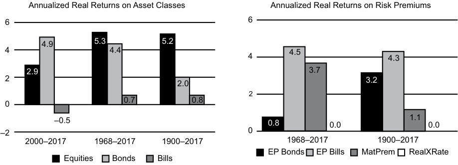

# Volume 5: Equity Investments
## Learning Module 4 Overview of Equity Securities
### Part 1/3: Importance of Equity Securities (PDF Pages 169–181)

---

<!-- PDF Page 169 -->

#### L E A R N I N G M O D U L E 

# **<mark>4</mark>** 

### **Overview of Equity Securities** 

###### **by Ryan C. Fuhrmann, CFA, and Asjeet S. Lamba, PhD, CFA.** 

_Ryan C. Fuhrmann, CFA, is at Fuhrmann Capital LLC (USA). Asjeet S. Lamba, PhD, CFA, is at the University of Melbourne (Australia)._ 

###### **<mark>LEARNING OUTCOMES</mark>** 

|**_Mastery_**|**_The candidate should be able to:_**|
|---|---|
||describe characteristics of types of equity securities|
||describe differences in voting rights and other ownership characteristics among different equity classes|
||compare and contrast public and private equity securities|
||describe methods for investing in non-domestic equity securities|
||compare the risk and return characteristics of different types of equity securities i|
||explain the role of equity securities in the financing of a company’s assets|
||contrast the market value and book value of equity securities|
||compare a company’s cost of equity, its (accounting) return on equity, and investors’ required rates of return|

##### **IMPORTANCE OF EQUITY SECURITIES** 

**<mark>1</mark>** 

Equity securities represent ownership claims on a company’s net assets. As an asset class, equity plays a fundamental role in investment analysis and portfolio management because it represents a significant portion of many individual and institutional investment portfolios. 

The study of equity securities is important for many reasons. First, the decision on how much of a client’s portfolio to allocate to equities affects the risk and return characteristics of the entire portfolio. Second, different types of equity securities have different ownership claims on a company’s net assets, which affect their risk and return characteristics in different ways. Finally, variations in the features of equity securities are reflected in their market prices, so it is important to understand the valuation implications of these features. 

<!-- PDF Page 170 -->

This reading provides an overview of equity securities and their different features and establishes the background required to analyze and value equity securities in a global context. It addresses the following questions: 

- What distinguishes common shares from preference shares, and what purposes do these securities serve in financing a company’s operations? 

- What are convertible preference shares, and why are they often used to raise equity for unseasoned or highly risky companies? 

- What are private equity securities, and how do they differ from public equity securities? 

- What are depository receipts and their various types, and what is the rationale for investing in them? 

- What are the risk factors involved in investing in equity securities? 

- How do equity securities create company value? 

- What is the relationship between a company’s cost of equity, its return on equity, and investors’ required rate of return? 

The remainder of this reading is organized as follows. Section 2 provides an overview of global equity markets and their historical performance. Section 3 examines the different types and characteristics of equity securities, and Section 4 outlines the differences between public and private equity securities. Section 5 provides an overview of the various types of equity securities listed and traded in global markets. Section 6 discusses the risk and return characteristics of equity securities. Section 7 examines the role of equity securities in creating company value and the relationship between a company’s cost of equity, its return on equity, and investors’ required rate of return. The final section summarizes the reading. 

###### **Equity Securities in Global Financial Markets** 

This section highlights the relative importance and performance of equity securities as an asset class. We examine the total market capitalization and trading volume of global equity markets and the prevalence of equity ownership across various geographic regions. We also examine historical returns on equities and compare them to the returns on government bonds and bills. 

Exhibit 1 summarizes the contributions of selected countries and geographic regions to global gross domestic product (GDP) and global equity market capitalization. Analysts may examine the relationship between equity market capitalization and GDP as a rough indicator of whether the global equity market (or a specific country’s or region’s equity market) is under, over, or fairly valued, particularly compared to its long-run average. 

Exhibit 1 illustrates the significant value that investors attach to publicly traded equities relative to the sum of goods and services produced globally every year. It shows the continued significance, and the potential over-representation, of US equity markets relative to their contribution to global GDP. That is, while US equity markets contribute around 51 percent to the total capitalization of global equity markets, their contribution to the global GDP is only around 25 percent. Following the stock market turmoil in 2008, however, the market capitalization to GDP ratio of the United States fell to 59 percent, which is significantly lower than its long-run average of 79 percent. 

As equity markets outside the United States develop and become increasingly global, their total capitalization levels are expected to grow closer to their respective world GDP contributions. Therefore, it is important to understand and analyze equity securities from a global perspective. 

<!-- PDF Page 171 -->

**Exhibit 1: Country and Regional Contributions to Global GDP and Equity Market Capitalization (2017)** 

<!-- Start of picture text -->
Contribution to GDP 2017 Relative Sizes of World Stock Market 2017 Other 9% Smaller Yearbook USA 7% Other 25% Australia 28% 2% Switzerland 3% Canada USA Japan 3% China 51% 6% 3% Smaller Yearbook UK Germany 9% 4% 3% France Australia France 3% 2% 3% UK Switzerland Germany 6% 1% Canada China 5% Japan 2% 15% 9% <!-- End of picture text -->

_Source_ : The WorldBank Databank _2017_ , and Dimson, Marsh, and Staunton (2018). 

Exhibit 2 lists the top 10 equity markets at the end of 2017 based on total market capitalization (in billions of US dollars), trading volume, and the number of listed companies.1 Note that the rankings differ based on the criteria used. For example, the top three markets based on total market capitalization are the NYSE Euronext (US), NASDAQ OMX, and the Japan Exchange Group; however, the top three markets based on total US dollar trading volume are the Nasdaq OMX, NYSE Euronext (US), and the Shenzhen Stock Exchange, respectively.2 

**Exhibit 2: Equity Markets Ranked by Total Market Capitalization at the End of 2017 (Billions of US Dollars)** 

|**Rank**|**Name of Market**|**Total US** **Dollar Market** **Capitalization**|**Total US** **Dollar Trad-** **ing Volume**|**Number** **of Listed** **Companies**|
|---|---|---|---|---|
|1|NYSE Euronext (US)|$22,081.4|$16,140.1|2,286|
|2|NASDAQ OMX|$10,039.4|$33,407.1|2,949|
|3|Japan Exchange Groupa|$6,220.0|$6,612.1|3,604|
|4|Shanghai Stock Exchange|$5,084.4|$7,589.3|1,396|
|5|Euronextb|$4,393.0|$1,981.6|1,255|
|6|Hong Kong Exchanges|$4,350.5|$1,958.8|2,118|
|7|Shenzhen Stock Exchanges|$3,617.9|$9,219.7|2,089|
|8|National Stock Exchange of India|$2,351.5|$1,013.3|1,897|

> 1 The market capitalization of an individual stock is computed as the share price multiplied by the number of shares outstanding. The total market capitalization of an equity market is the sum of the market capitalizations of each individual stock listed on that market. Similarly, the total trading volume of an equity market is computed by value weighting the total trading volume of each individual stock listed on that market. Total dollar trading volume is computed as the average share price multiplied by the number of shares traded. 2 NASDAQ is the acronym for the National Association of Securities Dealers Automated Quotations. 

<!-- PDF Page 172 -->

|**Rank**|**Name of Market**|**Total US** **Dollar Market** **Capitalization**|**Total US** **Dollar Trad-** **ing Volume**|**Number** **of Listed** **Companies**|
|---|---|---|---|---|
|9|BSE Limitedc|$2,331.6|$183.0|5,616|
|10|Deutsche Börse|$2,262.2|$1,497.9|499|

_Notes:_ 

a Japan Exchange Group is the merged entity containing the Tokyo Stock Exchange and Osaka Securities Exchange. 

b From 2001, includes Netherlands, France, England, Belgium, and Portugal. 

c Bombay Stock Exchange. 

_Source:_ Adapted from the _World Federation of Exchanges 2017 Report_ (see http:// www .world -exchanges .org). Note that market capitalization by company is calculated by multiplying its stock price by the number of shares outstanding. The market’s overall capitalization is the aggregate of the market capitalizations of all companies traded on that market. The number of listed companies includes both domestic and foreign companies whose shares trade on these markets. 

Exhibit 3 compares the _real_ (or inflation-adjusted) compounded returns on government bonds, government bills, and equity securities in 21 countries plus the world index (“Wld”), the world ex-US (“WxU”), and Europe (“Eur”) during the 118 years 1900–2017.3 In real terms, government bonds and bills have essentially kept pace with the inflation rate, earning annualized real returns of less than 2 percent in most countries.4 By comparison, real returns in equity markets have generally been around 3.5 percent per year in most markets—with a world average return of around 5.2 percent and a world average return excluding the United States just under 5 percent. During this period, South Africa and Australia were the best performing markets followed by the United States, New Zealand, and Sweden. 

**Exhibit 3: Real Returns on Global Equity Securities, Bonds, and Bills During 1900–2017** 

<!-- Start of picture text -->
6.5 6 5.2 4.5 4 2 0 –2 –4 –7.9 Aut Ita Bel Fra Ger Prt Spa Jap Eur Nor Ire WxU Swi Net Wld Fin UK Den Can Swe NZ US Aus SAf Equities Bonds Bills <!-- End of picture text -->

_Source_ : Dimson, Marsh, and Staunton (2018). 

> 3 The real return for a security is approximated by taking the nominal return and subtracting the observed inflation rate in that country. 

> 4 The exceptions are Austria, Belgium, Finland, France, Germany, Portugal, and Italy—where the average real returns on government bonds and/or bills have been negative. In general, that performance reflects the very high inflation rates in these countries during the World War years. 

<!-- PDF Page 173 -->

Exhibit 4 shows the annualized real returns on major asset classes for the world index over 1900–2017. 

**Exhibit 4: Annualized Real Returns on Asset Classes for the World Index, 1900–2017** 

<!-- Start of picture text -->
6 5.3 5.2 4.9 4.4 4 2.9 2 2.0 0.7 0.8 0 –0.5 –2 2000–2017 1968–2017 1900–2017 Equities Bonds Bills <!-- End of picture text -->

_Source_ : Dimson, Marsh, and Staunton (2018). 

The volatility in asset market returns is further highlighted in Exhibit 5, which shows the annualized risk premia for equity relative to bonds (EP Bonds), and equity relative to treasury bills (EP Bills). Maturity premium for government bond returns relative to treasury bill returns (Mat Prem) is also shown. 

These observations and historical data are consistent with the concept that the return on securities is directly related to risk level. That is, equity securities have higher risk levels when compared with government bonds and bills, they earn higher rates of return to compensate investors for these higher risk levels, and they also tend to be more volatile over time. 

<!-- PDF Page 174 -->

###### **Exhibit 5: Annualized Real Returns on Asset Classes and Risk Premiums for the World Index since 1900–2017** 

<!-- Start of picture text -->
Annualized Real Returns on Asset Classes Annualized Real Returns on Risk Premiums 6 6 4.9 5.3 5.2 4 4.4 4 4.5 4.3 2.9 3.7 2 2.0 3.2 2 0 0.7 0.8 –0.5 0.8 0.0 1.1 0.0 –2 0 2000–2017 1968–2017 1900–2017 1968–2017 1900–2017 EP Bonds EP Bills MatPrem RealXRate Equities Bonds Bills <!-- End of picture text -->

_Notes_ : Equities are total returns, including reinvested dividend income. Bonds are total return, including reinvested coupons, on long-term government bonds. Bills denotes the total return, including any income, from Treasury bills. All returns are adjusted for inflation and are expressed as geometric mean returns. EP bonds denotes the equity risk premium relative to long-term government bonds. EP Bills denotes the equity premium relative to Treasury bills. MatPrem denotes the maturity premium for government bond returns relative to bill returns. RealXRate denotes the real (inflation-adjusted) change in the exchange rate against the US dollar. 

_Source_ : Dimson, Marsh, and Staunton (2018). 

Given the high risk levels associated with equity securities, it is reasonable to expect that investors’ tolerance for risk will tend to differ across equity markets. This is illustrated in Exhibit 6, which shows the results of a series of studies conducted by the Australian Securities Exchange on international differences in equity ownership. During the 2004–2014 period, equity ownership as a percentage of the population was lowest in South Korea (averaging 9.0 percent), followed by Germany (14.5 percent) and Sweden (17.7 percent). In contrast, Australia and New Zealand had the highest equity ownership as a percentage of the population (averaging more than 20 percent). In addition, there has been a relative decline in share ownership in several countries over recent years, which is not surprising given the recent overall uncertainty in global economies and the volatility in equity markets that this uncertainty has created. 

**Exhibit 6: International Comparisons of Stock Ownership: 2004–2014****5** 

||**2004**|**2006**|**2008**|**2010**|**2012**|**2014**|
|---|---|---|---|---|---|---|
|Australia – Direct/|55%|46%|41%|43%|38%|36%|
|Indirect|||||||
|South Korea – Shares|8|7|10|10|10|N/A|
|Germany – Shares/Funds|16|16|14|13|15|13|
|Sweden – Shares|22|20|18|17|15|14|
|United Kingdom – Shares/Funds|22|20|18|N/A|17|N/A|
|New Zealand – Direct|23|26|N/A|22|23|26|

5 The percentages reported in the exhibit are based on samples of the adult population in each country who own equity securities either directly or indirectly through investment or retirement funds. For example, 36 percent of the adult population of Australia in 2014 (approximately 6.5 million people) owned equity securities either directly or indirectly. As noted in the study, it is not appropriate to make absolute comparisons across countries given the differences in methodology, sampling, timing, and definitions that have been used in different countries. However, trends across different countries can be identified. 

<!-- PDF Page 175 -->

_Source:_ Adapted from the _2014 Australian Share Ownership Study_ conducted by the Australian Securities Exchange (see http:// www .asx .com .au). For Australia and the United States, the data pertain to direct and indirect ownership in equity markets; for other countries, the data pertain to direct ownership in shares and share funds. Data not available in specific years are shown as “N/A.” 

An important implication from the above discussion is that equity securities represent a key asset class for global investors because of their unique return and risk characteristics. We next examine the various types of equity securities traded on global markets and their salient characteristics. 

##### **CHARACTERISTICS OF EQUITY SECURITIES** 

## **<mark>2</mark>** 

describe characteristics of types of equity securities 

describe differences in voting rights and other ownership characteristics among different equity classes 

Companies finance their operations by issuing either debt or equity securities. A key difference between these securities is that debt is a liability of the issuing company, whereas equity is not. This means that when a company issues debt, it is contractually obligated to repay the amount it borrows (i.e., the principal or face value of the debt) at a specified future date. The cost of using these funds is called interest, which the company is contractually obligated to pay until the debt matures or is retired. 

When the company issues equity securities, it is not contractually obligated to repay the amount it receives from shareholders, nor is it contractually obligated to make periodic payments to shareholders for the use of their funds. Instead, shareholders have a claim on the company’s assets after all liabilities have been paid. Because of this residual claim, equity shareholders are considered to be owners of the company. Investors who purchase equity securities are seeking total return (i.e., capital or price appreciation and dividend income), whereas investors who purchase debt securities (and hold until maturity) are seeking interest income. As a result, equity investors expect the company’s management to act in their best interest by making operating decisions that will maximize the market price of their shares (i.e., shareholder wealth). 

In addition to common shares (also known as ordinary shares or common stock), companies may also issue preference shares (also known as preferred stock), the other type of equity security. The following sections discuss the different types and characteristics of common and preference securities. 

###### **Common Shares** 

**Common shares** represent an ownership interest in a company and are the predominant type of equity security. As a result, investors share in the operating performance of the company, participate in the governance process through voting rights, and have a claim on the company’s net assets in the case of liquidation. Companies may choose to pay out some, or all, of their net income in the form of cash dividends to common shareholders, but they are not contractually obligated to do so.6 

> 6 It is also possible for companies to pay more than the current period’s net income as dividends. Such payout policies are, however, generally not sustainable in the long run. 

<!-- PDF Page 176 -->

Voting rights provide shareholders with the opportunity to participate in major corporate governance decisions, including the election of its board of directors, the decision to merge with or take over another company, and the selection of outside auditors. Shareholder voting generally takes place during a company’s annual meeting. As a result of geographic limitations and the large number of shareholders, it is often not feasible for shareholders to attend the annual meeting in person. For this reason, shareholders may **vote by proxy** , which allows a designated party—such as another shareholder, a shareholder representative, or management—to vote on the shareholders’ behalf. 

Regular shareholder voting, where each share represents one vote, is referred to as **statutory voting** . Although it is the common method of voting, it is not always the most appropriate one to use to elect a board of directors. To better serve shareholders who own a small number of shares, **cumulative voting** is often used. Cumulative voting allows shareholders to direct their total voting rights to specific candidates, as opposed to having to allocate their voting rights evenly among all candidates. Total voting rights are based on the number of shares owned multiplied by the number of board directors being elected. For example, under cumulative voting, if four board directors are to be elected, a shareholder who owns 100 shares is entitled to 400 votes and can either cast all 400 votes in favor of a single candidate or spread them across the candidates in any proportion. In contrast, under statutory voting, a shareholder would be able to cast only a maximum of 100 votes for each candidate. 

The key benefit to cumulative voting is that it allows shareholders with a small number of shares to apply all of their votes to one candidate, thus providing the opportunity for a higher level of representation on the board than would be allowed under statutory voting. 

Exhibit 7 describes the rights of Viacom Corporation’s shareholders. In this case, a dual-share arrangement allows the founding chairman and his family to control more than 70 percent of the voting rights through the ownership of Class A shares. This arrangement gives them the ability to exert control over the board of director election process, corporate decision making, and other important aspects of managing the company. A cumulative voting arrangement for any minority shareholders of Class A shares would improve their board representation. 

###### **Exhibit 7: Share Class Arrangements at Viacom Corporation****7** 

Viacom has two classes of common stock: Class A, which is the voting stock, and Class B, which is the non-voting stock. There is no difference between the two classes except for voting rights; they generally trade within a close price range of each other. There are, however, far more shares of Class B outstanding, so most of the trading occurs in that class. 

- **Voting Rights** —Holders of Class A common stock are entitled to one vote per share. Holders of Class B common stock do not have any voting rights, except as required by Delaware law. Generally, all matters to be voted on by Viacom stockholders must be approved by a majority of the aggregate voting power of the shares of Class A common stock present in person or represented by proxy, except as required by Delaware law. 

- **Dividends** —Stockholders of Class A common stock and Class B common stock will share ratably in any cash dividend declared by the Board of Directors, subject to any preferential rights of any 

> 7 This information has been adapted from Viacom’s investor relations website and its 10-K filing with the US Securities and Exchange Commission; see www .viacom .com. 

<!-- PDF Page 177 -->

outstanding preferred stock. Viacom does not currently pay a cash dividend, and any decision to pay a cash dividend in the future will be at the discretion of the Board of Directors and will depend on many factors. 

- **Conversion** —So long as there are 5,000 shares of Class A common stock outstanding, each share of Class A common stock will be convertible at the option of the holder of such share into one share of Class B common stock. 

- **Liquidation Rights** —In the event of liquidation, dissolution, or winding-up of Viacom, all stockholders of common stock, regardless of class, will be entitled to share ratably in any assets available for distributions to stockholders of shares of Viacom common stock subject to the preferential rights of any outstanding preferred stock. 

- **Split, Subdivision, or Combination** —In the event of a split, subdivision, or combination of the outstanding shares of Class A common stock or Class B common stock, the outstanding shares of the other class of common stock will be divided proportionally. 

- **Preemptive Rights** —Shares of Class A common stock and Class B common stock do not entitle a stockholder to any preemptive rights enabling a stockholder to subscribe for or receive shares of stock of any class or any other securities convertible into shares of stock of any class of Viacom. 

As seen in Exhibit 7, companies can issue different classes of common shares (Class A and Class B shares), with each class offering different ownership rights.8 For example, as shown in Exhibit 8, the Ford Motor Company has Class A shares (“Common Stock”), which are owned by the investing public. It also has Class B shares, which are owned only by the Ford family. The exhibit contains an excerpt from Ford’s _2017 Annual Report_ (p. 144). Class A shareholders have 60 percent voting rights, whereas Class B shareholders have 40 percent. In the case of liquidation, however, Class B shareholders will not only receive the first US$0.50 per share that is available for distribution (as will Class A shareholders), but they will also receive the next US$1.00 per share that is available for distribution before Class A shareholders receive anything else. Thus, Class B shareholders have an opportunity to receive a larger proportion of distributions upon liquidation than do Class A shareholders.9 

###### **Exhibit 8: Share Class Arrangements at Ford Motor Company****10** 

###### **NOTE 21. CAPITAL STOCK AND AMOUNTS PER SHARE** 

All general voting power is vested in the holders of Common Stock and Class B Stock. Holders of our Common Stock have 60% of the general voting power and holders of our Class B Stock are entitled to such number of votes per share as 

> 8 In some countries, including the United States, companies can issue different classes of shares, with Class A shares being the most common. The role and function of different classes of shares is described in more detail in Exhibit 8. 

> 9 For example, if US$2.00 per share is available for distribution, the Common Stock (Class A) shareholders will receive US$0.50 per share, while the Class B shareholders will receive US$1.50 per share. However, if there is US$3.50 per share available for distribution, the Common Stock shareholders will receive a total of US$1.50 per share and the Class B shareholders will receive a total of US$2.00 per share. 

> 10 Extracted from Ford Motor Company’s _2017 Annual Report_ (http:// s22 .q4cdn .com/ 857684434/ files/ doc _financials/ 2017/ annual/ Final -Annual -Report -2017 .pdf). 

<!-- PDF Page 178 -->

will give them the remaining 40%. Shares of Common Stock and Class B Stock share equally in dividends when and as paid, with stock dividends payable in shares of stock of the class held. 

If liquidated, each share of Common Stock is entitled to the first $0.50 available for distribution to holders of Common Stock and Class B Stock, each share of Class B Stock is entitled to the next $1.00 so available, each share of Common Stock is entitled to the next $0.50 so available, and each share of Common and Class B Stock is entitled to an equal amount thereafter. 

###### **Preference Shares** 

**Preference shares** (or preferred stock) rank above common shares with respect to the payment of dividends and the distribution of the company’s net assets upon liquidation.11 However, preference shareholders generally do not share in the operating performance of the company and do not have any voting rights, unless explicitly allowed for at issuance. Preference shares have characteristics of both debt securities and common shares. Similar to the interest payments on debt securities, the dividends on preference shares are fixed and are generally higher than the dividends on common shares. However, unlike interest payments, preference dividends are not contractual obligations of the company. Similar to common shares, preference shares can be perpetual (i.e., no fixed maturity date), can pay dividends indefinitely, and can be callable or putable. 

Exhibit 9 provides an example of callable preference shares issued by the GDL Fund to raise capital to redeem the remaining outstanding Series B Preferred shares. In this case, the purchaser of the shares will receive an ongoing dividend from the GDL Fund. If the GDL Fund chooses to buy back the shares, it must do so at the $50 a share liquidation preference price. The purchasers of the shares also have the right to put back the shares to GDL at the $50 a share price. 

###### **Exhibit 9: Callable Stock offering by the GDL Fund****12** 

RYE, NY—March 26, 2018—The GDL Fund (NYSE:GDL) (the “Fund”) is pleased to announce the completion of a rights offering (the “Offering”) in which the Fund issued 2,624,025 Series C Cumulative Puttable and Callable Preferred Shares (the “Series C Preferred”), totaling $131,201,250. Pursuant to the Offering, the Fund issued one non-transferable right (a “Right”) for each outstanding Series B Cumulative Puttable and Callable Preferred Share (the “Series B Preferred”) of the Fund to Series B Preferred shareholders of record as of February 14, 2018. Holders of Rights were entitled to purchase the Series C Preferred with any combination of cash or surrender of the Series B Preferred at liquidation preference. Therefore, one Right plus $50.00, or one Right plus one share of Series B Preferred with a liquidation value of $50.00 per share, was required to purchase each share of the Series C Preferred. The Offering expired at 5:00 PM Eastern Time on March 20, 2018. 

> 11 Preference shares have a lower priority than debt in the case of liquidation. That is, debt holders have a higher claim on a firm’s assets in the event of liquidation and will receive what is owed to them first, followed by preference shareholders and then common shareholders. 

> 12 https:// www .businesswire .com/ news/ home/ 20180326005609/ en/ GDL -Fund -Successfully -Completes -Offering -Issues -131 

<!-- PDF Page 179 -->

Dividends on preference shares can be cumulative, non-cumulative, participating, non-participating, or some combination thereof (i.e., cumulative participating, cumulative non-participating, non-cumulative participating, non-cumulative non-participating). 

Dividends on **cumulative preference shares** accrue so that if the company decides not to pay a dividend in one or more periods, the unpaid dividends accrue and must be paid in full before dividends on common shares can be paid. In contrast, **non-cumulative preference shares** have no such provision. This means that any dividends that are not paid in the current or subsequent periods are forfeited permanently and are not accrued over time to be paid at a later date. However, the company is still not permitted to pay any dividends to common shareholders in the current period unless preferred dividends have been paid first. 

**Participating preference shares** entitle the shareholders to receive the standard preferred dividend plus the opportunity to receive an additional dividend if the company’s profits exceed a pre-specified level. In addition, participating preference shares can also contain provisions that entitle shareholders to an additional distribution of the company’s assets upon liquidation, above the par (or face) value of the preference shares. **Non-participating preference shares** do not allow shareholders to share in the profits of the company. Instead, shareholders are entitled to receive only a fixed dividend payment and the par value of the shares in the event of liquidation. The use of participating preference shares is much more common for smaller, riskier companies where the possibility of future liquidation is more of a concern to investors. 

Preference shares can also be convertible. **Convertible preference shares** entitle shareholders to convert their shares into a specified number of common shares. This conversion ratio is determined at issuance. Convertible preference shares have the following advantages: 

- They allow investors to earn a higher dividend than if they invested in the company’s common shares. 

- They allow investors the opportunity to share in the profits of the company. 

- They allow investors to benefit from a rise in the price of the common shares through the conversion option. 

- Their price is less volatile than the underlying common shares because the dividend payments are known and more stable. 

As a result, the use of convertible preference shares is a popular financing option in venture capital and private equity transactions in which the issuing companies are considered to be of higher risk and when it may be years before the issuing company “goes public” (i.e., issues common shares to the public). 

Exhibit 10 provides examples of the types and characteristics of preference shares as issued by Tsakos Energy Navigation Ltd (TNP.PRE). 

###### **Exhibit 10: Examples of Preference Shares Issued by TEN Ltd****13** 

Athens, Greece, June 21, 2018—TEN Ltd. (“TEN”) (NYSE: TNP), a leading diversified crude, product and LNG tanker operator, today announced the pricing of its public offering of its Series F Fixed-to-Floating Rate Cumulative Redeemable Perpetual Preferred Shares, par value $1.00 per share, liquidation preference $25.00 per share (“Series F Preferred Shares”). TEN will issue 5,400,000 Series F Preferred Shares at a price to the public of $25.00 per share. Dividends will be payable on the Series F Preferred Shares to July 30, 2028 at a fixed rate equal to 9.50% per annum and from July 30, 2028, if not redeemed, at a floating rate. In 

<!-- PDF Page 180 -->

connection with the offering, TEN has granted the underwriters a 30-day option to purchase 810,000 additional Series F Preferred Shares, which, if exercised in full, would result in total gross proceeds of $155,250,000. TEN intends to use the net proceeds from the offering for general corporate purposes, which may include making vessel acquisitions and/or strategic investments and preferred share redemptions. Following the offering, TEN intends to file an application to list the Series F Preferred Shares on the New York Stock Exchange. The offering is expected to close on or about June 28, 2018. 

## **<mark>3</mark>** 

##### **PRIVATE VERSUS PUBLIC EQUITY SECURITIES** 

compare and contrast public and private equity securities 

Our discussion so far has focused on equity securities that are issued and traded in public markets and on exchanges. Equity securities can also be issued and traded in private equity markets. **Private equity securities** are issued primarily to institutional investors via non-public offerings, such as private placements. Because they are not listed on public exchanges, there is no active secondary market for these securities. As a result, private equity securities do not have “market determined” quoted prices, are highly illiquid, and require negotiations between investors in order to be traded. In addition, financial statements and other important information needed to determine the fair value of private equity securities may be difficult to obtain because the issuing companies are typically not required by regulatory authorities to publish this information. 

There are three primary types of private equity investments: venture capital, leveraged buyouts, and private investment in public equity (or PIPE). **Venture capital** investments provide “seed” or start-up capital, early-stage financing, or mezzanine financing to companies that are in the early stages of development and require additional capital for expansion. These funds are then used to finance the company’s product development and growth. Venture capitalists range from family and friends to wealthy individuals and private equity funds. Because the equity securities issued to venture capitalists are not publicly traded, they generally require a commitment of funds for a relatively long period of time; the opportunity to “exit” the investment is typically within 3 to 10 years from the initial start-up. The exit return earned by these private equity investors is based on the price that the securities can be sold for if and when the start-up company first goes public, either via an **initial public offering** (IPO) on the stock market or by being sold to other investors. 

A **leveraged buyout** (LBO) occurs when a group of investors (such as the company’s management or a private equity partnership) uses a large amount of debt to purchase all of the outstanding common shares of a publicly traded company. In cases where the group of investors acquiring the company is primarily comprised of the company’s existing management, the transaction is referred to as a **management buyout** (MBO). After the shares are purchased, they cease to trade on an exchange and the investor group takes full control of the company. In other words, the company is taken “private” or has been privatized. Companies that are candidates for these types of transactions generally have large amounts of undervalued assets (which can be sold to reduce debt) and generate high levels of cash flows (which are used to make 

<!-- PDF Page 181 -->

interest and principal payments on the debt). The ultimate objective of a buyout (LBO or MBO) is to restructure the acquired company and later take it “public” again by issuing new shares to the public in the primary market. 

The third type of private investment is a **private investment in public equity** , or PIPE.14 This type of investment is generally sought by a public company that is in need of additional capital quickly and is willing to sell a sizeable ownership position to a private investor or investor group. For example, a company may require a large investment of new equity funds in a short period of time because it has significant expansion opportunities, is facing high levels of indebtedness, or is experiencing a rapid deterioration in its operations. Depending on how urgent the need is and the size of the capital requirement, the private investor may be able to purchase shares in the company at a significant discount to the publicly-quoted market price. Exhibit 11 contains a recent PIPE transaction for the health care company TapImmune, which also included the proposed merger with Maker Therapeutics. 

###### **Exhibit 11: Example of a PIPE Transaction****15** 

JACKSONVILLE, Florida, June 8, 2018—TapImmune Inc. (NASDAQ: TPIV), a clinical-stage immuno-oncology company, today announced that it has entered into security purchase agreements with certain institutional and accredited investors in connection with a private placement of its equity securities. The private placement will be led by New Enterprise Associates (NEA) with participation from Aisling Capital and Perceptive Advisors, among other new and existing investors. The private placement is expected to be completed concurrently with the closing of the proposed merger between TapImmune Inc. and Marker Therapeutics, Inc., which was previously announced on May 15, 2018. 

Upon closing the private placement, TapImmune will issue 17,500,000 shares of its common stock at a price of $4.00 per share. The aggregate offering size, before deducting the placement agent fees and other offering expenses, is expected to be $70 million. Additionally, TapImmune will issue warrants to purchase 13,125,000 shares of TapImmune common stock at an exercise price of $5.00 per share that will be exercisable for a period of five years from the date of issuance. The closing of the transaction, which is subject to the closing of the merger with Marker, the approval by TapImmune’s stockholders as required by NASDAQ Stock Market Rules, and other customary closing conditions, is anticipated to occur by the end of the third quarter of 2018. 

While the global private equity market is relatively small in comparison to the global public equity market, it has experienced considerable growth over the past three decades. According to a study of the private equity market sponsored by the _World Economic Forum_ and spanning the period 1970–2007, approximately US$3.6 trillion in debt and equity were acquired in leveraged buyouts. Of this amount, approximately 75 percent or US$2.7 trillion worth of transactions occurred during 2001–2007.16 This pace continued with a further US$2.9 trillion in transactions occurring during 2008-2017.17 While the US and the UK markets were the focus of most private equity investments during the 1980s and 1990s, private equity investments outside of these markets have grown substantially in recent years. In addition, the number of companies operating under private equity ownership has also grown. For example, during the mid-1990s, fewer than 2,000 companies were under LBO ownership compared to 

> 14 The term PIPE is widely used in the United States and is also used internationally, including in emerging markets. 

> 15 https:// tapimmune .com/ 2018/ 06/ tapimmune -announces -pricing -of -70 -million -private -placement/ 

> 16 Strömberg (2008). 

> 17 https:// www .statista .com/ statistics/ 270195/ global -private -equity -deal -value/ 

