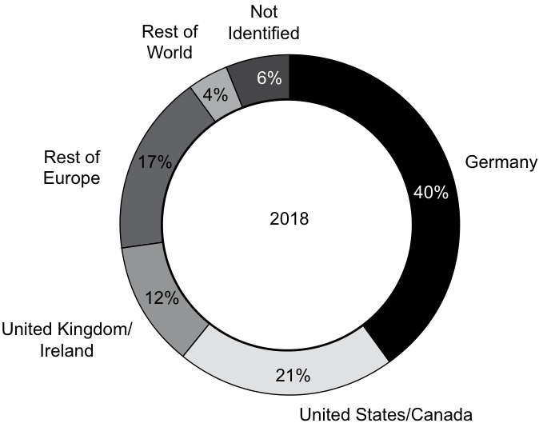
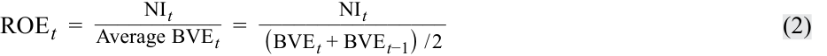
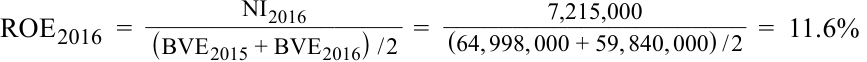

# Volume 5: Equity Investments
## Learning Module 4 Overview of Equity Securities
### Part 2/3: Non-Domestic Equity Securities (PDF Pages 182–195)

---

<!-- PDF Page 182 -->

more than 20,000 companies that were under LBO ownership globally at the beginning of 2017. The holding period for private equity investments has also increased during this time period from 3 to 5 years (1980s and 1990s) to approximately 10 years.18 

The move to longer holding periods has given private equity investors the opportunity to more effectively and patiently address any underlying operational issues facing the company and to better manage it for long-term value creation. Because of the longer holding periods, more private equity firms are issuing convertible preference shares because they provide investors with greater total return potential through their dividend payments and the ability to convert their shares into common shares during an IPO. 

In operating a publicly traded company, management often feels pressured to focus on short-term results19 (e.g., meeting quarterly sales and earnings targets from analysts biased toward near-term price performance) instead of operating the company to obtain long-term sustainable revenue and earnings growth. By “going private,” management can adopt a more long-term focus and can eliminate certain costs that are necessary to operate a publicly traded company—such as the cost of meeting regulatory and stock exchange filing requirements, the cost of maintaining investor relations departments to communicate with shareholders and the media, and the cost of holding quarterly analyst conference calls. 

As described above, public equity markets are much larger than private equity networks and allow companies more opportunities to raise capital that is subsequently actively traded in secondary markets. By operating under public scrutiny, companies are incentivized to be more open in terms of corporate governance and executive compensation to ensure that they are acting for the benefit of shareholders. In fact, some studies have shown that private equity firms score lower in terms of corporate governance effectiveness, which may be attributed to the fact that shareholders, analysts, and other stakeholders are able to influence management when corporate governance and other policies are public. 

# **<mark>4</mark>** 

## **NON-DOMESTIC EQUITY SECURITIES** 

describe methods for investing in non-domestic equity securities 

Technological innovations and the growth of electronic information exchanges (electronic trading networks, the internet, etc.) have accelerated the integration and growth of global financial markets. As detailed previously, global capital markets have expanded at a much more rapid rate than global GDP in recent years; both primary and secondary international markets have benefited from the enhanced ability to rapidly and openly exchange information. Increased integration of equity markets has made it easier and less expensive for companies to raise capital and to expand their shareholder base beyond their local market. Integration has also made it easier for investors to invest in companies that are located outside of their domestic markets. This has enabled investors to further diversify and improve the risk and return characteristics of their portfolios by adding a class of assets with lower correlations to local country assets. 

> 18 See, for example, Bailey, Wirth, and Zapol (2005). 

> 19 See, for example, Graham, Harvey, and Rajgopal (2005). 

<!-- PDF Page 183 -->

One barrier to investing globally is that many countries still impose “foreign restrictions” on individuals and companies from other countries that want to invest in their domestic companies. There are three primary reasons for these restrictions. The first is to limit the amount of control that foreign investors can exert on domestic companies. For example, some countries prevent foreign investors from acquiring a majority interest in domestic companies. The second is to give domestic investors the opportunity to own shares in the foreign companies that are conducting business in their country. For example, the Swedish home furnishings retailer IKEA abandoned efforts to invest in parts of the Asia/Pacific region because local governments did not want IKEA to maintain complete ownership of its stores. The third reason is to reduce the volatility of capital flows into and out of domestic equity markets. For example, one of the main consequences of the Asian Financial Crisis in 1997–98 was the large outflow of capital from such emerging market countries as Thailand, Indonesia, and South Korea. These outflows led to dramatic declines in the equity markets of these countries and significant currency devaluations and resulted in many governments placing restrictions on capital flows. Today, many of these same markets have built up currency reserves to better withstand capital outflows inherent in economic contractions and periods of financial market turmoil. 

Studies have shown that reducing restrictions on foreign ownership has led to improved equity market performance over the long term.20 Although restrictions vary widely, more countries are allowing increasing levels of foreign ownership. For example, Australia has sought tax reforms as a means to encourage international demand for its managed funds in order to increase its role as an international financial center. 

Over the past two decades, three trends have emerged: a) an increasing number of companies have issued shares in markets outside of their home country; b) the number of companies whose shares are traded in markets outside of their home has increased; and c) an increasing number of companies are dual listed, which means that their shares are simultaneously issued and traded in two or more markets. Companies located in emerging markets have particularly benefited from these trends because they no longer have to be concerned with capital constraints or lack of liquidity in their domestic markets. These companies have found it easier to raise capital in the markets of developed countries because these markets generally have higher levels of liquidity and more stringent financial reporting requirements and accounting standards. Being listed on an international exchange has a number of benefits. It can increase investor awareness about the company’s products and services, enhance the liquidity of the company’s shares, and increase corporate transparency because of the additional market exposure and the need to meet a greater number of filing requirements. 

Technological advancements have made it easier for investors to trade shares in foreign markets. The German insurance company Allianz SE recently delisted its shares from the NYSE and certain European markets because international investors increasingly traded its shares on the Frankfurt Stock Exchange. Exhibit 12 illustrates the extent to which the institutional shareholder base at BASF, a large German chemical corporation, has become increasingly global in nature. 

#### **Exhibit 12: Example of Increased Globalization of Share Ownership****21** 

BASF is one of the largest publicly owned companies with over 500,000 shareholders and a high free float. An analysis of the shareholder structure carried out in March 2018 showed that, at 21% of share capital, the United States and Canada made up the largest regional group of institutional investors. Institutional 

<!-- PDF Page 184 -->

investors from Germany made up 12%. Shareholders from United Kingdom and Ireland held 12% of BASF shares, while a further 17% are held by institutional investors from the rest of Europe. Around 28% of the company’s share capital is held by private investors, most of whom are resident in Germany. 

<!-- Start of picture text -->
Not Rest of Identified World 6% 4% Rest of 17% Germany Europe 40% 2018 12% United Kingdom/ Ireland 21% United States/Canada <!-- End of picture text -->

### **Direct Investing** 

Investors can use a variety of methods to invest in the equity of companies outside of their local market. The most obvious is to buy and sell securities directly in foreign markets. However, this means that all transactions—including the purchase and sale of shares, dividend payments, and capital gains—are in the company’s, not the investor’s, domestic currency. In addition, investors must be familiar with the trading, clearing, and settlement regulations and procedures of that market. Investing directly often results in less transparency and more volatility because audited financial information may not be provided on a regular basis and the market may be less liquid. Alternatively, investors can use such securities as depository receipts and global registered shares, which represent the equity of international companies and are traded on local exchanges and in the local currencies. With these securities, investors have to worry less about currency conversions (price quotations and dividend payments are in the investor’s local currency), unfamiliar market practices, and differences in accounting standards. The sections that follow discuss various securities that investors can invest in outside of their home market. 

### **Depository Receipts** 

A **depository receipt**22 (DR) is a security that trades like an ordinary share on a local exchange and represents an economic interest in a foreign company. It allows the publicly listed shares of a foreign company to be traded on an exchange outside its domestic market. A depository receipt is created when the equity shares of a foreign company are deposited in a bank (i.e., the depository) in the country on whose exchange the shares will trade. The depository then issues receipts that represent the shares that were deposited. The number of receipts issued and the price of each DR is based on a ratio, which specifies the number of depository receipts to the underlying 

> 22 Note that the spellings _depositary_ and _depository_ are used interchangeably in financial markets. In this reading, we use the spelling _depository_ throughout. 

<!-- PDF Page 185 -->

shares. Consequently, a DR may represent one share of the underlying stock, many shares of the underlying stock, or a fractional share of the underlying stock. The price of each DR will be affected by factors that affect the price of the underlying shares, such as company fundamentals, market conditions, analysts’ recommendations, and exchange rate movements. In addition, any short-term valuation discrepancies between shares traded on multiple exchanges represent a quick arbitrage profit opportunity for astute traders to exploit. The responsibilities of the **depository bank** that issues the receipts include acting as custodian and as a registrar. This entails handling dividend payments, other taxable events, stock splits, and serving as the transfer agent for the foreign company whose securities the DR represents. The Bank of New York Mellon is the largest depository bank; however, Deutsche Bank, JPMorgan, and Citibank also offer depository services.23 

A DR can be **sponsored** or **unsponsored** . A sponsored DR is when the foreign company whose shares are held by the depository has a direct involvement in the issuance of the receipts. Investors in sponsored DRs have the same rights as the direct owners of the common shares (e.g., the right to vote and the right to receive dividends). In contrast, with an unsponsored DR, the underlying foreign company has no involvement with the issuance of the receipts. Instead, the depository purchases the foreign company’s shares in its domestic market and then issues the receipts through brokerage firms in the depository’s local market. In this case, the depository bank, not the investors in the DR, retains the voting rights. Sponsored DRs are generally subject to greater reporting requirements than unsponsored DRs. In the United States, for example, sponsored DRs must be registered (meet the reporting requirements) with the US Securities and Exchange Commission (SEC). Exhibit 13 contains an example of a sponsored DR issued by Alibaba in September 2014. 

#### **Exhibit 13: Sponsored Depository Receipts****24** 

NEW YORK—(BUSINESS WIRE)—Citi today announced that Alibaba Group Holding Limited (“Alibaba Group”) has appointed Citi’s Issuer Services business, acting through Citibank, N.A., as the depositary bank for its American Depositary Receipt (“ADR”) program. Alibaba Group’s ADRs, which began trading on September 19, 2014, represent the largest Depositary Receipt program in initial public offering market history. 

Alibaba Group’s ADR program was established through a $25.03 billion initial public offering of 368,122,000 American Depositary Shares (“ADSs”), representing ordinary shares of Alibaba Group, which was priced at $68 per ADS on September 18, 2014. The IPO ranks as the largest in history. The ADRs are listed on the New York Stock Exchange (the “NYSE”) under the trading symbol BABA. Each ADS represents one ordinary share of the Company. In its role as depositary bank, Citibank will hold the underlying ordinary shares through its local custodian and issue ADSs representing such shares. Alibaba Group’s ADSs trade on the NYSE in ADR form. 

There are two types of depository receipts: Global depository receipts (GDRs) and American depository receipts (ADRs), which are described below. 

> 23 Boubakri, Cosset, and Samet (2010). 

<!-- PDF Page 186 -->

#### **_Global Depository Receipts_** 

A **global depository receipt** (GDR) is issued outside of the company’s home country and outside of the United States. The depository bank that issues GDRs is generally located (or has branches) in the countries on whose exchanges the shares are traded. A key advantage of GDRs is that they are not subject to the foreign ownership and capital flow restrictions that may be imposed by the issuing company’s home country because they are sold outside of that country. The issuing company selects the exchange where the GDR is to be traded based on such factors as investors’ familiarity with the company or the existence of a large international investor base. The London and Luxembourg exchanges were the first ones to trade GDRs. Some other stock exchanges trading GDRs are the Dubai International Financial Exchange and the Singapore Stock Exchange. Currently, the London and Luxembourg exchanges are where most GDRs are traded because they can be issued in a more timely manner and at a lower cost. Regardless of the exchange they are traded on, the majority of GDRs are denominated in US dollars, although the number of GDRs denominated in pound sterling and euros is increasing. Note that although GDRs cannot be listed on US exchanges, they can be privately placed with institutional investors based in the United States. 

#### **_American Depository Receipts_** 

An **American depository receipt** (ADR) is a US dollar-denominated security that trades like a common share on US exchanges. First created in 1927, ADRs are the oldest type of depository receipts and are currently the most commonly traded depository receipts. They enable foreign companies to raise capital from US investors. Note that an ADR is one form of a GDR; however, not all GDRs are ADRs because GDRs cannot be publicly traded in the United States. The term **American depository share** (ADS) is often used in tandem with the term ADR. A depository share is a security that is actually traded in the issuing company’s domestic market. That is, while American depository receipts are the certificates that are traded on US markets, American depository shares are the underlying shares on which these receipts are based. 

There are four primary types of ADRs, with each type having different levels of corporate governance and filing requirements. Level I Sponsored ADRs trade in the over-the-counter (OTC) market and do not require full registration with the Securities and Exchange Commission (SEC). Level II and Level III Sponsored ADRs can trade on the New York Stock Exchange (NYSE), NASDAQ, and American Stock Exchange (AMEX). Level II and III ADRs allow companies to raise capital and make acquisitions using these securities. However, the issuing companies must fulfill all SEC requirements. 

The fourth type of ADR, an SEC Rule 144A or a Regulation S depository receipt, does not require SEC registration. Instead, foreign companies are able to raise capital by privately placing these depository receipts with qualified institutional investors or to offshore non-US investors. Exhibit 14 summarizes the main features of ADRs. 

**Exhibit 14: Summary of the Main Features of American Depository Receipts** 

||**Level I** **(Unlisted)**|**Level II** **(Listed)**|**Level III** **(Listed)**|**Rule 144A** **(Unlisted)**|
|---|---|---|---|---|
|Objectives|Develop and broaden US investor base with existing shares|Develop and broaden US investor base with existing shares|Develop and broaden US investor base with existing/new shares|Access qualified insti- tutional buyers (QIBs)|
|Raising capital on US|No|No|Yes, through public f|Yes, through private|
|markets?|||offerings|placements to QIBs|
|SEC registration|Form F-6|Form F-6|Forms F-1 and F-6|None|

<!-- PDF Page 187 -->

||**Level I** **(Unlisted)**|**Level II** **(Listed)**|**Level III** **(Listed)**|**Rule 144A** **(Unlisted)**|
|---|---|---|---|---|
|Trading|Over the counter (OTC)|NYSE, NASDAQ, or AMEX|NYSE, NASDAQ, or AMEX|Private offerings, resales, and trading through automated linkages such as PORTAL|
|Listing fees|Low|High|High|Low|
|Size and earnings|None|Yes|Yes|None|
|requirements|||||

_Source:_ Adapted from Boubakri, Cosset, and Samet (2010): Table 1. 

More than 2,000 DRs, from over 80 countries, currently trade on US exchanges. Based on current statistics, the total market value of DRs issued and traded is estimated at approximately US$2 trillion, or 15 percent of the total dollar value of equities traded in US markets.25 

#### **_Global Registered Share_** 

A **global registered share** (GRS) is a common share that is traded on different stock exchanges around the world in different currencies. Currency conversions are not needed to purchase or sell them, because identical shares are quoted and traded in different currencies. Thus, the same share purchased on the Swiss exchange in Swiss francs can be sold on the Tokyo exchange for Japanese yen. As a result, GRSs offer more flexibility than depository receipts because the shares represent an actual ownership interest in the company that can be traded anywhere and currency conversions are not needed to purchase or sell them. GRSs were created and issued by Daimler Chrysler in 1998 and by UBS AG in 2011. 

#### **_Basket of Listed Depository Receipts_** 

Another type of global security is a **basket of listed depository receipts** (BLDR), which is an exchange-traded fund (ETF) that represents a portfolio of depository receipts. An ETF is a security that tracks an index but trades like an individual share on an exchange. An equity-ETF is a security that contains a portfolio of equities that tracks an index. It trades throughout the day and can be bought, sold, or sold short, just like an individual share. Like ordinary shares, ETFs can also be purchased on margin and used in hedging or arbitrage strategies. The BLDR is a specific class of ETF security that consists of an underlying portfolio of DRs and is designed to track the price performance of an underlying DR index. For example, the Invesco BLDRS Asia 50 ADR Index Fund is a capitalization-weighted ETF designed to track the performance of 50 Asian market-based ADRs. 

## **RISK AND RETURN CHARACTERISTICS** 

compare the risk and return characteristics of different types of equity securities 

<!-- PDF Page 188 -->

Different types of equity securities have different ownership claims on a company’s net assets. The type of equity security and its features affect its risk and return characteristics. The following sections discuss the different return and risk characteristics of equity securities. 

### **Return Characteristics of Equity Securities** 

There are two main sources of equity securities’ total return: price change (or capital gain) and dividend income. The price change represents the difference between the purchase price ( _Pt_ –1) and the sale price ( _Pt_ ) of a share at the end of time _t_ – 1 and _t_ , respectively. Cash or stock dividends ( _Dt_ ) represent distributions that the company makes to its shareholders during period _t_ . Therefore, an equity security’s total return is calculated as: 

<!-- Formula Text: Total return, Rt = (Pt – Pt–1 + Dt)/Pt–1 (1) -->

For non-dividend-paying stocks, the total return consists of price appreciation only. Companies that are in the early stages of their life cycle generally do not pay dividends because earnings and cash flows are reinvested to finance the company’s growth. In contrast, companies that are in the mature phase of their life cycle may not have as many profitable growth opportunities; therefore, excess cash flows are often returned to investors via the payment of regular dividends or through share repurchases. 

For investors who purchase depository receipts or foreign shares directly, there is a third source of return: **foreign exchange gains (or losses)** . Foreign exchange gains arise because of the change in the exchange rate between the investor’s currency and the currency that the foreign shares are denominated in. For example, US investors who purchase the ADRs of a Japanese company will earn an additional return if the yen appreciates relative to the US dollar. Conversely, these investors will earn a lower total return if the yen depreciates relative to the US dollar. For example, if the total return for a Japanese company was 10 percent in Japan and the yen depreciated by 10 percent against the US dollar, the total return of the ADR would be (approximately) 0 percent. If the yen had instead appreciated by 10 percent against the US dollar, the total return of the ADR would be (approximately) 20 percent. 

Investors that only consider price appreciation overlook an important source of return: the compounding that results from reinvested dividends. Reinvested dividends are cash dividends that the investor receives and uses to purchase additional shares. As Exhibit 15 shows, in the long run total returns on equity securities are dramatically influenced by the compounding effect of reinvested dividends. Between 1900 and 2016, US$1 invested in US equities in 1900 would have grown in _real_ terms to US$1,402 with dividends reinvested, but to just US$11.9 when taking only the price appreciation or capital gain into account. This corresponds to a real compounded return of 6.4 percent per year with dividends reinvested, versus only 2.1 percent per year without dividends reinvested. The comparable ending real wealth for bonds and bills are US$9.8 and US$2.60, respectively. These ending real wealth figures correspond to annualized real compounded returns of 2.0 percent on bonds and 0.8 percent on bills. 

<!-- PDF Page 189 -->

#### **Exhibit 15: Impact of Reinvested Dividends on Cumulative Real Returns in the US and UK Equity Market: 1900–2016** 

<!-- Start of picture text -->
1,000 100 10 1 0.1 1900 10 20 30 40 50 60 70 80 90 2000 10 US real total return 6.4% p.a. UK real total return 5.5% p.a. US real capital gain 2.1% p.a. UK real capital gain 0.8% p.a. <!-- End of picture text -->

_Source_ : Dimson, Marsh, and Staunton (2017). This chart is updated annually and can be found at http:// publications .credit -suisse .com/ index .cfm/ publikationen -shop/ research -institute/ . 

### **Risk of Equity Securities** 

The risk of any security is based on the uncertainty of its future cash flows. The greater the uncertainty of its future cash flows, the greater the risk and the more variable or volatile the security’s price. As discussed above, an equity security’s total return is determined by its price change and dividends. Therefore, the risk of an equity security can be defined as the uncertainty of its expected (or future) total return. Risk is most often measured by calculating the standard deviation of the equity’s expected total return. 

A variety of different methods can be used to estimate an equity’s expected total return and risk. One method uses the equity’s average historical return and the standard deviation of this return as proxies for its expected future return and risk. Another method involves estimating a range of future returns over a specified period of time, assigning probabilities to those returns, and then calculating an expected return and a standard deviation of return based on this information. 

The type of equity security, as well as its characteristics, affects the uncertainty of its future cash flows and therefore its risk. In general, preference shares are less risky than common shares for three main reasons: 

**1.** Dividends on preference shares are known and fixed, and they account for a large portion of the preference shares’ total return. Therefore, there is less uncertainty about future cash flows. 

**2.** Preference shareholders receive dividends and other distributions before common shareholders. 

**3.** The amount preference shareholders will receive if the company is liquidated is known and fixed as the par (or face) value of their shares. However, there is no guarantee that investors will receive that amount if the company experiences financial difficulty. 

<!-- PDF Page 190 -->

With common shares, however, a larger portion of shareholders’ total return (or all of their total return for non-dividend shares) is based on future price appreciation and future dividends are unknown. If the company is liquidated, common shareholders will receive whatever amount (if any) is remaining after the company’s creditors and preference shareholders have been paid. In summary, because the uncertainty surrounding the total return of preference shares is less than common shares, preference shares have lower risk and lower expected return than common shares. 

It is important to note that some preference shares and common shares can be riskier than others because of their associated characteristics. For example, from an investor’s point of view, putable common or preference shares are less risky than their callable or non-callable counterparts because they give the investor the option to sell the shares to the issuer at a pre-determined price. This pre-determined price establishes a minimum price that investors will receive and reduces the uncertainty associated with the security’s future cash flow. As a result, putable shares generally pay a lower dividend than non-putable shares. 

Because the major source of total return for preference shares is dividend income, the primary risk affecting all preference shares is the uncertainty of future dividend payments. Regardless of the preference shares’ features (callable, putable, cumulative, etc.), the greater the uncertainty surrounding the issuer’s ability to pay dividends, the greater risk. Because the ability of a company to pay dividends is based on its future cash flows and net income, investors try to estimate these amounts by examining past trends or forecasting future amounts. The more earnings and the greater amount of cash flow that the company has had, or is expected to have, the lower the uncertainty and risk associated with its ability to pay future dividends. 

Callable common or preference shares are riskier than their non-callable counterparts because the issuer has the option to redeem the shares at a pre-determined price. Because the call price limits investors’ potential future total return, callable shares generally pay a higher dividend to compensate investors for the risk that the shares could be called in the future. Similarly, putable preference shares have lower risk than non-putable preference shares. Cumulative preference shares have lower risk than non-cumulative preference shares because the cumulative feature gives investors the right to receive any unpaid dividends before any dividends can be paid to common shareholders. 

# **<mark>6</mark> EQUITY AND COMPANY VALUE** 

- explain the role of equity securities in the financing of a company’s assets 

- contrast the market value and book value of equity securities compare a company’s cost of equity, its (accounting) return on equity, and investors’ required rates of return 

Companies issue equity securities on primary markets to raise capital and increase liquidity. This additional liquidity also provides the corporation an additional “currency” (its equity), which it can use to make acquisitions and provide stock option-based incentives to employees. The primary goal of raising capital is to finance the company’s revenue-generating activities in order to increase its net income and maximize the wealth of its shareholders. In most cases, the capital that is raised is used to finance the purchase of long-lived assets, capital expansion projects, research and 

<!-- PDF Page 191 -->

development, the entry into new product or geographic regions, and the acquisition of other companies. Alternatively, a company may be forced to raise capital to ensure that it continues to operate as a going concern. In these cases, capital is raised to fulfill regulatory requirements, improve capital adequacy ratios, or to ensure that debt covenants are met. 

The ultimate goal of management is to increase the book value (shareholders’ equity on a company’s balance sheet) of the company and maximize the market value of its equity. Although management actions can directly affect the book value of the company (by increasing net income or by selling or purchasing its own shares), they can only indirectly affect the market value of its equity. The book value of a company’s equity—the difference between its total assets and total liabilities—increases when the company retains its net income. The more net income that is earned and retained, the greater the company’s book value of equity. Because management’s decisions directly influence a company’s net income, they also directly influence its book value of equity. 

The market value of the company’s equity, however, reflects the collective and differing expectations of investors concerning the amount, timing, and uncertainty of the company’s future cash flows. Rarely will book value and market value be equal. Although management may be accomplishing its objective of increasing the company’s book value, this increase may not be reflected in the market value of the company’s equity because it does not affect investors’ expectations about the company’s future cash flows. A key measure that investors use to evaluate the effectiveness of management in increasing the company’s book value is the accounting return on equity. 

### **Accounting Return on Equity** 

**Return on equity (ROE)** is the primary measure that equity investors use to determine whether the management of a company is effectively and efficiently using the capital they have provided to generate profits. It measures the total amount of net income available to common shareholders generated by the total equity capital invested in the company. It is computed as net income available to ordinary shareholders (i.e., after preferred dividends have been deducted) divided by the average total book value of equity (BVE). That is: 

<!-- Formula Text: ROE t  = NI t ___________ Average BVE t   = NI t ________________ (BVE t + BVE t−1)  / 2 (2) -->

where NI _t_ is the net income in year _t_ and the average book value of equity is computed as the book values at the beginning and end of year _t_ divided by 2. Return on equity assumes that the net income produced in the current year is generated by the equity existing at the beginning of the year and any new equity that was invested during the year. Note that some formulas only use shareholders’ equity at the beginning of year _t_ (that is, the end of year _t_ – 1) in the denominator. This assumes that only the equity existing at the beginning of the year was used to generate the company’s net income during the year. That is: 

<!-- Formula Text: ROE t  = NI t _ BVE t−1 (3) -->

Both formulas are appropriate to use as long as they are applied consistently. For example, using beginning of the year book value is appropriate when book values are relatively stable over time or when computing ROE for a company annually over a period of time. Average book value is more appropriate if a company experiences more volatile year-end book values or if the industry convention is to use average book values in calculating ROE. 

One caveat to be aware of when computing and analyzing ROE is that net income and the book value of equity are directly affected by management’s choice of accounting methods, such as those relating to depreciation (straight line versus accelerated 

<!-- PDF Page 192 -->

methods) or inventories (first in, first out versus weighted average cost). Different accounting methods can make it difficult to compare the return on equity of companies even if they operate in the same industry. It may also be difficult to compare the ROE of the same company over time if its accounting methods have changed during that time. 

Exhibit 16 contains information on the net income and total book value of shareholders’ equity for three **blue chip** (widely held large market capitalization companies that are considered financially sound and are leaders in their respective industry or local stock market) pharmaceutical companies: Pfizer, Novartis AG, and GlaxoSmithKline. The data are for their financial years ending December 2015 through December 2017.26 

**Exhibit 16: Net Income and Book Value of Equity for Pfizer, Novartis AG, and GlaxoSmithKline (in Thousands of US Dollars)** 

||**F**|**inancial Year Endin**|**g**|
|---|---|---|---|
||**31 Dec 2015**|**31 Dec 2016**|**31 Dec 2017**|
|**Pfizer**||||
|Net income|$6,960,000|$7,215,000|$21,308,000|
|Total stockholders’ equity|$64,998,000|$59,840,000|$71,287,000|
|**Novartis AG**||||
|Net income|$17,783,000|$6,712,000|$7,703,000|
|Total stockholders’ equity|$77,122,000|$74,891,000|$74,227,000|
|**GlaxoSmithKline**||||
|Net income|$12,420,000|$1,126,000|$2,070,700|
|Total stockholders’ equity|$11,309,250|$6,127,800|$4,715,800|

Using the average book value of equity, the return on equity for Pfizer for the years ending December 2016 and 2017 can be calculated as: 

Return on equity for the year ending December 2016 

<!-- Formula Text: ROE 2016  = NI 2016 ___________________ (BVE 2015 + BVE 2016)  / 2   = 7,215,000 ______________________ (64, 998, 000 + 59, 840, 000)  / 2   =  11.6% -->

Return on equity for the year ending December 2017 

<!-- Formula Text: ROE 2017  = NI 2017 ___________________ (BVE 2016 + BVE 2017)  / 2   = 21,308,000 ______________________ (59, 840, 000 + 71, 287, 000)  / 2   =  32.5% -->

Exhibit 17 summarizes the return on equity for Novartis and GlaxoSmithKline in addition to Pfizer for 2016 and 2017. 

> 26 Pfizer uses US GAAP to prepare its financial statements; Novartis and GlaxoSmithKline use International Financial Reporting Standards. Therefore, it would be inappropriate to compare the ROE of Pfizer to that of Novartis or GlaxoSmithKline. 

<!-- PDF Page 193 -->

#### **Exhibit 17: Return on Equity for Pfizer, Novartis AG, and GlaxoSmithKline** 

||**31 Dec 2016 (%)**|**31 Dec 2017 (%)**|
|---|---|---|
|Pfizer|11.6|32.5|
|Novartis AG|8.8|10.3|
|GlaxoSmithKline|12.9|38.2|

In the case of Pfizer, the ROE of 32.5 percent in 2017 indicates that the company was able to generate a return (profit) of US$0.325 on every US$1.00 of capital invested by shareholders. GlaxoSmithKline almost tripled its return on equity over this period, from 12.9 percent to 38.2 percent. Novartis’s ROE remained relatively unchanged. 

ROE can increase if net income increases at a faster rate than shareholders’ equity or if net income decreases at a slower rate than shareholders’ equity. In the case of GlaxoSmithKline, ROE almost tripled between 2016 and 2017 due to its net income almost doubling during the period and due to its average shareholder’s fund decreasing by almost 45 percent during the period. Stated differently, in 2017 compared to 2016, GlaxoSmithKline was significantly more effective in using its equity capital to generate profits. In the case of Pfizer, its ROE increased dramatically from 11.6 percent to 32.5 percent in 2017 versus 2016 even though its average shareholder equity increased by around 5 percent due to a nearly tripling of net income during the period. 

An important question to ask is whether an increasing ROE is always good. The short answer is, “it depends.” One reason ROE can increase is if net income decreases at a slower rate than shareholders’ equity, which is not a positive sign. In addition, ROE can increase if the company issues debt and then uses the proceeds to repurchase some of its outstanding shares. This action will increase the company’s leverage and make its equity riskier. Therefore, it is important to examine the source of changes in the company’s net income _and_ shareholders’ equity over time. The DuPont formula, which is discussed in a separate reading, can be used to analyze the sources of changes in a company’s ROE. 

The book value of a company’s equity reflects the historical operating and financing decisions of its management. The market value of the company’s equity reflects these decisions as well as investors’ collective assessment and expectations about the company’s future cash flows generated by its positive net present value investment opportunities. If investors believe that the company has a large number of these future cash flow-generating investment opportunities, the market value of the company’s equity will exceed its book value. Exhibit 18 shows the market price per share, the total number of shares outstanding, and the total book value of shareholders’ equity for Pfizer, Novartis AG, and GlaxoSmithKline at the end of December 2017. This exhibit also shows the total market value of equity (or market capitalization) computed as the number of shares outstanding multiplied by the market price per share. 

**Exhibit 18: Market Information for Pfizer, Novartis AG, and GlaxoSmithKline (in Thousands of US Dollars except market price)** 

||**Pfizer**|**Novartis AG**|**GlaxoSmithKline**|
|---|---|---|---|
|Market price|$35.74|$90.99|$18.39|
|Total shares outstanding|5,952,900|2,317,500|4,892,200|
|Total shareholders’ equity|$71,287,000|$74,227,000|$4,715,800|
|Total market value of equity|$212,756,646|$210,869,325|$89,967,558|

<!-- PDF Page 194 -->

- Note that in Exhibit 18, the total market value of equity for Pfizer is computed as: Market value of equity = Market price per share × Shares outstanding 

Market value of equity = US$35.74 × 5,952,900 = US$212,756,646. 

The book value of equity per share for Pfizer can be computed as: 

- Book value of equity per share = Total shareholders’ equity/Shares outstanding 

Book value of equity per share = US$71,287,000/5,952,900 = US$11.98. 

A useful ratio to compute is a company’s price-to-book ratio, which is also referred to as the market-to-book ratio. This ratio provides an indication of investors’ expectations about a company’s future investment and cash flow-generating opportunities. The larger the price-to-book ratio (i.e., the greater the divergence between market value per share and book value per share), the more favorably investors will view the company’s future investment opportunities. For Pfizer the price-to-book ratio is: 

Price-to-book ratio = Market price per share/Book value of equity per share 

Price-to-book ratio = US$35.74/US$11.98= 2.98 

Exhibit 19 contains the market price per share, book value of equity per share, and price-to-book ratios for Novartis and GlaxoSmithKline in addition to Pfizer. 

**Exhibit 19: Pfizer, Novartis AG, and GlaxoSmithKline** 

||**Pfizer**|**Novartis AG**|**GlaxoSmithKline**|
|---|---|---|---|
|Market price per share|$35.74|$90.99|$18.39|
|Book value of equity per share|$11.98|$32.03|$0.96|
|Price-to-book ratio|2.98|2.84|19.16|

The market price per share of all three companies exceeds their respective book values, so their price-to-book ratios are all greater than 1.00. However, there are significant differences in the sizes of their price-to-book ratios. GlaxoSmithKline has the largest price-to-book ratio, while the price-to-book ratios of Pfizer and Novartis are similar to each other. This suggests that investors believe that GlaxoSmithKline has substantially higher future growth opportunities than either Pfizer or Novartis. 

It is not appropriate to compare the price-to-book ratios of companies in different industries because their price-to-book ratios also reflect investors’ outlook for the industry. Companies in high growth industries, such as technology, will generally have higher price-to-book ratios than companies in slower growth (i.e., mature) industries, such as heavy equipment. Therefore, it is more appropriate to compare the price-to-book ratios of companies in the same industry. A company with relatively high growth opportunities compared to its industry peers would likely have a higher price-to-book ratio than the average price-to-book ratio of the industry. 

Book value and return on equity are useful in helping analysts determine value but can be limited as a primary means to estimate a company’s true or intrinsic value, which is the present value of its future projected cash flows. In Exhibit 20, Warren Buffett, one of the most successful investors in the world and CEO of Berkshire Hathaway, provides an explanation of the differences between the book value of a company and its intrinsic value in a letter to shareholders. As discussed above, market value reflects the collective and differing expectations of investors concerning the amount, timing, and uncertainty of a company’s future cash flows. A company’s intrinsic value can only be estimated because it is impossible to predict the amount and timing of 

<!-- PDF Page 195 -->

its future cash flows. However, astute investors—such as Buffett—have been able to profit from discrepancies between their estimates of a company’s intrinsic value and the market value of its equity. 

#### **Exhibit 20: Book Value versus Intrinsic Value****27** 

We regularly report our per-share book value, an easily calculable number, though one of limited use. Just as regularly, we tell you that what counts is intrinsic value, a number that is impossible to pinpoint but essential to estimate. 

For example, in 1964, we could state with certitude that Berkshire’s pershare book value was $19.46. However, that figure considerably overstated the stock’s intrinsic value since all of the company’s resources were tied up in a sub-profitable textile business. Our textile assets had neither going-concern nor liquidation values equal to their carrying values. In 1964, then, anyone inquiring into the soundness of Berkshire’s balance sheet might well have deserved the answer once offered up by a Hollywood mogul of dubious reputation: “Don’t worry, the liabilities are solid.” 

Today, Berkshire’s situation has reversed: Many of the businesses we control are worth far more than their carrying value. (Those we don’t control, such as Coca-Cola or Gillette, are carried at current market values.) We continue to give you book value figures, however, because they serve as a rough, understated, tracking measure for Berkshire’s intrinsic value. 

We define intrinsic value as the discounted value of the cash that can be taken out of a business during its remaining life. Anyone calculating intrinsic value necessarily comes up with a highly subjective figure that will change both as estimates of future cash flows are revised and as interest rates move. Despite its fuzziness, however, intrinsic value is all-important and is the only logical way to evaluate the relative attractiveness of investments and businesses. 

To see how historical input (book value) and future output (intrinsic value) can diverge, let’s look at another form of investment, a college education. Think of the education’s cost as its “book value.” If it is to be accurate, the cost should include the earnings that were foregone by the student because he chose college rather than a job. 

For this exercise, we will ignore the important non-economic benefits of an education and focus strictly on its economic value. First, we must estimate the earnings that the graduate will receive over his lifetime and subtract from that figure an estimate of what he would have earned had he lacked his education. That gives us an excess earnings figure, which must then be discounted, at an appropriate interest rate, back to graduation day. The dollar result equals the intrinsic economic value of the education. 

### **The Cost of Equity and Investors’ Required Rates of Return** 

When companies issue debt (or borrow from a bank) or equity securities, there is a cost associated with the capital that is raised. In order to maximize profitability and shareholder wealth, companies attempt to raise capital efficiently so as to minimize these costs. 

When a company issues debt, the cost it incurs for the use of these funds is called the cost of debt. The cost of debt is relatively easy to estimate because it reflects the periodic interest (or coupon) rate that the company is contractually obligated to pay 

