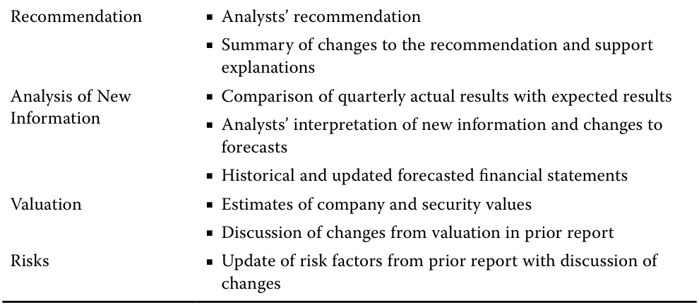

# Volume 5: Equity Investments
## Learning Module 5 Company Analysis: Past and Present
### Part 1/5: Introduction (PDF Pages 207–214)

---

<!-- PDF Page 207 -->

### L E A R N I N G M O D U L E 

# **<mark>5</mark>** 

## **Company Analysis: Past and Present** 

##### **<mark>LEARNING OUTCOMES</mark>** 

|**_Mastery_**|**_The candidate should be able to:_**|
|---|---|
||describe the elements that should be covered in a thorough company research report|
||determine a company’s business model|
||evaluate a company’s revenue and revenue drivers, including pricing power|
||evaluate a company’s operating profitability and working capital using key measures|
||evaluate a company’s capital investments and capital structure|

<!-- Start of picture text -->
1 <!-- End of picture text -->

#### **INTRODUCTION** 

An insightful and well-written company research report helps investors understand a company and make better investment decisions about the company’s securities. This module is the first of three that will provide a framework to prepare a company research report by applying methods covered in previous modules to assess a company’s business model, financial performance, and financial position. 

###### **LEARNING MODULE OVERVIEW** 

- Company research reports analyze a company’s past and present financials, its industry and competitors, and forecast its future financial statements. Reports end with a valuation, an investment recommendation, and investment risks. 

- ■ The first step of company analysis requires an understanding of the issuer’s business model, for which analysts rely on both issuer and third-party information sources. 

- ■ An understanding of the issuer’s business model and analysis of historical financial statements will allow the analyst to identify key drivers of revenues, <u>profitability, cash flows, and financial position.</u> 

<!-- PDF Page 208 -->

- Revenue analysis can be done using a bottom-up or top-down approach. A bottom-up approach breaks down revenues into drivers such as sales volumes and prices, by product line or segment. A top-down approach expresses revenue as a function of drivers such as market share, market size, and GDP growth. 

- While a company can change its prices at will, its ability to do so successfully (i.e., not causing a loss of volume) and relative to costs is driven by the company’s pricing power. Pricing power is primarily a function of industry structure and competitive strategy. 

- Cost analysis assesses a company’s profitability and working capital management. Analysts calculate and interpret several cost and profitability measures, including gross, operating, and net margins. 

- While a fixed versus variable cost analysis is useful, the analysis is often limited by issuer disclosures and accounting standards that emphasize cost reporting by function or nature. 

- The degree of operating leverage measures the sensitivity of operating profit to changes in sales. Operating leverage is primarily driven by the fixed and variable cost composition of the issuer’s operating expenses. 

- The degree of financial leverage measures the sensitivity of net income to changes in operating income. Financial leverage is primarily driven by the issuer’s capital structure. 

###### **LEARNING MODULE SELF-ASSESSMENT** 

These initial questions are intended to help you gauge your current level of understanding of this learning module. 

1. Identify two elements that are common to _all_ company research reports and two elements that are common to _initial_ research reports. 

   - **Solution** : 

Common to all research reports: 

- Analyst’s investment recommendation and target buy or sell prices 

- Risks such as evaluation of material downside and upside risks 

- Common to initial research reports: 

- Discussion of issuer’s business model and strategy, and explanatory charts and figures that disaggregate revenues and profits by product or geography 

- Detailed financial analysis and models 

- Industry overview and competitive positioning such as industry size, growth rate, market share trends, and industry profitability. Evaluation of the company’s competitive position and strategy in each product line or segment is also common. 

<!-- PDF Page 209 -->

2. Identify three information sources that analysts commonly use to determine and analyze a company’s business model. **Solution:** 

   - Regulatory filings if the issuer is public, especially the annual and quarterly reports 

   - Investor events and presentations by the issuer 

   - Visiting the company’s properties and/or websites 

3. Last year, a distributor of dental care products earned EUR800 million in revenues. Management estimated that its market share was 10%. Based on management’s estimate, the market size for distribution of dental care products in this geography last year was _closest_ to (in millions of EUR): 

   - **A.** 80 

   - **B.** 7,200 

   - **C.** 8,000 

   - **Solution:** 

C is correct. 

- _ 

- Market share =Revenue Market Size 

- Which can be rearranged to: 

- _ 

- Market size =Revenue Market Share _____________ 

- Market size =EUR 800 million 10% 

Market size =  EUR 8, 000 million( 8 billion) 

4. A beverage manufacturer recently introduced a new line of healthy teabased drinks. The average selling price was USD20 a case last year and the company sold 2 million cases. This year, an analyst forecasts sales of 3 million cases and an increase in the average selling price—from a reduction in discounts and promotions—of 5%. The analyst’s forecast for net sales growth this year over the prior year is _closest_ to: 

   - **A.** 50% 

   - **B.** 55% 

**C.** 58% **Solution:** C is correct. Net sales = average selling price × cases sold Net sales last year = USD20 × 2 million = USD40 million Net sales forecast this year = (USD20 × 1.05) × 3 million = USD63 million Forecasted net sales growth rate = 63/40 − 1 = 0.575 or 58% 

5. Impression Ltd. is a fictional company that designs, manufactures, and sells skin care and beauty <u>products. Identify whether each expense line below</u> 

<!-- PDF Page 210 -->

from Impression Ltd.’s last annual income statement is _most likely_ a fixed or variable cost. 

|I. Amortization of acquired intangible|Fixed|Variable|
|---|---|---|
|assets|||
|II. Interest expense|Fixed|Variable|
|III. Costs ofgoods sold|Fixed|Variable|
|IV. General and administrative expenses|Fixed|Variable|
|V. Sales commissions|Fixed|Variable|

###### **Solution:** 

I. Fixed. Amortization expense generally does not change with levels of sales volume, as definite-lived intangible assets are amortized on a straight-line basis over the assets’ useful lives. 

II. Fixed. Interest expense is a function of the quantity of debt and its interest rate, not sales volume. 

III. Variable. Costs of goods sold are incurred when sales are made. 

IV. Fixed. General and administrative expenses are usually not related to sales volume each year. 

V. Variable. Sales commissions, a form of performance-based compensation for salespeople, are a function of sales and are therefore variable. 

6. Based on the data below, the degree of operating leverage for Company XYZ for the year ended 31 December 20X1 is _closest_ to: 

###### **Company XYZ: Statement of Income for the Year Ended (in millions of EUR)** 

||**31 December** **20X1**|**31 December** **20X0**|
|---|---|---|
|Revenue|9,707|9,256|
|Costs of goods sold|4,850|4,637|
|Selling, general, and administrative expenses|993|1,090|
|Research and development expenses|1,700|1,554|
|Other operating expenses|491|448|
|Interest expense|309|325|
|Other (income) expense|24|(71)|
|Income before income taxes|1,340|1,273|
|Provision for income taxes|295|255|
|Net income|1,045|1,018|

**A.** 0.51 

**B.** 1.08 

**C.** 1.96 

C is correct. 

20X1 Operating Income = 9,707 – 4,850 – 993 – 1,700 – 491 = 1,673 20X0 Operating Income = 9,256 – 4,637 – 1,090 – 1,554 – 448 = 1,527 _DOL_ = % Δ Operating Income/% Δ Sales 

_DOL_ = (1,673/1,527 – 1)/(9,707/9,256 − 1) 

<!-- PDF Page 211 -->

|_DOL_= 1.96 A is incorrect, as it inverts the equation; it is the ratio of the change in sales to the change in operating income. B is incorrect; it is the ratio of the percentage change in pre-tax income, rather than operating income, to the percentage change in sales.|
|---|
|7. If a company reported trailing 12 months’ operating cash flow of USD150 million, current assets excluding cash of USD40 million, and current liabili- ties of USD60 million, the company_most likely_: **A.**was inefficient in managing its financing. **B.**used trade credit to manage working capital. **C.**over-extended itself and is at risk of bankruptcy. **Solution:**|
|B is correct. Negative net working capital typically indicates that the compa- ny uses suppliers’ trade credit to lengthen days payable, while also efficiently managing inventory days and days sales outstanding. A is incorrect. Negative working capital is a source rather than a use of financing and gives an issuer more financial flexibility, as capital is not tied up in working capital.|
|C is incorrect. There is not enough information here to determine bankrupt- cy risk, but positive operating cash flows and negative net working capital are not bankruptcy risk indicators.|
|8. A company’s management may choose_not_to use financial leverage because the company has:|
|**A.**an investment-grade credit rating. **B.**a high degree of operating leverage. **C.**a lower net debt to EBITDA ratio than its peers. **Solution:**|
|B is correct. The degree of financial leverage and the degree of operating leverage together equal the degree of total leverage in the business. If the company already has a high degree of operating leverage, using financial leverage may increase total leverage and risk to too high a level. A is incorrect. An investment-grade credit rating generally indicates that the company could borrow economically, which would be a reason to use financial leverage.|
|i C is incorrect. A lower net debt to EBITDA ratio than its peers is an indica- tor of borrowing capacity, which would be a reason to use financial leverage.|

describe the elements that should be covered in a thorough company research report 

<!-- PDF Page 212 -->

Analysts value and make investment recommendations on issuers’ equity securities using scenarios of future earnings, cash flows, and financial position. These future scenarios are structured in the form of financial statements and are known as financial statement models. While a financial statement model is quantitative, it is not a mathematics problem to solve with a correct answer, but rather a quantitative expression of an analyst’s forward-looking views. These views should be based on supporting evidence and justified by analysis. 

The process of forming and justifying a view of an issuer’s future financial results and position involves company and industry analysis and is the subject of this module and the next two. Exhibit 1 introduces a framework for company and industry analysis. This module focuses on the foundational block Company Analysis: Past and Present. 

**Exhibit 1: Company and Industry Analysis Framework** 

<!-- Start of picture text -->
3) Company Analysis: Forecasting • Determine forecast objects and approaches • Forecast revenue 3) • Forecast operating profitability and working capital • Forecast capital investments and capital structure Company • Evaluate key risks and uncertainties Analysis: Forecasting 2) Industry and Competitive Analysis • Define Industry • Analyze size, growth and character, profitability, 2) market share trends Industry and • Analyze industry structure and external influences Competitive Analysis • Evaluate company’s competitive strategy and positioning and determine if company has a competitive advantage 1) 1) Company Analysis: Past and Present Company Analysis: • Determine business model Past and Present • Analyze revenue and revenue drivers • Analyze operating profitability and working capital • Analyze capital investments and capital structure (uses of capital and sources of financing) <!-- End of picture text -->

Analysts present their company and industry analysis, as well as their valuation and investment recommendation, in a **company research report** . The structure, content, and tone of the report depend on the analyst’s setting. Reports on a public issuer’s equity securities for distribution to external clients (a “sell-side report”), for example, often consist of an extensive initial report (an “initiating coverage” report, or “initiation”) when the analyst begins covering the security, followed by shorter reports on specific topics or that make updates to a recommendation after the analyst receives new information or conducts additional analyses, particularly after the issuer reports financial results. Analysts’ reports solely for internal distribution to an audience already familiar with the issuer might be far shorter and delivered verbally or in a handful of presentation slides. 

An example of the structure of an _initial_ company research report for external distribution is shown in Exhibit 2. The primary audience is those who are not already knowledgeable about the issuer or security. 

<!-- PDF Page 213 -->

###### **Exhibit 2: Initial Company Research Report Elements** 

|Front Matter|■Issuer name and security identifiers (e.g., symbol, CUSIP) ■Analysts’ recommendation (buy, hold, sell) and target buy or sell prices ■Disclosures, disclaimers, and other legally required information|
|---|---|
|Recommendation|■Analysts’ recommendation ■Summary of key reasons supporting the recommendation|
|Company Description|■Discussion of issuer’s business model and strategy ■Explanatory charts and figures—for example, disaggregation of revenues and profits by product, geography, etc.|
|Industry Overview & Competitive Positioning|i ■Industry size, growth rate and key drivers, market share trends, profitability—historical and outlook ■Competitive analysis such as Porter’s Five Forces ■Analysis of external industry influences such as political, economic, social, technological, legal, and environmental (“PESTLE” analysis) ■Evaluation of company’s position and strategy in the industry|
|Financial Analysis and Model|■Evaluation of key drivers of revenue, costs, profitability, cash flows, and the issuer’s uses and sources of capital ■Forecasts of key drivers and supporting discussion ■Historical and forecasted financial statements|
|Valuation|■Estimates of company and security values with target price ■Typically includes relative and present value approaches ■Discussion of key inputs and scenario and sensitivity analyses|
|Environmental, Social, and Governance (ESG) Considerations|■Evaluation of ESG indicators and risks ■Ownership structure and management composition ■Executive compensation|
|Risks|■Evaluation of material downside and upside risks and discus- sion of how they are considered in the financial analysis and valuation|

###### **THE CFA INSTITUTE RESEARCH CHALLENGE** 

For examples of initial company research reports, we encourage you to visit the Past Research Challenge Champions section of cfainstitute.org, which has winning reports and presentations from the research competition that CFA Institute and CFA Societies around the world host each year. Teams of university students are assigned a public company to research by a local CFA Society and compete on the quality of their research and modeling, valuation, and communication skills. 

_Subsequent_ company research reports are often shorter than initial reports. Their primary audience is those who are already familiar with the issuer or security and require an update based on new information and analyses or a change in the analyst’s recommendation. Such a report for a company that recently reported quarterly financial results may be structured in the form shown in Exhibit 3. The structure of a subsequent report depends on the analyst’s setting and the nature of the report. 

<!-- PDF Page 214 -->

###### **Exhibit 3: Subsequent Company Research Report Elements** 

Front Matter 

- Analysts’ names 

- Issuer name 

- Security and exchange identifiers (e.g., symbol, CUSIP) 

- Analysts’ recommendation: buy, hold, sell 

- Current security price and analysts’ target price 

- Disclosures, disclaimers, and other legally required information 

<!-- Start of picture text -->
Recommendation ■ Analysts’ recommendation ■ Summary of changes to the recommendation and support explanations Analysis of New  ■ Comparison of quarterly actual results with expected results Information ■ Analysts’ interpretation of new information and changes to forecasts ■ Historical and updated forecasted financial statements Valuation ■ Estimates of company and security values ■ Discussion of changes from valuation in prior report Risks ■ Update of risk factors from prior report with discussion of changes <!-- End of picture text -->

###### **QUESTION SET** 

1. Which of the following statements about initiation reports is true? 

   - **A.** The structure, content, and tone of the report are independent of the analyst’s setting. 

   - **B.** The report makes updates to the recommendation after the issuer reports financial results. 

   - **C.** The primary audience is those who are not already knowledgeable about the issuer or security. 

###### **Solution:** 

C is correct. The primary audience is those who are not already knowledgeable about the issuer or security. 

A is incorrect, because the structure, content, and tone of the report are dependent on the analyst’s setting. Examples include whether the report is meant for internal or external distribution and whether it is an in-depth initiation report or a subsequent report updating the reader after a change in recommendation or the release of the issuer’s quarterly results. 

B is incorrect, because the initial report is to help those who are not already knowledgeable to understand the issuer or security. A subsequent research report is used to update the audience after the release of financial results. 

2. If you read a research report that includes both a Porter’s Five Forces analysis and a PESTLE analysis, then _most likely_ : 

   - **A.** the authoring analyst is initiating coverage. 

   - **B.** the report is updating a recommendation after an earnings release. 

