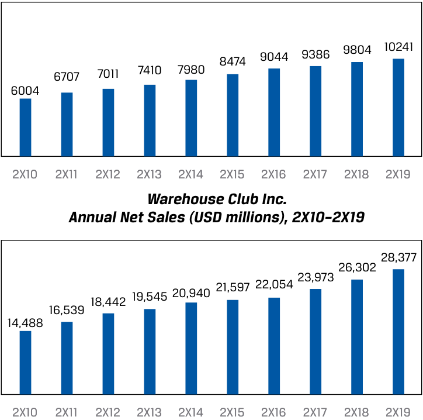
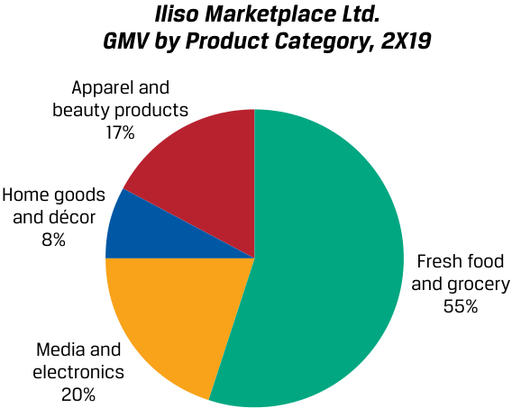

# Volume 5: Equity Investments
## Learning Module 5 Company Analysis: Past and Present
### Part 2/5: Determining the Business Model (PDF Pages 215–226)

---

<!-- PDF Page 215 -->

**C.** the report is written by a firm’s analyst who has covered the company for many years. **Solution:** A is correct. A Porter’s Five Forces analysis and a PESTLE analysis are common elements in initiations and are less common in subsequent research reports, as they tend to evolve more slowly than other report elements such as financial analyses and models. B and C are incorrect; these elements are common in subsequent rather than initial research reports. 3. The evaluation of a company’s competitive strategy takes place before the: **A.** analysis of revenue and revenue drivers. **B.** analysis of operating profitability and working capital. **C.** forecasting of revenue, operating profitability, and working capital. **Solution:** C is correct. Forecasting takes place only after company analysis and industry and competitive analysis are complete. The evaluation of a company’s competitive strategy is part of the industry and competitive analysis. A is incorrect, because the analysis of revenue and revenue drivers is part of the first stage of analysis, where the analyst studies the company’s past and present financial statements. As we shall see in Lesson 3, analysts start by analyzing the revenue line items first. B is incorrect, because the analysis of operating profitability and working capital typically takes place before the industry and competitive analysis. The evaluation of the company’s competitive strategy is usually part of the industry and company analysis, which takes place after completion of the analysis of operating profitability and working capital. 

# **DETERMINING THE BUSINESS MODEL** **<mark>3</mark>** 

determine a company’s business model 

Determining the business model is the first step in our industry and company analysis framework because it summarizes important drivers of an issuer’s financial results and position, focuses the analyst on what requires further investigation, and should begin setting the analyst’s expectations for the issuer. A discussion of the business model is usually in the first part of a company research report (see the “Company Description” section in Exhibit 2). 

Recall that a business model describes a company’s operations and includes the following elements, which analysts investigate by answering several key questions discussed in prior learning modules. 

|**Business Model Element**|**Key Questions for Analysts**|
|---|---|
|The product(s) or service(s) the company|What is the firm selling?|
|h sells|i|
|Customers and key customer groups|To whom does the company sell?|

<!-- PDF Page 216 -->

|**Business Model Element**|**Key Questions for Analysts**|
|---|---|
|Sales channels, including customer acquisition and product/service delivery mechanisms|How does the company reach potential and current customers and how does it deliver products?|
|How the product(s) or service(s) are priced and paid for|How much does the company charge and how are prices and payment terms structured?|
|Resource, supplier, and partner relation- ships need to operate effectively|What does the company buy and rely on?|

There are many corollary questions for each of the key questions, such as determining whether customers are few and concentrated, whether suppliers and resources are specialized or hard to replace, and so on. The answers to these questions are company specific, but the key questions to ask are common across industries and companies. Also, recall that many companies have a conventional business model, such as retailer or natural resource producer, which simplifies business model identification in practice. Analysts will often focus their analysis on the differences in a company’s business model, if any, from a conventional model or those of its competitors. 

Information sources that analysts use to answer these questions include the following, grouped by origin: the issuer, public third party, proprietary third party, and proprietary primary research. 

- Issuer sources (available freely if the company is public) 

   - Regulatory filings, especially the annual and quarterly reports 

   - Quarterly or semi-annual earnings conference calls 

   - Presentations and events for investors 

   - Press releases 

   - Issuer management, investor relations, or other personnel 

   - Company website or properties that the analyst may be able to visit as either a customer or an investor. It is often useful to experience an issuer’s and its competitors’ products firsthand, though it is not always possible (e.g., pharmaceuticals). 

- Public third-party sources 

   - Free industry white papers or analyst reports from a consultancy 

   - Economic or industry indicators from governments and other organizations 

   - General news outlets 

   - Industry-specific news outlets 

   - Social media 

   - Miscellaneous sources available via search engines 

- Proprietary third-party sources 

   - Analyst reports and communications, including from “sell-side” or “Wall Street” analysts and credit rating agencies 

   - Reports and data from platforms such as Bloomberg and FactSet 

   - Reports and data from consultancies, often industry specific, such as Rystad in energy, IQVIA and Evaluate in biopharma, Gartner and IDC in information technology 

- Proprietary primary research 

<!-- PDF Page 217 -->

- Surveys, conversations, product comparisons, and other studies commissioned by the analyst or conducted directly 

Analysts in an institutional investment setting (e.g., an asset management firm) are often able to conduct this initial research quickly, as they enjoy broad access to a variety of proprietary third-party sources, may have industry knowledge and experience themselves, can access prior analyses of the company or industry, and often have access to the issuer investor relations personnel and management. 

We will demonstrate the determination of an issuer’s business model with a fictional example adapted from a real company. We will use this case study throughout this module and the next two to demonstrate the use of the company and industry analysis framework. Another case study of a different company in the same industry is in the self-assessment section at the end of each lesson, so you can practice using the framework on your own. 

### **CASE STUDY** 

## **Warehouse Club Inc.** 

Elaine Nguyen is an analyst at Fyleton Investments. To find investment candidates for one of Fyleton’s funds, Nguyen ran a screen for companies in developed markets that exceeded a certain level of sales growth and return on invested capital over the last five years while also performing well in the last recession. One company that passed the screen is Warehouse Club Inc. (“Warehouse”). Neither Nguyen nor her colleagues have ever worked on Warehouse before. A portfolio manager suggested that Nguyen research the company and its industry for several days and then discuss initial findings with colleagues before writing a formal research report. 

Warehouse is a public company, so Nguyen compiles several issuer information sources, including the company’s latest annual report and a transcript of management’s presentation at a recent investor event. The following paragraphs and figures are excerpts from these sources. 

Warehouse Club Inc. (“we,” “our,” “us,” “the company”) is a leading discount retailer, consistently offering customers more than 20% savings on a broad range of food and other merchandise compared to supermarket, department store, convenience store, and e-commerce competitors. Warehouse operated 149, 145, and 141 stores as of 31 December 2X19, 2X18, and 2X17, respectively. 

We sell a core assortment of packaged food and beverages, fresh foods, and non-food merchandise such as apparel, appliances, electronics and entertainment, housewares, and sporting goods. In addition to our core assortment, our stores feature a changing assortment of seasonal or discounted items based on the latest consumer trends and availability from suppliers, which vary by store. We also offer ancillary products and services such as petrol stations co-located with our stores, in-store takeaway prepared foods, pharmacy and optician centers, and hearing aids. In addition to carrying the leading branded goods, we also sell packaged food and household goods under our exclusive private-label brand that we source from contract manufacturers, which account for over 15% of our net sales and carry higher than average profitability. 

We operate a member-based model that requires customers to show their membership card to enter and shop in our stores. The annual membership fee is $60 per household. We estimate that members’ annual savings versus shopping at competitors for the same basket of goods amounts to over five times their annual membership fee. Our membership fee revenues 

<!-- PDF Page 218 -->

were $601, $576, and $553 million in fiscal years 2X19, 2X18, and 2X17, respectively. Besides providing us with a source of recurring revenue, membership engenders shopper loyalty and drives our industry-low levels of inventory theft of less than 20 basis points as a percentage of net sales, which we believe is at least one-fifth that of competitors. Total memberships were 10.2, 9.8, and 9.4 million as of 31 December 2X19, 2X18, and 2X17, respectively. 

Our strategy is based on price and cost leadership. We stock a limited selection of high-quality branded and private-label products in a wide range of categories that produce high sales volumes and rapid inventory turnover. We limit items to fast-selling models, sizes, and colors and carry an average of approximately 4,000 unique products per store, less than a quarter of the assortment of our supermarket and supercenter competitors. Most items are sold only in bulk sizes. Wherever possible, we utilize direct-from-manufacturer distribution and move merchandise immediately to the sales floor, presenting on pallets in a no-frills warehouse atmosphere. Our high-volume purchases of a limited number of products, direct from manufacturer distribution, and reduced handling of merchandise enable us to hold a low-cost position in the retail industry in terms of merchandise and labor costs. Our low costs and membership fee revenues enable us to operate profitably while charging significantly lower prices than other retailers. Low prices for quality products drive greater membership and net sales over time, leveraging our selling, general, and administrative expenses, reducing them as a percentage of net sales. 

Our stores operate on a seven-day, 70-hour week with predictable shifts for employees. Because the hours of operation are shorter than other retailers, and due to other efficiencies inherent in a warehouse-type operation, labor costs are lower relative to the volume of sales. We look to maintain a large base of full-time employees with above-average wages and benefits to establish long tenures, as we believe this maximizes productivity and customer service at our stores. Our employee retention rate for employees who have been with us for at least a year is 90%, which we believe is substantially higher than the retail industry average. 

Our retail operations, which represent substantially all our consolidated net sales, are our only reportable segment. We do not have significant sales outside our domestic geography: the United States. No single customer or supplier represents a material amount of revenues or merchandise costs, respectively. 

<!-- PDF Page 219 -->

<!-- Start of picture text -->
Warehouse Club Inc. Number of Stores at Year-End, 2X10–2X19 130 136 141 145 149 108 112 116 120 126 2X10 2X11 2X12 2X13 2X14 2X15 2X16 2X17 2X18 2X19 Warehouse Club Inc. Number of Members (thousands) at Year-End, 2X10–2X19 <!-- End of picture text -->

<!-- Start of picture text -->
8474 9044 9386 9804 10241 6707 7011 7410 7980 6004 2X10 2X11 2X12 2X13 2X14 2X15 2X16 2X17 2X18 2X19 Warehouse Club Inc. Annual Net Sales (USD millions), 2X10–2X19 16,539 18,442 19,545 20,940 21,597 22,054 23,973 26,302 28,377 14,488 2X10 2X11 2X12 2X13 2X14 2X15 2X16 2X17 2X18 2X19 <!-- End of picture text -->

### **Warehouse Club Inc. Income Statements for the Years Ended . . . (amounts in USD millions except per share amounts)** 

||**31 December** **2X17**|**31 December** **2X18**|**31 December** **2X19**|
|---|---|---|---|
|Net sales|23,973|26,302|28,377|
|Membership fees|553|576|601|
|Total revenues|24,526|26,878|28,978|
|Merchandise costs|(21,258)|(23,399)|(25,248)|
|Selling, general, and administrative expenses|(2,201)|(2,363)|(2,566)|
|Depreciation and amortization|(260)|(273)|(283)|
|New-store opening expenses|(16)|(13)|(16)|

<!-- PDF Page 220 -->

||**31 December** **2X17**|**31 December** **2X18**|**31 December** **2X19**|
|---|---|---|---|
|Operating income|791|830|865|
|Interest expense|(25)|(30)|(29)|
|Interest income|10|14|24|
|Income before taxes|776|814|860|
|Income tax expense|(178)|(187)|(198)|
|Net income|598|627|662|
|Shares outstanding|83|83|84|
|Earningsper share|7.20|7.55|7.88|

During its presentation at a recent investor event, Warehouse management made the following statements that were not in the annual report: 

- Three years ago, the company launched “Buy Online, Pick-Up in Store,” which enables members to shop on Warehouse’s website or mobile app and pick up their order, assembled by Warehouse employees, at a store. The company does not plan to offer e-commerce or delivery itself or through third-party services. 

- Membership is $60 per year, paid upfront, and refundable on a prorated basis for days remaining in the year. Management has increased the price of membership every five years by $5 and expects to continue to do so. The last price increase was three years ago. 

- Management intends to open four new stores per year for the next five years. 

- The company operates stores in urban and suburban areas in a single country. Over 90% of current members live within 10 kilometers of a store, and while membership has grown around existing stores over time, management believes the primary driver of membership growth is opening stores in new areas. 

- Management does not plan to open stores in another country for the foreseeable future. An immaterial amount of merchandise is imported. 

### **EXAMPLE 1** 

## **Determining Warehouse Club Inc.’s Business Model** 

Nguyen answers the following questions to determine Warehouse Club Inc.’s business model and to identify areas to conduct further research. 

- What is the firm selling? 

Warehouse sells a range of consumer goods, mostly consumables and perishables, approximately 4,000 unique items. For customers to shop at the stores, they must hold a membership, which Warehouse sells for $60 per year, per household. Nguyen graphs the following net sales by category data with descriptions supplied by Warehouse, and notes that the composition of net sales by category has not changed materially in the last 10 years. 

<!-- PDF Page 221 -->

<!-- Start of picture text -->
Warehouse Club Inc. Net Sales by Category, 2X19 Ancillary and other 19% Packaged food and beverages 40% Non-food merchandise 28% Fresh foods 13% <!-- End of picture text -->

“Non-food merchandise” includes a broad range of items such as appliances, electronics, health and personal care products, hardware, outdoor and sporting goods, jewelry, furniture, and housewares. 

“Ancillary and other” are service businesses that operate in or next to Warehouse’s stores and include takeaway prepared foods, prescription pharmacies, petrol stations, optician centers, and hearing aids. 

### ■ To whom? 

Warehouse’s members are primarily consumer households that live within 10 kilometers of a store, are value-conscious, are willing to forgo a more extensive selection for lower unit prices on bulk-sized goods, and are able to afford the annual membership fee. 

### ■ How? 

Warehouse sells products and services both in and around its stores. Members can either shop at the store or shop online and pick up at the store (Nguyen notes that management did not disclose the size of this in terms of net sales). Management said that it does minimal advertising (besides promotional mail) in an area before it opens a store and also sends out membership renewal reminders; the company primarily relies on word of mouth and its stores’ physical presence to drive interest and foot traffic. 

Memberships can be purchased online, by phone, or at any Warehouse store. Management said that over three-quarters of members purchase and renew their memberships online. 

### ■ For how much? 

Warehouse has two revenue streams: goods and services (for which it earns net sales) and membership (for which it earns membership fees). 

Management sets the prices of its merchandise by item. Gross margin and markup on aggregate net sales for the last three fiscal years were as follows: 

||**31 December** **2X17**|**31 December** **2X18**|**31 December** **2X19**|
|---|---|---|---|
|Net sales|23,973|26,302|28,377|
|Merchandise costs|(21,258)|(23,399)|(25,248)|
|Gross margin|2,715|2,903|3,129|
|Gross margin % of net sales|11.33%|11.04%|11.03%|
|Markup|12.77%|12.41%|12.39%|

<!-- PDF Page 222 -->

Therefore, the average good or service is sold at a price that is a little over 12% of the cost for Warehouse to purchase and ready the item for sale. While management claims that the company is a cost and price leader, Nguyen will have to corroborate that. 

Membership is $60 per year, per household. Membership is required to shop at Warehouse stores, thus effectively raising the price of all its goods and services. 

- What does the company buy and rely on to operate effectively? 

   - Merchandise from a broad range of manufacturers and private-label goods from contract manufacturers 

   - Human capital in stores and in management 

   - Fixed assets including land in attractive locations, buildings, fixtures, refrigerators and freezers, and a range of information technology systems such as point-of-sale payment systems 

   - Credit and debit card payment networks and financial institutions to receive and make electronic payments 

While these are all broadly available and the company has not had supply or service interruptions in the past, a key partner appears to be merchandise manufacturers, particularly those that manufacture Warehouse’s private-label products. Since Warehouse is strict on cost and quality and carries a limited selection, the company does rely heavily on these contract manufacturers. 

In summary, Warehouse’s business model is aimed at creating a virtuous cycle whereby low prices drive memberships, which drive further sales, which drive negotiating leverage with suppliers to enable low prices at low costs. 

### **DISCUSSION BOARD QUESTION** 

Based on the information provided, what would you change about or add to Elaine Nguyen’s analysis of Warehouse Club Inc.’s business model? Why? 

We encourage you to post your response, as well as read and reply to others’ responses, on the Learning Ecosystem discussion board. 

### **QUESTION SET** 

Iliso Marketplace Ltd. (“we,” “our,” “us,” “the Company,” “Iliso”) is redefining e-commerce by delivering superior customer experiences at competitive prices through our Iliso Marketplace mobile app and website. While e-commerce customers have historically been forced to compromise on shipping times, product quality, and hassles with returns, we’ve built a vertically integrated system that delivers a vast selection of products with one-day delivery on most orders. We continue to make significant investments in both technology and our fulfillment infrastructure to improve the customer experience and expand into new product categories and geographies. 

**Customer Experience** 

<!-- PDF Page 223 -->

|We custo|’re committed to delighting our customers every day. Hallmarks of our mer experience include:|
|---|---|
|■|Next-Day or Faster Delivery. Customers are eligible for one-day deliv- ery 365 days a year. In 2X19, over 93% of orders were delivered within 24 hours of receiving the order.|
|■|Free Shipping. Customers are eligible for free shipping on orders greater than $25, which we believe is the industry-leading minimum order threshold, and no membership fee is required.|
|■|Vast Selection of Items, Including Fresh Groceries. Customers can order from a selection of items across almost every category of goods—from fresh produce to consumer electronics to home décor and furniture. To continue offering the highest-quality items, we mod- ify our selection continuously based on customer reviews. We enforce strict standards for third-party merchants to protect customers from counterfeit goods.|
|■|Frictionless Returns. Our customers simply tap a button on our app and leave the item outside their door for pickup. Refunds are initiated the moment the item is picked up at the door.|
|The years respec least o or req **Ou i** f|h number of active customer accounts as of the fourth quarter for the ended 31 December 2X17, 2X18, and 2X19, were 29, 31, and 36 million, tively. Active customer account refers to a unique email address and at ne purchase in the indicated period; we do not charge membership fees uire minimum purchases to maintain an account. **r Fulfillment Network** f|

To achieve our differentiated customer experience, we focus on urban markets and have built a vertically integrated system in which we control every step, from a customer’s purchase on our app to the photo confirmation of the delivery at the customer’s front door. We receive most of our products directly from manufacturers at our fulfillment centers and minimize the use of third-party carriers and contractors by directly employing over 65,000 people in fulfillment and delivery. We believe direct employment and control of fulfillment assets such as delivery trucks enable speed, efficiency, and waste reduction, which is especially important for product categories such as fresh foods. 

We’ve made the strategic decision to focus on urban markets in the United States for the foreseeable future to achieve an economical route density for customer deliveries and returns and one-day shipping. 

### **Merchant Services** 

In 2X13, we launched Merchant Services, allowing third-party merchants to sell products on Iliso Marketplace and utilize our fulfillment network. When multiple merchants (including us) sell the same product, our algorithm shows the customer the lowest price, including shipping cost, though the customer can manually choose a different seller. Third-party merchants must meet our rigorous quality standards but otherwise have discretion in product assortment and description, pricing, and shipping terms. 

We receive sales commissions on third-party merchants’ sales, as well as service revenues if the merchant utilizes our fulfillment network for warehousing and delivery. We record revenue on a “net” basis for third-party merchant-related transactions because we act as an agent; the Company is not the seller of record, nor does it take control of the goods inventory. The number of active third-party merchants as of the fourth quarter for the years ended 31 December 2X17, 2X18, and 2X19 was 25,500, 31,500, and 40,500, respectively. Active third-party merchant refers to a unique email address and at least one sale in the indicated period; we do not charge merchant membership fees, nor do we require minimum sales levels. 

<!-- PDF Page 224 -->

Our annual gross merchandise value (GMV)—which includes the value of all products sold on our marketplace by us and third-party merchants, net of sales taxes and returns allowances but including any applicable shipping fees— was $5,721, $6,950, and $8,605 million for the years ended 31 December 2X17, 2X18, and 2X19, respectively. GMV by product category for the year ended 31 December 2X19 was as follows: 

<!-- Start of picture text -->
Iliso Marketplace Ltd. GMV by Product Category, 2X19 Apparel and beauty products 17% Home goods and décor 8% Fresh food and grocery 55% Media and electronics 20% <!-- End of picture text -->

Iliso recently went public, so financial information is available only for the five years ended 31 December 2X19. Amounts are in millions of USD (except per share amounts). 

### **Iliso Marketplace Ltd. GMV, Customer, and Merchant Counts for the Years Ended 31 December** 

||**2X15**|**2X16**|**2X17**|**2X18**|**2X19**|
|---|---|---|---|---|---|
|Iliso retail sales|2,589|3,424|5,100|6,052|7,336|
|Third-party merchant sales|279|432|621|898|1,269|
|Total GMV|2,868|3,856|5,721|6,950|8,605|
|Active customer accounts (millions)|16|23|29|31|36|
|Third-party mer- chants (#)|14,850|18,000|25,500|31,500|40,500|

### **Iliso Marketplace Ltd. Income Statements for the Years Ended 31 December** 

||**2X15**|**2X16**|**2X17**|**2X18**|**2X19**|
|---|---|---|---|---|---|
|Net retail sales|2,589|3,424|5,100|6,052|7,336|
|Third-party merchant fees|42|65|94|134|190|
|Total revenues|2,631|3,489|5,194|6,186|7,526|
|Costs of revenues|(1,894)|(2,506)|(3,729)|(4,446)|(5,414)|
|Operating, general, and administrative expenses|(685)|(895)|(1,300)|(1,544)|(1,831)|
|Advertising and marketing|(53)|(70)|(104)|(124)|(151)|
|Operating income|(1)|18|61|72|130|

<!-- PDF Page 225 -->

||**2X15**|**2X16**|**2X17**|**2X18**|**2X19**|
|---|---|---|---|---|---|
|Interest income|6|7|9|9|10|
|Interest expense|(5)|(13)|(15)|(12)|(8)|
|Pre-tax income|0|12|55|69|132|
|Provision for income taxes|0|(3)|(13)|(16)|(32)|
|Net income|0|9|42|52|100|
|Basic EPS|0.00|0.03|0.15|0.18|0.34|
|Diluted EPS|0.00|0.03|0.14|0.18|0.34|
|Basic share count|274|280|284|288|291|
|Diluted share count|274|280|291|288|297|

The notes to Iliso’s financial statements provide the following descriptions of accounts. 

### **Net retail sales** 

Retail sales are earned from the Company’s online product sales to consumers. Retail revenue is recognized when control of the goods is transferred to the customer, which occurs upon delivery to the customer. 

### **Third-party merchant fees** 

Third-party merchant fees revenue includes commissions and service fees earned from merchants that sell their products through the Company’s online business. The revenue is recognized when the order is completed and transmitted to the third-party merchant. 

### **Costs of revenues** 

Costs of revenues primarily comprise the purchase price of products sold to customers where the Company records revenue gross, and include logistics center costs. Inbound shipping and handling costs to receive products from suppliers are included in inventory and recognized in costs of revenues as products are sold. Additionally, costs of revenues include outbound shipping and logistics-related expenses, delivery service costs from our Merchant Services business (where the Company is the delivery service provider), and depreciation expense. 

### **Operating, general, and administrative expenses** 

Operating, general, and administrative expenses include costs incurred in operating and staffing the Company’s fulfillment centers (including costs attributable to receiving, inspecting, picking, packaging, and preparing customer orders), customer service costs, payment processing fees, costs related to the design, execution, and maintenance of the Company’s technology infrastructure and online offerings, and general corporate function costs. 

### **Advertising and marketing expenses** 

Advertising and marketing expenses are expensed as incurred and include brand and performance advertising such as television and digital advertising, sponsored search, email marketing campaigns, and other similar initiatives. 

1. What forms the customer base (the “who”) for Iliso’s merchant services segment? 

   - **A.** Third-party merchants 

   - **B.** E-commerce customers 

<!-- PDF Page 226 -->

- **C.** Fresh food and grocery consumers 

- **Solution:** 

A is correct. In merchant services, Iliso acts as an agent for third-party merchants. Iliso is paid commissions and service fees by merchants that sell their products through the company’s online business. Third-party merchants are therefore the customer base for this business segment. 

B is incorrect, because e-commerce customers are customers of Iliso’s retail sales segment. Iliso is paid by e-commerce customers for goods purchased through its online platform. The purchases of third-party merchant products by these e-commerce customers belong to the third-party merchant and are not recognized in Iliso’s retail sales. 

C is incorrect, because fresh food and grocery consumers are a product line segmentation of both its retail sales and its third-party merchant GMV. In addition, fresh food and grocery forms only 55% of the overall GMV and does not encompass all of Iliso’s GMV sales. 

2. Iliso’s business model(s) is(are) likely to benefit from __________ effects. 

   - **A.** network 

   - **B.** value chain 

   - **C.** supply chain 

   - **Solution:** 

A is correct. Iliso’s business model—in particular, merchant services—is an example of a two-sided network effect. Network effect refers to a network in which the value increases as more participants join the network. By providing an excellent service to merchants and to consumers, Iliso is able to attract both buyers and sellers to its online marketplace. The growth of users on Iliso’s platform attracts more merchants, which in turn attracts more users. 

B is incorrect, because value chain refers to the systems and processes within a firm that create value for its customers—which answers the “how” aspect of a business model. 

C is incorrect, because the supply chain is the network inside and outside the company involved in producing the product/service and delivering it to the end user. 

3. Which of the following business features is _least likely_ to increase consumer retention (“stickiness”) on Iliso’s platform? 

   - **A.** A focus on urban markets 

   - **B.** Next-day or faster delivery 

   - **C.** No membership fee is required. 

   - **Solution:** 

A is correct. A focus on urban markets does not change customer stickiness. The customer experience for those in urban markets would not necessarily change if the company began shipping to rural markets as well. 

B is incorrect. The company states that next-day or faster delivery is a hallmark of its customer experience and may provide a competitive advantage. 

C is incorrect, because the lack of a membership fee is likely to decrease the cost of a customer’s staying on the platform, thus increasing retention for some customers. 

