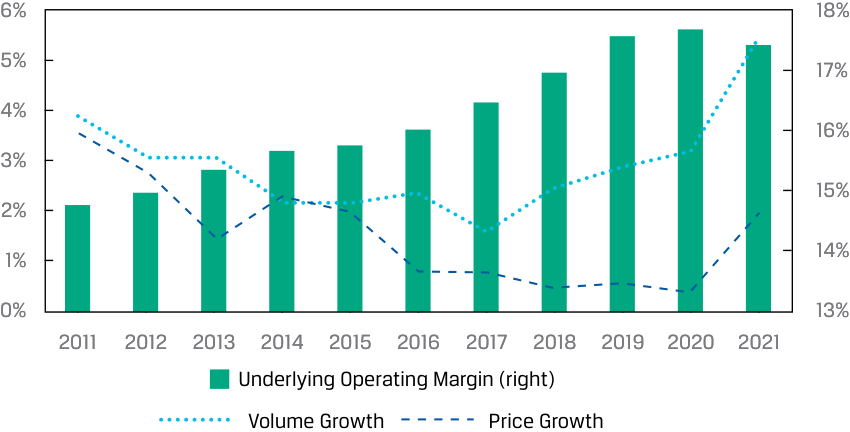

# Volume 5: Equity Investments
## Learning Module 5 Company Analysis: Past and Present
### Part 3/5: Revenue Analysis (PDF Pages 227–233)

---

<!-- PDF Page 227 -->

4. The gross margin of Iliso’s merchant services segment is _most likely_ _____________ the gross margin of Iliso’s retail sales segment. **A.** higher than **B.** the same as **C.** lower than **Solution:** A is correct. The cost of revenues for Iliso’s retail sales includes the purchase price of products sold to customers, including shipping and handling costs, whereas the cost of revenues for merchant services includes only the outbound shipping and logistics expenses. The purchase price of products is a far higher proportion of total GMV sold to customers compared with shipping and logistics costs. Accordingly, the exclusion of the purchase price of products in both the numerator and the denominator will raise the reported gross margin of the merchant services segment. B is incorrect, because the gross margin for merchant services cannot be the same as that of retail sales. The retail sales segment includes the purchase price of products sold and associated inbound logistics costs, which means the numerator and the denominator are significantly higher than in the merchant services segment. C is incorrect, because the gross margin for merchant services cannot be lower than that of retail sales. Assuming a positive gross margin for both segments, the gross margin for merchant services must be higher since the denominator is smaller (being only the service commissions and service fees charged to merchants). 

## **REVENUE ANALYSIS** 

# **<mark>4</mark>** 

evaluate a company’s revenue and revenue drivers, including pricing power 

### **Revenue Drivers** 

After determining the business model, we turn to the analysis of historical financial results and position for the company. This analysis will be used as a basis for forecasting a financial statement model that supports security valuation. For most companies—perhaps with the exception of banks, for which the balance sheet comes first—analysts start by analyzing revenues. As with other financial statement lines, the analysis involves identifying **drivers** , which are causative factors that explain the level of and changes in an output variable (here, revenues), and understanding the evolution of the drivers over time. 

Analysts can take a bottom-up or top-down approach to determining revenue drivers. A bottom-up approach decomposes revenues into drivers such as sales volume and price, or revenues by product line, segment, or geography, which may be further broken down into other drivers. A top-down approach expresses revenues as a function of drivers such as market share, the addressable market or market size, and GDP growth. The two approaches are often used together. 

<!-- PDF Page 228 -->

#### **CASE STUDY** 

### **Bottom-Up Approach to Revenue Analysis: Warehouse Club Inc.** 

Warehouse’s revenues are composed of net sales and membership fees. 

Based on her business model work, Nguyen knows that net sales are sales of merchandise and services in Warehouse stores (the company does not operate an e-commerce business). A logical driver of net sales each year, therefore, is the number of stores open that year. Nguyen decomposes Warehouse’s net sales into two drivers: the _average_ number of stores open and net sales per average store. Nguyen also calculates the change in these drivers: the absolute change in stores each year (new-store openings; so far, Warehouse has never closed a store) and the annual percentage change in net sales per store. 

||**2X10**|**2X11**|**2X12**|**2X13**|**2X14**|**2X15**|**2X16**|**2X17**|**2X18**|**2X19**|
|---|---|---|---|---|---|---|---|---|---|---|
|Stores, year-end|108|112|116|120|126|130|136|141|145|149|
|New-store openings|5|4|4|4|6|4|6|5|4|4|
|Average stores (#)|106|110|114|118|123|128|133|139|143|147|
|Net sales per average|138|150|162|166|170|169|166|173|184|193|
|store|||||||||||
|Growth rate||9%|8%|2%|3%|−1%|−2%|4%|6%|5%|
|Net sales|14,488|16,539|18,442|19,545|20,940|21,597|22,054|23,973|26,302|28,377|

Net sales in 2X19 were 96% higher than in 2X10, driven by similar growth contributions from the two drivers: the average number of stores increased by 39% and sales per average store increased by 40%. 

An encouraging sign for forecasting this company’s results is that each driver appears relatively stable, indicating that they might be somewhat predictable. Sometimes, however, key revenue drivers are volatile, such as interest rates and oil prices for banks and oil producers, respectively. Volatility does not mean that the analyst has selected an incorrect driver; drivers are based on the business model. 

Nguyen then decomposes Warehouse’s membership fee revenues into the annual price of membership and the average number of members. 

##### **Members** 

||**2X10**|**2X11**|**2X12**|**2X13**|**2X14**|**2X15**|**2X16**|**2X17**|**2X18**|**2X19**|
|---|---|---|---|---|---|---|---|---|---|---|
|Members, end of year|6,004|6,707|7,011|7,410|7,980|8,474|9,044|9,386|9,804|10,241|
|Members, annual average|5,900|6,360|6,855|7,218|7,691|8,218|8,764|9,217|9,600|10,017|
|Avg. per member fee|50.00|50.00|55.00|55.00|55.00|55.00|55.00|60.00|60.00|60.00|
|Membership fee revenues|295|318|377|397|423|452|482|553|576|601|

Membership growth has been a larger driver of membership fee revenue growth than price increases, as the number of members has grown by 70% from 2X10 to 2X19 while prices have increased by 20% over the same period. 

<!-- PDF Page 229 -->

Management indicated that over 90% of members live within 10 kilometers of a store and, from 2X10 to 2X19, the company opened 46 new stores. Nguyen adds to her membership analysis by calculating the average number of members per store; if this number has been falling over time, it could mean that existing stores are losing members and sales to new stores the company opens, an example of **cannibalization** . 

||**2X10**|**2X11**|**2X12**|**2X13**|**2X14**|**2X15**|**2X16**|**2X17**|**2X18**|**2X19**|
|---|---|---|---|---|---|---|---|---|---|---|
|Avg. members per store|57,282|57,818|60,128|61,171|62,528|64,205|65,892|66,546|67,133|68,141|
|Growth rate||0.9%|4.0%|1.7%|2.2%|2.7%|2.6%|1.0%|0.9%|1.5%|

Not only has the average number of members per store not declined, but it has also grown by 19%, indicating no cannibalization and that new-store openings are not the only driver of membership growth. This is a positive sign, though Nguyen notes that additional analysis is needed to estimate a ceiling on the number of members a store can reasonably support, and to determine whether stores that opened many years ago have already hit this ceiling. 

### **Pricing Power** 

Prices are a driver of revenue for every firm, and it may appear that pricing is a unilateral decision by management (e.g., Warehouse management chooses its markups on merchandise net sales and has chosen to increase its annual membership fee by $5 every five years). In fact, prices are constrained by a company’s **pricing power** . Pricing power refers to a company’s ability to set prices and other economic terms with customers without affecting its sales volumes. While Warehouse’s management could choose to increase the price of membership from $60 to $600, such a decision would likely result in the loss of all its members. The membership price is constrained by the savings Warehouse can offer members on purchases, which itself is the subject of competition from other retailers that also use low prices to attract customers and of negotiations with suppliers that desire higher prices. Pricing power is primarily a function of both market structure (covered earlier in Economics) and a company’s competitive positioning in its market. 

In the most competitive markets, where firms are selling nearly identical products, firms are price _takers_ —that is, price is dictated by the forces of supply and demand—and all firms generally sell at the same price. If a firm prices above the prevailing market price, it will sell a fraction or none of its output, as customers will buy elsewhere. It is also generally not rational for a firm to price below the market price, as doing so would not only reduce its profits but also cause competitors to do the same, leading to a price war. Returns on capital in highly competitive markets move in cycles based on supply and demand, but over the long run approximate firms’ cost of capital as competition forces prices down to marginal cost. A **low-cost producer** (with costs below—in some cases, _well_ below—those of a marginal producer) can, however, earn long-run returns above its cost of capital in a highly competitive industry, but it requires the low-cost position to be sustained against competition over time. A prominent example is state-owned oil producers that benefit from monopoly ownership of low-cost oil reserves in certain countries. 

Other attributes of highly competitive markets include little to no product differentiation, low barriers to firm entry, available substitutes, a lack of customer loyalty, and low switching costs for customers. Many markets fit this description, including retail, oil and gas and other natural resources, bank loans and deposits, insurance, fresh food, off-patent pharmaceuticals, transportation, and some types of technology 

<!-- PDF Page 230 -->

hardware. Highly competitive markets often do not start as highly competitive but, rather, become more competitive as new firms enter, the pace of innovation slows, and imitation becomes widespread, a process known as **commoditization** . 

Firms operating in less competitive markets, such as monopolistic competition, oligopoly, or monopoly structures, tend to have some degree of pricing power. They can raise prices or change other economic terms (contract length, late fees, etc.) without materially affecting sales volumes. Attributes of these markets include product differentiation, barriers to entry, lack of economical substitutes, switching costs for customers, and a high degree of customer loyalty or retention. Markets and companies that fit this description include branded consumer goods, utilities, patented pharmaceuticals, software, restaurants, payment networks, medical devices, and some types of real estate. Firms with pricing power often apply value- or cost-based pricing as well as price discrimination strategies (outlined in the previous module). While product differentiation is most visible, differentiation can also include convenience, wrap-around services, and a secondary resale market. 

Analysts evaluate pricing power not just by examining a firm’s prices over time or relative to competitors, but also by comparing a firm’s prices with its costs—in other words, its profit margins. While a company may be increasing prices by 3% per year, if its costs are rising by 5%, it is showing both an inability to pass along price increases to customers and declining profitability for investors. A company without pricing power may be unable to increase prices even as costs rise, because it is constrained by the availability of substitutes and customers can easily switch. For example, a movie theater might be unable to increase prices in line with costs, because streaming video subscriptions are cheaper and the company would likely lose customers if it raised prices significantly. Therefore, an important sign of pricing power is rising profitability over time, which demonstrates both an ability to retain economics for investors and that competitors, new entrants, or substitutes are not driving down prices faster than costs. 

#### **EXAMPLE 2** 

Nestlé SA is a global packaged food and beverage company headquartered in Switzerland. The company sells products with proprietary brand trademarks (such as Nespresso, Purina, Perrier, Maggi, and Stouffer’s) that it acquires and develops with marketing and R&D investments, which totaled CHF19 billion in 2021, or 20% of the company’s revenues. The distinctiveness of its products through branding can confer pricing power. From 2011 to 2021, the company demonstrated its pricing power through a record of increasing prices while increasing volumes and its operating profitability. 

#### **_Nestle SA Pricing Power_** 

<!-- Start of picture text -->
6% 18% 5% 17% 4% 16% 3% 15% 2% 14% 1% 0% 13% 2011 2012 2013 2014 2015 2016 2017 2018 2019 2020 2021 Underlying Operating Margin (right) Volume Growth Price Growth <!-- End of picture text -->

<!-- PDF Page 231 -->

### **Top-Down Revenue Analysis** 

Analysts can also take a top-down approach to analyzing revenue by expressing it as a function of drivers such as market size and a company’s share of that market. This approach will be discussed in more detail in the next module (on industry and competitive analysis), but we will demonstrate this approach for Warehouse Club Inc. 

#### **CASE STUDY** 

### **Top-Down Approach to Revenue Analysis: Warehouse Club Inc.** 

A government agency reports total national retail and food services sales each month for the country that Warehouse operates in (the United States). The data capture consumer spending at hundreds of thousands of retailers and restaurants. Sales are categorized by the type of retailer or restaurant, which reflects the primary type of product or service it sells. An excerpt of a monthly release is shown below. 

|**National Retail Sales, January 2X19**|**(billions of USD)**|
|---|---|
|Total retail and food services sales|456,012|
|Total retail sales|399,359|
|Automobile and parts dealers|88,152|
|Petrol stations|36,539|
|Pharmacies and drug stores|24,273|
|Grocery stores|57,392|
|Total food services sales|56,653|
|Full-service restaurants|24,730|
|Limited-service restaurants|25,273|
|Pubs, bars, and other|6,650|

Warehouse sells a broad range of retail goods in most cities, so US national retail spending is generally representative of Warehouse’s **market size** —the existing demand for goods or services offered by a company. By expressing Warehouse’s revenues as a percentage of the market, or its **market share** , over time, we can assess whether the company has been gaining or losing relevance with its customers relative to competitors and substitutes. 

A challenge for analysts is determining market size. The data might be difficult to gather (not the case here), and judgment is required for determining what to include and exclude: only sales of products identical to the company’s, sales of similar products, all sales of competitors, and so on. The common practice is to include all sales of _similar_ products and to consider _substitutes_ separately (discussed in the next module on industry analysis). A substitute serves the same function as a product but differs in form (e.g., movie theater and streaming video, grocery stores and restaurants, print and digital advertising). This practice is subject to a wide range of opinions, however, and some analysts include sales of substitutes in market size estimates. The share of market that a firm does not have (i.e., 100% – _x_ % market share) represents sales potential. 

Elaine Nguyen decides to use total US retail sales as the market size for Warehouse, with one exclusion: automobiles and parts. Warehouse does not sell automobiles or automobile parts, nor does it sell substitute means of transportation or repair. Nguyen considers food service substitutes (restaurants and <u>pubs) for Warehouse.</u> 

<!-- PDF Page 232 -->

**_Warehouse Club Inc. Market Share (%, left) of Retail Sales excl. Autos and Parts (USD millions, right)_** 

<!-- Start of picture text -->
0.8% 4,500,000 0.7% 4,000,000 0.6% 3,500,000 3,000,000 0.5% 2,500,000 0.4% 2,000,000 0.3% 1,500,000 0.2% 1,000,000 0.1% 500,000 0% 0 2X10 2X11 2X12 2X13 2X14 2X15 2X16 2X17 2X18 2X19 <!-- End of picture text -->

Nguyen makes three observations: 

- The market is large and growth has been positive, albeit at a slow (3.4%) rate. This finding aligns with Nguyen’s expectations, because this is a developed market that represents a broad range of consumer spending (a large portion of which is for necessities) and the country has been in an economic expansion. 

- Warehouse Club Inc. has a small (70 basis points in 2X19) but growing share of the market (up from 48 basis points in 2X10), indicating that its value proposition relative to other retailers has been resonating with consumers. 

- Warehouse’s market share increased in most years, with the exception of 2X16, when its share was flat from the prior year. Nguyen will have to investigate further. 

#### **DISCUSSION BOARD QUESTION** 

Which of Nguyen’s analyses was more helpful to you in understanding Warehouse’s historical revenue growth: the bottom-up or the top-down approach? Why? 

We encourage you to post your response, as well as read and reply to others’ responses, on the Learning Ecosystem discussion board. 

#### **QUESTION SET** 

Questions 1–4 refer to the earlier vignette on Iliso Marketplace Ltd. 

1. In 2X19, the percentage of GMV that Iliso collected from third-party merchants (the company’s “take rate”) was _closest_ to: 

   - **A.** 2.2%. 

**B.** 14.7%. 

<!-- PDF Page 233 -->

**C.** 15.0%. **Solution:** C is correct. For e-commerce businesses, the take rate refers to the retention percentage of the value of transactions facilitated by the platform. In 2X19, Iliso third-party merchant fees were $190 million against third-party gross merchandise value (GMV) of $1,269 million on its platform. The take rate is therefore: 190/1,269 = 0.1497 ≈ 15.0% A is incorrect, because it results from dividing third-party merchant fees by total GMV. B is incorrect, because 14.7% is the percentage of Iliso’s GMV attributable to third-party merchant sales. 2. Which of the following measures would be used to best assess Iliso’s pricing power? **A.** Take rate **B.** GMV year-on-year growth rate **C.** GMV per active customer account **Solution:** A is correct. The percentage of transaction value retained by the platform reflects the price Iliso charges third-party merchants to use its platform. Both the stability and the level of its take rate reflect the state of competition that Iliso faces from other e-commerce platforms. B is incorrect, because the GMV year-on-year growth rate can be affected by numerous factors, including customer volumes, product mix, and basket size. It does not carry information for analysts to estimate pricing power. C is incorrect, because GMV per active customer account can be affected by product mix and the average basket size, which is driven by its $25 minimum for free shipping. This measure does not carry information for analysts to estimate the pricing power of the platform. 3. Referring to the data table earlier in this lesson titled “National Retail Sales, January 2X19” and assuming 2X19 US monthly retail and food sales of $456 billion and assuming Iliso’s addressable geography is the United States, Iliso’s market share of retail and food sales was _closest_ to: **A.** 0.134%. **B.** 0.138%. **C.** 0.157%. **Solution:** C is correct. In 2X19, annual US retail and food sales were: 456 × 12 = $5,472 billion. Since GMV reflects the value of retail sales on Iliso’s platform, the appropriate estimate of Iliso’s market share is therefore: 2X19 GMV/2X19 US retail and food sales = 8,605/5,472,000 = 0.157% A is incorrect, because this measure uses only Iliso’s retail sales and ignores third-party GMV, even though the vignette states that merchants may sell the same products. B is incorrect, because this measure uses Iliso’s net revenues as a percentage of the market. This measure is inappropriate, since Iliso’s net revenues do not reflect the gross value of third-party merchant sales on its platform. 

