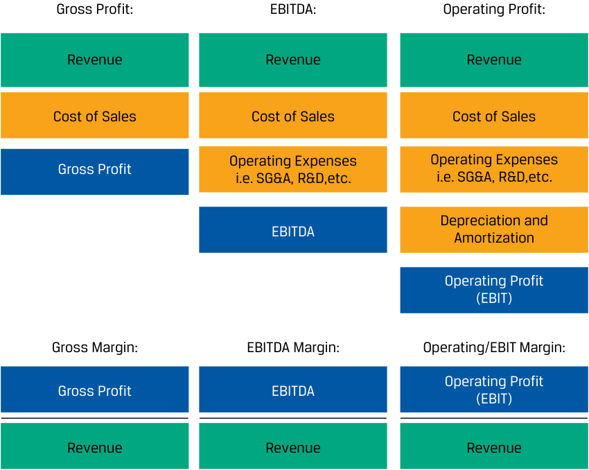
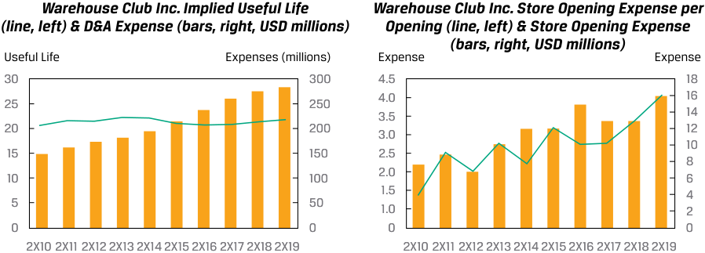
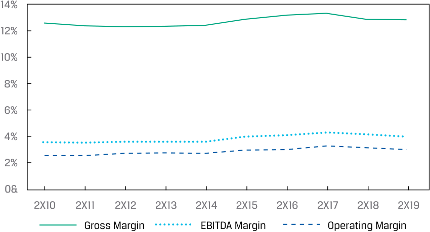

# Volume 5: Equity Investments
## Learning Module 5 Company Analysis: Past and Present
### Part 4/5: Operating Profitability and Working Capital Analysis (PDF Pages 234–245)

---

<!-- PDF Page 234 -->

4. Which of the following is an appropriate bottom-up driver of Iliso’s revenues? 

   - **A.** Iliso’s market share of US retail and food sales 

   - **B.** GMV per average active customer account 

   - **C.** Iliso’s revenue as a function of GDP growth 

   - **Solution:** 

B is correct. In a bottom-up approach, analysts decompose the revenues into logical revenue drivers such as product line or segment. A driver of Iliso’s net sales must be the average number of active customer accounts during the period and the net retail sales per account. We use GMV, since this measure accurately reflects the total amount of retail sales (both Iliso’s first-party and third-party sales). 

A and C are incorrect, because they are top-down, not bottom-up, drivers. 

# **<mark>5</mark>** 

## **OPERATING PROFITABILITY AND WORKING CAPITAL ANALYSIS** 

evaluate a company’s operating profitability and working capital using key measures 

### **Operating Costs and Their Classification** 

Generally, operating costs are incurred in generating—or are otherwise related to— _current period_ revenue: all costs related to the acquisition, production, sale, improvement, and delivery of goods and services; the management of business activities; and compliance with laws and regulations. Investing costs are related to the acquisition and production of long-term assets, including tangible assets like property and equipment and intangible assets such as software, trademarks, and patents. Financing costs include payments to debt and equity investors as a return on their investment. 

#### **MINDING THE GAAP: CLASSIFICATION OF COSTS** 

IFRS and US GAAP do not classify operating, investing, or financing costs in an intuitive manner, and there are differences in classification on the income statement and statement of cash flows. Several prominent examples include: 

|**Cost**|**Intuition**|**IFRS and US GAAP** **Classification: Income** **Statement**|**IFRS and US GAAP** **Classification: State-** **ment of Cash Flows**|
|---|---|---|---|
|Research and development|Investing|Operating|Operating|
|Depreciation and amortization*|Investing|Operating|Non-cash add-back to Operating _Capital expenditures_ in Investing|

<!-- PDF Page 235 -->

|**Cost**|**Intuition**|**IFRS and US GAAP** **Classification: Income** **Statement**|**IFRS and US GAAP** **Classification: State-** **ment of Cash Flows**|
|---|---|---|---|
|Interest expense|Financing|Other (not operating)|US GAAP: Operating IFRS: Operating or Financing|
|Income taxes|Separate|Other (not operating)|Operating|

Recall that IFRS and US GAAP require the costs of acquiring and constructing long-term tangible and intangible assets to be capitalized and then, for those with a finite useful life, systematically expensed over time on the income statement as non-cash depreciation and amortization expense. The most common allocation method is straight line, where the cost is expensed evenly over the useful life of the asset. 

Unless specified otherwise, we use the IFRS classifications of costs on the income statement in our discussion. 

For most companies, operating costs account for the majority of costs and are primarily determined by the company’s business model and size. As shown in Exhibit 4, a company’s operating costs can be categorized and analyzed in three ways: by their behavior with output, their nature, or their function. 

**Exhibit 4: Categorization of Operating Costs** 

<!-- Start of picture text -->
Behavior with Output Whether the cost varies or Nature Function not with output in the What the cost is The purpose of the cost short run • Variable costs vary • Compensation of • Cost of goods sold  with output  employees • Sales and Marketing • Fixed costs do not • Raw materials  vary with output • Genral and • Merchandise  administrative • Office supplies • Research and  development <!-- End of picture text -->

### **Behavior with Output: Fixed and Variable Costs** 

A useful classification of operating costs for analysts is fixed versus variable, which was introduced in an earlier module. The distinction is useful because the proportion of fixed to variable costs in operating costs affects the stability and predictability of operating profit. Using a fixed/variable operating cost classification, operating profit is defined in Equation 1. 

<!-- PDF Page 236 -->

Operating profit = [ _Q_ × ( _P_ − _VC_ )] − _FC_ 

- _Q_ = units of outputs sold in a period. 

- _P_ = price per unit of output. 

- _VC_ = variable operating costs expressed per unit of output. Examples include merchandise costs for a retailer like Warehouse Club Inc. and materials and direct labor costs for a manufacturer. 

- _FC_ = fixed operating costs, which do not change within a given range of output in the short run. Examples include compensation for salaried employees, depreciation and amortization, software and IT expenses, insurance, and certain utilities costs. _FC_ is stated on a total dollar, not per unit, basis. 

For a firm to be profitable, it’s clear from Equation 1 that ( _P_ − _VC_ ), or the **contribution margin** , must be positive and that _Q_ must be high enough such that _FC_ is exceeded. Recall that the amount of fixed costs in the operating cost structure of an issuer is referred to as operating leverage and that it presents both benefits and risks. If operating costs are largely fixed and the contribution margin is positive, operating profit can increase rapidly with increases in _Q_ . However, the reverse is true if _Q_ declines, since fixed costs do not change, so operating profit will fall. As shown in Equation 2, operating leverage can be measured and compared across firms by using the **degree of operating leverage** (DOL): 

_DOL_ = % Δ Operating Profit/% Δ Sales ~~(2)~~ 

A firm can increase its degree of operating leverage by increasing the fixed costs and decreasing the variable costs in its cost base. 

#### **EXAMPLE 3** 

### **Variable and Fixed Cost Analysis** 

While analyzing operating costs using the variable and fixed framework is insightful, its use by independent investment analysts is limited because disclosure of fixed and variable costs is not required by IFRS or US GAAP, nor is the disclosure of output volume. Additionally, many companies have several lines of business that have different volume, price, and cost structures, the details of which are lost in the presentation of highly aggregated financial statements that investors receive. However, in some industries, it is common for issuers to disclose these figures, or it is relatively easy for an analyst to make assumptions. A prominent example is oil and gas producers, for which we provide an example here. 

Ribbon Energy Ltd. (“Ribbon”) is a fictional oil and natural gas company focused on the exploration and development of oil and natural gas reserves. Selected operating and financial data for the last 12 months are as follows: 

||**Last 12 Months**|
|---|---|
|Sales volume (thousands of barrels of oil equivalent)|154,812|
|Average price, per barrel of oil equivalent|$49.66|
|Total revenues (millions)|$7,688|
|_Production costs, per barrel of oil equivalent:_||
|Lease operating expense|11.21|
|Production and ad valorem taxes|3.40|

<!-- PDF Page 237 -->

|**L**|**ast 12 Months**|
|---|---|
|Gathering and transportation expense|2.63|
|Production costs|$17.24|
|_Other operating expenses (millions of USD):_||
|Depreciation, depletion, and accretion (DD&A)|1,275|
|General and administrative expenses (G&A)|150|

Production costs are variable costs stated on a per barrel of oil equivalent basis, while other operating expenses (DD&A and G&A) are fixed and stated on an aggregate dollar basis. 

Ribbon’s management provides the following guidance for the next 12 months. Management does not provide guidance for prices (and therefore revenue), since it sells in a commodity market with volatile prices that are difficult to predict. Ribbon does not hedge. At the time guidance was provided, the average oil price per barrel was $62.50. 

||**Next 12 Months**|
|---|---|
|Sales volume (thousands of barrels of oil equivalent)|156,360–167,197|
|Production costs, per barrel of oil equivalent|$17.34|
|_Other operating expenses (millions of USD):_||
|Depreciation, depletion, and accretion (DD&A)|1,415|
|General and administrative expenses (G&A)|150|

1. Ribbon’s contribution margin per barrel for the last 12 months is _closest_ to: 

   - **A.** $23.2. 

   - **B.** $32.4. 

   - **C.** $45.3. 

#### **Solution:** 

B is correct. Recall that the contribution margin per barrel is _P_ − _VC_ . The average price per barrel, _P_ , in the past 12 months was $49.66, and the variable cost per barrel, _VC_ , was $17.24. Therefore, the contribution margin was $49.66 − $17.24 = $32.42. 

A is incorrect, because this amount is the company’s EBIT, or operating profit, per barrel. 

C is incorrect, because it results from using the current rather than the last 12 months’ average oil price per barrel to calculate the contribution margin. 

2. At the high end of management’s guidance, Ribbon’s operating profit for the next 12 months is _closest_ to: 

**A.** $5,496 million. 

- **B.** $5,986 million. 

**C.** $6,002 million. 

**Solution:** 

B is correct. 

Operating profit = [ _Q_ × ( _P_ − _VC_ )] − _FC_ 

<!-- PDF Page 238 -->

Operating profit = [167.197 million × ($62.50 − $17.34)] − ($1,415 + $150) Operating profit = $5,986 million 

A is incorrect, because this amount is the operating profit using the low end of guided sales volume of 156.360 million barrels. 

C is incorrect, because it relies on last year’s production costs of $17.24 per barrel. 

3. Some analysts covering Ribbon believe that volume will be lower than what management expects. Assuming a 5% reduction over last year’s volume, Ribbon’s operating profit for the next 12 months is _closest_ to: 

**A.** $5,077 million. **B.** $5,091 million. **C.** $5,776 million. **Solution:** 

A is correct. The last 12 months’ volume was 154.812 million. A 5% reduction is 154.812 × 0.95 = 147,071 million barrels. 

Operating profit = [ _Q_ × ( _P_ − _VC_ )] − _FC_ Operating profit = [147,071 million × ($62.50 − $17.34)] – ($1,415 + $150) Operating profit = $5,076.7 million 

B is incorrect, because it uses last year’s production costs. C is incorrect, because it assumes a 5% increase rather than decrease in volume from the prior year. 

4. Ribbon’s degree of operating leverage for the next 12 months at the low end of management’s guidance is _____________ at the high end of management’s guidance. 

**A.** lower than 

**B.** the same as 

**C.** higher than **Solution:** 

C is correct. Last 12 months’ sales: $7,688 Last 12 months’ operating profit: $3,594 **Low end of guidance** Next 12 months’ sales: 156.360 × $62.50 = $9,773 Next 12 months’ operating profit: $9,773 – (156.360 × 17.34) – 1,565 = 5,496 Degree of operating leverage: (5,496/3,594 – 1)/(9,773/7,688 – 1) = 1.95 **High end of guidance** Next 12 months’ sales: 167.197 × $62.50 = $10,450 Next 12 months’ operating profit: $10,450 – (167.197 × 17.34) – 1,565 = 5,986 Degree of operating leverage: (5,986/3,594 – 1)/(10,450/7,688 – 1) = 1.85 

<!-- PDF Page 239 -->

### **Natural and Functional Operating Cost Classifications and Measures of Operating Profitability** 

Rather than fixed and variable, IFRS and US GAAP require issuers to disclose operating costs using either a natural or a functional cost classification based on “historical and industry factors and the nature of the entity.” Most issuers, including Warehouse Club Inc., choose a functional classification. This approach leads to all issuers’ income statements appearing similar in structure, with lines related to functional areas such as “cost of sales,” “selling, general, and administrative expenses,” and “research and development,” even though their business models (and fixed versus variable cost composition) can differ significantly. The functional classification of operating costs is used to calculate and distinguish key profitability measures used in analysis and forecasting, as shown in Exhibit 5. 

**Exhibit 5: Measures of Operating Profitability** 

<!-- Start of picture text -->
Gross Profit: EBITDA: Operating Profit: Revenue Revenue Revenue Cost of Sales Cost of Sales Cost of Sales Operating Expenses Operating Expenses Gross Profit i.e. SG&A, R&D,etc. i.e. SG&A, R&D,etc. Depreciation and EBITDA Amortization Operating Profit (EBIT) Gross Margin: EBITDA Margin: Operating/EBIT Margin: Operating Profit Gross Profit EBITDA (EBIT) Revenue Revenue Revenue <!-- End of picture text -->

Gross profit, EBITDA, and EBIT are measures of operating profitability that capture different functional costs in their definitions. Generally, a significant amount of cost of sales is variable, so gross margin is an approximate measure of contribution margin. Other operating expenses such as sales and marketing, general and administrative, and research and development costs tend to be largely fixed, though they may have a variable component such as sales commissions. Depreciation and amortization expenses are fixed unless the issuer uses units of output as the depreciation method. An issuer’s notes to its financial statements contain useful information about the composition and nature of operating costs. 

For most companies, the major driver of operating costs over the long run is output, even for fixed costs, because output growth often requires growth in assets, human capital, and purchased goods and services. Warehouse Club Inc., for example, might be able to grow membership fee revenues to an extent without incurring costs, but growing net sales requires more stores and employees. This has been true even for so-called asset-light companies in the internet and software industries, which have 

<!-- PDF Page 240 -->

shown large increases in operating costs along with large increases in revenue over time. Since output or revenue is a major cost driver, analysts often express operating costs as a percentage of revenue. Additional considerations include industry profitability, **economies of scale** , and **economies of scope** . 

Industry profitability will be discussed in detail in the next module, but recall from the earlier discussion on pricing power that prices relative to costs (i.e., profitability) are largely dictated by market structure and a company’s competitive positioning. Since industry participants are competing in the same product and factor markets, competitive forces within them determine industry profitability in the long run; analysts should not analyze profitability only on a company-by-company basis. 

Economies of scale refer to a decline in costs per unit as output grows and generally result from having fixed costs in the cost structure that are spread over more units of output. A company with entirely variable costs can also exhibit some economies of scale over time if it increases its bargaining power over suppliers as it grows, driving down variable costs per unit. Economies of scale are usually evident from the business model and can be found empirically by comparing a company’s size in revenues with its operating costs as percentages of sales or margins. 

Economies of scope refer to a decline in costs per unit as the number of product or business lines increases and generally result from shared costs between the product lines. Economies of scope are usually evident from the business model and can be found empirically by comparing the profitability of an integrated company with that of a standalone company. Examples of economies of scope can be found in financial services, where there are customer, client service, compliance, technology, and back-office similarities (and thus cost efficiencies) across commercial banking, consumer banking, brokerage, asset management, payment processing, and investment banking. Economies of scope have resulted in large global firms competing in many lines of business. 

Recall that Warehouse Club Inc.’s management claimed that it has economies of scale, saying that “low prices for quality products drive greater membership and net sales over time, leveraging our selling, general, and administrative expenses, reducing them as a percentage of net sales.” While this makes intuitive sense as there is probably a fixed amount of SG&A costs each year to operate a store, Elaine Nguyen must corroborate it empirically. 

#### **CASE STUDY** 

### **Warehouse Club Inc. Operating Profitability Analysis** 

Warehouse Club Inc.’s operating costs are composed of merchandise costs (costs of sales), SG&A expenses, depreciation and amortization, and costs associated with opening new stores. 

Based on her business model work, Elaine Nguyen believes the following about drivers for each of these operating costs. 

|**Operating Cost**|**Driver(s)**|
|---|---|
|Merchandise costs (costs of sales)|Sales|
|SG&A expenses|Sales Number of employees and per-employee compensation|
|Depreciation and amortization|Long-term assets Useful lives|
|Store openingexpenses|Store openings|

<!-- PDF Page 241 -->

Based on these drivers, Nguyen calculates Warehouse’s gross margin (1 – cost of sales as % of net sales), SG&A expenses as a percentage of net sales, gross fixed assets to depreciation and amortization (implied useful life), store opening expenses per new-store opening, and, finally, profit margins. Profit margins include membership fee revenues. 

<!-- Start of picture text -->
Warehouse Club Inc. Gross Margin (line, left) Warehouse Club Inc. SG&A % of Net Sales and Cost of Sales (bars, right, USD millions) (line, left) & SG&A Expenses (bars, right, USD millions) Gross Margins Sales Net Sales Expenses 16% 30,000 16% 3,000 14% 25,000 14% 2,500 12% 12% 10% 20,000 10% 2,000 8% 15,000 8% 1,500 6% 10,000 6% 1,000 4% 4% 2% 500 2% 500 0% 0 0% 0 2X10 2X11 2X12 2X13 2X14 2X15 2X16 2X17 2X18 2X19 2X10 2X11 2X12 2X13 2X14 2X15 2X16 2X17 2X18 2X19 <!-- End of picture text -->

<!-- Start of picture text -->
Warehouse Club Inc. Implied Useful Life Warehouse Club Inc. Store Opening Expense per (line, left) & D&A Expense (bars, right, USD millions) Opening (line, left) & Store Opening Expense (bars, right, USD millions) Useful Life Expenses (millions) Expense Expense 30 300 4.5 18 25 250 4.0 16 3.5 14 20 200 3.0 12 10 15 150 2.5 8 10 100 2.0 6 1.5 4 5 50 1.0 2 0 0 0 0 2X10 2X11 2X12 2X13 2X14 2X15 2X16 2X17 2X18 2X19 2X10 2X11 2X12 2X13 2X14 2X15 2X16 2X17 2X18 2X19 <!-- End of picture text -->

**_Warehouse Club Inc. Operating Profitability_** 

<!-- Start of picture text -->
14% 12% 10% 8% 6% 4% 2% 0& 2X10 2X11 2X12 2X13 2X14 2X15 2X16 2X17 2X18 2X19 Gross Margin EBITDA Margin Operating Margin <!-- End of picture text -->

Nguyen makes the following observations: 

- Operating costs have increased significantly on an absolute basis from 2X10 to 2X19, but on a relative-to-sales basis have remained stable over the same period, indicating that the driver of the increase has been net sales growth. 

- One exception is store opening expenses per store opening, which have quadrupled from 2X10 to 2X19, though in aggregate remain a small cost (less than 1/100 of SG&A expenses). Note that these are operating costs related to store openings, such as employee training before opening, not the investing cost of land and fixed assets. 

- SG&A expenses do not appear to be fixed relative to net sales, as they have remained roughly the same percentage of net sales over time. 

<!-- PDF Page 242 -->

- Margins have remained mostly stable, though they did increase from 2X15 to 2X17 before coming back down in 2X18 and 2X19. Margins are low for Warehouse, with EBITDA and operating margins of 4% and 3%, respectively, in 2X19. 

- The amount of operating profit is similar to the amount of membership fee revenues each year. Nguyen creates the following chart: 

#### **_Warehouse Club Inc. Membership Fee Revenue as % of Operating Profit_** 

<!-- Start of picture text -->
100% 90% 80% 70% 60% 50% 40% 30% 2X10 2X11 2X12 2X13 2X14 2X15 2X16 2X17 2X18 2X19 <!-- End of picture text -->

This chart implies that net sales from its stores—after deducting costs of sales, SG&A expenses, D&A, and store opening expenses—account for the remaining 30% of operating profit. This percentage is likely an understatement, since some amount of SG&A expenses is associated with membership fee revenues (marketing, customer service, payment processing, management), but it does align with Warehouse management’s assertion in its annual report that prices provide members with a significant return on membership: the company earns a thin margin on net sales, and it is membership fees that allow the company to run profitably. 

### **Working Capital** 

Recall from earlier modules on working capital that the primary measures of a company’s working capital management are activity ratios that determine its cash conversion cycle and the ratio of net working capital to sales. A short cash conversion cycle means that the company requires less external financing to fund operations, while net working capital requirements determine a minimum level of investment, in addition to capital investments, that cannot be distributed to investors. Negative net working capital means that suppliers are a source of financing. 

### **CASE STUDY Warehouse Club Inc. Working Capital Management** 

Elaine Nguyen calculates the working capital measures for Warehouse. 

<!-- PDF Page 243 -->

<!-- Start of picture text -->
Warehouse Club Inc. Activity Ratios and Cash Conversion Cycle (Days) 35 30 25 20 15 10 5 0 2X10 2X11 2X12 2X13 2X14 2X15 2X16 2X17 2X18 2X19 DSO DOH DPO Cash Conversion Cycle Warehouse Club Inc. Net Working Capital to Net Sales (line, left) and Net Working Capital (bars, right, USD millions) Net Sales Net Working Capital (millions) 0% 0 –200 –1% –400 –2% –600 –3% –800 –1,000 –4% –1,200 –5% –1,400 –6% –1,600 2X10 2X11 2X12 2X13 2X14 2X15 2X16 2X17 2X18 2X19 Nguyen makes the following observations: <!-- End of picture text -->

- The cash conversion cycle is short, less than a week, primarily as a result of a DSO of 4, because Warehouse’s customers pay in cash or with credit or debit cards that settle in less than five business days, and days of inventory on hand is nearly equal to days payable outstanding, indicating that inventory is financed by suppliers. 

- Net working capital is negative, now down to −5.0% of net sales, indicating that it is a source of financing for the company. 

- Generally, all the activity ratios have been stable since 2X10, except for a one-year increase in 2X16 from a decline in days payable outstanding. Nguyen looked into this increase in the notes to the financial statements in a historical annual report. The company indicated that it changed accounting information systems in early 2X17 and made accelerated payments to suppliers at the end of 2X16, in advance of the system change in case there were problems. 

<!-- PDF Page 244 -->

#### **QUESTION SET** 

Questions 1–4 relate to the working capital data below for Iliso Marketplace, as well as to Iliso’s financial statements in the lesson “Determining the Business Model”. 

|**Working Capital**|**2X15**|**2X16**|**2X17**|**2X18**|**2X19**|
|---|---|---|---|---|---|
|Accounts receivable, net|29|50|50|52|58|
|_DSO_|_4_|_5_|_4_|_3_|_3_|
|Inventories, net|190|250|325|384|439|
|_DOH_|_37_|_36_|_32_|_32_|_30_|
|Prepayments and other|23|32|35|56|59|
|_% of total revenue_|_1%_|_1%_|_1%_|_1%_|_1%_|
|Accounts payable|138|190|272|321|410|
|_DPO_|_27_|_28_|_27_|_26_|_28_|
|Taxes payable|2|8|10|12|29|
|_% of total revenue_|_0%_|_0%_|_0%_|_0%_|_0%_|
|Accrued expenses and other current|111|193|232|295|354|
|_% of total revenue_|_4%_|_6%_|_4%_|_5%_|_5%_|
|Net working capital|(8)|(59)|(104)|(136)|(237)|
|_NWC to sales_|_0%_|_−2%_|_−2%_|_−2%_|_−3%_|
|Cash conversion cycle|14|14|9|8|5|

1. Compared with 2X18, Iliso’s operating margin change in 2X19 is _closest_ to: 

   - **A.** 0.07%. 

   - **B.** 0.57%. 

   - **C.** 80.56%. 

   - **Solution:** 

B is correct. Operating (EBIT) margin is Operating profit/Revenue: 

2X18: 72/6,186 = 1.163% 

2X19: 130/7,526 = 1.727% 

Subtracting 2X18 EBIT margin from 2X19 EBIT margin gives: 

1.727% − 1.163% = 0.564% 

A is incorrect, because it is the change in gross profit margin. 

C is incorrect, because it is the year-over-year change in operating profit. 

2. What is the _most likely_ explanation for Iliso’s improvement in inventory days on hand from 2X15 to 2X19? 

   - **A.** More customers paying in cash 

**B.** Strong <u>growth in net retail sales</u> 

<!-- PDF Page 245 -->

|**C.**Rising proportion of GMV from third-party merchant sales **Solution:** C is correct. With third-party merchant sales, Iliso acts as an agent for the third-party merchant and does not take control of inventory. Accordingly, as the proportion of third-party merchant sales rises in GMV and Iliso’s reve- nues, the portion of revenues associated with inventories falls.|
|---|
|A is incorrect, because there is no indication that Iliso accepts cash on delivery (as is common in China and other geographies). It appears that, like other e-commerce platforms, Iliso accepts only online payments.|
|B is incorrect, because growth in retail sales is likely to grow accounts re- ceivable as well; days sales outstanding should be unaffected.|
|3. Which of the following expenses are_most likely_to vary with output?|
|**A.**depreciation|
|**B.**costs of sales **C.**interest expense **Solution:**|
|B is correct. Costs of sales are inventory costs that are recognized when a sale is made. A is incorrect, because depreciation varies with fixed assets. This expense is a fixed cost in the short run. Recall that fixed operating costs do not change within a given range of output in the short run.|
|C is incorrect, because interest expense is a fixed cost component that arises from the company’s capital structure, not its revenues.|
|4. Iliso doesn’t disclose gross profit on third-party merchant sales. However, an analyst observes that a competing marketplace platform makes 85% gross profit margin on third-party merchant sales. Assuming that Iliso’s gross profit margin is similar, what proportion of Iliso’s gross profit_most likely_ came from third-party merchant sales in 2X19?|
|**A.**7.6%|
|**B.**15.0%|
|**C.**28.1% **Solution:** A is correct.|
|Gross profit of third-party merchant sales = 85% × 190 = $162|
|Gross profit of Iliso = Total revenues − Costs of revenues = $7,526 − $5,414 = $2,112|
|Proportion of gross profit arising from merchant sales = $162/$2,112 = 7.6%|
|B is incorrect; it is the cost of revenues on third-party merchant sales. C is incorrect; it is Iliso’s gross profit margin in 2X19.|

