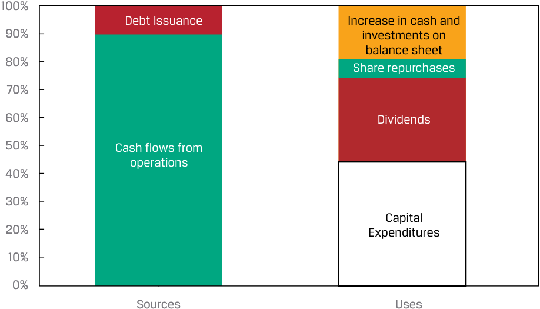
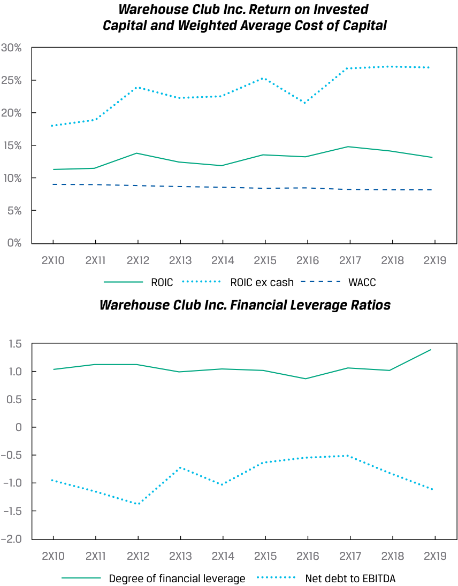

# Volume 5: Equity Investments
## Learning Module 5 Company Analysis: Past and Present
### Part 5/5: Capital Investments and Capital Structure (PDF Pages 246–254)

---

<!-- PDF Page 246 -->

# **<mark>6</mark>** 

#### **CAPITAL INVESTMENTS AND CAPITAL STRUCTURE** 

evaluate a company’s capital investments and capital structure 

##### **Sources and Uses of Capital** 

Firms invest capital from debt and equity investors to earn returns above their investors’ required rates of return. An important consideration in company analysis is to evaluate whether required rates of return have been met or exceeded (i.e., whether economic value is created for investors) over the longer run and to assess risks and opportunities associated with the capital structure, such as the use of financial leverage. Before evaluation, a first step is to determine a company’s sources and uses of capital on a historical basis, as shown generically in Exhibit 6. 

**Exhibit 6: Sources and Uses of Capital** 

|**Sources of Capital**|**Uses of Capital**|
|---|---|
|Cash flows from operations, including net working capital (if negative)|Cash and investments on hand|
|Debt issuance|Net working capital (if positive)|
|Equity issuance|Capital expenditures and additions to intangibles|
|Asset disposals|Acquisitions|
||Debt paydown Dividends and share repurchases|

###### **CASE STUDY** 

##### **Warehouse Club Inc.’s Sources and Uses of Capital** 

Elaine Nguyen calculates the following information on Warehouse over 2X10–2X19. Cash flows from operations include the effect of additional net working capital financing (i.e., Warehouse’s net working capital became more negative over time). 

<!-- PDF Page 247 -->

###### **_Warehouse Club Inc. Sources and Uses of Capital, 2X10–2X19_** 

<!-- Start of picture text -->
100% Debt Issuance Increase in cash and 90% investments on balance sheet 80% Share repurchases 70% 60% Dividends 50% Cash flows from operations 40% 30% Capital 20% Expenditures 10% 0% Sources Uses <!-- End of picture text -->

Nguyen makes the following observations: 

- Capital expenditures and returns to shareholders (dividends and share repurchases) are almost equal, which is surprising considering that new-store openings performed well; Nguyen expected the company to devote a greater amount to capital expenditures for new stores. 

- The company has made no acquisitions. 

- Even after returns to shareholders, the company seems to prefer equity financing to debt financing. This preference is logical considering the company’s thin operating margin, though the fact that it primarily sells a wide range of necessities reduces its sales risks (i.e., from changes in the business cycle and in technology or fashion) and membership fees are a source of predictable income. 

- The fact that debt issuance is smaller than the increase in cash and investments on the balance sheet indicates that the company’s net debt has decreased over time, implying a decline in financial leverage. 

##### **Evaluating Capital Investments and Capital Structure** 

Returns on invested capital over the longer run, compared with investors’ required rates of return, can be used to evaluate whether management has used investors’ capital wisely. Recall that independent investment analysts do not have access to the same information that management uses to assess individual projects with IRRs and NPVs, so analysts have to use more aggregated measures to discern whether there have been worsening or improving trends in value creation. 

Risks related to the capital structure can be measured using leverage and coverage ratios, credit ratings by third-party rating agencies, and the sensitivity of net income to changes in operating income known as the **degree of financial leverage** , as shown in Equation 3. The degree of financial leverage is increased by higher interest expenses that are fixed with respect to operating income. The degree of financial leverage is analogous to the degree of operating leverage but is determined by financing costs rather than fixed operating costs. 

<!-- PDF Page 248 -->

###### **CASE STUDY** 

##### **Evaluating Warehouse Club Inc.’s Capital Investments and Capital Structure** 

Elaine Nguyen calculates the following information on Warehouse over 2X10–2X19. Additionally, the company’s interest coverage ratio (EBIT to interest expense) has been over 20 times and recently reached 30 times in 2X19, and the company’s credit is rated investment grade by major credit rating agencies. 

<!-- Start of picture text -->
Warehouse Club Inc. Return on Invested Capital and Weighted Average Cost of Capital 30% 25% 20% 15% 10% 5% 0% 2X10 2X11 2X12 2X13 2X14 2X15 2X16 2X17 2X18 2X19 ROIC ROIC ex cash WACC Warehouse Club Inc. Financial Leverage Ratios 1.5 1.0 0.5 0 –0.5 –1.0 –1.5 –2.0 2X10 2X11 2X12 2X13 2X14 2X15 2X16 2X17 2X18 2X19 Degree of financial leverage Net debt to EBITDA <!-- End of picture text -->

Nguyen makes the following observations: 

- The company has created value for investors, with a spread of ROIC over WACC of 200–700 basis points since 2X10. WACC has declined slightly over time as interest rates have fallen; this calculation assumes a constant required rate of return on equity of 9%. 

- The company’s returns on capital are far higher than its low operating and net margins would suggest, owing to its high asset turnover and negative net working capital as a low-cost means of financing from suppliers, requiring less capital from investors. 

<!-- PDF Page 249 -->

- The company has a conservative capital structure, with negative net debt and a degree of financial leverage close to 1.0 because interest expense is largely covered by interest income on cash holdings (i.e., net and operating income move together). 

- The capital structure conservatism is evidenced in the counterfactual ROIC, which excludes cash and investments on the balance sheet. While an exaggeration (the company would need _some_ cash on hand), ROIC could be almost 15 percentage points higher if the company reduced net cash by investing in value-creating projects or by returning capital. 

Unlevered returns, as measured by ROIC or return on assets, are augmented by financial leverage to produce levered returns, or return on equity, which was introduced in an earlier module. We can use return on equity and its decomposition as a comprehensive measure of profitability for an issuer. The ROE decomposition for Warehouse Club Inc. illustrates the drivers of the company’s levered returns, which are well in excess of its net margin. 

<!-- Start of picture text -->
ROE in 2X19 18% Asset Equity Net Margin × Turnover × Multiplier 2% 3 3 Operating Margin 3% × Interest Burden 1 × Tax Burden 0.8 <!-- End of picture text -->

###### **QUESTION SET** 

Questions 1–4 relate to Iliso’s financial statements in the lesson “Determining the Business Model”. 

1. In 2X19, the market value of Iliso’s equity was $1,178 million, and the book value of debt, which was approximately equal to the market value, was $144 million. Assuming a cost of debt of 5.5%, cost of equity of 12%, tax rate of 24%, and price-to-book ratio of 1.0, Iliso’s WACC is _closest_ to: 

**A.** 11.15%. 

**B.** 11.30%. **C.** 12.00%. **Solution:** 

A is correct. Recall that: 

<!-- PDF Page 250 -->

WACC = [weighting of debt × gross cost of debt × (1 − tax rate)] + (weighting of equity × cost of equity). 

Total capital is $1,178 + $144 = $1,322 million. Weighting of debt is therefore $144/$1,322 = 10.89%, and Weighting of equity is 1 − Weight of debt = 89.11%. 

Therefore, WACC = [10.89% × 5.5% × (1 − 24%)] + (89.11% × 12%) = 11.15%. B is incorrect, because it incorrectly calculates WACC using a pre-tax rather than after-tax cost of debt. 

C is incorrect; it is the cost of equity. 

2. Why might Iliso’s WACC be significantly higher than Warehouse Club’s WACC, as calculated earlier in the module? 

   - **A.** Warehouse Club’s business model is less risky than e-commerce. 

   - **B.** Warehouse Club’s capital structure, with degree of financial leverage close to 1.0, is less conservative than Iliso’s. 

   - **C.** Iliso is an established retailer with an investment-grade rating. 

   - **Solution:** 

A is correct. The cost of equity is the compensation that equity investors demand for the business and financial risks of investing in an issuer’s equity securities. Iliso’s cost of equity is 12%, whereas Warehouse Club’s is 9%, reflecting Warehouse Club’s longer operating history, more proven business model, and competitive positioning. 

B is incorrect, because Warehouse Club’s capital structure, with degree of financial leverage of 1.0, would imply almost 100% weighting of equity, whereas Iliso has an 11% debt weighting and therefore Warehouse’s capital structure is _more_ conservative. 

C is incorrect, because an investment-grade rating would reduce Iliso’s cost of debt and WACC. 

3. Iliso’s degree of financial leverage in 2X19 is _closest_ to: 

   - **A.** 0.77. 

   - **B.** 1.13. 

**C.** 1.84. 

###### **Solution:** 

B is correct, calculated as Change in net income/Change in operating income = (100/52 − 1) divided by (130/72 − 1) = 1.146. 

A is incorrect, because it is incorrectly calculated as 2X19 Net income/Operating income = 100/130 = 0.77. 

C is incorrect, because it is Iliso’s equity multiplier: Total assets/Equity = 2,168/(592 + 586) = 1.84. 

4. Explain why Iliso’s ROE differs from Warehouse Club’s ROE. **Solution:** 

Iliso’s ROE is lower than Warehouse Club’s ROE. 

ROE = Net margin × Asset turnover × Equity multiplier 

<!-- PDF Page 251 -->

ROE = 1.3% × 3.5 × 1.84 = 8.37%, which is less than half of Warehouse Club’s 18% ROE. This primarily results from Iliso’s lower net margin (1% versus 2%) and an equity multiplier that is 40% lower (1.84 versus 3), which is somewhat offset by Iliso’s higher asset turnover (3.5 versus 3). 

<!-- PDF Page 252 -->

## **~~PRACTICE PROBLEMS~~** 

### **The following information relates to questions 1-6** 

Joshua Hu, a research analyst, is initiating coverage on several companies in the ocean freight shipping industry. OldShips is a mature company with high fixed costs and a high capital expenditure to sales ratio because it owns and operates its own fleet of ships. CleanYards is a technologically advanced, sustainable shipyard with a focus on specialized repairs and ship construction. Hu has compiled the following data for the two companies: 

||**OldShips**|**CleanYards**|
|---|---|---|
|Degree of Financial Leverage (DFL)|2.0|2.0|
|Degree of Operating Leverage (DOL)|1.0|2.0|
|Asset turnover ratio|0.84×|0.42×|
|DSO|27|98|
|DOH|12|46|
|DPO|55|40|

NewShips, a third company, is a web-based shipping technology platform that connects ship operators such as OldShips with customers in a wide variety of industries who need ocean freight shipping. NewShips’ customers place orders online and pay for freight to be placed on a container to any destination in the world. NewShips’ partners, like OldShips, provide vessels on both long- and short-term charters. 

In 2X19, NewShips’ platform brokered orders for 900,000 twenty-foot equivalent unit (TEU) containers in aggregate, with an average gross freight rate of USD3,848 per TEU. On average, NewShips’ commission, which it receives as a broker from the customer, was 5% of the freight rate. 

**1.** Which of the following is _most likely_ to be an element of Hu’s subsequent reports? 

   - **A.** Industry size, growth rate, and key drivers 

   - **B.** Summary of changes to the recommendation 

   - **C.** Ownership structure and management composition 

**2.** Shipping is a highly cyclical industry. Which of the following companies _most likely_ has the most ability to ramp up capacity to meet increased demand for shipping services? 

   - **A.** OldShips 

   - **B.** NewShips 

   - **C.** CleanYards 

<!-- PDF Page 253 -->

**3.** In 2X19, NewShips’ revenue was _closest_ to: 

   - **A.** $173 million. 

   - **B.** $1.46 billion. 

   - **C.** $3.63 billion. 

**4.** When conducting company analysis, which of the following is _least_ relevant to determining a company’s business model? 

   - **A.** Company annual report describing the firm’s product lines 

   - **B.** Comments by management about competing products and substitutes 

   - **C.** Industry white papers regarding the company’s product pricing strategy 

**5.** OldShips’ cash conversion cycle (CCC) is: 

   - **A.** lower than CleanYards’. 

   - **B.** similar to CleanYards’. 

   - **C.** higher than CleanYards’. 

**6.** The first step in reviewing a company’s capital investments is to: 

   - **A.** evaluate management’s investments. 

   - **B.** identify operating cash flow drivers. 

   - **C.** determine the major sources and uses of cash. 

<!-- PDF Page 254 -->

## **~~SOLUTIONS~~** 

1. B is correct. A subsequent company research report focuses on updating investors on new information or changes in an analyst’s price target and recommendation. 

A and C are incorrect, because in-depth information regarding industry size, growth rate, and key drivers or ownership structure and management composition is more suited to an initiation report. 

2. B is correct. Only NewShips has a capital-light business model. Both OldShips and CleanYards require substantial capital investment in order to increase supply capacity. New ship construction (for OldShips) and acquiring new yards (for CleanYards) take time and cannot be met immediately. 

3. A is correct. NewShips acts as a broker and earns 5% of the freight rate in commissions. In 2X19, NewShips brokered 900,000 TEUs at an average freight rate of 3,848 per TEU, earning a 5% commission: 900,000 × 3,848 × 0.05 = $173 million. 

4. B is correct. Competing products and substitutes are analyzed in Porter’s Five Forces. This analysis is usually performed to better understand a company’s industry and its competitive positioning. Management comments are unlikely to guide the analyst to better understand the company’s business model. A and C are incorrect, because both are relevant sources for an analyst in determining the company’s business model. 

5. A is correct. 

CCC = DOH + DSO – DPO, so: 

OldShips’ CCC = 12 + 27 − 55 = −16 days 

CleanYards’ CCC = 46 + 98 − 40 = 104 days 

OldShips, in fact, has a negative cash conversion cycle. OldShips takes advantage of the favorable credit terms granted by its suppliers. 

B and C are incorrect, because OldShips’ CCC is lower than CleanYards’. 

6. C is correct. Before a review of a company’s capital investments, the first step is to determine the company’s sources and uses of capital on a historical basis. A and B are incorrect, because both take place after the analyst has identified the company’s sources and uses of cash and determined what to focus on. 

