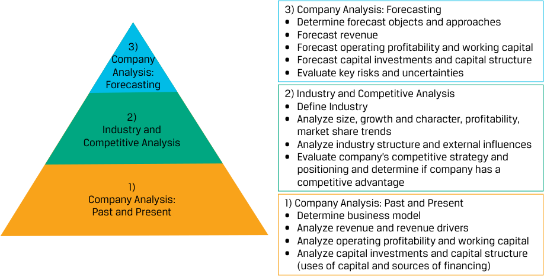

# Volume 5: Equity Investments
## Learning Module 6 Industry and Competitive Analysis
### Part 1/4: Introduction (PDF Pages 255–267)

---

<!-- PDF Page 255 -->

# L E A R N I N G M O D U L E **<mark>6</mark>** 

### **Industry and Competitive Analysis** 

##### **<mark>LEARNING OUTCOMES</mark>** 

|**_Mastery_**|**_The candidate should be able to:_**|
|---|---|
||describe the purposes of, and steps involved in, industry and competitive analysis|
||describe industry classification methods and compare methods by which companies can be grouped|
||determine an industry’s size, growth characteristics, profitability, and market share trends|
||analyze an industry’s structure and external influences using Porter’s Five Forces and PESTLE frameworks|
||evaluate the competitive strategy and position of a company|

<!-- Start of picture text -->
1 <!-- End of picture text -->

#### **INTRODUCTION** 

It is essential for analysts to understand the industry context for a company’s financial performance and its evaluation. For example, is a company’s revenue growth driven by a macroeconomic or industry-wide factor (such as an economic expansion) or a company-specific factor (such as increasing market share)? The answer has important implications for forecasting and valuation. 

In this learning module, we discuss how an industry is defined and address the challenges associated with grouping companies that operate in multiple industries. Next, we introduce methods to survey an industry in terms of size, profitability, and market share trends. Further analysis includes frameworks to interpret a competitive environment using Porter’s Five Forces and external trends using PESTLE analysis. Finally, we combine these approaches to understand a company’s competitive strategy and its position relative to its industry peers. 

###### **LEARNING MODULE OVERVIEW** 

- Analysts use industry and competitive analysis to understand an industry’s structural factors, relative competitive strengths and weaknesses, and their contribution to a company’s economic <u>profits.</u> 

<!-- PDF Page 256 -->

- An analyst’s first step in an industry and competitive analysis is to define the boundaries of the industry in question and its constituents. Industries are commonly defined as companies that sell similar products or services. However, this definition can be challenging to apply in practice, as companies can sell diverse products or services across many industries and product similarity is subjective. 

- To define an industry, analysts can use third-party classification systems such as GICS but need to be aware of the methodologies and limitations of these systems. 

- After defining the industry, the analyst surveys the industry by estimating its total annual sales, historical growth rate, and profitability metrics and then determining market shares and trends of key players. 

- Industry metrics can be compared against broader economic trends during recessions or expansions to determine the industry’s level of maturity, sensitivity to business cycles, and competitive rivalry. 

- Analysts use Porter’s Five Forces to understand an industry’s structure, as defined by the level of competitive rivalry, through an assessment of the threat of new entrants, the threat of substitutes, customer bargaining power, and the bargaining power of suppliers. 

- To supplement this research, analysts use PESTLE analysis to understand the external influences on and potential changes to an industry’s growth rate and market share dynamics. 

- To evaluate a company’s competitive strategy, an analyst should determine whether the strategy creates a defense against industry forces and is aligned with the external forces acting on the industry, and whether the company has the resources and capabilities necessary to execute it. 

###### **LEARNING MODULE SELF-ASSESSMENT** 

These initial questions are intended to help you gauge your current level of understanding of this learning module. 

1. When assigning a company to an industry, which of the following is a limitation of using third-party industry classification schemes? 

   - **A.** Currency differences 

   - **B.** Single-product companies 

   - **C.** Strictly hierarchical taxonomies 

   - **Solution:** 

C is correct. Commercial classification schemes such as GICS, IBC, and TRBC are examples of strictly hierarchical taxonomies that classify a company to a single group, regardless of whether the company sells multiple types of products or services. 

2. A factor that determines sensitivity to the business cycle is _most likely_ : 

   - **A.** customer migration to substitute products. 

   - **B.** interest rate exposure of the business model. 

<!-- PDF Page 257 -->

- **C.** growth rates in line with broader economic activity. 

- **Solution:** 

B is correct. Factors that determine sensitivity to the business cycle include the degree to which sales are discretionary or necessary for consumers, pricing power, the interest rate exposure of the business model, and whether the product is a durable or capital good versus a recurring purchase such as consumables and subscription services. 

A and C are incorrect, as they reflect features of a mature industry but are not necessarily more cyclical. 

3. A common measure of industry concentration is: 

   - **A.** Porter’s Five Forces. 

   - **B.** the PESTLE framework. 

   - **C.** the Herfindahl-Hirschman Index. 

   - **Solution:** 

C is correct. The Herfindahl-Hirschman Index (HHI) is a common measure of industry concentration that is calculated as the sum of the squares of competitor market shares. Porter’s Five Forces model evaluates an industry’s level of competitive rivalry and profitability. The PESTLE framework is more concerned with an industry’s growth rate and market share dynamics. 

4. Identify the following statement as true or false. Justify your answer. 

Some of the forces included in Porter’s Five Forces framework are the threat of new entrants, sensitivity to the business cycle, and the bargaining power of customers. 

###### **Solution:** 

False. Porter’s Five Forces model uses the threat of substitutes, the threat of new entrants, the bargaining power of customers, and the bargaining power of suppliers to determine the rivalry among existing competitors. Sensitivity to the business cycle is _not_ one of the forces. 

5. The price competition historically demonstrated by automakers and aircraft manufacturers is _best_ described as an example of: 

   - **A.** the threat of substitutes. 

   - **B.** the bargaining power of suppliers. 

**C.** the rivalry among existing competitors. 

- **Solution:** 

C is correct. Despite relatively low risks from the other Five Forces, automakers and aircraft manufacturers compete fiercely on price, offering promotions and generous financing and warranty terms in an attempt to capture every sale. 

6. Standardization of a product will ____________ (increase/decrease/have no effect on) the bargaining power of customers. 

###### **Solution:** 

Standardization of a product will _<u>increase</u>_ the bargaining power of customers. For example, oil refiners pay for crude oil based on its grade, not on its specific oil producer; crude oil within a grade is interchangeable. 

<!-- PDF Page 258 -->

7. Impression Ltd. is a fictional company that designs, manufactures, and sells skin care and beauty products. A PESTLE analysis for Impression Ltd. would _most likely_ identify which of the following? 

   - **A.** A customer of Impression Ltd., a large e-commerce retailer, is acquiring a private-label manufacturer of skin care products. 

   - **B.** Increased discussion by legislatures around instituting an excise tax on disposable plastic packaging as part of a package of carbon taxes 

   - **C.** An online, direct sales competitor has launched a suite of photo filters that integrate with leading social media apps based on its beauty products. 

###### **Solution:** 

B is correct. PESTLE analysis is concerned with identifying and evaluating _external_ forces on an industry, which include political forces such as a packaging tax. A and C are incorrect, as they are competitor moves within the beauty industry. 

8. As a venture capital investor, you are on the board of Ridge Inc., a fictional company that is entering the auto industry, which is characterized by high capital intensity, minimal switching costs for customers because regulations require standardization of many features, and price consciousness of customers except among a relatively small percentage of affluent consumers. 

Based on these observations, recommend and justify a competitive strategy to the rest of Ridge Inc.’s board. 

###### **Solution:** 

A cost leadership strategy is one competitive strategy that might be successful for Ridge Inc. Since most customers are price conscious and face minimal switching costs between automakers or models, a low selling price can be an effective way to gain market share. Combined with high capital intensity, such a strategy might enable Ridge to operate at an economic profit if it produces and sells enough volume and maintains fixed-cost discipline to keep unit costs low. Other competitive strategies that might be successful for Ridge include a differentiation strategy aimed at luxury or performance customers. 

## **<mark>2</mark> USES OF INDUSTRY ANALYSIS** 

describe the purposes of, and steps involved in, industry and competitive analysis 

The next step in our company and industry analysis framework (Exhibit 1), introduced in the last module, is industry and competitive analysis, which involves the study of the drivers of an industry’s size, profitability, and market shares and the evaluation of a company’s competitive positioning in its industry. 

<!-- PDF Page 259 -->

###### **Exhibit 1: Company and Industry Analysis Framework** 

<!-- Start of picture text -->
3) Company Analysis: Forecasting • Determine forecast objects and approaches • Forecast revenue 3) • Forecast operating profitability and working capital Company • Forecast capital investments and capital structure Analysis: • Evaluate key risks and uncertainties Forecasting 2) Industry and Competitive Analysis • Define Industry 2) • Analyze size, growth and character, profitability, Industry and market share trends Competitive Analysis • Analyze industry structure and external influences • Evaluate company’s competitive strategy and positioning and determine if company has a 1) competitive advantage Company Analysis: 1) Company Analysis: Past and Present Past and Present • Determine business model • Analyze revenue and revenue drivers • Analyze operating profitability and working capital • Analyze capital investments and capital structure (uses of capital and sources of financing) <!-- End of picture text -->

##### **Why Analyze an Industry?** 

Many industry participants have similar business models. They often compete in the same or similar product markets as sellers and in factor markets as buyers, so they tend to be exposed to the same demand and supply opportunities and risk factors. As will be discussed later with Porter’s Five Forces model, these industry structural factors result in profitability differences by industry in the long run, with company-specific factors like business model variation, competitive strategy, size, and execution creating variance around the industry median. 

McGahan and Porter (1997) estimated the relative importance of industry versus company-specific effects on both the emergence of economic profits (ROIC in excess of WACC) and their sustainability over time, finding that industry was the most important factor in the sustainability of economic profits. Importantly, they found that company-specific effects were much larger for low performers than for high performers in an industry, suggesting that industry and competitive forces can act as a ceiling on a company’s returns but not as a floor. 

A useful way to think about this dynamic is that competition “pulls” company profitability to an industry base rate over time. Industry and competitive analysis is used to estimate that base rate and its determinants, to form a forward-looking perspective on potential structural changes, and, finally, to analyze firms’ relative strengths and weaknesses to determine their position against the base rate. It is important to emphasize, though, that these measures and outcomes are dynamic and that some companies have outperformed or underperformed their industry in economic profitability for many years. 

##### **Improve Forecasts** 

Competitive forces from industry incumbents, substitutes, suppliers, and customers discipline companies’ prices and costs, market share, and thus profitability. By taking an industry perspective and better understanding these drivers—as well as building a database of past competitive actions and strategies by firms in an industry and their track records of success—analysts can sharpen their forecasts and alertness to what is most important. Guan, Wong, and Zhang (2014) found that sell-side investment analysts who covered both companies and their suppliers made more accurate earnings 

<!-- PDF Page 260 -->

forecasts than those who did not cover the suppliers. Without a broader perspective, an analyst may underrate competitive forces and overrate the degree to which a company controls its destiny. 

##### **Identify Investment Opportunities** 

Industry analysis may uncover an attractive investment candidate that an analyst was previously unaware of or had not fully appreciated until assessing its strengths and weaknesses relative to industry peers and competitors. In addition, some investors may conclude that it is the industry, not any specific company, that they want exposure to, and in fact would like to diversify away the company-specific risks. These investors might take a basket approach by investing in several companies with position sizes scaled by size, liquidity, or relative attractiveness. 

##### **Industry and Competitive Analysis Steps** 

We approach industry and competitive analysis through the process shown in Exhibit 2, which begins with defining an industry and ends with evaluating a company’s competitive positioning in the context of that industry. 

**Exhibit 2: Industry and Competitive Analysis Steps** 

<!-- Start of picture text -->
Define Industry • Can use third-party industry classificiation schemes • Requires judgement on similar and substitute products, multidivisional companies, geography Industry Survey • Size, growth rate and character, profitability, market share trends Industry Structure • Porter’s Five Forces analysis • Determine most important factors and what to monitor External Influences • Political, economic, social, technological, legal, environmental (”PESTLE”) influences on the industry Competitive Analysis • Evaluate competitive strategy of firm in context of its industry and determine competitive advantage <!-- End of picture text -->

###### **QUESTION SET** 

1. Over the long run: 

   - **A.** business cycles result in profitability differences by industry. 

<!-- PDF Page 261 -->

**B.** company-specific factors such as competitive strategy result in profitability differences by industry. **C.** structural factors result in profitability differences by industry. **Solution:** C is correct. Structural factors, such as Porter’s Five Forces, drive profitability and profitability differences by industry in the long run. Company-specific factors result in company profitability levels around the industry median, while changes in the business cycle drive _short-run_ profitability for both industries and companies. 

2. Which of the following is an industry, _not_ a company-specific, attribute? **A.** Competitive strategy **B.** Business model variation **C.** Sensitivity to the business cycle 

**Solution:** 

C is correct. Sensitivity to the business cycle is an example of a factor that influences an entire industry. 

A and B are examples of company-specific attributes, which also include company size and strategy execution. 

3. Explain why industry has a significant effect on company growth and profitability. **Solution:** 

Companies in the same industry compete in similar product markets as sellers and in factor markets as buyers, so they tend to be exposed to the same demand and supply opportunities and risk factors. For example, while a restaurant company that sells chicken has a different product than a restaurant that sells pastries, both are competing for a similar customer need (prepared food), employ similarly skilled workers, and have capital equipment and real estate. 

## **INDUSTRY CLASSIFICATION** **<mark>3</mark>** 

describe industry classification methods and compare methods by which companies can be grouped 

An industry is commonly defined as companies that sell similar products or services, from the perspective of a customer. Challenges in defining an industry include whether to include substitutes, classifying companies that operate in multiple industries, geographical considerations, and making updates since business models are always evolving. To help analysts contend with these difficulties, third-party organizations maintain industry classification schemes that are widely used in investment management. 

<!-- PDF Page 262 -->

##### **Third-Party Industry Classification Schemes** 

Early third-party industry classification schemes such as SIC, NACE, and ISIC were devised by government agencies, tended to be country-specific, and grouped companies by their production characteristics into industries such as agriculture, manufacturing, distribution, retail, and services. The schemes were not updated frequently and became less useful as new technologies and business models emerged and both issuers and investors became increasingly global. These legacy schemes used by investment analysts were largely replaced with commercial schemes such as the Global Industry Classification Standard (GICS) by MSCI and S&P Dow Jones Indices, Industry Classification Benchmark (ICB) by FTSE Russell, and The Refinitiv Business Classification (TRBC) by Refinitiv. These schemes are global, reviewed and updated at least annually, with new companies added more frequently, and group companies by the similarity of the products or services they sell—a “demand” approach rather than the “supply” approach of the legacy schemes. GICS and ICB cover public companies, while TRBC also covers private companies, non-profits, and government entities. Data aggregators (such as Bloomberg, FactSet, and CapIQ) and stock exchange operators (such as the London Stock Exchange) either use these industry classification schemes or have their own that are substantially similar. 

GICS, ICB, and TRBC are strictly hierarchical taxonomies, analogous to the species, genus, family, etc., taxonomy used in biology. In each scheme, a company is classified to a _single_ group in the lowest tier, with the groups themselves making up the higher tiers. In other words, continuing with the biology metaphor, a company is classified to a single species, which automatically assigns it to a genus, family, and so on. GICS, ICB, and TRBC have slightly different groupings, tiers, and names. Exhibit 3 shows the names and hierarchy of each scheme’s tiers, the number of groups in each tier, and the composition of the highest tier. 

<!-- PDF Page 263 -->

###### **Exhibit 3: GICS, ICB, and TRBC Structures** 

<!-- Start of picture text -->
GICS by S&P DJI and MSCI GICS Sectors 1. Energy 11 2. Financials Sectors 3. Materials 4. Information Technology 25 Industry  5. Industrials Groups 6. Communication Services 7. Consumer Discretionary 74 Industries 8. Utilities 9. Consumer Staples 163 Sub-Industries 10. Real Estate 11. Health care ICB by FTSE Russell ICB Industries 1. Energy 2. Financials 11 3. Basic Materials Industries 4. Information Technology 20  5. Industrials Supersectors 6. Telecommunications 7. Consumer Discretionary 45 Sectors 8. Utilities 9. Consumer Staples 173 Subsectors 10. Real Estate 11. Health care TRBC by Refinitiv TRBC Economic Sectors 1. Energy 14 2. Financials Economic 3. Basic Materials Sectors 4. Technology 33  5. Industrials Business Sectors 6. Communication Services 7. Consumer Cyclicals 62 Industry Groups 8. Utilities 154 Industries 9. Consumer Non-Cyclicals 10. Real Estate 898 Activities 11. Healthcare 12. Institutions, Associations, and Organizations 13. Government Activity 14. Academic and Educational Services <!-- End of picture text -->

GICS, ICB, and TRBC also have slightly different rules for companies operating in multiple industries, all of which use some discretion. While each scheme differs slightly, the general process is shown in Exhibit 4. The goal is to assign a company to a single grouping that describes the majority of its business. 

<!-- PDF Page 264 -->

**Exhibit 4: Classifying Companies to Industries** 

<!-- Start of picture text -->
Company has single Classify based on single segment/business line segment/business line Classify based on Company has multiple segment/business line segment/business lines with ≥60% revenue If none has ≥60% revenue... Classify based on segment/business line with >50% revenue, profits, or assets If none meets >50% test... Use discretion or classify Discretion includes market as multi-indsutry/conglomerate perception, growth rates of segments, business model <!-- End of picture text -->

##### **Limitations of Third-Party Industry Classification Schemes** 

While these classification schemes are a useful starting place for research (and they have other uses like index construction and investment performance attribution, described elsewhere in the curriculum), they have four important limitations that analysts must contend with in doing industry research: 

**1.** Groupings of companies with business model variations or that sell substitute products 

**2.** The classification of multi-product companies 

**3.** Geographical considerations 

**4.** Changes in groupings over time that affect prior-period comparability of industry statistics 

Analysts may find that industry groupings in the third-party schemes are either too narrow or too broad, as the scheme providers use discretion in constructing groups based on product similarity and business model. Therefore, analysts must either use classification tiers at a higher or lower level or modify the groupings based on their own discretion and purposes of analysis. On the one hand, many companies classified as “application software” sell products with completely different functionality and do not compete with one another—for example, Shopify, the Canadian company that sells front-end and payment processing software to small and mid-sized e-commerce companies, is grouped with Check Point Software, an Israeli security software company. On the other hand, as will be shown with Warehouse Club Inc., retailers are classified into numerous sub-industries and even across sectors, although many of their product offerings overlap and are thus competing for the same consumer dollar. 

Because GICS, ICB, and TRBC are strict taxonomies, multi-product companies are assigned to a single grouping. This treatment can be a problem for an analyst identifying competitors if a competitor is a division of a company classified in a 

<!-- PDF Page 265 -->

different industry or even sector. The most prominent examples are in technology. A large software market is cloud infrastructure and platform services (sometimes called “public cloud”), which are computing, storage, and other IT-related capabilities sold on a metered basis to clients over the internet. Large players include Amazon Web Services, Microsoft Azure, Google Cloud Platform, and Alibaba Cloud, which are all divisions of larger parent companies with other segments that differ materially by business model. While Amazon and Alibaba are classified in the same industry, Alphabet (parent of Google Cloud Platform) and Microsoft are each classified in different sectors. Amazon’s classification as a consumer discretionary retailer has long inspired consternation, as most of its operating profits come from its Amazon Web Services segment, not e-commerce. 

With their global nature, GICS, ICB, and TRBC are useful for some sectors and industries that are in fact global (primarily those that manufacture physical goods and digital products), but they can be less useful for more service-oriented companies that compete nationally or even locally because of customer behavior or regulations that restrict competition. For example, only a small minority of people travel a significant distance from their home to receive healthcare services, and insurers (whether private or government) typically restrict the choice of provider geographically. Governments also regulate the practice of medicine through the licensing of facilities, physicians, and other practitioners. Therefore, the healthcare services industry is best examined on a national or regional basis; the economics of hospitals in the UAE have little relevance to those in France. However, this approach should not be taken for granted, as industries can globalize or localize based on business model changes. While media (pay TV) companies were once regional, the shift to internet-based streaming video has resulted in a global industry with new, larger players. 

Finally, industry classification scheme providers change groupings and classifications, which can affect industry statistics. One of the largest changes, for example, was the creation of the Real Estate sector, composed primarily of Real Estate Investment Trusts carved out of the Financials sector. Additionally, public offerings and de-listings from acquisitions and bankruptcies change the composition of the groupings over time (introducing survivorship bias in historical returns statistics). Analysts should be aware of these issues, make sure that historical statistics are restated to conform to the latest groupings, and construct survivorship bias–free datasets if possible. 

###### **CASE STUDY** 

##### **Defining Warehouse Club Inc.’s Industry** 

Warehouse Club Inc. has a single line of business and would be assigned to the “Consumer Staples Merchandise Retail” sub-industry in GICS. 

|**Sector**|**Industry** **Group**|**Industry**|**Sub-Industry**|**Other** **Sub-Industry** **Constituents**|
|---|---|---|---|---|
|Consumer Staples|Consumer Staples Distribution & Retail|Consumer Staples Distribution & Retail|Consumer Staples Merchandise Retail|Costco, Walmart, BJ’s, Carrefour, Sun Art Retail Group, Coles Group, PriceSmart|

While this classification is logical, the sub-industry includes companies outside Warehouse’s domestic geography that are less relevant to its customers and does not include many companies in its domestic geography that sell similar 

<!-- PDF Page 266 -->

products to the same types of customers. For example, grocers and drugstores are included in a different sub-industry (Food Retail and Drug Retail, respectively), and e-commerce retailers that it competes with are in a different sector entirely (Consumer Discretionary). 

The challenge in placing Warehouse in an industry is that it sells several categories of consumer goods, both staples and discretionary goods like apparel, as do many other companies. Retailers also have varying business models— including membership-based warehouses, e-commerce, and co-locations with other services like pharmacies—and have varying location, assortment, and pricing strategies. 

Elaine Nguyen chooses to define Warehouse’s industry more broadly than its GICS sub-industry by taking a customer perspective: retailers of all kinds operating in Warehouse’s domestic geography, except for automobile and auto parts retailers as Warehouse does not sell those products or even substitutes for them (and it is a large category of domestic retail sales). Nguyen also does not include restaurants and food services, instead considering them substitutes. 

##### **Alternative Methods of Grouping Companies** 

An industry or product approach to grouping companies is not the only grouping method and may be less useful in contexts outside industry analysis. Other approaches that are used in contexts such as index construction and investment performance evaluation include the following: 

- Geography, in which companies are classified by country and then countries are aggregated into categories such as developed, emerging, and frontier markets. Classification by country is typically by the country where the issuer is incorporated, the country of the primary listing of its equity securities, the location of its headquarters, or market perception. Note that classification by the geographic composition of revenue is generally _not_ the approach taken, though this aspect may be the foremost concern for an analyst. For example, Toyota is universally classified as a Japanese company. However, its largest market by revenues is North America, which is also the location of most of its assets. The classification of developed, emerging, and frontier markets is more controversial, and third parties like index providers use greater discretion. It is not a quantitative determination but considers variables such as the size and liquidity of equity securities markets in the country, income per capita, and legal restrictions on foreign investment. 

- Sensitivity to the business cycle, with groupings such as “defensive” and “cyclical.” Defensive companies are those whose sales growth, profitability, and valuations are less affected by changes in broad macroeconomic activity (e.g., GDP growth), while the opposite is true of cyclicals. Generally, this classification is done by grouping entire sectors from the industry classification schemes discussed earlier. Sectors such as consumer staples, healthcare, and utilities are considered defensive, while financials, basic materials, consumer discretionary, and industrials are considered cyclical. This grouping method can be combined with other methods—such as a geographic approach (e.g., Japanese cyclicals), because countries may vary with respect to their current position in the business cycle, or credit ratings (e.g., Japanese cyclicals with high-yield credit)—to further isolate exposure to certain risk factors. 

<!-- PDF Page 267 -->

- Statistical similarities, or the use of clustering analysis to group companies based on similarities of financial ratios and market data or co-movements of their securities’ investment returns. This approach includes grouping by size according to market capitalization or by other characteristics such as the following: 

   - Valuation ratios 

   - Growth rates of sales or earnings 

   - Profitability ratios 

   - Statistics based on price performance such as volatility and momentum 

- ESG characteristics, such as the ratio of carbon emissions to revenues, measures of board and executive personnel diversity, and exposure to certain businesses such as tobacco and gambling. These metrics can be aggregated into composite ESG ratings or scores that enable cross-issuer comparability. 

These groupings are usually relative (e.g., companies with dividend yields at or above the 75th percentile as of the measurement date) and tend to show far more turnover in their constituents than groupings based on industries and countries, because these statistics are less stable by company and companies’ rankings change. 

###### **QUESTION SET** 

1. Contrast the Global Industry Classification Standard (GICS) commercial scheme with the Standard Industrial Classification (SIC) third-party classification system in terms of geographic coverage, update frequency, and the addition of new companies. 

###### **Solution:** 

The GICS commercial scheme is determined on a global basis, updated at least annually, and adds new companies frequently, while the SIC is US-only, infrequently updated, and does not regularly add new companies. 

2. The GICS, ICB, and TRBC commercial industry classification schemes suffer from which common problem when used by analysts? 

   - **A.** They quickly become out of date. 

   - **B.** They cover a limited number of countries. 

   - **C.** They often classify multi-industry companies inaccurately. 

   - **Solution:** 

C is correct. Commercial industry classification schemes are strictly hierarchical and assign each company to a single industry. Multi-industry companies are classified using evaluations of segment revenues, profits, or assets or the discretion of the scheme creator. This approach often results in classifications that are different from analyst expectations or in “multi-industry” classifications that are challenging to use in practice. 

3. Identify whether each of the following sectors is generally considered “cyclical” or “defensive.” 

|I. Consumer Staples|Cyclical|Defensive|
|---|---|---|
|II. Consumer Discretionary|Cyclical|Defensive|
|III. Energy|Cyclical|Defensive|
|IV. Healthcare|Cyclical|Defensive|

