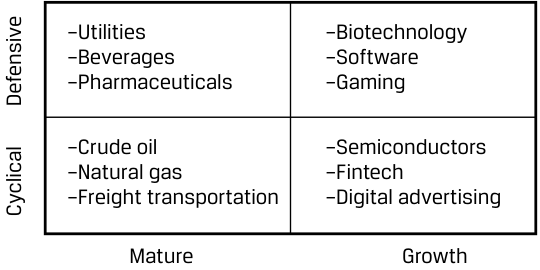
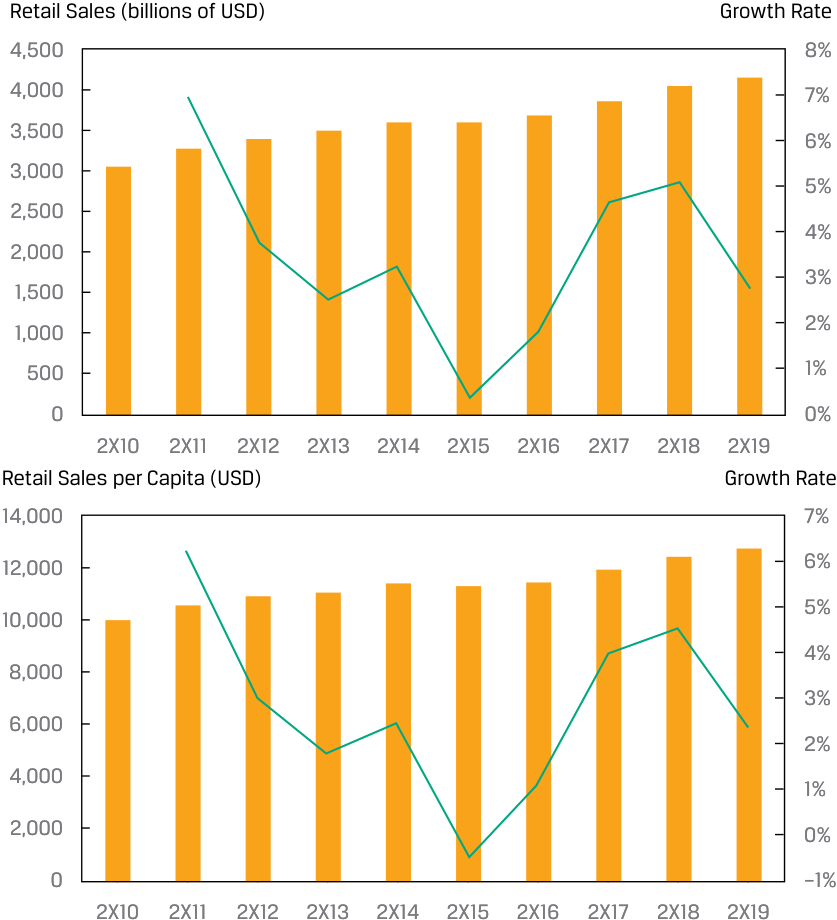
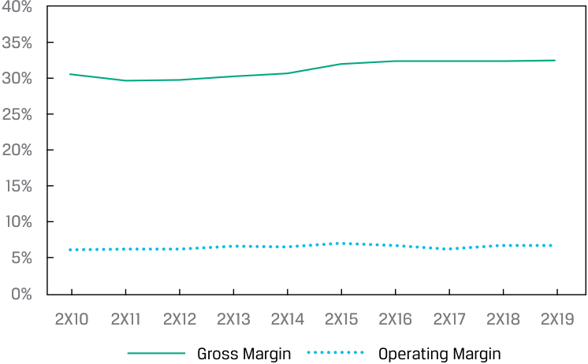

# Volume 5: Equity Investments
## Learning Module 6 Industry and Competitive Analysis
### Part 2/4: Industry Survey (PDF Pages 268–274)

---

<!-- PDF Page 268 -->

|V. Utilities|Cyclical|Defensive|
|---|---|---|
|VI. Financials|Cyclical|Defensive|
|VII. Industrials|Cyclical|Defensive|
|VIII. Technology|Cyclical|Defensive|
|IX. Materials|Cyclical|Defensive|
|X. Real Estate|Cyclical|Defensive|

**Solution:** I. Defensive II. Cyclical III. Cyclical IV. Defensive V. Defensive VI. Cyclical VII. Cyclical VIII. Defensive IX. Cyclical 

X. Defensive 

# **<mark>4</mark>** 

## **INDUSTRY SURVEY** 

determine an industry’s size, growth characteristics, profitability, and market share trends 

After defining an industry, the next step in industry and competitive analysis is to survey the industry by estimating its size, calculating its historical growth rate, evaluating the character of that growth rate, measuring its profitability, and identifying major industry players and market share trends over time. This industry survey provides a basis for the industry evaluation in the next step and makes an analyst aware of the main issues and opportunities. 

### **Industry Size and Historical Growth Rate** 

Industry size is typically measured by total annual sales from the product or customer perspective, which is not necessarily all sales of each industry constituent. For example, Amazon’s retail segment sales would be included in sizing the retail industry, while sales for its Amazon Web Services segment would not. The growth rate is calculated either as year-over-year rates each year or as a compounded annual growth rate over a multi-year period. If possible, industry growth should be broken out by contributions from volume and price/mix drivers. 

Except for some industries that are dominated by large, publicly traded companies (e.g., autos, smartphones, airlines, pharmaceuticals), industry size will often include a potentially large amount in sales from private companies, sometimes small businesses, for which data are unavailable or impractical to tabulate. It’s common practice to estimate industry size for these industries using economic indicators published by government agencies, data from third-party consultancies that use surveys, or 

<!-- PDF Page 269 -->

industry data from issuers’ investor presentations based on proprietary sources. These all need to be corroborated for reasonableness by the analyst. For Warehouse Club Inc., for example, we use retail sales published by a government agency for industry size, because the retail industry includes hundreds of thousands of small retailers. 

### **Characterizing Industry Growth** 

The pattern of historical growth of an industry can be used to characterize it based on the magnitude of its growth rate and sensitivity to the business cycle. One approach to characterizing an industry’s growth rate is a style box, as shown in Exhibit 5. Essential to this approach is comparing the industry’s historical growth rate with a broader measure of economic growth during recessions and expansions. 

**Exhibit 5: Industry Growth Style Box** 

<!-- Start of picture text -->
–Utilities –Biotechnology –Beverages –Software –Pharmaceuticals –Gaming –Crude oil –Semiconductors –Natural gas –Fintech –Freight transportation –Digital advertising Mature Growth Defensive Cyclical <!-- End of picture text -->

_Source:_ Authors’ analysis. 

Growth industries include those that have not yet reached full saturation or penetration of their total addressable market, and thus have idiosyncratic growth drivers separate from broader economic growth. Growth industries are often based on or benefit from an emerging technology. Key questions for analysts related to growth industries include whether historically high growth rates will persist and what the peak penetration rate is—which are more challenging to answer the “newer” the industry is. Conversely, mature industries have fully penetrated their addressable market and have growth rates either in line with broader economic activity (approximately zero) or declining as customer demand migrates to a substitute. Key issues for investors in a mature industry include monitoring for disruptive threats, changes in competitive intensity, and the speed of decline. 

Sensitivity to the business cycle is driven by the business models of companies in an industry and correlates with industry maturity. Factors that determine sensitivity include the degree to which sales are discretionary or necessary for consumers, prices, the interest rate exposure of the business model, and whether the product is a durable or capital good versus a recurring purchase such as consumables and subscription services. Although most investors expect greater variability in returns from firms in cyclical industries, differing investor views as to the length and magnitude of such cycles lead to wide variations in the valuations of issuers over time. 

Although commonly used by market participants, these distinctions can sometimes be of limited usefulness. For example, a severe economic downturn is likely to have a negative impact on all firms, so differences will be a matter of degree but not categorical. Second, companies in different stages of the life cycle within an industry can differ materially in terms of growth, defensiveness, and cyclicality; for example, growth firms based on an emerging technology may exist within a cyclical industry that is far less affected by an economic downturn. 

<!-- PDF Page 270 -->

### **Industry Profitability Measures** 

The best measure of industry profitability is a time series of the distribution of returns on invested capital (e.g., 25th, 50th, 75th percentiles), which captures after-tax operating profits for each dollar of invested capital and is agnostic about capital structure. However, unless the industry is dominated by public companies, obtaining these data is seldom feasible. 

Two common methods to overcome this challenge in practice are to measure the profitability of the publicly traded players and assume that the profitability of private competitors is similar—either using various sources to estimate the profitability of non-public companies (e.g., for state-owned energy companies, there are estimates of their production costs per barrel, production, and capital expenditures, and prices are generally uniform throughout the industry) or obtaining data from a government agency or third-party consultancy. For Warehouse Club Inc., the same government agency that publishes retail sales data each month also does an annual survey of retailers’ gross margins and operating expenses, which can be used to calculate industry operating margins. 

Clearly, a profitable industry is preferable to an unprofitable one, but often more important than a point estimate of profitability is the time series: is industry profitability rising or falling? If there is a discernible trend, it will be an important point of investigation for the analyst. 

### **Market Share Trends and Major Players** 

Finally, market shares are measured by expressing industry participants’ annual revenues as percentages of the industry size each year. Given the aforementioned measurement problems with estimating industry size, market shares should be interpreted as a range rather than a definitive point estimate. Again, more important than each company’s market share is the trend over time, which can reveal whether customers have judged the company’s products superior to competitors’. An important consideration is acquisitions, particularly large ones; a company buying a competitor is a market share gain, but more important is whether the company is increasing or decreasing its share on an organic (non-acquired) basis. 

An additional consideration in this analysis is the degree of industry concentration. Lower concentration—that is, many small competitors in the market—is usually associated with a high degree of competitive intensity unless the industry is very service-oriented, is local in nature, or has high product differentiation. Rising concentration (consolidation) is associated with falling competitive intensity and higher profitability. A common measure of industry concentration is the **Herfindahl-Hirschman Index (HHI)** , calculated as the sum of the squares of competitor market shares: 

<!-- Formula Text: HHI = ∑ i=1 ∞   s i 2 , -->

where _s_ is the market share of market participant _i_ stated as a whole number (i.e., 50% share = 50, not 0.50). 

A market consisting of four firms with shares of 30, 30, 20, and 20 has an HHI of 302 + 302 + 202 + 202 = 2,600. The maximum HHI is for a monopoly, with a value of 1002 = 10,000. Antitrust regulators in some countries consider markets with an HHI between 1,500 and 2,500 moderately concentrated and consider markets with an HHI over 2,500 highly concentrated. A rule of thumb is that acquisitions in highly concentrated markets that increase the HHI by more than 200 points are often subject to regulatory challenges. 

<!-- PDF Page 271 -->

##### **CASE STUDY** 

### **Industry Survey for Warehouse Club Inc. and Iliso Marketplace Ltd.** 

#### **Industry Size and Growth Rate** 

Elaine Nguyen sizes the US retail (excluding autos) industry using three measures: total annual revenues, annual revenues on a per capita basis, and the number of retailers. For all these measures, Nguyen uses data from the US Census Bureau, since the industry consists mostly of small businesses with no public filings and the data are high quality; the Bureau has been collecting such data since 1952. 

##### **_US Annual Retail Sales ex Autos (Bars, left) and Growth Rate (Line, right)_** 

<!-- Start of picture text -->
Retail Sales (billions of USD) Growth Rate 4,500 8% 4,000 7% 3,500 6% 3,000 5% 2,500 4% 2,000 3% 1,500 2% 1,000 500 1% 0 0% 2X10 2X11 2X12 2X13 2X14 2X15 2X16 2X17 2X18 2X19 Retail Sales per Capita (USD) Growth Rate 14,000 7% 12,000 6% 5% 10,000 4% 8,000 3% 6,000 2% 4,000 1% 2,000 0% 0 –1% 2X10 2X11 2X12 2X13 2X14 2X15 2X16 2X17 2X18 2X19 <!-- End of picture text -->

At the end of 2X19, there were 556,531 firms in the industry, but over 92% of them employed fewer than 20 people. Just 470 large firms with over 5,000 employees accounted for 62% of total industry employment. Of these large firms, 144 were publicly traded. 

|**US Retailers (ex autos) as of 2X19**||
|---|---|
|< 20 employees|516,766|
|Between 20 and 5,000 employees|39,295|
|> 5,000 employees|470|

<!-- PDF Page 272 -->

|**US Retailers (ex autos) as of 2X19**||
|---|---|
|Total|556,531|
|_Note:_ public companies|144|

#### **Character of Industry Growth** 

The retail industry has existed for hundreds of years in the USA, though there have been many changes in both form (e.g., department stores, discounters, e-commerce) and the products sold. Comparing industry sales growth with GDP growth since the early 1990s shows that the two are tightly related. However, the industry does not show extreme cyclicality, unlike the auto industry. Elaine Nguyen classifies the industry as mature and moderately cyclical. 

**_Annual Growth Rates: US Retail Sales ex Autos, Autos, and GDP_** 

<!-- Start of picture text -->
20 15 10 5 0 –5 –10 –15 –20 –25 1993 1996 1999 2002 2005 2008 2011 2014 2017 2020 Auto Sales Retail Sales Excluding Motor Vehicle and Parts Gross Domestic Product <!-- End of picture text -->

#### **Industry Profitability** 

Nguyen analyzes industry profitability in two ways: (1) the gross and operating margins of all retailers (except autos) in the USA using Census Bureau data and (2) the profitability of the 10 largest publicly traded retailers in the USA by 2X19 sales. Because of segment disclosure changes, M&A, and other corporate transactions, Nguyen examines the last 5 rather than 10 years of data. 

**_Gross and Operating Margins of US Retailers ex Autos_** 

<!-- Start of picture text -->
40% 35% 30% 25% 20% 15% 10% 5% 0% 2X10 2X11 2X12 2X13 2X14 2X15 2X16 2X17 2X18 2X19 Gross Margin Operating Margin <!-- End of picture text -->

<!-- PDF Page 273 -->

|**Operating Margins**|**2X15**|**2X16**|**2X17**|**2X18**|**2X19**|
|---|---|---|---|---|---|
|Walmart (US segment)|6.4%|5.8%|5.3%|5.2%|5.1%|
|Walmart (Sam’s Club segment)|3.2%|2.9%|1.5%|2.6%|2.8%|
|Amazon.com (North America segment)|2.2%|3.0%|2.7%|5.1%|4.1%|
|Costco Wholesale (US segment)|2.7%|2.7%|2.8%|2.7%|2.7%|
|The Home Depot, Inc.|13.3%|14.2%|14.5%|14.4%|14.4%|
|h Kroger Co.|3.3%|3.0%|2.1%|2.1%|1.8%|
|Target Corp.|6.9%|7.1%|5.8%|5.5%|6.0%|
|Lowe’s Companies, Inc.|8.4%|9.0%|9.6%|7.9%|8.8%|
|Albertsons Companies, Inc.|0.7%|1.1%|0.3%|1.0%|1.5%|
|Ahold Delhaize (US segment)|4.0%|3.9%|4.1%|4.5%|4.3%|
|The TJX Companies, Inc. (US segments)|13.0%|12.8%|11.8%|11.8%|11.6%|

#### **Market Share Trends** 

The most significant market share trend in US retail is the shift toward e-commerce, which has been ongoing since the late 1990s. This shift has accrued largely to Amazon.com, the pioneer in US e-commerce, with its share of e-commerce at roughly 40% (Amazon has a large third-party merchant business but does not disclose GMV, so its exact share is unknown). 

##### **_US E-Commerce % of Retail Sales ex Autos and Petrol_** 

<!-- Start of picture text -->
14% 12% 10% 8% 6% 4% 2% 0% 2000 2002 2004 2006 2008 2010 2012 2014 2016 2018 <!-- End of picture text -->

The industry is fragmented, with the top 10 largest firms holding less than 30% market share, the 10th largest holding less than 1%, with a large amount of share held by over 500,000 small retail businesses. However, the top 10 largest firms have gained share (~2%, from 26.3% in 2X15 to 28.6% in 2X19). 

|**US Net Sales**|**2X15**|**2X16**|**2X17**|**2X18**|**2X19**|
|---|---|---|---|---|---|
|Walmart US and Sam’s Club|355,206|365,198|377,693|389,505|399,796|
|Amazon.com*|63,708|79,785|106,110|141,366|170,773|
|Costco Wholesale (US segment)|84,351|86,579|93,889|102,286|111,751|
|The Home Depot, Inc.|80,550|86,615|92,413|99,386|101,333|
|Kroger Co.|109,830|115,337|123,280|121,852|122,286|
|Target Corp.|73,717|69,414|71,786|74,433|77,130|
|Lowe’s Companies, Inc.|59,074|61,311|63,263|65,872|67,147|
|Albertsons Companies, Inc.|58,734|59,678|56,925|60,535|62,455|
|Ahold Delhaize (US segment)|42,482|42,946|43,194|44,174|44,841|
|The TJX Companies, Inc. (US segments)|23,899|25,651|27,365|29,845|32,021|
|h Total top 10|951,551|992,514|1,055,918|1,129,254|1,189,533|
|Share of US retail sales ex autos|26.3%|26.9%|27.4%|27.9%|28.6%|

<!-- PDF Page 274 -->

- _*Amazon.com’s “North America” segment only._ 

##### **QUESTION SET** 

1. Identify the following statement as true or false. Justify your answer. 

Industry size is typically measured by the total annual sales of all industry constituents. 

##### **Solution:** 

False. Industry size is typically measured by the total annual sales from the product or customer perspective, which is not necessarily the sum of total sales of each industry constituent as some constituents may have segments in other industries. 

2. A section of the fast-food market consists of 10 firms operating 1,840 restaurant locations across North America and currently has a Herfindahl-Hirschman Index (HHI) of 1,516. The market leader announces plans to acquire its closest competitor and commits to not closing any locations at either company. As a result, the HHI will _most likely_ : 

   - **A.** decrease. 

**B.** not change. 

**C.** increase. 

##### **Solution:** 

C is correct. The Herfindahl-Hirschman Index (HHI) is calculated as the sum of the squares of competitor market shares. In this example, the market share of the leading company would increase and the number of competitors would decrease, which would increase the HHI. The number of store locations does not affect the HHI. 

3. Identify the following statement as true or false. Justify your answer. 

Companies in different stages of the life cycle within the same industry can differ materially in terms of cyclicality. 

##### **Solution:** 

True. An industry is defined as companies with similar products or services from the perspective of a customer. A new entrant in an industry may have low but increasing market share, which can serve as a growth driver in addition to an economic expansion. The new entrant may therefore be less affected than a mature company by a recession. 

**Please refer to the Industry Survey for Warehouse Club Inc. and Iliso Marketplace Ltd. earlier in the lesson to answer the following questions.** 

4. Amazon.com’s change in US retail market share from 2X15 to 2X19 is _best_ described as an example of: 

   - **A.** a disruptive threat. 

   - **B.** achieving <u>peak penetration rate.</u> 

