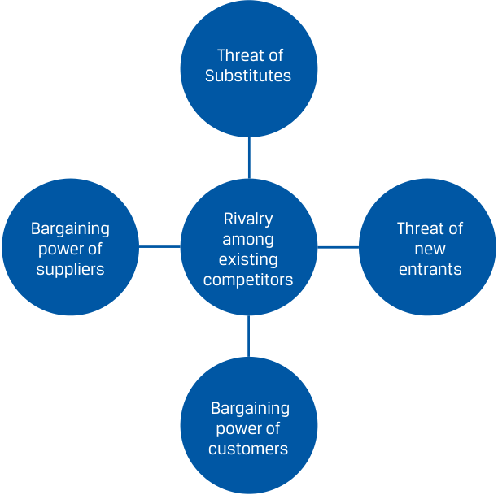

# Volume 5: Equity Investments
## Learning Module 6 Industry and Competitive Analysis
### Part 3/4: Industry Structure and External Influences (PDF Pages 275–290)

---

<!-- PDF Page 275 -->

- **C.** saturation of its addressable market. 

- **Solution:** 

A is correct. As the pioneer in US e-commerce, Amazon achieved roughly 40% market share by using Amazon.com as an online shopping platform. Therefore, Amazon.com is an example of a disruptive threat to the established retail industry. Based on US net sales from 2X15 to 2X19, it is uncertain whether Amazon achieved its peak penetration rate or saturated its addressable market, as it continued to increase its market share component of the top 10 retailers’ share from 7% to 14%. 

5. Current economic forecasts call for an increase of 3% in US GDP, an inflation rate of 1.5%, and decreasing consumer sentiment. Therefore, over the next fiscal year, Nguyen would _most likely_ expect Warehouse Club Inc.’s total sales to: 

   - **A.** decrease. 

   - **B.** increase 2%–5%. 

   - **C.** increase 5%–8%. 

   - **Solution:** 

B is correct. Nguyen classifies the industry as mature and moderately cyclical, and Warehouse Club Inc. operates a single line of business with no new products or services defined. As a result, Warehouse Club Inc.’s total sales would move in line with broader US GDP growth as a stable company in a mature industry. 

### **INDUSTRY STRUCTURE AND EXTERNAL INFLUENCES** 

# **<mark>5</mark>** 

analyze an industry’s structure and external influences using Porter’s Five Forces and PESTLE frameworks 

Recall from earlier lessons in economics that Porter’s Five Forces is a framework for assessing industry structure that determines an industry’s long-run profitability measure by its returns on invested capital. 

<!-- PDF Page 276 -->

<!-- Start of picture text -->
Threat of Substitutes Rivalry Bargaining  Threat of among power of  new existing suppliers  entrants competitors Bargaining power of customers <!-- End of picture text -->

If some or all of the five industry forces are intense, almost no company earns attractive returns on capital, while benign forces lead to highly profitable industries. From the industry survey work in the previous lesson, we may have already measured the industry’s profitability on a historical basis. The analysis of structural forces is aimed at not simply measuring profitability but rather characterizing its drivers in a qualitative fashion and improving alertness to key issues to monitor that can affect industry profitability. For new industries for which data are unavailable or which are still in an early, unprofitable stage, the analysis of industry structure can help point to potential profitability levels. 

#### **Assessing the Five Forces: A Checklist Approach** 

The assessment of the five forces is similar to the determination of a company’s business model, from the prior module, in that it is a qualitative research investigation that is difficult to generalize. We provide illustrative questions to answer as an analyst and offer examples of real industry observations for each question. 

###### **_Assessing the Threat of New Entrants_** 

- Have there been significant numbers of new industry entrants in recent history? 

   - In the USA, more than 50,000 new restaurants are opened per year. Conversely, from 2010 to 2021, fewer than three new commercial bank charters were issued per year in the USA. 

- Are there network effects with the industry’s product or service, such that its value to users is greater as the number of users increases and a new entrant would have a low-value product that has to achieve scale? 

   - Payment networks such as Visa, Mastercard, JCB, and China UnionPay enable payments between hundreds of millions of cardholders and millions of merchants by connecting thousands of financial institutions on their network. 

- Do incumbents benefit from economies of scale from significant fixed costs in the cost structure, such that a new entrant would require time and unprofitable economics to reach competitiveness? 

<!-- PDF Page 277 -->

   - Cloud computing services require enormous fixed assets in terms of servers and networking equipment. These services have virtually no variable cost, however, and large incumbents have decreased unit prices substantially over time while gaining scale. 

- Do incumbents benefit from economies of scope across multiple business lines—from increased convenience in terms of customers and market share and/or from joint costs that can be leveraged across the businesses? 

   - Warehouse Club Inc. operates pharmacies and gas stations, which leverages real estate costs and drives increased foot traffic. Many commercial banks operate consumer banks, asset and investment management, broker-dealers, and investment bank businesses, as there are common customers and joint operating costs. 

- Are customers loyal to brands? 

   - A common threat to branded consumer merchandise sold to retailers is merchandise manufactured by contract manufacturers at the direction of the retailer and sold under retailer-owned “private label” or “generic” brands. In some categories, such as dairy milk and packaged baked goods, private label has over 50% volume share, which has risen over time. Consumers do not appear to be driven by brands in these categories. However, energy drinks, alcoholic beverages, and tobacco products have a very low private label market share over time, with consumers making repeat purchases of the same brand. Note that an important consideration for the value of brands is the legal environment that protects trademarks, trade dress, copyright, and other intangible assets in a jurisdiction. Without these legal protections, brands and their likeness can be imitated by competitors. 

- Are there significant switching costs for customers in terms of time, training, or replacement? 

   - So-called infrastructure software such as SAP for businesses requires lengthy implementation processes led by third-party consulting firms, and connections to other mission-critical software systems need to be established. Switching from SAP to another provider is a costly and lengthy endeavor. Conversely, customers can and do switch between food delivery apps, as minimal useful information is needed (or stored) to switch apps (payment information). 

- Do incumbents have exclusive or preferential access to hard-to-obtain inputs or end-customer interfaces? 

   - In the beverages business, incumbents have shelf space arrangements with retailers, often own distribution assets, and in some countries have the same arrangements with restaurants and pubs. This advantage is a potent deterrent for the beverage companies’ customers to start carrying new entrants’ products. 

- Are there government policies that restrict or slow industry entry? 

   - These policies can take many forms, such as regulations that only larger companies can afford to comply with, subsidies for domestic companies, patents, and licenses. 

<!-- PDF Page 278 -->

Note that experience and expertise among incumbents are not sustainable barriers to industry entry. Entrants can imitate, poach employees, purchase inputs and services from the incumbents’ suppliers, and engage with industry consultants to obtain industry expertise. 

###### **_Assessing the Threat of Substitutes_** 

- Is there another product or service that fulfills the same or similar customer need? Is it lower priced? 

   - Video conference calls and collaboration software are a low-price substitute for business travel and office real estate. 

- Can customers go without the industry’s product? 

   - Aesthetic and elective medical procedures can be canceled or deferred without loss of function for a patient. 

- Is the substitute product improving in performance relative to the industry’s product? 

   - While digital advertising was rudimentary in the early 2000s, with popups and display ads, and was not a material threat to television advertising, digital advertising improved to include highly targeted videos and advertising disguised as content from third-party influencers and has taken market share from television advertising. 

- Is it difficult for customers to switch to a substitute? 

   - In most countries, prescriptions for a branded pharmaceutical are automatically substituted with a generic at a pharmacy if there is one approved. 

###### **_Assessing the Bargaining Power of Customers_** 

- Are there few, concentrated customers for the industry? 

   - For many electronic component companies, mobile device makers such as Apple, Samsung, and Xiaomi account for a significant percentage of their revenues. 

- Are the industry’s products standardized or undifferentiated? 

   - Crude oil is graded (e.g., Brent, West Texas Intermediate) by its density and sulfur content, which determine its cost and the effort to refine it into products such as petroleum. Oil refiners pay for crude oil based on its grade, not by specific oil producer; crude oil within a grade is interchangeable. 

- Are the industry’s products critical for customers? 

   - Pesticides and seeds, especially those made with biotechnology, are sold at high prices but are vital to sustaining high agricultural yields and the high prices are outweighed by the cost of crops lost to disease and insects. 

- Are the industry’s products a large part of customers’ budget? 

   - Customers may be more motivated to seek alternatives and negotiate for products that account for a large part of their budget and for which quality is not a paramount concern. For livestock farmers, the cost of feed 

<!-- PDF Page 279 -->

accounts for over 60% of annual operating costs, while pharmaceuticals and vaccines for livestock account for a small percentage but come with a high cost of failure, which has given animal-pharmaceutical companies a strong bargaining position. 

- Can customers backward-integrate—that is, “build” rather than “buy” what the industry is selling? 

   - Streaming video services first licensed content from existing studios and media companies, but over time they vertically integrated by producing their own video content. 

###### **_Assessing the Bargaining Power of Suppliers_** 

- Are there few, concentrated suppliers for the industry? 

   - Apple’s “A” and “M” series processors for its iPhones and MacBooks are manufactured exclusively by TSMC. While Apple has more supplier choice for its other components, it is beholden to a single company for this crucial component. 

- 

   - Are there significant costs for switching suppliers? 

   - Asset managers need performance data and analytics on equity, fixed income, and other indexes for investment processes and client reporting of benchmarks. Indexes are owned by a small number of companies and charge licensing fees for data permissions and commercial use. An, Benetton, Song, and Index Providers (2021) found that managers of indexed exchange-traded funds paid index licensing fees equal to 35% of their management fee revenue. While asset managers can switch because each provider offers similar catalogues of indexes, doing so would require changing investment processes, client reporting, and conversations with clients—and can look bad to prospects. 

- Are suppliers differentiated or specialized? 

   - Healthcare providers, airlines, investment banks, technology companies, and professional services firms all require skilled, credentialed, or licensed labor, for which there is limited supply. 

- Are there substitutes for the products from suppliers? 

   - Retailers can substitute branded merchandise for private label merchandise from contract manufacturers. 

###### **_Assessing Rivalry among Existing Competitors_** 

- Is there a history of price competition among competitors? 

   - Despite a low risk from every other industry force, automakers and aircraft manufacturers compete fiercely on price, offering promotions and generous financing and warranty terms to try to capture every sale. 

- Are there numerous, roughly equal-sized competitors? 

   - There are approximately a dozen automakers with an annual global market share over 1%. However, the largest company (Toyota) has had less than 15% market share for many years. 

- Are products differentiated? 

<!-- PDF Page 280 -->

   - Pharmaceuticals without a patent (generics) are legally required to be chemically equivalent to their originator drug in order to be approved by regulators in an abbreviated process that doesn’t involve a clinical trial. Pharmacies are indifferent as to whether an approved generic is sold by one company or another and manufacturers’ costs are largely fixed, so the companies compete fiercely on price for volume. Price competition increases with the number of approved generics per originator drug; Dave, Hartzema, and Kesselheim (2017) found that a drug with one generic competitor had prices that were, on average, six times higher than the prices of one for which there were nine generic manufacturers. 

- Are there high barriers to exiting? 

   - If exiting an industry is difficult or costly, such as shutting down natural resource–producing assets, companies with low profitability may remain in the industry for much longer than in other industries, which can result in lingering competition. 

- Is industry growth slow? 

   - If penetration of the addressable market is low, companies may not feel a need to compete for customers using price and other economic terms. This was the case for mobile wireless plans until the mid-2010s, when penetration plateaued and companies began engaging in aggressive promotional activity in competition for one another’s customers. 

After completing the evaluation of industry structure, an analyst must judge which are the most and least important factors. It is often clear that one or two forces are strongest, but there isn’t a quantitative test or threshold by which to judge definitively. Posing scenarios to experienced industry insiders is often useful, such as asking, “What do you think would happen if company X increased its prices by 10% tomorrow?” If their answer is that a large percentage of customers are willing and able to switch to a competitor or substitute—perhaps it has happened before—it’s likely that customer bargaining power and the threat of substitutes warrant further investigation. 

###### **CASE STUDY** 

#### **Porter’s Five Forces Analysis for US Retail (ex autos)** 

##### **Threat of New Entrants: Very High** 

Opening a retailer, especially an e-commerce retailer that utilizes third-party merchant services, is relatively easy and common. In the USA, retailers are the most common type of business formed—by a wide margin, with over 40,000 new firms filing formation papers each month (the next most common is transportation and warehousing, with around half the number of retailer formations). Customers can easily switch retailers, as most do not have an ongoing relationship such as a subscription fee or contract, and there are minimal regulatory barriers such as licenses and patents. 

##### **Threat of Substitutes: Low** 

Broadly speaking, the substitute for retail is consumer services (e.g., restaurants, travel, healthcare), which also includes digital services (such as streaming video subscriptions and gaming). Most categories of goods, however, are not 

<!-- PDF Page 281 -->

easily replaceable with services (e.g., apparel and home décor), or they enjoy a cost advantage because of lower labor intensity (e.g., fresh food). There have been periods when services grew faster than goods, but as shown in an earlier exhibit, retail sales have grown essentially in line with US nominal output/ income. Retail is arguably one of the oldest industries, and while it has evolved over time, it has yet to be replaced. 

##### **Bargaining Power of Customers: Moderate** 

Retail customers are highly fragmented, with each consumer representing a distinct decision-maker, as there are generally no group purchasing organizations. However, many products are sold by many retailers, and the internet has enabled easy comparison shopping at retailers. Customers are price sensitive with respect to identical products sold by different retailers. 

##### **Bargaining Power of Suppliers: Low to Moderate** 

Key suppliers for retailers include manufacturers of goods, employees, and lessors of retail or fulfillment space. In most cases, numerous options are available. However, branded goods are sold exclusively by a sole manufacturer that may impose high prices and other economic terms, like shelf space and visibility, and may want to sell only to certain retailers (e.g., makers of luxury goods may not sell to discount retailers in order to maintain exclusivity). 

##### **Rivalry among Existing Competitors: High** 

Given the sheer number of similarly sized firms selling similar or identical products, retailers compete fiercely, often with price promotions and discounts as price is one of the few ways they can lure customers away from competitors. 

#### **External Influences on Industry Growth** 

Analyzing the structure of an industry primarily involves looking _inside_ the industry and at close adjacencies such as customers, suppliers, and substitutes. It is important for analysts to look _outside_ the industry for factors that influence the industry’s economic outcomes. One framework for this purpose is a **PESTLE analysis** of the _p_ olitical, _e_ conomic, _s_ ocial, _t_ echnological, _l_ egal, and _e_ nvironmental influences on an industry. While Porter’s Five Forces is concerned with the determinants of industry profitability, a PESTLE analysis is more concerned with an industry’s growth rate and market share dynamics. For example, athletic apparel companies such as lululemon athletica inc. have long benefited from increasing consumer interest in fitness and wellness, a social influence on the apparel industry. This trend is not apparent from Porter’s Five Forces but is obviously important for growth in athletic apparel. When the trend eventually plateaus or declines, it’s likely to result in declining sales growth or sales for lululemon, so analysts carefully monitor the trend using a variety of metrics. PESTLE analysis is a framework for identifying “themes” or “narratives” that investors may take a perspective on and desire exposure to. 

While analysts must look broadly for influences, several factors make this search easier in practice. First, external influences often do not change very quickly (though their magnitude and direction can), so this analysis does not need to be done every quarter. Second, analysts develop industry expertise, and those in an institutional setting can access industry specialists who offer their perspectives and surveillance of industry trends as a paid service. Finally, it is usually the case that some influences are far more important than others for a given industry. 

<!-- PDF Page 282 -->

###### **_Political Influences_** 

Political influences on an industry include changing fiscal and monetary policies, governments’ direct selling and purchasing activities, regulatory changes, and geopolitical conditions and actions. We highlight three sectors and their constituent industries for which political influences are often significant: energy, healthcare, and defense. 

The energy sector is subject to three important political influences: the political appeal of low and stable energy prices in the short run, climate agreements and legislation calling for emissions reductions, and the actions of OPEC (Organization of the Petroleum Exporting Countries). Most governments desire low energy prices in the short run to maintain their appeal to consumers and businesses that have inelastic demand with respect to price. However, in the long run, higher energy prices (perhaps because of a carbon tax) might be preferable in order to curb demand and meet emissions targets, for which the consumption of fossil fuels is the main driver. Investors and producers may worry about the longer-term outlook, since governments are intending to shrink fossil fuels as a percentage of the energy mix, but reductions in fossil fuel production are at odds with low energy prices in the short run. Finally, energy companies owned by member states of OPEC produced 35% of crude oil globally in 2021 ( _BP Statistical Review of World Energy_ ) and set production quotas as a bloc. Actions taken by OPEC significantly affect global and regional energy prices. OPEC members may choose to keep prices low enough to slow the transition to renewables, exploiting governments’ need for low energy prices in the short run. 

Governments are the largest buyers of healthcare products and services and, in most cases, are the exclusive buyers of defense goods and services globally. For political appeal and to shore up fiscal deficits, governments have at times pursued reforms such as expansions of healthcare coverage and subsidies, price controls or reductions, and restrictions on certain healthcare services or products. 

Defense spending is determined by countries’ geopolitical objectives, perceived threat environment, and alliance commitments. From the late 1990s to 2010, global military spending rose markedly, increasing as a share of global GDP, which benefited defense companies. Future defense spending depends on geopolitical events and other competing budget priorities. Finally, governments also extensively regulate healthcare and defense, the stringency of which changes over time. From 2000-2007, several high-profile pharmaceutical scandals led to a period of heightened regulatory scrutiny and a declining number of drug approvals. This scrutiny was relaxed by the mid-2010s. Countries are selective about which countries they permit domestic defense companies to do business with, and the contracting process is highly complex, involving third-party costs and performance audits. 

###### **_Economic Influences_** 

Economic influences on an industry include changes in GDP or personal income, inflation, interest rates, and exchange rates. These influences can be related to the business cycle (cyclical) or structural, such as how longer-run population and productivity growth rates have differed across countries, which affects the sales and costs of companies operating in different countries. Economic influences are most important for cyclical sectors such as financials, basic materials, and consumer discretionary, and exchange rate changes are most important for industries and companies operating in multiple currencies—especially if there are large currency compositional mismatches in revenues and costs and if the company does business in an illiquid currency with more volatile exchange rates. 

The auto industry is among the most affected by economic influences, because it sells high-priced durable goods, the purchase of which can be delayed (consumer keeps current car longer) or substituted (used car) based on consumer confidence. Structural economic influences are important for many multinational companies that 

<!-- PDF Page 283 -->

have sought to increase exposure to faster-growing emerging markets over time. As of 2022, over 40% of Nestlé SA’s sales were in emerging markets, which have long shown faster volume growth than its developed-market sales. 

###### **_Social Influences_** 

Social influences include cultural and consumer trends, demographic changes such as the relative growth rates among different population cohorts, and changes in lifestyles. These influences are not entirely external to an industry, as companies influence culture through political advocacy, advertising, and a variety of other efforts such as product placements in media. There is growing reputational risk and/or pressure on companies via social media and the press to source sustainable inputs, as well as increased scrutiny of supply chains for violations of human rights. 

Social influences are often more significant for industries that sell to consumers rather than to other businesses. In concert with technological and economic influences, the global beauty industry (comprising skin care, color cosmetics, hair care, fragrances, and select personal care product categories) has grown briskly since 2010, particularly premium products. High-quality cameras on mobile devices and social media have increased the salience of people’s physical appearance and created efficient marketing channels for beauty companies that utilize third-party influencers and video tutorials. 

###### **_Technological Influences_** 

Technological changes can create new or improved products or render existing products obsolete, radically changing industries and companies. Based on the pioneering work of Clayton Christensen, we distinguish between two kinds of technological changes: sustaining and disruptive innovations. 

Sustaining innovations are improvements in product or service performance and the addition of marginal features, but without a fundamental change in functionality or operation. These innovations are often led by industry incumbents making improvements to better serve existing or adjacent customers’ needs. Successive improvements to cable television—including digital transmission, improved video quality, premium programming, DVRs, and additional channels—represent sustaining innovations. Disruptive innovation is a change that creates a new market or enters an existing one but with a very different value proposition that may not immediately appeal to existing customers who are happy with the current product. Cable television was disrupted by streaming video delivered over the internet. At first a rudimentary offering that appealed to people who did not have cable subscriptions, it eventually grew to overtake cable in the number of subscribers. 

Disruptive innovation is most likely to come from new entrants, because they do not have an existing profitable business to protect. The difficulty faced by incumbents with disruptive innovation is termed the “innovator’s dilemma”: they can either invest in the disruptive innovation themselves, speeding the decline of their existing business (and potentially harming employees) but not losing market share, or ignore the innovation and lose market share while continuing to generate strong profits in the near to medium term. 

###### **_Legal Influences_** 

Legal influences on an industry include changes in laws and regulations from courts and policymakers that alter an industry’s business practices or economic outcomes. These influences, which are in addition to the fiscal and monetary policy changes discussed earlier under political influences, are often more subtle changes to the “rules of the road” governing industry affairs. Companies look to shape these influences through policy advocacy and in legal proceedings of their own. 

<!-- PDF Page 284 -->

Examples of industries strongly affected by legal influences include tobacco and cannabis. Jurisdictions have wide-ranging laws and regulations on the manufacturing, distribution, marketing, sale, and use of tobacco products to discourage consumption and the associated adverse health consequences, including secondhand smoke. Laws cover advertising prohibitions, graphic images on packaging, minimum purchase age, bans on smoking in public places, and limitations on nicotine content and flavorings. These laws are in addition to the generally high taxes levied on tobacco, which encourage non-taxable counterfeit activity that governments must police. Adoption of or changes in these laws in various jurisdictions significantly affect tobacco industry sales. In response to these influences, as well as broader social influences that have resulted in declining cigarette sale volumes, the tobacco industry is primarily focused on developing so-called reduced risk products that may pose fewer health risks and therefore create a more favorable legal environment. 

The cannabis industry is in an evolving legal environment, where certain jurisdictions have legalized its production, sale, and use (Canada), while some have varying laws at the sub-sovereign level (the USA) and most others still completely prohibit cannabis (most of Asia). 

###### **_Environmental Influences_** 

Finally, environmental influences are often closely associated with legal influences and include risks and opportunities related to the transition to a lower-carbon economy, laws and practices concerning waste and land use, and environmental protections. 

Transition risks and opportunities are important influences for sectors such as energy, airlines, utilities, and autos, as they are involved in the production or consumption of fossil fuels, which are responsible for carbon emissions. Due to changes in regulations, taxes, consumer preferences, or voluntary actions, companies in these sectors must evolve their business operations or face share losses to competing solutions with lower-carbon emissions. 

###### **QUESTION SET** 

1. In 2009, Amazon.com started Amazon Publishing, extending its business into publishing books in addition to book retailing. From the perspective of a competing publisher, this is an example of: 

   - **A.** decreasing the threat of substitutes. 

   - **B.** decreasing the bargaining power of suppliers. 

   - **C.** increasing the bargaining power of customers. 

   - **Solution:** 

C is correct. Amazon Publishing is an example of backward-integration, as it could now produce and sell its own published content as well as other publishers’ content. The creation of Amazon Publishing increased the bargaining power of Amazon as a customer and increased the level of competitive rivalry in the publishing industry. Amazon Publishing would also increase the threat of substitutes and the bargaining power of suppliers, as authors and end users could work directly with Amazon. 

2. Proposed government regulations for the restaurant industry would introduce new compliance requirements for all new and existing facilities to reduce the environmental impact of take-out and delivery options. These regulations would apply only to restaurants with a physical address and 

<!-- PDF Page 285 -->

would not apply to mobile restaurants (i.e., food trucks). For an existing restaurant with several physical locations, these regulations would: **A.** reduce competitive rivalry by increasing the barriers to entry. **B.** increase competitive rivalry by increasing the threat of substitutes. **C.** both reduce and increase competitive rivalry. **Solution:** C is correct. The proposed regulatory changes would have a mixed impact on the level of competitive rivalry in the restaurant industry. These environmental regulations would increase the entry barriers by increasing the costs of setting up a new restaurant, while also increasing the threat of substitutes by making it easier to open mobile restaurants, which do not have to comply with these regulations. **Please refer to the Industry Survey for Warehouse Club Inc. and Iliso Marketplace Ltd. in the previous lesson to answer the following questions.** 3. To compete with online retailers, Warehouse Club Inc. is considering installing a sophisticated image recognition system in its stores to track and analyze consumer behavior in order to identify clothing items that were tried on but not purchased. For Warehouse, this change would be a ____________________ ( _sustaining_ or _disruptive_ ) innovation. 

###### **Solution:** 

For Warehouse, this change would be a _<u>sustaining</u>_ innovation. Sustaining improvements focus on adding marginal features without a fundamental change in functionality or operation. For example, the proposed system would provide incremental customer and product knowledge but would not represent a fundamental change in Warehouse’s go-to-market strategy. Disruptive innovation is a change that creates a new market or enters an existing one with a different value proposition. 

4. Identify the following statement as true or false. Justify your answer. 

The CEO of Iliso Marketplace Ltd. expects revenue growth to be in line with US GDP growth for the next two fiscal years. As a result, the CEO approves an extension to an existing aggressive sales promotion and discount strategy that has been in place for the past 18 months. This extension will increase the competitive rivalry in the industry. 

###### **Solution:** 

False. The sales promotion and discount strategy is already in place within this mature industry, thus demonstrating a history of price competition among the competitors. 

5. A PESTLE analysis for Iliso Marketplace Ltd. would _most likely_ identify which of the following items? 

   - **A.** A competitor is acquiring a fleet of delivery vehicles instead of using third-party parcel carriers. 

   - **B.** The increasing political discussion around instituting a tax on parcel deliveries of less than 2 kilograms 

<!-- PDF Page 286 -->

- **C.** A competitor is launching an augmented reality application to allow tech-savvy consumers to view home décor and furniture products in real time. 

###### **Solution:** 

B is correct. The political discussion around potential applications of a tax is an example of a political trend changing over time. This theme could potentially affect Iliso Marketplace Ltd. A (fleet of delivery vehicles) and C (augmented reality) are examples of competitive actions that could affect the level of competitive rivalry in the industry. 

# **<mark>6</mark>** 

### **COMPETITIVE POSITIONING** 

evaluate the competitive strategy and position of a company 

All companies have a competitive strategy, whether intentional or not. An intentional strategy results from company-wide planning, performance measurement, and feedback loops to sharpen the strategy. An unintentional strategy results from various teams within a firm pursuing their own incentives, doing whatever they did in prior years, or following industry or professional norms. An unintentional strategy is rarely the best and often exacerbates communication and coordination problems present at every company, although the approach might perform well in areas such as discovery-oriented research. Munos (2009) found evidence of diseconomies of scale in pharmaceutical R&D, with most new drugs discovered by small companies operating in a relatively “unmanaged” way. 

Ultimately, an effective competitive strategy is evidenced by a company’s track record of value added for its stakeholders, such as economic profits. Its effectiveness can be judged only in hindsight. To evaluate a competitive strategy on a forward-looking basis, an analyst should assess the strategy along three dimensions: 

- Does the strategy create a defense against the five industry forces? 

- Does the strategy benefit from, or is at least not at odds with, the expected external industry influences identified in the PESTLE analysis? 

- Does the company have the resources and capabilities to execute the strategy? 

Clearly, the analysis and the answers to these questions are company and industry specific (CFA Institute has published a helpful industry-by-industry reference titled _Sector Analysis: A Framework for Investors_ with examples). We can, however, identify three well-known competitive strategies that have worked in a variety of industries, as shown in Exhibit 6: cost leadership, differentiation, and focus. These three generic strategies are based on Michael Porter’s research on competition. While companies do tend to have specific variations, generic strategies explain a large percentage of strategies in practice—similar to how many companies’ business models are well described using conventional models. A poor situation is for a company to be “stuck in the middle”—not a cost leader, not differentiated, not focused. 

<!-- PDF Page 287 -->

**Exhibit 6: Generic Competitive Strategies** 

||**Cost Leadership**|**Differentiation**|**Focus**|
|---|---|---|---|
|Means of execut- ing strategy|■Economies of scale from fixed costs ■Favorable access to raw materials ■Culture of strict cost control ■Aggressive pricing to gain high volume ■Low-cost distribution ■Economies of scope|■Investments in advertising, brand, customer service, pro- prietary distribution channels ■Protection using trademarks, copyright, patents ■Superior quality, unique features ■Culture of strong customer experience ■Premium pricing ■Integration of services, soft- ware, and hardware|■Proximity to customers and strong understanding of their needs ■May incorporate elements of strategy from both cost lead- ership and differentiation, but focused on particular group|
|Which of the Five Forces it defends against (why it works)|■Threat of new entrants: Capital requirements and scale advan- tages deter entrants ■Bargaining power of custom- ers: Customers can only bring prices down to the costs of the marginal producer, leaving margin for the cost leaders ■Industry rivalry: Rivals may not be able to compete on price with cost leaders|■Threat of new entrants and of substitutions: Customer loyalty to unique product can deter switching, protect market share ■Bargaining power of customers: Customers may be unable to unwilling to comparison shop or switch ■Bargaining power of suppli- ers: The company may have the ability to pass along price increases to customers and/or margin to absorb cost increases|■Threat of new entrants and of substitutes: Customer loyalty to unique product can deter switching, protect market share ■Bargaining power of customers: Customers may be unable or unwilling to comparison shop or switch|
|Industry appropriateness|■Capital intensive ■Price-conscious customers ■Customers do not value or notice product differences ■Minimal innovation in industry|■Price is not foremost concern for customers ■Customers value distinctiveness ■Innovation in industry, with products varying in features and forms|■Difficult (or uneconomical) to serve customer group, product, or geography for other players|
|Risks to the strategy|■Cost inflation, loss of discipline ■Technological change that results in loss of cost leadership or market share ■Desire for premiumization among customers|■Imitation by competitors ■Buyers become sophisticated, no longer demand level of service ■Pricing premium becomes too high for customers to bear ■May preclude high market share, as customers value exclusivity|■Larger competitors outcompete on price ■The differences in demand between the narrow group and industry as a whole narrow ■Buyers become sophisticated, no longer demand level of service|

###### **QUESTION SET** 

1. Manitou Resorts is a 25-room boutique hotel located in a rural mountain area approximately three hours from a major urban center. It provides accommodations, high-end dining options, and an on-site health and wellness spa. Manitou’s primary customers are young <u>professional couples</u> 

<!-- PDF Page 288 -->

in the middle-to-upper-income brackets. The CEO is contemplating several options for expansion, as the resort is frequently at full capacity. Which of the following initiatives would be consistent with Manitou’s current competitive strategy? 

- **A.** The development of 10 stand-alone lakefront cottages to accommodate families of up to six people, providing access to family-related activities such as pools, water sports, and evening entertainment 

- **B.** The addition of conference room facilities to accommodate corporate events that could be priced at a 10%–15% discount to a 150-room franchise hotel approximately 30 minutes from Manitou 

- **C.** Developing a management and reservation system to identify recommendations to referral partners such as golf courses, taxi/shuttle services, or other guest experiences to increase fee revenue 

- **Solution:** 

C is correct. Manitou Resorts’ current competitive strategy is a focus strategy targeting a specific customer segment: young professionals in middle-to-upper-income brackets located in a nearby city and focused on wellness and relaxation. The other options represent an expansion into new customer segments (family vacations and corporate events), which could be inconsistent with its current customer base. A represents a cost leadership competitive strategy, while B represents a differentiation strategy. 

2. Warehouse Club Inc. is considering launching a “private label” brand of non-perishable food products. Based on its current competitive strategy, which of the following is the _most appropriate_ rationale to support? 

   - **A.** Customers do not notice product differences. 

   - **B.** Customers value new product features and forms. 

   - **C.** Products can be segmented into regular and premium brands. 

   - **Solution:** 

A is correct. Warehouse Club Inc.’s current competitive strategy is cost leadership. In a cost leadership strategy, industry appropriateness is determined by capital intensity, price-conscious customers, customers not valuing or noticing product differences, and minimal innovation in the industry. B represents an example of a differentiation strategy. C represents an example of a focus strategy. 

3. To defend against the bargaining power of suppliers, customers may be unable or unwilling to comparison shop or switch in which of the following competitive strategies (select all that apply): 

___ Cost leadership 

- ___ Differentiation 

___ Focus 

###### **Solution:** 

Both differentiation and focus. That “customers may be unable or unwilling to comparison shop or switch” is a common feature of both differentiation and focus strategies. In a cost leadership strategy, “customers can only bring 

<!-- PDF Page 289 -->

|prices down to the costs of the marginal producer, leaving margin for the cost leaders.”|
|---|
|4. A risk to a differentiation competitive strategy is:|
|**A.**limited market share due to exclusivity.|
|**B.**larger competitors outcompete on price.|
|**C.**technological change that results in loss of market share. **Solution:**|
|A is correct. Since a differentiation strategy pursues a unique product or service offering, it creates a risk that the strategy may preclude high market share, as customers value exclusivity. B is a risk to a focus strategy where larger competitors outcompete on price. C is a risk to a cost leadership strategy where the technological change results in cost leadership or market share loss.|
|5. A large online retailer in the USA has begun to offer a “price-matching” guarantee on its website to match any competitor’s online price for an iden- tical product, including Iliso Marketplace. Recommend and justify whether Iliso should launch a similar guarantee to protect its market share. **Solution:** No, Iliso should not launch a similar guarantee. A price-matching guarantee is a strategy pursued by companies with a cost leadership approach by using aggressive pricing to gain volume. Iliso Marketplace Ltd. operates with a dif- ferentiation strategy that permits premium pricing if aligned with a strong customer experience. If Iliso maintained its customer experience offering and began to reduce its revenue to match cost leaders, the company would likely decrease its overall profitability.|

<!-- PDF Page 290 -->

## **~~REFERENCES~~** 

- An, Yu, Matteo Benetton, and Yang Song. Whales Behind the Scenes of ETFs (July 30, 2021). Available at _SSRN_ : https:// ssrn .com/ abstract = 3855836 or 10.2139/ssrn.3855836 

- Dave, C. V., A. Hartzema, and A. S. Kesselheim. 28 Dec, 2017. “Prices of Generic Drugs Associated with Numbers of Manufacturers.” _New England Journal of Medicine_ 377 (26): 2597–98. 10.1056/NEJMc1711899 

- Guan, Yuyan, M.H. Franco Wong, and Yue Zhang.  Analyst Following Along the Supply Chain (March 17, 2014). INSEAD Working Paper No. 2014/21/ACC, Available at _SSRN_ : https:// ssrn .com/ abstract = 2410151 or 10.2139/ssrn.2410151 

- McGahan, A. M. and M. E. Porter. July 1997. ““How Much Does Industry Matter, Really?” Special Issue on Organizational and Competitive Influences on Strategy and Performance.” _Strategic Management Journal_ 18 (no. S1): 15–30. 10.1002/(SICI)1097-0266(199707)18:1+<1 5::AID-SMJ916>3.0.CO;2-1 

- Munos, B. Dec 2009. “Lessons from 60 years of pharmaceutical innovation.” _Nature Reviews. Drug Discovery_ 8 (12): 959–68. 10.1038/nrd2961 

