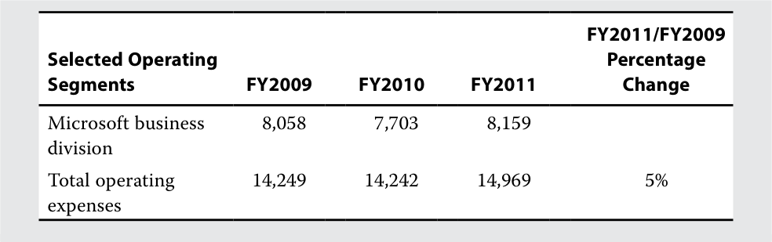

# Volume 5: Equity Investments
## Learning Module 7 Company Analysis: Forecasting
### Part 4/5: Scenario Analysis (PDF Pages 328–343)

---

<!-- PDF Page 328 -->

**C.** 195. **Solution:** 

B is correct. 

2X20 operating income = 0.02(8,411) = 168 

2X20 depreciation expense = 0.20(768) = 154 

EBITDA = 168 + 154 = 322 

Debt = 0.50(322) = 161 

4. The analyst notes that Iliso’s common stock and paid-in capital accounts increased, in total, by 75 million from 2X18 to 2X19, but only 42 million was reported as stock issuance on the statement of cash flows. Retained earnings increased by the amount of net income. Which of the following _most likely_ explains the difference of 33 million? 

   - **A.** A stock split 

   - **B.** A stock dividend 

   - **C.** Stock-based compensation 

   - **Solution:** 

C is correct. Stock-based compensation is a non-cash expense in the income statement and is reported as an addition to net income in the indirect method of reporting cash flow from operations. The issuance also increases common stock and paid-in capital. A stock split typically simply increases the number of shares outstanding and decreases any stated par value per share. A stock dividend increases common stock and paid-in capital and reduces retained earnings by the same amount. 

# **<mark>6</mark> SCENARIO ANALYSIS** 

describe the use of scenario analysis in forecasting 

Recall from earlier lessons that industry and business risks may result in future outcomes that differ from expectations. The final step in forecasting involves incorporating the possibility of different outcomes based on key risk factors as well as judging their likelihood of occurrence. Generic risk factors that affect all companies—but to varying degrees—include changes in the business cycle, competition, inflation and deflation, and technological developments. Rather than develop single point estimate forecasts, analysts make several forecast scenarios that vary based on different outcomes with respect to key risk factors. Investors compare these scenarios with other analysts’ (e.g., sell-side analysts) forecasts for a company, as well as forecasts implied by current valuations, to make investment decisions. 

We demonstrate the use of scenario analysis for technological developments that threaten to cannibalize demand for an existing product in the following historical case study. Technological developments can affect demand for a product, the quantity supplied of a product, or both. When changes in technology lead to lower manufacturing 

<!-- PDF Page 329 -->

costs, the supply curve will shift to the right as suppliers produce more of the product at the same price. Conversely, if changes in technology result in the development of attractive substitute products, the demand curve will shift to the left. 

#### **EXAMPLE 4** 

### **Quantifying the Tablet Market’s Potential to Cannibalize Demand for Personal Computers** 

The worldwide tablet market experienced a major technological development with the introduction of the Apple iPad tablet in April 2010, which was expected to have (and indeed did have) important implications for the manufacturers of desktop and laptop computers. A tablet promised to offer the capabilities of a portable personal computer (PC) with a touchscreen interface instead of a keyboard. Another distinguishing feature of the then-new tablets was that—unlike the majority of PCs, which run on the Microsoft Windows platform—they would run on a non-Microsoft operating system: Apple’s iOS or Google’s Android. Given the tablet’s ability to perform many of the most common tasks of a PC— including emailing, browsing the web, sharing photos, playing music, watching movies, playing games, keeping a calendar, and managing contacts—an analyst at that time might reasonably have wondered to what extent sales of tablets might cannibalize demand for PCs and what the potential impact might be on Microsoft’s sales and earnings. Exhibit 13 presents one approach to answering these questions. It is set at the start of 2012, just over a year after the launch of the iPad. It is presented from the position of an analyst assessing the impact of the tablet on the PC market and Microsoft. 

**Exhibit 13: Unit and Revenue Projections (in thousands, unless noted)** 

|**Pre-Cannibalization PC**|||||**3-Year**|
|---|---|---|---|---|---|
|**Projections**|**FY2011**|**FY2012E**|**FY2013E**|**FY2014E**|**CAGR**|
|Consumer PC shipments|170,022|174,430|184,120|193,811|4.5%|
|Non-consumer PC shipments|180,881|185,570|195,880|206,189|4.5%|
|Total global PC shipments|350,903|360,000|380,000|400,000|4.5%|
|% of which is consumer|48%|48%|48%|48%||
|% of which is non-consumer|52%|52%|52%|52%||
|Consumer tablet shipments|36,785|82,800|111,250|148,750|59.3%|
|Non-consumer tablet shipments|1,686|7,200|13,750|26,250|149.7%|
|Total global tablet shipments|38,471|90,000|125,000|175,000|65.7%|
|% of which is consumer|96%|92%|89%|85%||
|% of which is non-consumer|4%|8%|11%|15%||

<!-- PDF Page 330 -->

|**Pre-Cannibalization PC** **Projections**|**FY2011**|**FY2012E**|**FY2013E**|**FY2014E**|**3-Year** **CAGR**|
|---|---|---|---|---|---|
|Cannibalization factor, consumer|30%|30%|30%|30%||
|Cannibalization factor, non-consumer|10%|10%|10%|10%||
|# of consumer PCs can- nibalized by tablets|11,036|24,840|33,375|44,625||
|# of non-consumer PCs cannibalized by tablets|169|720|1,375|2,625||
|Total PCs cannibalized|11,205|25,560|34,750|47,250||
|by tablets||||||
|% of total PCs cannibal- ized by tablets|3.2%|7.1%|9.1%|11.8%||
|**Post-Cannibalization PC**|**Projection**|**s**||||
|Consumer PC|158,987|149,590|150,745|149,186|−2.1%|
|shipments||||||
|Non-consumer PC|180,712|184,850|194,505|203,564|4.0%|
|shipments||||||
|Total global PC|339,699|334,440|345,250|352,750|1.3%|
|shipments||||||
|_Microsoft implied aver-_ _age selling price (USD)_||||||
|Consumer|85|85|85|85||
|Non-consumer|155|155|155|155||
|_Revenue impact for_ _Microsoft (USD millions)_||||||
|Consumer|938|2,111|2,837|3,793||
|Non-consumer|26|112|213|407||
|Total revenue impact|964|2,223|3,050|4,200||

_Note:_ CAGR is compound annual growth rate. Non-consumer includes enterprise, education, and government purchasers. 

_Sources:_ Based on data from Gartner, JPMorgan, Microsoft, and authors’ analysis. 

Worldwide market shipments of PCs in FY2011 totaled 350.9 million units, while worldwide shipments of tablets totaled 38.5 million units (source: Gartner Personal Computer Quarterly Statistics Worldwide Database). Shipments to consumers represented 96% of total tablet shipments during fiscal year 2011. We next estimate the magnitude of the potential substitution effect, or cannibalization factor, that tablets will have on the PC market. Because the cannibalization factor depends on many different variables—including user preferences, end-use application, and whether the purchaser already owns a PC—we use a range of potential estimates. Moreover, we also divide the worldwide PC market into consumer and non-consumer (enterprise, education, and government 

<!-- PDF Page 331 -->

purchasers), because the degree of substitution is likely to differ between the two. For purposes of illustration, we assume a cannibalization factor of 30% for the consumer market and 10% for the non-consumer market in our base case scenario. 

In addition, the base case scenario assumes that non-consumer adoption of tablets increases to 15% of the market from 4% in 2011. Moreover, although the composition of the global PC market is roughly evenly divided between consumers and non-consumers (48% and 52% in fiscal year 2011, respectively), the non-consumer segment is significantly more profitable for Microsoft, because approximately 80% of the company’s Office products are sold to enterprise, education, and government institutions. The average selling price (ASP) estimates are derived by dividing Microsoft’s estimated average revenue by customer type for the prior three years by Microsoft’s estimated PC shipments for each type of customer. By multiplying the projected number of PCs cannibalized by tablets by the estimated ASP, we can derive an estimate of the revenue impact for Microsoft. For example, in FY2012, it is projected that 24.8 million consumer PCs will be cannibalized by sales of tablets. With a consumer ASP of USD85, this cannibalization implies a revenue loss for Microsoft of USD2.1 billion (24.8 million units × USD85 per unit = USD2.1 billion). 

Once the revenue impact has been projected, the next step is to estimate the impact of lower PC unit volumes on operating costs and margins. We begin by analyzing the cost structure of Microsoft and, more specifically, the breakdown between fixed and variable costs. Most software companies have a cost structure with a relatively high proportion of fixed costs and a low proportion of variable costs, because costs related to product development and marketing (mostly fixed) are sunk and unrecoverable, whereas the cost of producing an additional copy of the software (mostly variable) is relatively low. Because very few, if any, companies provide an explicit breakdown of fixed versus variable costs, an estimate almost always needs to be made. One method is to use the formula 

%∆ (Cost of revenue + Operating expenses)/%∆ revenue, 

where %∆ is “percentage change in,” used as a proxy for variable cost percentage. Another approach is to assign an estimate of the percentage of fixed and variable costs to the various components of operating expenses. The two approaches are illustrated in Exhibit 14 and Exhibit 15. 

**Exhibit 14: Estimation of Variable Costs for Microsoft, Method 1 (USD millions)** 

|**Selected Operating** **Segments**|**FY2009**|**FY2010**|**FY2011**|**FY2011/FY2009** **Percentage** **Change**|
|---|---|---|---|---|
|Revenue:|||||
|Windows and Windows Live|15,563|18,792|18,778||
|Microsoft business division|19,211|19,345|21,986||
|Total segment revenue|34,774|38,137|40,764|17%|
|Operating expenses:|||||
|Windows and|6,191|6,539|6,810||
|Windows Live|||||

<!-- PDF Page 332 -->

<!-- Start of picture text -->
FY2011/FY2009 Selected Operating  Percentage Segments FY2009 FY2010 FY2011 Change Microsoft business  8,058 7,703 8,159 division Total operating  14,249 14,242 14,969 5% expenses <!-- End of picture text -->

%Variable cost estimate ≈ %∆ (Cost of revenue + Operating expenses)/%∆ revenue ≈ 5%/17% ≈ **29%** 

%Fixed cost ≈ 1 − %Variable cost ≈ 1 − 29% ≈ **71%** 

**Exhibit 15: Estimation of Variable Costs for Microsoft, Method 2 (USD millions)** 

|**Operating** **Expenses**|**FY2009**|**FY2010**|**FY2011**|**FY2009–** **FY2011** **Average**|**% of** **Total Op.** **Expenses**|**Estimated %** **of Fixed Costs**|**Fixed Cost** **Contribution**|
|---|---|---|---|---|---|---|---|
|Cost of rev- enue (excl. depreciation)|10,455|10,595|13,577|11,542|29%|20%|6%|
|Depreciation expense|1,700|1,800|2,000|1,833|5%|100%|5%|
|Total cost of revenue|12,155|12,395|15,577|13,376|34%||10%|
|R&D|9,010|8,714|9,043|8,922|22%|100%|22%|
|Sales and marketing|12,879|13,214|13,940|13,344|34%|80%|27%|
|General and admin.|4,030|4,063|4,222|4,105|10%|100%|10%|
|Total operating expenses|38,074|38,386|42,782|39,747|100%||60%|

Estimated percentage of Microsoft’s total cost structure that is fixed: 

70% 

_Note:_ Fiscal year ends in June. 

_Sources:_ Microsoft 2011 Form 10-K and authors’ analysis. 

As can be seen, Microsoft’s cost structure appears to consist of approximately 70% fixed costs and 30% variable costs. Note, however, that a growing company like Microsoft will typically re-invest in PP&E to support future growth, so even those expenses that appear to be “fixed” will increase over time. To adjust for this expected growth in fixed costs, this example includes an assumption that the change in fixed costs will be half the rate of the change in sales. Variable costs are projected to change at the same rate as sales. As shown in Exhibit 16, after incorporating these assumptions into the projections, an assumed 7.0% compound annual growth rate (CAGR) in revenue through FY2014 would translate into a 10.6% CAGR in operating income [(36,757/27,161)1/3 − 1 = 0.106, or 10.6%]. In addition, these assumptions would result in an operating margin expansion of 410 bps over the same period (42.9% − 38.8% = 4.1 pps, or 410 bps), because of the significant amount of operating leverage that exists as a result of 

<!-- PDF Page 333 -->

a relatively large fixed cost base. With the further assumptions of no change in other income, a constant effective tax rate, and no change in shares outstanding, the pre-cannibalization model, shown in Exhibit 16, results in projected revenue of USD85.7 billion, operating income of USD36.8 billion, an operating margin of 42.9%, and EPS that increases at a CAGR of 10.3% to USD3.62 in FY2014. 

**Exhibit 16: Microsoft Pre-Cannibalization EPS Projections (USD millions, except EPS)** 

||**FY2011**|**FY2012E**|**FY2013E**|**FY2014E**|**3-Year** **CAGR**|
|---|---|---|---|---|---|
|Revenue|69,943|74,839|80,078|85,683|7.0%|
|YoY%||7.0%|7.0%|7.0%||
|_Operating Expenses_||||||
|Fixed (70%)|29,947|30,996|32,080|33,203|3.5%|
|Variable (30%)|12,835|13,733|14,694|15,723|7.0%|
|Total operating expenses|42,782|44,729|46,774|48,926|4.6%|
|Operating income|27,161|30,110|33,303|36,757|10.6%|
|Operating margin|38.83%|40.23%|41.59%|42.90%||
|Other income (expense)|910|910|910|910||
|Pre-tax income|28,071|31,020|34,213|37,667||
|Provision for income taxes|4,921|5,438|5,998|6,603||
|Effective tax rate|17.53%|17.53%|17.53%|17.53%||
|Net income|23,150|25,582|28,215|31,064||
|Weighted average shares outstanding, diluted|8,593|8,593|8,593|8,593||
|Estimated EPS pre-cannibalization|2.69|2.98|3.28|3.62|10.3%|

In the post-cannibalization scenario, as shown in Exhibit 17, revenue is reduced each year to reflect the expected impact of cannibalization, which results in a decrease in the CAGR of revenue over the period to 5.2%, down from 7.0% in the pre-cannibalization scenario. Given the reduction in revenue growth and holding the cost structure constant at 70/30 fixed versus variable costs, operating income growth slows to a CAGR of 8.0%, down from 10.6% in the pre-cannibalization scenario. Operating margin at the end of the period is reduced by approximately 100 bps, from 42.9% to 41.9%, because the company is unable to leverage its fixed cost base to the same degree as a result of slower revenue growth. Overall, in the post-cannibalization scenario, Microsoft is expected to generate revenue of USD81.5 billion, operating income of USD34.2 billion, an operating margin of 41.9%, and EPS that increases at a CAGR of 7.7% 

<!-- PDF Page 334 -->

to USD3.37 in FY2014. Thus, the cannibalization of PCs as a result of projected growth in the tablet market is expected to reduce the company’s annual revenues in FY2014 by USD4.2 billion, operating income by USD2.6 billion, operating margins by 96 bps, and EPS by USD0.25. 

#### **Exhibit 17: Microsoft Post-Cannibalization EPS Projections, Base Case Scenario (USD millions, except EPS and unless noted)** 

||**FY2011**|**FY2012E**|**FY2013E**|**FY2014E**|**3-Year CAGR**|
|---|---|---|---|---|---|
|Revenue|69,943|72,616|77,028|81,483|5.2%|
|YoY%||3.8%|6.1%|5.8%||
|_Operating Expenses_||||||
|Fixed (70%)|29,947|30,520|31,447|32,356|2.6%|
|Variable (30%)|12,835|13,325|14,135|14,952|5.2%|
|Total operating expenses|42,782|43,845|45,581|47,308|3.4%|
|Operating income|27,161|28,771|31,446|34,175|8.0%|
|Operating margin|38.83%|39.62%|40.82%|41.94%||
|Other income (expense)|910|910|910|910||
|Pre-tax income|28,071|29,681|32,356|35,085||
|Provision for income taxes|4,921|5,203|5,672|6,151||
|Effective tax rate|17.53%|17.53%|17.53%|17.53%||
|Net income|23,150|24,478|26,684|28,934||
|Weighted average shares outstand- ing, diluted|8,593|8,593|8,593|8,593||
|Estimated EPS post-cannibalization|2.69|2.85|3.11|3.37|7.7%|
|Compared with pre-cannibalization:||||||
|Estimated impact on operating margin||−61 bps|−77 bps|−96 bps||
|Estimated impact on EPS (USD)||–0.13|–0.17|–0.25|−2.6%|

#### **KNOWLEDGE CHECK** 

Answer the following questions using the data from the exhibits on Microsoft: 

1. Estimate post-cannibalization global PC shipments in FY2012 assuming a cannibalization factor of 40% for consumers and 15% for non-consumers. 

#### **Solution:** 

The number of PCs cannibalized by tablets is equal to the product of the expected number of global tablet shipments, the percentage representation of each category, and the cannibalization factor for the category. Tablet shipments in FY2012 are projected to be 90 million units; <u>(90 million tablets</u> 

<!-- PDF Page 335 -->

   - × 92% consumer representation × 40% consumer cannibalization factor = 33.12 million consumer PCs cannibalized by tablets) + (90 million tablets × 8% non-consumer representation × 15% cannibalization = 1.08 million non-consumer PCs cannibalized by tablets) = 34.2 million total PCs cannibalized by tablets. Post-cannibalization shipments are equal to pre-cannibalization shipments minus expected cannibalization, or 360 million − 34.2 million = 325.8 million. 

2. Using the results derived in Question 1, estimate the post-cannibalization revenue in FY2012 for Microsoft. 

#### **Solution:** 

The estimated impact on revenue is equal to the product of the number of PCs cannibalized and the ASP. Using the results obtained in Question 1 and the ASP data, the expected revenue impact can be calculated as (33.12 million consumer PCs cannibalized by tablets × USD85 ASP = USD2.815 billion) + (1.08 million non-consumer PCs cannibalized by tablets × USD155 ASP = USD167.4 million) = USD2.983 billion total impact on revenue for Microsoft. Post-cannibalization revenue is equal to pre-cannibalization revenue minus the estimated impact of cannibalization on revenue, or USD74.839 billion − USD2.983 billion = USD71.856 billion. 

3. Using the estimate for post-cannibalization revenue derived in Question 2 and the cost structure provided, estimate post-cannibalization operating income and operating margin in FY2012 for Microsoft. Assume that fixed costs change at half the rate of the change in sales. 

   - **Solution:** 

**Exhibit 18: Solution to Question 3 (USD millions)** 

||**FY2011**|**FY2012E**|**Notes**|
|---|---|---|---|
|Revenue|69,943|71,856|Derived from Question 2|
|YoY%||2.74%|Rate of change in sales used to estimate operating expenses|
|_Operating Expenses_||||
|Fixed (70%)|29,947|30,357|Fixed costs change at half the rate of the change in sales, or 29,947 × (1 + 2.74%/2)|
|Variable (30%)|12,835|13,186|Variable costs change at the same rate as the change in sales, or 12,835 × (1 + 2.74%)|
|Total operating expenses|42,782|43,543|Although not shown, operating expenses include COGS|

<!-- PDF Page 336 -->

||**FY2011**|**FY2012E**|**Notes**|
|---|---|---|---|
|Operating income|27,161|28,313|Revenue minus total operating expenses, or 71,856 − 43,543 = 28,313|
|Operating margin|38.8%|39.4%|Operating income divided by revenue, or 28,313/71,856 =|
||||39.4%|

Post-cannibalization operating income and operating margin in FY2012 for Microsoft are USD28,314 million and 39.4%, respectively. 

4. Using the estimate for operating income derived in Question 3 and the data in the exhibits, calculate the expected post-cannibalization EPS in FY2012 for Microsoft. Assume that other income (expense), the effective tax rate, and the diluted weighted average shares outstanding provided for FY2011 remain constant in FY2012. 

**Solution:** 

#### **Exhibit 19: Solution to Question 4 (USD millions, except EPS and unless noted)** 

||**FY2011**|**FY2012E**|**Notes**|
|---|---|---|---|
|Revenue|69,943|71,856||
|YoY%||2.74%||
|_Operating Expenses_||||
|Fixed (70%)|29,947|30,357||
|Variable (30%)|12,835|13,186||
|Total operating expenses|42,782|43,543||
|Operating income|27,161|28,314||
|Operating margin|38.8%|39.4%||
|Other income (expense)|910|910||
|Pre-tax income|28,071|29,224|Operating income + Other income (expense), or 28,314 + 910 = 29,224|
|Provision for income taxes|4,921|5,123|Pre-tax income × Effective tax rate, or 29,224 × 17.53% = 5,123|
|Effective tax rate|17.53%|17.53%||
|Net income|23,150|24,101|Pre-tax income − Provision for income taxes, or 29,224 − 5,123 = 24,101|

<!-- PDF Page 337 -->

||**FY2011**|**FY2012E**|**Notes**|
|---|---|---|---|
|Weighted average|8,593|8,593||
|shares outstanding, diluted||||
|**Estimated EPS**|**2.69**|**2.80**|Net income/Wtd. avg. shs.|
|**post-cannibalization**|||out., or 24,101/8,593 =|
|**(USD)**|||USD2.80|

Whenever one is estimating something that depends on many different variables that are difficult to measure, we recommend altering some of the assumptions to generate a range of estimates based on various scenarios. Thus, having developed a forecast under a base case cannibalization scenario, we can analyze the sensitivity of the results by altering the cannibalization assumptions. The base case scenario corresponds to the assumptions reflected in the boxed center of the table in Exhibit 20. Exhibit 21 summarizes the results of both bull and bear case scenarios, showing the estimated FY2014 EPS under alternative estimated cannibalization factors. 

**Exhibit 20: Estimated FY2014 EPS Sensitivity to Changes in Cannibalization Rates (USD)** 

||||**Non-Cons**|**umer Cann**|**ibalizatio**|**n**|
|---|---|---|---|---|---|---|
|||**0%**|**5%**|**10%**|**15%**|**20%**|
||15%|−0.11|−0.12|−0.14|−0.15|−0.16|
||20%|−0.15|−0.16|−0.17|−0.19|−0.20|
||25%|−0.19|−0.20|−0.21|−0.22|−0.23|
|**Consumer** **Cibliti**|30%|−0.22|−0.24|−0.25|−0.26|−0.27|
|**annazaon**|35%|−0.26|−0.27|−0.28|−0.30|−0.31|
||40%|−0.30|−0.31|−0.32|−0.33|−0.35|
||45%|−0.34|−0.35|−0.36|−0.37|−0.38|

**Exhibit 21: Post-Cannibalization EPS Projections for Bull and Bear Case Scenarios (USD millions, except EPS and unless noted)** 

**Bull Case Scenario (Cannibalization Factor: 15% Consumer/5% Non-Consumer)** 

||**FY2011**|**FY2012E**|**FY2013E**|**FY2014E**|**3-Year** **CAGR**|
|---|---|---|---|---|---|
|Revenue|69,943|73,728|78,553|83,583|6.1%|
|YoY%||5.4%|6.5%|6.4%||
|_Operating Expenses_||||||
|Fixed (70%)|29,947|30,758|31,764|32,781|3.1%|
|Variable (30%)|12,835|13,529|14,414|15,338|6.1%|
|Total operating expenses|42,782|44,287|46,178|48,119|4.0%|

<!-- PDF Page 338 -->

|**Bull Case Scenario (Cannib**|**alization Fac** **FY2011**|**tor: 15% Con** **FY2012E**|**sumer/5% N** **FY2013E**|**on-Consumer** **FY2014E**|**)** **3-Year** **CAGR**|
|---|---|---|---|---|---|
|Operating income|27,161|29,441|32,374|35,464|9.3%|
|Operating margin|38.83%|39.93%|41.21%|42.43%||
|Other income (expense)|910|910|910|910||
|Pre-tax income|28,071|30,351|33,284|36,374||
|Provision for income taxes|4,921|5,321|5,835|6,377||
|Effective tax rate|17.53%|17.53%|17.53%|17.53%||
|Net income|23,150|25,030|27,449|29,998||
|Weighted average shares outstanding, diluted|8,593|8,593|8,593|8,593||
|**Estimated EPS** **post-cannibalization** **(USD)**|**2.69**|**2.91**|**3.19**|**3.49**|**9.0%**|
|Compared with pre-cannibalization:||||||
|**Estimated impact on** **operating margin**||**−30 bps**|**−38 bps**|**−47 bps**||
|**Estimated impact on** **EPS (USD)**||**–0.07**|**–0.09**|**–0.13**|**−1.3%**|

|**Bear Case Scenario (cannib**|**alization fac**|**tor: 40% con**|**sumer, 20%**|**non-consume**|**r)**|
|---|---|---|---|---|---|
||**FY2011**|**FY2012E**|**FY2013E**|**FY2014E**|**3-Year** **CAGR**|
|Revenue|69,943|71,801|75,869|79,812|4.5%|
|YoY%||2.7%|5.7%|5.2%||
|_Operating Expenses_||||||
|Fixed (70%)|29,947|30,345|31,205|32,016|2.3%|
|Variable (30%)|12,835|13,175|13,922|14,646|4.5%|
|Total operating expenses|42,782|43,520|45,127|46,662|2.9%|
|Operating income|27,161|28,280|30,742|33,151|6.9%|
|Operating margin|38.83%|39.39%|40.52%|41.54%||
|Other income (expense)|910|910|910|910||
|Pre-tax income|28,071|29,190|31,652|34,061||
|Provision for income taxes|4,921|5,117|5,549|5,971||
|Effective tax rate|17.53%|17.53%|17.53%|17.53%||
|Net income|23,150|24,073|26,103|28,090||

<!-- PDF Page 339 -->

**Bear Case Scenario (cannibalization factor: 40% consumer, 20% non-consumer)** 

||**FY2011**|**FY2012E**|**FY2013E**|**FY2014E**|**3-Year** **CAGR**|
|---|---|---|---|---|---|
|Weighted average shares outstanding, diluted|8,593|8,593|8,593|8,593||
|**Estimated EPS** **post-cannibalization** **(USD)** Compared with pre-cannibalization:|**2.69**|**2.80**|**3.04**|**3.27**|**6.7%**|
|**Estimated impact on** **operating margin**||**−84 bps**|**−107 bps**|**−136 bps**||
|**Estimated impact on** **EPS (USD)**||**–0.18**|**–0.24**|**–0.35**|**−3.6%**|

#### **QUESTION SET** 

1. For which of the following companies is it _most_ crucial for an analyst to conduct scenario analysis to estimate a decline in earnings from a recession? 

   - **A.** A bank 

   - **B.** A chain of large grocery stores 

**C.** A provider of residential electricity 

- **Solution:** 

A is correct, because both lending volume and interest rates typically fall in recessions, which results in declining earnings for banks. Demand for both food-at-home and residential electricity is generally not as sensitive to changes in the business cycle. 

2. An analyst is preparing scenarios for a company’s gross margin. Selected financial data from the prior period include the following: 

Average selling price per product EUR6.50 

Quantity sold (000s) 2,300 

Total revenues (EUR 000s) 14,950 

Cost of sales (EUR 000s) 7,475 Gross profit (EUR 000s) 7,475 

Gross profit margin 50% 

If input prices increase by 20%, the analyst expects the company to increase selling prices by 10%, resulting in a 5% decrease in volume sold. The forecast decrease in gross profit margin is _closest_ to: 

**A.** 4.5% 

**B.** 7.4%. 

<!-- PDF Page 340 -->

**C.** 15.0% **Solution:** 

A is correct. 

Average selling price = EUR6.50(1.10) = EUR7.15 

Quantity sold in 000s = 2,300(0.95) = 2,185 Average input cost = (7,475/2,300)(1.20) = EUR3.90 

Total revenues in 000s = 2,185(EUR7.15) = 15,622.75 

Gross profit in 000s = 2,185(EUR7.15 − EUR3.90) = 7,101.25 Gross profit margin 

   - = 7,101.25/15,622.75 ≈ 45.5%, which is 4.5% less than 50% 

3. The invention of a new technology that leads to lower product manufacturing costs in a highly competitive industry is _most likely_ to result in: 

   - **A.** lower gross profit margins. 

   - **B.** higher gross profit margins. 

   - **C.** no impact on gross profit margins. 

   - **Solution:** 

C is correct. In a highly competitive industry, savings in manufacturing costs are likely to be passed on to customers through competition in the form of lower prices. 

<!-- PDF Page 341 -->

## **~~REFERENCES~~** 

- Beyer, Anne, Daniel A. Cohen, Thomas Z. Lys, and Beverly R. Walther. 2010. “The financial reporting environment: Review of the recent literature.” December. _Journal of Accounting and Economics, Elsevier_ 50 (2-3): 296–343. 10.1016/j.jacceco.2010.10.003 

- Ciconte, Will, Marcus Kirk, and Jenny Wu Tucker. 2013. Does the Midpoint of Range Earnings Forecasts Represent Managers’ Expectations? (February 1, 2013). _Review of Accounting Studies_ 19(2), : 628-660., Available at _SSRN_ : https:// ssrn .com/ abstract = 2061440 or 

- Hutton, A. P., L. F. Lee, and S. Z. Shu. 2012. “Do Managers Always Know Better? The Relative Accuracy of Management and Analyst Forecasts.” _Journal of Accounting Research_ 50:1217–44. 

- 10.1111/j.1475-679X.2012.00461.x 

<!-- PDF Page 342 -->

## **~~PRACTICE PROBLEMS~~** 

**1.** Forecast objects should be: 

   - **A.** based on independent third-party reports. 

   - **B.** based on individual discrete items, not aggregations. 

   - **C.** disclosed regularly or based on items that are disclosed regularly. 

**2.** Management guidance is _most_ appropriately used by analysts in forecasting: 

   - **A.** capital expenditures of a company. 

   - **B.** pricing of commodities sold by a company. 

   - **C.** revenue of a company sensitive to the business cycle. 

**3.** Which of the following is an example of a top-down driver of revenues for a passenger airline? 

   - **A.** Market share of routes 

   - **B.** Number of planes in fleet 

   - **C.** Average ticket price per mile flown 

**4.** An analyst forecasts a company’s sales using a historical results approach and top-down drivers (expected industry sales and expected market share). The analyst observes that the forecast is within the range of management guidance on sales but is toward the upper end and not closer to the midpoint. Which of the following is the _most likely_ explanation for this observation? 

   - **A.** The analyst has been overly optimistic in estimating the company’s expected market share. 

   - **B.** Management’s true expectations are toward the upper end, but management has created a range using a pessimistic lower bound that is more easily cleared. 

   - **C.** The midpoint represents management’s true expectations, and management has a lower and better estimate of market growth based on macroeconomic variables. 

**5.** A clothing company, which initially produced designer clothing, has increasingly entered into the mass market. Which of the following approaches to forecasting revenues is _least_ appropriate? 

   - **A.** Historical results 

   - **B.** Analyst’s discretionary forecast 

   - **C.** Historical base rates and convergence 

**6.** An analyst is forecasting operating costs for a company with relatively high fixed costs, sensitivity to economic conditions, and commodity inputs with volatile pricing. The company does not follow a hedging strategy for commodity purchases but tries to buy when prices are low. Which of the following is _most_ appropri- 

<!-- PDF Page 343 -->

ate to use in forecasting operating costs? The analyst uses: 

   - **A.** analyst discretion to forecast all operating costs. 

   - **B.** management guidance to forecast all operating costs. 

   - **C.** management guidance to forecast fixed operating costs and analyst discretion to forecast variable operating costs. 

**7.** An analyst notes that a company’s capital expenditures do not follow a discernible pattern; the company seems to have periods of very low capital expenditures and periods of high capital expenditures. Management does not provide any guidance on capital expenditures. The analyst should develop a forecast of capital expenditures based on: 

   - **A.** the company’s usage of PP&E capacity. 

   - **B.** the industry’s average capital expenditures. 

   - **C.** the company’s average capital expenditures. 

**8.** An analyst predicts that if a company’s technological developments are a success, the company’s operating costs will be reduced by 15%. As a result of the reduction in costs, the company will reduce the average selling price of its products by 5% and the volume of sales will increase by 8%. The company’s current gross profit margin is 40%. If technological developments occur, the company’s gross profit margin will be _closest_ to: 

   - **A.** 44.8%. 

**B.** 46.3%. 

- **C.** 47.5%. 

