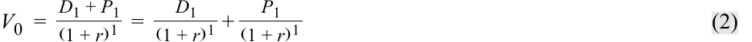
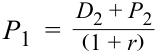
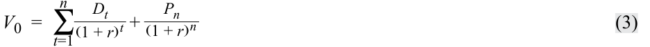
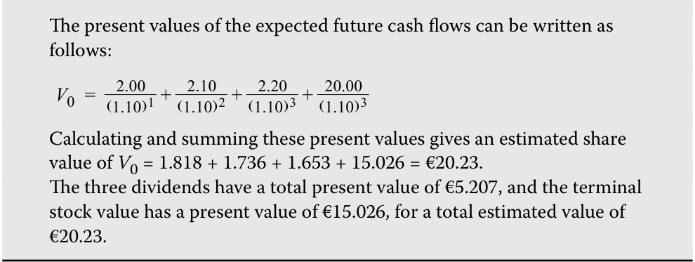
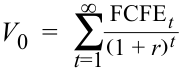

# Volume 5: Equity Investments
## Learning Module 8 Equity Valuation: Concepts and Basic Tools
### Part 1/4: Introduction (PDF Pages 345–359)

---

<!-- PDF Page 345 -->

#### L E A R N I N G M O D U L E 

# **<mark>8</mark>** 

### **Equity Valuation: Concepts and Basic Tools** 

**by John J. Nagorniak, CFA, and Stephen E. Wilcox, PhD, CFA.** 

_John J. Nagorniak, CFA (USA). Stephen E. Wilcox, PhD, CFA, is at Minnesota State University, Mankato (USA)._ 

###### **<mark>LEARNING OUTCOMES</mark>** 

|**_Mastery_**|**_The candidate should be able to:_**|
|---|---|
||evaluate whether a security, given its current market price and a value estimate, is overvalued, fairly valued, or undervalued by the market|
||describe major categories of equity valuation models|
||describe regular cash dividends, extra dividends, stock dividends, stock splits, reverse stock splits, and share repurchases|
||describe dividend payment chronology|
||explain the rationale for using present value models to value equity and describe the dividend discount and free-cash-flow-to-equity models|
||explain advantages and disadvantages of each category of valuation model|
||calculate the intrinsic value of a non-callable, non-convertible preferred stock|
||calculate and interpret the intrinsic value of an equity security based on the Gordon (constant) growth dividend discount model or a two-stage dividend discount model, as appropriate|
||identify characteristics of companies for which the constant growth or a multistage dividend discount model is appropriate|
||explain the rationale for using price multiples to value equity, how the price to earnings multiple relates to fundamentals, and the use of multiples based on comparables|

<!-- PDF Page 346 -->

###### **<mark>LEARNING OUTCOMES</mark>** 

|**_Mastery_**|**_The candidate should be able to:_**|
|---|---|
||calculate and interpret the following multiples: price to earnings, price to an estimate of operating cash flow, price to sales, and price to book value|
||describe enterprise value multiples and their use in estimating equity value|
||describe asset-based valuation models and their use in estimating equity value|

## **<mark>1</mark>** 

##### **INTRODUCTION** 

Analysts gather and process information to make investment decisions, including buy and sell recommendations. What information is gathered and how it is processed depend on the analyst and the purpose of the analysis. Technical analysis uses such information as stock price and trading volume as the basis for investment decisions. Fundamental analysis uses information about the economy, industry, and company as the basis for investment decisions. Examples of fundamentals are unemployment rates, gross domestic product (GDP) growth, industry growth, and quality of and growth in company earnings. Whereas technical analysts use information to predict price movements and base investment decisions on the direction of predicted change in prices, fundamental analysts use information to estimate the value of a security and to compare the estimated value to the market price and then base investment decisions on that comparison. 

This reading introduces equity valuation models used to estimate the **intrinsic value** (synonym: **fundamental value** ) of a security; intrinsic value is based on an analysis of investment fundamentals and characteristics. The fundamentals to be considered depend on the analyst’s approach to valuation. In a top-down approach, an analyst examines the economic environment, identifies sectors that are expected to prosper in that environment, and analyzes securities of companies from previously identified attractive sectors. In a bottom-up approach, an analyst typically follows an industry or industries and forecasts fundamentals for the companies in those industries in order to determine valuation. Whatever the approach, an analyst who estimates the intrinsic value of an equity security is implicitly questioning the accuracy of the market price as an estimate of value. Valuation is particularly important in active equity portfolio management, which aims to improve on the return–risk trade-off of a portfolio’s benchmark by identifying mispriced securities. 

This reading is organized as follows. Section 2 discusses the implications of differences between estimated value and market price. Section 3 introduces three major categories of valuation model. Section 4 presents an overview of present value models with a focus on the dividend discount model. Section 5 describes and examines the use of multiples in valuation. Section 6 explains asset-based valuation and demonstrates how these models can be used to estimate value. Section 7 states conclusions and summarizes the reading. 

<!-- PDF Page 347 -->

##### **ESTIMATED VALUE AND MARKET PRICE** 

## **<mark>2</mark>** 

evaluate whether a security, given its current market price and a value estimate, is overvalued, fairly valued, or undervalued by the market 

By comparing estimates of value and market price, an analyst can arrive at one of three conclusions: The security is _undervalued_ , _overvalued_ , or _fairly valued_ in the marketplace. For example, if the market price of an asset is $10 and the analyst estimates intrinsic value at $10, a logical conclusion is that the security is fairly valued. If the security is selling for $20, the security would be considered overvalued. If the security is selling for $5, the security would be considered undervalued. Basically, by estimating value, the analyst is assuming that the market price is not necessarily the best estimate of intrinsic value. If the estimated value exceeds the market price, the analyst infers the security is _undervalued_ . If the estimated value equals the market price, the analyst infers the security is _fairly valued_ . If the estimated value is less than the market price, the analyst infers the security is _overvalued_ . 

In practice, the conclusion is not so straightforward. Analysts must cope with uncertainties related to model appropriateness and the correct value of inputs. An analyst’s final conclusion depends not only on the comparison of the estimated value and the market price but also on the analyst’s confidence in the estimated value (i.e., in the model selected and the inputs used in it). One can envision a spectrum running from relatively high confidence in the valuation model _and_ the inputs to relatively low confidence in the valuation model _and/or_ the inputs. When confidence is relatively low, the analyst might demand a substantial divergence between his or her own value estimate and the market price before acting on an apparent mispricing. For instance, if the estimate of intrinsic value is $10 and the market price is $10.05, the analyst might reasonably conclude that the security is fairly valued and that the 1/2 of 1 percent market price difference from the estimated value is within the analyst’s confidence interval. 

Confidence in the convergence of the market price to the intrinsic value over the investment time horizon relevant to the objectives of the portfolio must also be taken into account before an analyst acts on an apparent mispricing or makes a buy, sell, or hold recommendation: The ability to benefit from identifying a mispriced security depends on the market price converging to the estimated intrinsic value. 

In seeking to identify mispricing and attractive investments, analysts are treating market prices with skepticism, but they are also treating market prices with respect. For example, an analyst who finds that many securities examined appear to be overvalued will typically recheck models and inputs before acting on a conclusion of overvaluation. Analysts also often recognize and factor into recommendations that different market segments—such as securities closely followed by analysts versus securities relatively neglected by analysts—may differ in how common or persistent mispricing is. Mispricing may be more likely in securities neglected by analysts. 

###### **EXAMPLE 1** 

###### **Valuation and Analyst Response** 

1. An analyst finds that all the securities analyzed have estimated values higher than their market prices. The securities all appear to be: 

   - **A.** overvalued. 

<!-- PDF Page 348 -->

**B.** undervalued. 

**C.** fairly valued. 

###### **Solution:** 

B is correct. The estimated intrinsic value for each security is greater than the market price. The securities all appear to be undervalued in the market. Note, however, that the analyst may wish to reexamine the model and inputs to check that the conclusion is valid. 

2. An analyst finds that nearly all companies in a market segment have common shares which are trading at market prices above the analyst’s estimate of the shares’ values. This market segment is widely followed by analysts. Which of the following statements describes the analyst’s _most appropriate_ first action? 

   - **A.** Issue a sell recommendation for each share issue. 

   - **B.** Issue a buy recommendation for each share issue. 

   - **C.** Reexamine the models and inputs used for the valuations. 

###### **Solution:** 

C is correct. It seems improbable that all the share issues analyzed are overvalued, as indicated by market prices in excess of estimated value—particularly because the market segment is widely followed by analysts. Thus, the analyst will not issue a sell recommendation for each issue. The analyst will _most appropriately_ reexamine the models and inputs prior to issuing any recommendations. A buy recommendation is not an appropriate response to an overvalued security. 

3. An analyst, using a number of models and a range of inputs, estimates a security’s value to be between ¥250 and ¥270. The security is trading at ¥265. The security appears to be: 

   - **A.** overvalued. 

   - **B.** undervalued. 

   - **C.** fairly valued. 

###### **Solution:** 

C is correct. The security’s market price of ¥265 is within the range estimated by the analyst. The security appears to be fairly valued. 

Analysts often use a variety of models and inputs to achieve greater confidence in their estimates of intrinsic value. The use of more than one model and a range of inputs also helps the analyst understand the sensitivity of value estimates to different models and inputs. 

## **<mark>3</mark> CATEGORIES OF EQUITY VALUATION MODELS** 

describe major categories of equity valuation models 

<!-- PDF Page 349 -->

Three major categories of equity valuation models are as follows: 

- **Present value models** (synonym: **discounted cash flow models** ). These models estimate the intrinsic value of a security as the present value of the future benefits expected to be received from the security. In present value models, benefits are often defined in terms of cash expected to be distributed to shareholders ( **dividend discount models** ) or in terms of cash flows available to be distributed to shareholders after meeting capital expenditure and working capital needs ( **free-cash-flow-to-equity models** ). Many models fall within this category, ranging from the relatively simple to the very complex. In Section 4, we discuss in detail two of the simpler models, the Gordon (constant) growth model and the two-stage dividend discount models. 

■ **Multiplier models** (synonym: **market multiple models** ). These models are based chiefly on share price multiples or enterprise value multiples. The former model estimates intrinsic value of a common share from a price multiple for some fundamental variable, such as revenues, earnings, cash flows, or book value. Examples of the multiples include price to earnings (P/E, share price divided by earnings per share) and price to sales (P/S, share price divided by sales per share). The fundamental variable may be stated on a forward basis (e.g., forecasted EPS for the next year) or a trailing basis (e.g., EPS for the past year), as long as the usage is consistent across companies being examined. Price multiples are also used to compare relative values. The use of the ratio of share price to EPS—that is, the P/E multiple—to judge relative value is an example of this approach to equity valuation. **Enterprise value** (EV) multiples have the form (Enterprise value)/(Value of a fundamental variable). Two possible choices for the denominator are earnings before interest, taxes, depreciation, and amortization (EBITDA) and total revenue. Enterprise value, the numerator, is a measure of a company’s total market value from which cash and short-term investments have been subtracted (because an acquirer could use those assets to pay for acquiring the company). An estimate of common share value can be calculated indirectly from the EV multiple; the value of liabilities and preferred shares can be subtracted from the EV to arrive at the value of common equity. 

- **Asset-based valuation models** . These models estimate intrinsic value of a common share from the estimated value of the assets of a corporation minus the estimated value of its liabilities and preferred shares. The estimated market value of the assets is often determined by making adjustments to the **book value** (synonym: **carrying value** ) of assets and liabilities. The theory underlying the asset-based approach is that the value of a business is equal to the sum of the value of the business’s assets. 

As already mentioned, many analysts use more than one type of model to estimate value. Analysts recognize that each model is a simplification of the real world and that there are uncertainties related to model appropriateness and the inputs to the models. The choice of model(s) will depend on the availability of information to input into the model(s) and the analyst’s confidence in the information and in the appropriateness of the model(s). 

<!-- PDF Page 350 -->

###### **EXAMPLE 2** 

###### **Categories of Equity Valuation Models** 

1. An analyst is estimating the intrinsic value of a new company. The analyst has one year of financial statements for the company and has calculated the average values of a variety of price multiples for the industry in which the company operates. The analyst plans to use at least one model from each of the three categories of valuation models. The analyst is _least likely_ to rely on the estimate(s) from the: 

   - **A.** multiplier model(s). 

   - **B.** present value model(s). 

   - **C.** asset-based valuation model(s). 

###### **Solution:** 

B is correct. Because the company has only one year of data available, the analyst is _least likely_ to be confident in the inputs for a present value model. The values on the balance sheet, even before adjustment, are likely to be close to market values because the assets are all relatively new. The multiplier models are based on average multiples from the industry. 

2. Based on a company’s EPS of €1.35, an analyst estimates the intrinsic value of a security to be €16.60. Which type of model is the analyst _most likely_ to be using to estimate intrinsic value? 

   - **A.** Multiplier model. 

   - **B.** Present value model. 

   - **C.** Asset-based valuation model. 

###### **Solution:** 

A is correct. The analyst is using a multiplier model based on the P/E multiple. The P/E multiple used was 16.60/1.35 = 12.3. 

As you begin the study of specific equity valuation models in the next section, you must bear in mind that any model of value is, by necessity, a simplification of the real world. Never forget this simple fact! You may encounter models much more complicated than the ones discussed here, but even those models will be simplifications of reality. 

## **<mark>4</mark>** 

##### **BACKGROUND FOR THE DIVIDEND DISCOUNT MODEL** 

describe regular cash dividends, extra dividends, stock dividends, stock splits, reverse stock splits, and share repurchases describe dividend payment chronology 

Present value models follow a fundamental tenet of economics which states that individuals defer consumption—that is, they invest—for the future benefits expected. Individuals and companies make an investment because they expect thereby to earn a 

<!-- PDF Page 351 -->

rate of return over the investment period. Logically, the value of an investment should be equal to the present value of the expected future benefits. For common shares, an analyst can equate benefits to the cash flows to be generated by the investment. The simplest present value model of equity valuation is the dividend discount model (DDM), which specifies cash flows from a common stock investment to be dividends. 

The next section describes aspects of dividends that users of dividend discount models should understand. 

###### **Dividends: Background for the Dividend Discount Model** 

Generally, there are two sources of return from investing in equities: (1) cash dividends received by an investor over his or her holding period and (2) the change in the market price of equities over that holding period. 

A **dividend** is a distribution paid to shareholders based on the number of shares owned, and a cash dividend is a cash distribution made to a company’s shareholders. Cash dividends are typically paid out regularly at known intervals; such dividends are known as regular cash dividends. By contrast, an **extra dividend** or **special dividend** is a dividend paid by a company that does not pay dividends on a regular schedule or a dividend that supplements regular cash dividends with an extra payment. Companies in cyclical industries and companies undergoing corporate and/or financial restructuring are among those observed to use extra dividends.1 

The payment of dividends is not a legal obligation: dividends must be declared (i.e., authorized) by a company’s board of directors; in some jurisdictions, they must also be approved by shareholders. Regular cash dividends are customarily declared and paid out quarterly in the United States and Canada; semiannually in Europe and Japan; and annually in some other countries, including China. 

Dividend discount models address discounting expected cash dividends. A **stock dividend** (also known as a **bonus issue of shares** ) is a type of dividend in which a company distributes additional shares of its common stock (typically, 2%–10% of the shares then outstanding) to shareholders instead of cash. A stock dividend divides the “pie” (the market value of shareholders’ equity) into smaller pieces without affecting the value of the pie or any shareholder’s proportional ownership in the company. Thus, stock dividends are not relevant for valuation. Stock splits and reverse stock splits are similar to stock dividends in that they have no economic effect on the company or shareholders. A **stock split** involves an increase in the number of shares outstanding with a consequent decrease in share price. An example of a stock split is a two-for-one stock split in which each shareholder is issued an additional share for each share currently owned. A **reverse stock split** involves a reduction in the number of shares outstanding with a corresponding increase in share price. In a one-for-two reverse stock split, each shareholder would receive one new share for every two old shares held, thereby reducing the number of shares outstanding by half. 

In contrast to stock dividends and stock splits, share repurchases are an alternative to cash dividend payments. A **share repurchase** (or **buyback** ) is a transaction in which a company uses cash to buy back its own shares. Shares that have been repurchased are not considered for dividends, voting, or computing earnings per share. A share repurchase is viewed as equivalent to the payment of cash dividends of equal value in terms of the effect on shareholders’ wealth, all other things being equal. Company managements have expressed several key reasons for engaging in share repurchases— namely, (1) signaling a belief that their shares are undervalued (or, more generally, to 

> 1 Another type of dividend is a liquidating dividend, which is a return of capital rather than a distribution from earnings or retained earnings. Liquidating dividends are used when a company goes out of business and distributes its net assets, sells a portion of its business for cash and distributes the sale’s proceeds, or pays a dividend that exceeds its accumulated retained earnings. 

<!-- PDF Page 352 -->

support share prices), (2) flexibility in the amount and timing of distributing cash to shareholders, (3) tax efficiency in markets where tax rates on dividends exceed tax rates on capital gains, and (4) the ability to absorb increases in outstanding shares because of the exercise of employee stock options. 

The payout of regular cash dividends to common shareholders follows a fairly standard chronology that is set in motion once the company’s board of directors votes to pay the dividend. First is the **declaration date** , the day that the company issues a statement declaring a specific dividend. Next comes the **ex-dividend date** (or ex-date), the first date that a share trades without (i.e., “ex”) the dividend. This is followed closely (one or two business days later) by the **holder-of-record date** (also called the owner-of-record date, shareholder-of-record date, record date, date of record, or date of book closure), the date that a shareholder listed on the company’s books will be deemed to have ownership of the shares for purposes of receiving the upcoming dividend; the amount of time between the ex-date and the holder-of-record date is linked to the trade settlement cycle in force. The final milestone is the **payment date** (or **payable date** ), which is the day that the company actually mails out (or electronically transfers) a dividend payment to shareholders. 

###### **EXAMPLE 3** 

###### **Total S.A. Dividend Payment Time Line** 

On 26 May 2017, Total S.A., one of the world’s largest integrated energy companies, declared an annual dividend of €2.48 per share, payable on a quarterly basis. The first quarterly dividend of €2.48/4 = €0.62 was payable on 12 October 2017. The holder-of-record date was 26 September, and the ex-dividend date was 25 September. A timeline for the upcoming Total S.A. quarterly dividend is shown in Exhibit 1. 

**Exhibit 1: Timeline for Total S.A. Quarterly Dividend** 

<!-- Start of picture text -->
Declaration Holder-of-Record Date Date Ex-Date Payment Date 26 May 25 September 26 September 12 October Source:  Total S.A. website: www .total .com . <!-- End of picture text -->

Because buyers of a company’s shares on the ex-dividend date are no longer eligible to receive the upcoming dividend, all else being equal, on that day the company’s share price immediately decreases by the amount of the foregone dividend. Exhibit 2 illustrates the decrease in share price that occurs for a hypothetical company that has declared a $1.00 per share dividend as trading begins on its ex-dividend date. 

<!-- PDF Page 353 -->

###### **Exhibit 2: Stock Price Change for Hypothetical Company on Ex-Dividend Date** 

<!-- Start of picture text -->
Stock Price ($ per share) Last Trade on Ex-Date –1 20.50 Price: $20.00/share 20.25 20.00 19.75 19.50 19.25 19.00 18.75 First Trade on Ex-Date 18.50 Price: $19.00/share 0 Trading Days Ex-Date –2 Ex-Date –1 Ex-Date Ex-Date +1 Record Date <!-- End of picture text -->

_Note_ : Assumes dividend declared is $1 per share and convention for stock trade settlement is _T_ + 3. 

##### **DIVIDEND DISCOUNT MODEL (DDM) AND FREE-CASH-FLOW-TO-EQUITY MODEL (FCFE)** 

## **<mark>5</mark>** 

explain the rationale for using present value models to value equity and describe the dividend discount and free-cash-flow-to-equity models explain advantages and disadvantages of each category of valuation model 

If the issuing company is assumed to be a going concern, the intrinsic value of a share is the present value of expected future dividends. If a constant required rate of return is also assumed, then the DDM expression for the intrinsic value of a share is Equation 1: 

<!-- Formula Text: V 0  =  ∑ t=1 ∞ D t _ (1 + r) t (1) -->

where 

<!-- Formula Text: V0 = value of a share of stock today, at t = 0 -->

<!-- Formula Text: Dt = expected dividend in year t, assumed to be paid at the end of the year -->

- _r_ = required rate of return on the stock 

At the shareholder level, cash received from a common stock investment includes any dividends received and the proceeds when shares are sold. If an investor intends to buy and hold a share for one year, the value of the share today is the present value of two cash flows—namely, the expected dividend _plus_ the expected selling price in one year: 

<!-- PDF Page 354 -->

<!-- Formula Text: V 0  = D 1 + P 1 _ (1 + r) 1   = D 1 _ (1 + r) 1  + P 1 _ (1 + r) 1 (2) -->

where _P_ 1 = the expected price per share at _t_ = 1. 

To estimate the expected selling price, _P_ 1, the analyst could estimate the price another investor with a one-year holding period would pay for the share in one year. If _V_ 0 is based on _D_ 1 and _P_ 1, it follows that _P_ 1 could be estimated from _D_ 2 and _P_ 2: 

<!-- Formula Text: P 1  = D 2 + P 2 _ (1 + r) -->

Substituting the right side of this equation for _P_ 1 in Equation 2 results in _V_ 0 estimated as 

<!-- Formula Text: V 0  = D 1 _ (1 + r)  + D 2 + P 2 _ (1 + r) 2   = D 1 _ (1 + r)  + D 2 _ (1 + r) 2  + P 2 _ (1 + r) 2 -->

Repeating this process, we find the value for _n_ holding periods is the present value of the expected dividends for the _n_ periods plus the present value of the expected price in _n_ periods: 

<!-- Formula Text: V 0  = D 1 _ (1 + r) 1  + ⋯  + D n _ (1 + r) n  + P n _ (1 + r) n -->

Using summation notation to represent the present value of the _n_ expected dividends, we arrive at the general expression for an _n_ -period holding period or investment horizon: 

<!-- Formula Text: V 0  =  ∑ t=1 n D t _ (1 + r) t  + P n _ (1 + r) n (3) -->

The expected value of a share at the end of the investment horizon—in effect, the expected selling price—is often referred to as the **terminal stock value** (or **terminal value** ). 

###### **EXAMPLE 4** 

###### **Estimating Share Value for a Three-Year Investment Horizon** 

1. For the next three years, the annual dividends of a stock are expected to be €2.00, €2.10, and €2.20. The stock price is expected to be €20.00 at the end of three years. If the required rate of return on the shares is 10 percent, what is the estimated value of a share? 

###### **Solution:** 

<!-- Formula Text: The present values of the expected future cash flows can be written as follows: V 0  =    2.00 _ (1.10) 1  +   2.10 _ (1.10) 2  +   2.20 _ (1.10) 3  +  20.00 _ (1.10) 3 Calculating and summing these present values gives an estimated share value of V0 = 1.818 + 1.736 + 1.653 + 15.026 = €20.23. The three dividends have a total present value of €5.207, and the terminal stock value has a present value of €15.026, for a total estimated value of €20.23. -->

Extending the holding period into the indefinite future, we can say that a stock’s estimated value is the present value of all expected future dividends as shown in Equation 1. 

<!-- PDF Page 355 -->

Consideration of an indefinite future is valid because businesses established as corporations are generally set up to operate indefinitely. This general form of the DDM applies even in the case in which the investor has a finite investment horizon. For that investor, stock value today depends _directly_ on the dividends the investor expects to receive before the stock is sold and depends _indirectly_ on the expected dividends for periods subsequent to that sale, because those expected future dividends determine the expected selling price. Thus, the general expression given by Equation 1 holds irrespective of the investor’s holding period. 

In practice, many analysts prefer to use a free-cash-flow-to-equity (FCFE) valuation model. These analysts assume that dividend-paying _capacity_ should be reflected in the cash flow estimates rather than _expected dividends_ . FCFE is a measure of dividend-paying capacity. Analysts may also use FCFE valuation models for a non-dividend-paying stock. To use a DDM, the analyst needs to predict the timing and amount of the first dividend and all the dividends or dividend growth thereafter. Making these predictions for non-dividend-paying stock accurately is typically difficult, so in such cases, analysts often resort to FCFE models. 

The calculation of FCFE starts with the calculation of cash flow from operations (CFO). CFO is simply defined as net income plus non-cash expenses minus investment in working capital. FCFE is a measure of cash flow generated in a period that is available for distribution to common shareholders. What does “available for distribution” mean? The entire CFO is _not_ available for distribution; the portion of the CFO needed for fixed capital investment (FCInv) during the period to maintain the value of the company as a going concern is _not_ viewed as available for distribution to common shareholders. Net amounts borrowed (borrowings minus repayments) are considered to be available for distribution to common shareholders. Thus, FCFE can be expressed as 

FCFE = CFO – FCInv + Net borrowing ~~(4)~~ 

The information needed to calculate historical FCFE is available from a company’s statement of cash flows and financial disclosures. Frequently, under the assumption that management is acting in the interest of maintaining the value of the company as a going concern, reported capital expenditure is taken to represent FCInv. Analysts must make projections of financials to forecast future FCFE. Valuation obtained by using FCFE involves discounting expected future FCFE by the required rate of return on equity; the expression parallels Equation 1: 

<!-- Formula Text: V 0  =  ∑ t=1 ∞ FCFE t _ (1 + r) t -->

###### **EXAMPLE 5** 

###### **Present Value Models** 

1. An investor expects a share to pay dividends of $3.00 and $3.15 at the end of Years 1 and 2, respectively. At the end of the second year, the investor expects the shares to trade at $40.00. The required rate of return on the shares is 8 percent. If the investor’s forecasts are accurate and the market price of the shares is currently $30, the _most likely_ conclusion is that the shares are: 

   - **A.** overvalued. 

**B.** undervalued. 

- **C.** fairly valued. 

<!-- PDF Page 356 -->

###### **Solution:** 

B is correct. 

<!-- Formula Text: V 0  =    3.00 _ (1.08) 1  +   3.15 _ (1.08) 2  +  40.00 _ (1.08) 2   =  39.77 -->

The value estimate of $39.77 exceeds the market price of $30, so the conclusion is that the shares are undervalued. 

2. Two investors with different holding periods but the same expectations and required rate of return for a company are estimating the intrinsic value of a common share of the company. The investor with the shorter holding period will _most likely_ estimate a: 

   - **A.** lower intrinsic value. 

   - **B.** higher intrinsic value. 

   - **C.** similar intrinsic value. 

###### **Solution:** 

C is correct. The intrinsic value of a security is independent of the investor’s holding period. 

3. An equity valuation model that focuses on expected dividends rather than the capacity to pay dividends is the: 

   - **A.** dividend discount model. 

   - **B.** free cash flow to equity model. 

   - **C.** cash flow return on investment model. 

###### **Solution:** 

A is correct. Dividend discount models focus on expected dividends. 

How is the required rate of return for use in present value models estimated? To estimate the required rate of return on a share, analysts frequently use the capital asset pricing model (CAPM): 

Required rate of return on share _i_ = Current expected risk 

- free rate of return ~~(5)~~ + Beta _i_ [ Market   ( equity )  risk premium ] 

Equation 5 states that the required rate of return on a share is the sum of the current expected risk-free rate plus a risk premium that equals the product of the stock’s beta (a measure of non-diversifiable risk) and the market risk premium (the expected return of the market in excess of the risk-free return, where in practice, the “market” is often represented by a broad stock market index). However, even if analysts agree that the CAPM is an appropriate model, their inputs into the CAPM may differ. Thus, there is no uniquely correct answer to the question: What is the required rate of return? 

Other common methods for estimating the required rate of return for the stock of a company include adding a risk premium that is based on economic judgments, rather than the CAPM, to an appropriate risk-free rate (usually a government bond) and adding a risk premium to the yield on the company’s bonds. Good business and economic judgment is paramount in estimating the required rate of return. In many investment firms, required rates of return are determined by firm policy. 

<!-- PDF Page 357 -->

##### **PREFERRED STOCK VALUATION** 

## **<mark>6</mark>** 

calculate the intrinsic value of a non-callable, non-convertible preferred stock 

explain advantages and disadvantages of each category of valuation model 

General dividend discount models are relatively easy to apply to preferred shares. In its simplest form, **preferred stock** is a form of equity (generally, non-voting) that has priority over common stock in the receipt of dividends and on the issuer’s assets in the event of a company’s liquidation. It may have a stated maturity date at which time payment of the stock’s par (face) value is made or it may be perpetual with no maturity date; additionally, it may be callable or convertible. 

For a non-callable, non-convertible perpetual preferred share paying a level dividend _D_ and assuming a constant required rate of return over time, Equation 1 reduces to the formula for the present value of a perpetuity. Its value is: 

<!-- Formula Text: V 0  = D 0 _ r (6) -->

For example, a $100 par value non-callable perpetual preferred stock offers an annual dividend of $5.50. If its required rate of return is 6 percent, the value estimate would be $5.50/0.06 = $91.67. 

For a non-callable, non-convertible preferred stock with maturity at time _n_ , the estimated intrinsic value can be estimated by using Equation 3 but using the preferred stock’s par value, _F_ , instead of _Pn_ : 

<!-- Formula Text: V 0  =  ∑ t=1 n D t _ (1 + r) t  + F _ (1 + r) n (7) -->

When Equation 7 is used, the most precise approach is to use values for _n, r,_ and _D_ that reflect the payment schedule of the dividends. This method is similar to the practice of fixed-income analysts in valuing a bond. For example, a non-convertible preferred stock with a par value of £20.00, maturity in six years, a nominal required rate of return of 8.20 percent, and semiannual dividends of £2.00 would be valued by using an _n_ of 12, an _r_ of 4.10 percent, a _D_ of £2.00, and an _F_ of £20.00. The result would be an estimated value of £31.01. Assuming payments are annual rather than semiannual (i.e., assuming that _n_ = 6, _r_ = 8.20 percent, and _D_ = £4.00) would result in an estimated value of £30.84. 

Preferred stock issues are frequently callable (redeemable) by the issuer at some point prior to maturity, often at par value or at prices in excess of par value that decline to par value as the maturity date approaches. Such call options tend to reduce the value of a preferred issue to an investor because the option to redeem will be exercised by the issuer when it is in the issuer's favor and ignored when it is not. For example, if an issuer can redeem shares at par value that would otherwise trade (on the basis of dividends, maturity, and required rate of return) above par value, the issuer has motivation to redeem the shares. 

Preferred stock issues can also include a retraction option that enables the holder of the preferred stock to sell the shares back to the issuer prior to maturity on prespecified terms. Essentially, the holder of the shares has a put option. Such put options tend to increase the value of a preferred issue to an investor because the option to retract will be exercised by the investor when it is in the investor's favor and ignored when it is 

<!-- PDF Page 358 -->

not. Although the precise valuation of issues with such embedded options is beyond the scope of this reading, Example 6 includes a case in which Equation 7 can be used to approximate the value of a callable, retractable preferred share. 

###### **EXAMPLE 6** 

###### **Preferred Share Valuation: Two Cases** 

###### **_Case 1_ :** **_Non-callable, Non-convertible, Perpetual Preferred Shares_** 

The following facts concerning the Union Electric Company 4.75 percent perpetual preferred shares are as follows: 

   - Issuer: Union Electric Co. (owned by Ameren) 

   - Par value: US$100 

   - Dividend: US$4.75 per year 

   - Maturity: perpetual 

   - Embedded options: none 

   - Credit rating: Moody’s Investors Service/Standard & Poor’s Ba1/BB 

   - Required rate of return on Ba1/BB rated preferred shares as of valuation date: 7.5 percent. 

1. Estimate the intrinsic value of this preferred share. 

###### **Solution** 

Basing the discount rate on the required rate of return on Ba1/BB rated preferred shares of 7.5 percent gives an intrinsic value estimate of US$4.75/0.075 = US$63.33. 

2. Explain whether the intrinsic value of this issue would be higher or lower if the issue were callable (with all other facts remaining unchanged). 

###### **Solution** 

The intrinsic value would be lower if the issue were callable. The option to redeem or call the issue is valuable to the issuer because the call will be exercised when doing so is in the issuer’s interest. The intrinsic value of the shares to the investor will typically be lower if the issue is callable. In this case, because the intrinsic value without the call is much less than the par value, the issuer would be unlikely to redeem the issue if it were callable; thus, callability would reduce intrinsic value, but only slightly. 

###### **_Case 2_ :** **_Retractable Term Preferred Shares_** 

Retractable term preferred shares are a type of preferred share that has been previously issued by Canadian companies,and have now began to be offered by companies in other jurisdictions, including Japan. This type of issue specifies a “retraction date” when the preferred shareholders have the option to sell back their shares to the issuer at par value (i.e., the shares are “retractable” or “putable” 

<!-- PDF Page 359 -->

at that date).2 At predetermined dates prior to the retraction date, the issuer has the option to redeem the preferred issue at predetermined prices (which are always at or above par value). 

An example of a retractable term preferred share currently outstanding is TMC (Toyota Motor Corporation), First Series Model AA class shares, with a 0.5 percent dividend rate, increasing by 0.5 percent every year until 2020 and thereafter, becoming fixed at 2.5 percent. TMC is leading global automobile manufacturer, with headquarters in Japan and global operations. The issue is in Japanese Yen. The shares have a ¥10,598 par value and pay a semiannual dividend of ¥26.5 [= (0.5 percent × ¥10,598)/2] on 31 March 2016. The semiannual dividend is expected to increase to ¥132.5 [= (2.5 percent × ¥10,598)/2] on 31 March 2020 and beyond. As of 31 December 2017 the company carried ratings from Moody’s and Standard & Poor’s of Aa3 and AA–, respectively. Thus, the shares are viewed by Moody’s and Standard & Poor’s as having “adequate” credit quality, qualified by “Aa3 and AA–,” which means relatively high quality within that group. Beginning from 2 April 2021, the shares are redeemable at the option of TMC at ¥10,598 (par value). The retraction date is the last day of March, June, September, and December of each year, starting from 1 September 2020, with the shares retractable at par value. The Series AA shares have voting rights and may exercise their voting rights and other rights held by holders of common shares of TMC in the same manner. The Series AA shares were issued at a 20% premium to the common shares price in 2015, and since then the share price has decreased to ¥7,243 as at 31 December 2017, and with a current required rate of 3.05 per year (1.525 percent semiannual). Because the issue’s market price is so far below the prices at which TMC could redeem or call the issue, redemption is considered to be unlikely by TMC, whereas the retraction option for the Series AA holders appears to have a significant value since they will potentially be able to put back the shares to TMC at approximately 45 percent over the current market value (¥10,598 compared to ¥7,243). 

3. Assume that the issue will be retracted in December 2020; the holders of the shares will put the shares to the company in December 2020. Based on the information given, estimate the intrinsic value of a share. Assume it is December 2017. 

###### **Solution** 

An intrinsic value estimate of a share of this preferred issue is ¥10,279. Expected semiannual dividends: 

Year ended March 31, 2018: ¥79.5 [= (1.5 percent × ¥10,598)/2] 

Year ended March 31, 2019: ¥106 [= (2.0 percent × ¥10,598)/2] 

Year ended March 31, 2020: ¥132.5 [= (2.5 percent × ¥10,598)/2] 

_ _ _ _ _ _ __V_0 =   [ 1.01525¥79.5+ 1.01525¥79.52+ 1.01525¥1063+ 1.01525¥1064+ 1.01525¥132.55+ 1.01525¥132.56+ 1.01525¥10, 5986] ≈ ¥10, 279 

The difference between the current market price of ¥7,243 and the intrinsic value of ¥10,279 is the implied value of retractable option given to the holders of the Series AA shares. 

> 2 “Retraction” refers to this option, which is a put option. The terminology is not completely settled: The type of share being called “retractable term preferred” is also known as “hard retractable preferred,” with “hard” referring to payment in cash rather than common shares at the retraction date. 

