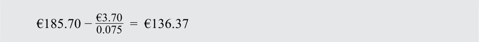
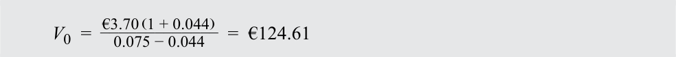
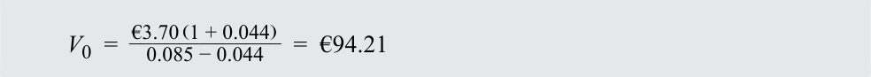
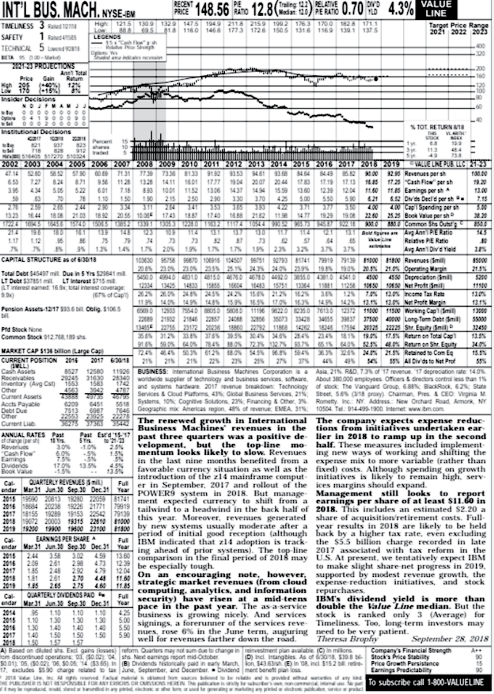
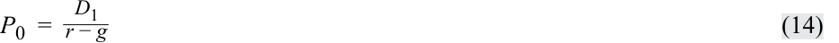
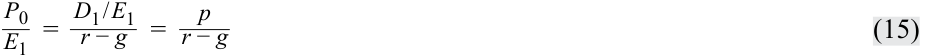
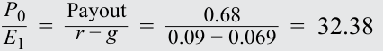

# Volume 5: Equity Investments
## Learning Module 8 Equity Valuation: Concepts and Basic Tools
### Part 2/4: The Gordon Growth Model (PDF Pages 360–372)

---

<!-- PDF Page 360 -->

# **<mark>7</mark>** 

## **THE GORDON GROWTH MODEL** 

calculate and interpret the intrinsic value of an equity security based on the Gordon (constant) growth dividend discount model or a two-stage dividend discount model, as appropriate 

identify characteristics of companies for which the constant growth or a multistage dividend discount model is appropriate explain advantages and disadvantages of each category of valuation model 

A rather obvious problem when one is trying to implement Equation 1 for common equity is that it requires the analyst to estimate an infinite series of expected dividends. To simplify this process, analysts frequently make assumptions about how dividends will grow or change over time. The Gordon (constant) growth model (Gordon, 1962) is a simple and well-recognized DDM. The model assumes dividends grow indefinitely at a constant rate. 

Because of its assumption of a constant growth rate, the Gordon growth model is particularly appropriate for valuing the equity of dividend-paying companies that are relatively insensitive to the business cycle and in a mature growth phase. Examples might include an electric utility serving a slowly growing area or a producer of a staple food product (e.g., bread). A history of increasing the dividend at a stable growth rate is another practical criterion if the analyst believes that pattern will hold in the future. 

With a constant growth assumption, Equation 1 can be written as Equation 8, where _g_ is the constant growth rate: 

<!-- Formula Text: V 0  =  ∑ t=1 ∞ D 0 (1 + g) t _ (1 + r) t    =  D 0 [ (1 + g) _ (1 + r)  + (1 + g) 2 _ (1 + r) 2  + ... + (1 + g) ∞ _ (1 + r) ∞ ] (8) -->

If required return _r_ is assumed to be strictly greater than growth rate _g_ , then the square-bracketed term in Equation 8 is an infinite geometric series and sums to [(1 + _g_ )/( _r_ – _g_ )]. Substituting into Equation 8 produces the Gordon growth model as presented in Equation 9: 

<!-- Formula Text: V 0  = D 0 (1 + g) _ r − g    = D 1 _ r − g (9) -->

For an illustration of the expression, suppose the current (most recent) annual dividend on a share is €5.00 and dividends are expected to grow at 4 percent per year. The required rate of return on equity is 8 percent. The Gordon growth model estimate of intrinsic value is, therefore, €5.00(1.04)/(0.08 – 0.04) = €5.20/0.04 = €130 per share. Note that the numerator is _D_ 1 not _D_ 0. (Using the wrong numerator is a common error.) 

The Gordon growth model estimates intrinsic value as the present value of a growing perpetuity. If the growth rate, _g_ , is assumed to be zero, Equation 8 reduces to the expression for the present value of a perpetuity, given earlier as Equation 6. 

In estimating a long-term growth rate, analysts use a variety of methods, including assessing the growth in dividends or earnings over time, using the industry median growth rate, and using the relationship shown in Equation 10 to estimate the sustainable growth rate: 

<!-- Formula Text: g = b × ROE (10) -->

<!-- PDF Page 361 -->

##### where 

_g_ = dividend growth rate 

_b_ = earnings retention rate = (1 – Dividend payout ratio) 

ROE = return on equity 

Example 7 illustrates the application of the Gordon growth model to the shares of a large industrial manufacturing company. The analyst believes it will continue to grow at a rate that it achieved in the previous three years and remain stable in the future. The example asks how much the dividend growth assumption adds to the intrinsic value estimate. The question is relevant to valuation because if the amount is high on a percentage basis, a large part of the value of the share depends on the realization of the growth estimate. One can answer the question by subtracting from the intrinsic value estimate determined by Equation 9 the value determined by Equation 6, which assumes no dividend growth.3 

##### **EXAMPLE 7** 

### **Applying the Gordon Growth Model** 

Siemens AG operates in the capital goods and technology space. It is involved in the engineering, manufacturing, automation, power, and transportation sectors. It operates globally and is one of the largest companies in the sectors in which it operates. It is a substantial employer in both its original, domestic German market, as well as dozens of countries around the world. Selected financial information for Siemens appears in Exhibit 3. 

**Exhibit 3: Selected Financial Information for Siemens AG** 

|**Year**|**2017**|**2016**|**2015**|**2014**|**2013**|
|---|---|---|---|---|---|
|EPS|€7.45|€6.74|€8.85|€6.37|€5.08|
|DPS|€3.7|€3.6|€3.5|€3.3|€3.0|
|Payout ratio|50%|53%|40%|52%|59%|
|ROE|15.6%|15.9%|22.3%|18.2%|14.6%|
|Share price||||||
|(XETRA - Frankfurt)|€119.2|€104.2|€79.94|€94.37|€89.06|

_Note:_ DPS stands for “dividends per share.” 

_Source:_ Morningstar, www .siemens .com. 

The analyst estimates the growth rate to be approximately 5.4 percent based on the dividend growth rate over the period 2013 to 2017 [3(1 + _g_ )4 = 3.7, so _g_ = 5.4%]. To verify that the estimated growth rate of 5.4 percent is feasible in the future, the analyst also uses the average of Siemens’s retention rate and ROE for the previous five years ( _g_ ≈ 0.49 × 17.3% ≈ 8.5%) to estimate the sustainable growth rate. 

Using a number of approaches, including adding a risk premium to a longterm German government bond and using the CAPM, the analyst estimates a required return of 7.5 percent. The most recent dividend of €3.70 is used for _D0_ . 

<!-- PDF Page 362 -->

1. Use the Gordon growth model to estimate Siemens’s intrinsic value. 

#### **Solution:** 

<!-- Formula Text: V 0  =   €3.70 (1 + 0.054) _____________ 0.075 − 0.054    =  €185.70 -->

2. How much does the dividend growth assumption add to the intrinsic value estimate? 

#### **Solution:** 

<!-- Formula Text: €185.70 −  €3.70 _ 0.075   =  €136.37 -->

3. Based on the estimated intrinsic value, is a share of Siemens undervalued, overvalued, or fairly valued? 

#### **Solution:** 

A share of Siemens appears to be undervalued. The analyst, before making a recommendation, might consider how realistic the estimated inputs are and check the sensitivity of the estimated value to changes in the inputs. 

4. What is the intrinsic value if the growth rate estimate is lowered to 4.4 percent? 

#### **Solution:** 

<!-- Formula Text: V 0  =   €3.70 (1 + 0.044) _____________ 0.075 − 0.044    =  €124.61 -->

5. What is the intrinsic value if the growth rate estimate is lowered to 4.4 percent and the required rate of return estimate is increased to 8.5 percent? 

#### **Solution:** 

<!-- Formula Text: V 0  =   €3.70 (1 + 0.044) _____________ 0.085 − 0.044    =  €94.21 -->

The Gordon growth model estimate of intrinsic value is extremely sensitive to the choice of required rate of return _r_ and growth rate _g_ . It is possible that the growth rate assumption and the required return assumption used initially were too high. Worldwide economic growth is typically in the low single digits, which may mean that a large company such as Siemens may struggle to grow dividends at 5.4 percent into perpetuity. Exhibit 4 presents a further sensitivity analysis of Siemens’s intrinsic value to the required return and growth estimates. 

**Exhibit 4: Sensitivity Analysis of the Intrinsic-Value Estimate for Siemens AG** 

||**_g_ = 2.5%**|**_g_ = 3.5%**|**_g_ = 4.5%**|**_g_ = 5.5%**|**_g_ = 6.5%**|
|---|---|---|---|---|---|
|_r_= 6%|€108.4|€153.2|€257.8|€780.7|—|
|_r_= 7%|€84.3|€109.4|€154.7|€260.2|€788.1|
|_r_= 8%|€69.0|€85.1|€110.5|€156.1|€262.7|

<!-- PDF Page 363 -->

||**_g_ = 2.5%**|**_g_ = 3.5%**|**_g_ = 4.5%**|**_g_ = 5.5%**|**_g_ = 6.5%**|
|---|---|---|---|---|---|
|_r_= 9%|€58.3|€69.6|€85.9|€111.5|€157.6|
|_r_= 10%|€50.6|€58.9|€70.3|€86.7|€112.6|

Note that no value is shown when the growth rate exceeds the required rate of return. The Gordon growth model assumes that the growth rate cannot be greater than the required rate of return. 

The assumptions of the Gordon model are as follows: 

- Dividends are the correct metric to use for valuation purposes. 

- The dividend growth rate is forever: It is perpetual and never changes. 

- The required rate of return is also constant over time. 

- The dividend growth rate is strictly less than the required rate of return. 

An analyst might be dissatisfied with these assumptions for many reasons. The equities being examined might not currently pay a dividend. The Gordon assumptions might be too simplistic to reflect the characteristics of the companies being evaluated. Some alternatives to using the Gordon model are as follows: 

- Use a more robust DDM that allows for varying patterns of growth. 

- Use a cash flow measure other than dividends for valuation purposes. 

- Use some other approach (such as a multiplier method) to valuation. 

Applying a DDM is difficult if the company being analyzed is not currently paying a dividend. A company may not be paying a dividend if 1) the investment opportunities the company has are all so attractive that the retention and reinvestment of funds is preferable, from a return perspective, to the distribution of a dividend to shareholders or 2) the company is in such shaky financial condition that it cannot afford to pay a dividend. An analyst might still use a DDM to value such companies by assuming that dividends will begin at some future point in time. The analyst might further assume that constant growth occurs after that date and use the Gordon growth model for valuation. Extrapolating from no current dividend, however, generally yields highly uncertain forecasts. Analysts typically choose to use one or more of the alternatives instead of or as a supplement to the Gordon growth model. 

##### **EXAMPLE 8** 

### **Gordon Growth Model in the Case of No Current Dividend** 

1. A company does not currently pay a dividend but is expected to begin to do so in five years (at _t_ = 5). The first dividend is expected to be $4.00 and to be received five years from today. That dividend is expected to grow at 6 percent into perpetuity. The required return is 10 percent. What is the estimated current intrinsic value? 

### **Solution:** 

The analyst can value the share in two pieces: 

**1.** The analyst uses the Gordon growth model to estimate the value at _t_ = 5; in the model, the year-ahead dividend is $4(1.06). Then the analyst finds the present value of this value as of _t_ = 0. 

<!-- PDF Page 364 -->

**2.** The analyst finds the present value of the $4 dividend not “counted” in the estimate in Piece 1 (which values dividends from _t_ = 6 onward). Note that the statement of the problem implies that _D_ 0, _D_ 1, _D_ 2, _D_ 3, and _D_ 4 are zero. Piece 1: The value of this piece is $65.818: _Vn_ =   Dnr_ ( −  1 + _g g_ ) =   rD_ − _n_ +1 _g_ _  V_ 5 =$4 0.10 − 0.06( 1 + 0.06 ) =  $4.24 0.04= $106 _$106 _V_ 0 =( 1 + 0.10)5 = $65.818 Piece 2: The value of this piece is $2.484: <mark>_</mark> $4 _V_ 0 =( 1 + 0.10)5 = $2.484 

The sum of the two pieces is $65.818 + $2.484 = $68.30. Alternatively, the analyst could value the share at _t_ = 4, the point at which dividends are expected to be paid in the following year and from which point they are expected to grow at a constant rate. _$4.00  V_ 4 =  0.10 − 0.06=  $4.00 0.04= $100 _$100 _V_ 0 =( 1 + 0.10)4 = $68.30 

The next section addresses the application of the DDM with more flexible assumptions as to the dividend growth rate. 

# **<mark>8</mark> MULTISTAGE DIVIDEND DISCOUNT MODELS** 

calculate and interpret the intrinsic value of an equity security based on the Gordon (constant) growth dividend discount model or a two-stage dividend discount model, as appropriate 

identify characteristics of companies for which the constant growth or a multistage dividend discount model is appropriate explain advantages and disadvantages of each category of valuation model 

Multistage growth models are often used to model rapidly growing companies. The _two-stage DDM_ assumes that at some point the company will begin to pay dividends that grow at a constant rate, but prior to that time the company will pay dividends that are growing at a higher rate than can be sustained in the long run. That is, the company is assumed to experience an initial, finite period of high growth, perhaps prior to the entry of competitors, followed by an infinite period of sustainable growth. The two-stage DDM thus makes use of two growth rates: a high growth rate for an initial, finite period followed by a lower, sustainable growth rate into perpetuity. The Gordon growth model is used to estimate a terminal value at time _n_ that reflects the present value at time _n_ of the dividends received during the sustainable growth period. 

Equation 11 will be used here as the starting point for a two-stage valuation model. The two-stage valuation model is similar to Example 8 except that instead of assuming zero dividends for the initial period, the analyst assumes that dividends will exhibit a 

<!-- PDF Page 365 -->

high rate of growth during the initial period. Equation 11 values the dividends over the short-term period of high growth and the terminal value at the end of the period of high growth. The short-term growth rate, _gS_ , lasts for _n_ years. The intrinsic value per share in year _n_ , _Vn_ , represents the year _n_ value of the dividends received during the sustainable growth period or the terminal value at time _n_ . _Vn_ can be estimated by using the Gordon growth model as shown in Equation 12, where _gL_ is the long-term or sustainable growth rate. The dividend in year _n_ + 1, _Dn_ +1, can be determined by using Equation 13: 

<!-- Formula Text: V 0  =  ∑ t=1 n D 0 (1 + g S) t _ (1 + r) t   + V n _ (1 + r) n (11) V n  = D n+1 _ r − g L (12) D n+1  =  D 0 (1 + g S) n (1 + g L) (13) -->

##### **EXAMPLE 9** 

### **Applying the Two-Stage Dividend Discount Model** 

1. The current dividend, _D_ 0, is $5.00. Growth is expected to be 10 percent a year for three years and then 5 percent thereafter. The required rate of return is 15 percent. Estimate the intrinsic value. 

### **Solution:** 

_D_ 1 = $5.00(1 + 0.10) = $5.50 

_D_ 2 = $5.00(1 + 0.10)2 = $6.05 _D_ 3 = $5.00(1 + 0.10)3 = $6.655 _D_ 4 = $5.00(1 + 0.10)3 (1 + 0.05) = $6.98775 

 V_ 3 =  0.15 − 0.05$6.98775= $69.8775 _ _$6.05 _  V_ 0 =( 1 + 0.15$5.50)+  ( 1 + 0.15)2 +  ( 1 + 0.15$6.655)3 +  ( 1 + 0.15$69.8775)3 ≈ $59.68 

The DDM can be extended to as many stages as deemed appropriate. For most publicly traded companies (that is, companies beyond the start-up stage), practitioners assume growth will ultimately fall into three stages: 1) growth, 2) transition, and 3) maturity. This assumption supports the use of a _three-stage DDM_ , which makes use of three growth rates: a high growth rate for an initial finite period, followed by a lower growth rate for a finite second period, followed by a lower, sustainable growth rate into perpetuity. 

One can make the case that a three-stage DDM would be most appropriate for a fairly young company, one that is just entering the growth phase. The two-stage DDM would be appropriate to estimate the value of an older company that has already moved through its growth phase and is currently in the transition phase (a period with a higher growth rate than the sustainable growth rate) prior to moving to the maturity phase (the period with a lower, sustainable growth rate). 

However, the choice of a two-stage DDM need not rely solely on the age of a company. Long-established companies sometimes manage to restart above-average growth through, for example, innovation, expansion to new markets, or acquisitions. 

<!-- PDF Page 366 -->

Or a company’s long-run growth rate may be interrupted by a period of subnormal performance. If growth is expected to moderate (in the first case) or improve (in the second case) toward some long-term growth rate, a two-stage DDM may be appropriate. Thus, we chose a two-stage DDM to value International Business Machines Corporation in Example 10. 

##### **EXAMPLE 10** 

### **Two-Stage Dividend Discount Model: International Business Machines Corporation** 

International Business Machines Corporation (IBM) is a US based leading technology company. IBM was founded in 1911, initially as a company that manufactured machinery for sale and lease, ranging from commercial scales and industrial time recorders, meat and cheese slicers, to punched cards. IBM introduced the personal computer in 1981; however, by the 1990s, it began to suffer losses in its core computer manufacturing business and by the 2000s, it had begun to diversify into business consulting, which was finalized in 2005 when it sold its personal computer business to Chinese company Lenovo. IBM now operates through five segments: Cognitive Solutions, Global Business Services (GBS), Technology Services & Cloud Platforms, Systems, and Global Financing. The Cognitive Solutions segment delivers a spectrum of capabilities from descriptive, predictive, and prescriptive analytics to cognitive systems. Cognitive Solutions includes Watson, a cognitive computing platform that has the ability to interact in natural language, process big data, and learn from interactions with people and computers. The GBS segment provides clients with consulting, application management services, and global process services. The Technology Services & Cloud Platforms segment provides information technology infrastructure services. The Systems segment provides clients with infrastructure technologies. The Global Financing segment includes client financing, commercial financing, and remanufacturing and remarketing. 

The 30 July 2018 _Value Line_ report on IBM appears in Exhibit 5. IBM has increased its dividends every year over the past 15 years. Information from _Value Line_ shows that the dividend growth is around 17.0 percent for the past 10 years, 13.5 percent for the past 5 years, and estimated to be 4.5 percent for 2015 to 2023. After a period of growth through acquisition and merger, the pattern suggests that IBM may be transitioning to a mature growth phase. 

The two-stage DDM is arguably a good choice for valuing IBM because the company appears to be transitioning from a high-growth phase (note the 13.5 percent dividend growth for the past 5 years) to a lower-growth phase (note the forecast of 4.5 percent dividend growth to 2015–2023). 

The CAPM can be used to estimate the required return, _r_ , for IBM. The _Value Line_ report (in the top left corner) estimates beta to be 0.95. Using the yield of about 2.0 percent on 10-year US Treasury notes as a proxy for the risk-free rate and assuming an equity risk premium of 5.0 percent, we find the estimate for _r_ would be 6.75 percent [2.0% + 0.95(5.0%)]. 

To estimate the intrinsic value at the end of 2018, we use the 2018 dividend of US$6.21 from the _Value Line_ report. The dividend is assumed to grow at a rate of 5.0 percent for one year and then 2.33 percent thereafter. The growth rate assumption for the first stage is consistent with the _Value Line_ forecast for the 

<!-- PDF Page 367 -->

2018 and 2019 dividends. Our assumption of a 2.33 percent perpetual growth rate produces an 8-year growth rate assumption near 4.5%,4 which is consistent with the _Value Line_ forecast of 4.5 percent growth from 2015–2022. Thus: 

_D_ 2019 = US$6.21(1 + 0.05) = US$6.5205 _D_ 2020 = US$6.21(1 + 0.05)(1 + 0.0233) = US$6.6724 _D_ 2021 = US$6.21(1 + 0.05)(1 + 0.0233)2 = US$6.8279 ___________ V_ 2020 =  0.0675 − 0.0233US$6.8279= US$154.4774 _ _  V_ 2018 =(US$6.5205 1 + 0.0675)+  ( 1 + 0.0675US$6.6724)2 +  US$154.4774( 1 + 0.0675)2≈ US$147.523 

Given a recent price of US$148.56, as noted at the top left corner of the _Value Line_ report, the intrinsic-value estimate of US$147.523 suggests that IBM is approximately fairly valued. 

<!-- PDF Page 368 -->

##### **Exhibit 5:** **_Value Line_ Report on IBM** 

_Source:_ © 2018 Value Line, Inc. All Rights Reserved Worldwide. “Value Line” is a registered trademark of Value Line, Inc. Value Line Geometric and Arithmetic Indices calculated by Thomson Reuters. Information supplied by Thomson Reuters. 

<!-- PDF Page 369 -->

## **MULTIPLER MODELS AND RELATIONSHIP AMONG PRICE MULTIPLES, PRESENT VALUE MODELS, AND FUNDAMENTALS** 

# **<mark>9</mark>** 

explain the rationale for using price multiples to value equity, how the price to earnings multiple relates to fundamentals, and the use of multiples based on comparables calculate and interpret the following multiples: price to earnings, price to an estimate of operating cash flow, price to sales, and price to book value 

explain advantages and disadvantages of each category of valuation model 

The term **price multiple** refers to a ratio that compares the share price with some sort of monetary flow or value to allow evaluation of the relative worth of a company’s stock. Some practitioners use price ratios as a screening mechanism. If the ratio falls below a specified value, the shares are identified as candidates for purchase, and if the ratio exceeds a specified value, the shares are identified as candidates for sale. Many practitioners use ratios when examining a group or sector of stocks and consider the shares for which the ratio is relatively low to be attractively valued securities. 

Price multiples that are used by security analysts include the following: 

- Price-to-earnings ratio (P/E). This measure is the ratio of the stock price to earnings per share. P/E is arguably the price multiple most frequently cited by the media and used by analysts and investors (Block 1999). The seminal works of McWilliams (1966), Miller and Widmann (1966), Nicholson (1968), Dreman (1977), and Basu (1977) presented evidence of a return advantage to low-P/E stocks. 

- Price-to-book ratio (P/B). The ratio of the stock price to book value per share. Considerable evidence suggests that P/B multiples are inversely related to future rates of return (Fama and French 1995). 

- Price-to-sales ratio (P/S). This measure is the ratio of stock price to sales per share. O’Shaughnessy (2005) provided evidence that a low P/S multiple is the most useful multiple for predicting future returns. 

- Price-to-cash-flow ratio (P/CF). This measure is the ratio of stock price to some per-share measure of cash flow. The measures of cash flow include free cash flow (FCF) and operating cash flow (OCF). 

A common criticism of all of these multiples is that they do not consider the future. This criticism is true if the multiple is calculated from trailing or current values of the divisor. Practitioners seek to counter this criticism by a variety of techniques, including forecasting fundamental values (the divisors) one or more years into the future. The resulting forward (leading or prospective) price multiples may differ markedly from the trailing price multiples. In the absence of an explicit forecast of fundamental values, the analyst is making an implicit forecast of the future when implementing such models. The choice of price multiple—trailing or forward—should be used consistently for companies being compared. 

Besides the traditional price multiples used in valuation, just presented, analysts need to know how to calculate and interpret other ratios. Such ratios include those used to analyze business performance and financial condition based on data reported in financial statements. In addition, many industries have specialized measures of 

<!-- PDF Page 370 -->

business performance that analysts covering those industries should be familiar with. In analyzing cable television companies, for example, the ratio of total market value of the company to the total number of subscribers is commonly used. Another common measure is revenue per subscriber. In the oil industry, a commonly cited ratio is proved reserves per common share. Industry-specific or sector-specific ratios such as these can be used to understand the key business variables in an industry or sector as well as to highlight attractively valued securities. 

### **Relationships among Price Multiples, Present Value Models, and Fundamentals** 

Price multiples are frequently used independently of present value models. One price multiple valuation approach, the method of comparables, does not involve cash flow forecasts or discounting to present value. A price multiple is often related to fundamentals through a discounted cash flow model, however, such as the Gordon growth model. Understanding such connections can deepen the analyst’s appreciation of the factors that affect the value of a multiple and often can help explain reasons for differences in multiples that do not involve mispricing. The expressions that are developed can be interpreted as the _justified value_ of a multiple—that is, the value justified by (based on) fundamentals or a set of cash flow predictions. These expressions are an alternative way of presenting intrinsic-value estimates. 

As an example, using the Gordon growth model identified previously in Equation 9 and assuming that price equals intrinsic value ( _P_ 0 = _V_ 0), we can restate Equation 9 as follows: 

<!-- Formula Text: P 0  = D 1 _ r − g (14) -->

To arrive at the model for the justified forward P/E given in Equation 15, we divide both sides of Equation 14 by a forecast for next year’s earnings, _E_ 1. In Equation 15, the dividend payout ratio, _p_ , is the ratio of dividends to earnings: 

<!-- Formula Text: P 0 _ E 1   = D 1 / E 1 _ r − g   = p _ r − g (15) -->

Equation 15 indicates that the P/E is inversely related to the required rate of return and positively related to the growth rate; that is, as the required rate of return increases, the P/E declines, and as the growth rate increases, the P/E increases. The P/E and the payout ratio appear to be positively related. This relationship may not be true, however, because a higher payout ratio may imply a slower growth rate as a result of the company retaining a lower proportion of earnings for reinvestment. This phenomenon is referred to as the dividend displacement of earnings. 

##### **EXAMPLE 11** 

### **Value Estimate Based on Fundamentals** 

1. Petroleo Brasileiro SA, commonly known as Petrobras, was once labeled “the most expensive oil company” by Bloomberg.com. Data for Petrobras and the oil industry, including the trailing twelve-month (TTM) P/E and payout ratios, appear below. 

||**Petrobras**|**Industry**|
|---|---|---|
|P/E ratio (TTM)|39.61|13.0|
|Return on assets (TTM) (%)|3. 0|3.2|

<!-- PDF Page 371 -->

||**Petrobras**|**Industry**|
|---|---|---|
|EPS 3-year growth rate (%)|NM|66.00|
|EPS (MRQ) vs. Qtr. 1yr. ago (% change)|138.96|−12.0|

_Note:_ NM stands for non-quantifiable. Petrobras EPS has decreased from a loss of BRL 1.14 per share to a profit of BRL 0.16 per share in the most recent period. MRQ stands for “most recent quarter.” 

_Source:_ Reuters. 

Explain how the information shown supports a higher P/E for Petrobras than for the industry. 

### **Solution:** 

The data support a higher P/E for Petrobras because its (MRQ) EPS growth rate exceed those of the industry. Equation 15 implies a positive relationship between the payout ratio and the P/E multiple. Petrobras has had a negative EPS for the period 2014 to 2017, and has paid no dividend during that period. A higher payout ratio supports a higher P/E. Furthermore, to the extent that higher EPS growth implies a high growth rate in dividends, the high EPS growth rate supports a high P/E. The higher P/E ratio is due to an improvement in the underlying financial performance of the company and the expected higher growth potential of the stock compared to the median firms in the industry. 

##### **EXAMPLE 12** 

### **Determining Justified Forward P/E** 

Heinrich Gladisch, CFA, is estimating the justified forward P/E for Nestlé, one of the world’s leading nutrition and health companies. Gladisch notes that sales for 2017 were SFr89.78 billion (US$90.3 billion) and that net income was SFr7.18 billion (US$7.25 billion). He organizes the data for EPS, dividends per share, and the dividend payout ratio for the years 2013–2017 in the following table: 

||**2013**|**2014**|**2015**|**2016**|**2017**|
|---|---|---|---|---|---|
|Earnings per share|SFr3.24|SFr4.54|SFr2.90|SFr2.76|SFr2.32|
|_Year over year % change_||44.6%|–36.1%|–4.8%|–15.9%|
|Dividend per share|SFr2.15|SFr2.2|SFr2.25|SFr2.3|SFr2.35|
|_Year over year % change_||2.3%|2.3%|2.2%|2.2%|
|Dividend payout ratio|68.5%|48.5%|77.6%|83.3%|99.2%|

Gladisch calculates that ROE averaged 15.5 percent in the period 2013−2017 but was below that level at 11.7 percent in 2017. In that year, however, Nestlé’s reported net income included a large nonrecurring component. The company reported 2017 “underlying earnings,” which it defined as net income “from continuing operations before impairments, restructuring costs, results on disposals and significant one-off items,” to be SFr2.93, giving an adjusted 14.8% ROE. Predicting increasing improvement in Nestlé’s profit margins from growth in its product markets, Gladisch estimates a long-run ROE of 21.5 percent. 

<!-- PDF Page 372 -->

Gladisch decides that the dividend payout ratios of the 2013–2016 period— averaging 67.7 percent—are more representative of Nestlé’s future payout ratio than is the high 2017 dividend payout ratio (when based on reported earnings). The dividend payout ratio in 2017 was higher because management apparently based the 2017 dividend on the components of net income that were expected to continue into the future. But basing a dividend on net income including non-recurring items creates the potential need to increase dividends in the future. Rounding up the 2013−2017 average, Gladisch settles on an estimate of 68 percent for the dividend payout ratio for use in calculating a justified forward P/E using Equation 15. 

Gladisch’s firm estimates that the required rate of return for Nestlé’s shares is 9 percent per year. Gladisch also finds the following data at the opposite ends of the spectrum of external research analyst forecasts: 

||**2018E**|**2019E**|
|---|---|---|
|Most optimistic analyst forecast:|||
|EPS|SFr3.99|SFr4.33|
|_Year over year % change_|71.9%|8.5%|
|P/E (based on a target price of SFr105)|26.3|24.2|
|Least optimistic analyst forecast:|||
|EPS|SFr3.52|SFr3.59|
|_Year over year % change_|51.7%|2.0%|
|P/E (based on a target price of SFr68)|19.3|18.9|

1. Based only on information and estimates developed by Gladisch and his firm, estimate Nestlé’s justified forward P/E. 

#### **Solution:** 

The estimate of the justified forward P/E is 32.38. The dividend growth rate can be estimated by using Equation 10 as (1 – Dividend payout ratio) × ROE = (1 – 0.68) × 0.21.5 = 0.069, or 6.9 percent. Therefore, 

<!-- Formula Text: P 0 _ E 1   = Payout _ r − g   = 0.68 _ 0.09 − 0.069   =  32.38 -->

2. Compare and contrast the justified forward P/E estimate from Question 1 to the estimates from each end of the spectrum of external research analysts forecasts. 

#### **Solution:** 

The estimated justified forward P/E of 32.38 is higher than the justified 2018 P/E estimates of 26.3 and 19.3 of the two analysts. Using a required rate of return of 9.5 percent rather than 9 percent results in a justified forward P/E estimate of 26.2 = 0.68/(0.095 – 0.069). Using an ROE of 16.5 percent (the average ROE of the 2013–2016 period) rather than 21.5 percent results in a justified forward P/E estimate of 18.4 = 0.68/[0.09 – (0.32)(0.165)] = 0.68/ (0.09 – 0.053). The justified forward P/E is very sensitive to changes in the inputs. 

Justified forward P/E estimates can be sensitive to small changes in assumptions. Therefore, analysts can benefit from carrying out a sensitivity analysis, as shown in Exhibit 6, which is based on Example 12. Exhibit 6 shows how the justified forward 

