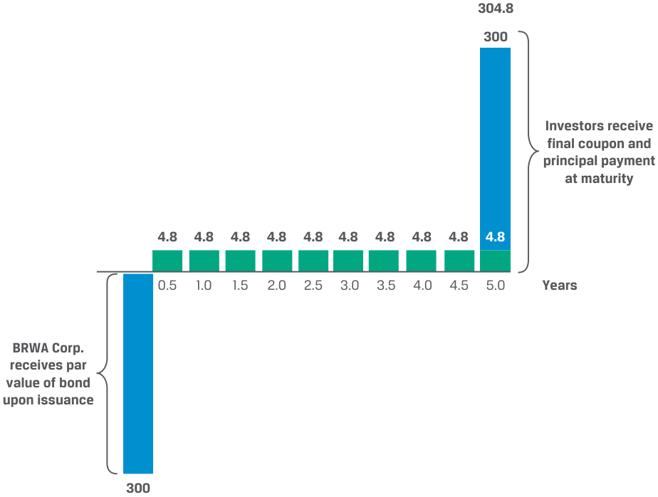
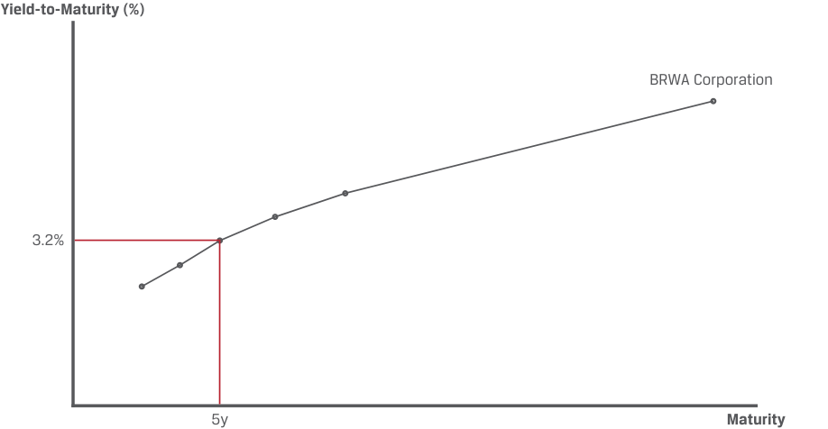

# Volume 6: Fixed Income
## Learning Module 1 Fixed-Income Instrument Features
### Part 1/2: Introduction (PDF Pages 13–23)

---

<!-- PDF Page 13 -->

#### L E A R N I N G M O D U L E 

# **<mark>1</mark>** 

### **Fixed-Income Instrument Features** 

###### **<mark>LEARNING OUTCOMES</mark>** 

**_Mastery The candidate should be able to:_** describe the features of a fixed-income security describe the contents of a bond indenture and contrast affirmative and negative covenants 

##### **INTRODUCTION** 

## **<mark>1</mark>** 

Fixed-income instruments, such as loans and bonds, are the most common means of financing. Fixed-income issuers include businesses, governments, and not-for-profits that promise to pay interest and repay borrowed principal to investors. Loans are commonly used between an individual or company and a bank. Bonds are more standardized fixed-income instruments designed to be more easily tradeable than loans and are commonly issued by larger companies, governments, and special purpose issuers. Bonds are a core holding for many investors, including mutual funds, pension plans, insurance companies, and central banks. This module introduces the features of fixed-income instruments and the legal contracts that govern them. 

###### **LEARNING MODULE OVERVIEW** 

- Fixed-income instruments are debt instruments, such as loans and bonds, that represent a contractual agreement under which an issuer borrows money from investors in exchange for interest and future repayment of principal. 

- Key features of fixed-income instruments include the issuer (borrower), time to maturity, principal amount, coupon rate and frequency, seniority, and contingency provisions. These features in turn define the cash flow structure of the instrument. 

- A fixed-income investor (lender) receives a return or yield based on the periodic cash flows paid by the bond issuer and the change in price of the bond. A bond’s price and yield vary inversely with one another. 

<!-- PDF Page 14 -->

- Fixed-income investors are exposed to credit risk, the risk of loss resulting from the issuer failing to make full and timely payments of interest and/or to repay principal. Investors expect to earn the lowest yield on bonds that carry little or no credit risk and expect higher yields on lower-credit-quality instruments. 

- A fixed-income instrument’s credit quality is affected by the underlying source of repayment, its seniority, credit provisions such as collateral backing, and the issuer’s willingness to pay. 

- The legal contract describing the features and other terms of a fixed-income security is known as an indenture. 

- Indentures often contain covenants, or legally enforceable terms, agreed to at the time of issuance. These may either require the bond issuer to take an action or prohibit the issuer from performing some action. 

###### **LEARNING MODULE SELF-ASSESSMENT** 

These initial questions are intended to help you gauge your current level of understanding of this learning module. 

1. The annual coupon amount for a fixed-rate bond is calculated by: 

   - **A.** multiplying its yield by the par value of the bond. 

   - **B.** Multiplying its coupon rate by the price of the bond. 

   - **C.** Multiplying its coupon rate by the par value of the bond. 

   - **Solution:** 

C is correct. On each interest payment date, a fixed-rate bond issuer pays investors a coupon payment equal to the bond’s coupon rate times its par value. For periods shorter than a year, the annual coupon amount is divided into smaller equal periodic payments. For example, a bond with a par value of 100 and a coupon rate of 6% paid quarterly would pay coupon payments of 0.06 × 100 = 60/4 = 15 four times per year. 

2. Match each bond type in the left column with a description in the right column. 

|A. Fixed-coupon bond|I. The difference between its issuance price and par value at maturity represents a cumulative interest pay- ment at maturity.|
|---|---|
|B. Floating-rate note|II. Usually involves uniform payments that occur at monthly,quarterly, semi-annual, or annual intervals.|
|C. Zero-coupon bond|III. Involves interest payments that reset periodically based on market factors.|

###### **Solution:** 

- **A.** II is correct. Fixed-coupon bonds usually involve uniform payments that occur at monthly, quarterly, semi-annual, or annual intervals. 

- **B.** III is correct. Floating-rate notes (FRNs) involve interest payments that reset periodically based on market factors. 

<!-- PDF Page 15 -->

|**C.**I is correct. Zero-coupon bonds are typically issued at a discount to par; the difference between the issuance price and par value represents a cumulative interest payment at maturity.|
|---|
|3. The coupon rate for a floating rate note (FRN) is composed of a market reference rate and:|
|**A.**a credit rating.|
|**B.**an issuer-specific spread.|
|i **C.**The yield on a fixed-rate benchmark bond. **Solution:**|
|B is correct. An FRN coupon rate comprises a market reference rate (MRR) and an issuer-specific spread that is usually constant and set at the time of issuance, while the MRR resets periodically based on market factors. As the MRR changes, the FRN coupon rate and interest payment change accordingly.|
|A is incorrect. While the issuer’s credit rating may be a determinant of an FRN’s spread over the MRR, a credit rating is a letter-grade assessment of credit risk and is not directly involved in the calculation of the coupon rate.|
|C is incorrect. The yield on a fixed-rate benchmark bond would reflect top- down factors that determine interest rates, such as real growth and expected inflation, which are already considered in the MRR.|
|4. A sovereign bond is usually a safer investment than a corporate bond of similar maturity issued within a country because:|
|**A.**corporate bonds are subject to inflation risk.|
|l **B.**sovereign bonds are backed by taxation and fiscal power of the issuing government.|
|**C.**sovereign bonds are secured by high-quality collateral, such as prop- erty and equipment. **Solution:**|
|B is correct. Sovereign bonds are backed by a national government’s taxa- tion and fiscal power and thus usually represent the highest-credit-quality bonds in each geographic market.|
|A is incorrect because sovereign bonds, unless specifically indexed to infla- tion, are also subject to inflation risk.|
|l C is incorrect because sovereign bonds are typically not secured by collat- eral; this is more commonly a feature of corporate bonds and asset-backed securities.|
|5. Which of the following is the appropriate order of claims in liquidation, by type of bond, in order of highest to lowest?|
|**A.**Junior, senior secured, senior unsecured|
|**B.**Senior unsecured, senior secured, junior|
|**C.**Senior secured, senior unsecured, junior **Solution:**|
|C is correct. Senior secured debts would be the highest-priority claims to be satisfied. Senior unsecured debts would be the next to receive allocations of the liquidated asset value, and junior debts would be the lowest-priority claims to be satisfied.|

<!-- PDF Page 16 -->

6. Describe the purpose of a pari passu clause in a bond indenture. **Solution:** 

A pari passu (“equal footing”) clause ensures that a debt obligation is treated the same as the borrower’s other senior debt instruments. 

## **<mark>2</mark>** 

##### **FEATURES OF FIXED-INCOME SECURITIES** 

describe the features of a fixed-income security 

**Fixed-income instruments** are debt instruments, such as loans and bonds. **Loans** are debt instruments formed and governed by a private agreement usually between an individual or company and a financial intermediary, such as a bank. **Bonds** or **fixed-income securities** are more standardized contractual agreements between larger issuers and investors. A bond issuer borrows money most often to fund operations or capital expenditures. Bond investors are lenders who provide funds to the issuer in exchange for interest payments and future repayment of principal. While corporate issuers tend to have, at most, one or two types of equity securities outstanding, they often have many types of debt obligations outstanding, each with distinct features, such as time to maturity, seniority, and currency. 

###### **WHICH LIABILITIES ARE FIXED-INCOME INSTRUMENTS?** 

Earlier modules in corporate issuers and financial statement analysis discussed the balance sheets of corporate issuers composed of assets and the liabilities and equity that finance them. Liabilities are broadly defined by accounting standards as present obligations to transfer economic resources as a result of past events. This definition encompasses many types of obligations, including amounts that an issuer owes to suppliers, customers, employees, governments, retirees, lessors, and so on. 

Not all liabilities are fixed-income instruments (or “debt”), but all fixed-income instruments are liabilities. In these modules on fixed income, from the perspective of a corporate issuer, we are focused only on loans and bonds: instruments that can be settled in cash and for which the counterparty is an investor or a bank. Other liabilities, particularly leases and pension obligations, share some characteristics with fixed-income instruments but are outside the scope of these modules. 

<!-- Start of picture text -->
Accounts Payable Lease Liability (obligations to (obligations to suppliers) lessors) Accrued Payroll Pension Liability Short-Term (obligations to (obligations to Short-Term Liabilities employees) retirees) Assets Deferred Revenue Loan Long-Term (obligations to (obligations to Liabilities customers) banks) Long-Term Taxes Payable Bonds Assets (obligations to (obligations to Equity governments) investors) Fixed-Income Instruments <!-- End of picture text -->

<!-- PDF Page 17 -->

Note that government issuers tend to be financed by bonds, not by loans, though some exceptions exist—for example, loans from supranational organizations such as the International Monetary Fund (IMF). 

The committed periodic cash flows of a bond distinguish it from equity securities. Exhibit 1 shows the cash flows of a fixed-rate bond issued by Bright Wheels Automotive (BRWA) Corporation. 

**Exhibit 1: BRWA Corporation Bond Cash Flows** 

<!-- Start of picture text -->
Time t  = 0 Semiannual ( t ) Maturity ( t  =  T ) BRWA BRWA BRWA Corp Corp Corp Principal Periodic fixed Final coupon (par value) coupon payment plus paid to issuer payment return of principal Bond Bond Bond Investor Investor Investor <!-- End of picture text -->

At issuance, investors purchased the BRWA bond in exchange for cash equal to the bond **principal** or the amount borrowed, which is also referred to as the bond’s **par value** . On each interest payment date, BRWA commits to pay bond investors an interest or **coupon** payment equal to the coupon rate times the par value of the bond. For periods shorter than a year, the annual coupon amount is divided into smaller equal periodic payments. On the bond’s maturity date, BRWA pays the final fixed coupon and the principal amount to investors. 

The key features of each bond issue are usually summarized in a prospectus. Exhibit 2 outlines the terms of BRWA Corporation’s bond issue. 

<!-- PDF Page 18 -->

**Exhibit 2: BRWA Corporation Bond: Brief Summary of Terms** 

<!-- Start of picture text -->
Borrower liable 3.2% BRWA Corporation Five-Year Notes for all interest (The “Notes”) Prospectus Summary and principal Issuer: Bright Wheels Automotive Corporation payments Settlement Date: [T + 3 Business Days] Final date upon which Maturity Date: [Five Years from Settlement Date] bond payment occurs Principal Amount:  US$ 300 million Periodic fixed orvariable cash Interest: 3.2% fixed coupon Amount that issueragrees to pay flows paid to investors on or before investors on or Interest Payment: Commencing six months from [Settlement the maturity date Date] to be paid semiannually with final before the payment on [Maturity Date] maturity date Seniority: The Notes are unsecured and unsubordinated obligations of BRWA Corporation and will A specific rank  pari passu  with all other unsecured and bond’s ranking unsubordinated indebtedness among all issuer obligations Business Days: New York <!-- End of picture text -->

Key bond features include the issuer, time to maturity, principal amount, coupon rate and frequency, seniority, and contingency provisions. 

###### **Issuer** 

A bond issuer can be any legal entity and is liable for all interest and principal payments. Government sector issuers include national (also termed sovereign) or local governments, supranational organizations (such as the World Bank), and quasi-government entities (agencies owned or sponsored by governments, such as postal services or national railways). Because sovereign bonds are backed by the taxation and fiscal power of the issuing government, they usually represent the lowest-credit-risk bond in each region. Private sector issuers include corporate issuers and special purpose entities created to take ownership in such assets as loans or receivables, financed by **asset-backed securities (ABS)** issued to investors, which will be discussed in detail in later lessons. 

###### **Maturity** 

A bond’s **maturity** is the date of the final payment the issuer makes to investors, and the **tenor** refers to the remaining time to maturity. Fixed-income securities with a tenor one year or less at issuance are known as **money market securities** , examples of which include government Treasury bills and commercial paper issued by corporations. Bonds with tenors longer than one year at issuance are called **capital market securities** . **Perpetual bonds** are a less common bond type with no stated maturity. Public sector entities were the first issuers of perpetual bonds, and current examples include local governments and local authorities, as well as certain bonds issued by banks to meet regulatory capital requirements. Perpetual bonds are still distinct from equities, however, in that they have contractually defined cash flows, no voting rights, and greater seniority in the capital structure. 

<!-- PDF Page 19 -->

###### **AIRPORT AUTHORITY HONG KONG’S PERPETUAL BONDS** 

Airport Authority Hong Kong (AAHK) is a statutory body responsible for operating and developing Hong Kong International Airport, one of the world’s busiest cargo airports and a major passenger hub connecting to over 200 global destinations. In late 2020, following a sharp decline in passenger volume during the COVID-19 pandemic, AAHK announced a two-part, USD1.5 billion perpetual bond issue to fund construction of a third runway and for general corporate purposes. Asian and European investors demonstrated confidence in the airport’s recovery of passenger volume, placing orders totaling more than 10× the offer amount. 

###### **Principal (Par or Face Value)** 

The principal, par value, or **face value** is the amount an issuer agrees to repay to investors at maturity. In the BRWA Corporation example, the principal amount of USD300 million is repaid at maturity, which is five years from issuance. Certain instruments may repay the principal in equal or variable increments over time. A common example is a mortgage loan, for which borrowers make a monthly payment composed of both principal repayment and interest. The principal is repaid over time and not in a lump sum at maturity. 

###### **Coupon Rate and Frequency** 

A bond’s interest can be paid as 

- a fixed coupon paid on specified dates, 

- a variable coupon determined and paid on specified dates, or 

- part of a single payment with the principal at maturity. 

Fixed-coupon bond payments usually involve uniform payments at monthly, quarterly, semi-annual, or annual intervals. Corporate bonds tend to pay semiannually. 

Bonds with variable interest payments are called **floating-rate notes** (FRNs). An FRN coupon is determined as a combination of a **market reference rate** (MRR) and an issuer-specific spread referred to as the **credit spread** . The MRR is a standard borrowing or lending rate for issuers with the highest creditworthiness or lowest default risk for different currencies and maturities. MRRs were historically determined by a poll of lenders (Libor) but transitioned to an average of observed market transaction rates. 

The credit spread is set at the time of FRN issuance, is usually constant over the bond’s life, and is expressed in basis points (bps), or hundredths of a percentage point. The higher an issuer’s credit quality, the lower the spread. In contrast, the MRR resets periodically throughout the bond’s life based on market factors. As the MRR changes, the FRN coupon rate and interest payment change accordingly. 

Bonds that do not pay periodic interest and instead pay interest as part of a single payment with principal at maturity are termed **zero-coupon bonds** or **pure discount bonds** . Zero-coupon bonds are typically issued at a discount to par; the difference between the issuance price and par value represents a cumulative interest payment at maturity. 

<!-- PDF Page 20 -->

###### **Seniority** 

A debt issue’s **seniority** or priority of repayment among all issuer obligations is an important determinant of risk. **Senior debt** has priority over other debt claims in the case of bankruptcy or liquidation. **Junior debt** , or **subordinated debt** , claims have a lower priority than senior debt and are paid only once senior claims are satisfied. The BRWA Corporation bonds are senior debt and would be repaid before any BRWA subordinated debt in the event of bankruptcy. 

###### **Contingency Provisions** 

A **contingency provision** is a clause in a legal agreement that allows for an action if an event or circumstance occurs. The most common contingency provision for bonds involves **embedded options** —specifically, call, put, and conversion to equity options. These resemble option contracts but cannot be traded separately from the bond itself. However, the value of these embedded options may be established by comparing the value of a bond with a contingency provision with that of an otherwise similar standard bond from the same issuer. The BRWA bond does not contain any contingency provisions, but this feature will be explored in depth in later lessons. 

We can use the features of a bond issue to model its cash flows. Exhibit 3 illustrates the cash flows over the life of the five-year, fixed-coupon BRWA Corporation bond described earlier. 

**Exhibit 3: BRWA Corporation Bond Cash Flows** 

<!-- Start of picture text -->
304.8 300 Investors receive final coupon and principal payment at maturity 4.8 4.8 4.8 4.8 4.8 4.8 4.8 4.8 4.8 4.8 0.5 1.0 1.5 2.0 2.5 3.0 3.5 4.0 4.5 5.0 Years BRWA Corp. receives par value of bond upon issuance 300 <!-- End of picture text -->

At the time of issuance, investors purchase the bond and pay cash to BRWA Corporation equal to the USD300 million in par value. BRWA investors receive periodic interest payments as follows: 

Annual interest expense = Bond par value × Coupon rate. 

<!-- PDF Page 21 -->

Annual interest expense = USD300,000,000 × 3.2%. 

Annual interest expense = USD9,600,000. 

Semiannual interest expense = USD9,600,000/2 = USD4,800,000. 

At the end of the fifth year on the maturity date, BRWA Corporation pays investors the final semiannual coupon payment plus the par value of USD300 million for a total of USD304.8 million. 

###### **Yield Measures** 

Given a bond’s expected cash flows and its price, return or yield measures can be calculated. One simple measure is the **current yield** (CY), equal to the bond’s annual coupon divided by the bond’s price and expressed as a percentage. For example, if the five-year BRWA bond were trading at a price of USD101 per USD100 in face value at time _t_ , its current yield would be 

CY _t_ = Annual coupon _t_ /Bond price _t_ = 3.2%/1.01 = 3.168%. 

The current yield is analogous to the dividend yield for an equity security. 

A more complex but far more common yield measure is the **yield-to-maturity** (YTM), which is the internal rate of return (IRR) calculated using the bond’s price and its expected cash flows to maturity. YTM is usually quoted as an annual rate. An investor’s rate of return on a bond will equal the bond’s YTM at the time of purchase as long as the investor 

**1.** receives all promised interest and principal payments as scheduled (i.e., no default), 

**2.** holds the bond until maturity, and 

**3.** reinvests all periodic cash flows at the YTM. 

Notice that these are the same IRR assumptions discussed in earlier modules. If any of these assumptions do not hold, the investor’s rate of return on the bond investment will differ from the YTM. If the five-year BRWA bond were trading at a price of USD101 per USD100 in face value immediately after issuance, its YTM is the rate, _r_ , in the following equation (recall that the 3.2% coupon is paid semiannually, or 1.6 in each of 10 periods per USD100 in face value): 

101 = 1.6/(1 + r)1 + 1.6/(1 + r)2 + . . . + 101.6/(1 + r)10 . 

_r_ = 1.49% on a semiannual basis, or 1.49% × 2 = 2.98% annualized. 

The YTM calculation is covered in depth in later modules. 

###### **Yield Curves** 

Most fixed-income issuers have many debt instruments outstanding. A useful way of evaluating the YTM on one issue is to graph all an issuer’s debt instruments with identical features by their YTM and times to maturity. This graphical depiction results in a **yield curve** . BRWA has six bond issues outstanding, shown in Exhibit 4. The 3.2%, five-year bond is the third point from the left. 

<!-- PDF Page 22 -->

**Exhibit 4: BRWA Corporation Bond Yield Curve** 

<!-- Start of picture text -->
Yield-to-Maturity (%) BRWA Corporation 3.2% 5y Maturity <!-- End of picture text -->

In this example, the BRWA bonds with longer maturities have higher YTMs, indicating that investors are demanding higher expected returns to compensate for higher risk associated with longer-maturity bonds of the same issuer. A way to measure the credit risk (one type of investment risk of fixed-income securities) for a bond is to compare an issuer’s yield curve to that of comparable sovereign bonds, which have little or no credit risk. Exhibit 5 shows the yield curve for BRWA bonds versus the yield curve for comparable sovereign bonds in the United States, which are US Treasuries. 

**Exhibit 5: BRWA Corporation Yield Curve vs. Treasuries** 

<!-- Start of picture text -->
Yield-to-Maturity (%) BRWA Corporation Government Issuer 3.2% 2.3% 5y Maturity <!-- End of picture text -->

The yield-to-maturity difference between the five-year BRWA bond and the five-year US Treasury bond is 90 bps (= 3.2% − 2.3%), which reflects compensation that investors demand for taking the additional credit risk associated with the BRWA bonds. 

<!-- PDF Page 23 -->

###### **QUESTION SET** 

1. Match the fixed-income instrument type in the left column with its description in the right column. 

|A. Money market securities|I. Public and private bonds with a time to maturityofgreater than oneyear|
|---|---|
|B. Capital market securities|II. Fixed-income instruments with maturities of less than one year, such as commercialpaper|
|C. Perpetual bonds|III. Bonds that have no stated maturity date|

###### **Solution:** 

   - **A.** II is correct. Money market securities are fixed-income instruments with maturities of less than one year, such as commercial paper. 

   - **B.** I is correct. Capital market securities are public and private bonds with a time to maturity of greater than one year. 

   - **C.** III is correct. Perpetual bonds have no stated maturity date. 

2. Calculate the coupon payment on a 2.5% coupon bond with GBP100,000 par value and a semiannual payment frequency. 

###### **Solution:** 

The correct answer is GBP1,250. 

The annual coupon on a bond is calculated by multiplying the coupon rate and the par value. For this bond, the coupon rate of 2.5% and par value of GBP100,000 results in a GBP2,500 annual coupon. However, since the payment frequency is semiannual (twice a year), each coupon payment is GBP1,250. 

3. Determine the appropriate FRN coupon and interest payable in the following example: A European corporation issues a EUR10 million FRN that pays quarterly interest equal to the three-month MRR plus 125 bps. If three-month MRR is –0.50%, what is the corporation’s FRN coupon interest payable on the FRN for the period? 

###### **Solution:** 

The answer is EUR18,750. 

An FRN coupon comprises MRR plus the issuer-specific spread. 

FRN coupon = MRR + Spread. 

FRN coupon = –0.50% + 1.25%. 

FRN coupon = 0.75%. Annual interest = Principal × FRN coupon. Annual interest = €10,000,000 × 0.75%. Annual interest = €75,000, or €18,750 on a quarterly basis. 

