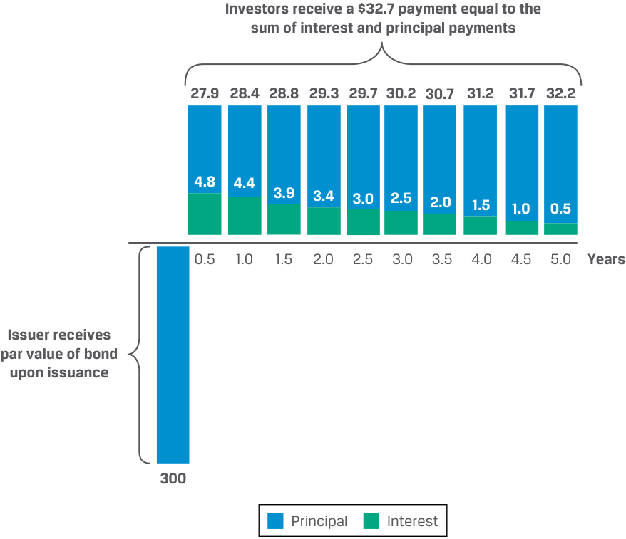
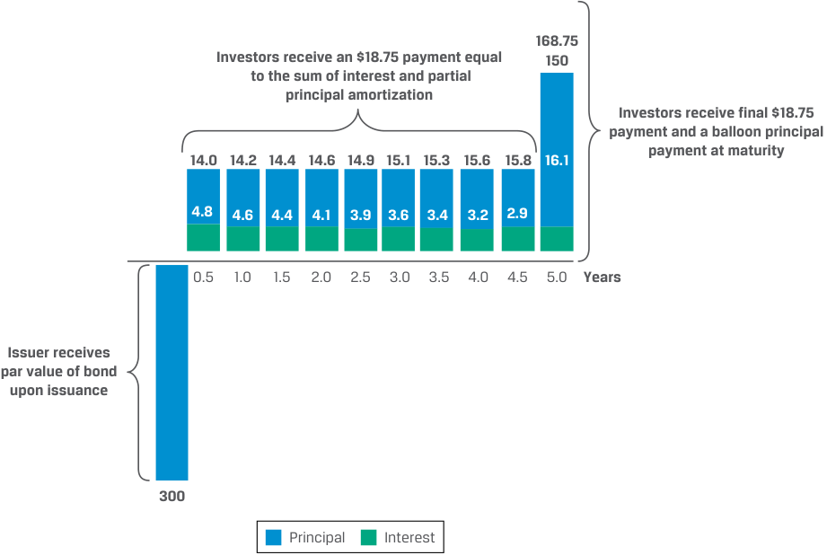
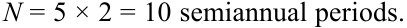

# Volume 6: Fixed Income
## Learning Module 2 Fixed-Income Cash Flows and Types
### Part 1/2: Introduction (PDF Pages 33–48)

---

<!-- PDF Page 33 -->

#### L E A R N I N G M O D U L E 

# **<mark>2</mark>** 

### **Fixed-Income Cash Flows and Types** 

###### **<mark>LEARNING OUTCOMES</mark>** 

|**_Mastery_**|**_The candidate should be able to:_**|
|---|---|
||describe common cash flow structures of fixed-income instruments and contrast cash flow contingency provisions that benefit issuers and investors|
||describe how legal, regulatory, and tax considerations affect the issuance and trading of fixed-income securities|

##### **INTRODUCTION** 

## **<mark>1</mark>** 

A fixed-income instrument’s cash flows are determined by its features. In this module, we discuss common fixed-income instrument cash flow structures and their implications for issuers and investors. The module’s final lesson discusses the legal, regulatory, and tax considerations across jurisdictions faced by fixed-income issuers and investors. 

###### **LEARNING MODULE OVERVIEW** 

- In contrast to standard bullet bonds with full principal repayment at maturity, amortizing bonds have a payment schedule that involves early repayment of principal. Sinking funds and waterfall structures represent special cases of amortizing bonds. 

- ■ Other coupon payment structures include index-linked bonds that offer payments adjusted for changes in price indices and bonds with step-up coupons, with coupons that increase by specific amounts in the future based on a schedule or subject to specific provisions. 

- ■ Fixed-income contingency provisions include call, put, and conversion features. A call feature grants an issuer the right to buy bonds back early at a fixed price, while a put feature grants an investor the right to sell bonds to the issuer at a fixed price prior to maturity. Convertible bonds grant investors the right to convert the bond into shares of the issuer’s stock at a pre-determined price. 

<!-- PDF Page 34 -->

- Bonds can be classified as domestic, foreign, or Eurobonds. Domestic bonds are those issued in a country by an issuer incorporated in that same country, while foreign bonds are issued by entities incorporated elsewhere. 

- Eurobonds are issued internationally in a currency different from that country’s domestic currency (e.g. US dollar bonds issued in London) and are subject to fewer listing, disclosure, and regulatory requirements than domestic or foreign bonds. 

- Bond interest earned by an investor is usually taxed as ordinary income, although some bonds offer tax advantages. Some countries also apply a capital gains tax. Specific tax provisions often apply for bonds issued at a discount or purchased at a premium. 

###### **LEARNING MODULE SELF-ASSESSMENT** 

These initial questions are intended to help you gauge your current level of understanding of this learning module. 

1. An investor that is more sensitive to an issuer’s credit risk than to reinvesting risk would most likely invest in a: 

   - **A.** bullet bond. 

   - **B.** partially amortizing bond. 

   - **C.** fully amortizing bond. 

   - **Solution:** 

C is correct. Investors receive higher near-term cash flows on amortizing debt versus bullet bonds and face lower credit risk because the borrower’s liability is reduced over time. However, investors also face the risk of reinvesting the higher near-term cash flows at prevailing market interest rates, which can fluctuate. This effect is larger for fully amortizing bonds versus partially amortizing bonds. 

###### 2. Match the term in the left column with its description in the right column. 

|A. Bullet bond|I. A bond with a fixed periodic payment schedule that reduces the bond’s outstanding principal to a portion of the principal to be repaid on the maturitydate|
|---|---|
|B. Partially amortizing bond|II. A bond with a coupon rate that increases by specified margins at one or more specified dates|
|C. Step-up coupon bond|ii III. A bond that pays its face value and final inter- est payment at maturity|

###### **Solution:** 

- **A.** III is correct. A bullet bond pays 100% of its face value plus a final interest payment at the bond’s maturity. 

- **B.** I is correct. A bond characterized by a fixed periodic payment schedule that reduces the bond’s outstanding principal to a portion of the principal to be repaid on the maturity date is known as a partially amortizing bond. 

<!-- PDF Page 35 -->

|**C.**II is correct. A bond with a coupon rate that increases by specified margins at one or more specified dates is known as a step-up coupon bond.|
|---|
|3. A call provision embedded in a fixed-income security: **A.**is a benefit to the issuer. **B.**gives the bondholder the right but not an obligation to sell the bond. **C.**grants the bondholder some degree of inflation protection. **Solution:** A is correct. A call provision gives the issuer the right to redeem all or part of the bond at a pre-determined price on specified dates. It is a benefit to the issuer because if market interest rates fall, the issuer can replace the call- able bond with one with a lower interest rate. It also gives the issuer added flexibility if it has excess cash or wishes to change its capital structure in the future. B is incorrect. This describes a putable bond, not a callable bond. If a call- able bond is called, the bondholder is obliged to sell it to the issuer accord- ing to the specified terms. C is incorrect. A call provision does not grant the bondholder inflation pro- tection. A call would be exercised by the issuer if interest rates fall.|
|4. A put provision embedded in a fixed-income security: **A.**is a benefit to the bondholders. **B.**leads to a lower value compared to a bullet bond. **C.**increases the likelihood that its issuer will be acquired. **Solution:** A is correct. A put provision gives bondholders the right to sell the bonds back to the issuer at a pre-determined price on specified dates. The put pro- vision is a benefit to bondholders because it can protect them from the risk of the price of the bond falling from, for example, rising interest rates. B is incorrect. As put provisions are beneficial to investors, putable bonds are priced at a premium, not a discount, relative to option-free counterparts. C is incorrect. Put provisions can deter acquirers because the exercise of putable bonds results in an immediate claim on cash, making the acquisition more expensive. Issuing bonds with put provisions is a strategy employed by some firms to deter unfriendly takeovers known as a “poison puts.”|

5. Match the term in the left column with its description in the right column. 

|A. Eurobond|I. A bond issued outside the jurisdiction of any single country|
|---|---|
|B. Global bond|II. A bond issued simultaneously in the Eurobond market|
||and in at least one domestic bond market|

**Solution:** 

- **A.** I is correct. Eurobonds are issued outside the jurisdiction of any single country, are usually unsecured, and may be denominated in any currency, including the issuer’s domestic currency. 

<!-- PDF Page 36 -->

   - **B.** II is correct. A global bond is a bond issued simultaneously in the Eurobond market and in at least one domestic bond market, ensuring sufficient demand for large bond issues and access to all fixed-income investors regardless of location. 

6. Compared to a bond with an original issue discount (OID) tax provision, an otherwise identical bond without this provision would _most likely_ have: 

   - **A.** lower taxes due at maturity. 

   - **B.** the same taxes due at maturity. 

   - **C.** higher taxes due at maturity. 

   - **Solution:** 

C is correct. Under the OID tax provision, the investor will recognize a prorated portion of the OID as taxable income each year and pay no capital gains tax upon maturity. Investors without an OID tax provision will recognize no taxable income until maturity, upon which they will face capital gains tax on the OID (provided there is capital gains tax in their jurisdiction). 

## **<mark>2</mark>** 

##### **FIXED-INCOME CASH FLOW STRUCTURES** 

describe common cash flow structures of fixed-income instruments and contrast cash flow contingency provisions that benefit issuers and investors 

The most common bond cash flow structure is that of a standard fixed-coupon bond, often referred to as a **bullet bond** . The bond issuer receives the principal at settlement, makes periodic, fixed coupon payments, and repays the principal at maturity. Most government and corporate issuers use bullet bonds as their primary means of debt financing, and investors often prefer the associated fixed income stream and set maturity to fund known cash flows. Exhibit 1 shows the bullet bond structure of the five-year, USD300 million, 3.2% semiannual coupon BRWA bond introduced in the prior module. 

<!-- PDF Page 37 -->

###### **Exhibit 1: BRWA Corporation Bullet Bond Cash Flows** 

<!-- Start of picture text -->
304.8 300 Investors receive final coupon and principal payment at maturity 4.8 4.8 4.8 4.8 4.8 4.8 4.8 4.8 4.8 4.8 0.5 1.0 1.5 2.0 2.5 3.0 3.5 4.0 4.5 5.0 Years BRWA Corp. receives par value of bond upon issuance 300 Principal Interest <!-- End of picture text -->

Some instruments, including most loans, have cash flow structures that differ from that of the bullet bond. For example, some instruments have principal repayments distributed over the life of the instrument. In the case of interest payments, most loans pay periodic interest at a rate that changes as short-term market rates change, while others change based on credit or other provisions. Finally, zero-coupon bonds are sold at a discount with no cash flow during their life until repayment of par at maturity. These bonds pay no periodic interest, but the difference between the discount price and par at maturity represents a cumulative interest payment at maturity. 

###### **Amortizing Debt** 

Fixed-income instruments that periodically retire a portion of principal outstanding prior to maturity offer a borrower the ability to spread payments more evenly over the life of the instrument. Examples include commercial or residential real estate mortgage loans. Investors receive higher near-term cash flows on this **amortizing debt** relative to bullet bonds and face lower credit risk because the borrower’s liability is reduced over time. However, investors also face the risk of reinvesting the higher cash flows at prevailing market interest rates over the life of the instrument, which could decline. 

Let us consider the opposite of the BRWA five-year bullet bond, a **fully amortizing loan** for the same term and at the same interest rate. As shown in Exhibit 2, principal amortization begins on the first interest payment date and continues through maturity. 

<!-- PDF Page 38 -->

**Exhibit 2: BRWA Corporation Fully Amortizing Loan Cash Flows** 

<!-- Start of picture text -->
Investors receive a $32.7 payment equal to the sum of interest and principal payments 27.9 28.4 28.8 29.3 29.7 30.2 30.7 31.2 31.7 32.2 4.8 4.4 3.9 3.4 3.0 2.5 2.0 1.5 1.0 0.5 0.5 1.0 1.5 2.0 2.5 3.0 3.5 4.0 4.5 5.0 Years Issuer receives par value of bond upon issuance 300 Principal Interest <!-- End of picture text -->

Note that while the first interest payment, USD4.8, is identical to that of the bullet bond, instead of interest-only coupons each period followed by the final coupon and principal at maturity, investors receive a uniform USD32.7 periodic cash flow until maturity, which in the first period includes USD27.9 of principal amortization. Over time, the interest portion of the payment declines while the principal repayment portion increases. 

Let us assume instead that BRWA issues a bond with the same maturity and at the same rate but repays a _portion_ of the principal each period, with a final lump sum payment (or **balloon payment** ) at maturity equal to half of the principal amount. The interest and principal payments for this **partially amortizing bond** are shown in Exhibit 3. 

<!-- PDF Page 39 -->

**Exhibit 3: BRWA Corporation Partially Amortizing Bond Cash Flows** 

<!-- Start of picture text -->
168.75 Investors receive an $18.75 payment equal 150  to the sum of interest and partial principal amortization Investors receive final $18.75 payment and a balloon principal 14.0 14.2 14.4 14.6 14.9 15.1 15.3 15.6 15.8 16.1 payment at maturity 4.8 4.6 4.4 4.1 3.9 3.6 3.4 3.2 2.9 0.5 1.0 1.5 2.0 2.5 3.0 3.5 4.0 4.5 5.0 Years Issuer receives par value of bond upon issuance 300 Principal Interest <!-- End of picture text -->

The cash flows for the partially amortizing bond combine elements of the bullet and fully amortizing examples. Cash flow schedules from the perspective of the investor for the bullet bond, partially amortizing bond, and fully amortizing loan with the same principal, maturity, and fixed coupon rate are shown in Exhibit 4. 

**Exhibit 4: Investor Perspective: BRWA Bond/Loan Cash Flow Summary (USD millions)** 

|**Year**|**Bullet Bond**|**Partially Amortizing Bond**|**Fully Amortizing Loan**|
|---|---|---|---|
|0|–300|–300|–300|
|0.5|4.8|18.75|32.7|
|1|4.8|18.75|32.7|
|1.5|4.8|18.75|32.7|
|2|4.8|18.75|32.7|
|2.5|4.8|18.75|32.7|
|3|4.8|18.75|32.7|
|3.5|4.8|18.75|32.7|
|4|4.8|18.75|32.7|
|4.5|4.8|18.75|32.7|
|5|304.8|168.75|32.7|

The fully amortizing loan has a level semiannual payment equal to the sum of interest and principal repayment. We may calculate the periodic payment ( _A_ ) as follows: 

 r_ × Principal _A_ = ~~(1)~~ 1 −( 1 + _r_)−_N_, 

<!-- PDF Page 40 -->

where 

_A_ = Periodic payment amount 

_r_ = Market interest rate per period 

_Principal_ = Principal amount of loan or bond 

_N_ = Number of payment periods 

The fully amortized BRWA bond is a five-year, 3.2% semiannual coupon bond with a par value of USD300 million. The periodic payment is calculated as follows, in millions: 

<!-- Formula Text: A = r × Principal _ 1 − (1 + r) −N . -->

<!-- Formula Text: r = 3.2%/2 = 1.6% on a semiannual basis. -->

Principal = USD300 million. 

<!-- Formula Text: N = 5 × 2 = 10 semiannual periods. -->

<!-- Formula Text: A =  0.016 × USD300 ____________ 1 − (1.016) −10  . -->

_A_ = USD32.70. 

Therefore, the semiannual payment is a constant USD32.70, as shown in Exhibit 2, but the principal and interest amounts vary each period as follows: 

- First semiannual interest payment: USD300 × 3.2%/2 = USD4.80. 

- Initial principal repayment: USD32.7 − USD4.8 = USD27.90. 

- Outstanding principal after first period: USD300 − USD27.90 = USD272.10. 

The USD272.10 outstanding principal becomes the basis for the calculation of the interest and principal payment in the second period: 

- Second semiannual interest payment: USD272.10 × 3.2%/2 = USD4.35. 

- Second principal repayment: USD32.70 − USD4.35 = 28.35. 

- Outstanding principal after second period: USD272.10 − USD28.35 = USD243.75. 

Note that the periodic payment is constant, but over time, the interest payment decreases while the principal repayment increases. 

The partially amortized bond in Exhibit 3 with the USD150 balloon principal payment paid at maturity combines two elements: 

**1.** a five-year fully amortizing loan with USD150 notional and 

**2.** a USD150 balloon payment at maturity. 

The sum of the present values of these two elements is equal to the bond price of USD300. The present value ( _PV_ ) of the USD150 balloon payment is calculated as 

_ PV of balloon payment  =USD150( 1.016)10 = USD127.98. 

Subtracting the present value of the balloon payment from the USD300 price of the bond gives us USD172 in principal repayment to amortize over 10 semiannual periods to leave a remaining principal of USD150 at maturity. Using this USD172 principal amount, we can compute the periodic payment amount as 

- ____________ 

- _A_ =0.016 (USD172) 1 −( 1.016)−10 = USD18.75. 

<!-- PDF Page 41 -->

The periodic payment is USD18.75, as shown in Exhibit 3. The final semiannual payment of USD168.75 is the sum of the final constant USD18.75 payment and the outstanding principal amount of USD150. Since the principal amount is not fully amortized, interest payments are higher for the partially amortized bond in each period than for the fully amortized bond, except the first period when they are equal. 

Commercial and residential mortgages are common examples of fully amortizing loans. Mortgage borrowers usually prefer the constant cash flows of fully amortizing loans, because they are better able to match rental or lease income in the case of commercial borrowers or personal income for households. In the United States, these mortgage loans often back bonds known as **mortgage-backed securities** with cash flows similar to those of the loan shown in Example 1. 

###### **EXAMPLE 1** 

###### **30-Year Fixed-Rate Residential Mortgage Loan** 

A borrower agrees to purchase a home and enters into a mortgage loan with a financial intermediary based on the following terms: 

Home price: USD500,000 

Loan amount: USD400,000 

Annual interest rate: 3.50% 

Loan term: 360 months 

Noting that the borrower’s monthly interest rate is 0.29167% (= 3.50%/12), we can use Equation 1 to calculate the homeowner’s monthly mortgage payment on the USD400,000 loan as follows: 

<!-- Formula Text: A = 0.0029167(USD400, 000) __________________ 1 − (1.0029167) −360    =  USD1, 796.18. -->

As in the case of BRWA, we can calculate the interest and principal components of each periodic payment, with the first five and final five monthly payments of the 30-year mortgage shown below. 

|**Month**|**Total** **Monthly** **Payment**|**Monthly Inter-** **est Payment**|**Monthly Principal** **Payment**|**Remaining** **Principal**|
|---|---|---|---|---|
|1|USD1,796.18|USD1,166.67|USD629.51|USD399,370.49|
|2|USD1,796.18|USD1,164.83|USD631.35|USD398,739.14|
|3|USD1,796.18|USD1,162.99|USD633.19|USD398,105.95|
|4|USD1,796.18|USD1,161.14|USD635.04|USD397,470.91|
|5|USD1,796.18|USD1,159.29|USD636.89|USD396,834.03|
|356|USD1,796.18|USD25.97|USD1,770.21|USD7,132.63|
|357|USD1,796.18|USD20.80|USD1,775.38|USD5,357.26|
|358|USD1,796.18|USD15.63|USD1,780.55|USD3,576.70|
|359|USD1,796.18|USD10.43|USD1,785.75|USD1,790.96|
|360|USD1,796.18|USD5.22|USD1,790.96|USD0.00|

<!-- PDF Page 42 -->

Two additional bond amortization arrangements commonly encountered are **sinking funds** , used primarily by government and some corporate issuers, and **waterfall structures** , which are commonly used in asset-backed securities (ABS) and mortgage-backed securities (MBS). 

A sinking fund arrangement is used by issuers to periodically retire a bond’s principal outstanding. The term _sinking fund_ refers to an issuer’s plans to set aside funds over time in an escrow account to retire the bond early based on terms agreed upon issuance. For example, an issuer may direct the bond trustee to redeem a predetermined principal amount selected from among investors at random. Alternatively, the issuer may have the right to repurchase bonds prior to maturity at a predetermined fixed price under a contingency feature addressed later in this lesson. Like amortization, sinking funds reduce credit risk while increasing reinvestment risk due to a reduction of principal outstanding prior to maturity. 

Another structure for principal repayment is a waterfall. This approach is used to determine the timing of cash flows to investor classes with different priority claims to the same cash flows. In the most common form, interest or coupon payments are paid to all classes with no preference, but the repayment of principal occurs sequentially so that the most senior investor class with the highest ranking in the capital structure receives principal payments first, followed by the second-highest ranked investors once the most senior class has been fully repaid. Exhibit 5 shows a typical waterfall structure based on the three-tranche example from the prior module. 

###### **Exhibit 5: Typical ABS Waterfall Structure** 

<!-- Start of picture text -->
Tranche A First to receive Bond Investor principal Asset-Backed Tranche B Principal received Security (ABS) Bond Investor only when Tranche A is fully repaid Principal received Tranche C only when Tranches Bond Investor A & B are fully repaid <!-- End of picture text -->

Payment shortfalls are borne by the more junior tranches since the senior tranches are paid first, so Tranche A faces the lowest credit risk, followed by Tranches B and C. 

###### **Variable Interest Debt** 

Some bonds and most loans have variable interest payments, calculated using a market reference rate (MRR) and a credit spread. Financial intermediaries, such as banks, prefer floating-rate loan assets since they match their variable-rate liabilities, such as deposits. Loans or floating-rate notes (FRN) are also attractive to investors seeking to benefit from rising interest rates. 

Recall that a variable-rate loan or FRN coupon consists of a periodically resetting MRR plus an issuer-specific credit spread. 

FRN coupon = MRR + Credit spread. 

For example, practice problems in the prior module highlighted the four-year, EUR250 million Antelas AG FRN issued at an interest rate of MRR + 250 bps p.a. paid quarterly. Exhibit 6 shows the final four Antelas AG FRN cash flows, including principal repayment at maturity similar to a fixed-rate bullet bond. 

<!-- PDF Page 43 -->

**Exhibit 6: Antelas AG FRN Cash Flows** 

|Note Prin|cipal Amou|nt (EUR)|250,000,000||
|---|---|---|---|---|
|Credit Spr|ead over M|RR|2.50%||
|**Quarter**|**MRR**|**Coupon** **Rate**|**Quarterly Inter-** **est Payment**|**Principal** **Payment**|
|13|–0.50%|2.00%|1,250,000||
|14|0.15%|2.65%|1,656,250||
|15|0.25%|2.75%|1,718,750||
|16|0.50%|3.00%|1,875,000|250,000,000|

For example, in Quarter 15, the coupon rate is 2.75% (= 0.25% + 2.50%) and the quarterly interest payment is calculated as follows: 

###### (2.75% × EUR250,000,000)/4 = EUR1,718,750. 

Investors face less interest rate risk with variable-rate instruments because coupon payments adjust with interest rates, unlike fixed-coupon bonds. However, like fixed-coupon bonds, variable-rate instruments still have credit risk: If an issuer’s likelihood of missing payments increases, investors will seek a higher yield as compensation for lower credit quality, causing their price to fall, irrespective of any changes in the MRR. 

In addition to changing cash flows based on variations in MRR, other adjustment mechanisms exist, which can be either predetermined or tied to an event. In the case of predetermined adjustments, a bond coupon increases by specified margins at specified dates. These bonds are referred to as **step-up bonds** and are used to protect investors against rising rates and, in some cases, to provide an incentive for issuers to take advantage of a contingency provision, as addressed later. An example of cash flow changes based on an event are higher coupons in the event of a deterioration in an issuer’s credit quality. This provides investors with greater comfort that they will be compensated for adverse credit changes and allows less creditworthy issuers to obtain debt financing for longer and/or at lower spreads than may be possible at a fixed coupon. This is most common with **leveraged loans** , or loans to issuers of lower credit quality. Coupon changes may also be linked to financial covenants or credit ratings, which are sometimes used in what are referred to as **credit-linked notes** . 

For example, say that Antelas AG experiences a decline in its credit quality as the FRN matures. It must therefore adequately address investor credit concerns by revising the terms of its debt. Exhibit 7 shows how Antelas might achieve this by entering a loan agreement arranged by a bank with a credit spread that adjusts based on leverage and interest coverage ratios. 

**Exhibit 7: Antelas AG Leveraged Loan Term Sheet** 

||**Antelas AG Five-Year Leveraged Loan** **Term Sheet**|
|---|---|
|**Issuer:**|Antelas AG|
|**Settlement Date:**|[T + 3 Business Days]|
|**Maturity Date:**|[Five Years from Settlement Date]|
|**Principal Amount:**|EUR250 million|
|**Interest:**|MRR Plus Credit Spread|

<!-- PDF Page 44 -->

||**Antelas AG Five-Year Leveraged Loan** **Term Sheet**|
|---|---|
|**Interest Payment:**|Commencing three months from [Settlement Date] to be paid quarterly with final payment on [Maturity Date]|
|**Credit Spread:**|Based on Issuer’s Total Leverage Ratio (TLR) at the end of each quarter as follows: 325 bps p.a. if TLR ≥ 3.5× 300 bps p.a. if 3.5× > TLR ≥ 3.0× 275 bps p.a. if 3.0× > TLR ≥ 2.5× 250 bps p.a. if TLR ≤ 2.5×|
|**Seniority:**|The Loan is a secured, unsubordinated obligation of Antelas AG.|
|**Debt Restriction Test:**|Issuer must maintain (a) Total Leverage Ratio (Net Interest Bearing Debt to EBITDA) not greater than 5.00× and (b) Interest Coverage Ratio greater than 2.50× for each financial reporting period.|

Antelas maintains its current credit spread only if its total leverage ratio remains below 2.5×, with a higher spread if leverage increases. An issuer concerned about potential cash flow problems in the future might seek to add a **payment-in-kind** (PIK) feature to a loan or bond. PIK features allow an issuer to pay periodic interest in the form of an increase in the bond or loan principal outstanding rather than as a cash payment. This feature is most frequently used by firms with relatively high reliance on debt financing and are usually associated with a higher interest rate to compensate investors assuming greater principal risk. 

As the following box example shows, the use of variable bond coupon provisions is not limited to issuers with credit quality or cash flow issues. 

###### **PUBLIC POWER CORPORATION (PPC) SUSTAINABILITY-LINKED BOND** 

Fixed-income markets have rapidly adapted to the growing importance of environmental, social, and governance (ESG) factors among issuers and investors. For example, **green bonds** are fixed-income instruments usually issued by governments or private companies that are created to fund projects with a positive environmental impact. 

Public Power Corporation (PPC) is a publicly traded company that is 51% owned by the Greek government and is Greece’s largest electricity utility. PPC announced plans to close most of its coal power capacity to sharply reduce carbon emissions, increase renewable energy production, and modernize and partially privatize its power grid. In order to attract a broader investor base to provide debt financing for its ambitious plans, PPC issued sustainability-linked bonds in early 2021 based on the following terms: 

|**Public Powe**|**r Corporation Five-Year Sustainability-Linked Bonds** **Key Terms**|
|---|---|
|**Issuer:**|Public Power Corporation S.A.|
|**Settlement Date:**|March 18, 2021|
|**Maturity Date:**|March 30, 2026|
|**Principal**|EUR775 million|
|**Amount:**||
|**Interest:**|3.875% p.a.|
|**Step-Up Margin:**|50 bps p.a. if a Step-Up Event occurs|

<!-- PDF Page 45 -->

|**Public Power**|**Corporation Five-Year Sustainability-Linked Bonds** **Key Terms**|
|---|---|
|**Step-Up Event:**|Issuer fails to reduce CO2emissions by 40% by December 2022 versus 2019 base year|
|**Interest Payment:**|Commencing 9/30/21 to be paid semiannually with final payment on the Maturity Date|
|**Seniority:**|The Notes are senior unsecured obligations of the Issuer|

PPC’s sustainability-linked bonds were the first of its kind for a European high-yield issuer. The CO2-related step-up margin feature in PPC’s bonds was a significant factor in attracting widespread investor demand in a transaction that exceeded the original EUR500 million planned size. 

**Index-linked bonds** have interest and/or principal payments linked to a specified index. Although a bond may be linked to any variable, in practice, **inflation-linked bonds** (sometimes referred to as linkers) tied to a broad consumer price index are by far the most common type of index-linked bonds. The fixed interest and principal payments of a standard bond are nominal cash flows whose purchasing power declines with inflation. The interest rate a bondholder receives net of inflation is the real interest rate, which is approximately equal to the nominal interest rate minus the rate of inflation. Investors often use inflation-linked bonds to protect against rising prices by receiving inflation-adjusted cash flows. Most inflation-linked bonds are issued by sovereign governments. Examples include **Treasury Inflation-Protected Securities (TIPS)** in the United States, which address investor demand for inflation-indexed cash flows. There is also growing demand for inflation-linked emerging market bonds due to investor concerns over high inflation. The following example demonstrates how TIPS cash flows are adjusted for inflation. 

###### **EXAMPLE 2** 

###### **TIPS Cash Flow** 

An investor purchases TIPS with the following terms: 

|Principal amount:|USD115,000,000|
|---|---|
|Semiannual coupon:|1.00% p.a.|
|Time to maturity:|9.5 years|
|Inflation protection:|Based on the change in the Consumer Price Index for All Urban Consumers: All Items in U.S. City Average, Not Seasonally Adjusted (CPI)|

If the CPI rises from 265.00 to 267.25 over the next semiannual interest period, the next coupon payment is calculated as follows: 

- Inflation adjustment: (267.25 − 265) / 265 = 0.849%. 

- Inflation-adjusted principal = Principal amount × (1 + Inflation adjustment) = USD115,976,350 = USD115,000,000 × 1.00849. 

- Annual interest expense = Coupon rate × Inflation-adjusted principal, or = 1.00% × USD115,976,350 = USD1,159,764. 

- Semiannual interest paid = USD1,159,764/2 = USD579,882. 

<!-- PDF Page 46 -->

TIPS, which have a periodic principal adjustment based on a price index, are an example of a **capital-indexed bond** . This approach protects the real value of debt principal. Capital-indexed bonds are also issued by other sovereign governments, including those of Australia, Canada, and the United Kingdom. Note that while deflation causes the principal to decline over time, investors usually receive the greater of the inflation-adjusted principal or par at maturity. 

Unlike capital-indexed bonds, **interest-indexed bonds** pay a fixed nominal principal amount at maturity. Only the coupon is index linked and pays an inflation adjustment. These bonds are essentially an FRN in which the MRR is the rate of inflation. Interest-indexed bonds are more commonly issued by private financial intermediaries than by governments. 

###### **Zero-Coupon Structures** 

Zero-coupon bonds repay principal at maturity but have no coupon payments. Zero-coupon bonds are often referred to as discount bonds, since they are priced below par if interest rates are positive. An investor’s sole source of return is the difference between the price paid and the principal, which represents a cumulative interest payment at maturity. Zero-coupon bonds are commonly issued by governments with tenors less than 12 months. As sovereign interest rates fell to (or below) zero in the wake of global financial crisis in 2008, zero-coupon bonds also became more common at longer maturities. Zero-coupon bonds are also created by financial intermediaries that sell individual interest or principal payments separated (or stripped) from sovereign bullet bonds. 

Zero-coupon bonds are useful for funding fixed future obligations. If interest rates fall, a standard fixed-rate bond may fall short of meeting the obligation because falling interest rates reduce reinvestment income (in other words, the investor’s rate of return will fall below the original YTM because the reinvestment assumption at the YTM does not hold). Since zero-coupon bonds require no coupon reinvestment, investors in these bonds do not face this risk. 

###### **Deferred Coupon Structures** 

**Deferred coupon bonds** pay no interest for the first few years and have a higher coupon paid later through maturity. Issuers of deferred coupon bonds usually seek to conserve cash immediately following the bond issue, which may indicate lower credit quality or that the issuer is financing a construction project that does not generate income until completion. Similar to zero-coupon bonds, which may be considered an extreme form of deferred coupon bond, deferred coupon bonds are typically priced at a discount to par since the higher coupon is not usually sufficient to offset the forgone interest in earlier periods. 

Exhibit 8 summarizes the common types of cash flow structures for fixed-income instruments. 

<!-- PDF Page 47 -->

###### **Exhibit 8: Fixed-Income Instrument Cash Flow Structures** 

<!-- Start of picture text -->
– Fixed coupon rate – Coupons are interest only Standard, Fixed-Rate Bond – Par value or principal paid at maturity (”bullet bond”) – Example: most long-term corporate   and government bonds – Often uniform periodic payments,  composed of both interest and  principal Amortizing Principal – Principal paid over life of the  instrument – Example: mortgage loans – Cash flows change based on specified   market interest rate, index, inflation Variable Interest  rate, etc. – Example: floating rate notes, most  bank loans – Fixed 0% coupon rate – Par value or principal paid at maturity Zero Coupon – Typically sold at a discount – Example: short-term government  bonds <!-- End of picture text -->

|**QUESTION SET**|
|---|
|1. Compared to a bullet bond, an otherwise identical amortizing bond would_most likely_have:|
|**A.**lower credit risk.|
|**B.**lower reinvestment risk.|
|**C.**lower near-term cash flows. **Solution:**|
|A is correct. Compared to a bullet bond, an otherwise identical amortizing bond would have early principal repayments each period instead of all prin- cipal paid at maturity, lowering exposure to the issuers credit risk. However, larger periodic payments increase reinvestment risk.|
|2. Calculate the periodic payment and the interest and principal components of the first payment for a fully amortizing bond based on the following:|
|■ Loan amount: USD10,000,000|
|■ Annual interest rate: 2.75%|
|■ Loan term: 10 semiannual periods (5 years)|
|**Solution:**|
|UsingEquation 1:|

<!-- PDF Page 48 -->

~~_~~ _r_ × Principal _A_ = 1 −( 1 + _r_)−_N_, 

where 

_r_ = 1.375% (= 2.75%/2) _Principal_ = USD10,000,000 

_N_ = 10 

Solve for the periodic payment ( _A_ ) as follows: 

- USD1, 077, 174 =  ___________________( 0.01375) ×  (10, 000, 000). 1 −( 1.01375)−10 

The initial USD1,077,174 periodic payment comprises the following: 

   - Initial interest payment: USD10,000,000 × 1.375% = USD137,500. 

   - Initial principal repayment: USD1,077,174 − USD137,500 = USD939,674. 

3. Describe how a decrease in the consumer price index would affect the next coupon payment of a capital-indexed inflation-linked bond. 

###### **Solution:** 

The principal of capital-indexed inflation-linked bonds is adjusted using a price index, with coupon payments calculated using a fixed coupon rate and the adjusted principal. A decrease in the consumer price index (or deflation) will cause the principal of a capital-indexed inflation-linked bond to be adjusted downward in the next period and result in a lower coupon payment. 

4. Match the term in the left column with its description in the right column. 

|A. Payment-in-kind|I. Coupon is based on a market reference rate plus a spread.|
|---|---|
|B. Floating-rate note|II. Interest coupon may be paid by increasing the principal.|
|C. Step-up coupon|III. Coupon increases by specified margins at specified dates.|

###### **Solution:** 

- **A.** II is correct. A payment-in-kind feature allows an issuer to pay a bond or loan interest coupon by increasing principal. 

- **B.** I is correct. A floating-rate note coupon is based on a market reference rate plus a spread. 

- **C.** III is correct. A step-up coupon feature involves a coupon that increases by specified margins at specified dates. 

