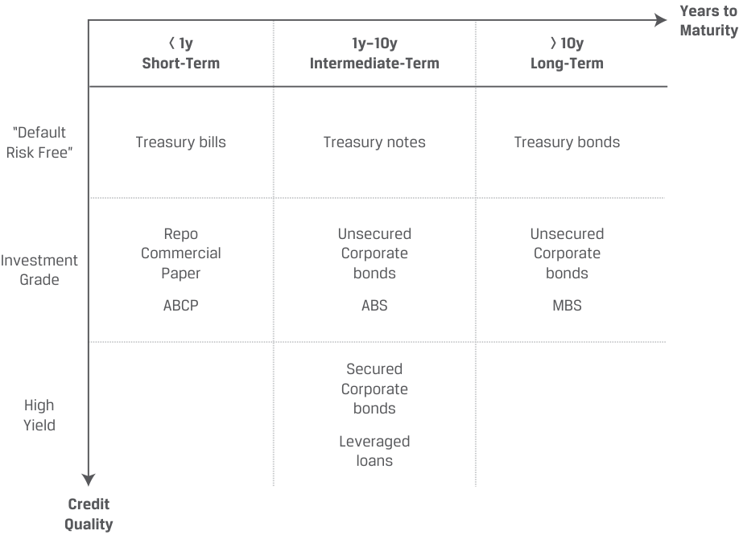
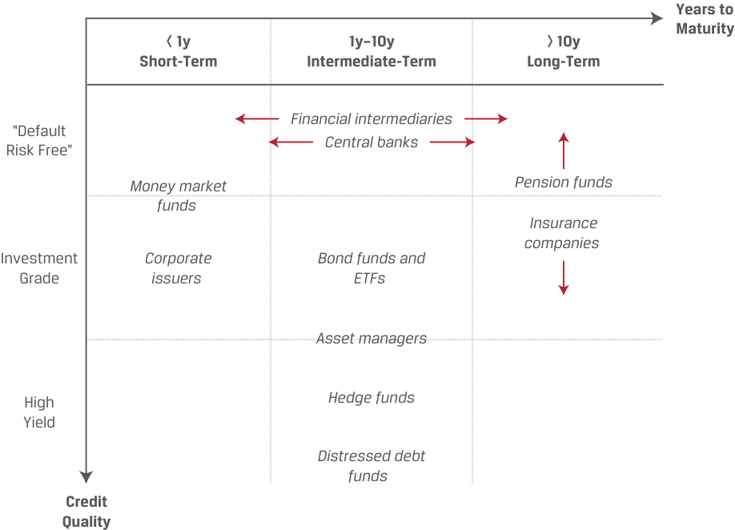
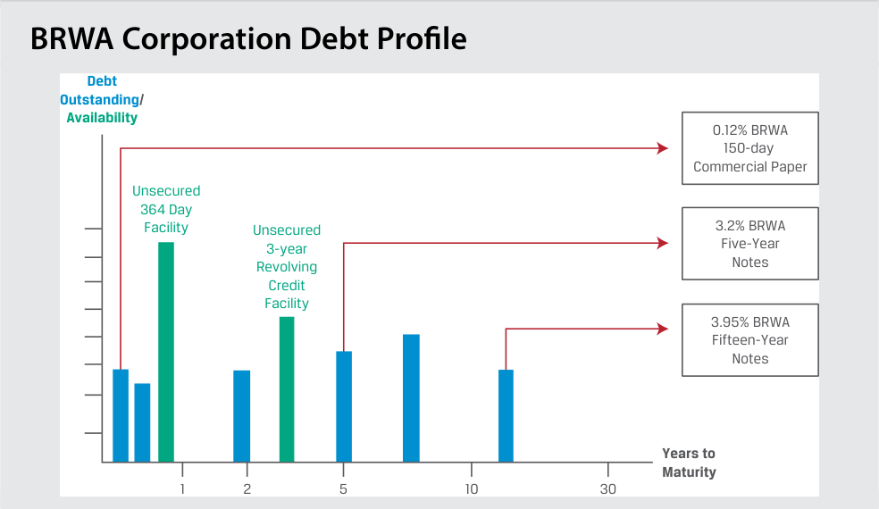
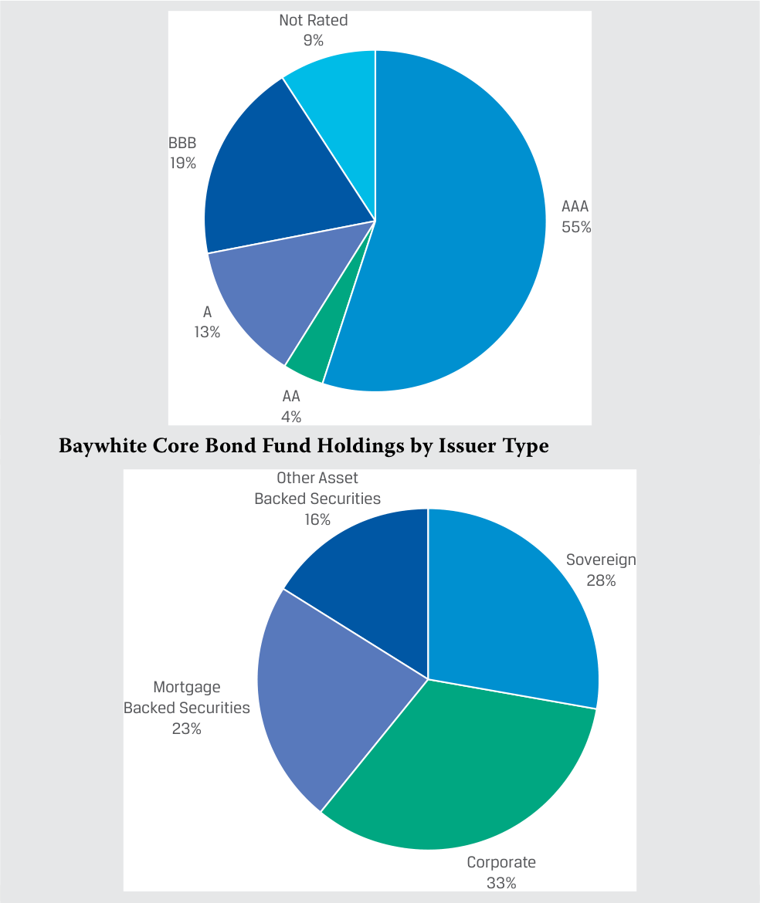
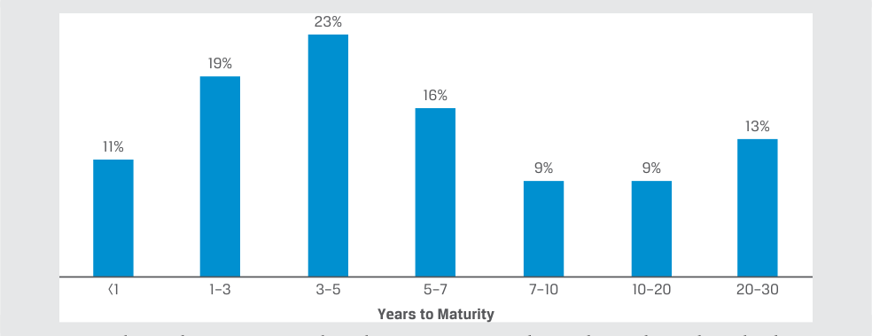
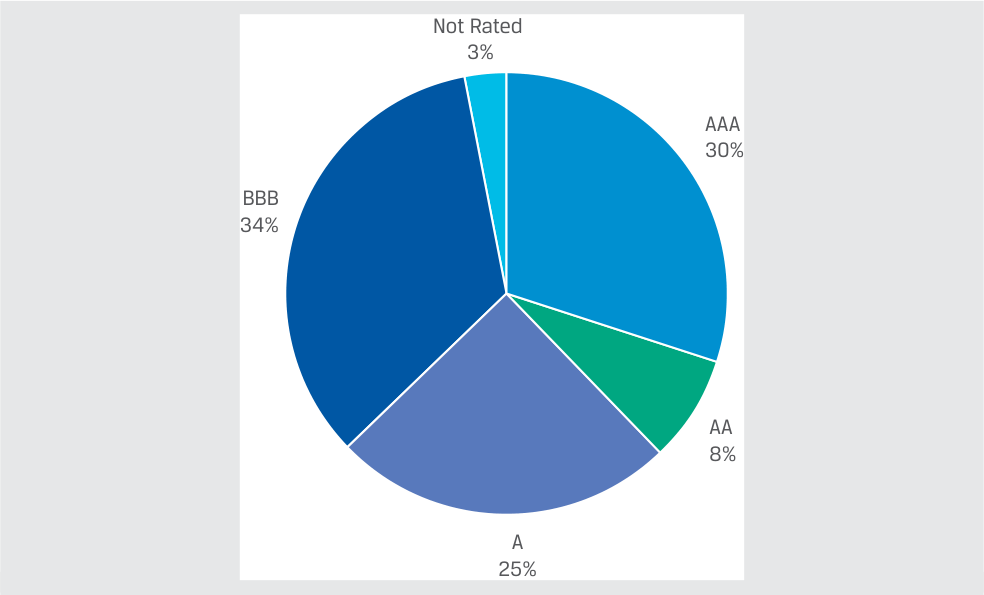
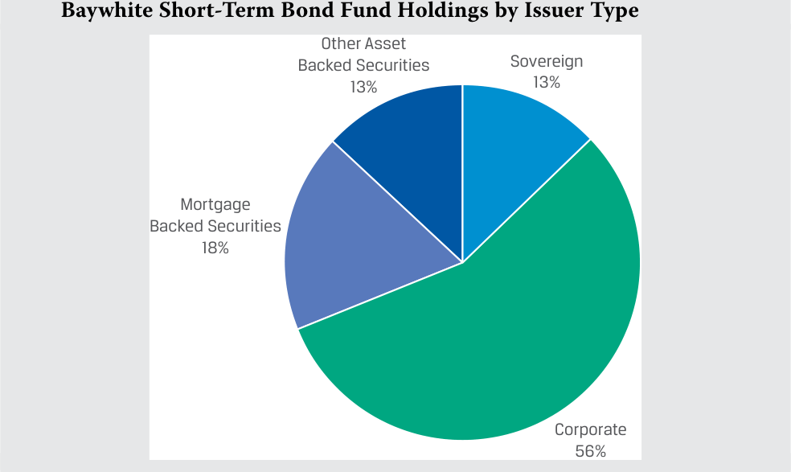

# Volume 6: Fixed Income
## Learning Module 3 Fixed-Income Issuance and Trading
### Part 1/2: Introduction (PDF Pages 65–80)

---

<!-- PDF Page 65 -->

#### L E A R N I N G M O D U L E 

# **<mark>3</mark>** 

### **Fixed-Income Issuance and Trading** 

###### **<mark>LEARNING OUTCOMES</mark>** 

**_Mastery The candidate should be able to:_** describe fixed-income market segments and their issuer and investor participants describe types of fixed-income indexes compare primary and secondary fixed-income markets to equity markets 

##### **INTRODUCTION** 

## **<mark>1</mark>** 

Fixed-income instruments and markets are often categorized by issuer type, credit quality, time to maturity, and, sometimes, additional features, such as currency, geography, and environmental, social, and governance (ESG) characteristics. Fixed-income indexes are categorized in a similar manner and serve important functions, like the role of equity market indexes in stock markets. Like other financial markets, fixed-income markets are composed of primary markets in which issuers raise financing from investors with new issues and secondary markets where investors trade existing instruments with other investors. Given bonds’ finite maturities and other features, there are important distinctions in fixed-income markets from the primary and secondary markets for equities. 

###### **LEARNING MODULE OVERVIEW** 

- Fixed-income instruments and markets are typically categorized along three dimensions: issuer type (i.e., sector), credit quality, and time to maturity. 

- Fixed-income investors have corresponding positions along the credit and maturity spectrum as they seek exposures to certain risks and attempt to match the cash flows of known future obligations. 

<!-- PDF Page 66 -->

- Similar to equity market indexes, fixed-income indexes track the returns of groups of securities that meet their inclusion criteria. Indexes are used to evaluate market performance, benchmark the performance of investments and investment managers, and form the basis of indexed investment strategies. 

- Fixed-income indexes can be classified as broad-based, aggregate indexes with a vast number of constituents or narrower indexes that focus on criteria such as issuer type, credit quality, and time to maturity. 

- Primary bond markets are markets in which an issuer sells a new bond or bonds to investors to raise financing, whereas secondary bond markets are markets in which existing bonds are traded among investors. 

###### **LEARNING MODULE SELF-ASSESSMENT** 

These initial questions are intended to help you gauge your current level of understanding of this learning module. 

1. Discuss two ways that an investor could seek to increase her expected return on a fixed-income portfolio. 

###### **Solution:** 

Investors could increase _credit risk_ with instruments with lower credit ratings. Second, provided that the yield curve is upward sloping, investors may also increase expected returns with _longer-term bonds_ . 

2. Which of the following statements about fixed-income and equity indexes is correct? 

   - **A.** There is more turnover in equity indexes than in fixed-income indexes. 

   - **B.** Fixed-income indexes often have more constituent securities than equity indexes. 

   - **C.** Fixed-income index constituents are typically equally weighted, while equity index constituents are typically weighted by issuers’ market capitalization. 

###### **Solution:** 

B is correct. Fixed-income indexes often have more constituent securities than equity indexes because issuers tend to have many types of instruments outstanding, and governments issue large amounts of fixed-income securities but not equity securities. The finite maturity of bonds and the higher frequency of new issuance lead to far more turnover in fixed-income indexes than in equity indexes. Fixed-income index constituents are usually weighted by market value of debt outstanding, whereas equity indexes are weighted by issuers’ market capitalizations. 

3. The Bloomberg Barclays Global Aggregate Index includes: 

   - **A.** all issuer sizes. 

   - **B.** issuers in multiple currencies. 

<!-- PDF Page 67 -->

**C.** high-yield and unrated issuers. **Solution:** B is correct. The Bloomberg Barclays Global Aggregate Index includes fixed-coupon capital market securities from all major issuer types in 28 developed and emerging markets that meet the inclusion criteria. However, the index excludes high-yield and unrated debt instruments and those that do not meet minimum issuance size. 

4. A debut issuer seeking to sell its bonds only to a select group of investors will _most likely_ undertake a: 

   - **A.** public offering. 

   - **B.** shelf registration. 

   - **C.** private placement. 

   - **Solution:** 

C is correct. Bonds can be sold via a private placement, in which only a select group of investors or a single investor purchases the bonds. Bonds can also be sold in a public offering in which any member of the public may buy the bonds. Frequent bond issuers use a shelf registration, which is updated regularly and may be used for a range of future bond issuances. 

5. A frequent bond issuer that seeks flexibility to issue bonds opportunistically when market conditions are favorable would _most likely_ use a: 

   - **A.** reopening. **B.** shelf offering. 

   - **C.** private placement. 

   - **Solution:** 

B is correct. Frequent issuers of bonds have ready access to the bond market and often choose issuance timing on an opportunistic basis, when market conditions are most favorable. Frequent bond issuers use a shelf registration or a broad, all-encompassing offering circular that is updated regularly and may be used for a range of future bond issuances. A less common strategy is to increase the size of an _existing_ bond with a price significantly _different_ from par, which is referred to as the reopening of an existing bond. In a private placement, only a selected investor or group of investors may buy the bonds. 

##### **FIXED-INCOME SEGMENTS, ISSUERS, AND INVESTORS** 

**<mark>2</mark>** 

describe fixed-income market segments and their issuer and investor participants 

Fixed-income instruments and markets are typically categorized along three dimensions: issuer type (often known as sector), credit quality, and time to maturity. Sometimes, instruments and markets are additionally classified by issuers’ geography, currency, and ESG characteristics. 

<!-- PDF Page 68 -->

In contrast to equities, where issuers typically issue just one or two instruments, issuers often have _many_ fixed-income instruments outstanding. For example, a corporate issuer may have loans or both loans and bonds, either on a short-term basis to finance working capital or a long-term basis for capital investment. Some large companies also issue commercial paper, a type of short-term bond to finance working capital needs that can be collateralized by specific assets. These debt instruments may be in varying currencies to hedge exposures and broaden access to investors. For example, at the end of 2021, Apple Inc. had over 80 fixed-income instruments but a single equity instrument (common stock) outstanding. 

Exhibit 1 illustrates typical issuers and instrument types across credit and time-to-maturity segments. 

**Exhibit 1: Issuers across the Credit and Maturity Spectrums: Issuers and Instrument Types** 

<!-- Start of picture text -->
Years to Maturity < 1y 1y–10y > 10y Short-Term Intermediate-Term Long-Term “Default Treasury bills Treasury notes Treasury bonds Risk Free” Repo Unsecured Unsecured Investment Commercial Corporate Corporate Grade Paper bonds bonds ABCP ABS MBS Secured Corporate High bonds Yield Leveraged loans Credit Quality <!-- End of picture text -->

_Note:_ ABCP is asset-backed commercial paper. 

Fixed-income investors have corresponding positions along the credit and maturity spectrums as they seek to gain exposures to certain risks and to match the cash flows of known future obligations. Near-term obligations and the desire for liquid cash alternatives are often met with money market securities, while investors may assume greater interest rate risk with long-term bonds to meet obligations further in the future or pursue higher expected returns. Pension funds and insurance companies with long investment time horizons favor fixed-income instruments with fixed periodic coupon cash flows and a maturity profile that matches their long-term liabilities. Additionally, investors may take credit risk at any point on the maturity spectrum to augment returns. Exhibit 2 illustrates common investor positions across the credit and maturity spectrums. 

<!-- PDF Page 69 -->

**Exhibit 2: Investors across the Credit and Maturity Spectrums: Investors** 

<!-- Start of picture text -->
Years to Maturity < 1y 1y–10y > 10y Short-Term Intermediate-Term Long-Term Financial intermediaries “Default Central banks Risk Free” Money market Pension funds funds Insurance companies Investment Corporate Bond funds and Grade issuers  ETFs Asset managers High Hedge funds Yield Distressed debt funds Credit Quality <!-- End of picture text -->

A common measure of credit quality is a **credit rating** . Credit ratings are letter-grade, qualitative measures of an issuer’s ability to meet its debt obligations based on both the probability of default and the expected loss under a default scenario. Credit ratings are given and maintained by **credit rating agencies** for both short-term and long-term debt and for _issuers_ and specific bond _issues_ . Two of the largest credit rating agencies are Standard & Poor’s (S&P) and Moody’s. Many investors are restricted to instruments with credit ratings, with a limited percentage of their portfolio invested in unrated instruments. Credit risk and credit ratings will be discussed in detail in later lessons. 

###### **S&P CREDIT RATINGS** 

S&P ratings range from AAA for the highest credit quality to D for default, with ratings in descending order of credit quality as follows: 

|Investment Grade|AAA|Extremely strong capacity to meet financial commitments; highest rating|
|---|---|---|
||AA|Very strong capacity to meet financial commitments|
||A|Strong capacity to meet financial com- mitments but somewhat susceptible to adverse economic conditions and changes in circumstances|
||BBB|Adequate capacity to meet financial commit- ments but more subject to adverse economic conditions|
||BBB-|Considered lowest investment grade by mar- ket participants|
|Speculative Grade _or_High Yield|BB+|Considered highest speculative grade by mar- ket participants|

<!-- PDF Page 70 -->

|BB|Less vulnerable in the near term but faces major ongoing uncertainties to adverse busi- ness, financial, and economic conditions|
|---|---|
|B|More vulnerable to adverse business, financial, and economic conditions but currently has the capacity to meet financial commitments|
|CCC|Currently vulnerable and dependent on favorable business, financial, and economic conditions to meet financial commitments|
|CC|Highly vulnerable; default has not yet occurred but is expected to be a virtual certainty|
|C|Currently highly vulnerable to non-payment, and ultimate recovery is expected to be lower than that of higher-rated obligations|
|D|Payment default on a financial commitment or breach of an imputed promise; also used when a bankruptcy petition has been filed or similar action taken|

_Source:_ S&P Global Ratings. 

Developed market (DM) sovereign issuers usually represent the most creditworthy borrowers within a market and often carry a AAA rating. Because investors often assume they will receive all promised interest and principal payments on DM sovereign bonds, they comprise the “default risk free” category in Exhibit 1. 

Issuers rated BBB- (Baa3 on Moody’s scale) or higher are considered **investment grade** . Issuers rated BB+ (Ba1 on Moody’s scale) or lower are referred to as **high yield** , speculative grade, or junk. High-yield issuers include new issuers for which investors are more likely to require collateral due to less stable operating cash flows, as well as formerly investment-grade issuers whose credit quality has deteriorated since the time of issuance (known as “ **fallen angels** ”). 

The participation of issuers and investors in heterogeneous fixed-income markets is illustrated in the following examples. 

<!-- PDF Page 71 -->

###### **EXAMPLE 1** 

<!-- Start of picture text -->
BRWA Corporation Debt Profile Debt Outstanding/ Availability 0.12% BRWA 150-day Commercial Paper Unsecured 364 Day Facility Unsecured 3.2% BRWA 3-year Five-Year Revolving Notes Credit Facility 3.95% BRWA Fifteen-Year Notes Years to Maturity 1 2 5 10 30 <!-- End of picture text -->

BRWA is an example of an investment-grade corporate issuer with ready access to unsecured debt across maturities and markets as well as in different currencies either directly or through its affiliates. It uses commercial paper to meet its short-term or seasonal working capital needs, intermediate-term debt to cover more permanent working capital or medium-term investments, and long-term debt to match the longer useful life of capital investments, such as new manufacturing equipment or factories. BRWA pays a fee to a group (or **syndicate** ) of banks for two **credit facilities** , which are loan agreements with pre-specified terms and limits but with fluctuating balances based on borrower-specific needs at different points in time, analogous to a credit card. The first is a 364-day facility which backs the commercial paper program, and the second is a longer-term revolving credit facility. 

The combination of domestic and cross-border operating, financing, and leasing activities in Example 1 leads many of BRWA’s real-world industry peers to have _hundreds_ of unique debt instruments outstanding across all affiliates. We may contrast the BRWA example with VIVU, the digital media company introduced in an earlier module that has fewer fixed assets, less stable operating cash flows, and, therefore, limited access to fixed-income markets. 

<!-- PDF Page 72 -->

###### **EXAMPLE 2** 

<!-- Start of picture text -->
VIVU Fixed-Income Issuance <!-- End of picture text -->

<!-- Start of picture text -->
Debt Outstanding/ Availability Secured 2-year Credit 6.5% VIVU Facility Seven-Year Callable Notes Term Loan A Secured Working Capital Facility Years to Maturity 1 2 5 10 30 <!-- End of picture text -->

VIVU is an example of a high-yield corporate issuer that has limited access to secured debt across shorter maturities. VIVU has no access to the unsecured commercial paper market but, rather, relies on partially drawn secured working capital and credit facilities from banks to meet its short-term needs. VIVU has a fully drawn loan (Term Loan A) that has a floating-rate coupon equal to MRR plus a fixed credit spread. VIVU also has seven-year callable notes outstanding under which it has the right to redeem the notes at a fixed price starting three years from issuance. 

Sovereign government issuers typically have the lowest credit risk (highest credit rating) in each market, due to sovereign governments’ right to tax economic activity. Developed market sovereign bonds are often widely held by both foreign investors and foreign central banks seeking to hold reserves in the developed market’s currency in the form of an interest-bearing asset. Sovereign bonds also serve important functions in the domestic financial system. Central banks often use domestic sovereign bonds to conduct monetary policy, borrowing or lending these securities to increase or decrease monetary reserves. 

Investment-grade bond investors expect more stable cash flows, and defaults among investment-grade issuers are relatively rare. Expected returns are therefore lower than those for high-yield bonds and usually comparable or modestly higher than those of sovereign bonds. High-yield investors expect greater return for assuming a higher probability of default and often compare returns to those of equity investments. 

###### **EXAMPLE 3** 

###### **Baywhite Financial’s Bond Funds** 

Baywhite Financial manages its Core Bond Fund with the objectives of longrun capital appreciation with a relatively low tolerance for credit risk. The fund invests in investment-grade intermediate- and long-term bonds, including BRWA’s 5- and 15-year notes. The composition of the fund’s holdings, which include 3,601 positions, is as follows: 

**Baywhite Core Bond Fund Holdings by Credit Rating** 

<!-- PDF Page 73 -->

<!-- Start of picture text -->
Not Rated 9% BBB 19% AAA 55% A 13% AA 4% Baywhite Core Bond Fund Holdings by Issuer Type Other Asset Backed Securities 16% Sovereign 28% Mortgage Backed Securities 23% Corporate 33% <!-- End of picture text -->

<!-- Start of picture text -->
Baywhite Core Bond Fund Holdings by Time to Maturity <!-- End of picture text -->

<!-- Start of picture text -->
23% 19% 16% 13% 11% 9% 9% <1 1–3 3–5 5–7 7–10 10–20 20–30 Years to Maturity <!-- End of picture text -->

Baywhite also manages the Short-Term Bond Fund as a liquid cash alternative for investors, and it takes minimal credit and interest rate risk by investing in investment-grade, short-term bonds, such as BRWA’s commercial paper. The composition of the Short-Term Bond Fund’s holdings, which include 451 positions, is as follows: 

**Baywhite Short-Term Bond Fund Holdings by Credit Rating** 

<!-- PDF Page 74 -->

<!-- Start of picture text -->
Not Rated  3% AAA 30% BBB 34% AA 8% A 25% <!-- End of picture text -->

<!-- Start of picture text -->
Baywhite Short-Term Bond Fund Holdings by Issuer Type Other Asset Backed Securities Sovereign 13% 13% Mortgage Backed Securities 18% Corporate 56% <!-- End of picture text -->

**Baywhite Short-Term Bond Fund Holdings by Time to Maturity** 

<!-- Start of picture text -->
57% 41% 2% 0% 0% 0% 0% <1 1–3 3–5 5–7 7–10 10–20 20–30 Years to Maturity <!-- End of picture text -->

Neither of these funds would invest in VIVU’s seven-year callable notes, because both are restricted to owning investment-grade debt. 

<!-- PDF Page 75 -->

###### **QUESTION SET** 

1. A fixed-income mutual fund that is required to invest in only investment-grade bonds would _most likely_ invest in: **A.** B rated bonds. **B.** BB+ rated bonds. **C.** BBB- rated bonds. 

**Solution:** C is correct. Both B and BB+ rated bonds are considered high-yield bonds. A BBB- rated bond is considered the lowest investment-grade bond. 

2. New issuers for which investors are likely to require collateral due to more volatile operating cash flows are _best_ categorized as: 

   - **A.** fallen angels. **B.** high-yield issuers. **C.** investment-grade issuers. 

   - **Solution:** B is correct. High-yield issuers (not investment-grade issuers) include new issuers for which investors are more likely to require collateral due to less stable operating cash flows. Investment-grade issuers whose credit quality has deteriorated since the time of issuance are known as fallen angels. 

3. A corporate issuer seeking to fund working capital needs would _most likely_ issue: **A.** commercial paper. **B.** intermediate-term debt. **C.** long-term debt. 

**Solution:** 

B is correct. A corporate issuer would use commercial paper to meet its short-term or seasonal working capital needs, intermediate-term debt to cover more medium-term investments, and long-term debt or equity to match the longer useful life of capital investments. 4. A high-yield corporate issuer would _most likely_ finance its operations using: **A.** secured term loans. **B.** long-term callable bonds. **C.** unsecured commercial paper. **Solution:** A is correct. A high-yield corporate issuer has limited access to secured debt across shorter maturities but has no access to unsecured commercial paper or the long-term bond market. (See Example 2.) 

<!-- PDF Page 76 -->

5. Identify the following statement as true or false. Justify your answer. 

Foreign investors in emerging market debt have an expected return that is similar to that of developed market sovereign bonds. 

###### **Solution:** 

False. Foreign investors in emerging market debt expect a return above that of developed market sovereign bonds in exchange for holding bonds with lower credit quality and higher risk related to currency fluctuations. 

## **<mark>3</mark>** 

##### **FIXED-INCOME INDEXES** 

describe types of fixed-income indexes 

An earlier module highlighted the role of market indexes in tracking the broad risk and return of different security markets, which enable the evaluation of market performance, benchmarking the performance of investments and investment managers, and forming the basis for indexed investment strategies. Fixed-income indexes perform a similar function in bond markets as equity indexes in stock markets but differ in three important ways from their equity counterparts. 

**1.** A single issuer may have many individual fixed-income securities outstanding. _All_ bonds that meet index eligibility requirements are included in indexes, causing fixed-income indexes to have many more constituent securities than equity indexes have. Some indexes have over 10,000 constituents. 

**2.** The finite maturity of bonds and the higher frequency of new issuance lead to far more changes in constituents (turnover) in fixed-income indexes than in equity indexes. Bond indexes are usually rebalanced each month to both add new issues and remove those that fall below a minimum maturity. 

**3.** Analogous to equity indexes weighted by issuers’ market capitalization, bond index constituents are usually weighted by market value of debt outstanding. Since bonds are issued by many types of issuers, broad bond indexes will reflect changes to bond market composition over time—for example, increases in public versus private issuer debt, longer maturities, and deterioration in credit quality. Government issuers are large bond issuers, so many broad bond indexes have high weights of government debt. 

If a bond fund aims to match the returns of a specific index, it will typically hold a representative sample of constituent securities in order to match index returns because the complexity of bond indexes makes it impossible to purchase all the constituent securities. 

Fixed-income indexes can be classified as aggregate indexes, with a vast number of constituents, or narrower indexes, based on criteria such as sector, credit quality, time to maturity, geography, and ESG considerations. The choice of index for investment manager performance evaluation is important and will be discussed in detail later in the curriculum, but generally speaking, the index chosen to evaluate an investment manager or fund should correspond to that manager’s or fund’s investment strategy. For example, Baywhite’s Short-Term Bond Fund invests in short-term, investment-grade bonds. To evaluate the fund, its returns should be compared to an index of instruments with similar maturity and credit quality. 

<!-- PDF Page 77 -->

The following three exhibits illustrate fixed-income indexes and their use by investors. 

**Exhibit 3: Global Aggregate Bond Index** 

|**Bl**|**oomberg Barclays Global Aggregate Index** **Brief Summary of Inclusion Criteria**|
|---|---|
|**Issuers:**|Fixed-rate bonds from sovereign, government, corporate, and securitized issuers based in DM and EM markets|
|**Currencies:**|28 eligible currencies across the Americas, EMEA, and Asia Pacific|
|**Credit Quality:**|Investment-grade rating or equivalent|
|**Coupon:**|Fixed rate, zero coupon, and step-up coupon (if step-up dates are predetermined)|
|**Amount Outstanding:**|Minimum issuance size by market, for example: —CAD150 m —USD300 m, EUR300 m, CHF300 m, AUD300 m —CNY 5 bn (Treasury and bank debt) —RUB20 bn —JPY35 bn|
|**Maturity:**|At least one year to final maturity or average weighted maturity|
|**Rebalancing Rules:**|At each month end, the composition of the fixed set of bonds for the following monthly index return is established. Bonds that no longer meet maturity, rating, size, or other criteria are removed, and new issues where security reference information and pricing are available are included.|
|**Reinvestment of Cash** **Flows:**|Intra-month interest and principal payments contribute to monthly index returns and are reinvested into the index on the following rebalancing date.|
|**Market of Issue:**|Global and regional public markets|
|**Seniority of Debt:**|Senior and subordinated issues|
|**Taxability:**|Only fully taxable issues are eligible.|

The Bloomberg Barclays Global Aggregate Index includes fixed-coupon capital market securities from all major issuer types in 28 developed and emerging markets that meet the above inclusion criteria. However, the index excludes high-yield and unrated debt instruments and those that do not meet minimum issuance size. 

The index sponsor prices all bonds at a predetermined time each business day to calculate the index value. Mutual funds and ETFs that track this benchmark index offer _comprehensive_ exposure to many fixed-income markets with _no_ active security selection and portfolio turnover limited solely to either new issuance or issues no longer meeting inclusion criteria. Similar subindexes are available by market or region, and returns may include gains or losses due to currency fluctuations (unhedged returns) or may offset these currency-based changes using currency forwards on rebalancing dates (hedged returns). 

The Bloomberg Barclays Global Aggregate Index might be appropriate to use to evaluate Baywhite Financial’s Core Bond Fund since it includes investment-grade, longer-term bonds from a variety of sectors. However, if Baywhite invests in only a single market, such as Japan, a more appropriate benchmark would be the Bloomberg Barclays Japanese Aggregate Index. 

<!-- PDF Page 78 -->

The J.P. Morgan EMBI+ Index in Exhibit 4 is a more narrowly defined fixed-income index that includes US dollar–denominated debt of sovereign governments at or below a certain credit quality of a minimum issuance size and maturity. The focus on foreign debt of lower credit quality targets a higher US dollar–based return than for developed market sovereign bonds while assuming the external debt risk of issuer countries. 

**Exhibit 4: Emerging Markets Bond Index** 

|**J.P. Mor**|**gan Emerging Markets Bond Index Plus (EMBI+)** **Brief Summary of Inclusion Criteria**|
|---|---|
|**Issuers:**|Emerging market sovereign issuers of US dollar debt|
|**Currencies:**|Only US dollar–denominated bonds are included. Bonds with a coupon or redemption payment linked to an exchange rate are not eligible.|
|**Credit Quality:**|Sovereign rating of Baa1/BBB+/BBB+ or below by Moody’s/S&P/ Fitch Ratings|
|**Coupon:**|Fixed rate, zero coupon, and step-up coupon (if step-up dates are predetermined)|
|**Amount Outstanding:**|Issues with a current face amount outstanding of USD500 mil- lion or more|
|**Maturity:**|Only instruments with at least 2.5 years until maturity are considered. At each month-end, instruments that will fall below 12 months to maturity during the upcoming month will be excluded.|
|**Return Calculation:**|Index total return is calculated as a weighted average of bond returns using bid side prices.|
|**Rebalancing:**|Occurs on the final US business day of each month|
|**Reinvestment of Cash** **Flows:**|All coupons received are immediately reinvested into the index|

Bond investors seeking to incorporate ESG considerations into fixed-income investment decisions frequently use bond indexes that regularly screen for and exclude issuers that fail to meet certain minimum ESG criteria. For example, the Bloomberg Barclays MSCI Euro Corporate Sustainable SRI Index (see Exhibit 5) filters by sector, currency, credit quality, time to maturity, _and_ ESG considerations, such as a minimum ESG rating and exclusion of issuers involved in certain business activities. 

**Exhibit 5: Corporate Sustainable Socially Responsible Investment (SRI) Bond Index** 

|**Bloomberg** |**Barclays MSCI Euro Corporate Sustainable SRI Index** **Brief Summary of Inclusion Criteria** i|
|---|---|
|**Issuers:**|Corporate (industrial, utility, and financial institution) issuers|
|**Currencies:**|Only euro-denominated bonds are included.|
|**Credit Quality:**|Security rating of Baa3/BBB-/BBB- or above by Moody’s/S&P/ Fitch or equivalent|
|**Coupon:**|Fixed rate, zero coupon, and step-up coupon (if step-up dates are predetermined)|
|**Amount Outstanding:**|EUR300 million minimum par amount outstanding|

<!-- PDF Page 79 -->

|**Bloomberg**|**Barclays MSCI Euro Corporate Sustainable SRI Index** **Brief Summary of Inclusion Criteria**|
|---|---|
|**Maturity:**|At least one year to final maturity, with fixed-to-floating per- petual bonds excluded one year prior to conversion. Fixed-rate perpetual bonds are excluded.|
|**Return Calculation:**|Index total return is calculated as a weighted average of bond returns using bid side prices.|
|**Rebalancing:**|Occurs on the final US business day of each month|
|**Reinvestment of Cash** **Flows:**|Intra-month interest and principal payments contribute to monthly index returns and are reinvested into the index on the following rebalancing date.|
|**ESG Rules:**|■Must have an MSCI ESG rating of BBB or higher ■Excludes issuers involved in the following business lines/ activities: ●Alcohol|
||●Tobacco ●Gambling|
||●Adult Entertainment|
||●Genetically Modified Organisms (GMOs)|

- Nuclear Power 

- Civilian Firearms 

- Military Weapons 

- Thermal Coal 

- Generation of Thermal Coal 

- Oil Sands 

- Excludes issuers with a “Red” MSCI Controversies score measuring issuer involvement in major ESG controversies and adherence to international norms and principles 

###### **QUESTION SET** 

1. Which of the following indexes would be _most_ suitable for evaluating Baywhite’s Short-Term Bond Fund? 

An index composed primarily of: 

- **A.** high-yield short-term bonds. 

- **B.** investment-grade short-term bonds. 

- **C.** investment-grade bonds with more than five years to maturity. 

- **Solution:** 

B is correct. Baywhite’s Short-Term Bond Fund invests in investment-grade, short-term bonds. To evaluate this fund, its returns should be compared to those of an index of similar maturity and credit instruments. 

|2. Match the characteristics on the right with the indexes on the left.|
|---|
|A. Broad equityindex I. Includes sovereign issuers|
|B. Broad bond index II. Less frequent rebalancing|

<!-- PDF Page 80 -->

III. Easier to fully replicate IV. Larger number of constituents 

###### **Solution:** 

   - **A.** II and III 

   - **B.** I and IV 

3. Relative to equity indexes, fixed-income indexes exhibit more turnover due to: 

   - **A.** annual rebalancing. 

   - **B.** the finite maturity of bonds. 

   - **C.** the lower frequency of new issues. 

   - **Solution:** 

B is correct. The finite maturity of bonds and the higher frequency of new issuance leads to far more turnover in fixed-income indexes than in equity indexes. Bond indexes are usually rebalanced each month to both add new issues and remove those that fall below a minimum maturity. 

4. The composition of broad bond indexes will _most likely_ change due to changes in: 

   - **A.** the maturity mix of issuers only. 

   - **B.** the proportion of public versus private issuers only. 

   - **C.** both the maturity mix of issuers and the proportion of public versus private issuers. 

   - **Solution:** 

C is correct. Since bonds are issued by many types of issuers, broad bond indexes will reflect changes to bond market composition over time—for example, increases in public versus private issuer debt, longer maturities, and deterioration in credit quality. 

5. Identify the following statement as true or false. Justify your answer. 

The Bloomberg Barclays MSCI Euro Corporate Sustainable SRI Index requires an MSCI ESG rating of AAA and excludes all emerging market issuers. 

###### **Solution:** 

False. The Bloomberg Barclays MSCI Euro Corporate Sustainable SRI Index requires an MSCI ESG rating of BBB or higher and excludes certain business lines/activities, including alcohol, tobacco, gambling, and thermal coal. Emerging market issuers are not excluded. 

