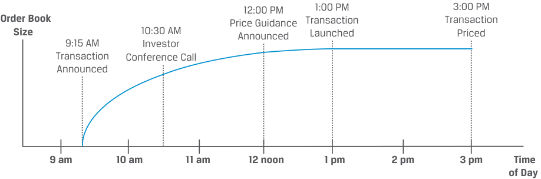

# Volume 6: Fixed Income
## Learning Module 3 Fixed-Income Issuance and Trading
### Part 2/2: Primary and Secondary Fixed-Income Markets (PDF Pages 81–88)

---

<!-- PDF Page 81 -->

# **PRIMARY AND SECONDARY FIXED-INCOME MARKETS** **<mark>4</mark>** 

compare primary and secondary fixed-income markets to equity markets 

### **Primary Fixed-Income Markets** 

**Primary bond markets** are markets in which an issuer sells a new bond or bonds to investors to raise capital. In contrast, **secondary bond markets** are markets in which existing bonds are traded among investors. As in the case of an IPO for equity investors, an issuer approaching the bond market for the first time (often referred to as a **debut issuer** ) represents the first opportunity for a fixed-income investor to purchase an issuer’s bonds. Bonds can be sold via a public offering, in which any member of the public may buy the bonds, or via a private placement, in which only a selected investor or group of investors may buy the bonds. Similar to primary equity issuance, which typically involves a transfer from private to public ownership, a debut issuer is often replacing private debt, such as a bank loan, with bonds. Examples of debut bond issuers include 

- new corporate legal entities formed after a merger, acquisition, or divestiture, which usually refinance _all_ existing debt outstanding; 

- companies that reach a more mature stage of the life cycle with more predictable cash flows and begin issuing debt; and 

- sovereign governments that raise external foreign currency debt for the first time. 

For debut issuers that must complete the respective domestic market or Eurobond registration process, the underwriters usually conduct roadshows and other information sessions for a period of several weeks prior to issuance to familiarize potential investors with the new entity and its uses of and sources for repayment for the new bond. 

For _repeat_ issuers of fixed-income securities, the process is far more abbreviated than for debut issuers and for follow-on offerings of equities. Whereas publicly traded companies that return to the equity market to increase their shares outstanding do so under an identical instrument, fixed-income issuers usually issue a new security priced at or close to par. A less common strategy is to increase the size of an _existing_ bond with a price significantly _different_ from par, which is referred to as the **reopening** of an existing bond. 

For example, unsecured investment-grade issuance of new corporate bonds usually takes place within a several-hour period, as shown in the diagram and timeline in Exhibit 6. 

<!-- PDF Page 82 -->

**Exhibit 6: Investment-Grade Corporate Bond Issuance Timeline** 

<!-- Start of picture text -->
12:00 PM 1:00 PM 3:00 PM Order Book Price Guidance Transaction Transaction Size   10:30 AM Announced Launched Priced 9:15 AM Investor Transaction Conference Call Announced 9 am 10 am 11 am 12 noon 1 pm 2 pm 3 pm Time of Day <!-- End of picture text -->

### **Illustrative Timeline:** 

- 9:00 a.m. Underwriters and issuer agree to launch transaction 9:15 a.m. Transaction announced (size, spread, and maturities TBD) Electronic roadshow released Order book opens to investors 

- 10:30 a.m. Investor conference call with issuer and underwriters 12:00 p.m. Price guidance, size, and maturities subject to change Order book closed to investors 

- 1:00 p.m. Transaction launched with final size, pricing, and maturities 1:00–3:00 p.m. Underwriters allocate transaction to investors 3:00 p.m. Transaction priced (government benchmark and coupon set) 4:00 p.m. Final term sheet delivered, bonds free to trade same or next day 

Exhibit 6 is an example of an underwritten bond offering in which one or more financial intermediaries (or underwriters) guarantee the sale of the bond issue at an offering price that is negotiated with the issuer. Investors in such bonds (e.g., Baywhite) are usually very familiar with the bond indenture and financial statements of these frequent issuers. As in the case of BRWA earlier in this module, issuers of such bonds have ready access to the bond market and often choose issuance timing on an opportunistic basis when market conditions are most favorable. Underwriters seek to manage the bond order book to ensure the greatest availability to large institutional investors at the lowest possible spread across maturities. Frequent bond issuers use a shelf registration or a broad, all-encompassing offering circular that is updated regularly and may be used for a range of future bond issuances. 

Secured bond issuance among corporate high-yield, some special purpose entities, and other issuers (e.g., VIVU) is usually a longer and more involved process than for unsecured investment-grade bonds. Investors must familiarize themselves with unique and more complex covenants, as well as the use of _both_ operating cash flows _and_ collateral as sources of bond repayment. For bonds of lower credit quality, the financial intermediary does not guarantee the sale and may serve only as a broker in a best-efforts offering. That is, it tries to sell the bond issue on a commission basis at the negotiated price only if it can do so. 

In instances where the bond size is small, the issuer is less well known, or the terms are more customized, a bond might take the form of a private placement or non-underwritten, unregistered offering of bonds sold only to a small group of investors. 

Primary market issuance of sovereign debt usually takes the form of a public auction led by the national treasury or finance ministry, which are discussed in detail in a later module. 

<!-- PDF Page 83 -->

### **Secondary Fixed-Income Markets** 

While progress continues to be made by various electronic marketplace platforms, such as MarketAxess and Tradeweb, fixed-income markets are mostly quote-driven or over-the-counter (OTC) markets. Major participants in secondary bond market trading include institutional investors (such as the Baywhite funds introduced earlier), financial intermediaries, and central banks. 

Secondary bond market liquidity varies widely across fixed-income market segments and even among bonds outstanding from a single issuer. The bid–offer spread or difference in price at which a dealer will buy (or bid) from a customer and sell (or offer) to a customer is a key liquidity measure. This spread is often quoted in basis points in fixed-income markets. 

The most recently issued, or on-the-run, developed market sovereign bonds are typically the most liquid fixed-income securities, with primary dealers making active markets in large size with bid–offer spreads equal to a fraction of a basis point. In some markets, such as Australia, domestic sovereign government bonds are traded on an exchange. Among corporate issuers, recently issued corporate bonds from frequent issuers of higher credit quality usually exhibit the greatest liquidity and tightest bid–offer spreads. Underwriters and other dealers are more likely to hold trading inventory in recent issues and may therefore quote bid-offer spreads of a few basis points. Bonds of less frequent corporate issuers or more seasoned bonds of frequent issuers are rarely traded, leading dealers to quote bid–offer spreads of at least 10–20 basis points or more for small sizes. One exception that can increase trading frequency of a seasoned issue is a significant deterioration in a bond’s credit quality, as in the following example. 

#### **EXAMPLE 4** 

### **Hertz Corporation** 

Hertz Global Holdings Inc. (Hertz) is a US-based car rental company that filed for Chapter 11 bankruptcy protection in May 2020 amid the initial outbreak of COVID-19 in the United States. Hertz’s bonds maturing in 2022 and 2028 were trading at an average of less than 10% of par value, a decline of more than 90% from three months earlier. However, a year later, the bonds rose back to their pre-pandemic price as the company exited bankruptcy through a reorganization with outside investors that kept these bonds intact. 

_Source:_ Bloomberg News 

Bonds of issuers believed to be very close to or in bankruptcy, as in the previous example, are referred to as **distressed debt** . Distressed debt typically trades in the secondary market at a price well below par, because bondholders are unlikely to receive all promised future interest and principal payments. Investors with policies limiting their bond investments to highly rated securities may be forced to sell distressed debt, while hedge funds and other opportunistic investors seeking more equity-like returns (from price appreciation) are often the buyers of distressed bonds. Distressed debt is traded until either the corporate issuer has liquidated its assets or its outstanding bonds have been restructured. In contrast, an equity security may be removed or delisted from secondary trading on an exchange if it fails to meet the listing requirements of the exchange, which often include minimum share prices, net worth, and free float. By the time an issuer’s debt has become distressed, its equity securities will likely have already been delisted. 

<!-- PDF Page 84 -->

Finally, many bond issues do not trade at all on a regular basis. Price quotes from dealers or on platforms such as Bloomberg for illiquid bonds often rely on estimates derived from more liquid bonds of similar credit quality and maturity, a process covered in a later module. 

#### **QUESTION SET** 

1. A bond issuance by a company after it has reached a more mature stage of the life cycle with more predictable cash flows would be _best_ considered a: 

   - **A.** private placement. 

   - **B.** primary fixed-income market transaction. 

   - **C.** secondary fixed-income market transaction. 

   - **Solution:** 

B is correct. Primary bond markets are markets in which an issuer sells a new bond or bonds to investors to raise capital. Secondary bond markets are markets in which existing bonds are traded among investors. Bonds can be sold via a private placement, in which only a selected investor or group of investors may buy the bonds. 

2. Which of the following statements about debut issuers is _correct_ ? 

   - **A.** A debut issuer typically replaces bank loans with bonds. 

   - **B.** Debut issuers transfer ownership from public to private markets. 

   - **C.** Debut issuers offer bonds in a public offering, not a private placement. 

   - **Solution:** 

A is correct. Similar to primary equity issuance, which typically involves a transfer from private to public ownership, a first-time bond issuer is often replacing private debt, such as a bank loan, with bonds. 

B is incorrect. Fixed-income securities have no voting or control rights, and debut issues represent a private to public (not public to private) transition. C is incorrect. A debut issuer can offer bonds in either a public offering or a private placement. 

3. Relative to unsecured issuers, secured issuers _most likely_ experience an issuance timeline that is: 

   - **A.** shorter. 

   - **B.** the same. 

   - **C.** longer. 

   - **Solution:** 

C is correct. Secured bond issuance among corporate high-yield, some special purpose entities, and other issuers (e.g., VIVU) is usually a longer and more involved process than for unsecured investment-grade bonds. Investors must familiarize themselves with unique and more complex covenants, as well as the use of _both_ operating cash flows _and_ collateral as sources of bond repayment. 

<!-- PDF Page 85 -->

4. Identify the following statement as true or false. Justify your answer. 

Secondary fixed-income markets consist mostly of quote-driven or overthe-counter markets, while secondary trading for listed equity markets primarily occurs on an electronic exchange. **Solution:** 

True. Unlike listed equities, for which secondary trading largely occurs on an electronic exchange, fixed-income markets consist mostly of quote-driven or over-the-counter markets. 

5. For a firm in distress, its bonds will _most likely_ stop trading: 

   - **A.** before the firm’s equity. 

**B.** at the same time as the firm’s equity. 

**C.** after the firm’s equity. **Solution:** 

C is correct. Distressed debt is traded until either the corporate issuer has liquidated its assets or its outstanding bonds have been restructured. In contrast, an equity security may be removed or delisted from secondary trading on an exchange if it fails to meet the listing requirements of the exchange, which often include minimum share prices, net worth, and free float. By the time an issuer’s debt has become distressed, its equity securities will likely have already been delisted. 

<!-- PDF Page 86 -->

## **~~PRACTICE PROBLEMS~~** 

**1.** Match the instrument type on the left with its typical investor on the right. 

|A. Commercialpaper|I. Insurance companies|
|---|---|
|B. Unsecured corporate bonds|II. Hedge funds|
|C. Secured corporate bonds|III. Money market funds|

**2.** An issuer with a AAA credit rating would _most likely_ be a: 

   - **A.** distressed issuer. 

   - **B.** high-yield issuer. 

   - **C.** sovereign issuer. 

**3.** An index tracking the Bloomberg Barclays Global Aggregate Index would _most likely_ have: 

   - **A.** limited security selection. 

   - **B.** modest turnover due to changes in market values. 

   - **C.** comprehensive exposure to fixed-income markets. 

**4.** A firm that increases the size of an existing bond issue with a price significantly different from par is conducting a: 

   - **A.** reopening. 

   - **B.** private placement. 

   - **C.** distressed debt issuance. 

**5.** The bond issue trading at the highest bid–offer spread is _most likely_ a: 

   - **A.** recently issued sovereign bond. 

   - **B.** seasoned investment-grade corporate bond. 

   - **C.** recently issued investment-grade corporate bond. 

<!-- PDF Page 87 -->

## **~~SOLUTIONS~~** 

1. 

   - **A.** III 

   - **B.** I 

   - **C.** II 

2. C is correct. Sovereign government issuers typically have the lowest credit risk (highest credit rating) in each market, due to sovereign governments’ right to tax economic activity. High-yield issuers have below-investment-grade credit ratings (BBB- or below), while distressed issuers typically have high-yield ratings or are in default. 

3. C is correct. Mutual funds and ETFs that track this benchmark index offer _comprehensive_ exposure to many fixed-income markets with _no_ active security selection and portfolio turnover limited solely to either new issuance or issues no longer meeting inclusion criteria. 

4. A is correct. Increasing the size of an existing bond with a price significantly different from par is referred to as the reopening of an existing bond. A private placement refers to bonds being sold to a selected investor or group of investors, versus a sale to the public. Bonds of issuers believed to be very close to or in bankruptcy are referred to as distressed. 

5. B is correct. Bonds of less frequent corporate issuers or more seasoned bonds of frequent issuers are rarely traded, leading dealers to quote bid–offer spreads of at least 10–20 basis points or more for small sizes. The most recently issued, or on-the-run, developed market sovereign bonds are typically the most liquid fixed-income securities, with primary dealers making active markets in large size with bid–offer spreads equal to a fraction of a basis point. Among corporate issuers, recently issued corporate bonds from frequent issuers of higher credit quality usually exhibit the greatest liquidity and tightest bid–offer spreads. 

<!-- PDF Page 88 -->

