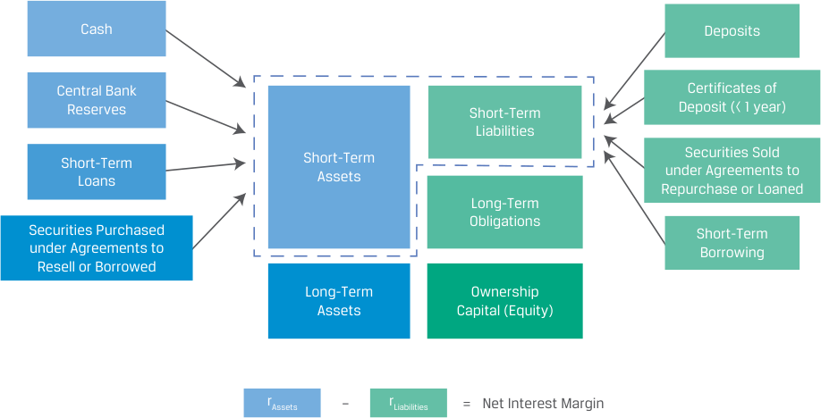

# Volume 6: Fixed Income
## Learning Module 4 Fixed-Income Markets for Corporate Issuers
### Part 1/3: Introduction (PDF Pages 89–97)

---

<!-- PDF Page 89 -->

L E A R N I N G M O D U L E **<mark>4</mark>** 

## **Fixed-Income Markets for Corporate Issuers** 

#### **<mark>LEARNING OUTCOMES</mark>** 

|**_Mastery_**|**_The candidate should be able to:_**|
|---|---|
||compare short-term funding alternatives available to corporations and financial institutions|
||describe repurchase agreements (repos), their uses, and their benefits and risks|
||i contrast the long-term funding of investment-grade versus high-yield corporate issuers|

### **INTRODUCTION** 

**<mark>1</mark>** 

Previous modules described various types of fixed-income issuers and investors. In this module, we focus on the corporate fixed-income sector, composed of instruments issued by financial institutions and non-financial corporate issuers across the time-to-maturity and credit spectrums. These instruments account for a significant portion of total debt issuance and debt outstanding globally. 

##### **LEARNING MODULE OVERVIEW** 

- Non-financial corporations frequently use short-term external funding in the form of bank loans and securities, such as commercial paper to meet cash needs. 

- ■ Financial institutions rely on deposits, interbank markets, commercial paper, and repurchase agreements (repos) as primary sources of shortterm funding. 

- ■ Commercial paper is a short-term unsecured promissory note issued by both financial institutions and non-financial corporations. 

- ■ A repurchase agreement (repo) is a form of short-term secured lending that involves the sale and simultaneous agreement to buy back a security at a pre-agreed future price. 

<!-- PDF Page 90 -->

- An investment-grade bond has a significant proportion of its yield-to-maturity (YTM) attributed to the government benchmark yield due to its strong ability to meet promised interest and principal obligations from operating cash flows. 

- High-yield issuers are characterized by a higher expected likelihood of financial distress. Relative to investment-grade bonds, a higher proportion of their bonds’ YTM is attributed to an issuer-specific spread over the government benchmark yield. 

##### **LEARNING MODULE SELF-ASSESSMENT** 

These initial questions are intended to help you gauge your current level of understanding of this learning module. 

1. Which of the following financing instruments provides the _most_ reliable source of short-term bank funding for a non-financial corporation? 

   - **A.** Revolving credit agreement 

   - **B.** Committed bank line of credit 

   - **C.** Uncommitted bank line of credit 

##### **Solution:** 

A is correct. Revolving credit agreements, also referred to as revolvers, are the most reliable source of short-term bank funding. 

B is incorrect. While committed lines of credit are a more reliable source of financing than uncommitted lines because they involve a formal written commitment, they are less reliable than revolvers. C is incorrect because uncommitted bank lines of credit are the least reliable form of bank borrowing for a company. 

2. Identify the following statement as true or false. Justify your answer. 

In an unsecured loan, the lender requires the company to provide collateral in the form of an asset that is pledged against the loan. 

##### **Solution:** 

False. _Secured_ loans are loans in which the lender requires the company to provide collateral in the form of an asset, such as a fixed asset that the company owns or high-quality receivables or inventory. These assets are pledged against the loan, and the lender files a security interest against them. This pledge or lien is added to the borrowing company’s financial record and reflected on its credit report. Companies that lack sufficient credit quality to qualify for unsecured loans may attempt to obtain secured loans. 

3. Relative to long-term debt and equity, repo funding provides which of the following benefits to a financial institution? 

   - **A.** Lower cost 

   - **B.** Longer-term financing 

   - **C.** Greater financial flexibility 

##### **Solution:** 

A is correct. Financial institutions must balance the low cost of repo funding with the greater financial flexibility of more costly longer-term financing al- 

<!-- PDF Page 91 -->

|ternatives, such as long-term debt and equity. B and C are incorrect because they are both benefits of long-term debt and equity.|
|---|
|4. Venus, Inc., a financial institution, and Bank A, a large regional bank, enter into a repurchase agreement in which Venus is the security seller and Bank A is the security buyer. The repo is subject to a 102% initial margin. Which of the following statements is correct?|
|**A.**Bank A benefits from a long-term cash investment on a collateralized basis with minimal liquidity risk.|
| **B.**Bank A could generate higher returns for longer repo terms and/or by accepting less liquid or lower-quality collateral.|
|**C.**The repo transaction reduces Venus’s funding requirement for the security to a fraction of the bond’s purchase price. **Solution:**|
|B is correct. Short-term repos with high-quality collateral (lowest risk) result in the lowest return; however, investors can expect higher returns for longer repo terms and/or by accepting less liquid or lower quality collateral. A is incorrect because Bank A benefits from a short-term (not long-term) cash investment on a collateralized basis with minimal liquidity risk.|
|C is incorrect because the repo transaction reduces Bank A’s (not Venus’s) funding requirement for the security to a fraction of the bond’s purchase price due to the 102% initial margin.|
|5. An investor is analyzing three bonds for a potential investment: a AA rated bond, a B rated bond, and a CCC rated bond. Which of the bonds is_most_ _appropriate_if the investor is seeking safety with few issuer restrictions? **A.**AA rated bond|
|**B.**B rated bond **C.**CCC rated bond **Solution:**|
|A is correct. The AA rated bond is investment grade with low likelihood of default and minimal issuer restrictions. B and C are incorrect because the B rated and CCC rated bonds are considered high yield with equity-like risk attributes and often greater issuer restrictions.|
|6. A bond analyst would_most likely_consider the probability of default and loss given default for:|
|**A.**an investment-grade bond because of its equity-like cash flow.|
|l **B.**a high-yield bond because of its higher expected likelihood of financial distress.|
|**C.**an investment-grade bond because of the importance of financial ratios and credit ratings to determine the issuer’s likelihood of default. **Solution:**|
|B is correct. High-yield issuers are characterized by a higher expected likelihood of financial distress. Given the higher chance of default, these instruments are more equity-like in nature and analysts place a greater em- phasis on the likelihood (probability) of default, potential loss given default, and the protections and secondary repayment sources that are available. A is incorrect because investment-grade bonds exhibit bond-like cash flows,|

<!-- PDF Page 92 -->

for which there is a high probability of receiving the agreed-upon interest and principal payments. C is incorrect because investment-grade bond analysts use financial ratios and credit ratings to determine if and when an investment-grade issuer’s likelihood of default will change and don’t rely on probability of default or loss given default measures. 

# **<mark>2</mark>** 

### **SHORT-TERM FUNDING ALTERNATIVES** 

compare short-term funding alternatives available to corporations and financial institutions 

Both non-financial corporations and financial institutions rely on borrowed capital to support their short-term activities. As discussed in an earlier module in the corporate issuers reading, corporations use external short-term financing to meet cash needs during their cash conversion cycle, preserve liquidity, and take advantage of supplier discounts. 

Non-financial corporate sources and uses of short-term funding are summarized in Exhibit 1. 

**Exhibit 1: Sources and Uses of Short-Term Funding for Non-Financial Corporates** 

<!-- Start of picture text -->
Working Capital Cash Accounts Payable Short-Term Short-Term Liabilities Investments Short-Term Short-Term Borrowing Assets Accounts Long-Term Receivable Obligations Inventory Long-Term Ownership Assets Capital (Equity) <!-- End of picture text -->

#### **External Loan Financing** 

Non-financial corporations often rely on financial intermediaries for short-term financing. Common instruments include 

- uncommitted bank lines of credit, 

- committed bank lines of credit, and 

- revolving credit agreements, or revolvers. 

<!-- PDF Page 93 -->

These can be unsecured or secured, depending on a company’s financial strength, general credit situation, and jurisdiction. Uncommitted lines and revolvers are used more frequently in the United States, whereas regular committed lines are more common elsewhere. Credit lines typically offer the most flexible and immediate access to short-term funding. 

##### **_Lines of Credit_** 

**Uncommitted lines of credit** are the least reliable form of bank borrowing for a company, as the name suggests. A bank offers uncommitted credit lines up to a certain principal amount (“credit line”) for a pre-determined maximum maturity, charging a base or market reference rate (MRR) plus an issuer-specific spread on only the principal outstanding for the period of use. Under normal business conditions, companies often find uncommitted bank credit lines to be the most flexible and least costly means of external funding. Banks usually offer these lines on an unsecured basis to clients who maintain stable cash deposits at the bank, allowing the banks to closely monitor and react to adverse borrower developments, such as declining account balances. Uncommitted credit lines require minimal capital reserves until they are drawn down and used, but banks reserve the right to refuse to honor any request for use of the line. Firms cannot therefore rely on uncommitted lines as a primary source of funding, because banks may choose not to lend if business or economic conditions deteriorate. Alternative funding sources may be difficult to obtain or are prohibitively expensive at times when uncommitted funding becomes unavailable. The primary attraction of uncommitted lines is that they do not require the company to pay any compensation other than interest on balances outstanding to the bank. From a bank perspective, these uncommitted lines of credit serve as valuable tools to maintain a long-term business relationship with the borrower through which the bank can monitor borrower activity. Funding for these lines often comes from stable deposits that the bank holds, allowing it to finance these lines using funds that depositors do not regularly touch. 

**Committed (regular) lines of credit** are a more reliable source of financing than uncommitted lines because they involve a formal written commitment. Committed lines require more bank capital than uncommitted lines, although commitments of less than a year (usually 364 days) minimize a bank’s capital requirement. For larger corporate borrowers, banks often further reduce the committed capital needed to support the line by forming a group of banks or a syndicate, which involves a mutual agreement to accept a pre-determined percentage of the total credit commitment and loan drawdown over time. When drawn, regular credit lines are short-term liabilities, usually classified as notes payable or the equivalent. Undrawn committed lines are sometimes used as a source of backup credit for other financing forms, such as short-term securities, as shown later. 

Regular lines are unsecured and prepayable without penalty. Although they are a more reliable source of short-term funding than uncommitted lines, these commitments face the risk of renewal at maturity, particularly when heavily used and drawn by a borrower with weakening credit conditions. Unlike uncommitted lines, regular lines usually involve upfront costs in the form of a commitment fee (such as 0.50%) on either the full or unused amount of the line for the commitment period. 

**Revolving credit agreements** , also referred to as “revolvers” (or “operating lines of credit”), are the most reliable source of short-term bank funding. These are multiyear credit commitments and lenders typically seek protections, such as covenants which require or restrict certain borrower actions as in the case of a bond indenture. Otherwise, revolvers have similar features to regular lines with respect to borrowing rates and commitment fees and may also include optional medium-term loan features. 

<!-- PDF Page 94 -->

##### **_Secured Loans and Factoring_** 

**Secured loans** , also called asset-based loans, are loans in which the lender requires the company to provide collateral in the form of an asset, such as a fixed asset that the company owns or high-quality receivables, inventory, or marketable securities. These assets are pledged against the loan, and the lender files a security interest (or right to possess the asset until the loan is repaid) against them. This pledge or lien is added to the borrowing company’s financial record and reflected on its credit report. Companies that lack sufficient credit quality to qualify for unsecured loans might arrange for secured loans. 

A company can use its accounts receivable to generate cash flow through the assignment of accounts receivable, which is the use of receivables as collateral for a loan. Firms can also sell accounts receivable to a lender, called a factor, typically at a substantial discount. Under an assignment, the company remains responsible for the collection of the accounts, whereas in a **factoring arrangement** , the company shifts the credit-granting and collection process to the lender or factor. The cost of this credit (i.e., the amount of the discount) depends on the credit quality of the accounts and the collection costs. Similarly, inventory can be used in different ways as collateral for a loan. 

#### **External, Security-Based Financing** 

For some firms, loans can be more expensive than debt, secured or unsecured, issued in financial markets. Large, highly rated companies can issue short-term, unsecured notes known as **commercial paper** (CP) in the public market or via a private placement. Commercial paper issued by corporations typically matures in less than three months and can be used to fund working capital, seasonal demand for cash, or to provide **bridge financing** (i.e., interim financing that provides funds until permanent financing can be arranged). 

In most cases, maturing commercial paper is paid with the proceeds of newly issued commercial paper (or “rolled over”). This practice raises the possibility that an issuer is unable to issue new paper at maturity, known as **rollover risk** . To minimize rollover risk, investors usually require a committed **backup line of credit** from banks, also referred to as a liquidity enhancement or backup liquidity lines. The purpose of the backup lines of credit is to ensure that the issuer can fully repay maturing commercial paper if a rollover is not possible. Given their short maturity, commercial paper markets adapt quickly to adverse credit events and defaults are relatively rare. 

Apart from non-financial corporations, the largest commercial paper issuers include financial institutions, governments, and supranational agencies. Commercial paper issued in the international market is known as Eurocommercial paper (ECP). Although similar to United States commercial paper (USCP), typical ECP transaction sizes are much smaller and less liquid than the USCP market. 

#### **Short-Term Funding Alternatives for Financial Institutions** 

Common bank sources and uses of funding are shown in Exhibit 2. The short-term funding needs of financial institutions, such as banks, arise from their role as intermediaries between borrowers and depositors. In addition to cash and reserves, most bank assets are loans issued or securities purchased. Liabilities include deposits received from households and firms, securities sold, or short-term borrowing. 

<!-- PDF Page 95 -->

**Exhibit 2: Bank Short-Term Funding Sources and Uses** 

<!-- Start of picture text -->
Cash Deposits Central Bank Certificates of Reserves Short-Term Deposit (< 1 year) Liabilities Short-Term Short-Term Securities Sold Loans Assets Repurchase or Loanedunder Agreements to Long-Term Securities Purchased Obligations Short-Term under Agreements to Borrowing Resell or Borrowed Long-Term Ownership Assets Capital (Equity) rAssets – rLiabilities = Net Interest Margin <!-- End of picture text -->

##### **_Deposits_** 

Household (or retail) and commercial deposits are a primary source of short-term funding for most banks. These are usually in the form of **checking accounts** , or deposits with no stated maturity available for transactional purposes that pay little or no interest. Although these so-called demand deposit balances may be withdrawn at any time, fee rebates, uncommitted credit lines, and other services extended by banks under normal business conditions to their commercial customers allow them to rely on this stable source to meet both short-term and longer-term funding needs. For larger depositors, these so-called **operational deposits** generated by clearing, custody, and cash management activities are also a relatively stable source of funding, while rules requiring banks to maintain liquidity reserves against other less stable demand deposits make them a less attractive funding source. 

**Saving deposits** are usually held for non-transactional purposes and often have a stated term. For example, a bank may accept a specific deposit with a pre-determined maturity and interest rate known as a **certificate of deposit** (CD). CDs typically have maturities shorter than one year and pay interest at maturity. A non-negotiable CD involves payment of principal and interest at maturity to the initial depositor, with a penalty for early withdrawal. Negotiable CDs allow a depositor to withdraw funds by selling the CD in the open market prior to maturity. A negotiable CD oriented toward the retail market is called a small-denomination CD, while large-denomination CDs are a common source of wholesale funding from institutional investors. As in the case of CP, CDs are traded in the Eurobond market. 

##### **_Interbank Market_** 

The **interbank market** involves short-term borrowing and lending among financial institutions on a secured or unsecured basis. Unsecured loans and deposits in the interbank market typically range from overnight to a one-year term at an interest rate closely tied to a market reference rate. Banks typically factor credit risk into the interest rate on these loans and deposits and impose counterparty limits as part of their credit risk management. 

In most countries, banks and other financial institutions are required to maintain reserves at the central bank. While some banks may have excess funds over the minimum reserve requirement, others may run short of required reserves. This imbalance is solved through the **central bank funds market** , allowing banks with a surplus of 

<!-- PDF Page 96 -->

funds to lend to others. The interest rate at which central bank funds are bought (i.e., borrowed) and sold (i.e., lent) is known as the **central bank funds rate** . Central banks target a specific rate or range of policy rates and use open market operations or interest paid on reserves to achieve it. A bank unable to borrow in the interbank market may do so directly from the central bank as a last resort (discount window lending), but this is typically associated with posting of collateral with the central bank and may lead to greater central bank oversight that can result in restrictions on the bank’s activities to address the bank’s liquidity issues. Such lending is offered at a higher interest rate than the central bank funds rate. 

The most common form of secured interbank borrowing and lending involves repurchase agreements addressed in the next lesson. 

##### **_Commercial Paper_** 

Commercial paper issuance is dominated by large financial institutions, which use these _unsecured_ notes to meet short-term borrowing needs and in some cases to fund longer-term balance sheet assets, such as loans. Approximately 60% of the annual issuance volume comes from financial institutions, and the remainder comes from non-financial corporate issuers. As in the case of non-financial corporations, banks also face rollover risk to the extent that their funding needs exceed the maturity of commercial paper outstanding. 

Banks and other financial institutions also commonly use a _secured_ form of commercial paper issuance known as **asset-backed commercial paper** (ABCP). Recall from an earlier lesson that in some cases, loans or receivables are sold to a special purpose entity (SPE) that issues debt and makes interest and principal payments from asset cash flows. Exhibit 3 shows an ABCP issuance in two simple steps (asset-backed securities will be covered in detail later). First, a bank agrees to transfer short-term loans to an SPE in exchange for cash. Second, the SPE issues ABCP to investors with a backup credit liquidity line provided by the bank. 

**Exhibit 3: Asset-Backed Commercial Paper Issuance** 

<!-- Start of picture text -->
Step 1: Short-Term Loans Bank SPE Cash Step 2: ABCP Investor Bank SPE Investor Back Up Credit Investor Facility <!-- End of picture text -->

This financing is not recorded on the balance sheet of the issuer, and such off-balance-sheet financing benefits both the bank (as the SPE sponsor and backup credit provider) and investors. The bank receives cash when the commercial paper is issued and reduces its capital costs by providing undrawn backup liquidity instead of holding the short-term loans to maturity. Investors purchase a liquid, short-term note with interest and principal payments from a loan portfolio to which they would otherwise not have direct access. 

<!-- PDF Page 97 -->

The ABCP market experienced rapid growth prior to the Global Financial Crisis due in part to a significant increase in the funding of long-term assets using short-term notes. However, the inability of many issuers to roll ABCP at the height of the crisis caused numerous SPEs to fail. Following the crisis, the ABCP market reverted to primarily funding short-term, generally high-quality loans and receivables. 

##### **QUESTION SET** 

1. Pennington Corporation is a large pharmaceutical company with an investment-grade credit rating and uses Cavalier Bank for some of its financing needs. Pennington maintains stable cash deposits at Cavalier Bank and is seeking a short-term financing option with no upfront commitment fee. Which of the following financing options would be _most appropriate_ for Pennington? 

   - **A.** Secured loan 

   - **B.** Committed bank line of credit 

   - **C.** Uncommitted bank line of credit 

   - **Solution:** 

C is correct. Banks offer uncommitted lines of credit on an unsecured basis to clients who maintain stable cash deposits at the bank, allowing the banks to closely monitor and react to adverse borrower developments, such as declining account balances. Uncommitted lines of credit also have no upfront commitment fee and are obtained by stronger companies, such as Pennington. A is incorrect because secured loans are obtained by companies that lack sufficient credit quality to qualify for unsecured loans. B is incorrect because committed lines of credit have upfront commitment fees. 

2. Which of the following statements about revolvers is correct? 

   - **A.** Revolvers are the least reliable form of bank borrowing for a company. 

   - **B.** Revolvers are multiyear credit commitments where lenders typically seek covenants that require or restrict certain borrower actions. 

   - **C.** Revolvers usually involve upfront costs in the form of a commitment fee on either the full or the unused amount of the line for the commitment period. 

##### **Solution:** 

B is correct. Revolvers are multiyear credit commitments in which lenders typically seek protections, such as covenants, which require or restrict certain borrower actions, as in the case of a bond indenture. A is incorrect because uncommitted lines of credit are the least reliable form of bank borrowing for a company. C is incorrect because committed lines of credit, not revolvers, usually involve upfront costs in the form of a commitment fee on either the full or the unused amount of the line for the commitment period. 

3. Which of the following would a commercial paper issuer _most likely_ obtain to minimize rollover risk? 

   - **A.** Credit rating 

**B.** Bridge financing 

