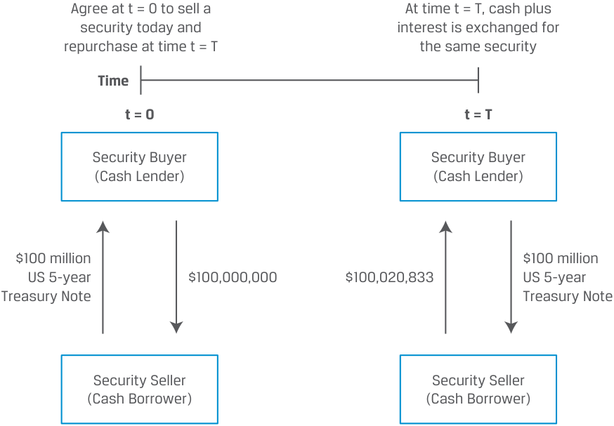
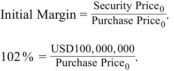
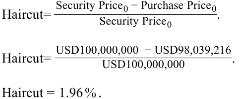
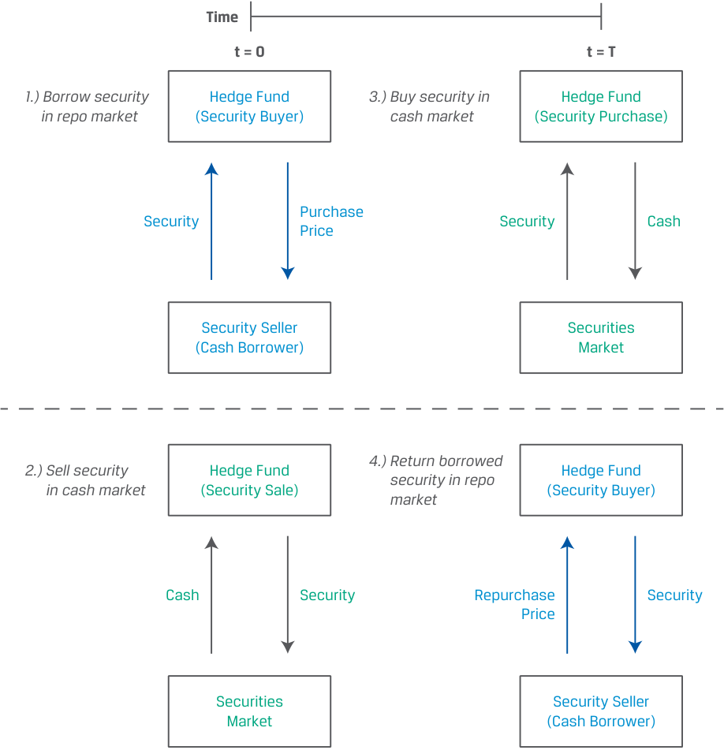
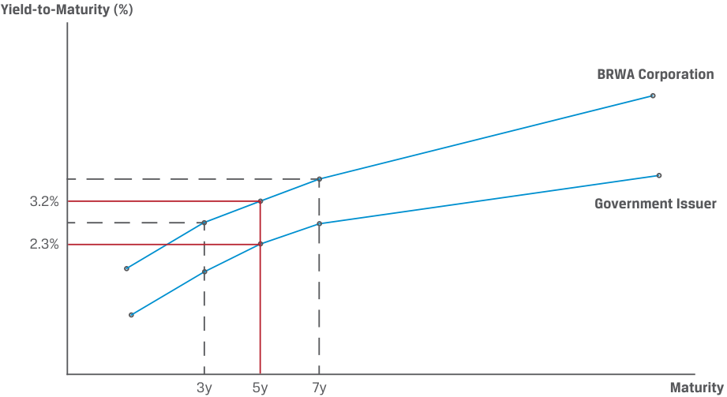
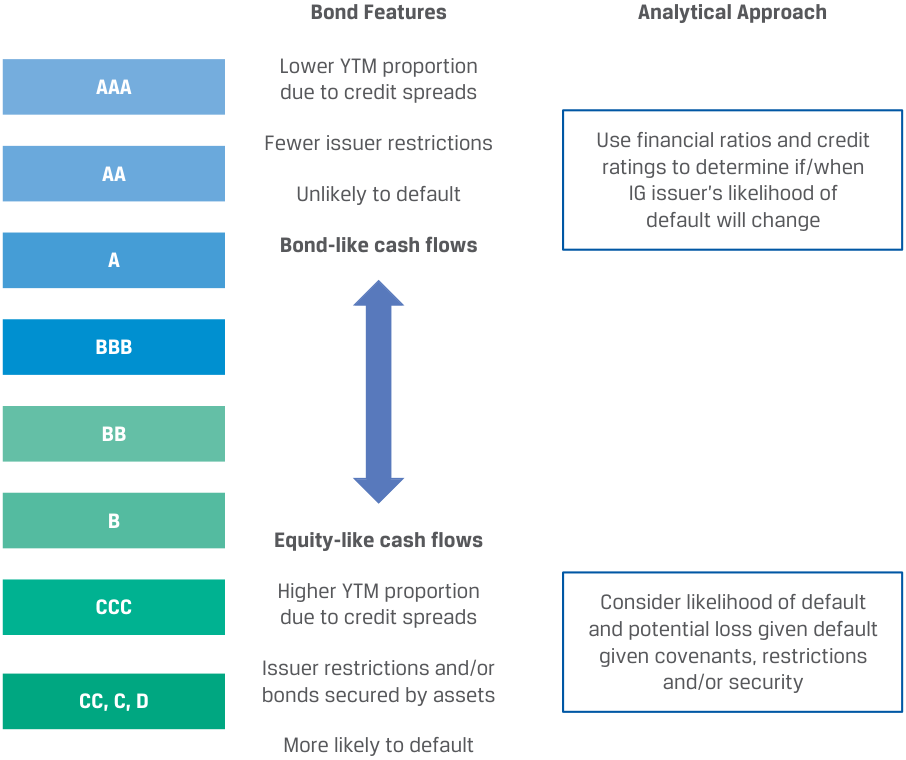
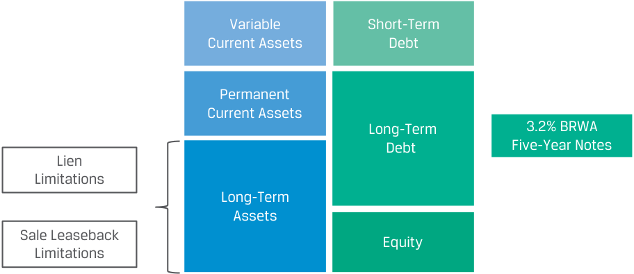

# Volume 6: Fixed Income
## Learning Module 4 Fixed-Income Markets for Corporate Issuers
### Part 2/3: Repurchase Agreements (PDF Pages 98–113)

---

<!-- PDF Page 98 -->

- **C.** Liquidity enhancement 

- **Solution:** 

C is correct. To minimize rollover risk, investors usually require a liquidity enhancement to ensure that the issuer can fully repay maturing commercial paper if a rollover is not possible. B is incorrect because bridge financing, which is interim financing that provides funds until permanent financing can be arranged, would require additional issuance of commercial paper by the issuer, increasing rollover risk. A is incorrect because a credit rating does not affect rollover risk. 

4. Which of the following statements about asset-backed commercial paper is correct? 

   - **A.** This financing is not recorded on the balance sheet of the issuer. 

   - **B.** The bank issues ABCP to investors with a backup credit liquidity line provided by the SPE. 

   - **C.** Investors purchase an illiquid, short-term note with interest and principal payments from the SPE. 

   - **Solution:** 

A is correct. This financing is not recorded on the balance sheet of the issuer. B is incorrect because the SPE (not the bank) issues ABCP to investors with a backup credit liquidity line provided by the bank. C is incorrect because investors purchase a _liquid_ , short-term note from the SPE. 

# **<mark>3</mark> REPURCHASE AGREEMENTS** 

describe repurchase agreements (repos), their uses, and their benefits and risks 

An important source of _secured_ short-term lending and borrowing is the repurchase agreement (repo) market. A **repurchase agreement** , or repo, involves the sale of a security with a simultaneous agreement by the seller to buy the same (or a similar) security back from the purchaser at an agreed-on **repurchase price** and future date called the **repurchase date** . Exhibit 4 shows the mechanics of a simple repurchase agreement. 

<!-- PDF Page 99 -->

**Exhibit 4: Repurchase Agreement** 

<!-- Start of picture text -->
Agree at t = 0 to sell a At time t = T, cash plus security today and interest is exchanged for repurchase at time t = T the same security Time t = 0 t = T Security Buyer Security Buyer (Cash Lender) (Cash Lender) $100 million $100 million US 5-year $100,000,000 $100,020,833 US 5-year Treasury Note Treasury Note Security Seller Security Seller (Cash Borrower) (Cash Borrower) <!-- End of picture text -->

Assume that today ( _t_ = 0) the current US five-year Treasury note trades at a price equal to the bond’s face value of USD100,000,000. The security _buyer_ takes delivery of the US Treasury note today and pays the security _seller_ USD100,000,000. If we assume a repo term of 30 days (and 360 days in a year) and an annual interest rate (or **repo rate** ) of 0.25%, then the buyer agrees to return the Treasury note 30 days from today ( _t_ = _T_ ) to the seller at a repurchase price of USD100,020,833, calculated as follows: 

USD100,000,000 × [1 + (0.25% × 30/360)] = USD100,020,833. 

In effect, the security seller borrows USD100,000,000 on a short-term basis at a low cost, with interest (USD20,833) paid at maturity, because the loan is collateralized by the US Treasury note. 

The details of repo and other money market interest calculations are addressed in a later lesson. In a repo transaction, the seller of the security (cash borrower) retains ownership of the security over the repo term, as well as the interest and actual coupon paid by the security, while the security buyer (cash lender) receives the repo rate. 

Because cash lenders in the repo market are primarily interested in both the liquidity and safety of their investments, most repos are typically very short-term transactions with the highest-quality securities (e.g., sovereign bonds) serving as collateral. Repo periods range from overnight to so-called **term repos** , those involving any maturity longer than one day. The underlying securities used in repo transactions are usually limited to the most liquid bonds with the lowest credit risk, such as sovereign bonds of various maturities. Rather than involving a specific security as in Exhibit 4, a repo transaction may instead reference a specific group of securities as eligible collateral (such as government bonds of a specific maturity) in what is known as a **general collateral repo** transaction. These transactions take place at the **general collateral repo rate** . 

In addition to the high quality of underlying securities, repos include features designed to reduce the risk of a collateral shortfall over the contract life. One such feature is the provision of collateral in excess of the cash exchanged, known as **initial margin** , defined as the following ratio: 

<!-- PDF Page 100 -->

A 100% initial margin indicates a fully collateralized loan, while a higher margin indicates even greater initial collateral protection. This is alternatively considered a _reduction_ or **haircut** of the underlying loan relative to the initial collateral value, which may be shown as follows: 

<!-- Formula Text: Haircut = Security Price 0 − Purchase Price 0 ________________________ Security Price 0 . (2) -->

The use of excess collateral is shown in the following repo example. 

#### **KNOWLEDGE CHECK** 

1. Assume the repurchase agreement in Exhibit 4 is subject to a 102% initial margin. 

Calculate the revised original purchase price (loan amount). 

**Solution:** Using an initial margin of 102%, we can solve for a revised purchase price using Equation 1: 

<!-- Start of picture text -->
____________ Security Price 0  Initial Margin =  Purchase Price 0  . _____________  102 %  =   USD100, 000, 000  Purchase Price 0  . <!-- End of picture text -->

- Purchase Price 0 = USD98, 039, 216. 

Note that security seller must finance the remaining USD1,960,784 from other sources. 

2. Calculate the associated repo haircut. 

**Solution:** Using Equation 2, solve for the haircut as follows: 

<!-- Start of picture text -->
 Haircut=  ________________________ Security Price 0 −  Purchase Price 0.  Security Price 0  Haircut=  __________________________ USD100,000,000  − USD98,039,216 . USD100,000,000  Haircut = 1.96 % . <!-- End of picture text -->

3. Calculate the repurchase price using the same 30-day repo term and 0.25% repo rate. 

**Solution:** The repurchase price may be calculated as follows: 

- Repurchase price = USD98,039,216× [1 + (0.25% × 30/360)]. Repurchase price = USD98,059,641. 

Repos address collateral value _changes_ by granting contract participants the right to request additional collateral (or release existing collateral) to maintain a security interest equal to the original initial margin terms. This variable margin payment (referred to as **variation margin** ) is equal to the difference between current margin required and the security’s price at time _t_ , as shown in Equation 3: 

<!-- PDF Page 101 -->

For example, a security price _decline_ requires a cash borrower (security seller) to provide additional collateral to the seller. 

#### **KNOWLEDGE CHECK** 

1. Assume the same repurchase agreement terms from Exhibit 4 and the previous Knowledge Check. Calculate the variation margin five days after trade inception if the price of the five-year US Treasury note rises to 103% of the security’s USD100 million face value. **Solution:** Recall the original loan amount (or purchase price at _t_ = 0) is equal to USD98,039,216, or USD100,000,000/1.02. We may solve for the purchase price when _t_ = 5 as follows: Purchase price = USD98,039,216× [1 + (0.25% × 5/360)]. Purchase price = USD98,042,620. To calculate the variation margin, we use Equation 3: Variation margin =  (Initial margin ×  Purchase price _t_ ) −  Security price _t_ . Variation margin =  (102% × USD98, 042, 620) − USD103, 000, 000. Variation margin = − USD2, 996, 528. The security price increase to USD103,000,000 resulted in an overcollateralization of the loan by USD2,996,528, allowing the cash borrower (security seller) to request the release of five-year US Treasury notes with a face value of approximately USD2.91 million (= USD2,996,528/1.03). 

Repo contract participants typically agree to margining and other terms, such as the substitutability of collateral and events of default, in a **master repurchase agreement** or similar legal document that governs all trades between parties. 

### **Repurchase Agreement Applications and Benefits** 

Financial market participants use the repo market for three specific purposes: 

- Finance the ownership of a security 

- Earn short-term income by lending funds on a secured basis 

- Borrow a security in order to sell it short 

Financial institutions that trade securities often or hold securities inventory frequently participate in the repo market as security sellers or cash borrowers. For example, say an investor sells a bond to a bank’s trading desk in exchange for cash. The bank must pay the investor immediately although it may intend to sell the security to another party at a later time. To do so, the bank may borrow the purchase price from another bank or an asset manager in exchange for delivering the bond just purchased. The repo transaction reduces the bank’s funding requirement for the security to a fraction (equal to the initial margin) of the bond’s purchase price. 

From a security buyer’s perspective, a repo offers a short-term cash investment on a collateralized basis with minimal liquidity or default risk. Overnight cash repos with high-quality collateral result in the lowest return; investors can generate higher returns for longer repo terms or by accepting less liquid or lower quality collateral. 

<!-- PDF Page 102 -->

These investors include banks and other institutions, such as mutual funds or pension funds. As shown in Equation 4, these short-term assets appear on a bank’s balance sheet as “Securities Purchased under Agreements to Resell or Borrowed.” 

Central banks are also active participants in the repo market to conduct monetary policy. While reserve requirements and the outright purchase and sale of securities are more permanent means of influencing the money supply, repo contracts are frequently used for shorter-term, transitory policy measures. For example, a central bank may temporarily increase cash reserves in the banking system by borrowing securities and lending cash. 

Sometimes, a security buyer enters a repo not only to lend cash for interest but also to use the security for another use. For instance, a hedge fund may take a short position in a security, with a view that its price will decline. The use of a repo transaction to facilitate this transaction is shown in Exhibit 5. 

**Exhibit 5: Reverse Repos and Short Security Positions** 

<!-- Start of picture text -->
Time t = 0 t = T 1.) Borrow security Hedge Fund 3.) Buy security in Hedge Fund  in repo market (Security Buyer) cash market (Security Purchase) Purchase Security Security Cash Price Security Seller Securities (Cash Borrower) Market 4.) Return borrowed 2.) Sell security Hedge Fund Hedge Fund security in repo in cash market (Security Sale) (Security Buyer) market Cash Security Repurchase Security Price Securities Security Seller Market (Cash Borrower) <!-- End of picture text -->

- Exhibit 5 illustrates this transaction in four steps: At time _t_ = 0: 

   **1.** The hedge fund _borrows_ the security in exchange for cash in a repo transaction. 

   **2.** The hedge fund simultaneously _sells_ the security in the secondary market and receives cash. 

<!-- PDF Page 103 -->

At time _t_ = _T_ : 

**3.** The hedge fund _purchases_ the security in the secondary market and pays the current market price. 

**4.** The hedge fund simultaneously _delivers_ the security at the pre-agreed repurchase price for cash to settle the repo. 

When viewed from the perspective of the security buyer (cash lender), a repo transaction is sometimes referred to as a **reverse repurchase agreement** or reverse repo. 

#### **KNOWLEDGE CHECK** 

1. Assume that a hedge fund enters the same repurchase agreement from Exhibit 4 as the security buyer (cash lender), sells the security short in the secondary market today, and buys back the security to deliver for repo settlement in 30 days. For purposes of this example, we exclude initial or variation margin. 

Calculate the hedge fund’s return on the transaction if it is able to purchase the five-year US Treasury note in 30 days in the secondary market at a price equal to 99% of the face value. 

#### **Solution:** 

Follow the four steps in Exhibit 5: 

**1.** The hedge fund _borrows_ the five-year US Treasury note priced at USD100,000,000 today and delivers USD100,000,000 in cash to the security seller in a repo transaction. 

As in Exhibit 4, the hedge fund (security buyer) agrees to return the five-year Treasury note 30 days from today to the seller at a repurchase price of USD100,020,833, calculated (using a 0.25% repo rate) as follows: 

USD100,000,000 × [1 + (0.25% × 30)/360] = USD100,020,833. 

**2.** The hedge fund simultaneously _sells_ the five-year US Treasury note in the secondary market today and receives USD100,000,000 in cash. 

**3.** In 30 days, the hedge fund purchases the five-year US Treasury note in the secondary market at the current market price of USD99,000,000. 

**4.** The hedge fund simultaneously _delivers_ the five-year US Treasury note and receives the pre-agreed repurchase price of USD100,020,833 to settle the repo. 

The hedge fund has therefore earned a return of USD1,020,833 (= USD100,020,833 − USD99,000,000), ignoring transaction costs. The hedge fund’s short position yields a profit because the price of the Treasury note fell over the time period. 

Ignoring initial margin and other transaction costs, the hedge fund will earn a positive return if the short position gain exceeds the repo rate for the period. Note that such a repo transaction requires delivery of a particular security, known as a special trade, which occurs at a special collateral rate. When a particular security is subject to very high borrowing demand, this special repo rate may fall below the general collateral repo rate or even below zero. Under a negative repo rate, the security buyer _pays_ interest on cash lent to the cash borrower. 

<!-- PDF Page 104 -->

Repo rates are influenced by several factors, including the following: 

- Money market interest rates: Repo rates are correlated with other shortterm interest rates. Central banks use secured repo markets to influence the unsecured central bank funds rate. 

- Collateral quality: Higher collateral risk increases repo rates. Repo rates are usually higher for equity securities or emerging market bonds than for developed market government bonds. 

- Repo term: Repo rates generally increase with maturity, because long-term rates exceed short-term rates under normal market conditions and a longer term increases credit risk. 

- Collateral uniqueness: The higher the demand for a specific security, the lower the repo rate. The most recently issued or on-the-run developed market sovereign bonds typically have the lowest repo rates in a given market. 

- Collateral delivery: Repo rates are usually higher when either the cash lent is undercollateralized or no collateral is provided to the funds lender. 

### **Risks Associated with Repurchase Agreements** 

Repo markets are a widely used source of short-term funding, with relatively low borrowing costs relative to other financing available to banks and other financial institutions. However, repurchase agreements involve a number of structural risks, and excessive reliance on this form of secured financing under adverse market conditions can lead to financial distress or insolvency. 

Each repo contract participant is exposed to the risk that the other party is unable to meet its obligations. While the secured nature of repo contracts reduces risk due to the value of the underlying collateral, several risks are important to consider: 

- Default risk: Default risk is the primary exposure under a repo transaction, despite the existence of collateral. Collateral received from less creditworthy parties is more likely to be tested under a default scenario and may face illiquidity, adverse price changes, and legal or operational challenges. 

- Collateral risk: In addition to minimizing liquidity and credit risks to ensure quick and efficient liquidation under a default, the collateral should have little or no correlation with the credit risk of the repo counterparty in order to diversify credit exposure. 

- Margining risk: Proper and timely collateral valuation and transfer of variation margin to minimize collateral shortfalls in the event of liquidation following a default are important. Such adverse market conditions may also cause large changes in collateral value, increasing margin calls among market participants and forcing further liquidations. 

- Legal risk: Addresses the ability to enforce legal rights under a repurchase agreement. 

- Netting and settlement risk: Addresses the ability of repo contract participants to both offset or net the obligations of a non-defaulting party and take possession of collateral or cash in settlement of a trade. 

In many cases, repo market participants manage these risks by engaging a third party. Repos executed directly between two parties are called bilateral repos; under a **triparty repo** , both parties agree to use a third-party agent for the transaction. While triparty agents do not change the credit risk relationship between repo participants in the event of default, they create cost efficiencies by providing access to a larger collateral pool and multiple counterparties, as well as specializing in the valuation 

<!-- PDF Page 105 -->

and safekeeping of assets. The triparty agent (a custodian or clearinghouse) administers the transaction and is responsible for cash, securities, collateral valuation, and management, as well as collateral custody, as shown in Exhibit 6. 

**Exhibit 6: Bilateral versus Triparty Repo Agreements** 

<!-- Start of picture text -->
Bilateral Repo Transaction Long-term yield Party A Party B Securities Lender Securities Borrower Cash Borrower Cash Lender Short-term repo rate Triparty Repo Transaction Party A Trade details Party B Securities Lender Securities Borrower Cash Borrower Cash Lender Long-term Long-term yield yield Short-term Triparty Collateral Short-term repo rate Agent Holds repo rate Cash, Securities as Custodian <!-- End of picture text -->

While the repo market represents a more stable funding source than short-term unsecured financing, both the uncommitted nature of repo markets and their very short (mostly overnight) maturity give rise to significant rollover and liquidity risks under adverse market conditions. Financial institutions must balance the low cost of repo funding with the greater financial flexibility of more costly longer-term financing alternatives, such as long-term debt and equity. In theory, the collateralized nature of repo transactions should provide cash lenders comfort to roll existing repo trades. In practice, financial firms that have lost the confidence of market participants have faced substantial losses and even bankruptcy during past financial crises due in part to their heavy reliance on repo financing. 

#### **THE FALL OF BEAR STEARNS AND THE REPO MARKET** 

Bear Stearns was the fifth-largest US investment bank, with USD350 billion in total assets at the end of 2006 and record revenue of over USD9 billion in that year. As a major underwriter of mortgage-backed securities (MBS) and subprime MBS, the firm faced challenges in 2007 as the MBS market deteriorated. The firm’s losses mounted due to the failure of subprime mortgage hedge funds it had sponsored in July 2007 and the write-down of over USD2 billion in MBS it held later in the year, resulting in its first ever quarterly loss and a credit downgrade at the end of 2007. 

At the same time, Bear Stearns significantly reduced its unsecured shortterm funding (from USD25.8 billion at the end of 2006 to USD11.6 billion at the end of 2007) and specifically its commercial paper (USD20.7 billion to USD3.9 billion) in favor of secured funding–specifically, repo borrowing. As of 10 March 

<!-- PDF Page 106 -->

2008, Bear Stearns had USD18 billion in cash, but within two days, a loss of confidence due to the credit downgrade of related entities and market rumors caused this to fall to USD2 billion. Specifically, repo counterparties declined to roll over or renew repo trades, prime brokerage clients withdrew cash and securities, and other banks withdrew or refused to extend credit. On Friday, 14 March 2008, Bear Stearns received an emergency Federal Reserve loan against its securities collateral to prevent its failure, and on Monday, 17 March 2008, Bear Stearns agreed to be purchased by JPMorgan, which received a loan from the Federal Reserve. 

#### **QUESTION SET** 

1. Assume that today ( _t_ = 0) the current US five-year Treasury note trades at a price equal to the bond’s face value of USD100,000,000. The security buyer takes delivery of the US Treasury note today and pays the security seller a purchase price based on an initial margin of 103%. The repo haircut is _closest_ to: 

   - **A.** 0.00%. 

   - **B.** 2.91%. 

**C.** 3.00%. 

#### **Solution:** 

B is correct. Using an initial margin of 103%, the purchase price (loan amount) is calculated as USD100,000,000/1.03 = USD97,087,379. 

The repo haircut is then calculated as 

(USD100,000,000 − USD97,087,379)/USD100,000,000 = 2.91%. 

2. Assume that today ( _t_ = 0) the current US five-year Treasury note trades at a price equal to the bond’s face value of USD200,000,000. The security buyer takes delivery of the US Treasury note today and pays the security seller a purchase price based on an initial margin of 102%. Assume a repo term of 15 days (and 360 days in a year) and an annual interest rate (or repo rate) of 0.50%. If the buyer agrees to return the five-year Treasury note 15 days from today ( _t_ = _T_ ) to the seller, the repurchase price is closest to: 

   - **A.** USD196,119,281. 

**B.** USD196,160,130. 

**C.** USD200,041,667. 

#### **Solution:** 

A is correct. Using an initial margin of 102%, the purchase price (loan amount) is calculated as USD200,000,000/1.02 = USD196,078,431. 

The repurchase price is then calculated as follows: 

USD196,119,281 = USD196,078,431 × [1 + (0.50% × 15)/360]. 

B is incorrect because it incorrectly uses a repo term of 30 days: 

USD196,160,130 = USD196,078,431 × [1 + (0.50% × 30)/360]. 

C is incorrect because it does not incorporate the initial margin in calculating the purchase price: 

USD200,041,667 = USD200,000,000 × [1 + (0.50% × 15)/360]. 

<!-- PDF Page 107 -->

|3. Which of the following statements about repos is correct?|
|---|
|**A.**Financial market participants use the repo market to earn short-term income by lending funds on a secured basis.|
|**B.**Investors can generate higher returns for shorter repo terms.|
|**C.**From a security buyer’s perspective, a repo offers a short-term cash investment on a collateralized basis with significant liquidity or default risk.|
|**Solution:**|
|A is correct. Financial market participants use the repo market to earn short-term income by lending funds on a secured basis. B is incorrect because investors can generate higher returns for longer (not shorter) repo terms. C is incorrect because from a security buyer’s perspective, a repo offers a short-term cash investment on a collateralized basis with minimal (not significant) liquidity or default risk.|
|4. Which of the following statements about repos is correct?|
|**A.**Repo rates are correlated with other short-term interest rates. **B.**Repo rates are usually lower for equity securities or emerging market bonds than for developed market government bonds.|
|**C.**Most recently issued or on-the-run developed market sovereign bonds typically have the highest repo rates in a given market. **Solution:**|
|A is correct. Repo rates are correlated with other short-term interest rates. Central banks use secured repo markets to influence the unsecured central bank funds rate. B is incorrect because repo rates are usually higher for eq- uity securities or emerging market bonds than for developed market govern- ment bonds. C is incorrect because the most recently issued or on-the-run developed market sovereign bonds typically have the lowest repo rates in a given market.|

## **LONG-TERM CORPORATE DEBT** 

# **<mark>4</mark>** 

contrast the long-term funding of investment-grade versus high-yield corporate issuers 

Earlier lessons on corporate issuers addressed the uses of long-term debt, including more stable funding for short-term activities and long-term needs, such as capital investments. While corporate issuers face similar capital allocation and capital structure decisions when issuing long-term debt regardless of their credit quality, differences in credit give rise to different features and availability of long-term corporate funding. Recall that corporate issuers categorized as investment grade (IG) have a stronger capacity to meet future fixed obligations from cash flows, while the ability of high-yield (HY) issuers to meet debt interest and principal payments is considered more vulnerable. The relative credit quality of an issuer grows in importance for longer maturities as the likelihood of financial distress increases over time. 

<!-- PDF Page 108 -->

### **Similarities between Long-Term Investment-Grade and High-Yield Issuance** 

Both issuers and investors considering (non-callable) long-term debt of different maturities weigh the relative risk associated with a maturity choice against its costs or yield-to-maturity. Under normal market conditions, longer maturities are associated with both higher interest rates (yields-to-maturity on government bonds) and higher credit spreads for a given issuer. This is shown in Exhibit 7 by returning to the example of BRWA Corporation. 

**Exhibit 7: Maturity Choices of Long-Term Issuers and Investors** 

<!-- Start of picture text -->
Yield-to-Maturity (%) BRWA Corporation 3.2% Government Issuer 2.3% 3y 5y 7y Maturity <!-- End of picture text -->

Exhibit 7 shows a partial yield curve for BRWA’s bonds introduced earlier. Say an investor with a five-year investment horizon is instead attracted to the higher YTM of the seven-year BRWA bond. By investing in a bond whose maturity exceeds its planned investment horizon, the investor takes on the price risk of selling what will be a two-year bond in five years’ time. Also note that the investor faces reinvestment risk, or the possibility that prevailing market interest rates at which the investor may invest funds received are lower than the original bond coupon rate. As an issuer, BRWA may, in contrast, be attracted to the lower YTM of a potential three-year issuance to fund a five-year project. However, in doing so, BRWA assumes rollover risk, or the possibility of having to refinance at higher interest rates when these bonds mature in three years. While these trade-offs for both investors and issuers exist for investment-grade and high-yield issuers alike, higher spreads associated with high-yield debt increase the risk-versus-return trade-off for issuers of lower credit quality. The change in a bond’s price for a given change in yield for different maturities and investor returns over a specific horizon will be addressed in detail in later lessons. 

### **Differences between IG and HY Issuance** 

The differences between investment-grade and high-yield corporate bonds go well beyond simply a difference in credit spreads to compensate investors for assuming more or less default risk. Exhibit 8 summarizes the differences between IG and HY bonds. 

<!-- PDF Page 109 -->

#### **Exhibit 8: IG versus HY Bonds** 

<!-- Start of picture text -->
Bond Features Analytical Approach Lower YTM proportion AAA due to credit spreads Fewer issuer restrictions Use financial ratios and credit AA ratings to determine if/when Unlikely to default IG issuer’s likelihood of default will change Bond-like cash flows A BBB BB B Equity-like cash flows CCC Higher YTM proportion Consider likelihood of default due to credit spreads and potential loss given default given covenants, restrictions Issuer restrictions and/or and/or security CC, C, D bonds secured by assets More likely to default <!-- End of picture text -->

Given their strong ability to meet promised interest and principal obligations from operating cash flows, a significant proportion of the yield-to-maturity on an investment-grade bond is attributed to the government benchmark yield. High investor confidence that an IG issuer will be able to make debt service payments over time from operating cash flows typically allows these borrowers to issue debt with relatively little monitoring from bondholders throughout the debt term. Issuers are able to take advantage of a high degree of flexibility in choosing debt maturities (usually up to 30 years), which are accepted by investors with few or no restrictive covenants, as shown in Exhibit 9. 

#### **Exhibit 9: BRWA Restrictive Covenants** 

<!-- Start of picture text -->
Variable Short-Term Current Assets Debt Permanent Current Assets Long-Term 3.2% BRWA Debt  Five-Year Notes Lien Limitations Long-Term Assets Sale Leaseback Equity Limitations <!-- End of picture text -->

<!-- PDF Page 110 -->

Because BRWA’s senior unsecured notes rely solely on operating cash flows as a source of repayment, the restrictions on these investment-grade bonds are limited to those that broadly protect investor claims to the company’s assets by preventing their sale and leaseback or pledge to a third party. 

Investment-grade bonds are relatively standardized debt instruments, and issuers often have numerous general obligation unsecured bonds outstanding based on similar terms with different maturities at any given time. The most frequent IG debt issuers often minimize refinancing risk by staggering debt maturities over time, reducing rollover risk while preserving the ability to opportunistically raise more debt if market conditions allow. 

High-yield issuers are characterized by a higher expected likelihood of financial distress, with a higher proportion of a bond’s YTM attributed to an issuer-specific spread over the benchmark yield than for IG debt. Given the higher chance of default, these instruments are more equity-like in nature (i.e., uncertain cash flows) and analysts place a greater emphasis on the potential loss given default and the protections and secondary repayment sources that are available. As a result, investors generally impose more constraints on high-yield issuers. The debt covenants in a bond’s indenture (or loan covenants in a loan agreement) establish the ability to monitor issuer financial performance based on predetermined criteria, allowing lenders to take actions to restructure debt or preserve creditor claims as needed. Exhibit 10 shows the restrictive covenants for VIVU’s 6.5% seven-year callable bonds. 

**Exhibit 10: VIVU Restrictive Covenants** 

<!-- Start of picture text -->
Revenue Cost of Goods Sold Debt/EBITDA EBITDA Restriction Depreciation Variable Short-Term Current Assets Debt Debt Interest Coverage Service Ratio Restriction Permanent Taxes Current Assets 6.5% VIVU Additional Debt Long-TermDebt  Seven-Year Net Income Restrictions Long-Term Callable Notes Assets Dividend/Distribution Pledge of Long- Restrictions Term Assets Equity <!-- End of picture text -->

In contrast to BRWA’s IG debtholders, who hold a general obligation unsecured bond and rely on operating cash flows as the source of repayment, as secured debtholders, VIVU investors hold a claim to specific pledged assets. This secondary repayment source aims to minimize losses in the more likely event of a default. The indenture also establishes limitations on additional debt and restrictions related to the level of debt versus operating cash flows and the distribution of net income to shareholders. 

These investor restrictions and constraints result in far less HY issuer flexibility and market availability than for IG issuers. For example, VIVU’s indenture introduced earlier prohibited the company from issuing additional debt under certain conditions unless the new debt is either subordinated or consists of short-term working capital up to 20% of the principal amount of notes outstanding. HY issuers also face limitations on debt maturities, which are typically shorter in maturity (10 years or less) and face greater fluctuations in both issuer-specific credit spreads and market availability 

<!-- PDF Page 111 -->

over the economic cycle. Instead of financing opportunistically as market conditions allow, HY firms often must restructure debt and renegotiate covenants in order to take advantage of lower borrowing costs. 

Issuers in the high-yield market often seek to retain financial flexibility by borrowing under leveraged loans with prepayment features or issuing bonds with contingency features. Recall that issuers of callable debt establish the right to redeem all or part of a bond prior to maturity at a fixed price. In the earlier VIVU example, the company issued 6.5% debt for seven years but owned the right to redeem bonds starting three years after issuance at an initial fixed price of 103.25% of principal. Borrowers who believe their creditworthiness will improve frequently choose to issue callable debt, because the value of this contingency feature rises as a firm’s borrowing costs fall. Note that high-yield investors also benefit from higher bond prices (lower yields) as issuer-specific credit spreads fall, but in the case of callable debt, these gains are capped at the call price. For example, if VIVU were able to issue new debt in three years’ time with financing cost savings that exceed the 3.25% call premium in present value terms, it would make sense for VIVU to call the bonds and issue new debt at a lower YTM. The relationship between the prices and yields of callable bonds and the different outcomes for high-yield issuers and investors are covered in detail later in the curriculum. 

An important exception in the high-yield bond market is formerly investment-grade issuers known as “fallen angels,” introduced earlier. While these borrowers’ likelihood of financial distress is similar to that of other high-yield issuers, their outstanding debt has investment-grade features; that is, it is typically non-callable, with few restrictions and covenants and longer maturities. The reason for this is that the bonds were issued to investment-grade bond investors at a time when the borrower was highly rated. The subsequent deterioration in issuer credit quality results in losses to the original investors, many of whom must divest these bonds because they no longer meet minimum rating requirements for their portfolios. This can result in significant price deterioration because the market for high-yield bonds is a fraction of the size of the market for investment-grade bonds. 

#### **QUESTION SET** 

1. For a given issuer, longer maturities are typically associated with: 

   - **A.** lower interest rates and lower credit spreads. 

   - **B.** lower interest rates and higher credit spreads. 

   - **C.** higher interest rates and higher credit spreads. 

   - **Solution:** 

C is correct. Under normal market conditions, longer maturities are associated with both higher interest rates and higher credit spreads for a given issuer. A and B are incorrect because longer maturities are typically associated with higher interest rates and higher credit spreads. 

2. Which of the following is a reason why a high-yield issuer may elect to issue equity as opposed to bonds? 

   - **A.** High-yield bond maturities are limited to 30 years or less. 

   - **B.** High-yield issuers face numerous restrictions when issuing debt. 

<!-- PDF Page 112 -->

- **C.** High-yield bond analysts use financial ratios and credit ratings to determine when a high-yield issuer’s credit rating is likely to change. 

- **Solution:** 

B is correct. High-yield issuers face numerous restrictions when issuing debt; however, there are limited restrictions when issuing equity. A is incorrect because high-yield bond maturities tend to be limited to 10 years (not 30 years) or less whereas there is no maturity date on equity. C is incorrect because investment-grade bond analysts use financial ratios and credit ratings to determine when an investment-grade issuer’s credit rating is likely to change. 

3. Relative to investment-grade bonds, high-yield bonds exhibit: 

   - **A.** less market availability. 

   - **B.** more bond-like cash flows. 

   - **C.** fewer constraints by investors. 

#### **Solution:** 

A is correct. Investor restrictions and constraints on HY issuers lead to less market availability than for IG issuers. B is incorrect because high-yield bonds exhibit more equity-like cash flows. C is incorrect because high-yield bonds exhibit more restrictions and constraints by investors. 

4. Which of the following statements about high-yield bonds relative to investment-grade bonds is correct? 

   - **A.** High-yield bonds have more bond-like cash flows. 

   - **B.** Investment-grade bonds have greater issuer restrictions. 

   - **C.** High-yield bonds have a higher proportion of YTM attributed to a credit spread. 

#### **Solution:** 

C is correct. High-yield bonds have a higher proportion of YTM attributed to a credit spread, while investment-grade bonds have a lower proportion of YTM attributed to a credit spread. A is incorrect because high-yield bonds have more equity-like cash flows while investment-grade bonds have more bond-like cash flows. B is incorrect because investment-grade bonds have fewer issuer restrictions than high-yield bonds. 

5. Which of the following statements about fallen angels is correct? 

   - **A.** Their outstanding debt has high-yield bond features. 

   - **B.** Their likelihood of financial distress is similar to that of other highyield issuers. 

   - **C.** The improvement in issuer credit quality results in gains to the original investors. 

#### **Solution:** 

B is correct. Fallen angels’ likelihood of financial distress is similar to that of other high-yield issuers. A is incorrect because their outstanding debt has investment-grade (not high-yield) bond features; they are typically non-callable, with few restrictions and covenants and longer maturities. C is incorrect because the deterioration (not improvement) in issuer credit quality results in losses (not gains) to the original investors, many of whom must divest these bonds because they no longer meet minimum rating requirements. This can result in significant price deterioration because the high- 

<!-- PDF Page 113 -->

yield bond market is a fraction of the size of the investment-grade bond market. 

