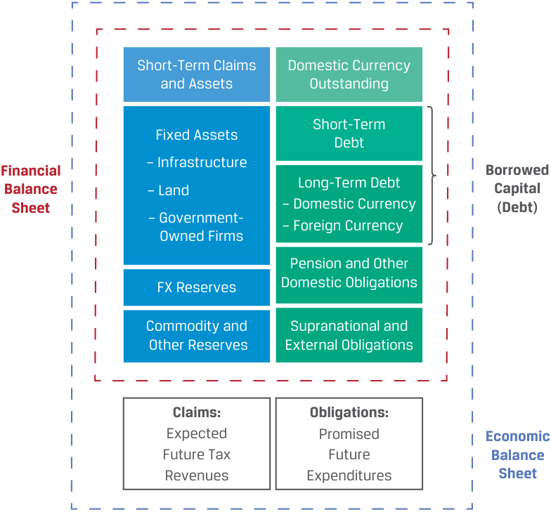
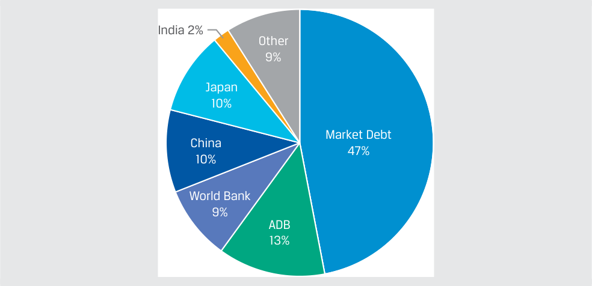
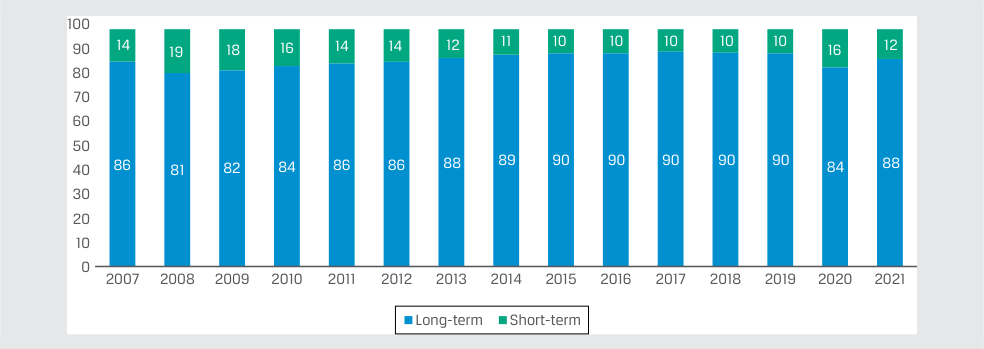

# Volume 6: Fixed Income
## Learning Module 5 Fixed-Income Markets for Government Issuers
### Part 1/2: Introduction (PDF Pages 117–129)

---

<!-- PDF Page 117 -->

#### L E A R N I N G M O D U L E 

# **<mark>5</mark>** 

### **Fixed-Income Markets for Government Issuers** 

###### **<mark>LEARNING OUTCOMES</mark>** 

|**_Mastery_** **_The candidate should be able to:_**|
|---|

describe funding choices by sovereign and non-sovereign governments, quasi-government entities, and supranational agencies contrast the issuance and trading of government and corporate fixed-income instruments 

##### **INTRODUCTION** 

**<mark>1</mark>** 

In this module, we complete the review of major fixed-income sectors by focusing on public sector issuers, including sovereign and non-sovereign governments, and how they differ from private sector issuers. Sovereign governments are distinguished by their right to tax within a jurisdiction, while non-sovereign, quasi-government, and supranational issuers may rely on local taxes, fee-based revenue, or other sources of repayment. Sovereign debt issuance is usually conducted through scheduled public auctions, with a different role for financial intermediaries than in private sector issuance. Sovereign debt securities are the most common benchmark securities used in pricing and valuation analyses for fixed-income instruments. 

###### **LEARNING MODULE OVERVIEW** 

- National or sovereign government issuers are distinguished by their legal authority to establish and maintain a country’s public goods and services, as well as their ability to tax economic activity in their jurisdictions. Developed market sovereign issues are characterized by a strong, stable, well-diversified domestic economy, and emerging market sovereign issuers are usually characterized by higher growth but less stable and less well-diversified economies sub- <u>ject to greater fluctuations over the economic cycle.</u> 

<!-- PDF Page 118 -->

- Sovereign debt issues include short-term securities (with maturities ranging from 1 to 12 months), medium- and long-term notes and bonds, and bonds that are guaranteed but not directly issued by the sovereign government. 

- Issuance of sovereign debt usually takes the form of a public auction using standard procedures led by the national treasury or finance ministry, while corporate debt issuances are managed by investment bank underwriters on behalf of issuers. Sovereign governments designate a group of financial intermediaries as primary dealers that are required to participate in all auctions with competitive prices. 

- Once a government debt auction is announced, prospective investors submit competitive or non-competitive bids. Once issued, sovereign debt is usually traded in a manner similar to private sector debt securities, primarily in OTC markets through financial intermediary broker/ dealers. 

- The level and type of non-sovereign government funding vary widely among countries, depending on whether specific goods and services are provided and financed at the national, regional, or local level. 

- Agencies are quasi-government entities that issue debt in order to fund the government-sponsored provision of specific public goods or services based on sovereign or local law. Supranational organizations are created and supported by sovereign governments in pursuit of a common objective. 

###### **LEARNING MODULE SELF-ASSESSMENT** 

These initial questions are intended to help you gauge your current level of understanding of this learning module. 

1. Complete the sentence by selecting the correct words from the options given. 

   - A nation’s fiscal policy determines the ( _level_ / _composition_ ) of sovereign debt through central government spending, and government debt management policies address the ( _level_ / _composition_ ) of sovereign debt—that is, short term versus long term, as well as other features. 

   - **Solution:** 

A nation’s fiscal policy determines the _<u>level</u>_ of sovereign debt through central government spending, and government debt management policies address the _<u>composition</u>_ of sovereign debt—that is, short term versus long term, as well as other features. 

2. The issuer ranks bids by prices, choosing bids from highest to lowest until the desired issuance amount is reached, for: 

   - **A.** single-price auctions. 

   - **B.** multiple-price auctions. 

<!-- PDF Page 119 -->

   - **C.** single-price and multiple-price auctions. 

   - **Solution:** 

   - C is correct. For both a single-price and a multiple-price auction, the issuer ranks bids by prices, choosing bids from highest to lowest until the desired issuance amount is reached. 

3. Compare the role of financial intermediaries when engaging with sovereign issuers versus corporate debt issuers. 

###### **Solution:** 

Sovereign issuers engage with financial intermediaries, like corporate debt issuers, but in a different form. Sovereign governments designate a group of financial intermediaries as primary dealers that are required to participate in all auctions with competitive prices, often serve as the central bank’s counterparty for open market operations, and facilitate the purchase and sale of government debt by foreign central banks and other indirect bidders. Corporate debt issuances, in contrast, are managed by investment bank underwriters on behalf of issuers. 

4. The ability of _______________________ government issuers to access funding across maturities is affected by the predictability and stability of sources of repayment. 

   - **A.** Sovereign 

   - **B.** Non-sovereign 

   - **C.** Both sovereign and non-sovereign 

   - **Solution:** 

   - C is correct. Borrowing costs and access to financing for both sovereign and non-sovereign government issuers are affected by their credit quality. 

5. Identify the following statement as true or false. Justify your answer. 

Sovereign agencies, such as the Airport Authority of Hong Kong (AAHK) and the Government National Mortgage Association (Ginnie Mae), benefit from the full liquidity premium associated with sovereign debt. 

###### **Solution:** 

False. While each of these sovereign agencies is typically able to borrow at a yield-to-maturity near that of their sovereign guarantor, neither will benefit from the full liquidity premium associated with sovereign debt. 

##### **SOVEREIGN DEBT** 

## **<mark>2</mark>** 

describe funding choices by sovereign and non-sovereign governments, quasi-government entities, and supranational agencies 

National or sovereign government issuers are distinguished by their legal authority to establish and maintain a country’s public goods and services and their ability to tax economic activity in their jurisdiction. Additional sources of repayment for their 

<!-- PDF Page 120 -->

debt obligations include tariffs, usage fees, and cash flows from government-owned enterprises. The size and scope of public goods and services provided by national, versus regional or local, governments vary widely among markets, as does the degree of government involvement in the economy. Similar to private sector issuers, a government’s “economic balance sheet” may be used to illustrate the sources and uses of funding, as shown in Exhibit 1, which also includes activities of the central bank. 

**Exhibit 1: Government “Balance Sheet”** 

<!-- Start of picture text -->
Short-Term Claims Domestic Currency and Assets Outstanding Short-Term Fixed Assets Debt – Infrastructure Financial Borrowed Balance – Land Long-Term Debt Capital Sheet – Domestic Currency (Debt) – Government- – Foreign Currency  Owned Firms Pension and Other FX Reserves Domestic Obligations Commodity and Supranational and  Other Reserves External Obligations Claims: Obligations: Expected Promised Economic Future Tax Future Balance Revenues Expenditures Sheet <!-- End of picture text -->

While private issuers prepare and file periodic financial statements in accordance with generally accepted accounting principles (GAAP), public sector financial accounting standards vary widely and are often prepared using cash, rather than accrual-based, principles, typically excluding such items as the depreciation of fixed public goods, such as federal highways, or the accrual of unfunded liabilities, such as government pension obligations. In contrast, the economic balance sheet in Exhibit 1 includes expected future claims and obligations and is therefore of greater relevance for public versus private sector issuers. 

The relative size of the government sector as a proportion of the domestic economy varies widely among nations, and the allocation of these activities between the national government itself, quasi-government agencies, and local governments also differs among countries. As a result, this gives rise to non-sovereign issuers based in the same jurisdiction as the sovereign issuer, a topic discussed in Lesson 3. 

A key distinction among national government issuers is the difference between developed market and emerging market sovereign issuers. 

- _Developed market (DM) sovereign issuers:_ DMs are characterized by a strong, stable, well-diversified domestic economy. DM national government budgets primarily comprise consistent, recurrent outlays financed with broad-based individual and business tax cash flows, resulting in stable and transparent fiscal policy. DM fixed-income securities are denominated in a 

<!-- PDF Page 121 -->

major currency commonly held in reserve by foreign governments. These features allow DM sovereign governments to issue what is often referred to as default-risk-free debt with unconstrained market access across the maturity spectrum. 

- _Emerging market (EM) sovereign issuers:_ EMs are usually characterized by higher growth but less stable and less well-diversified economies subject to greater fluctuations over the economic cycle. EMs often depend on a dominant domestic industry or industries, such as commodities, and may involve more state-owned or state-controlled enterprises. Central government budget priorities may involve investments to expand economic and social infrastructure that exceed current domestic tax cash flows, giving rise to external or supranational funding. EM sovereign debt securities are often denominated in a **restricted domestic currency** , or one with limited convertibility into other currencies due to illiquidity. Currency restrictions may limit foreign investment and constrain access to longer-term maturities in domestic currency. 

In the case of emerging market sovereign issuers, it is important to further distinguish between _domestic_ debt issued in the domestic currency and **external debt** , or debt owed to foreign creditors. Sovereign bonds issued in domestic currency are often held mostly by domestic financial institutions and other domestic investors. 

External debt of emerging and frontier market sovereign issuers comprises debt from supranational financial organizations and debt issuance denominated in a foreign currency held by foreign private investors. Earlier modules cited examples of emerging market sovereign Eurobond issuance, such as Romania’s euro-denominated bond and the quasi-government PT Indonesia Infrastructure Finance US dollar–denominated bond. Investors based in developed markets who purchase these bonds do not face the same _direct_ currency risk as for domestic currency emerging market sovereign debt. However, they face _indirect_ exposure to currency fluctuations, because their returns depend on an issuer’s ability to generate foreign currency revenue through international capital, goods, and services flows sufficient to meet foreign currency interest and principal payments. The following example highlights the case of the government of Sri Lanka’s external debt. 

###### **GOVERNMENT OF SRI LANKA EXTERNAL DEBT** 

In May 2022, Sri Lanka became the first Asia-Pacific country in many years to default on its external debt when it failed to make USD78 million in foreign currency interest payments following a 30-day grace period. Sri Lanka’s government debt rose sharply in the years preceding the default due in large part to infrastructure projects financed by global debt markets, supranational agencies, and major trading partners. Total government debt outstanding rose from 87% of Sri Lanka’s GDP to over 100% in 2020, while both its economy and foreign currency reserves shrank during that year due to a collapse in tourism and declining remittances from citizens working abroad. Higher inflation and commodity prices in the wake of the 2022 war in Ukraine compounded the country’s external debt problems and ultimately led to default. 

<!-- PDF Page 122 -->

###### **Sri Lanka’s External Debt, 2021** 

<!-- Start of picture text -->
India 2% Other 9% Japan 10% Market Debt China 47% 10% World Bank 9% ADB 13% <!-- End of picture text -->

_Note:_ “Market Debt” is primarily international sovereign bonds denominated in US dollars and owned by foreign private investors, including mutual funds. 

_Sources:_ Government of Sri Lanka, Department of External Resources (www .erd .gov .lk). Lilian Karunungan and Amelia Pollard, “Sri Lanka Falls into Default for the First Time Ever,” Bloomberg (19 May 2022). Bank for International Settlements, “Debt Securities Statistics.” “Infrastructure Financing in Sri Lanka: Lessons Learnt and Future Collaborations,” European Institute for Asian Studies Policy Brief 16/2021. 

A nation’s fiscal policy determines the _level_ of sovereign debt through central government spending, including both budgetary requirements and debt service costs, against tax receipts, fees, and revenue from government-owned enterprises or other sources. Government budget deficits increase the need for borrowing while surpluses reduce borrowing needs. Forecasts of sovereign debt levels must consider not only changes in fiscal policy but also the sensitivity of expenditures and revenues to changes in economic growth and inflation. 

**Government debt management** policies address the _composition_ of sovereign debt—that is, short term versus long term, as well as other features. Sovereign debt issues include the following: 

- Short-term securities (with maturities ranging from 1 to 12 months), often known as Treasury bills, which are usually zero-coupon instruments sold at a discount to par. 

- Medium- and long-term securities often known as Treasury notes and bonds. Fixed-rate coupon instruments in the domestic currency are most common, but sovereigns also issue floating-rate, inflation-linked, and foreign currency instruments. 

- While not acting as the issuer, some sovereign governments guarantee certain other instruments that, in effect, make them a type of sovereign debt. The most prominent example is mortgage-backed securities, especially in the United States, that conform to certain criteria. Such instruments will be discussed in detail later. 

Given the sovereign right to levy taxes on economic activity, national governments represent the lowest default risk among domestic currency issuers and are usually the largest bond issuer in a domestic market. 

Recall from earlier in the corporate issuers reading that the Modigliani–Miller (MM) theorem stated that under certain strict conditions, a company’s choice of capital structure is irrelevant in determining the present value of the firm’s expected future cash flows. In the case of sovereign government debt, the Ricardian equivalence 

<!-- PDF Page 123 -->

theorem introduced in an earlier economics lesson, which was based on similar simplified assumptions, gives an analogous result: a government’s choice of debt maturity is irrelevant in determining the present value of future tax cash flows. 

Under Ricardian equivalence, taxpayers expect government debt to be offset by higher future taxes, suggesting that a sovereign government should be indifferent between collecting taxes today or raising debt of any maturity based on the following assumptions: 

- Taxpayers smooth consumption over time, saving expected future taxes today for future payment. 

- Taxpayers form rational expectations that today’s tax cuts will result in future tax increases. 

- Capital markets are perfect with no transaction costs, and taxpayers can freely borrow and lend. 

- Taxpayers are altruistic on an intergenerational basis; that is, they pass on tax savings to descendants. 

The relaxation of these Ricardian equivalence assumptions to allow imperfect capital markets and friction costs between bond investors and taxpayers gives rise to debt management policies that offer liquidity benefits to investors and other issuers across the maturity spectrum. 

For example, short-term government issuance provides investors with a high degree of liquidity and safety and often substitutes for bank deposits. Under normal market conditions, the prices of these very short-term government securities involve a liquidity premium; that is, their yields-to-maturity will tend to be _lower_ than they otherwise would be in the absence of this liquidity benefit. While short-term sovereign debt is typically issued at regular intervals (discussed later) and standard maturities, government issuers have a high degree of flexibility to alter the size of these periodic auctions to manage uncertain cash flows, such as near-term tax receipts or unforeseen funding needs. 

Strict adherence to Ricardian equivalence assumptions suggests that governments should fund themselves with the shortest possible maturity to minimize borrowing costs and avoid paying any term premium associated with longer-term interest rates. However, similar to the example of corporate bonds in the prior module, excessive government reliance on short-term funding introduces rollover risk, or uncertain refinancing costs, increasing the variability of budget costs and therefore tax rates. Since taxpayers are unable to perfectly smooth consumption over time nor do they form rational expectations about current versus future taxes across generations, fiscal instability creates uncertainty in future tax rates and threatens the stability of economic growth over time. Therefore, in practice, governments seek to minimize interest rate and rollover risks by distributing debt across maturities, while issuing debt in regular, predictable intervals. 

Fiscal policies differ significantly across the 38 OECD member countries, but their sovereign debt maturity structures have shown far less variance. At the end of 2021, the weighted average maturity across the OECD was just over one year higher than the average at the end of 2007. Long-term debt represented 85% of total sovereign debt outstanding, largely unchanged since 2007, while annual issuance was evenly split between short and long term (short-term debt must be issued more frequently because it matures sooner). This time frame includes two major recessions and significant sovereign debt issuance. 

<!-- PDF Page 124 -->

###### **Average Time to Maturity of OECD Nations’ Sovereign Debt Outstanding (Years)** 

<!-- Start of picture text -->
8 7 6 5 4 7.4 7.6 3 6.3 2 1 0 2007 2020 2021 <!-- End of picture text -->

###### **Maturity Structure of OECD Nations’ Sovereign Government Debt Outstanding (Percent)** 

<!-- Start of picture text -->
100 90 14 19 18 16 14 14 12 11 10 10 10 10 10 16 12 80 70 60 50 40 86 81 82 84 86 86 88 89 90 90 90 90 90 84 88 30 20 10 0 2007 2008 2009 2010 2011 2012 2013 2014 2015 2016 2017 2018 2019 2020 2021 Long-term Short-term <!-- End of picture text -->

_Source:_ OECD, “OECD Sovereign Borrowing Outlook 2022” (2022). https:// doi .org/ 10 .1787/ b2d85ea7 -en. 

The use of medium- and long-term sovereign funding issuance must balance the trade-off of higher borrowing costs with greater fiscal stability, while considering liquidity or other benefits of issuing bonds with the lowest default risk across the maturity spectrum. 

The benefits of issuing sufficient longer-term sovereign government securities to maintain liquidity across maturities include the following: 

- _Establishment of a risk-free benchmark for all debt of specific maturities:_ The first fixed-income module demonstrated the use of sovereign bond yields to calculate an issuer’s credit risk premium. Government debt policies often mandate the regular issuance of benchmark securities across maturities to increase capital market efficiency and transparency for private issuers. 

- _Use in managing and hedging market interest rate risk:_ Market participants such as financial intermediaries and asset managers use medium- to long-term government securities and related derivatives to manage interest rate risk separately from credit risk. 

- _Preferred use as collateral in repo and derivative transactions:_ Longer-term government securities are the most common form of collateral for both repo and derivative transactions due to their high degree of liquidity and safety. Recall from the prior learning module that repurchase agreements offer security sellers a means of financing and offer security buyers a short-term collateralized investment with relatively little liquidity or default risk. 

- _Government bond use in monetary policy and foreign exchange reserves:_ Recall from an earlier lesson that central banks use government securities in fulfilling their monetary policy mandate, which includes the outright 

<!-- PDF Page 125 -->

purchase and sale of securities and repo contracts with government bonds as collateral. Given their high degree of liquidity and safety, foreign market participants often hold their foreign currency reserves in the form of liquid foreign government bonds. 

While sovereign governments seek to maintain regular and predictable bond market access across maturities, changes in the amount of debt, the level of deficits, and the difference between short- and long-term interest rates lead to changes in debt management policy, as shown in the following example. 

###### **THE US TREASURY’S 30-YEAR BOND** 

In October 2001, the United States stopped issuing 30-year Treasury bonds due to cost concerns related to paying interest on the notes. At the time, Treasury officials saw a reduced need for future borrowing because the U government was posting a budget surplus. The move stunned the markets and resulted in the largest one-day price move in years due to supply concerns. In prior years, the Treasury Department suspended the three- and seven-year issues. The 10-year Treasury became the de facto benchmark for measuring the performance of long-term bonds during the suspension of the 30-year bond. Issuance of the 30-year US Treasury bond resumed in February 2006 to cover deficits created by tax cuts and war spending. 

_Sources: Wall Street Journal_ , “Yields Plunge after Treasury Halts Issue of 30-Year Bonds” (31 October 2001). www .wsj .com/ articles/ S B100454296 3185681400 TSC Staff, “Treasury to Resume 30-Year Bond on Feb. 9,” TheStreet (2 November 2005). www .thestreet .com/ markets/ rates -and -bonds/ treasury -to -resume -30 -year -bond -on -feb -9 -10250971 

###### **QUESTION SET** 

1. Identify the following statement as true or false. Justify your answer. 

Emerging market external sovereign debt is denominated in a foreign currency. 

###### **Solution:** 

False. Although EM sovereigns do issue debt in foreign currencies to increase demand by foreign investors who desire less currency risk, many EM sovereigns have external debt denominated in their domestic currency as well, especially those with currencies that have exhibited exchange rate stability. 

2. US-based investors of US dollar–denominated external sovereign debt can still face exposure to currency risk because: 

   - **A.** sovereign fixed-income securities are denominated in freely floating domestic currencies. 

   - **B.** the issuer’s credit rating may be downgraded. 

   - **C.** the issuer must be able to generate foreign currency revenue. 

   - **Solution:** 

C is correct. Investors based in developed markets who purchase external debt of emerging and frontier market sovereign issuers face _indirect_ exposure to currency fluctuations, because their returns depend on an issuer’s 

<!-- PDF Page 126 -->

ability to generate foreign currency revenue to meet foreign currency interest and principal payments through international capital, goods, and services flows. 

3. Explain why national governments represent the lowest default risk among domestic currency issuers. 

###### **Solution:** 

National governments are distinguished by their sovereign right to generate tax cash flows from economic activity within a jurisdiction, unlike private sector issuers that rely on operating cash flows and secondary sources of repayment, such as asset sales, to service debt obligations. 

4. Due to their high degree of liquidity and safety, the most common form of collateral for both repo and derivative transactions is: 

   - **A.** shorter-term government securities. 

   - **B.** medium-term government securities. 

   - **C.** longer-term government securities. 

   - **Solution:** 

C is correct. Longer-term government securities are the most common form of collateral for both repo and derivative transactions due to their high degree of liquidity and safety. 

5. A sovereign government faced with growing deficits and concerns about rollover risk would _most likely_ : 

   - **A.** lower tax rates. 

   - **B.** stop servicing the debt. 

   - **C.** issue medium- to long-term securities. 

   - **Solution:** 

C is correct. Government budget deficits increase the need for borrowing at a higher level while surpluses reduce borrowing needs. Excessive government reliance on short-term funding introduces rollover risk, or uncertain refinancing costs, increasing the variability of budget costs and therefore tax rates. Therefore, in practice, governments seek to minimize interest rate and rollover risks by distributing debt across maturities while issuing debt in regular, predictable intervals. A is incorrect because taxes should be raised, not lowered, in such a scenario. B is incorrect because such an action would put the government in default, with severe consequences for its credit standing and its ability to meet fiscal policy commitments. 

## **<mark>3</mark> SOVEREIGN DEBT ISSUANCE AND TRADING** 

contrast the issuance and trading of government and corporate fixed-income instruments 

<!-- PDF Page 127 -->

In contrast to the opportunistic nature of corporate debt issuance managed by investment bank underwriters on behalf of issuers, issuance of sovereign debt usually takes the form of a public auction led by the national Treasury or finance ministry. 

Once a government debt auction is announced, prospective investors submit competitive or non-competitive bids. A competitive bidder specifies an acceptable price and number of securities to be purchased. If the price determined at auction is above the bid, a competitive bidder will not be offered any securities. In contrast, a non-competitive bidder agrees to accept the price determined at auction and always receives securities. 

A competitive bid process is either a **single-price auction** or **multiple-price auction** . In both cases, the issuer ranks bids by prices, choosing bids from highest to lowest until the desired issuance amount is reached. Under a single-price auction, _all_ winning bidders pay the same price and receive the same coupon rate for the bonds regardless of their bid. In contrast, a multiple-price auction process generates different prices among bidders for the same bond issue. The single-price auction process may result in a lower cost of funds and broader distribution among investors, while multiple-price auctions may result in a narrower distribution of large bids because investors must accept bonds at their bid price. 

A single-price auction process has four phases: 

**1.** The auction is announced by the government debt management office, which includes information about the bond issue, such as the amount and type of securities being offered, the auction and issue dates, the maturity date of the bonds, and bidding times. 

**2.** Dealers, institutional investors, and individuals make bids. Bids can be competitive or non-competitive. 

**3.** All non-competitive bids are accepted while competitive bids are ranked starting at the lowest yield (highest bond price). The highest yield that fills the offering amount, counting from the bottom, is the “cut off.” All securities are sold for a single price, using this stop yield. Competitive bidders who bid higher than this yield (lower price) do not purchase any securities. Results are announced publicly, as shown in Exhibit 2. 

**4.** Securities are delivered to the non-competitive and winning competitive bidders in exchange for proceeds. 

###### **Exhibit 2: 30-Year Singapore Government Bond Auction Announcement and Results** 

On 8 September 2021, the Monetary Authority of Singapore announced an auction of SGD2.6 billion of 30-year Singapore government bonds. 

|**Th** **Application for T**|**e Monetary Authority of Singapore** **21 September 2021** **axable Book-Entry Singapore Government Bonds**|
|---|---|
|**Tenor:**|Approximately 30 Years|
|**Total Amount Offered:**|SGD2,600,000,000|
|**f** **Issue/Settlement Date:**|1 October 2021|
|**Maturity Date Amount:**|1 October 2051|
|**Coupon Rate:**|To be determined based on the cut-off yield of successful applications|
|**Yield and Price:**|To be determined at the auction|
|**Coupon Payment Dates:**|1 October and 1 April|

<!-- PDF Page 128 -->

|**The Monetary Authority of Singapore** **21 September 2021** **Application for Taxable Book-Entry Singapore Government Bonds**|
|---|
|**Method of Sale:** Uniform-price auction|
|Bids must be submitted through primary dealers.|

The results were announced shortly after the auction on 28 September 2021. 

|**The**|**Monetary Authority of Singapore** **28 September 2021**|
|---|---|
|**Results of Auction of Taxabl**|**e Book-Entry Singapore Government Bonds to Be Issued** **1 October 2021**|
|**Tenor:**|Approximately 30 years|
|**Total amount allotted:**|SGD2,600,000,000|
|**Amount allotted to** **non-competitive bids:**|SGD207,355,000|
|**Total amount of bids:**|SGD4,105,487,000|
|**Coupon rate:**|1.875% p.a.|
|**Cut-off yield and price:**|1.95% p.a. and 98.303|
|**f** **Median yield and price:**|1.89% p.a. and 99.658|
|**Average yield and price:**|1.84% p.a. and 100.804|
|**Total amount of bids:**|SGD4,105,487,000|

The yield-to-maturity and price determined at this auction (the “Cut-off yield and price”) was 1.95% and 98.303% of par. The Monetary Authority of Singapore’s auction rules states that the bond coupon rate will be the cut-off yield rounded down to the nearest 0.125%, or 1.875%. This auction attracted bids totaling SGD4.1 billion, over 1.5× the offer amount. 

###### **GOVERNMENT OF INDIA SWITCHES FROM MULTIPLE-PRICE TO SINGLEPRICE DEBT AUCTIONS** 

In July 2021, the central bank of India (Reserve Bank of India) moved from multiple- to single-price auctions for its 2-year, 3-year, 5-year, 10-year, 14-year, and floating-rate bonds. The 30-year and 40-year bonds continued to be auctioned via the multiple-price method. The Reserve Bank of India changed the methodology it uses for government bond issuance after it faced several partially failed auctions. Under the single-price auction, volatility in yields is reduced because all successful bidders receive the same rate. 

_Sources:_ BQ Prime, “RBI Tweaks Government Bond Auction Strategy amid Falling Sales” (2 July 2021). www .bloombergquint .com/ business/ rbi -tweaks -government -bond -auction -strategy -amid -falling -sales. 

Subhadip Sircar, Suvashree Ghosh, and Ronojoy Mazumdar, “RBI Proposes Framework for Acceptable Bids at Auctions to Underwriters,” Bloomberg (2 July 2021). www .bloomberg .com/ news/ articles/ 2021 -07 -02/ rbi -said -to -propose -acceptable -bids -at -auctions -to -underwriters. 

Sovereign issuers also engage with financial intermediaries, such as corporate debt issuers, but in a different form. Sovereign governments designate a group of financial intermediaries as **primary dealers** that are required to participate in all auctions with competitive prices, often serve as the central bank’s counterparty for open market operations and facilitate the purchase and sale of government debt by 

<!-- PDF Page 129 -->

foreign central banks and other indirect bidders. Investors may also participate directly in auctions—for example, through the UK Debt Management Office or TreasuryDirect in the United States. 

Once issued, sovereign debt is usually traded in a manner similar to that of private sector debt securities primarily on OTC markets by financial intermediary broker/ dealers, although in some markets, such as Australia, they are traded on an exchange. In each market, the sovereign issuer is often the largest borrower and their securities are the most liquid among fixed-income instruments. The most recently issued sovereign debt securities, known as **on-the-run securities** , are used for benchmark yield analyses because they are more liquid than previously issued **off-the-run securities** , which trade infrequently. Given their liquidity, some trading of on-the-run securities occurs electronically, on centralized marketplaces operated by private companies. 

A significant difference in trading between sovereign and corporate debt is the presence of investors in sovereign debt with varying “non-economic” objectives. For example, major investors in US Treasuries include the Federal Reserve, which uses Treasuries in the conduct of monetary policy; major foreign governments, which hold the securities as US dollar reserves; state and local governments, which face restrictions on holding other types of securities; and banks and insurance companies that either must hold Treasuries or are incentivized to do so to meet regulatory requirements. These factors reduce sovereign borrowing costs versus the private sector and are most pronounced for sovereign issuers with a **reserve currency** , a currency held by global central banks in significant quantities and widely used to conduct international trade and financial transactions. In addition to the US dollar, the euro, Japanese yen, British pound, Swiss franc, Australian dollar, and Chinese renminbi are reserve currencies. However, the US dollar accounts for 60% of global foreign exchange reserves and about half of international trade, international loans, and global debt securities and is involved in nearly 90% of all FX market transaction.1 

###### **QUESTION SET** 

1. An advantage of a single-price auction versus a multiple-price auction is that a single-price auction may result in a: 

   - **A.** lower cost of funds and broader distribution among investors. 

   - **B.** narrower distribution of large bids because investors must accept bonds at their bid prices. 

   - **C.** ranking of bids by prices, where bids from highest to lowest are chosen until the desired issuance amount is reached. 

###### **Solution:** 

A is correct. The single-price auction process may result in a lower cost of funds and broader distribution among investors. B is incorrect because multiple-price auctions may result in a narrower distribution of large bids because investors must accept bonds at their bid price. C is incorrect because in both cases, the issuer ranks bids by prices, choosing bids from highest to lowest until the desired issuance amount is reached. 

