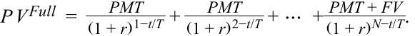
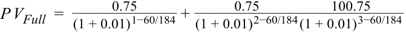
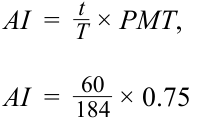
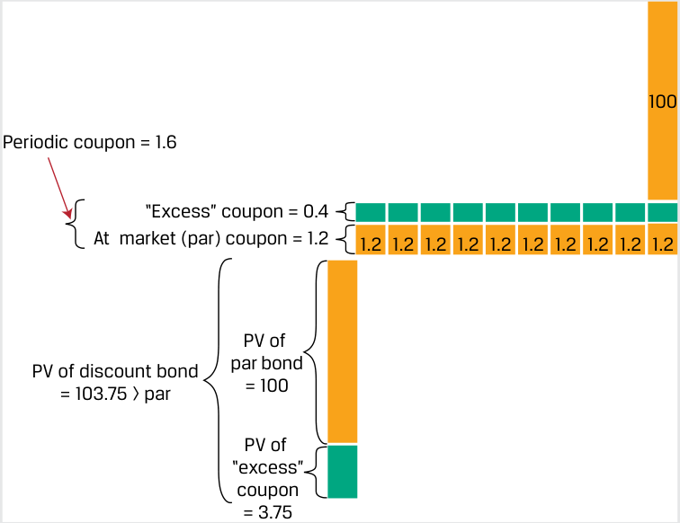
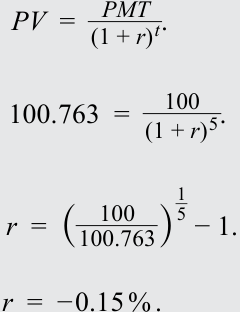
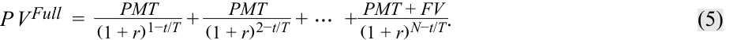
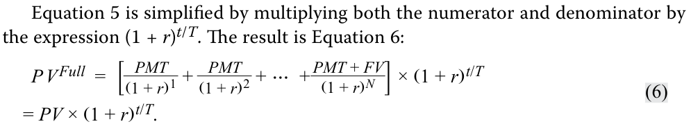

# Volume 6: Fixed Income
## Learning Module 6 Fixed-Income Bond Valuation: Prices and Yields
### Part 1/2: Introduction (PDF Pages 137–152)

---

<!-- PDF Page 137 -->

# L E A R N I N G M O D U L E **<mark>6</mark>** 

## **Fixed-Income Bond Valuation: Prices and Yields** 

#### **<mark>LEARNING OUTCOMES</mark>** 

**_Mastery The candidate should be able to:_** calculate a bond’s price given a yield-to-maturity on or between coupon dates identify the relationships among a bond’s price, coupon rate, maturity, and yield-to-maturity describe matrix pricing 

### **INTRODUCTION** 

**<mark>1</mark>** 

We will now use discounted cash flow analysis to calculate bond prices and show how the discount rate used as well as a bond’s features, such as its coupon rate and time-to-maturity, affect pricing. The price of a bond and its future cash flows can be used calculate an internal rate of return, known as the yield-to-maturity, which serves as a useful return measure for fixed-income investors under certain assumptions. One of these assumptions that applies to this learning module is that all bond interest and principal cash flows occur as promised. We will explore the relationship between bond prices and bond features, showing how different features affect a bond’s price, and demonstrate pricing both on and between bond coupon dates. Finally, we will introduce matrix pricing, which uses comparable bonds to estimate a bond’s price and yield-to-maturity when neither is known. 

Most of the examples and exhibits used throughout the reading can be downloaded as a Microsoft Excel workbook. Each worksheet in the workbook is labeled with the corresponding example or exhibit number in the text. 

##### **LEARNING MODULE OVERVIEW** 

- Bond pricing is an application of discounted cash flow analysis. Bond prices are a function of a bond’s features, including its cash flows and the interest rate(s) used to discount future cash flows. 

<!-- PDF Page 138 -->

- By comparing a bond’s price to its face value or its coupon rate to the discount rate, we can identify whether a bond is trading at a discount, at par, or at a premium. 

- If the market price of a bond is known, an internal rate of return on the cash flows can be calculated, known as the yield-to-maturity (YTM). The YTM is the single interest rate that equates the present value of future cash flows to the price of the bond. 

- A bond investor’s rate of return will equal the YTM if (1) the investor holds the bond to maturity, (2) the issuer makes full coupon and principal payments on the scheduled dates, and (3) the investor reinvests all coupon payments at the same YTM. 

- When a bond is priced or traded in between coupon dates, an additional amount must be added for interest that has accrued since the last coupon payment, to compensate the seller, since the buyer will receive the entire next coupon payment. 

- To calculate a bond’s accrued interest on any date, we multiply the coupon by the fraction of days elapsed in the coupon period divided by the total days in the coupon period. There are various conventions for counting these days; two common conventions are actual/actual and 30/360. 

- A bond’s price changes inversely with changes in its YTM. A bond’s features determine price sensitivity to changes in YTM. 

- The lower the coupon rate on a fixed-coupon bond, the greater the percentage price change for a given change in the bond’s yield-to-maturity. Generally, the longer a bond’s time-to-maturity, the greater its percentage price change for a given change in its yield-to-maturity. 

- Unlike listed equity securities, most bonds are thinly traded, which complicates price discovery. 

- Matrix pricing is a price estimation process for new or illiquid bonds that uses yields on securities with the same or similar features. Matrix pricing is widely used in price quotations for bonds. 

##### **LEARNING MODULE SELF-ASSESSMENT** 

These initial questions are intended to help you gauge your current level of understanding of the learning module. 

1. A corporate bond that matures on 1 January 2035 pays semiannual coupons of 3.25% per year and has a face value of 100. The market discount rate is 4.0%. For a trade settlement date of 1 January 2030, the price of the bond as a percentage of par value, assuming a 30/360 day count, is _closest_ to: 

   - **A.** 96.632. 

   - **B.** 96.661. 

**C.** 103.436. 

- **Solution:** 

A is correct. The bond price is the sum of the coupon and principal payments discounted at the market discount rate. 

<!-- PDF Page 139 -->

_PV_ = _PMT_ 1/(1 + _r_ )1 + _PMT_ 2/(1 + _r_ )2 + … + ( _PMTN_ + _FVN_ )/(1 + _r_ )_N_ , where 

_PMT_ =1.625 _r_ = 0.02 _FV_ = 100 _N_ = 10 _1.625 _1.625 _1.625 _1.625 _1.625_PV_= (1 + 0.02)1+ (1 + 0.02)2+ (1 + 0.02)3+ (1 + 0.02)4+ (1 + 0.02)5+ _ (1 + 0.02) 1.6256+ _ (1 + 0.02) 1.6257+ _ (1 + 0.02) 1.6258+ _ (1 + 0.02) 1.6259+ _ (1 + 0.02)101.62510 _PV_ = 96.632. Note: Quantities in the calculation are not rounded, though they are shown with three decimal places for presentation purposes. Solutions are rounded to three decimal places. 

The calculation can also be done using the PV or PRICE functions in Microsoft Excel and Google Sheets: 

~~=-PV(rate, nper, pmt, [FV], type)~~ =-PV(0.02,10,1.625,100,0) = 96.632 ~~=PRICE(settlement, maturity, rate, yield, redemption, frequency, [basis])~~ =PRICE(DATE(2030,1,1),DATE(2035,1,1),0.0325,0.04,100,2) = 96.632 

2. Which of the following is _not_ required for a bond investor’s rate of return on a bond investment to equal the bond’s YTM? **A.** The bond is held to maturity. **B.** The issuer may default on one, but only one, coupon payment. **C.** Coupon payments are reinvested at the same rate as the YTM. 

**Solution:** 

B is correct. For a bond investor to earn the YTM, the issuer must make all coupon and principal payments on their scheduled dates. 

A is incorrect because a bond investor does have to hold the bond to maturity to earn the YTM. C is incorrect because a bond investor does have to reinvest coupons at the same rate as the YTM to earn the YTM. 

3. A three-year sovereign bond issued on 1 January 2030 pays semiannual coupons of 1.5% per year on 30 June and 31 December each year and has a face value of 100. The market discount rate is 2.0%. For a trade settlement date 

<!-- PDF Page 140 -->

of 29 August 2031, the flat price of the bond as a percentage of par value, assuming an actual/actual day count, is _closest_ to: 

**A.** 99.343. 

**B.** 99.587. **C.** 99.832. **Solution:** 

A is correct. The flat price is the full price less accrued interest. The full price is the present value as of the trade settlement date, which involves partial payment periods because we’re between coupon dates. 

<!-- Formula Text: P V Full  = PMT _ (1 + r) 1−t/T  + PMT _ (1 + r) 2−t/T  + ⋯  +  PMT + FV _ (1 + r) N−t/T . -->

Here, 

_PMT_ = 0.75 

_r_ = 0.01 

_t_ = 60 (days from 30 June 2031 to 29 August 2031) 

_T_ = 184 (days from 30 June 2031 to next coupon on 31 December 2031) 

_FV_ = 100 

_N_ = 3 

<!-- Formula Text: P V Full  = 0.75 _____________ (1 + 0.01) 1−60/184  + 0.75 _____________ (1 + 0.01) 2−60/184 100.75 _____________ (1 + 0.01) 3−60/184 -->

_P VFull_ = 99.587. 

Accrued interest is the proportional share of the next coupon payment owed the seller. 

<!-- Formula Text: AI  =   t _ T  × PMT, AI  =   60 _ 184  × 0.75 -->

<!-- Formula Text: AI  =  0.245. -->

The flat price is 99.587 – 0.245 = 99.343. 

The present value calculations can also be done easily on spreadsheet software. Additionally, the PRICE function in Microsoft Excel and Google Sheets can be used to directly solve for the flat price (note: _not_ full prices). 

~~=PRICE(~~ _~~settlement, maturity, rate, yield, redemption, frequency, [basis]~~_ ~~)~~ 

=PRICE(DATE(2031,8,29),DATE(2032,12,31),0.015,0.02,100,2) 

= 99.343. 

4. True or false: A bond’s quoted price is also called its full price because it is the amount that the buyer pays the seller. 

**A.** True 

<!-- PDF Page 141 -->

**B.** False **Solution:** False. A bond is quoted by its flat price. The full price is the amount paid by the buyer to the seller, and it includes accrued interest if settlement does not occur on a coupon payment date. 5. Assume that the Japanese government issues two non-callable fixed-coupon bonds on the same date with the same coupon rate. The bonds are identical except that one matures in 10 years and the other matures in 30 years. If the relevant market discount rates for both bonds rise by 65 bps, which of the following will be true? **A.** The 10-year bond will have a larger percentage price change than the 30-year bond. **B.** The 10-year bond will have a smaller percentage price change than the 30-year bond. **C.** The 10-year bond and the 30-year bond will have equal percentage price changes. **Solution:** B is correct. Generally, for the same coupon rate, a shorter-term bond will have a smaller percentage price change than a longer-term bond when their relevant market discount rates change by the same amount. A is incorrect because generally a shorter-term bond will have a smaller percentage price change than a longer-term bond when their market discount rates change by the same amount. C is incorrect because shorter-term bonds and longer-term bonds will not have the same percentage price changes when their market discount rates change by the same amount. 6. True or false. Justify your answer. Matrix pricing is an estimation process in which quotes from derivative markets (e.g., interest rates swaps) are used to determine the price of illiquid or new bonds for which transactional data are scarce. **A.** True **B.** False **Solution:** False. Matrix pricing is a process for estimating prices of illiquid or newly issued bonds using prices of comparable bonds, not from transactions in derivative markets. The comparable bonds have similar times-to-maturity, coupon rates, and credit quality as those of the bond under study. 

calculate a bond’s price given a yield-to-maturity on or between coupon dates 

<!-- PDF Page 142 -->

#### **Bond Pricing with a Market Discount Rate** 

Bond pricing is an application of discounted cash flow analysis that depends on a bond’s cash flow features and the rate (or rates) used for discounting. Recall from an earlier lesson that the price of the bond at issuance is the present value of the promised interest and principal cash flows. The market discount rate is used in the time-value-of-money calculation to obtain the present value. The **market discount rate** is the rate of return required by investors given the risk of the bond investment. It is also called the **required yield** , or the **required rate of return** . 

The present value ( _PV_ ) calculation for each bond coupon cash flow ( _PMT_ ) that occurs in _t_ periods with a market discount rate of _r_ per period should be familiar from an earlier time-value-of-money lesson: 

_PV_ (Bond coupon) = _PMTt_ /(1 + _r_ )_t_ . ~~(1)~~ 

Equation 2 extends this calculation in a general formula for calculating a bond price ( _PV_ ) given the market discount rate on a coupon date: 

_PV_ = _PMT_ 1/(1 + _r_ )1 + _PMT_ 2/(1 + _r_ )2 + … + ( _PMTN_ + _FVN_ )/(1 + _r_ )_N_ , ~~(2)~~ 

where _FV_ is equal to the bond’s face value and _N_ is the number of periods to maturity. 

Recall the Bright Wheels Automotive (BRWA) bond introduced in an earlier lesson. The bond’s price was 100% of face or par value because the market discount rate, _r_ , and the bond’s fixed coupon rate, _PMT_ , were equal (at 3.2% per annum, or 1.6% semiannually). We will now consider cases where the bond’s coupon rate and the market discount rate are not equal. 

##### **EXAMPLE 1** 

|**BR**|**WA Par,**|**Disco**|**unt, a**|**nd Pr**|**emiu**|**m Bo**|**nd**||||
|---|---|---|---|---|---|---|---|---|---|---|
|**Period:**|**1**|**2**|**3**|**4**|**5**|**6**|**7**|**8**|**9**|**10**|
|Cash Flow:|1.6|1.6|1.6|1.6|1.6|1.6|1.6|1.6|1.6|101.6|
|PV of Cash Flow at 1.2% periodic YTM:|1.6|1.6|1.5|1.5|1.5|1.5|1.5|1.5|1.4|90.2|
|Bond price (sum):|103.75||||||||||
|PV of Cash Flow at 1.6% periodic YTM:|1.6|1.6|1.5|1.5|1.5|1.5|1.4|1.4|1.4|86.7|
|Bond price:|100.00||||||||||
|PV of Cash Flow at 2.0% periodic YTM:|1.6|1.5|1.5|1.5|1.4|1.4|1.4|1.4|1.3|83.3|
|Bondprice:|96.41||||||||||

_Note:_ Please refer to the candidate learning ecosystem online for a spreadsheet of these calculations in the downloaded Microsoft Excel workbook. 

If the market discount rate rises to 2% semiannually, new bonds to be issued at par must provide coupon rates that are also 2% semiannually. The previously issued BRWA bond pays coupons at a 1.6% rate, so it should have a lower price than a bond that pays 2%. We could say that the BRWA bond’s 1.6% coupon rate is _deficient_ relative to the higher 2% market discount rate. The market price of the BRWA bond, with its lower coupon, will therefore fall below 100% of par. Example 1 shows that when we discount the BRWA bond cash flows at a market discount rate of 2%, we calculate a price of 96.41. This lower price compensates for a coupon rate below the market discount rate. When a bond’s price is less than 100, we say that the bond trades at a discount. (This use of “discount” when referring to the bond price is not connected to the use of “discount” in market discount rates). Exhibit 1 illustrates a bond trading at a discount. 

<!-- PDF Page 143 -->

##### **Exhibit 1: Discount Bond Cash Flows** 

<!-- Start of picture text -->
100 “Deficient” coupon = 0.4 At  market (par) coupon = 2.0 1.6 1.6 1.6 1.6 1.6 1.6 1.6 1.6 1.6 1.6 PV of discount bond PV of = 96.41 < par par bond = 100 PV of “deficient” coupon = 3.59 <!-- End of picture text -->

We now consider how the price of the existing BRWA bond will change if the market discount rate falls to 1.2%. A similar bond (five-year maturity, semi-annual coupon) issued when the five-year market discount rate is 1.2% semiannually will also have a semi-annual coupon rate of 1.2% so that its price will be 100% of par. Because the BRWA bond pays a higher coupon rate of 1.6%, its price should be higher than that of a bond that pays only 1.2%. We could say that the BRWA bond’s 1.6% coupon rate is _excessive_ relative to the lower 1.2% market discount rate. Therefore, the BRWA bond’s price rises as the market discount rate falls. When we discount the cash flows of the BRWA bond at the market discount rate of 1.2% and then add them up, we calculate a bond price equal to 103.73% of par. It has a higher price than the 1.2% coupon bond because it pays a higher coupon. Exhibit 2 illustrates a bond trading at a premium. 

##### **Exhibit 2: Premium Bond Cash Flows** 

<!-- Start of picture text -->
100 Periodic coupon = 1.6 “Excess” coupon = 0.4 At  market (par) coupon = 1.2 1.2 1.2 1.2 1.2 1.2 1.2 1.2 1.2 1.2 1.2 PV of PV of discount bond par bond = 103.75 > par = 100 PV of “excess” coupon = 3.75 <!-- End of picture text -->

The PV function in Microsoft Excel or Google Sheets may also be used for the price calculation: 

~~=PV(rate, nper, pmt, FV, type)~~ , 

where 

<!-- PDF Page 144 -->

_rate_ is the market discount rate per period 

_nper_ is the number of periods 

_pmt_ is the periodic coupon payment 

_FV_ is future or face value 

_type_ corresponds to payments made at the end (0) or beginning (1) of each period 

The discount, premium, and par relationships are summarized in Exhibit 3. 

**Exhibit 3: Fixed-Rate Discount, Premium, and Par Bonds** 

|**Bond** **Price**|**Price vs. Future Value**|**Coupon vs. Market Discount Rate**|
|---|---|---|
|Par|PV = FV|PMT = Market discount rate|
|Discount|PV < FV|PMT < Market discount rate|
|Premium|PV > FV|PMT > Market discount rate|

The interest rates per period are annualized by multiplying the rate per period by the number of periods in a year. Therefore, an equivalent statement is that the BRWA bond is priced at a premium because its stated annual coupon rate of 3.2% is greater than the stated annual market discount rate of 2.4%. Unless stated otherwise, interest rates are typically quoted as annual rates. 

#### **Yield-to-Maturity** 

If the market price of a bond is known, Equation 2 can be used to calculate its yield-to-maturity. The **yield-to-maturity** is the internal rate of return on the cash flows—the uniform interest rate such that when the future cash flows are discounted at that rate, the sum of the present values equals the price of the bond. It is an _implied_ or _observed_ single market discount rate. 

A bond investor will earn a rate of return on a bond equal to its YTM if each of the following is true: 

**1.** The investor holds the bond to maturity. 

**2.** The issuer makes full coupon and principal payments on scheduled dates. The YTM is the _promised_ yield—that is, assuming no issuer default. 

**3.** The investor reinvests all coupon payments at the same YTM. 

For example, say we observe that the five-year 3.2% fixed-rate BRWA bond in Example 1 is priced at 108.15. The yield-to-maturity is the solution for the rate, _r_ , in the following equation: 

108.15 = 1.6/(1 + _r_ )1 + 1.6/(1 + _r_ )2 + … + 101.6/(1 + _r_ )10 . 

The Microsoft Excel or Google Sheets YIELD function may be used for bonds that pay periodic interest: 

<!-- PDF Page 145 -->

~~=YIELD(settlement, maturity, rate, pr, redemption, frequency, [basis])~~ where 

_settlement_ is the settlement date entered using the DATE function 

_maturity_ is the maturity date entered using the DATE function 

_rate_ is the semi-annual (or periodic) coupon 

_pr_ is the price per 100 face value 

_redemption_ is the future value at maturity 

_frequency_ is the number of coupons per year 

_[basis]_ is the day-count convention, typically 0 for US bonds (30/360 day 

count). 

If we assume the BRWA bond settles and matures on 15 October 2025 and 15 October 2030, respectively, the appropriate entries are DATE(2025,10,15) and DATE(2030,10,15). The other entries are _rate_ = 1.6%, _pr_ = 108.15, _redemption_ = 100, _frequency_ = 2, and _basis_ = 0, as follows: 

=YIELD(DATE(2025,10,15),DATE(2030,10,15),1.6%,108.15,100,2,0) 

Given a price of 108.15, the YIELD function calculates the annual yield-to- maturity for the BRWA bond to be 1.50%. Additionally, since the yield-to-maturity is an internal rate of return, we can also use the IRR function in Microsoft Excel or Google Sheets to get the same result. 

Yield-to-maturity, commonly referred to as “yield,” is often used interchangeably with the market discount rate or required yield and in place of discussing bond prices. For example, market participants will simply say “yields are rising” rather than “market discount rates are rising” or “bond prices are falling.” 

##### **BONDS WITH NEGATIVE YIELDS-TO-MATURITY** 

The yield-to-maturity on a bond may be positive, zero, or negative. Yields on many sovereign bonds fell below zero following accommodative monetary policies introduced by central banks starting in 2012 in response to below-target inflation rates. Bonds with a negative yield-to-maturity include those issued at higher yields in the past that have experienced significant price appreciation and newly issued zero-coupon sovereign government bonds priced at a premium to par value. Bonds are generally not issued with negative coupons. 

In 2020, China issued its first ever negative-yielding sovereign bond denominated in euros, with terms shown in Exhibit 4. 

**Exhibit 4: People’s Republic of China Eurobond** 

|**People**|**’s Republic of China Zero-Coupon Bond** **Brief Summary of Terms**|
|---|---|
|Issuer:|People’s Republic of China|
|Settlement Date:|November 25, 2020|
|Maturity Date:|November 25, 2025|
|Principal Amount:|EUR 750 million|
|Interest:|Zero coupon (ACT/ACT day count)|
|Issuance Price:|100.763|
|Issuance Spread:|+30 bps p.a. plus Mid Swaps|

<!-- PDF Page 146 -->

<!-- Start of picture text -->
People’s Republic of China Zero-Coupon Bond Brief Summary of Terms Issuance and Trading: Eurobond Listed on Multiple Exchanges Euroclear/ Clearstream Seniority: Senior Unsecured Exchanges:  Luxembourg <!-- End of picture text -->

The Excel YIELD function cannot not be used for zero-coupon bonds. Instead, we solve for the annualized yield-to-maturity using Equation 1 for the single cash flow of par ( _PMT_ = 100) after five years ( _t_ = 5) at the original issuance price ( _PV_ = 100.763): 

<!-- Formula Text: PV  =    PMT _ (1 + r) t . 100.763  =    100 _ (1 + r) 5 . r  =  (  100 _ 100.763 ) 1 _ 5 − 1. r  =  − 0.15 % . -->

The _Financial Times_ reported high demand for this negative-yielding Chinese bond since its yield was more than 50 bps above that of European sovereign bonds—the five-year German bund was at approximately –0.74% around the same time —and more generally because many investors sought portfolio exposure to China amid a relative scarcity of euro-denominated Chinese bonds at the time. 

#### **Flat Price, Accrued Interest, and the Full Price** 

When a bond is priced between coupon payment dates, its price has two components: the **flat price** ( _PV__Flat_ ) and the **accrued interest** ( _AI_ ). The sum of the parts is the **full price** ( _PV__Full_ ), which also is known as the invoice or “dirty” price. 

_PV__Full_ = _PV__Flat_ + _AI_ . ~~(3)~~ 

The flat price, which is the full price minus the accrued interest, is also called the quoted or “clean” price and is the type of price usually quoted by bond dealers. If a trade takes place, the accrued interest is added to the flat price to obtain the full price paid by the buyer and received by the seller on the **trade settlement date** . The trade settles when the bond buyer pays and the seller delivers the security. 

The flat price is used for quotations to avoid misleading investors about a bond’s market price trend. If full prices were quoted by dealers, investors would see price rises each day even if the YTM did not change due to the accrual of interest. Once a coupon payment is made, the quoted price would drop significantly, as shown in Exhibit 5. 

<!-- PDF Page 147 -->

**Exhibit 5: Flat Price, Accrued Interest, and Full Price** 

<!-- Start of picture text -->
Bond Price Full Price = Flat Price + Acrued Interest Full Price Accrued Coupon Interest Payment Flat Price 1 2 3 4 Period <!-- End of picture text -->

The accrued interest is the portion of the next coupon payment owed to the seller of a bond, because although the seller held the bond for a partial coupon period, the full coupon will be received by the buyer. To calculate accrued interest, we determine the fractional amount by counting the days in the period. If the coupon period has _T_ days between payment dates and _t_ days have passed since the last payment, the accrued interest is calculated using Equation 4: 

<!-- Formula Text: AI  =   t _ T  × PMT, (4) -->

where 

- _t =_ number of days from the prior coupon payment to the settlement date 

- _T_ = number of days in the coupon period 

- _t_ / _T_ = fraction of coupon period that has passed since the prior payment 

- _PMT_ = coupon payment per period 

Note that the accrued interest portion of the full price does not depend on the yield-to-maturity. Therefore, it is only the flat price that is affected by a change in interest rates. 

There are multiple approaches for day counting (or “day counts”). The day count is specified by two parameters: how days are counted within a given period and the number of days assumed per period. Two common day count conventions are 30/360 and actual/actual. The 30/360 day count assumes each month has exactly 30 days (although most don’t) and each year has exactly 360 days (although none do). In contrast, the actual/actual day count convention assumes the actual number of days in each month and the actual number of days in a year. 

##### **EXAMPLE 2** 

#### **Actual/Actual vs. 30/360 Day Count** 

Consider two otherwise identical bonds that pay 4.375% semiannual interest on 15 May and 15 November of each year. One is a government bond with an actual/actual day count and the other is a corporate bond with a 30/360 day count. The actual/actual method uses the actual number of days, including weekends, holidays, and leap days. The 30/360 method assumes 30 days in a month and 360 days in each year. 

Calculate accrued interest for settlement on 27 June for both bonds. 

<!-- PDF Page 148 -->

Accrued interest for the actual/actual bond is the actual number of days between 15 May and 27 June ( _t_ = 43 days) divided by the actual number of days between 15 May and 15 November ( _T_ = 184 days), times the coupon payment. 

For the 30/360 bond, we 42 days between 15 May and 27 June: 15 days between 15 May and 30 May and 27 days between 1 June and 27 June (31 May is not counted in the 30/360 convention). There are assumed to be 180 days in the six-month period between 15 May and 15 November. 

||**Actual/Actual Bond**|**30/360 Bond**|
|---|---|---|
|Days (_t_)|43|42|
|Period (_T_)|184|180|
|_t_/_T_|0.233696|0.233333|

Accrued interest is calculated as follows: 

**Actual/actual bond:** _AI_ = (43/184) × (4.375/2) 

= 0.511209 per 100 of par value. 

**30/360 bond:** _AI_ = (42/180) × (4.375/2) 

= 0.510417 per 100 of par value. 

The full price of a fixed-rate bond between coupon payments given the market discount rate per period ( _r_ ) is the present value of future cash flows as of the trade settlement date, as shown in Equation 5: 

<!-- Formula Text: P V Full  = PMT _ (1 + r) 1−t/T  + PMT _ (1 + r) 2−t/T  + ⋯  +  PMT + FV _ (1 + r) N−t/T . (5) -->

This is very similar to Equation 2. The difference is that the next coupon payment ( _PMT_ ) is discounted for the remainder of the coupon period, which is 1 – _t_ / _T_ . The second coupon payment is discounted for that fraction plus another full period, 2 – _t_ / _T_ . 

<!-- Formula Text: Equation 5 is simplified by multiplying both the numerator and denominator by the expression (1 + r)t/T. The result is Equation 6: P V Full  =  [  PMT _ (1 + r) 1  +   PMT _ (1 + r) 2  + ⋯  +  PMT + FV _ (1 + r) N  ] × (1 + r) t/T = PV × (1 + r) t/T. (6) -->

An advantage of Equation 6 is that the expression in the brackets, _PV_ , is easily obtained using the Excel YIELD function because there are _N_ evenly spaced periods. _PV_ here is the present value of future cash flows as of the last coupon date; it is identical to Equation 2 but is not the same as _PV__Flat_ . 

The next two examples demonstrate the calculation of a bond’s flat price, accrued interest, and full price. 

##### **EXAMPLE 3** 

#### **BRWA Bond—Flat and Full Price** 

Calculate the flat price and full price of the 3.2% fixed BRWA bond 90 days after the first coupon payment. 

First, we calculate the bond’s present value on the coupon date that begins the period during which settlement occurs, using Equation 2 or the PV function in Microsoft Excel or Google Sheets. 

<!-- PDF Page 149 -->

=-PV(0.02,9,1.60,100,0) = 96.735 

Next, we calculate the full price by counting the days using the specified day count convention and using Equation 6. 

Number of days from beginning of period until settlement, _t_ = 90 Number of days in the period containing settlement _, T_ = 180 _P V__Full_ = _PV_ ×( 1 + _r_)_t_/_T_ _P V__Full_ = 96.735 ×( 1 + 0.02)90/180 _P V__Full_ = 97.698 

Then we use Equation 4 to calculate accrued interest. _AI_ =t_ _T_×_PMT_  AI_ =90 180× 1.60 

_AI_ = 0.80 

Finally, we calculate the flat price using Equation 3 by subtracting the accrued interest from the full price. 

_P V__Full_ = _P V__Flat_ + _AI P V__Flat_ = _P V__Full_ − _AI P V__Flat_ = 97.698 − 0.80 _P V__Flat_ = 96.898 

_Note_ : Quantities in the calculation are not rounded, though they are shown with three decimal places for presentation purposes. Solutions are rounded to three decimal places. 

##### **EXAMPLE 4** 

#### **Romania Bond—Flat and Full Price** 

The 4.625% EUR annual, actual/actual fixed-coupon bond issued by Romania maturing 3 April 2049 was introduced in an earlier lesson. Calculate the full price ( _PV__Full_ ), the accrued interest ( _AI_ ), and the flat price ( _PV__Flat_ ) for settlement on 15 December 2031 assuming an annual yield-to-maturity on that date of 3.50%. 

**Solution** 

Step 1 Calculate PV as of the beginning of the current coupon period for the settlement date: 

~~=-PV(rate, nper, pmt, [FV], type)~~ =-PV(0.035,18,4.625,100,0) = 114.838 

Step 2 Calculate the actual number of days ( _t_ ): 

<!-- PDF Page 150 -->

|**Days**|**Months**|
|---|---|
|15|December|
|27|April|
|30|June, September, November|
|31|May, July, August, October|
|**256**|**Total**|

Step 3 Calculate the actual number of days in the coupon period ( _T_ ): 

|Date at beginning of period|4/3/2031|
|---|---|
|Date at end of period|4/3/2032|
|**Actual number of days inperiod**|**366**|

Notice that 2032 is a leap year so it has an extra day. 

Step 4 Use Equation 6 to solve for _PV__Full_ : 

_P V__Full_ = _PV_ ×( 1 + _r_)_ _T__t_ . _P V__Full_ = 114.838 ×( 1 + 0.035) _366256 . _P V__Full_ = 117.635. 

Step 5 Use Equation 4 to solve for accrued interest: 

_AI_ =t_ _T_×_PMT_.  AI_ =256 366× 4.625. _AI_ = 3.235. 

Step 6 Use Equation 3 to solve for _PV__Flat_ : 

_P V__Full_ = _P V__Flat_ + _AI_ . _P V__Flat_ = _P V__Full_ − _AI_ . _P V__Flat_ = 117.635 − 3.235. 

_P V__Flat_ = 114.400. 

_Note_ : Quantities in the calculation are not rounded, though they are shown with three decimal places for presentation purposes. Solutions are rounded to three decimal places. 

##### **KNOWLEDGE CHECK** 

1. Define yield-to-maturity. 

**Solution:** 

Yield-to-maturity is the internal rate of return on a bond’s cash flows—the uniform interest rate such that when the future cash flows are discounted at that rate, the sum of the present values equals the price of the bond. 

<!-- PDF Page 151 -->

|2. A non-callable fixed-coupon bond with a maturity in 10 years and a face val- ue of 100 is issued with an annual coupon rate of 2.8% when the applicable market discount rate is also 2.8%. The price of this bond at issuance is:|
|---|
|**A.**less than 100.|
|**B.**exactly 100.|
|**C.**more than 100. **Solution:**|
|B is correct. When a bond is issued with a coupon rate that equals the mar- ket discount rate, it is priced at par.|
|3. A non-callable fixed-coupon bond with a maturity in 10 years and a face value of 100 has an annual coupon rate of 2.8%, while the market discount rate is 4.0%. The price of this bond at issuance is:|
|**A.**less than 100.|
|**B.**exactly 100. **C.**more than 100. **Solution:**|
|A is correct. A bond with a coupon rate lower than the market discount rate will trade at a discount to par, to compensate for its “deficient” coupons relative to the market rate.|
|4. A sovereign bond that matures on 1 January 2030 pays an annual coupon of 1.2% and has a face value of 100. For a trade settlement date of 1 January 2020, the bonds are priced at 128. Calculate the yield-to-maturity as of the settlement date and price. **Solution:** –1.390%. We use the YIELD function in Microsoft Excel or Google Sheets:|
|~~=YIELD(settlement, maturity, rate, pr, redemption,~~ ~~frequency,[basis])~~ =YIELD(DATE(2020,1,1),DATE(2030,1,1),0.012,128,100,1) = -1.390%|
|5. A bond with a face value of 100 pays an annual coupon of 12% and matures on Ad14 August 2007. It uses the actual/actual day count convention. For a settlement date of 23 December 2002 and an annual YTM of 9.75%, calcu- late the full price, accrued interest, and flat price. Assume an actual/actual day count. **Solution:**|
|Step 1 Calculate PV as of the beginning of the current coupon period for the settlement date:|
|~~=-PV(rate, nper, pmt, [FV], type)~~|
|=-PV(0.0975,5,12,100,0) = 108.584|

<!-- PDF Page 152 -->

##### Step 2 Calculate the actual number of days ( _t_ ): 

|**Month**|**Days**|
|---|---|
|August|17|
|September|30|
|October|31|
|November|30|
|December|23|
|**Total**|**131**|

Step 3 Calculate the actual number of days in the coupon period ( _T_ ): 

|Date at beginning of period|8/14/2002|
|---|---|
|Date at end of period|8/14/2003|
|**Actual number of days inperiod**|**365**|

Step 4 Use Equation 6 to solve for _PV__Full_ : 

- _P V__Full_ = _PV_ ×( 1 + _r_)_ _T__t_ . 

_P V__Full_ = 108.584 ×( 1 + 0.0975) _365131 . 

_P V__Full_ = 112.271. 

Step 5 Use Equation 4 to solve for accrued interest: 

_AI_ =t_ _T_×_PMT_. 

 AI_ =131 365× 12. 

_AI_ = 4.307. 

Step 6 Use Equation 3 to solve for _PV__Flat_ : 

- _P V__Full_ = _P V__Flat_ + _AI_ . 

- _P V__Flat_ = _P V__Full_ − _AI_ . 

- _P V__Flat_ = 112.271 − 4.307. 

- _P V__Flat_ = 107.964. 

_Note_ : Quantities in the calculation are not rounded, though they are shown with three decimal places for presentation purposes. Solutions are rounded to three decimal places. 

6. Perform the same calculations for the same bond in Question 5, but use a 30/360 day count convention. **Solution:** 

- Step 1 Calculate PV as of the beginning of the current coupon period for the settlement date: 

- ~~=-PV(rate, nper, pmt, [FV], type)~~ 

- =-PV(0.0975,5,12,100,0) 

