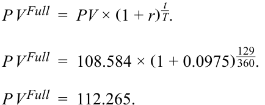
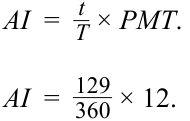
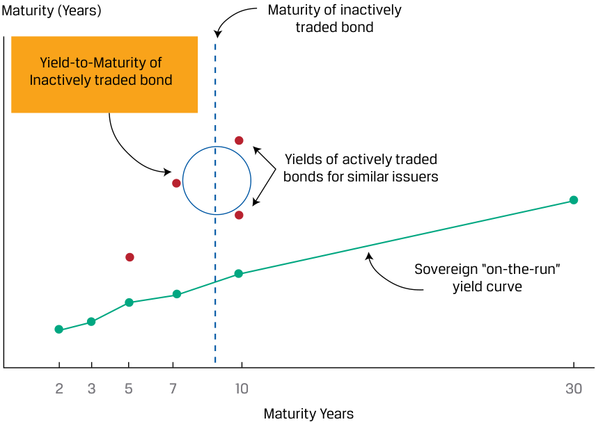
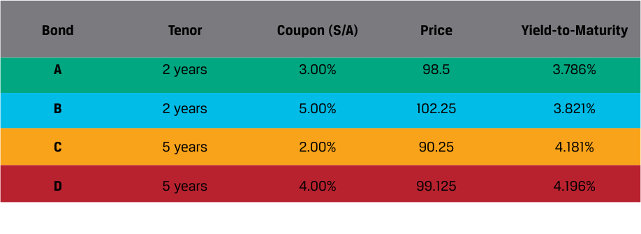
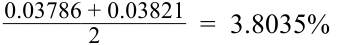
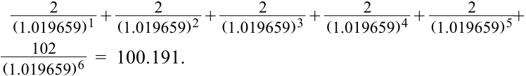
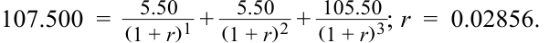

# Volume 6: Fixed Income
## Learning Module 6 Fixed-Income Bond Valuation: Prices and Yields
### Part 2/2: Relationships between Bond Prices and Bond Features (PDF Pages 153–166)

---

<!-- PDF Page 153 -->

##### = 108.584 

Step 2 Calculate the number of days ( _t_ ): 

|**Month**|**Days**|
|---|---|
|August|16|
|September|30|
|October|30|
|November|30|
|December|23|
|**Total**|**129**|

Step 3 Assume the number of days in the coupon period ( _T_ ) is 360. Step 4 Use Equation 6 to solve for _PV__Full_ : 

<!-- Formula Text: P V Full  =  PV × (1 + r)  t _ T . P V Full  =  108.584 × (1 + 0.0975)  129 _ 360 . P V Full  =  112.265. -->

Step 5 Use Equation 4 to solve for accrued interest: 

<!-- Formula Text: AI  =   t _ T  × PMT. AI  =   129 _ 360  × 12. -->

<!-- Formula Text: AI  =  4.300. -->

Step 6 Use Equation 3 to solve for _PV__Flat_ : 

<!-- Formula Text: P V Full  =  P V Flat + AI. P V Flat  =  P V Full − AI. P V Flat  =  112.265 − 4.300. P V Flat  =  107.965. -->

_Note_ : Quantities in the calculation are not rounded, though they are shown with three decimal places for presentation purposes. Solutions are rounded to three decimal places. 

### **RELATIONSHIPS BETWEEN BOND PRICES AND BOND FEATURES** 

# **<mark>3</mark>** 

identify the relationships among a bond’s price, coupon rate, maturity, and yield-to-maturity 

<!-- PDF Page 154 -->

#### **Inverse Relationship** 

As seen in the prior lesson, the price of a fixed-rate bond will change as the interest rate used to discount future cash flows changes. For any time-value-of-money calculation, a higher discount rate results in a lower present value for any fixed future cash flow and a lower discount rate results in a higher present value. Therefore, bond yields-to-maturity and prices move in opposite directions. 

#### **Coupon Effect** 

The _size_ of bond coupon cash flows affects how much a bond’s price will change for a given yield change for bonds of the same maturity. The lower a bond’s coupon, the higher the _proportion_ of total cash flow that occurs at maturity. Discounting this final cash flow by the factor of (1 + _r_ )_N_ as shown in Equation 2 magnifies the impact of a given change in _r_ relative to bonds whose final cash flow is a smaller proportion of the total. This coupon effect is best demonstrated by comparing the extreme case of a zero-coupon bond (with 100% of cash flows including cumulative interest paid at maturity) with an otherwise identical fixed-coupon bond, as in the following example. 

##### **EXAMPLE 5** 

#### **Yield Change Effect for Zero-Coupon vs. Coupon Bond** 

Assume an investor has the choice between the 4.625% fixed-coupon 30-year Romania Eurobond priced at par and an otherwise identical zero-coupon bond from the same issuer at the same yield-to-maturity of 4.625%. 

Calculate the percentage change in price for both bond alternatives if YTM rises or falls by 100 bps upon issuance. 

Use Equation 1 (zero-coupon bond) and the Excel or Google Sheets PV function (4.625% coupon bond) to calculate and compare these changes. Please refer to the candidate learning ecosystem online for a spreadsheet of these calculations in the downloaded Microsoft Excel workbook. 

|Face Value|100|
|---|---|
|Periods / year|1|
|Number of||
|periods|30|
|Coupon payment|4.625|

|**Change**|**YTM**|**Pri**|**ces**|**Price C**|**hanges**|**Percent** **Cha**|**age Price** **nges**|
|---|---|---|---|---|---|---|---|
|||Coupon|Zero|Coupon|Zero|Coupon|Zero|
|--|0.04625|100.000|25.759|--|--|--|--|
|0.01|0.05625|85.665|19.364|–14.335|–6.395|–14.34%|–24.83%|
|–0.01|0.03625|118.107|34.361|18.107|8.601|18.11%|33.39%|

For the same time-to-maturity, a lower-coupon (or zero-coupon) bond has a greater percentage price change than a higher-coupon bond when market discount rates change by the same amount. 

<!-- PDF Page 155 -->

#### **Maturity Effect** 

The time-to-maturity of a bond also affects a bond’s price/yield relationship. Generally, all else equal, a longer-term bond has a greater percentage price change than a shorter-term bond when the market discount rates change by the same amount. The maturity effect is the result of the higher _N_ in Equation 2 for the longer-maturity bond. 

##### **EXAMPLE 6** 

#### **Yield Change Effect for Different Maturities** 

Assume an investor has a choice between Bond A, with a 1.5% fixed coupon and a 30-year maturity priced at par, and Bond B, a 10-year, 1.5% fixed-coupon bond priced at par from the same issuer. 

Calculate the percentage change in price for these if YTM rises or falls by 100 bps upon issuance. 

Compare the price changes in the 10-year and 30-year bonds using the PV function to calculate and compare these changes. Please refer to the candidate learning ecosystem online for a spreadsheet of these calculations in the downloaded Microsoft Excel workbook. 

|**Bond**|**A**||**B**|
|---|---|---|---|
|Face Value|100||100|
|Price|100||100|
|Coupon Rate|0.015||0.015|
|Coupon Payment|1.50||1.50|
|Maturity|30||10|
|**_100 bps rise in YTM_**||||
|YTM||0.025||
|Price|79.070||91.248|
|% change|–20.93%||–8.75%|
|**_100 bps fall in YTM_**||||
|YTM||0.005||
|Price|127.794||109.730|
|% change|27.79%||9.73%|

We see that the percentage price change for the longer-maturity bond is larger than that for the shorter-maturity bond. Also, we see that, in price terms, the change for a YTM _decrease_ is larger than that for a YTM _increase_ . 

Exceptions to the maturity effect exist but are rare in practice. They occur only for low-coupon (but not zero-coupon), long-term bonds trading at a discount. The maturity effect always holds on zero-coupon bonds, as it does for bonds priced at par value or at a premium above par value. 

#### **Constant-Yield Price Trajectory** 

Bond prices change with the passage of time, even if the market discount rate remains the same. As time passes, so as _N_ in Equation 2 approaches zero, the bondholder comes closer to receiving the par value at maturity, provided the issuer does not default. The **constant yield-price trajectory** in Exhibit 6 illustrates price changes 

<!-- PDF Page 156 -->

of two 10-year bonds over time: a 2% coupon bond issued at a discount and an 8% coupon bond issued at a premium. At each time, the bond price is recalculated using a market discount rate of 5%. 

**Exhibit 6: Constant-Yield Price Trajectory** 

<!-- Start of picture text -->
Price (100 = par) 130 120 110 100 90 80 70 60 50 1 2 3 4 5 6 7 8 9 10 Year 2% Coupon 8% Coupon <!-- End of picture text -->

The 2% coupon bond’s initial price is 76.835 per 100 of par value. The price increases each year and approaches par value as the maturity date nears. The 8% coupon bond’s initial price is 123.165, and it decreases each year, approaching par value as the maturity date nears. Both prices are “pulled to par.” Please refer to the candidate learning ecosystem online for a spreadsheet of these calculations in the downloaded Microsoft Excel workbook. 

#### **Convexity Effect** 

The _percentage_ change in a bond’s price will also vary depending on how the yield changes. The percentage price _increase_ is greater, in absolute value, than the percentage price _decrease_ . This implies that the relationship between bond prices and yields is not linear; instead, it is curved and “convex.” Exhibit 7 shows this general relationship between a bond’s price and its yield-to-maturity. 

<!-- PDF Page 157 -->

##### **Exhibit 7: Convex Price–Yield Relationship** 

<!-- Start of picture text -->
Yield (%) Price <!-- End of picture text -->

##### **EXAMPLE 7** 

#### **BRWA Bond: Convex Relationship** 

Despite a uniform increase and decrease in the BRWA bond’s annual yield-to-maturity, notice how the resulting changes in price are different. Please refer to the candidate learning ecosystem online for a spreadsheet of these calculations in the downloaded Microsoft Excel workbook. 

|Face Value|||100|
|---|---|---|---|
|Coupon payment|||1.6|
|Number of periods|||10|
|**YTM Change**|**YTM**|**Price**|**% Price** **Change**|
|--|0.016|100.00|--|
|0.004|0.020|96.41|–3.59%|
|–0.004|0.012|103.75|3.75%|

A decrease in the yield-to-maturity from 160 bps to 120 bps results in a bond price increase of 3.75%, but an increase in the YTM from 160 bps to 200 bps results in a _smaller_ bond price decrease. Based on this, we can say that the BRWA bond has _positive_ convexity. Convexity will be discussed in greater detail in a later lesson. 

<!-- PDF Page 158 -->

##### **KNOWLEDGE CHECK** 

1. Recall the Romania bond from Example 4. It pays annual coupons at a rate of 4.625% and has a face value of 100. Its issue date is 3 April 2019 and its maturity date is 3 April 2049. Calculate its original yield-to-maturity at issue if its issue price is 99.488. 

##### **Solution:** 

The original yield-to-maturity is 4.657%. The YIELD function arguments in Microsoft Excel or Google Sheets are as follows: 

~~=YIELD(settlement, maturity, rate, pr, redemption, frequency,[basis])~~ 

=YIELD(DATE(2019,4,3),DATE(2049,4,3),0.04625,99.488,100,1) 

= 4.657% 

2. Describe the coupon effect. 

##### **Solution:** 

Given two non-callable, fixed-coupon bonds that have different coupons but are otherwise identical, for a change in yield, the lower-coupon bond will have a greater percentage price change than the higher-coupon bond. 

3. Describe the maturity effect. 

##### **Solution:** 

Generally, for two bonds that are identical except for their times-to-maturity, the longer-maturity bond will have a larger percentage price change than will the shorter-maturity bond when yields change by the same amount. 

4. Two non-callable, fixed-coupon bonds have the same maturity date. One trades at a discount; the other trades at a premium. If the yield stays constant until the bonds mature and neither defaults, the two bonds’ prices will, over time: 

   - **A.** converge. 

   - **B.** remain unchanged. 

   - **C.** diverge. 

##### **Solution:** 

A is correct. The prices will converge because of the “pull-to-par” effect. As the maturity date nears, the present values of future cash flows will fall or rise to the par value, provided that the issuer does not default. 

# **<mark>4</mark> MATRIX PRICING** 

<!-- PDF Page 159 -->

#### **Matrix Pricing Process** 

Unlike listed equity securities, most bonds are not actively traded, so there is often no current market price available to calculate yield-to-maturity. The same problem occurs for bonds that are not yet issued. In these situations, it is common to estimate price by using the prices of comparable but more frequently traded bonds. These comparable bonds have similar times-to-maturity, coupon rates, and credit quality. This estimation process, illustrated in Exhibit 8 and Exhibit 9, is called **matrix pricing** . 

**Exhibit 8: Matrix Pricing** 

<!-- Start of picture text -->
Maturity (Years) Maturity of inactively traded bond Yield-to-Maturity of Inactively traded bond Yields of actively traded bonds for similar issuers Sovereign “on-the-run” yield curve 2 3 5 7 10 30 Maturity Years <!-- End of picture text -->

**Exhibit 9: Determining Price of New or Illiquid Bond Using Matrix Pricing** 

|Identify actively Step 1|Step 2|Step 3|Step 4|
|---|---|---|---|
|traded,comparable|Calculate yields-to-|||
|bonds based on similar|maturity for each of the|Linearly interpolate||
|times-to-maturity,|comparable bonds, and|calculated YTMs of the|Using estimated YTM,|
|coupon rates, and credit quality.|calculate average yield for each maturity year.|comparable bonds to estimate YTM closest to the new/illiquid bond’s maturity|calculate the price of the new/illiquid bond by discounting all coupon and pricipal payments.|

For example, suppose that an analyst needs to value a three-year, 4% semiannual coupon payment corporate bond, Bond X. Assume that Bond X is not actively traded and that there are no recent transactions reported for this particular security. Exhibit 10 and Exhibit 11 shows quoted prices and yields-to-maturity for four corporate bonds with very similar credit quality, in tabular and matrix form (by coupon rate and time-to-maturity). 

<!-- PDF Page 160 -->

**Exhibit 10: Actively Traded Comparable Bonds** 

<!-- Start of picture text -->
Bond Tenor Coupon (S/A) Price Yield-to-Maturity A 2 years 3.00% 98.5 3.786% B 2 years 5.00% 102.25 3.821% C 5 years 2.00% 90.25 4.181% D 5 years 4.00% 99.125 4.196% <!-- End of picture text -->

**Exhibit 11: Actively Traded Comparable Bonds Matrix** 

<!-- Start of picture text -->
2% Coupon 3% Coupon 4% Coupon 5% Coupon Two Years 98.500 102.250 3.786% 3.821% Three Years Bond X Four Years Five Years 90.250 99.125 4.181% 4.196% <!-- End of picture text -->

Next, the analyst calculates the average yield for each year: 3.8035% for the two-year bonds and 4.1885% for the five-year bonds. 

<!-- Formula Text: 0.03786 + 0.03821 ______________ 2 =  3.8035% -->

<!-- Formula Text: 0.04181 + 0.04196 ______________ 2 =  4.1855% -->

The estimated three-year yield for bonds of similar credit quality can be obtained with linear interpolation. The interpolated yield is 3.932%. 

<!-- Formula Text: 0.038035 + ( 3 − 2 _ 5 − 2 ) × (0.041885 − 0.038035)  =  0.03932. -->

Using 3.9318% as the estimated three-year annual yield, the three-year, 4% semiannual coupon payment corporate bond has an estimated price of 100.191 per 100 of par value. 

<!-- Formula Text: 2 _ (1.019659) 1  + 2 _ (1.019659) 2  + 2 _ (1.019659) 3  + 2 _ (1.019659) 4  + 2 _ (1.019659) 5 + 102 _ (1.019659) 6   =  100.191. -->

Calculation of yield-to-maturity can also be done with the Excel or Google Sheets YIELD function: 

=YIELD(DATE(2025,10,1),DATE(2028,10,1),0.04,100.191,100,2,1) 

<!-- PDF Page 161 -->

Matrix pricing also is used in underwriting new bonds to get an estimate of the **required yield spread** over the benchmark rate, or the difference in yield-to-maturity between the bond and that of a government benchmark bond with the same or a similar time-to-maturity. 

Suppose that a corporation is about to issue a five-year bond. The corporate issuer currently has a four-year, 3% annual coupon payment debt liability. The price of that bond is 102.400 per 100 of par value. This is the full price, which is the same as the flat price because the accrued interest is zero. This implies that the coupon payment has just been made and there are four full years to maturity. The four-year rate of return required by investors for this bond is 2.36%: 

<!-- Formula Text: 102.400  = 3 _ (1 + r) 1  + 3 _ (1 + r) 2  + 3 _ (1 + r) 3  +   103 _ (1 + r) 4 ; r  =  0.0236. -->

This can also be calculated using the YIELD function in Microsoft Excel or Google Sheets: 

=YIELD(DATE(2025,10,1),DATE(2029,10,1),0.03,102.401,100,2,1) 

Suppose that there are no four-year government bonds to calculate the required yield spread on this security. However, there are three-year and five-year government bonds that have yields-to-maturity of 0.75% and 1.45%, respectively. The average of the two yields-to-maturity is 1.10%, which is the estimated yield for the four-year government bond. Therefore, the estimated required yield spread is 126 bps over the implied benchmark rate (0.0236 – 0.0110 = 0.0126). 

The issuer now has an estimate of the four-year yield spread: 126 bps. This spread is a reference point for estimating the five-year spread for the newly issued bond. 

##### **QUESTION SET** 

1. True or false: Bond price quotes on such platforms as Bloomberg often represent the price at which the most recent trade for that bond was made. 

   - **A.** True 

   - **B.** False 

   - **Solution:** 

False. Most bonds are infrequently traded, so price quotes on such platforms as Bloomberg are often estimated using matrix pricing methods. 

2. An analyst is estimating a price for an illiquid four-year, 4.5% annual coupon payment corporate bond. The analyst identifies two corporate bonds that have similar credit quality: One is a three-year, 5.50% annual coupon payment bond priced at 107.500 per 100 of par value, and the other is a fiveyear, 4.50% annual coupon payment bond priced at 104.750 per 100 of par value. Using matrix pricing, the estimated price of the illiquid bond per 100 of par value is _closest_ to: 

**A.** 103.895. 

**B.** 104.991. 

**C.** 106.125. 

##### **Solution:** 

B is correct. The first step is to determine the yields-to-maturity on the observed bonds. The required yield on the three-year, 5.50% bond priced at 107.500 is 2.856%: 

<!-- PDF Page 162 -->

<!-- Formula Text: 107.500  =    5.50 _ (1 + r) 1  +   5.50 _ (1 + r) 2  +  105.50 _ (1 + r) 3 ; r  =  0.02856. -->

The required yield on the five-year, 4.50% bond priced at 104.750 is 3.449%: 

<!-- Formula Text: 104.750  =    4.50 _ (1 + r) 1  +   4.50 _ (1 + r) 2  +   4.50 _ (1 + r) 3  +   4.50 _ (1 + r) 4  +  104.50 _ (1 + r) 5 ; r  =  0.03449. -->

The estimated yield for a four-year bond having the same credit quality is the average of two required yields: 

<!-- Formula Text: 0.02856 + 0.03449 ______________ 2 =  0.031525. -->

Given an estimated yield-to-maturity of 3.153%, the estimated price of the illiquid four-year, 4.50% annual coupon payment corporate bond is 104.991 per 100 of par value: 

<!-- Formula Text: 4.50 _ (1.031525) 1  + 4.50 _ (1.031525) 2  + 4.50 _ (1.031525) 3  + 104.50 _ (1.031525) 4   =  104.991. -->

3. An analyst uses the matrix pricing approach to determine the price of an illiquid bond. Identify three bond features that could be used to compare frequently traded bonds with the illiquid one. 

   - **Solution:** 

Matrix pricing involves determining the price of a new or illiquid bond by comparing it to frequently traded bonds with similar 

**1.** maturity, 

**2.** coupon rates, and 

**3.** credit quality. 

<!-- PDF Page 163 -->

## **~~PRACTICE PROBLEMS~~** 

**1.** A non-callable, fixed-coupon bond has a price of 106.0625 and a YTM of 2.8%. If the YTM were to increase instantaneously by 80 bps, the price of the bond would decrease by 11%. If the YTM were to decrease instantaneously by 80 bps, the price of the bond would increase by: 

   - **A.** less than 11%. 

   - **B.** exactly 11%. 

   - **C.** more than 11%. 

**2.** Exceptions to the maturity effect exist for bonds that have: 

   - **A.** long maturities, make small coupon payments, and trade at a discount. 

   - **B.** short maturities, have high coupon rates, and trade at a discount. 

   - **C.** long maturities, have high coupon rates, and trade at a premium. 

**3.** With a constant market discount rate, as a non-callable, fixed-coupon bond approaches maturity: 

   - **A.** the price–yield relationship will become more convex. 

   - **B.** a low-coupon bond trading at a discount will increase in price. 

   - **C.** a high-coupon bond trading at a premium will increase in price. 

**4.** A fixed-income analyst is pricing a bond using the following equation. 

<!-- Formula Text: PV  = 3 _ (1 + 0.0275) 1  + 3 _ (1 + 0.0275) 2  + .... + 103 ___________ (1 + 0.0275) 40 -->

The bond’s price, relative to par, is _most likely_ : 

   - **A.** greater than 100. 

   - **B.** exactly 100. 

   - **C.** less than 100. 

**5.** A four-year, 2.0% semiannual coupon bond that pays coupons semiannually is trading at a price of 102.581. The bond’s annualized yield-to-maturity is _closest to_ : **A.** 0.67%. 

**B.** 1.34%. 

**C.** 2.22%. 

**6.** A bond is traded in between its coupon payment dates. Which of the following is true? 

   - **A.** The buyer must pay the full price plus the accrued interest. 

   - **B.** The bond’s quoted price is greater than its flat price. 

   - **C.** Accrued interest is not included in the flat price. 

<!-- PDF Page 164 -->

**7.** An analyst is analyzing a bond that will soon be issued by XYZ Company. The new bond will have five years to maturity and a 2.25% coupon, paid semiannually. XYZ has never issued bonds before, so the analyst will use matrix pricing. The analyst has identified four similar bonds with the following characteristics. 

|**Bond**|**Maturity**|**Coupon (S/A)**|**YTM**|
|---|---|---|---|
|A|4 Years|2.250%|1.6995%|
|B|4 Years|1.750%|1.5438%|
|C|7 Years|2.250%|2.2671%|
|D|7 Years|1.500%|1.9576%|

Using the information provided, create a pricing matrix for the analyst to estimate the price of the XYZ five-year bond by filling in the matrix below with Bonds A, B, C, and D: 

|||**Coupon Rate**||
|---|---|---|---|
||**1.50%**|**1.75%** **2.25%**|**2.25%**|
|4 Years||||
|5 Years||||
|6 Years||||
|7 Years||||

<!-- PDF Page 165 -->

## **~~SOLUTIONS~~** 

1. C is correct. The absolute amount of the price increase would be more than the absolute amount of the price decrease for the same absolute change in YTM because of the convex relationship between bond price and yield. 

   - A is incorrect because of the positive convex relationship between bond price and yield. For a given level of yield change, the price rise for that given amount of yield decrease will be larger than the price decline for that amount of yield increase. 

B is incorrect because the relationship between bond price and yield is not linear. 

2. A is correct. Exceptions to the maturity effect are rare and occur only for low-coupon (but not zero-coupon) long-term bonds trading at a discount. B is incorrect because the maturity effect holds for bonds that have short maturities and high coupons. 

   - C is incorrect because the maturity effect always holds on bonds priced at a premium above par value. 

3. B is correct. Any bond trading at a discount will increase in price because of the pull-to-par effect. 

   - A is incorrect because the price–yield relationship generally becomes less convex as a bond approaches maturity. 

   - C is incorrect because a high-coupon bond trading at a premium will decrease in price as it approaches maturity. 

4. A is correct. The bond’s periodic coupon rate exceeds the periodic market discount rate, or its coupon rate is “excessive” relative to the market. Therefore, the bond will trade at a premium to par. B is incorrect. For the bond to trade at par, the coupon rate and market discount rate (yield-to-maturity) must be equal. 

   - C is incorrect. For the bond to trade at a discount, the yield-to-maturity would have to be higher than the coupon rate. 

5. B is correct. Two approaches to calculating the yield-to-maturity are calculating an IRR or using the YIELD function in Microsoft Excel or Google Sheets. The periodic IRR is annualized by multiplying by two. 

|**Period**|**Cash Flow**|**YIELD Function**||
|---|---|---|---|
|0|–102.581|Settlement date|1/1/2000|
|1|1|Maturity date|1/1/2004|
|2|1|Coupon|0.02|
|3|1|Price|102.581|
|4|1|Redemption|100|
|5|1|Coupon frequency|2|
|6|1|**Yield**|**1.34%**|
|7|1|||
|8|101|||
|**Periodic IRR**|**0.67%**|||
|**Annualized IRR**|**1.34%**|||

A is incorrect because 0.67% is the periodic, not annualized, yield-to-maturity. 

<!-- PDF Page 166 -->

C is incorrect. Note that this choice can be eliminated because the bond is trading at a premium; thus its yield-to-maturity is lower than its coupon rate of 2.0%. Please refer to the candidate learning ecosystem online for a spreadsheet of these calculations in the downloaded Microsoft Excel workbook. 

6. C is correct. The flat price, quoted by bond dealers, is the full price less accrued interest. Accrued interest is not included in the flat price. A is incorrect. The buyer must pay the full price, which already includes accrued interest. 

B is incorrect. The flat price is the quoted price. 

7. To price the new XYZ bond, the analyst should group yields for comparable bonds in a matrix with maturities and coupon rates. 

|||**Coupo**|**n Rate**||
|---|---|---|---|---|
||**1.50%**|**1.75%**|**2.25%**|**2.25%**|
|4 Years||B||A|
|5 Years|||||
|6 Years|||||
|7 Years|D||C||

