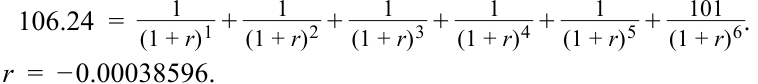
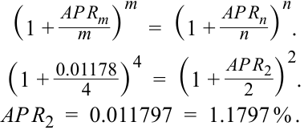
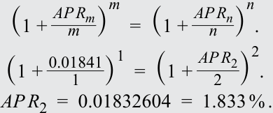
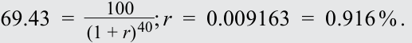
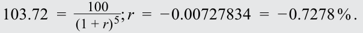
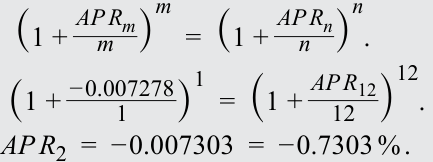
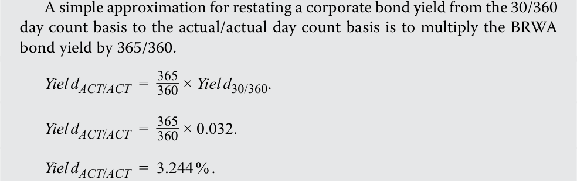
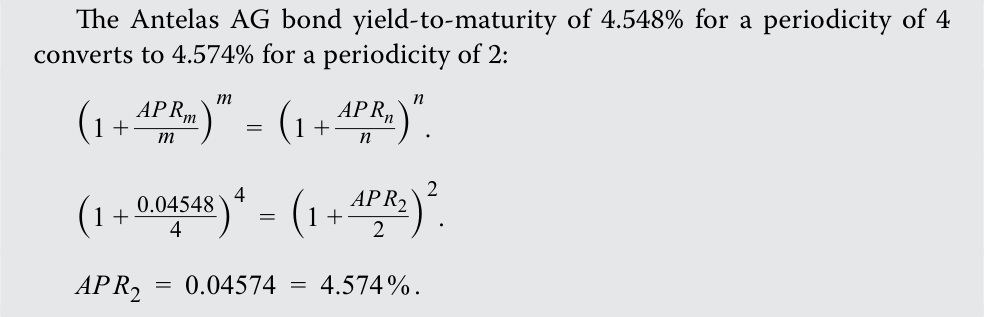
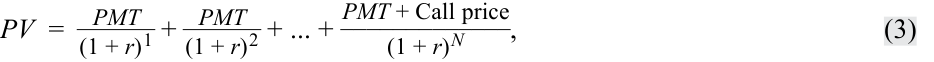

# Volume 6: Fixed Income
## Learning Module 7 Yield and Yield Spread Measures for Fixed-Rate Bonds
### Part 1/2: Introduction (PDF Pages 167–182)

---

<!-- PDF Page 167 -->

#### L E A R N I N G M O D U L E 

# **<mark>7</mark>** 

### **Yield and Yield Spread Measures for Fixed-Rate Bonds** 

###### **<mark>LEARNING OUTCOMES</mark>** 

**_Mastery The candidate should be able to:_** calculate annual yield on a bond for varying compounding periods in a year compare, calculate, and interpret yield and yield spread measures for fixed-rate bonds 

##### **INTRODUCTION** 

**<mark>1</mark>** 

Earlier lessons demonstrated the relationship between bond prices and yields-to-maturity (YTMs), as well as other features, such as coupon rate and time-to-maturity. Two important considerations for interpreting and determining yields-to-maturity and other yield measures are the assumed frequency of compounding interest and the presence of embedded options that could affect cash flow amounts or timing. This module explores these considerations and extends the analysis of yields by introducing spread measures, which compare yields to benchmark rates to ascertain how much an investor would be compensated for taking certain risks. 

Most of the examples and exhibits used throughout the reading can be downloaded as a Microsoft Excel workbook. Each worksheet in the workbook is labeled with the corresponding example or exhibit number in the text. 

###### **LEARNING MODULE OVERVIEW** 

- Yields-to-maturity allow analysts to use a single measure to compare bonds with varying maturities and coupons. An important factor in yield determination and interpretation is the frequency of compounding, known as periodicity. 

- All else equal, more frequent compounding results in greater future values or returns. Therefore, compounding more frequently at a lower rate can be equivalent to compounding less frequently at a higher rate; the more frequent compounding makes up for the lower rate. 

<!-- PDF Page 168 -->

- Prices and yields of bonds with embedded options require adjustments to reflect the value of the option. The option-adjusted yield spread and yield-to-worst are measures that reflect option values. 

- Yield measures for a bond, as well as changes in them, can be decomposed into a benchmark rate and a spread over the benchmark rate. Benchmark rates reflect macroeconomic, “top-down” conditions that affect all bonds in a market, while spreads capture issuer-specific, “bottom-up” factors, such as credit risk, liquidity, and taxation. 

- Similar to how a yield curve graphically depicts the relationship between yields-to-maturity and times-to-maturity for securities with the same risk profile, benchmark rates and spreads can be graphed by time-to-maturity as well, to show the term structure of credit spreads. 

###### **LEARNING MODULE SELF-ASSESSMENT** 

These initial questions are intended to help you gauge your current level of understanding of the learning module. 

1. Complete the sentences by filling in the blanks using the following words: 

   - annualized 

compounded 

standardized 

Both capital market securities’ yields and money market rates with maturity dates shorter than one year are _________________. However, money market rates are not ________________. 

###### **Solution:** 

Both capital market securities’ yields and money market rates with maturity dates shorter than one year are annualized. However, money market rates are not compounded. 

2. A three-year sovereign non-callable bond is priced at 106.24 per 100. The bond pays a 2% semiannual coupon. The annual yield-to-maturity for the bond is closest to: 

   - **A.** 0.077%. 

   - **B.** 0.039%. 

**C.** 1.883%. 

###### **Solution:** 

A is correct. Given that the bond pays coupons semiannually, the semiannual yield-to-maturity is calculated by solving for _r_ in the following equation. Additionally, the IRR or YIELD functions in Microsoft Excel and Google Sheets can be used. 

<!-- PDF Page 169 -->

<!-- Formula Text: 106.24  = 1 _ (1 + r) 1  + 1 _ (1 + r) 2  + 1 _ (1 + r) 3  + 1 _ (1 + r) 4  + 1 _ (1 + r) 5  +   101 _ (1 + r) 6 . r  =  − 0.00038596. -->

Given that the yield is expressed in semiannual terms, it needs to be annualized by multiplying by 2, which results in –0.000772, or –0.077%. 

B is incorrect because it is the semiannual, not annual, yield. 

C is incorrect because 1.883% is the bond’s current yield, not yield-to-maturity. 

3. A fixed-income analyst obtains the following data for three corporate bonds with the same maturity dates. The relevant government bond benchmark rate, calculated on a semiannual bond equivalent basis, is 1.10%. Calculate the G-spread for each bond. 

||**Bond A**|**Bond B**|**Bond C**|
|---|---|---|---|
|Yield-to-maturity|1.271%|1.213%|1.178%|
|Coupon frequency and assumedperiodicity|Annual|Semiannual|Quarterly|

###### **Solution:** 

The G-spread for Bond B is (0.01213 – 0.011) = 11.3 bps. 

Before computing the G-spreads for Bonds A and C, the yields-to-maturity must first be converted to a periodicity of two. The semiannual equivalent yield for Bond A is 1.267%: 

<!-- Formula Text: (1 + AP R m _ m  ) m =  (1 + AP R n _ n  ) n . (1 +  0.01271 _ 1 ) 1 =  (1 + AP R 2 _ 2  ) 2 . AP R 2  =  0.01267  =  1.267 % . -->

Thus, its G-spread is (0.01267 – 0.011) = 167 bps. The semiannual equivalent yield for Bond C is 1.1797%: 

<!-- Formula Text: (1 + AP R m _ m  ) m =  (1 + AP R n _ n  ) n . (1 +  0.01178 _ 4 ) 4 =  (1 + AP R 2 _ 2  ) 2 . AP R 2  =  0.011797  =  1.1797 % . -->

Thus, its G-spread is (0.011797 – 0.011) = 8 bps. 

4. If a bond has an embedded call option and the value of the call option is positive, the option-adjusted price, compared to the flat price of the bond, is most likely: 

**A.** lower. 

**B.** the same. 

**C.** higher. 

###### **Solution:** 

A is correct. The value of the call option is the price of the option-free bond minus the price of the callable bond. If the value of the call option is posi- 

<!-- PDF Page 170 -->

tive, then the option-adjusted price is lower compared to the flat price of the bond. 

B is incorrect because if the value of the call option is positive, the option-adjusted price compared to the flat price of the bond is lower, not the same. 

C is incorrect because if the value of the call option is positive, the option-adjusted price compared to the flat price of the bond is lower, not higher. 

## **<mark>2</mark>** 

##### **PERIODICITY AND ANNUALIZED YIELDS** 

calculate annual yield on a bond for varying compounding periods in a year 

Investors analyzing bonds with various cash flow and maturity profiles seek a _standardized_ yield measure to compare across different choices. Yield measures are usually _annualized_ in order to allow a direct comparison. For capital market securities maturing in more than one year, investors want an _annualized_ and _compounded_ yield-to-maturity. Conventions for instruments maturing in one year or less will be covered in a later lesson. 

An annualized and compounded yield on a fixed-rate bond depends on the assumed number of interest periods in the year, which is called the **periodicity** of the annual rate. The periodicity typically matches the frequency of coupon payments. For example, the fixed-coupon five-year bond issued by Bright Wheels Automotive (BRWA) from earlier lessons pays semiannual coupons with a stated annual yield-to-maturity of 3.2% for a periodicity of 2—the rate per semiannual period (1.6%) times 2. A bond that pays quarterly coupons has a stated annual yield for a periodicity of 4—the rate per quarter times 4. 

Exhibit 1 shows how a 5% stated annual yield-to-maturity generates different amounts in one year with annual, semiannual, quarterly, monthly compounding based on a fixed-rate par bond priced at 100. 

<!-- PDF Page 171 -->

###### **Exhibit 1: Effective Annual Rate for Different Compounding Periods** 

<!-- Start of picture text -->
Time t = 0 t = 1 Periodicity Bond interest at year end (Rate per Period) (Price = 100) Annual 5.00 (5.00%) Semi-annual 5.0625 (2.50%) Quarterly 5.0945 (1.25%) Monthly 5.1162 (0.4167%) <!-- End of picture text -->

The bond interest amounts on the right-hand side of Exhibit 1 expressed as percentages are known as effective annual rates. An **effective annual rate** has a periodicity of 1 because there is just one compounding period in the year. For example, for a quarterly coupon bond that pays 1.25% per period, or an annual coupon rate of (1.25% × 4) = 5%, each coupon received is assumed to be reinvested at the periodic rate—here, 1.25%—for the remainder of the year. We can solve for the future value of these cash flows using the Excel or Google Sheets FV function: 

~~=FV(rate, nper, pmt, [pv], [type]),~~ 

where 

_rate_ is the periodic reinvestment rate 

_nper_ is the number of periods in a year 

_pmt_ is the rate per period 

[ _pv_ ] is the present value 

[ _type_ ] indicates when payments occur, with 0 designating payment at the end of each period 

For the quarterly coupon bond: 

=FV(0.0125,4,1.25,0,0) = 5.0945. 

Therefore, assuming each coupon is reinvested at 1.25% through the end of the year, a quarterly coupon bond with an annual stated rate of 5% generates the same interest as an annual coupon bond with a stated rate of 5.0945%. The Excel or Google Sheets EFFECT function may also be used to calculate the effective annual rate for a given number of compounding periods per year. 

The most common periodicity in the United States, the United Kingdom, and several other fixed-income markets is 2 because most bonds in these jurisdictions make semiannual coupon payments. An annual rate having a periodicity of two is known as a **semiannual bond basis yield** , or **semiannual bond equivalent yield** . Therefore, a semiannual bond basis yield is the yield per semiannual period times 2. It is important to remember that “semiannual bond basis yield” and “yield per semiannual period” have different meanings. For example, if a bond yield is 2% per semiannual period, its annual yield is 4% when stated on a semiannual bond basis. 

<!-- PDF Page 172 -->

###### **EXAMPLE 1** 

###### **Periodicity of Zero-Coupon Bonds** 

The periodicity of the annual market discount rate for a zero-coupon bond is arbitrary because there are no coupon payments. Consider a five-year, zero-coupon bond priced at 80 per 100 of par value. Assuming annual compounding, or a periodicity of one, the yield-to-maturity is 4.564%. 

<!-- Formula Text: 80  =    100 _ (1 + r) 5 ; r  =  0.045640;4.564% -->

Assuming quarterly compounding, or a periodicity of four, the annual yield-to-maturity for this same five-year, zero-coupon bond is 4.488%. 

<!-- Formula Text: 80  =    100 _ (1 + r) 20 ; r  =  0.011220; × 4  =  0.044880. -->

As shown in Exhibit 2, 2.2565% compounded 2 times a year, 1.1220% compounded 4 times a year, and 0.3726% compounded 12 times a year are all equivalent to an effective annual rate of 4.564%. 

###### **Exhibit 2: Periodicity of Annual Discount Rate for Zero-Coupon Bond** 

|**_Column 1_**|**_Column 2_**|**_Column 3:_** **_(Col. 2_ ×****_5)_**|**_Column 4_**|**_Column 5:_** **_(Col. 2 × Col. 4)_**|**_Column 6:_** **_(1+Col. 4)^_****_(Col. 2)_**|
|---|---|---|---|---|---|
|**Periodicity**|**Number of Peri-** **ods/ Year**|**Number of Com-** **pounding Periods**|**Periodic** **Yield-to-** **Maturity (%)**|**Annual Yield- to-Ma-** **turity (%)**|**Periodic YTM Com-** **pounded at Periods/** **Year (%)**|
|Annual|1|5|0.045640|0.045640|0.045640|
|Semi-annual|2|10|0.022565|0.045130|0.045640|
|Quarterly|4|20|0.011220|0.044879|0.045640|
|Monthly|12|60|0.003726|0.044712|0.045640|

The compounded total return is the same for each expression for the annual rate. They differ in terms of the number of compounding periods per year—that is, in terms of the _periodicity_ of the annual rate. For a given pair of cash flows, the stated annual rate and the periodicity are inversely related. 

An important tool in fixed-income analysis is the conversion of an annualized yield using one periodicity to another periodicity. These are called periodicity, or compounding, conversions. Equation 1 shows a general formula to convert an annual percentage rate (APR) for _m_ periods per year, denoted _APRm_ , to an annual percentage rate for _n_ periods per year, _APRn_ : 

<!-- Formula Text: (1 + AP R m _ m  ) m =  (1 + AP R n _ n  ) n . (1) -->

For example, suppose that a three-year, 5% semiannual coupon payment corporate bond is priced at 104 per 100 of par value. Its yield-to-maturity is 3.582%, quoted on a semiannual bond basis for a periodicity of 2: 0.01791 × 2 = 0.03582. 

<!-- Formula Text: 104  =    2.5 _ (1 + r) 1  +   2.5 _ (1 + r) 2  +   2.5 _ (1 + r) 3  +   2.5 _ (1 + r) 4  +   2.5 _ (1 + r) 5  +   102.5 _ (1 + r) 6 ; r  =  0.01791. -->

To compare this bond with others, an analyst converts this annualized yield-to-maturity to quarterly and monthly compounding. Doing so entails using Equation 1 to convert from a periodicity of _m_ = 2 to periodicities of _n_ = 4 and _n_ = 12. 

<!-- PDF Page 173 -->

<!-- Formula Text: (1 +  0.03582 _ 2 ) 2 =  (1 + AP R 4 _ 4  ) 4 ; AP R 4  =  0.03566. (1 +  0.03582 _ 2 ) 2 =  (1 + AP R 12 _ 12  ) 12 ; AP R 12  =  0.03556. -->

An annual yield-to-maturity of 3.582% for semiannual compounding provides the same rate of return as annual yields of 3.566% and 3.556% for quarterly and monthly compounding, respectively. A general rule for periodicity conversions is _compounding more frequently at a lower annual rate corresponds to compounding less frequently at a higher annual rate_ . This rule can be used to check periodicity conversion calculations. 

###### **EXAMPLE 2** 

###### **Comparing Strip Bonds to Coupon Bonds** 

Financial intermediaries can own coupon bonds and then issue individual zero-coupon bonds composed of coupon or principal payments from the coupon bonds. These zero-coupon bonds are known as strip bonds. Strip bonds are attractive to investors seeking to match known cash flows on a specific future date. 

A 20-year government of Canada strip (zero-coupon) bond is priced at 69.4300 per 100. An analyst wants to compare the yield of the strip bond with that of a newly issued 20-year coupon bond. Both the strip bond and the coupon bond are non-callable. The 20-year coupon bond pays semiannual coupons of 2%, and its current price is 101.99 per 100, which corresponds to a semiannual bond equivalent yield of 1.880%. 

The analyst will compute a semiannual bond equivalent yield for the strip bond and compare it to the semiannual bond equivalent yield of 1.880% of the 20-year coupon bond. 

There are two approaches. The first involves calculating a yield-to-maturity assuming annual compounding for the strip bond and converting it to a semiannual equivalent bond yield. The second approach involves directly computing a semiannual yield-to-maturity for the strip bond and annualizing it by multiplying it by 2. 

###### **Approach 1** 

The 20-year strip bond does not pay any coupons, so as the first step, we assume annual compounding (periodicity of 1) to calculate an effective annual rate based on the current price and remaining years to maturity. 

<!-- Formula Text: 69.43  =    100 _ (1 + r) 20 ; r  =  0.01840997  =  1.841 % . -->

The next step is to convert the effective annual rate to semiannual bond equivalent yield. This is done by using Equation 1 to convert from a periodicity of 1 to a periodicity of 2. 

<!-- Formula Text: (1 + AP R m _ m  ) m =  (1 + AP R n _ n  ) n . (1 +  0.01841 _ 1 ) 1 =  (1 + AP R 2 _ 2  ) 2 . AP R 2  =  0.01832604  =  1.833 % . -->

<!-- PDF Page 174 -->

###### **Approach 2** 

Alternatively, we can assume that compounding happens semiannually (periodicity of two) and the effective rate calculated would be semiannual. 

<!-- Formula Text: 69.43  =    100 _ (1 + r) 40 ; r  =  0.009163  =  0.916 % . -->

To annualize this, we multiply it by 2 and obtain the same result as the first approach: 1.833%. 

###### **EXAMPLE 3** 

###### **Periodicity Conversion with Negative Yields** 

Assume the German government issues a five-year zero-coupon bond at a price of 103.72. Calculate the effective annual rate of the bond at issuance assuming annual, semiannual, and monthly compounding. 

###### **Solution:** 

First, we can calculate the German bond’s yield-to-maturity as an effective annual rate assuming the periodicity of 1. 

<!-- Formula Text: 103.72  =    100 _ (1 + r) 5 ; r  =  − 0.00727834  =  − 0.7278 % . -->

Converting that yield to semiannual and monthly compounding requires using Equation 1 to convert to from a periodicity of 1 to periodicities of 2 and 12, respectively. 

Conversion of an annual yield ( _m_ = 1) to semiannual ( _n_ = 2): 

<!-- Formula Text: (1 + AP R m _ m  ) m =  (1 + AP R n _ n  ) n . (1 +  − 0.007278 _ 1 ) 1 =  (1 + AP R 2 _ 2  ) 2 . AP R 2  =  − 0.007291  =  − 0.7291 % . -->

Conversion of an annual yield ( _m_ = 1) to monthly ( _n_ = 12): 

<!-- Formula Text: (1 + AP R m _ m  ) m =  (1 + AP R n _ n  ) n . (1 +  − 0.007278 _ 1 ) 1 =  (1 + AP R 12 _ 12  ) 12 . AP R 2  =  − 0.007303  =  − 0.7303 % . -->

_Note_ : Quantities in the calculation are not rounded, though they are shown with three decimal places for presentation purposes. Solutions are rounded to three decimal places. 

###### **QUESTION SET** 

1. A bond has a yield-to-maturity of –0.50% using annual compounding. If the yield is converted to monthly compounding, it will _most likely_ be: 

   - **A.** greater than –0.50%. 

   - **B.** equal to –0.50%. 

<!-- PDF Page 175 -->

**C.** less than –0.50%. **Solution:** 

C is correct. A general rule for periodicity conversions is compounding more frequently within the year corresponds to a lower (or more negative) yield-to-maturity. 

2. Convert a yield of 1.736% compounded monthly to an effective annual rate. **Solution:** 

<!-- Formula Text: The effective annual rate assumes only one compounding period in a year (periodicity of 1). Converting from monthly to annual compounding re- quires converting from a periodicity of 12 to 1: (1 + AP R m _ m  ) m =  (1 + AP R n _ n  ) n . (1 +  0.01736 _ 12  ) 12 =  (1 + AP R 1 _ 1  ) 1 . AP R 1  =  0.0175  =  1.75 % . -->

3. When calculating yield-to-maturity for a strip (zero-coupon) bond, the periodicity must be 1. 

Justify your answer. 

**A.** True **B.** False 

###### **Solution** 

False. The periodicity of the annual market discount rate for a zero-coupon bond is arbitrary because there are no coupon payments. For example, a yield calculated using quarterly periodicity (4) can simply be converted to a yield with annual periodicity (1). 

##### **OTHER YIELD MEASURES, CONVENTIONS, AND ACCOUNTING FOR EMBEDDED OPTIONS** 

## **<mark>3</mark>** 

compare, calculate, and interpret yield and yield spread measures for fixed-rate bonds 

###### **Other Yield Measures and Conventions** 

The current yield, a simple measure equal to a bond’s annual coupon divided by the flat price, was introduced in an earlier lesson. For example, if the BRWA 3.2% semiannual fixed-coupon five-year bond introduced earlier were trading at a price of 98.7 per $100 in face value at time _t_ , its current yield would be 

_CYt_ = Annual coupon _t_ /Bond price _t_ ~~(2)~~ = 3.2%/0.987 = 3.242%. 

<!-- PDF Page 176 -->

The current yield is a crude measure of return because it focuses solely on interest income, ignoring the frequency of coupon payments, interest on interest (time value of money), and accrued interest. In addition to collecting and reinvesting coupon payments, the investor has a gain if the bond is purchased at a discount and is redeemed at par value. The investor has a loss if the bond is purchased at a premium and is redeemed at par value. 

In practice, the actual timing of cash flows is important for quoting and calculating bond yields-to-maturity. Consider from earlier the 30-year 4.625% annual coupon Romania eurobond maturing on 3 April 2049. Suppose that for settlement on 3 April 2026, the bond is priced at 97.3684 per 100 of par value to yield 4.75% quoted on an annual, actual/actual basis. Its coupon payment is scheduled for 3 April of each year. The yield calculation implicitly assumes that the payments are made on those exact dates. This calculation ignores the fact that several of those dates are not business days. For example, both 3 April 2027 and 3 April 2032 are Saturdays, so investors will receive coupon payments on the following Mondays, 5 April 2027 and 2032, respectively. 

Yield measures that assume payments are made on scheduled dates and that do not account for weekends and holidays are quoted on what is called **street convention** . This assumption simplifies bond price and yield calculations and commonly is used in practice. A **true yield** that uses the actual payment dates (e.g., 5 April 2027 and 2032 in the Romania bond example), accounting for weekends and holidays, can also be computed. The true yield is never higher than the street convention yield because weekends and holidays delay the time to payment. The difference is typically small, no more than a basis point or two. Therefore, the true yield is not commonly used in practice. 

Recall that corporate bond yields typically use the 30/360 day count convention. Sometimes, these yields are restated using an actual/actual day count, known as a **government equivalent yield** . The government equivalent yield on a corporate bond can be used to obtain the spread (difference) over a government bond yield. 

###### **EXAMPLE 4** 

###### **Government Equivalent Yield for BRWA Five-Year Bond** 

In an earlier example, BRWA issued a 3.2% semiannual fixed-coupon five-year bond at par. As is standard for corporate bonds, the BRWA bond yield is calculated on a 30/360 day count basis. The comparable five-year US Treasury bond yields 2.3%, but as a government bond, the yield is calculated using the actual/ actual day count basis. While the yield difference appears to be 90 bps (= 3.2% – 2.3%), the day count bases differ. 

Calculate the government equivalent yield for the BRWA bond and show the yield difference between the BRWA and government bonds based on the same day count basis. 

**Solution:** 

<!-- Formula Text: A simple approximation for restating a corporate bond yield from the 30/360 day count basis to the actual/actual day count basis is to multiply the BRWA bond yield by 365/360. Yiel d ACT/ACT  =   365 _ 360  × Yiel d 30/360. Yiel d ACT/ACT  =   365 _ 360  × 0.032. Yiel d ACT/ACT  =  3.244 % . -->

<!-- PDF Page 177 -->

The bond equivalent yield for the BRWA bond is 3.2444%; hence, the yield-to-maturity difference between two bonds is 94.4 bps (= 3.2444% – 2.3%). 

Sometimes the **simple yield** on a bond is quoted. It is the sum of the coupon payments plus the straight-line amortized share of the gain or loss, divided by the flat price. Simple yields are used mostly to quote Japanese government bonds, known as JGBs. 

**Exhibit 3: Summary of Yield Conventions** 

|**Convention**|**Meaning**|
|---|---|
|**Actual/Actual**|Actual number of days from prior coupon payment to settlement|
|**(Act/Act)**|date/number of days in a coupon period, assuming the actual num- ber of days in a year. Typically used with government bonds.|
|**30/360**|Number of days from prior coupon payment to settlement date, assuming 30 days in a month/number of days in a coupon period, assuming 360 days in a year. Typically used with corporate bonds.|
|**Street Convention**|Yield measure that does not account for weekends and bank holidays and thus assumes cash flows are paid on their scheduled dates.|
|**True Yield**|Yield measure that accounts for weekends and bank holidays and thus assumes cash flows are paid after their scheduled dates. True yield is never higher than street convention yield due to the delay in time to payment.|
|**Government** **Equivalent Yield**|Yield measure that restates a yield-to-maturity based on a 30/360 day count to one based on an actual/actual day count. It is used to restate the YTM on a corporate bond to obtain the spread over the government YTM.|
|**Simple Yield**|Yield measure that is the sum of coupon payments plus the straight-line amortized share of the gain or loss, divided by the flat price. It is used mostly to quote Japanese government bonds (JGBs).|

###### **EXAMPLE 5** 

###### **Comparing Yields for Different Periodicities** 

An analyst observes the following reported statistics for two bonds. 

||**Antelas AG Bond**|**BRWA** **Bond**|
|---|---|---|
|Annual Coupon Rate|3.20%|2.50%|
|Coupon Payment Frequency|Quarterly|Semiannually|
|Years to Maturity|5 Years|5 Years|
|Price (per 100 of par value)|94|98.70|
|Current Yield|3.40%|2.53%|
|Yield-to-Maturity|4.548%|2.780%|

**1.** Confirm the calculation of the current yield and yield-to-maturity for the two bonds. 

<!-- PDF Page 178 -->

**2.** The analyst believes that the BRWA bond has less risk than the Antelas AG bond. How much additional compensation, in terms of basis points of yield-to-maturity, does a buyer of the Antelas AG bond receive for bearing this risk compared with the BRWA bond? 

**Solution to 1:** 

Recall that the current yield is the annual coupon expressed as a percentage of a bond’s flat price. ___________Annual coupon Current yield = Flat price. Current yield for Antelas AG bond:_CY_= _3.20 94. _CY_ = 0.0340 = 3.40 % . Current yield for BRWA bond:_CY_= _98.702.50. _CY_ = 0.0253 = 2.53 % . 

Recall that the yield-to-maturity is an internal rate of return, the discount rate _r_ that equates the price of a bond to the present value of future cash flows. 

_PV_ = _PMT_ 1/(1 + _r_ )1 + _PMT_ 2/(1 + _r_ )2 + … + ( _PMTN_ + _FVN_ )/(1 + _r_ )_N_ . 

The yield-to-maturity can also be calculated using the YIELD and IRR functions in Microsoft Excel or Google Sheets. 

|**Antelas AG Bond**||**BRWA Bond**||
|---|---|---|---|
|Settlement date|1/1/2000|Settlement date|1/1/2000|
|Maturity date|1/1/2005|Maturity date|1/1/2005|
|Coupon|0.032|Coupon|0.025|
|Price|94|Price|98.7|
|Redemption|100|Redemption|100|
|Coupon frequency|4|Coupon frequency|2|
|**YIELD**|**4.548%**|**YIELD**|**2.780%**|

###### **Solution to 2:** 

The yields-to-maturity on the two bonds have different periodicity assumptions. Therefore, the difference in the yields is _not_ 177 bps (0.04548 – 0.02780). It is essential to compare the yields for the same periodicity to make a statement about relative value. 

<!-- Formula Text: The Antelas AG bond yield-to-maturity of 4.548% for a periodicity of 4 converts to 4.574% for a periodicity of 2: (1 + AP R m _ m  ) m =  (1 + AP R n _ n  ) n . (1 +  0.04548 _ 4 ) 4 =  (1 + AP R 2 _ 2  ) 2 . AP R 2  =  0.04574  =  4.574 % . -->

When the yields-to-maturity for the Antelas AG and BRWA bonds are stated on a common periodicity, the additional yield that the buyer of the Antelas AG bond receives to compensate for its higher risk, compared to the BRWA bond, is (0.04574 – 0.02780) =179 bps. 

<!-- PDF Page 179 -->

###### **Bonds with Embedded Options** 

If a fixed-rate bond contains an embedded option, other yield measures are used. Recall from an earlier lesson that these bond contingency provisions cannot be removed and traded separately from the bond. For example, a callable bond gives the issuer the right to buy the bond back from the investor. This occurs at specific prices on pre-determined dates after a call protection period during which the issuer is not allowed to exercise the call option. 

For example, an earlier lesson on callable bonds introduced Vivivyu Inc. (VIVU) seven-year callable notes (see Exhibit 4). 

**Exhibit 4: 6.5% VIVU Seven-Year Callable Notes Term Sheet** 

|**6.5% Vivivy**|**u Inc. (VIVU) Seven-Year Callable Notes (The “Notes”)**|
|---|---|
||**Prospectus Summary**|
|Issuer:|Vivivyu Incorporated|
|Settlement Date:|[T + 3 Business Days]|
|Maturity Date:|[Seven Years from Settlement Date]|
|Principal Amount:|US$ 400 million|
|Interest:|6.5% fixed coupon|
|Interest Payment:|i Starting six months from [Settlement] to be paid semiannu- ally with final payment on [Maturity]|
|Seniority:|i The Notes are secured and unsubordinated obligations of VIVU and rank_pari passu_with all other secured and unsub- ordinated debt|
|Call Provision:|The Issuer may redeem some or all of the Notes on any Business Day before [Maturity] starting three years after [Settlement] based upon the Call Price Schedule as a percent- age of the Principal Amount plus accrued interest|
|Call Price Schedule:|103.25% [Three to Four Years after Settlement] 102.50% [Four to Five Years after Settlement] 101.75% [Five to Six Years after Settlement]|
||101.00% [Six to Seven Years after Settlement]|

The VIVU bond may not be called for the first three years, but the following year it may be called at a price of $103.25 per $100 in face value. VIVU has the right to call the bond for the final four years based on a fixed price schedule. Investors facing call risk starting in Year 3 often estimate the lowest possible yield earned by calculating the sequence of yields corresponding to the bond’s call dates. 

Traditional yield-to-maturity measures assume that all cash flows occur as promised and therefore must be modified for callable bonds. Analysts must use alternative return measures that take the bond’s call feature into account, such as the yield to the first call date, the second call date, and so on. The **yield-to-call** is calculated by modifying the general formula for calculating yield-to-maturity. 

<!-- Formula Text: PV  =    PMT _ (1 + r) 1  +   PMT _ (1 + r) 2  + ... + PMT + Call price _____________ (1 + r) N , (3) -->

<!-- PDF Page 180 -->

where 

_PV_ = the price of the bond 

_PMT_ = coupon payment per period 

Call price = price at which a bond can be called on a given date 

- _r_ = yield per period or market discount rate 

- _N_ = number of evenly spaced periods to the date when a bond can be called at the call price 

###### **EXAMPLE 6** 

###### **Yields-to-Call for the VIVU Bond** 

Assuming the call price schedule for the VIVU bond, the calculation of yields-tofirst, -second, -third, -fourth, and -worst call and yield-to-maturity are as follows: Yield-to-first call: 106.50 =  _ (1 +3.25 _r_ )1+ _ (1 +3.25 _r_ )2+ _ (1 +3.25 _r_ )3+ _ (1 +3.25 _r_ )4+ _ (1 +3.25 _r_ )5+ <mark>_</mark>103.25 + 3.25 (1 + _r_ )6 . _r_ = 0.025748 × 2 = 0.0515. Alternatively, the YIELD function in Microsoft Excel or Google Sheets can be used. Yield-to-second call: _ _ _ _ _ _ 106.50 =   (1 +3.25 _r_ )1+ (1 +3.25 _r_ )2+ (1 +3.25 _r_ )3+ (1 +3.25 _r_ )4+ (1 +3.25 _r_ )5+ (1 +3.25 _r_ )6 __102.50 + 3.25 +  (1 +3.25 _r_ )7 (1 + _r_ )8 . _r_ = 0.026237 × 2 = 0.0525. Yield-to-third call: _ _ _ _ _ _ 106.50 =   (1 +3.25 _r_ )1+ (1 +3.25 _r_ )2+ (1 +3.25 _r_ )3+ (1 +3.25 _r_ )4+ (1 +3.25 _r_ )5+ (1 +3.25 _r_ )6 _ _ _ _ +  (1 +3.25 _r_ )7+ (1 +3.25 _r_ )8+ (1 +3.25 _r_ )9+  101.75 + 3.25 (1 + _r_ )10 . _r_ = 0.02653 × 2 = 0.0531. Yield-to-fourth call: _ _ _ _ _ _ 106.50 =   (1 +3.25 _r_ )1+ (1 +3.25 _r_ )2+ (1 +3.25 _r_ )3+ (1 +3.25 _r_ )4+ (1 +3.25 _r_ )5+ (1 +3.25 _r_ )6 _ _ _ _ _ _ +  (1 +3.25 _r_ )7+ (1 +3.25 _r_ )8+ (1 +3.25 _r_ )9+ (1 +3.25 _r_ )10+ (1 +3.25 _r_ )11+  101.00 + 3.25 (1 + _r_ )12 . _r_ = 0.026811 × 2 = 0.0536. And finally, the yield-to-maturity assuming the bond is not called: _ _ _ _ _ _ 106.50 =   (1 +3.25 _r_ )1+ (1 +3.25 _r_ )2+ (1 +3.25 _r_ )3+ (1 +3.25 _r_ )4+ (1 +3.25 _r_ )5+ (1 +3.25 _r_ )6 _ _ _ _ _ _ +  (1 +3.25 _r_ )7+ (1 +3.25 _r_ )8+ (1 +3.25 _r_ )9+ (1 +3.25 _r_ )10+ (1 +3.25 _r_ )11+ (1 +3.25 _r_ )12 + _3.25 _ (1 + _r_ )13+  100.00 + 3.25 (1 + _r_ )14 . 

Alternatively, the YIELD function in Microsoft Excel or Google Sheets can be used. 

<!-- PDF Page 181 -->

###### _r_ = 0.026868 × 2 = 0.0537. 

In summary, the yield measures for the VIVU bond are as follows: 

|Yield-to-first call|5.149%|
|---|---|
|i Yield-to-second call|5.247%|
|Yield-to-third call|5.313%|
|Yield-to-fourth call|5.362%|
|Yield-to-maturity|5.374%|

The lowest of the sequence of yields-to-call and the yield-to-maturity is known as the **yield-to-worst** . For the VIVU bond, it is the yield-to-first call of 5.15%. The intent of this measure is to provide to the investor the most conservative measure for the rate of return. 

The yield-to-worst is a commonly cited yield measure for fixed-rate callable bonds used by bond dealers and investors. However, a more precise approach is to use an option pricing model and an assumption about future interest rate volatility to value the embedded call option. The value of the embedded call option is added to the flat price of the bond to get the **option-adjusted price** . The investor bears the call risk (the bond issuer has the option to call), so the embedded call option reduces the value of the bond from the investor’s perspective. The investor pays a lower price for the callable bond than if it were option-free. If the bond were non-callable, its price would be higher. The option-adjusted price is used to calculate the **option-adjusted yield** . The option-adjusted yield is the required market discount rate whereby the price is adjusted for the value of the embedded option. The value of the call option is the price of the option-free bond minus the price of the callable bond. 

###### **QUESTION SET** 

1. Identify which of the following yield measures corresponds to the characteristics listed below. 

|**Yield Measure**|**Characteristic**|
|---|---|
|A. Simple Yield|1. Yield measure assuming one compounding period per year|
|B. Effective Annual Rate|2. Yield measure that restates a yield based on a 30/360 day count to one based on an actual/ actual day count|
|C. Street Convention Yield|3. Yield measure that is the sum of coupon pay- ments plus the straight-line amortized share of the gain or loss, divided by the flat price|
|D. Government Equivalent Yield|4. Assumes cash flows are paid on their sched- uled dates, without accounting for weekends and bank holidays|

**Solution:** 

<!-- PDF Page 182 -->

|**Yield Measure**|**Characteristic**|
|---|---|
|B. Effective Annual Rate|1. Yield measure assuming one compounding period in the year|
|D. Government Equivalent|2. Yield measure that restates a yield-to-maturity|
|Yield|based on a 30/360 day count to one based on an actual/actual day count|
|A. Simple Yield|3. Yield measure that is the sum of coupon pay- ments plus the straight-line amortized share of the gain or loss, divided by the flat price|
|C. Street Convention Yield|4. Assumes cash flows are paid on their sched- uled dates, without accounting for weekends and bank holidays|

2. An analyst calculated the following yields for a four-year callable bond. Determine the yield-to-worst. 

|**Yield Measure**|**Value**|
|---|---|
|Yield-to-first call|0.000%|
|Yield-to-second call|0.157%|
|Yield-to-third call|0.939%|
|Yield-to-maturity|–0.385%|

###### **Solution:** 

–0.3852%. The yield-to-worst is the lowest of the sequence of yields-to-call and the yield-to-maturity. The intent of yield-to-worst is to provide to the investor the most conservative assumption for the rate of return. 

Use the following information compiled by a fixed-income analyst for two bonds, on the day both were issued, to answer Questions 3 and 4. 

||**Corporate Bond**|**Sovereign Bond**|
|---|---|---|
|Annual coupon rate|4.00%|1.00%|
|Coupon frequency|Semiannual|Quarterly|
|Years to maturity|3 Years|3 Years|
|Price (per 100 of par)|91|102|
|Day-count basis|30/360|Actual/actual|
|Call price schedule:|101.25 1–2 Years after settlement|-|

3. The current yield of the sovereign bond is approximately: 

   - **A.** 140 bps _lower_ than the current yield of the corporate bond. 

   - **B.** 340 bps _lower_ than the current yield of the corporate bond. 

   - **C.** 140 bps _higher_ than the current yield of the corporate bond. 

   - **Solution:** 

B is correct. The current yield is the annual coupon expressed as a percentage of a bond’s price. The current yield of the corporate bond is 440 bps, while the current yield of the sovereign bond is 98 bps, 342 bps lower. 

