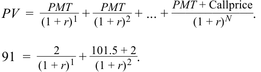
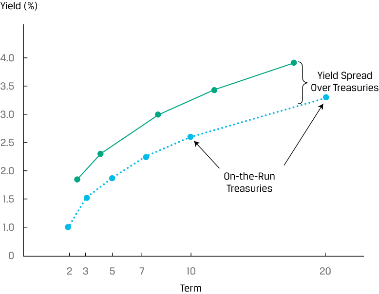
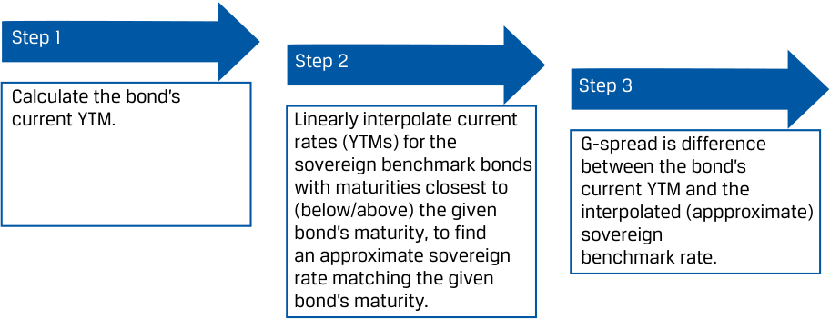
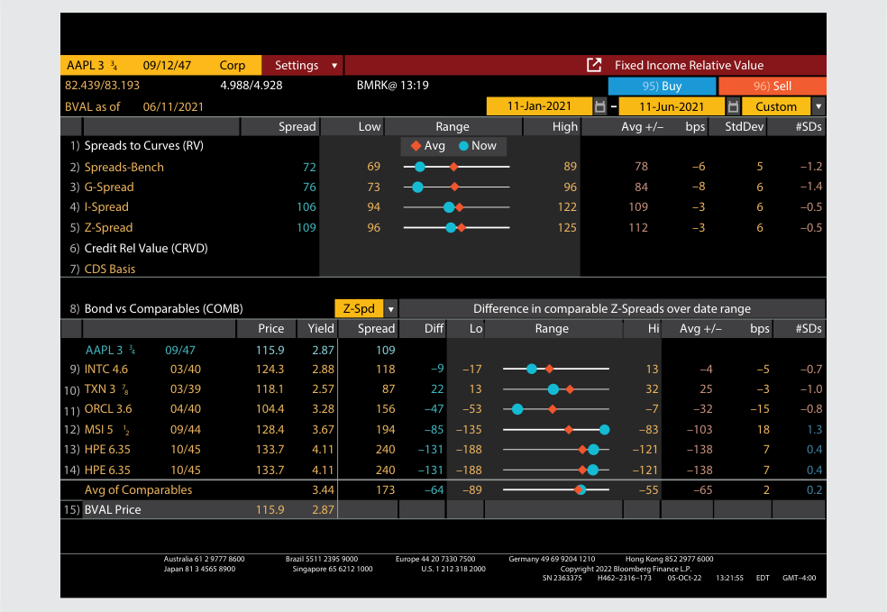
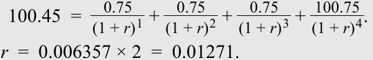
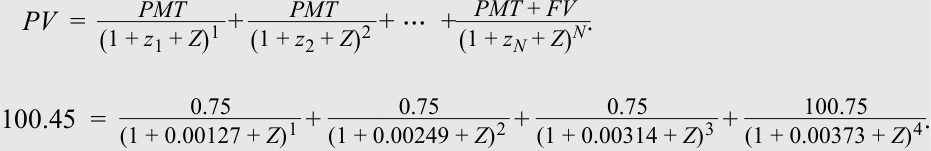
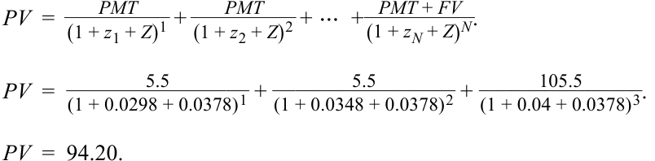
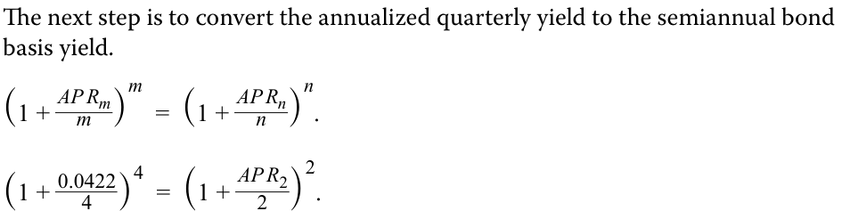
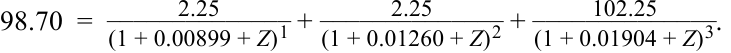
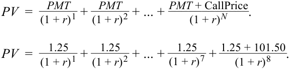

# Volume 6: Fixed Income
## Learning Module 7 Yield and Yield Spread Measures for Fixed-Rate Bonds
### Part 2/2: Yield Spread Measures for Fixed-Rate Bonds and Matrix Pricing (PDF Pages 183–196)

---

<!-- PDF Page 183 -->

4. The yield-to-first call of the corporate bond is closest to: **A.** 2.15%. **B.** 7.80%. **C.** 15.00%. **Solution:** 

C is correct. The yield-to-first call is the internal rate of return _r_ for a callable bond assuming it is called at its earliest scheduled call date for its call price. 

<!-- Formula Text: PV  =    PMT _ (1 + r) 1  +   PMT _ (1 + r) 2  + ... + PMT + Callprice ____________ (1 + r) N . 91  = 2 _ (1 + r) 1  +  101.5 + 2 _ (1 + r) 2 . -->

<!-- Formula Text: r  =  0.0762 × 2  =  0.1525. -->

The yield-to-first call for the bond is 15.25%. 

### **YIELD SPREAD MEASURES FOR FIXED-RATE BONDS AND MATRIX PRICING** 

# **<mark>4</mark>** 

compare, calculate, and interpret yield and yield spread measures for fixed-rate bonds 

#### **Yield Spreads over Benchmark Rates** 

In fixed-income security analysis, it is important to understand _why_ bond prices and yields-to-maturity change. To do this, it is useful to decompose a yield-to-maturity into a base rate or **benchmark** and an issuer-specific **spread** . For example, an earlier lesson introduced government benchmark bonds as the most liquid securities with the lowest default risk for a specific time-to-maturity in each market. The **yield spread** is the difference between the yield-to-maturity and the benchmark yield. 

These two components help investors distinguish between macroeconomic (top-down) and microeconomic (bottom-up) factors that affect the bond price and, therefore, its yield-to-maturity. The benchmark rate captures the top-down factors, while the spread captures the bottom-up factors, as shown in Exhibit 5. 

<!-- PDF Page 184 -->

**Exhibit 5: Yield-to-Maturity Components** 

<!-- Start of picture text -->
Taxation Spread Risk Premium Liquidity Credit Risk Expected Inflation Rate Benchmark “Risk-Free” Rate of Return Expected Real Rate <!-- End of picture text -->

The most used benchmark rate is the most recently issued government bond, known as an **on-the-run** security. The on-the-run government bond is the most actively traded security and has a coupon rate closest to the current market discount rate for that maturity. That implies that it is priced close to par value. Seasoned government bonds are called **off-the-run** . On-the-run bonds typically trade at slightly lower yields-to-maturity than off-the-run bonds with the same or similar times-to-maturity because of differences in demand for the securities and, sometimes, differences in the cost of financing the government security in the repo market. 

The yield spread over a specific benchmark is referred to as the **benchmark spread** and represents the risk premium for the credit and liquidity risks and possibly the tax impact of holding a specific bond. Exhibit 6 shows the relationship between yields-to-maturity for a specific issuer and a benchmark government yield curve. 

<!-- PDF Page 185 -->

**Exhibit 6: Issuer and Government Yield Curves** 

<!-- Start of picture text -->
Yield (%) 4.0 Yield Spread 3.5 Over Treasuries 3.0 2.5 2.0 On-the-Run Treasuries 1.5 1.0 0 2 3 5 7 10 20 Term <!-- End of picture text -->

Spreads allow an analyst to better assess a bond’s relative value on a historical and comparative basis by controlling for (excluding) macroeconomic factors, such as a broad increase or decrease in benchmark rates. An analyst might compare the current spread relative to its historical average and its past highs and lows and to other bonds to help identify whether a bond is under- or overpriced on a relative basis. 

The yield spread in basis points over an actual or interpolated government bond yield is known as the **G-spread** and represents the return for bearing risks relative to the sovereign bond. If there is no sovereign benchmark bond that matches the maturity of the bond, an approximation process for finding the G-spread must be used, as illustrated in Exhibit 7 and shown in the following example. 

##### **Exhibit 7: Finding G-Spreads When a Comparable Benchmark Bond Does Not Exist** 

<!-- Start of picture text -->
Step 1 Step 2 Step 3 Calculate the bond’s current YTM. Linearly interpolate current rates (YTMs) for the  G-spread is difference sovereign benchmark bonds  between the bond’s with maturities closest to  current YTM and the (below/above) the given interpolated (appproximate) bond’s maturity, to find sovereign an approximate sovereign  benchmark rate. rate matching the given bond’s maturity. <!-- End of picture text -->

<!-- PDF Page 186 -->

##### **EXAMPLE 7** 

#### **Calculating G-Spread without a Comparable Benchmark Bond** 

Assume that the Russian Federation has issued a 30-year US dollar–denominated sovereign bond based on the following terms: 

|**5** |**.25% Russian Federation Bonds** **Brief Summary of Terms** |
|---|---|
|Issuer:|Russian Federation|
|Settlement Date:|[T + 5 Business Days]|
|Maturity Date:|[30 Years from Settlement Date]|
|Principal Amount:|USD 750 million|
|Interest:|5.25% fixed semiannual 30/360 basis|
|Issuance Price:|99.625|
|Issuance Spread:|200 bp versus current US 30y Treasury|
|Issuance and Trading:|US Private Placement under Rule 144A DTC / Euroclear / Clearstream|
|Seniority:|Senior Unsecured|
|Exchanges:|Luxembourg|

Six years after the original issuance date, on 15 March 2026, the bond is trading at a price of 123.5 per 100 face value, and an analyst observes that 20-year and 30-year US Treasury yields are currently 2.00% and 2.25%, respectively. Calculate the current G-spread of the Russian Federation bond. 

- Step 1 Calculate the current yield-to-maturity of the Russian Federation bond. We may solve for _r_ using the general formula for bond price and yield: 

_PV_ = _PMT_ 1/(1 + _r_ )1 + _PMT_ 2/(1 + _r_ )2 + … + ( _PMTN_ + _FVN_ )/(1 + _r_ )_N_ . 

- Or we can use the Excel or Google Sheets YIELD function assuming a settlement date of 15 March 2026: 

=YIELD(DATE(2026,3,15),DATE(2050,3,15),5.25%,123.5,100,2,0) 

= 3.756%. 

- Step 2 Linearly interpolate the current 20-year ( _r_ 20 _y_ ) and 30-year ( _r_ 30 _y_ ) US Treasury yields to solve for an approximate 24-year ( _r_ 24 _y_ ) US Treasury benchmark: 

   **1.** Solve for the weights of the 20-year and the 30-year bonds in the interpolation calculation: 

20-year bond weight = _w_ 20 = 60% [= (30 – 24)/(30 – 20)]. 30-year bond weight = _w_ 30 = 40%, or (1 – _w_ 20). 

- Note that ( _w_ 20 × 20) + ( _w_ 30 × 30) = 24. 

- **2.** The 24-year government rate is a weighted average of the 20-year bond rate and the 30-year US Treasury rate using the weights above. 

_r_ 24 _y_ = _w_ 20 × _r_ 20 _y_ + _w_ 30 × _r_ 30 _y_ 

<!-- PDF Page 187 -->

= (60% × 2.00%) + (40% × 2.25%) = 2.10%. Step 3 The G-spread is the difference between the current Russian Federation bond yield-to-maturity and the 24-year US government rate: 1.656% = 3.756% – 2.10%, so the G-spread is 166 bps. 

The yield spread for a bond over the standard swap rate in that currency of the same tenor is known as the **I-spread** or interpolated spread. This type of spread is a comparison against a short-term market-based reference rate and is common practice for pricing and quoting euro-denominated corporate bonds, using a euro interest rate swap as the benchmark. For example, the five-year zero-coupon euro bond issued by the Chinese government at a negative yield-to-maturity from a prior lesson was priced at a rate of “mid-swaps plus 30 bps,” where “mid-swaps” is the average of the bid and offered swap rates. 

Issuers will use the I-spread to determine the relative cost of fixed-rate bonds versus floating-rate alternatives, such as a bank loan or commercial paper, while investors use it as a measure of a bond’s credit risk. Whereas a standard interest rate swap involves an exchange of fixed for floating cash flows based on a floating index, an asset swap converts the periodic fixed coupon of a specific bond to a market reference rate (MRR) plus or minus a spread. If the bond is priced close to par, this conversion approximates the price of a bond’s credit risk over the MRR index. 

##### **EXAMPLE 8** 

#### **Yield Spreads Using Bloomberg Fixed-Income Relative Value (FIRV)** 

The Bloomberg FIRV function for the 3.75% Apple bond that matures on 12 September 2047 shows the following. Identify the yield and yield spread measures. 

##### **FIRV Function for 3.75% AAPL Bond Maturing 12 September 2047** 

<!-- Start of picture text -->
AAPL 3 34 09/12/47 Corp Settings Fixed Income Relative Value 82.439/83.193 4.988/4.928 BMRK@ 13:19 95) Buy 96) Sell BVAL as of 06/11/2021 11-Jan-2021 11-Jun-2021 Custom Spread Low Range High Avg +/– bps StdDev #SDs 1) Spreads to Curves (RV) Avg Now 2) Spreads-Bench 72 69 89 78 –6 5 –1.2 3) G-Spread 76 73 96 84 –8 6 –1.4 4) I-Spread 106 94 122 109 –3 6 –0.5 5) Z-Spread 109 96 125 112 –3 6 –0.5 6) Credit Rel Value (CRVD) 7) CDS Basis 8) Bond vs Comparables (COMB) Z-Spd Dif f erence in comparable Z-Spreads over date range Price Yield Spread Dif Lo Range Hi Avg +/– bps #SDs AAPL 3 3 4 09/47 115.9 2.87 109 9) INTC 4.6  03/40 124.3 2.88 118 –9 –17 13 –4 –5 –0.7 10) TXN 3 78 03/39 118.1 2.57 87 22 13 32 25 –3 –1.0 11) ORCL 3.6  04/40 104.4 3.28 156 –47 –53 –7 –32 –15 –0.8 12) MSI 5 12 09/44 128.4 3.67 194 –85 –135 –83 –103 18 1.3 13) HPE 6.35 10/45 133.7 4.11 240 –131 –188 –121 –138 7 0.4 14) HPE 6.35 10/45 133.7 4.11 240 –131 –188 –121 –138 7 0.4 Avg of Comparables 3.44 173 –64 –89 –55 –65 2 0.2 15) BVAL Price 115.9 2.87 Japan 81 3 4565 8900Australia 61 2 9777 8600 Brazil 5511 2395 9000Singapore 65 6212 1000 Europe 44 20 7330 7500U.S. 1 212 318 2000 Germany 49 69 9204 1210Copyright 2022 Bloomberg Finance L.P.Hong Kong 852 2977 6000 SN 2363375 H462–2316–173 05-OCt-22 13:21:55  EDT GMT–4:00 <!-- End of picture text -->

_© 2021 Bloomberg L.P. All rights reserved. Reproduced with permission._ 

**Solution:** 

<!-- PDF Page 188 -->

The yield spreads are in the top left corner. On the date of analysis: 

- The yield spread over a particular Treasury benchmark was 72 bps. 

- The G-spread over an interpolated government bond yield was 76 bps. The spread over the benchmark and the G-spread sometimes differ by a few basis points, especially if the benchmark maturity differs from that of the underlying bond. 

- The bond’s I-spread was 106 bps. An I-spread larger than the G-spread indicates that Treasury yields were slightly higher than swap rates at that time. 

The use of these spreads in investment strategies will be covered in more detail later. In general, an analyst will track these spreads relative to their averages and historical highs and lows to identify relative value. 

#### **Yield Spreads over the Benchmark Yield Curve** 

Whereas the G-spread and I-spread are the difference between two single numbers and use the same discount rate (yield-to-maturity) for each cash flow, a different approach is to calculate a constant yield spread over a government (or interest rate swap) spot _curve_ , or series of yields. This spread is known as the zero-volatility spread ( **Z-spread** ) of a bond over the benchmark rate. In other words, the Z-spread is what must be added to each benchmark spot rate to make the present value of a bond’s cash flows equal its price. In Example 8, the Z-spread for the Apple bond, as quoted using the Bloomberg FIRV function, was 109 bps. 

The Z-spread over the benchmark spot curve can be calculated with Equation 4: 

<!-- Formula Text: PV  = PMT _ (1 + z 1 + Z) 1  + PMT _ (1 + z 2 + Z) 2  + ⋯  +   PMT + FV _ (1 + z N + Z) N . (4) -->

The benchmark spot or zero rates— _z_ 1, _z_ 2, . . . , _zN_ —are derived from the government yield curve (or from fixed rates on interest rate swaps), as shown in detail in a later lesson. _Z_ is the Z-spread per period and is the same for all time periods. In Equation 4 is an integer, so the calculation is on a coupon date when the accrued interest is zero. Sometimes, the Z-spread is called the “static spread” because it is constant (and has zero volatility). In practice, the Z-spread is usually calculated in a spreadsheet using a goal seek function or similar solver function. 

The Z-spread is also used to calculate the **option-adjusted spread** (OAS) on a callable bond. The OAS, like the option-adjusted yield, is based on an option-pricing model and an assumption about future interest rate volatility. Then, the value of the embedded call option, which is stated in basis points per year, is subtracted from the yield spread. 

OAS = Z-spread – Option value in basis points per year. ~~(5)~~ 

This important measure is covered in detail later. 

<!-- PDF Page 189 -->

##### **Exhibit 8: Summary of Yield Spreads** 

|**Type**|**Description**|
|---|---|
|G-spread|Government spread, the yield spread in basis points over an actual or interpolated government bond. Used in the US, the UK, Japan, and other jurisdictions.|
|I-spread|Interpolated spread, the yield spread of a bond over the stan- dard swap rate in the same currency and with the same tenor. Euro-denominated corporate bonds are typically priced vs. a euro interest rate swap benchmark.|
|Z-spread|Zero-volatility spread, a constant yield spread over a government (or interest rate swap) spot curve used to derive the term structure of credit spreads for an issuer.|
|Option-adjusted spread|The Z-spread adjusted for the value of an embedded call option.|

##### **EXAMPLE 9** 

#### **The G-Spread and Z-Spread** 

A 1.5% semiannual coupon, US dollar–denominated bond was issued by PT Indonesia Infrastructure Finance (IIF) three years ago. Currently, the bond has two years remaining to maturity and is trading at a price of 100.45. The twoyear, 0.75% semiannual payment government benchmark bond is trading at a price of 100.750. 

The government spot rates (stated as effective annual rates) are as follows: 

|**Maturity**|**Spot Rate**|
|---|---|
|6M|0.127%|
|12M|0.249%|
|18M|0.314%|
|24M|0.373%|

**1.** Calculate the G-spread for the IIF bond. 

**2.** Calculate the Z-spread for the IIF bond. 

##### **Solution to 1:** 

The G-spread is the yield spread in basis points over an actual or interpolated government bond. The yield-to-maturity for the IIF bond is 1.271%: 

<!-- Formula Text: 100.45  =    0.75 _ (1 + r) 1  +   0.75 _ (1 + r) 2  +   0.75 _ (1 + r) 3  +  100.75 _ (1 + r) 4 . r  =  0.006357 × 2  =  0.01271. -->

<!-- Formula Text: The yield-to-maturity for the relevant government benchmark bond is 0.373%: 100.75  =    0.375 _ (1 + r) 1  +   0.375 _ (1 + r) 2  +   0.375 _ (1 + r) 3  +  100.375 _ (1 + r) 4 . r  =  0.002618 × 2  =  0.005235. -->

Therefore, the G-spread is 0.01271 – 0.005235 = 75 bps. 

##### **Solution to 2:** 

The Z-spread is a constant yield spread over a government spot or interest rate swap curve. 

<!-- PDF Page 190 -->

The Z-spread for the IIF bond is the value of _Z_ that solves the following equation, using the government spot rates provided: 

<!-- Formula Text: PV  = PMT _ (1 + z 1 + Z) 1  + PMT _ (1 + z 2 + Z) 2  + ⋯  +   PMT + FV _ (1 + z N + Z) N . 100.45  = 0.75 ______________ (1 + 0.00127 + Z) 1  + 0.75 ______________ (1 + 0.00249 + Z) 2  + 0.75 ______________ (1 + 0.00314 + Z) 3  + 100.75 ______________ (1 + 0.00373 + Z) 4 . -->

The Solver add-in for Microsoft Excel finds _Z_ = 0.00268, or 27 bps, by setting the price (sum of present values of cash flows) equal to 100.45 as the objective and _Z_ as the change variable. Please refer to the candidate learning ecosystem online for a spreadsheet demonstrating the calculation in the downloadable Excel workbook. 

##### **QUESTION SET** 

1. Each of the five items below is a risk of investing in fixed-income instruments. For each, identify the component of yield-to-maturity that provides compensation for that risk: benchmark or spread. 

   - Credit 

Expected Real Rate 

Taxation 

Expected Inflation Rate 

Liquidity 

**Benchmark Spread** 

##### **Solution:** 

<!-- Start of picture text -->
Benchmark Spread Expected Real Rate Credit Risk Expected Inflation Rate Taxation Risk Liquidity Risk <!-- End of picture text -->

The two components of yield—the benchmark and the spread—allow us to distinguish macroeconomic and microeconomic factors. 

The benchmark yield captures the macroeconomic factors: the expected rate of inflation in the currency in which the bond is denominated, general economic growth and the business cycle, foreign exchange rates, and the impact of monetary and fiscal policy. Changes in those factors impact all bonds in the market. 

The yield spread captures the microeconomic factors specific to the bond issuer and the bond itself: credit risk, liquidity and trading in comparable securities, and the tax status of the bond. 

<!-- PDF Page 191 -->

2. A Mexican corporate non-callable bond matures in three years and has an annual coupon of 5.5%. The government spot rates (stated as effective annual rates) are as follows: 

###### **Government Spot Rates** 

|**Maturity**|**Spot Rate**|
|---|---|
|1Y|2.98%|
|2Y|3.48%|
|3Y|4.00%|

Using the provided spot rates and a Z-spread of 378 bps, calculate the price of the Mexican corporate bond. 

##### **Solution:** 

The price of the bond is 94.20. 

<!-- Formula Text: PV  = PMT _ (1 + z 1 + Z) 1  + PMT _ (1 + z 2 + Z) 2  + ⋯  +   PMT + FV _ (1 + z N + Z) N . PV  = 5.5 ________________ (1 + 0.0298 + 0.0378) 1  + 5.5 ________________ (1 + 0.0348 + 0.0378) 2  + 105.5 _______________ (1 + 0.04 + 0.0378) 3 . PV  =  94.20. -->

##### **Use the information provided for Questions 3 and 4.** 

A fixed-income analyst has compiled the following statistics for three corporate bonds issued by companies domiciled in three different countries. 

|**Bond**|**Yield-to-Maturity**|**Applicable Swap Rate**|
|---|---|---|
|A|13.379%|12.419%|
|B|8.121%|6.527%|
|C|5.406%|4.184%|

3. Which bond most likely has the greatest credit risk? 

   - **A.** Bond A 

   - **B.** Bond B 

   - **C.** Bond C 

##### **Solution:** 

B is correct. As a “bottom-up” or issuer-specific risk factor, credit risk is a component of a yield spread. To estimate which bond most likely has the greatest credit risk, we calculate the I-spread, or the yield spread for a bond over a swap rate for the same currency and tenor. 

|**Bond**|**Yield-to-Maturity**|**Applicable Swap Rate**|**I-Spread**|
|---|---|---|---|
|A|13.379%|12.419%|96 bps|
|B|8.121%|6.527%|159 bps|
|C|5.406%|4.184%|122 bps|

<!-- PDF Page 192 -->

4. Assume that the issuers of Bonds A, B, and C are comparable in terms of credit risk and that the bonds have similar liquidity and tax characteristics. Based solely on the information provided, which bond might offer an investor the _least_ relative value? 

   - **A.** Bond A 

   - **B.** Bond B 

   - **C.** Bond C 

##### **Solution:** 

A is correct. If the bonds are judged to be comparable in all material respects, then the least (most) relative value corresponds to the bond with the lowest (highest) spread. At 96 bps, Bond A has the lowest spread and thus the least attractive valuation to an investor. 

5. Match the following characteristics to _on-the-run_ and _off-the-run_ bonds: 

   - Seasoned government bonds 

   - Most recently issued government bonds 

   - Has a coupon rate below or above the current market discount rate for that maturity 

   - Has a coupon rate closest to the current market discount rate for that maturity 

   - Trades at slightly lower yields-to-maturity compared to bonds with the same or a similar time-to-maturity 

   - Trades at slightly higher yields-to-maturity compared to bonds with the same or a similar time-to-maturity 

##### **Solution:** 

|**On-the-Run**|**Off-the-Run**|
|---|---|
|Most recently issued government bonds|Seasoned government bonds|
|Has a coupon rate closest to the current market discount rate for that maturity|Has a coupon rate below or above the current market discount rate for that maturity|
|Trades at slightly lower|Trades at slightly higher|
|yields-to-maturity compared to|yields-to-maturity compared to|
|bonds with the same or a similar|bonds with the same or a similar|
|time-to-maturity|time-to-maturity|

<!-- PDF Page 193 -->

## **~~PRACTICE PROBLEMS~~** 

**1.** A bond issued by RTR pays a quarterly coupon of 3.25%, has three years to maturity, and is currently trading at 97.28. The semiannual bond basis yield is closest to: 

**A.** 1.055%. 

**B.** 2.121%. 

**C.** 4.242%. 

**2.** An analyst is analyzing a three-year, 2.25% annual coupon bond issued by QWE Company. Currently, the bond’s yield-to-maturity is 2.707%. The three-year swap rate is 1.840%. The government spot rates are presented in the table. 

||**Government Spot**|
|---|---|
|**Maturity**|**Rate**|
|1Y|0.899%|
|2Y|1.260%|
|3Y|1.904%|

The G-Spread (in basis points) for the QWE bond is closest to: 

**A.** 80. 

**B.** 87. 

   - **C.** 135. 

**3.** The I-spread (in basis points) for the QWE bond is closest to: 

   - **A.** 46. 

   - **B.** 80. 

**C.** 87. 

**4.** If the price of the QWE bond is 98.70% of par, its Z-spread (in basis points) is closest to: 

**A.** 80. 

- **B.** 82. 

**C.** 87. 

**5.** An analyst is analyzing a six-year callable bond with a semiannual coupon of 2.50% trading at a price of 98.90 per 100 par value and the following call schedule: 

###### **Call Schedule** 

|**Period**|**Call Price**|
|---|---|
|4–5 Years|101.50|
|5–6 Years|101.00|

Match the yields below to the respective yield measures. 

<!-- PDF Page 194 -->

|**Yield**|**Yield Measure**|
|---|---|
|2.6998%|Yield-to-first call|
|2.6998%|i Yield-to-second call|
|2.9253%|Yield-to-maturity|
|3.1497%|Yield-to-worst|

<!-- PDF Page 195 -->

## **~~SOLUTIONS~~** 

1. C is correct. As a first step, we need to calculate the quarterly yield and annualize it: 

<!-- Formula Text: PV  =    PMT _ (1 + r) 1  +   PMT _ (1 + r) 2  + ... +  PMT + FV _ (1 + r) N  . 97.28  =   0.8125 _ (1 + r) 1  +  0.8125 _ (1 + r) 2  + ... +  100.8125 _ (1 + r) 12 . -->

_r_ = 0.01055 × 4 = 0.0422. 

<!-- Formula Text: The next step is to convert the annualized quarterly yield to the semiannual bond basis yield. (1 + AP R m _ m  ) m =  (1 + AP R n _ n  ) n . (1 +  0.0422 _ 4  ) 4 =  (1 + AP R 2 _ 2  ) 2 . -->

_AP R_ 2 = 0.04242 = 4.242 % . 

A is incorrect because 1.0550% is the yield per quarter. 

B is incorrect because 2.1100% is the yield per quarter (1.0550%) multiplied by 2. 

2. A is correct. The G-spread is a yield spread above that of a government bond with the same maturity date. The yield-to-maturity for the corporate bond is 2.7070%. The yield-to-maturity for the government benchmark bond is 1.9036%. 

G-spread = 2.707% – 1.904% = 0.8034% = 80.3 bps. 

B is incorrect because 87 bps is the I-spread calculated as the yield spread of a bond over the standard swap rate in the same currency and with the same tenor. 

C is incorrect because 135 bps is the spread calculated as the difference between the yield-to-maturity of the QWE bond and the average of government rates for all maturities. 

3. C is correct. The I-spread is the yield spread of a bond over the standard swap rate in the same currency and with the same tenor. The yield-to-maturity for the corporate bond is 2.707%, and the swap rate for the same maturity is 1.840%. 

I-spread = 2.707% – 1.840% = 0.867% = 87 bps. 

A is incorrect because 46 bps is the difference between the bond’s yield-to-maturity and coupon rate. 

2.707% – 2.250% = 0.457% = 46 bps. 

B is incorrect because 80 bps is the G-spread—the yield-to-maturity for the corporate bond less the yield-to-maturity for the government benchmark bond. 

G-spread = 2.707% – 1.904% = 80 bps. 

4. B is correct. To calculate the Z-spread, we must solve for Z in the following equation, given the spot rates and price of the bond: 

 PMT_  PMT_  PV_ =  (1 + _z_ 1 + _Z_ )1 + (1 + _z_ 2 + _Z_ )2 + ⋯ + (1 +_PMT_ _zN_+ +_FV_ _Z_ )_N_. 

<!-- PDF Page 196 -->

<!-- Formula Text: 98.70  = 2.25 ______________ (1 + 0.00899 + Z) 1  + 2.25 ______________ (1 + 0.01260 + Z) 2  + 102.25 ______________ (1 + 0.01904 + Z) 3 . -->

The Solver add-in for Microsoft Excel finds _Z_ = 0.0082, or 82 bps, by setting the price (sum of present values of cash flows) equal to 98.70 as the objective and _Z_ as the change variable. Please refer to the candidate learning ecosystem online for a spreadsheet demonstrating the calculation in the downloadable Excel workbook. 

A is incorrect because 80 bps is the value of the G-spread, not the Z-spread. The G-spread is calculated as the difference between the QWE bond yield and the yield of the government bond with the same maturity: 

G-spread = 2.707% – 1.904% = 80 bps. 

C is incorrect because 87 bps is the I-spread, not the Z-spread. The I-spread is calculated as a yield spread of a bond over the standard swap rate in the same currency and with the same tenor. The yield-to-maturity for the corporate bond is 2.707%, and the swap rate for the same maturity is 1.840%. 

I-spread = 2.707% – 1.840% = 87 bps. 

5. The correct yield values matched with the corresponding yield measures are presented in the following table: 

|**Yield**|**Yield Measure**|
|---|---|
|3.1497%|Yield-to-first call|
|2.9253%|i Yield-to-second call|
|2.6998%|Yield-to-maturity|
|2.6998%|Yield-to-worst|

Calculation of yield-to-first call: 

<!-- Formula Text: PV  =    PMT _ (1 + r) 1  +   PMT _ (1 + r) 2  + ... +  PMT + CallPrice ____________ (1 + r) N . PV  =    1.25 _ (1 + r) 1  +   1.25 _ (1 + r) 2  + ... +   1.25 _ (1 + r) 7  +  1.25 + 101.50 _ (1 + r) 8 . -->

_r_ = 0.01548 × 2 = 0.031497. 

Calculation of yield-to-second call: 

<!-- Formula Text: PV  =    PMT _ (1 + r) 1  +   PMT _ (1 + r) 2  + ... +  PMT + CallPrice ____________ (1 + r) N . PV  =    1.25 _ (1 + r) 1  +   1.25 _ (1 + r) 2  + ... +   1.25 _ (1 + r) 9  +  1.25 + 101.0 _ (1 + r) 10  . -->

<!-- Formula Text: r  =  0.014626 × 2  =  0.029253. -->

Calculation of yield-to-maturity: 

<!-- Formula Text: PV  =    PMT _ (1 + r) 1  +   PMT _ (1 + r) 2  + ... +  PMT + FV _ (1 + r) N  . PV  =    1.25 _ (1 + r) 1  +   1.25 _ (1 + r) 2  + ... +   1.25 _ (1 + r) 11  +  1.25 + 100.0 _ (1 + r) 12  . -->

_r_ = 0.013499 × 2 = 0.026998. 

