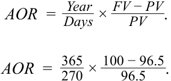
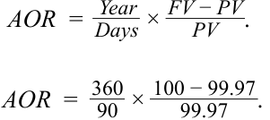
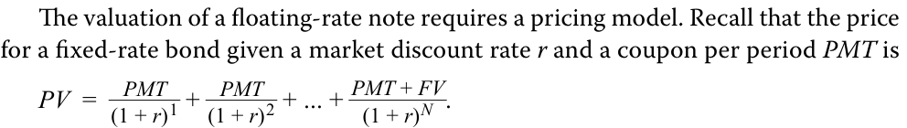
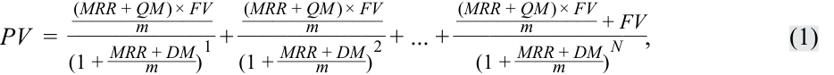
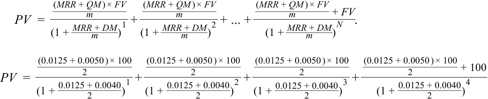
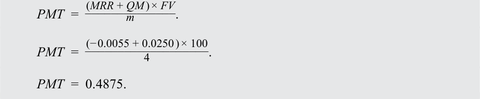
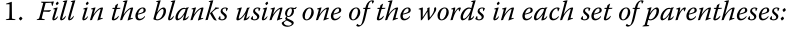
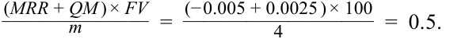
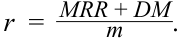

# Volume 6: Fixed Income
## Learning Module 8 Yield and Yield Spread Measures for Floating-Rate Instruments
### Part 1/2: Introduction (PDF Pages 197–206)

---

<!-- PDF Page 197 -->

#### L E A R N I N G M O D U L E 

# **<mark>8</mark>** 

### **Yield and Yield Spread Measures for Floating-Rate Instruments** 

###### **<mark>LEARNING OUTCOMES</mark>** 

|**_Mastery_**|**_The candidate should be able to:_**|
|---|---|
||calculate and interpret yield spread measures for floating-rate instruments|
||calculate and interpret yield measures for money market instruments|

##### **INTRODUCTION** 

## **<mark>1</mark>** 

Prior lessons covered pricing, yields, and spreads for bonds with fixed coupon rates and times-to-maturity of one year or longer. The next two lessons broaden the discussion to include instruments with variable rather than fixed coupons, known as floating-rate instruments, and those with original maturities of one year or less, known as money market instruments. Both types of instrument are important for investors and issuers. Floating-rate instruments, by adjusting cash flows to changes in interest rates, bear less price risk than fixed-rate instruments and are used to hedge certain exposures and to match asset and liability cash flows. Most loans are floating-rate instruments. Money market instruments are a significant source of short-term financing for many types of issuers. A short time-to-maturity means that investors can reinvest and issuers can refinance relatively quickly, which reduces interest rate risk. 

Most of the examples and exhibits used throughout the reading can be downloaded as a Microsoft Excel workbook. Each worksheet in the workbook is labeled with the corresponding example or exhibit number in the text. 

###### **LEARNING MODULE OVERVIEW** 

- A floating-rate instrument is a debt instrument with interest determined by an observed market reference rate (MRR) plus a quoted margin. Interest payments are reset, capturing any change in the MRR, on predetermined dates. 

<!-- PDF Page 198 -->

- The quoted margin is a specified spread over or under the reference rate. The required margin, also known as the discount margin, is the spread required by investors. 

- The required margin reflects “bottom-up” or issuer- and security-specific risks and is analogous to a yield spread for a fixed-rate bond discussed in prior lessons. If a floater trades at par, the quoted and required margins are equal. 

- Money market instruments have original maturities of one year or less and are quoted using different conventions from those of longer-dated securities. Quotes are made on a discount rate or add-on rate basis. 

- Money market discount rates are interest income divided by the face value (maturity value). They understate the investor’s rate of return if the purchase price is below the face value and vice versa. 

- Conventional money market measures can be converted to enhance comparability to longer-term securities. 

###### **LEARNING MODULE SELF-ASSESSMENT** 

These initial questions are intended to help you gauge your current level of understanding of the learning module. 

1. The following information relates to three floating-rate notes (FRNs) issued at par value that have the three-month MRR as their reference rate. 

|**Floating-Rate Note**|**Quoted Margin**|**Discount Margin**|
|---|---|---|
|FRN 1|140 bps|128 bps|
|FRN 2|145 bps|145 bps|
|FRN 3|150 bps|165 bps|

Based on the information provided, identify which FRN will be priced at a discount on the next reset date. 

- **A.** FRN 1 

- **B.** FRN 2 

**C.** FRN 3 

###### **Solution:** 

C is correct. FRN 3 will be priced at a discount on the next reset date since its quoted margin of 150 bps is less than its discount margin of 165 bps. The discount amount is the present value of the deficient future interest payments of 15 bps per quarter (150 bps – 165 bps). 

B is incorrect because FRN 2 will be priced at par value on the next reset date since its quoted margin is equal to its discount margin. 

A is incorrect because FRN 1 will be priced at a premium because its quoted margin of 140 bps is greater than its discount margin of 128 bps. The premium amount is the present value of the extra, or “excess,” interest payments of 12 bps each quarter (140 bps – 128 bps). 

<!-- PDF Page 199 -->

2. On a reset date, if the required margin falls to 30 bps because of a change in the issuer’s credit risk, an FRN that has a quoted margin of 50 bps will be priced at a: 

   - **A.** discount. 

   - **B.** premium. 

   - **C.** discount or premium, depending on its duration. 

   - **Solution:** 

B is correct. The required margin reflects the credit risk of the issuer. It declined, meaning that the credit risk of the issuer improved; in other words, the market demands a lower spread. The required margin is below the quoted margin, so this floater will be priced at a premium. 

3. A 365-day year bank certificate of deposit has an initial principal amount of USD96.5 million and a redemption amount due at maturity of USD100 million. The number of days between settlement and maturity is 270. The addon rate of the certificate of deposit is closest to: 

   - **A.** 3.63%. 

   - **B.** 4.82%. 

**C.** 4.90%. 

**Solution:** 

C is correct. The add-on rate is closest to 4.90%. The add-on rate is calculated as 

<!-- Formula Text: AOR  =   Year _ Days  ×  FV − PV _ PV  . AOR  =   365 _ 270  ×  100 − 96.5 _ 96.5 . -->

_AOR_ = 0.04903 = 4.90 % . 

4. A 90-day commercial paper instrument is quoted at a discount rate of 0.120%, assuming a 360-day year. Given that the price of the instrument is paid 100 per face value, its bond equivalent yield rate is closest to: 

   - **A.** 0.107%. 

   - **B.** 0.120%. 

   - **C.** 0.135%. 

   - **Solution:** 

B is correct. The bond equivalent yield is closest to 0.120%. First, we need to calculate the price of the instrument. Then, we can calculate the AOR or its bond equivalent yield. 

The price ( _PV_ ) of the commercial paper instrument is 

 Days PV_ = _FV_ × (1 − _Year_×_DR_) .  PV_ = 100 × (1 −  36090× 0.0012 ) . _PV_ = 99.97. 

_PV_ is used to calculate the add-on rate or bond equivalent yield: 

<!-- PDF Page 200 -->

<!-- Formula Text: AOR  =   Year _ Days  ×  FV − PV _ PV  . AOR  =   360 _ 90  ×  100 − 99.97 _ 99.97 . -->

_AOR_ = 0.0012 = 0.12 % . 

5. A fixed-income analyst is evaluating two instruments: 

- A 180-day Thai bank certificate of deposit (CD) quoted at a discount rate of 5.95%, assuming a 360-day year and a bond equivalent yield of 6.218% 

- A 180-day Thai corporate commercial paper (CP) quoted as an add-on rate of 6.10%, assuming a 365-day year and a bond equivalent yield of 6.100%. 

Assuming the six-month Thai T-bill is quoted at 4.36%, which instrument _most likely_ has higher credit risk? 

###### **Solution:** 

The Thai CD. The spreads over the Thai T-bill for the CD and CP are 186 bps and 174 bps, respectively. We use the bond equivalent yield measure to compare the return of each instrument and derive the spread of each one over the Thai T-bill. 

The Thai bank CD has a spread of 

6.218% – 4.36% = 186 bps. 

And the Thai corporate CP has a spread of 

- 6.10% – 4.36% = 174 bps. 

Therefore, the Thai bank CD has a higher credit risk than the Thai corporate CP. 

## **<mark>2</mark>** 

##### **YIELD AND YIELD SPREAD MEASURES FOR FLOATING-RATE NOTES** 

calculate and interpret yield spread measures for floating-rate instruments 

###### **Yield and Yield Spread Measures for Floating-Rate Instruments** 

Floating-rate instruments, including floating-rate notes (FRNs or floaters) and most loans, are different from fixed-rate bonds. Rather than fixed coupon payments, they vary from period to period depending on the current level of a reference interest rate. The intent is to both automatically adjust a borrower’s base rate to market conditions and offer an investor or lender less price risk when market interest rates fluctuate. In 

<!-- PDF Page 201 -->

principle, a floater has a stable price even in a period of volatile interest rates because cash flows adjust with changes in interest rates. With a traditional fixed-income security, constant future cash flows result in price changes in response to interest rate volatility. 

Exhibit 1 shows the term sheet for four-year FRNs issued by Antelas AG, the German emerging technology company focused on manufacturing process design, introduced in an earlier lesson. 

**Exhibit 1: Antelas AG Floating-Rate Note Issue** 

|**Antela**|**s AG Four-Year Floating-Rate Notes (the “Notes”)** **Prospectus Summary**|
|---|---|
|**Issuer:**|Antelas AG|
|**Settlement Date:**|[T + 5 Business Days]|
|**Maturity Date:**|[Four Years from Settlement Date]|
|**Principal Amount:**|EUR250 million|
|**Interest:**|MRR plus 250 bps p.a.|
|**Interest Payment:**|MRR is reset quarterly and interest is paid quarterly Commencing three months from [Settlement Date] to be paid quarterly with final payment on [Maturity Date]|
|**Seniority:**|i The Notes are secured and unsubordinated obligations of Antelas AG and will rank pari passu with all other secured and unsubordinated indebtedness|
|**Business Days:**|Frankfurt|

Notice how the interest is stated “MRR plus 250 bps p.a.” The market reference rate (MRR) on an FRN or loan usually is a short-term money market rate. Typically, the reference rate is determined at the beginning of the period, and the interest payment is made at the end of the period. This payment structure is called “in arrears.” The most common day-count conventions for calculating accrued interest on floaters are actual/360 and actual/365. For the Antelas FRN, the MRR is reset quarterly and interest is paid quarterly. 

For most FRNs and loans, a specified spread is added to or subtracted from the market reference rate. For the Antelas FRN, the spread over the MRR is 250 bps, and this is known as the **quoted margin** on the FRN. The role of the quoted margin is to compensate the investor for the difference in the credit risk of the issuer and that implied by the reference rate. Firms with very low credit risk may be able to obtain a negative quoted margin. 

The **required margin** is the yield spread over or under the reference rate such that the FRN is priced at par value on a rate reset date. It is determined by the market. Suppose that a floater is issued at par value and pays MRR plus 0.50%. The quoted margin is 50 bps. If there is no change in the credit risk of the issuer, the required margin remains at 50 bps. On each quarterly reset date, the floater will be priced at par value. Between coupon dates, its flat price will be at a premium or discount to par value if MRR goes, respectively, down or up. However, if the required margin continues to be the same as the quoted margin, the flat price is “pulled to par” as the next reset date nears. At the reset date, any change in MRR is included in the interest payment for the next period. 

Changes in the required margin usually come from changes in the issuer’s credit risk. Changes in liquidity or tax status can also affect the required margin. Note that these are the same factors that affect the yield spread for fixed-rate bonds. Suppose that on a reset date, the required margin increases to 75 bps because of a downgrade in the issuer’s credit rating. If the quoted margin is 50 bps, the issuer now pays its 

<!-- PDF Page 202 -->

investors a “deficient” interest payment. This FRN will be priced at a discount below par value. The amount of the discount is the present value of the deficient future cash flows. That annuity is 25 bps per period for the remaining life of the bond. It is the difference between the required and quoted margins. If the required margin instead fell to 40 bps, perhaps from a decrease in the issuer’s credit risk, the FRN would be priced at a premium. The amount of the premium is the present value of the 10 bp annuity for the “excess” interest payment each period. 

Fixed-rate and floating-rate bonds are essentially the same with respect to changes in credit risk. With fixed-rate bonds, the premium or discount arises from a difference in the fixed coupon rate and the required yield-to-maturity. With floating-rate bonds, the premium or discount arises from a difference in the fixed quoted margin and the required margin. However, fixed-rate and floating-rate bonds are very different with respect to changes in benchmark interest rates. 

<!-- Formula Text: The valuation of a floating-rate note requires a pricing model. Recall that the price for a fixed-rate bond given a market discount rate r and a coupon per period PMT is PV  =    PMT _ (1 + r) 1  +   PMT _ (1 + r) 2  + ... +  PMT + FV _ (1 + r) N  . -->

For an FRN, _PMT_ is a function of the MRR and the quoted margin and _r_ is a function of the MRR and the discount margin. We can use this intuition to derive Equation 1, a simplified FRN pricing model. 

<!-- Formula Text: PV  =    (MRR + QM ) × FV ______________ m ____________ (1 +  MRR + DM _ m ) 1 +   (MRR + QM ) × FV ______________ m ____________ (1 +  MRR + DM _ m ) 2 + ... +   (MRR + QM ) × FV ______________ m + FV ________________ (1 +  MRR + DM _ m ) N , (1) -->

where 

- _PV_ = present value, or the price of the floating-rate note 

- _MRR_ = the market reference rate, stated as an annual percentage rate (it is sometimes known generically as Index) 

- _QM_ = the quoted margin, stated as an annual percentage rate 

- _FV_ = the future value paid at maturity, or the par value of the bond 

- _m_ = the periodicity of the floating-rate note, the number of payment periods per year 

- _DM_ = the discount margin = required margin stated as an annual percentage rate 

- _N_ = the number of evenly spaced periods to maturity 

Notice that in Equation 1, because we are using annual rates for _MRR_ , _QM_ , and _DM_ , we must divide by _m_ periods in the year. 

This is a simplified model for several reasons. First, _PV_ is as of a rate reset date when there are _N_ evenly spaced periods to maturity. There is no accrued interest, so the flat price is the full price. Second, the model assumes a 30/360 day-count convention, to make sure the periodicity, _m_ , is an integer. However, in practice, most floaters use actual/360 day counts. Third, and most important, the same _MRR_ is used for all cash flows. More complex FRN pricing models use projected future rates in the numerators and spot rates in the denominators. Therefore, the calculation for _DM_ depends on the simplifying assumptions in the pricing model. 

<!-- PDF Page 203 -->

Suppose that we are pricing a two-year, semi-annual FRN that pays MRR plus 0.50%. Assume MRR is 1.25% and the yield spread required by investors is 40 bps. For Equation 1, we have the following inputs: 

_MRR_ = 0.0125, 

_QM_ = 0.0050, _FV_ = 100, _m_ = 2, 

_DM_ = 0.0040, and 

_N_ = 4. 

Using Equation 1 for _N_ = 4, the FRN is priced at 100.196 per 100 of par value. This floater is priced at a premium above par value because the quoted margin is greater than the discount margin. 

<!-- Formula Text: PV  =    (MRR + QM ) × FV ______________ m ____________ (1 +  MRR + DM _ m ) 1 +   (MRR + QM ) × FV ______________ m ____________ (1 +  MRR + DM _ m ) 2 + ... +   (MRR + QM ) × FV ______________ m + FV ________________ (1 +  MRR + DM _ m ) N . PV  = (0.0125 + 0.0050 ) × 100 _________________ 2 _______________ (1 +  0.0125 + 0.0040 ____________ 2 ) 1 + (0.0125 + 0.0050 ) × 100 _________________ 2 _______________ (1 +  0.0125 + 0.0040 ____________ 2 ) 2 + (0.0125 + 0.0050 ) × 100 _________________ 2 _______________ (1 +  0.0125 + 0.0040 ____________ 2 ) 3 + (0.0125 + 0.0050 ) × 100 _________________ 2 + 100 ____________________ (1 +  0.0125 + 0.0040 ____________ 2 ) 4 -->

PV = 100.196 

If we have the market price of an FRN, we can also use Equation 1 to estimate the discount margin. Suppose that a two-year FRN pays MRR plus 0.75% on a semiannual basis. Currently, MRR is 1.10% and the price of the floater is 95.50 per 100 of par value, a discount to par, because of worsening credit risk. For Equation 1, we have the following inputs: 

_PV_ = 95.50, 

_MRR_ = 0.0110, 

_QM_ = 0.0075, 

_FV_ = 100, 

_m_ = 2, and 

_N_ = 4. 

Using the Solver add-in for Microsoft Excel, we find _DM_ = 3.12%, or 312 bps, by setting the price (sum of present values of cash flows) equal to 95.50 as the objective and _DM_ as the change variable. Please see the candidate learning ecosystem online for a spreadsheet demonstrating the calculation in the downloadable Excel workbook. 

If this FRN was issued at par value, investors required at that time a spread of only 75 bps over MRR. Now, after the credit downgrade, investors require an _estimated_ discount margin of 312 bps. The floater trades at a discount because the quoted margin remains fixed at 75 bps, so is “deficient” by 237 bps (312-75) per period The discount margin is an estimate because it is based on a simplified FRN pricing model. 

The FRN pricing model in Equation 1 similarly applies to adjustable-rate loans made by banks and other fixed-income instruments based on MRR. Because a significant portion of bank funding comes from short-term deposits and other floating-rate 

<!-- PDF Page 204 -->

sources, banks prefer to make floating-rate loans to businesses and individuals, as opposed to fixed-rate loans, to help maintain a match between assets and liabilities on the balance sheet. 

###### **EXAMPLE 1** 

###### **Calculating the Discount Margin for a Floating-Rate Note** 

Suppose that the MRR for the Antelas AG four-year floating-rate note is on a three-month basis and the quoted margin is 250 bps. The floater is priced at 97 per 100 of par value. Calculate the discount margin for the floater assuming that three-month MRR is constant at –0.55%. Assume a 30/360 day-count convention and evenly spaced periods. 

###### **Solution:** 

We can use the Solver add-in in Microsoft Excel to quickly solve for _DM_ = 3.29%, or 329 bps, in the same manner as in the prior example. Please see the candidate learning ecosystem online for a spreadsheet demonstrating the calculation in the downloadable Excel workbook. 

Alternatively, we can use the RATE function in Microsoft Excel, Google Sheets, or a financial calculator by first solving for _PMT_ , the numerators in Equation 1. 

<!-- Formula Text: PMT  =   (MRR + QM ) × FV ______________ m . PMT  =   (− 0.0055 + 0.0250 ) × 100 ___________________ 4 . PMT  =  0.4875. -->

Then, using _PV_ = –97, _FV_ = 100, _PMT_ = 0.4875, and _N_ = 16, we can solve for the discount rate per period of 0.686122%. We use this to solve for _DM_ . <mark>_</mark> _r_ =_MRR_ _m_+_DM_ . 

<!-- Formula Text: 0.00686122  =   − 0.0055 + DM ___________ 4 . -->

<!-- Formula Text: DM  =  0.0329  =  3.29 % . -->

The quoted margin is 250 bps over the reference rate. Using the simplified FRN pricing model, the discount margin (the spread investors require for the floater to be priced at par) is 329 bps. 

###### **QUESTION SET** 

<!-- Formula Text: 1.	 Fill in the blanks using one of the words in each set of parentheses: -->

Floaters with longer reset periods may be __________ (more, less) exposed to interest rate and price volatility. 

<!-- PDF Page 205 -->

The __________ (shorter, longer) the reset period, the more a floater will behave similarly to a short-dated fixed-rate security and the __________ (less, more) its price will potentially fluctuate. **Solution:** Floaters with longer reset periods may be _<u>more</u>_ exposed to interest rate and price volatility. The _<u>longer</u>_ the reset period, the more a floater will behave similarly to a short-dated fixed-rate security and the _<u>more</u>_ its price will potentially fluctuate. 

|2. For a five-year floating-rate security, if market interest rates change by 0.5%, the change in the price of the security will most likely be:|
|---|
|**A.**zero.|
|**B.**like an otherwise identical fixed-rate security. **C.**related to the security’s coupon reset frequency. **Solution:** C is correct. The interest rate sensitivity of a floating-rate security comes typically from the time remaining until its next coupon reset date. A is incorrect: when the interest rates changes, the discount rate of the floating rate security also changes, changing the present value of the security when discounting the cashflows. B is incorrect: with a fixed-rate security, interest rates changes affect the price more than an identical (same-term) floating-rate security, due to its fixed coupon payments and a higher duration.|
|3. Identify the relationship between required margin and a floater’s price at the reset date:|
|1. Required margin > Quoted margin A. Floater priced at par|
|2. Required margin = Quoted margin B. Floater priced at a discount|
|3. Required margin < Quoted margin C. Floater priced at a premium|
|**Solution:**|
|1. Required margin > Quoted margin B. Floater priced at a discount|
|2. Required margin = Quoted margin A. Floater priced at par|
|3. Required margin < Quoted margin C. Floater priced at a premium|

For Required margin > Quoted margin, B is correct. Changes in the required margin usually come from changes in the issuer’s credit risk. If the required margin increases and is above the quoted margin at the reset date, the floater pays a “deficient” interest payment. The floater will be priced at a discount below par value. 

For Required margin = Quoted margin, A is correct. If the required margin continues to be the same as the quoted margin, the flat price is “pulled to <u>par” as the next reset date nears.</u> 

<!-- PDF Page 206 -->

For Required margin < Quoted margin, C is correct. If the required margin decreases and is below the quoted margin, the floater will be priced at a premium. 

4. A two-year Italian floating-rate note pays three-month Euribor of –0.50% plus 250 bp. The floater is priced at 99 per 100 of par value. Assuming the 30/360 day-count convention and evenly spaced periods, the discount margin for the floater is closest to: 

**A.** 201 bps. 

- **B.** 251 bps. 

**C.** 300 bps. 

###### **Solution:** 

C is correct. The discount margin for the floater is closest to 300 bps. Using the information provided, the periodic _PMT_ is equal to 

<!-- Formula Text: (MRR + QM ) × FV ______________ m =   (− 0.005 + 0.0025 ) × 100 __________________ 4 =  0.5. -->

Using the RATE function in Microsoft Excel, Google Sheets, or a financial calculator using _PV_ = –99, _FV_ = 100, _PMT_ = 0.5, and _N_ = 8, we solve for the discount rate per period of 0.628562%. The discount margin can be estimated by solving for _DM_ : 

<!-- Formula Text: r  =   MRR + DM _ m . -->

0.00628562 =  _− 0.005 +_DM_ . 4 

   - _DM_ = 0.03014 = 3.014 % . 

5. The Antelas AG four-year floating-rate note pays three-month MRR of –0.55% plus 250 bps. The floater is priced at 102 per 100 of par value. Assuming the 30/360 day-count convention and evenly spaced periods, calculate the discount margin for the floating-rate note. 

###### **Solution:** 

The estimated discount margin is 199 bps. 

Using the information provided, the periodic _PMT_ is equal to 

- ______________ __________________(_MRR_+ _m__QM_) ×_FV_ =(− 0.0055 + 0.025 ) × 100 4 = 0.4875. 

Using the RATE function in Microsoft Excel, Google Sheets, or a financial calculator using _PV_ = –102, _F_ V = 100, _PMT_ = 0.4875, and _N_ = 16, we solve for the discount rate per period of 0.358655%. The discount margin can then be estimated by solving for _DM_ : 

 r_ =_MRR_ _m_+_DM_ . 

0.00358655 =  ___________− 0.0055 +_DM_ . 4 

- _DM_ = 0.019846 = 1.99 % . 

