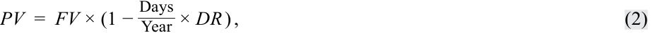
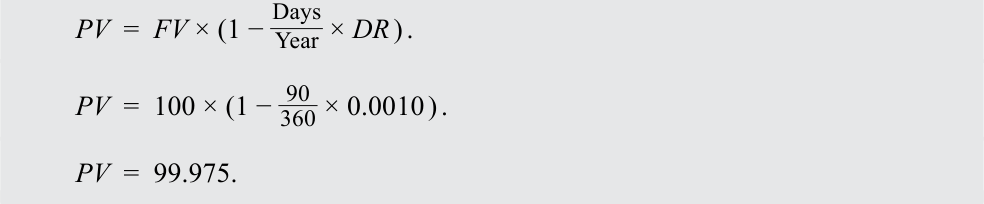
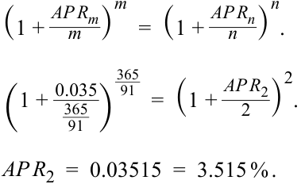
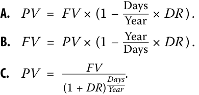

# Volume 6: Fixed Income
## Learning Module 8 Yield and Yield Spread Measures for Floating-Rate Instruments
### Part 2/2: Yield Measures for Money Market Instruments (PDF Pages 207–220)

---

<!-- PDF Page 207 -->

#### **YIELD MEASURES FOR MONEY MARKET INSTRUMENTS** 

# **<mark>3</mark>** 

calculate and interpret yield measures for money market instruments 

Money market instruments are debt securities with original maturities of one year or less. There are many types, including overnight sale and repurchase agreements (repos), bank certificates of deposit, commercial paper, Treasury bills (government securities issued with a maturity of one year or less), bankers’ acceptances, and time deposits based on market reference rates. There are mutual funds that invest solely in eligible money market securities, known as money market mutual funds, which are sometimes considered as an alternative to bank deposits. 

There are several important differences in yield measures quoted for money market instruments versus bonds: 

**1.** Bond yields-to-maturity are annualized and compounded. Yield measures in the money market are annualized but _not_ compounded; the return on a money market instrument is stated on a simple interest basis. 

**2.** Bond yields-to-maturity usually are stated for a common periodicity for all times-to-maturity. Money market instruments with different times-to-maturity have different periodicities for the annual rate. 

**3.** Bond yields-to-maturity can be calculated using standard time-valueof-money analysis. Money market instruments are often quoted using non-standard interest rates and require different pricing equations than those used for bonds. 

In general, quoted money market rates are either **discount rates** or **add-on rates** . Although market conventions vary around the world, commercial paper, Treasury bills, and bankers’ acceptances often are quoted on a discount rate basis. Bank certificates of deposit, repos, and market reference rate indexes are quoted on an add-on rate basis. While _discount rate_ usually means “interest rate used to calculate a present value,” in the money market, the discount rate involves an instrument for which interest is included in the face value of the instrument. An add-on rate, in contrast, involves interest that is added to the principal or investment amount. Some examples will clarify this point. 

Equation 2 is the pricing formula for money market instruments quoted on a discount rate basis. 

<!-- Formula Text: PV  =  FV × (1 − Days _ Year  × DR ) , (2) -->

where 

_PV_ = present value, or the price of the money market instrument 

- _FV_ = the future value paid at maturity, or the face value of the money market instrument 

Days = the number of days between settlement and maturity 

- Year = the number of days in the year 

- _DR_ = the discount rate, stated as an annual percentage rate 

<!-- PDF Page 208 -->

Suppose that a 91-day Indian Treasury bill (T-bill) with a face value of INR10 million is quoted at a discount rate of 3.45% for an assumed 360-day year. The price of the Indian rupee T-bill is INR9,912,792. 

<!-- Formula Text: PV  =  FV × (1 − Days _ Year  × DR ) . PV  =  10, 000, 000 × (1 −  91 _ 360  × 0.0345 ) . PV  =  9, 912, 791.67. -->

<!-- Formula Text: The unique characteristics of a money market discount rate can be examined with Equation 3, which transforms Equation 2 algebraically to isolate the DR term. DR  =   Year _ Days  ×  (FV − PV) _ FV . (3) -->

The first term, Year/Days, is the periodicity of the annual rate. The second term reveals the odd character of a money market discount rate. The numerator, _FV_ – _PV_ , is the interest earned on the rupee T-bill, INR87,208 (= 10,000,000 – 9,912,792), over the 91 days to maturity. However, the denominator is _FV_ , not _PV_ . In theory, an interest rate is the amount earned divided by the investment amount ( _PV_ ), not the maturity value ( _FV_ ), which includes the earnings. Therefore, by design, a money market discount rate _understates_ the rate of return to the investor, and it _understates_ the cost of borrowed funds to the issuer. That is because _PV_ is less than _FV_ if _DR_ is greater than zero. 

Equation 4 is the pricing formula for money market instruments quoted on an add-on rate basis. 

<!-- Formula Text: PV  = FV _____________ (1 + Days _ Year  × AOR) , (4) -->

where 

- _PV_ = present value, the principal amount, or the price of the money market instrument 

- _FV_ = the future value, or the redemption amount paid at maturity including interest 

- Days = the number of days between settlement and maturity 

- Year = the number of days in the year 

- _AOR_ = the add-on rate, stated as an annual percentage rate 

###### **EXAMPLE 2** 

##### **Yield Measures on Bank Certificates of Deposit** 

Commercial Finance Partners AG (CFP Bank) issues 90-day certificates of deposit (CDs) to fund its floating-rate loans made to customers. The objective is to maintain a match between the bank’s assets (floating-rate loans) and its funding sources. The quoted add-on rate for its 90-day CD is 0.12%, assuming a 365-day year. If the initial principal amount is EUR20 million, the redemption amount due at maturity is found by rearranging Equation 4 and entering _PV_ = 20,000,000, Day _s_ = 90, Year = 365, and _AOR_ = 0.0012. 

<!-- Formula Text: FV  =  20, 000, 000 + (20, 000, 000 ×  90 _ 365  × 0.0012 ) . -->

<!-- Formula Text: FV  =  20,005,918. -->

<!-- PDF Page 209 -->

At maturity, CFP Bank pays EUR20,005,918, the principal of EUR20,000,000 plus interest of EUR5,918. The interest is calculated as the principal times the fraction of the year times the annual add-on rate. It is added to the principal to determine the redemption amount. 

Suppose that after 45 days, the CD investor sells the CD to a dealer. At that time, the quoted add-on rate for a 45-day CD is 0.06%. The sale price for the CD can be calculated using Equation 4 for _FV_ = 20,004,918, Days = 45, Year = 365, and _AOR_ = 0.0012. The sale price is EUR20,002,958. 

<!-- Formula Text: PV  = FV _____________ (1 + Days _ Year  × AOR) . PV  = 20, 005, 918 _____________ (1 +  45 _ 365  × 0.0006) . -->

<!-- Formula Text: PV  =  20, 003, 438. -->

The characteristics of an add-on rate can be examined with Equation 5, which transforms Equation 4 algebraically to isolate the AOR term. 

<!-- Formula Text: AOR  =   Year _ Days  ×  FV − PV _ PV  . (5) -->

The first term, Year/Days, is the periodicity of the annual rate. The second term is the interest earned ( _FV_ – _PV_ ) divided by the amount invested ( _PV_ ). 

CFP Bank’s rate of return on its 45-day investment in the certificates of deposit can be calculated with Equation 5. 

<!-- Formula Text: AOR  =   Year _ Days  ×  FV − PV _ PV  . AOR  =   365 _ 45  ×  20, 002, 958 − 20, 000, 000 ___________________ 20, 000, 000 . AOR  =  0.0012. -->

The rate of return, stated on a 365-day add-on rate basis, is 0.12%. This result is an annual rate for a periodicity of 8.11 (= 365/45). Implicitly, this assumes that the investment can be replicated 8.11 times over the year. 

Investment analysis is more challenging for money market securities because (1) some instruments are quoted on a discount rate basis while others on an add-on rate basis and (2) some assume a 360-day year and others use a 365-day year. Another difference is that the “amount” of a money market instrument quoted by traders on a discount rate basis typically is the face value paid at maturity. However, the “amount” when quoted on an add-on rate basis usually is the price at issuance. Exhibit 2 summarizes these conventions. 

**Exhibit 2: Summary of Money Market Yield Measures** 

|**Conventions and** **Instruments**|**Description**|
|---|---|
|Quote Basis|Discount Rate (DR) Add-on Rate (AOR)|
|Equation|_DR_= (Year/Days) × [(_FV_ _AOR_= (Year/Days) × [(_FV_|
||–_PV_)/_FV_]. –_PV_)/_PV_].|

<!-- PDF Page 210 -->

|**Conventions and** **Instruments**|**Desc**|**ription**|
|---|---|---|
|Quoted Amount|Face Value at Maturity (FV)|Price at Issuance (PV)|
|Typical Instruments|Commercial Paper, Treasury Bills, Bankers’ Acceptances|Bank Certificates of Deposit, Repurchase Agreements (Repos), Market Reference Rates (MRRs)|

To make money market investment decisions, it is essential to compare instruments on a common basis. The following example illustrates this point. 

###### **EXAMPLE 3** 

##### **Yield Measures on Bank Certificates of Deposit** 

Suppose that an investor is comparing the following two money market instruments. Which offers the higher expected rate of return, assuming that credit risks are the same? 

- A 90-day commercial paper (CP) issued by Bright Wheel Automotive Corporation (BRWA), quoted at a discount rate of 0.100% for a 360day year 

- A 90-day certificate of deposit issued by CFP Bank, quoted at an add-on rate of 0.120% for a 365-day year 

The price of the commercial paper is 99.975 per 100 of face value, calculated using Equation 2 and entering FV = 100, Days = 90, Year = 360, and DR = 0.0010. 

<!-- Formula Text: PV  =  FV × (1 − Days _ Year  × DR ) . PV  =  100 × (1 −  90 _ 360  × 0.0010 ) . PV  =  99.975. -->

Next, use Equation 5 to solve for _AOR_ for a 365-day year, where Year = 365, Days = 90, _FV_ = 100, and _PV_ = 99.975. 

<!-- Formula Text: AOR  =   Year _ Days  ×  FV − PV _ PV  . AOR  =   365 _ 90  ×  100 − 99.975 _ 99.975 . AOR  =  0.00122. -->

The 90-day commercial paper discount rate of 0.10% converts to an add-on rate for a 365-day year of 0.1014%. This converted rate is called a bond equivalent yield, or sometimes just an “investment yield.” A **bond equivalent yield** is a money market rate stated on a 365-day add-on rate basis. If the risks are the same, BRWA’s CP offers 0.2 bps more in annual return than CFP Bank’s CD. 

Exhibit 3 summarizes the process just illustrated for comparing money market instruments on a common, bond equivalent yield basis. 

<!-- PDF Page 211 -->

###### **Exhibit 3: Comparing Money Market Instruments on Bond Equivalent Yield Basis** 

Step 1 Step 2 For a MM instrument Step 3 quoted on _Discount Rate Deternine Add-on Rate (DR) Basis_ : _(AOR)_ for this MM _Bond Equivalent Yield (BEY)_ Determine Price per 100 of instrument using PV from is a MM rate stated on a Par (PV): Step 1: 365-day _AOR basis_ . PV = FV x (1 – [Days/Year] x DR) AOR = (365/Days) * ([FV – PV]/PV) This instrument is now comprable with other MM instruments expressed on a BEY basis. 

###### **EXAMPLE 4** 

##### **Comparing Money Market Instruments Based on Bond Equivalent Yields** 

A money market investor observes quoted rates on four 180-day money market instruments: A, B, C, and D. 

|**Money Market** **Instrument**|**Quotation Basis**|**Assumed Num-** **ber of Days in the** **Year**|**Quoted Rate**|
|---|---|---|---|
|A|Discount Rate|360|4.33%|
|B|Discount Rate|365|4.36%|
|C|Add-On Rate|360|4.35%|
|D|Add-On Rate|365|4.45%|

Using a spreadsheet, we can calculate the bond equivalent yield for each instrument so that rates of return can be compared. Bond A offers the highest rate of return (4.487%) and Bond C offers the lowest rate of return (4.410%) on a bond equivalent yield basis. Please refer to the candidate learning ecosystem online for a spreadsheet demonstrating the calculation in the downloadable Excel workbook. 

||**Money market Instrument**|**A**|**B**|**C**|**D**|
|---|---|---|---|---|---|
|Input|Quotation Basis|Discount Rate|Discount Rate|Add-On Rate|Add-On Rate|
||Number of Days in the Year|360|365|360|365|
||Quoted Rated (%)|4.33%|4.36%|4.35%|4.45%|
|Output|PV/FV|97.835|97.850|102.175|102.195|
||Add-On-Rate|0.04487|0.04456|0.04410|0.04450|
||Bond Equivalent Yield (%)|4.487%|4.456%|4.410%|4.450%|

Another important difference between yield measures in the money market and the bond market is the periodicity of the annual rate. Because bond yields-to-maturity are computed using interest rate compounding, there is a well-defined periodicity. For instance, bond yields-to-maturity for semiannual compounding are annualized for a 

<!-- PDF Page 212 -->

periodicity of two. Money market rates are computed using simple interest without compounding. In the money market, the periodicity is the number of days in the year divided by the number of days to maturity. Therefore, money market rates for different times-to-maturity have different periodicities. 

Suppose that an analyst prefers to convert money market rates to a semiannual bond basis so that the rates are directly comparable to yields on bonds that make semiannual coupon payments. The quoted rate for a 91-day Indian rupee T-bill is 3.50%, quoted as a bond equivalent yield, which means its periodicity is 365/91. We use the periodicity conversion formula covered in a previous lesson to convert from a periodicity _m_ of 365/91 to _n_ of 2: 

<!-- Formula Text: (1 + AP R m _ m  ) m =  (1 + AP R n _ n  ) n . (1 +  0.035 _ 365 _ 91   ) 365 _ 91 =  (1 + AP R 2 _ 2  ) 2 . AP R 2  =  0.03515  =  3.515 % . -->

Therefore, 3.50% for a periodicity of 365/91 corresponds to 3.515% for a periodicity of 2. The difference is –1.5 bps. In general, the difference depends on the level of the annual percentage rate. When interest rates are lower, the difference between the annual rates for any two periodicities is reduced. 

###### **QUESTION SET** 

1. Identify the correct relationship for a money market instrument quoted on a discount rate basis: 

<!-- Start of picture text -->
_ A.  PV  =  FV  × (1 −   Days Year ×  DR  ) . _ B.  FV  =  PV  × (1 −  Days Year  ×  DR  ) . C.  PV  =  _ FV  .  (1 +  DR ) _ Days Year <!-- End of picture text -->

<!-- Start of picture text -->
Solution: <!-- End of picture text -->

A is correct. In the money market, the discount rate is a specific type of quoted rate. Hence, the price or the present value of a money market instrument is determined by 

<!-- Formula Text: PV  =  FV × (1 − Days _ Year  × DR ) , -->

where 

_PV_ = present value, or the price of the money market instrument 

_FV_ = the future value paid at maturity, or the face value of the money market instrument 

Days = the number of days between settlement and maturity 

Year = the number of days in the year 

_DR_ = the discount rate, stated as an annual percentage rate 

<!-- PDF Page 213 -->

2. _True or false:_ Yield measures in money market instruments are annualized and compounded. 

**A.** True 

**B.** False 

###### **Solution:** 

False. Bond yields-to-maturity are annualized and compounded. However, yield measures in money markets are annualized but not compounded. 

3. _True or false:_ Money market instruments use the standard time value of money, such as discount rates or add-on rates. 

   - **A.** True 

   - **B.** False 

###### **Solution:** 

False. Bond yields-to-maturity are calculated using the standard time value of money. Money market instruments are often quoted using non-standard interest rates, such as discount rates or add-on rates. 

4. _True or false:_ Money market instruments with different times-to-maturity have different periodicities. 

**A.** True 

**B.** False 

###### **Solution:** 

True. Money market instruments with different times-to-maturities have different periodicities. However, bond yields-to-maturity are given for a common periodicity for all times-to-maturity. 

5. Explain the concept of a bond equivalent yield for a money market instrument. 

###### **Solution:** 

A bond equivalent yield is the rate of return on a money market instrument that is calculated with reference to the purchase price of the instrument based on a 365-day year. The converted rate or yield can be used to compare the return earned on the money market instrument with a similar return earned by a bond. 

6. A portfolio manager has asked you to evaluate the following Thai baht–denominated 180 days money market instruments with equivalent credit risk. 

|**Money Market Instrument**|**Quotation Basis**|**Number of** **Days in the** **Year**|**Quoted** **Rate**|
|---|---|---|---|
|Short-Term Thai T-Bills|Discount Rate|360|4.78%|
|Thai Bank Certificate of|Discount Rate|365|4.81%|
|h  i Deposit||||
|Thai Corporate Commercial|Add-On Rate|365|4.85%|
|h Paper||||

Which instrument has the highest rate of return on a bond equivalent yield basis? 

<!-- PDF Page 214 -->

- **A.** Short-term Thai T-bills 

- **B.** Thai bank certificate of deposit 

- **C.** Thai corporate commercial paper 

- **Solution:** 

A is correct. The bond equivalent yield for each instrument is most easily calculated using a spreadsheet. Please refer to the candidate learning ecosystem online for a spreadsheet demonstrating the calculations in the downloadable Excel workbook. The short-term Thai T-bills offer the highest return of 4.965% on a bond equivalent yield basis. 

||**Money Market** **Instrument**|**Short-Term** **Thai T-Bill**|**Thai Bank CD**|**Thai Corpo-** **rate CP**|
|---|---|---|---|---|
|Input|Quotation Basis|Discount Rate|Discount Rate|Add-On Rate|
||Number of Days in the Year|360|365|365|
||Quoted Rated (%)|4.78%|4.81%|4.85%|
|Output|PV/FV|97.610|97.628|102.392|
||Add-On-Rate|0.04965|0.04927|0.04850|
||Bond Equivalent Yield (%)|4.965%|4.927%|4.850%|

###### **The following information relates to questions 7-8** 

A German insurance company buys a 91-day certificate of deposit with a quoted add-on rate of 0.40% for a 365-day year. 

7. If the initial payment amount is EUR20 million, calculate the redemption amount due at maturity. 

###### **Solution:** 

The redemption amount can be calculated using Equation 4: 

<!-- Start of picture text -->
PV  =  _____________ FV . (1 +  _DaysYear ×  AOR ) _____________ FV  20, 000, 000 = _ (1 +  365 91 × 0.0040). FV  = 20, 019, 945. <!-- End of picture text -->

8. Suppose that after 31 days, the insurance company sells the CD. At the time of the sale, the quoted add-on rate for a 60-day CD is 0.21%. Calculate the sale price for the CD. 

###### **Solution:** 

After 31 days, the sale price of the certificate of deposit is also calculated using Equation 4: 

_PV_ =  ____________ FV_ . (1 +  _DaysYear×_AOR_) _____________20, 019, 945 _PV_ = _ (1 +  36560× 0.0021). 

<!-- PDF Page 215 -->

_PV_ = 20, 013, 036. 

<!-- PDF Page 216 -->

## **~~PRACTICE PROBLEMS~~** 

**1.** A two-year floating-rate note issued by a French corporation pays the three-month MRR of –0.55% plus 160 bps. The floater is priced at 101.20 per 100 of par value. Assuming the 30/360 day-count convention and 90 days per period, the discount margin for the floater is closest to: 

   - **A.** 25 bps. 

   - **B.** 50 bps. 

   - **C.** 110 bps. 

**2.** Changes in the required margin for a floater usually come from: 

   - **A.** shifts in the yield curve. 

   - **B.** changes in credit risk. 

   - **C.** increases or decrease in inflation. 

### **The following information relates to questions 3-4** 

A fixed-income portfolio manager is looking to value a one-year US dollar– denominated floating-rate note that has quarterly payments based on 90-day MRR plus 80 bps. Assume the following information: 

90-Day MRR: 2.5% Quoted Margin: 80 bps Discount Margin: 100 bps Face Value: USD100 

**3.** Without doing any calculation, this floating-rate note is priced at: 

   - **A.** a premium. 

   - **B.** a discount. 

   - **C.** par. 

**4.** The price of the FRN is closest to: 

   - **A.** 98.804. 

   - **B.** 99.804. 

   - **C.** 100.804. 

**5.** The bond equivalent yield of a 90-day European bank certificate of deposit quoted at a discount rate of 0.55% for a 360-day year is closest to: 

   - **A.** 0.21%. 

<!-- PDF Page 217 -->

   - **B.** 0.24%. **C.** 0.56%. 

**6.** A 91-day UK gilt (Treasury bill) has a face value of GBP2 million, a discount rate of 0.25%, and a price of GBP1.9 million. If a year has 366 days, the discount rate for the UK gilt is closest to: 

   - **A.** 0.1821. 

**B.** 0.2011. 

**C.** 0.2134. 

**7.** Explain why a money market discount rate greater than zero understates the rate of return to an investor and understates the cost of borrowed funds for the issuer. 

<!-- PDF Page 218 -->

## **~~SOLUTIONS~~** 

1. B is correct. 

Using the information provided, the periodic _PMT_ is equal to 

______________ _________________(_MRR_+ _m__QM_) ×_FV_ =(− 0.055 + 0.016 ) × 100 4 = 0.2625. 

Using the RATE function in Microsoft Excel, Google Sheets, or a financial calculator and using _PV_ = –101.20, _FV_ = 100, _PMT_ =0.275, and _N_ = 8, we solve for the discount rate per period of 12.4161%. The discount margin can then be estimated by solving for _DM_ : 

 r_ =_MRR_ _m_+_DM_ . 

0.124161 =  _− 0.005 +_DM_ . 4 

_DM_ = 0.4525. 

The estimated discount margin is 45.25 bps. 

2. B is correct. The required margin is the yield spread over or under a reference rate, reflecting the credit risk of an issuer. Changes in the required margin typically come from a change in the issuer’s credit risk. A and C are incorrect. Both risks, as “top-down” or macroeconomic risks, would be reflected in changes in the MRR, not in a spread such as the required margin. 

3. B is correct. This FRN is priced at a discount, because the quoted margin is less than the discount (required) margin. 

4. B is correct. The FRN is priced at 99.804 per 100 of par value. Using the information provided, the periodic _PMT_ is equal to 

______________ ________________(_MRR_+ _m__QM_) ×_FV_ =(0.025 + 0.008 ) × 100 4 = 0.825. 

The assumed discount rate per period is equal to 0.875%. 

 r_ =_MRR_ _m_+_DM_ . 

 r_ =0.025 + 0.01 4 . 

_r_ = 0.00875. 

To value this FRN, take the present value of each cash flow using the discount rate per period. The FRN is priced at 99.804 per 100 of par value. 

___________0.825 ___________0.825 ___________0.825 ___________100.825 _PV_ =   (1 + 0.00875)1+ (1 + 0.00875)2+ (1 + 0.00875)3+ (1 + 0.00875)4. 

_PV_ = 99.804. 

5. C is correct. The bond equivalent yield is closest to 0.56%. The present value of the banker’s certificate of deposit is calculated as follows: 

<!-- Formula Text: PV  =  FV × (1 − Days _ Year  × DR ) . PV  =  100 × (1 −  90 _ 360  × 0.0055 ) . -->

<!-- PDF Page 219 -->

_PV_ = 99.865. The bond equivalent yield (AOR using a 365-day year) is calculated to be approximately 0.56%: _  AOR_ =Year Days×_FV_ _PV_−_PV_. _AOR_ =  _365 90× ___________100 − 99.8625 99.8625 . _AOR_ = 0.0056. 6. B is correct. The discount rate is closest to 0.2011. _  DR_ =  DaysYear×  (_FV_ _FV_−_PV_) . _ _________________ DR_ =366 . 91×  (2, 000, 000 − 1, 900, 000) 2, 000, 000 _DR_ = 0.2011. 

7. For a money market instrument, the discount rate is calculated as 

<!-- Formula Text: DR  =   Year _ Days  ×  (FV − PV) _ FV . -->

The denominator for the second term is _FV_ , not _PV_ . In theory, an interest rate is the amount earned divided by the investment amount ( _PV_ ), not the maturity value ( _FV_ ), which includes the earnings. So long as _DR_ is greater than zero, _FV_ will be higher than _PV_ . Therefore, by design, a money market discount rate _understates_ the rate of return to the investor, and it _understates_ the cost of borrowed funds to the issuer. 

<!-- PDF Page 220 -->

