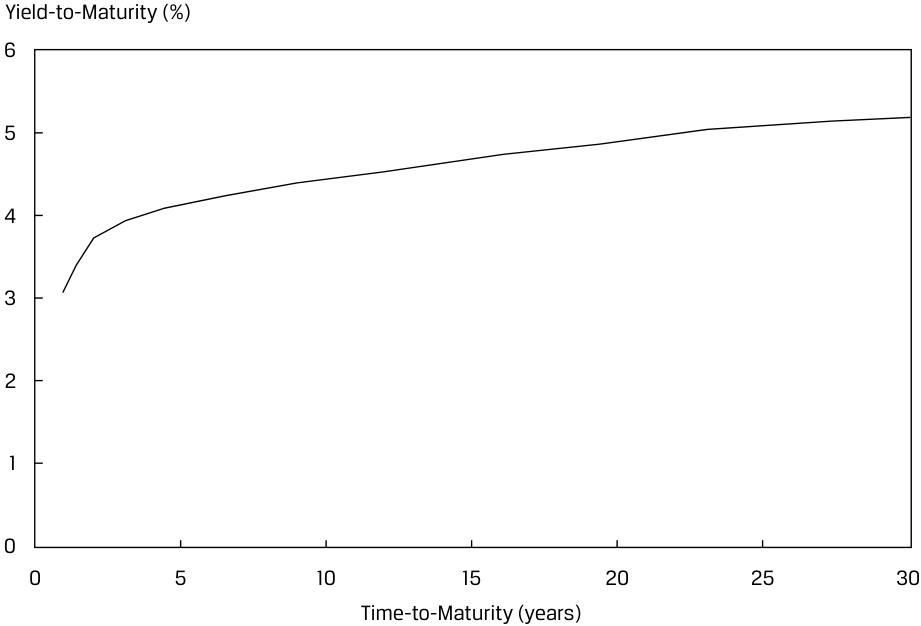
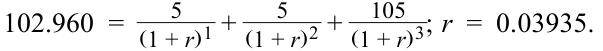
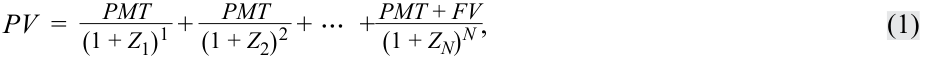
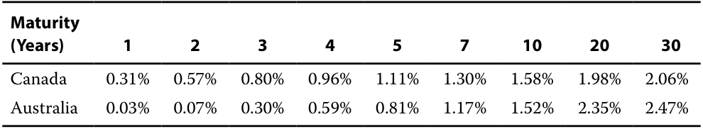
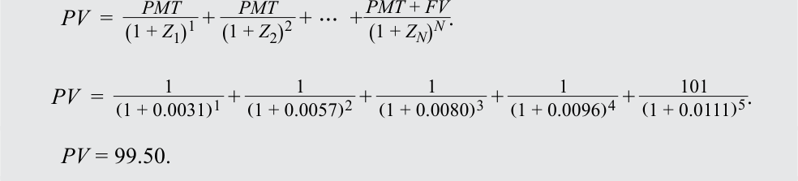
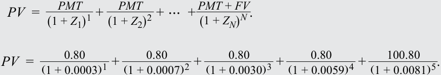
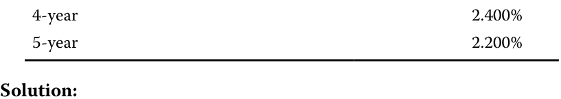

# Volume 6: Fixed Income
## Learning Module 9 The Term Structure of Interest Rates: Spot, Par, and Forward Curves
### Part 1/3: Introduction (PDF Pages 221–230)

---

<!-- PDF Page 221 -->

#### L E A R N I N G M O D U L E 

# **<mark>9</mark>** 

### **The Term Structure of Interest Rates: Spot, Par, and Forward Curves** 

###### **<mark>LEARNING OUTCOMES</mark>** 

|**_Mastery_**|**_The candidate should be able to:_**|
|---|---|
||define spot rates and the spot curve, and calculate the price of a bond using spot rates|
||define par and forward rates, and calculate par rates, forward rates from spot rates, spot rates from forward rates, and the price of a bond using forward rates|
||compare the spot curve, par curve, and forward curve|

##### **INTRODUCTION** 

**<mark>1</mark>** 

Prior lessons priced fixed-income instruments by discounting all future cash flows using a single interest rate, such as the yield-to-maturity or a market reference rate (MRR) plus a discount margin. The next three lessons relax this assumption by introducing the term structure of interest rates, or the fact that interest rates vary with time-to-maturity. The ideal data to use for term structure analysis are default-risk-free zero-coupon bonds, known as spot rates or the spot curve. Since these are generally not directly observable, various estimation techniques are used. The spot curve is used to derive two other important yield curves: the par curve and the forward curve. A par curve involves bond yields for hypothetical benchmark securities priced at par, while the forward curve involves rates for interest periods starting in the future. All three of these curves are fundamental to fixed-income analysis and other applications because they represent default-risk-free rates of return for time periods that start today and in the future. We show the pricing of bonds using these different rates and establish their relationships. 

Most of the examples and exhibits used throughout the reading can be downloaded as a Microsoft Excel workbook. Each worksheet in the workbook is labeled with the corresponding example or exhibit number in the text. 

<!-- PDF Page 222 -->

###### **LEARNING MODULE OVERVIEW** 

- Spot rates are market discount rates on default-risk-free zero-coupon bonds, sometimes referred to as zero rates. By using a sequence of spot rates in calculating bond prices, a no-arbitrage bond price is obtained. 

- A par rate is the market discount rate for a specific maturity that would result in a bond priced at par. A par rate is derived from the spot rates up to and including the maturity date. 

- Implied forward rates are calculated using spot rates and can be interpreted as an incremental, or marginal, return for extending the time-to-maturity for an additional time period. As such, they reflect a breakeven reinvestment rate. 

- Since par and forward rates can be derived from spot rates, the shape of the spot curve is closely related to the shape of the par and forward curves. 

- In upward-sloping term structures, par rates will be lower than their corresponding spot rates and forward rates will be greater than spot rates. In downward-sloping term structures, par rates will be greater than spot rates and forward rates will be lower than spot rates. 

###### **LEARNING MODULE SELF-ASSESSMENT** 

These initial questions are intended to help you gauge your current level of understanding of this learning module. 

1. Calculate the price and yield-to-maturity (YTM) of a 1% coupon, three-year bond with par value of 100 given the following spot rates: 

|1-year|1.0%|
|---|---|
|2-year|1.5%|
|3-year|2.0%|

###### **Solution:** 

The price is 97.135: 

<!-- Formula Text: PV  =    PMT _ (1 + Z 1) 1  +   PMT _ (1 + Z 2) 2  + ⋯  +  PMT + FV _ (1 + Z N) N PV  = 1 _ (1 + 0.01) 1  + 1 _ (1 + 0.015) 2  + 101 _ (1 + 0.02) 3 PV = 97.135 The YTM is 1.993%: PV  =    PMT _ (1 + r) 1  +   PMT _ (1 + r) 2  + ⋯  +  PMT + FV _ (1 + r) N 97.135  = 1 _ (1 + r) 1  + 1 _ (1 + r) 2  +   101 _ (1 + r) 3 r = 0.01993 = 1.993% -->

<!-- PDF Page 223 -->

2. Define what a par rate represents in the context of bond pricing. 

###### **Solution:** 

   - The par rate is the yield-to-maturity that makes the present value of a bond’s cash flows (i.e., its price) equal to its par or face value. 

3. Calculate an implied one-year forward rate two years from now (i.e., 2y1y) given the following spot rates, assuming annual compounding: 

|1-year|1.0%|
|---|---|
|2-year|1.5%|
|3-year|2.0%|

###### **Solution:** 

- (1 + _ZA_ )_A_ × (1 + _IFRA,B – A_ )_B_−_A_ = (1 + _ZB_ )_B_ . 

(1 + 0.01)1 × (1 + _IFR_ 2,1)2 = (1 + 0.02)3 . _IFR_ 2,1 = 2.50%. 

4. Explain the economic meaning of the forward rate result calculated in Question 3. 

###### **Solution:** 

The one-year forward rate two years from now (2y1y) of 3.01% implies that investors expect the one-year interest rate to be 3.01% at the end of two years. This reflects the rate at which reinvestment would yield the same results over a three-year horizon regardless of whether the investor initially bought a two-year bond versus a three-year bond. 

5. Contrast spot and forward rates. 

###### **Solution:** 

Spot rates reflect borrowing and investing rates for funds immediately (or in the next few days) over the specified tenor, while forward rates reflect rates applicable to agreements to borrow or invest beginning on a future date for a specified tenor. 

6. True or false: One-year forward rates are higher compared to their corresponding spot rates when the spot rate curve is downward sloping. 

   - **A.** True 

   - **B.** False 

###### **Solution:** 

False. When the spot curve is downward sloping, the one-year forward rate curve will lie below the spot rate curve. Declining spot rates for longer maturities imply that investors should expect lower rates of reinvestment in future years, and the forward curve reflects these expectations. 

<!-- PDF Page 224 -->

## **<mark>2</mark>** 

##### **MATURITY STRUCTURE OF INTEREST RATES AND SPOT RATES** 

define spot rates and the spot curve, and calculate the price of a bond using spot rates 

###### **Maturity Structure of Interest Rates** 

Suppose that the yield-to-maturity is higher on one bond compared to another bond. There are several possible reasons for the difference, including credit risk, different currencies, liquidity, tax differences, and the periodicity assumption used in the yield calculation. Credit risk and currency differences were demonstrated in earlier lessons where Romania’s (Ministry of Finance) 30-year euro-denominated bonds were issued at a 4.657% yield-to-maturity, a 411 bp spread over Federal Republic of Germany bonds. Another reason bonds may have different yields-to-maturity is that they have different times-to-maturity. This factor explaining the differences in yields is called the **maturity structure of interest rates** or **term structure of interest rates** . 

Term structure is best analyzed using bonds that have all the same properties _other than_ time-to-maturity; that is, the bonds should be denominated in the same currency and have the same credit risk, liquidity, tax status, and periodicity assumption and they should have the same coupon rate so that they each have the same degree of coupon reinvestment risk. This ideal dataset would be yields-to-maturity on a series of default-risk-free _zero-coupon_ bonds, known as **spot rates** , for a full range of maturities. Developed market sovereign bonds are typically used for this purpose, because they represent the lowest default risk among issuers in a given market. Collectively, this dataset is the government bond **spot curve** , sometimes called the zero or “strip” curve (because the coupon payments are “stripped” off the bonds). 

The government bond spot curve is ideal for analyzing maturity structure because it best meets the “other things being equal” assumption. These government bonds presumably have the same currency, credit risk, liquidity, and tax status. Most importantly, as zero-coupon bonds, they have no coupon reinvestment risk. A government bond spot curve is illustrated in Exhibit 1 for maturities ranging from 1 to 30 years. The annual yields are stated on a semiannual bond basis, which facilitates comparison to coupon-bearing bonds that make semiannual payments, like corporate bonds in many markets. 

<!-- PDF Page 225 -->

**Exhibit 1: Government Bond Spot (Zero) Curve** 

<!-- Start of picture text -->
Yield-to-Maturity (%) 6 5 4 3 2 1 0 0 5 10 15 20 25 30 Time-to-Maturity (years) <!-- End of picture text -->

The spot curve in Exhibit 1 is upward sloping and flattens for longer times-to-maturity, meaning that the longer-term government bonds have higher yields than the shorter-term bonds. This pattern is typical under normal market conditions. Sometimes, a spot curve is downward sloping in that shorter-term yields are higher than longer-term yields. Such downward-sloping spot curves are called inverted yield curves. Theories that attempt to explain the shape of the yield curve and its implications for future financial market conditions are covered later. 

While a spot curve comprised of zero-coupon government bonds is ideal for analysis, there are several practical issues to contend with. First, most actively traded government bonds make coupon payments. These coupon bonds might not have the same liquidity and tax status. Older (“seasoned”) bonds tend to be less liquid than newly issued debt because they are owned by “buy-and-hold” institutional and retail investors. Governments issue new debt for regular times-to-maturity—for instance, 5-year and 10-year bonds. The current 6-year bond could be a 10-year bond that was issued four years ago. Also, because interest rates fluctuate, older bonds can be priced at a discount or premium to par value, which can lead to tax differences because some tax jurisdictions distinguish capital gains and losses from interest income. 

In practice, therefore, only the most recently issued and actively traded government bonds are used to build a yield curve. These bonds have similar liquidity, and because they are priced closer to par value, they have fewer tax effects. Additionally, because there are limited data for the full range of maturities, interpolation is used to complete the curve. Exhibit 2 illustrates a yield curve for a government that issues 2-year, 3-year, 5-year, 7-year, 10-year, and 30-year bonds that make semiannual coupon payments. Straight-line interpolation is used between those points on the yield curve. 

<!-- PDF Page 226 -->

**Exhibit 2: Government Coupon Bond Yield Curve** 

<!-- Start of picture text -->
Yield-to-Maturity (%) 3.0 2.5 2.0 1.5 1.0 0.5 0 0 5 10 15 20 25 30 Time-to-Maturity (years) Yield-to-Maturity (%) 0.20 0.15 0.10 0.05 0 1 3 6 12 Time-to-Maturity (months) <!-- End of picture text -->

Exhibit 2 also includes yields for short-term government securities having 1 month, 3 months, 6 months, and 12 months to maturity. Although these money market instruments are issued and traded on a discount rate basis, they are converted to bond equivalent yields (i.e., add-on rates with a 365-day year). All bonds on the yield curve should also be converted to the same periodicity in order to facilitate comparisons across times-to-maturity. Conversion from discount rates to bond equivalent yields and across periodicities was demonstrated in prior lessons. 

###### **Bond Pricing Using Spot Rates** 

Since interest rates vary by maturity and have a term structure, we can price bonds using a sequence of discount rates that correspond to the cash flow dates. One such sequence, representing default-risk-free rates, is the spot curve. Bond prices determined using spot rates establish “no-arbitrage” prices; if a bond’s price differs from its no-arbitrage value, an arbitrage opportunity exists in the absence of transaction costs. 

<!-- PDF Page 227 -->

Suppose that the one-year spot rate is 2%, the two-year spot rate is 3%, and the three-year spot rate is 4%. Then, the price of a three-year bond that makes a 5% annual coupon payment is 102.960: 

<!-- Formula Text: 5 _ (1.02) 1  + 5 _ (1.03) 2  +   105 _ (1.04) 3  = -->

###### 4.902 + 4.713 + 93.345 = 102.960. 

This three-year bond is priced at a premium, so its yield-to-maturity must be less than its 5% coupon rate. Using the basic bond pricing formula, the yield-to-maturity is 3.935%: 

<!-- Formula Text: 102.960  = 5 _ (1 + r) 1  + 5 _ (1 + r) 2  +   105 _ (1 + r) 3 ; r  =  0.03935. -->

If the cash flows are discounted using the yield-to-maturity, the same price is obtained: 

<!-- Formula Text: 5 _ (1.03935) 1  + 5 _ (1.03935) 2  + 105 _ (1.03935) 3  = -->

4.811 + 4.629 + 93.520 = 102.960. 

Notice that the present values of the individual cash flows discounted using spot rates differ from those discounted using the yield-to-maturity. The present value of the first coupon payment is 4.902 when discounted at 2%, but it is 4.811 when discounted at 3.935%. The present value of the final cash flow, which includes the redemption of principal, is 93.345 at 4% and 93.520 at 3.935%. Nevertheless, the sum of the present values using either approach is 102.960. 

Equation 1 is a general formula for calculating a bond price given the sequence of spot rates. Note that for pricing a bond with a different risk profile than the spot curve (such as credit risk, as for corporate bonds, for example), a spread would have to be added to the spot rates. 

<!-- Formula Text: PV  =    PMT _ (1 + Z 1) 1  +   PMT _ (1 + Z 2) 2  + ⋯  +  PMT + FV _ (1 + Z N) N , (1) -->

where 

_Z1_ is the spot rate, or zero-coupon yield or zero rate, for period 1 

_Z_ 2 is the spot rate, or zero-coupon yield or zero rate, for period 2 

_ZN_ is the spot rate, or zero-coupon yield or zero rate, for period _N_ 

We’ll use spot rates on Canadian and Australian government bonds to demonstrate bond pricing with spot rates. 

<!-- PDF Page 228 -->

**Exhibit 3: Government Bond Spot Rates: Canada and Australia** 

<!-- Start of picture text -->
Spot Rates (%) 3.0 2.5 2.0 1.5 1.0 0.5 0 1 2 3 4 5 7 10 20 30 Years until Maturity Canada Australia <!-- End of picture text -->

<!-- Start of picture text -->
Maturity (Years) 1 2 3 4 5 7 10 20 30 Canada 0.31% 0.57% 0.80% 0.96% 1.11% 1.30% 1.58% 1.98% 2.06% Australia 0.03% 0.07% 0.30% 0.59% 0.81% 1.17% 1.52% 2.35% 2.47% <!-- End of picture text -->

###### **EXAMPLE 1** 

###### **Bond Prices and Yields-to-Maturity Based on Spot Rates** 

1. Calculate the price (per 100 par value) of a five-year Canadian government bond with a 1.00% coupon given the spot rates shown in Exhibit 3. 

###### **Solution:** 

99.50. To calculate the price of the bond, we use Equation 1 and the spot rates provided for each cash flow. 

<!-- Formula Text: PV  =    PMT _ (1 + Z 1) 1  +   PMT _ (1 + Z 2) 2  + ⋯  +  PMT + FV _ (1 + Z N) N . PV  = 1 _ (1 + 0.0031) 1  + 1 _ (1 + 0.0057) 2  + 1 _ (1 + 0.0080) 3  + 1 _ (1 + 0.0096) 4  + 101 _ (1 + 0.0111) 5 . PV = 99.50. -->

2. Calculate the price (per 100 par value) of a five-year Australian government bond with a 0.80% coupon given the spot rates shown in Exhibit 3. 

###### **Solution:** 

99.99. To calculate the price of the bond, we use Equation 1 and the spot rates provided for each cash flow. 

<!-- Formula Text: PV  =    PMT _ (1 + Z 1) 1  +   PMT _ (1 + Z 2) 2  + ⋯  +  PMT + FV _ (1 + Z N) N . PV  = 0.80 _ (1 + 0.0003) 1  + 0.80 _ (1 + 0.0007) 2  + 0.80 _ (1 + 0.0030) 3  + 0.80 _ (1 + 0.0059) 4  + 100.80 _ (1 + 0.0081) 5 . -->

<!-- PDF Page 229 -->

###### _PV_ = 99.99 

3. Calculate the YTM of the five-year Canadian government bond, using the price obtained in Question 1. 

###### **Solution:** 

1.104%. Instead of solving for the price, we use Equation 1 to solve for the YTM, the IRR that equates the price computed in Question 1 with the present value of future cash flows. In Microsoft Excel or Google Sheets, the RATE or IRR function can be used to solve for _r_ . 

<!-- Formula Text: PV  =    PMT _ (1 + r) 1  +   PMT _ (1 + r) 2  + ⋯  +  PMT + FV _ (1 + r) N 99.50  = 1 _ (1 + r) 1  + 1 _ (1 + r) 2  + 1 _ (1 + r) 3  + 1 _ (1 + r) 4  +   101 _ (1 + r) 5 = r = 0.011036 = 1.104% -->

Notice that the yield of the coupon bond is slightly below the five-year spot rate. 

###### **QUESTION SET** 

1. True or false: In practice, a spot curve is created by calculating the yields-to-maturity on recently issued coupon-paying government bonds of varying maturities. 

   - **A.** True 

   - **B.** False 

###### **Solution:** 

True. While zero-coupon government risk-free bonds would be preferable, in practice, the spot curve is created using yields on recently issued coupon-paying government bonds and linear interpolation. These bonds best satisfy the conditions for term structure analysis. 

2. Determine the missing word in the following sentence: Because there are usually limited data to calculate yields for the full range of maturities, it is usually necessary to __________ between observed yields to complete curve data. 

###### **Solution:** 

Because there are usually limited data to calculate yields for the full range of maturities, it is usually necessary to interpolate between observed yields to complete curve data. 

3. Calculate the price and yield-to-maturity of a 2.5% coupon, five-year bond given the following spot rates. Assume annual compounding. 

|1-year|3.000%|
|---|---|
|2-year|2.800%|
|3-year|2.600%|

<!-- PDF Page 230 -->

<!-- Start of picture text -->
4-year                   2.400% 5-year                   2.200% Solution: <!-- End of picture text -->

The price is 101.314. 

<!-- Formula Text: PV  =    PMT _ (1 + Z 1) 1  +   PMT _ (1 + Z 2) 2  + ⋯  +  PMT + FV _ (1 + Z N) N . PV  = 2.50 _ (1 + 0.03) 1  + 2.50 _ (1 + 0.028) 2  + 2.50 _ (1 + 0.026) 3  + 2.50 _ (1 + 0.024) 4  + 102.50 _ (1 + 0.022) 5 . PV = 101.34 The YTM is 2.22%. PV  =    PMT _ (1 + r) 1  +   PMT _ (1 + r) 2  + ⋯  +  PMT + FV _ (1 + r) N 101.34  =    2.50 _ (1 + r) 1  +   2.50 _ (1 + r) 2  +   2.50 _ (1 + r) 3  +   2.50 _ (1 + r) 4  +  102.50 _ (1 + r) 5 r = 0.022195 = 2.22% -->

4. Suppose we observed the following term structure for Canadian government bonds. Calculate the price of a 0.50% coupon, three-year Canadian government bond. 

|**Maturity**|**Yield-to-maturity**|
|---|---|
|1-Year|1.1000%|
|2-Year|0.9500%|
|3-Year|0.7951%|
|4-Year|0.5700%|
|5-Year|0.3100%|

<!-- Formula Text: Solution: The price is 99.126. PV  =    PMT _ (1 + Z 1) 1  +   PMT _ (1 + Z 2) 2  + ⋯  +  PMT + FV _ (1 + Z N) N . PV  = 0.50 _ (1 + 0.011) 1  + 0.50 _ (1 + 0.095) 2  + 100.50 ____________ (1 + 0.007951) 3 PV = 99.126 -->

5. Example 1 includes a question for a 0.50% coupon, three-year Canadian government bond, in which the bond’s price is the same as the 99.126 price in Question 4 above. Contrast the Canadian spot curves in Example 1 and Question 4 and explain why these two different yield curves produced the same pricing result. 

###### **Solution:** 

Example 1 has an upward-sloping term structure, while in Question 4, the term structure is downward sloping. An important similarity is that, despite the vast difference in starting <u>points (i.e., the one-year spot rates)</u> 

