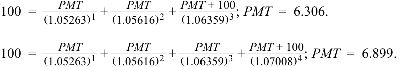
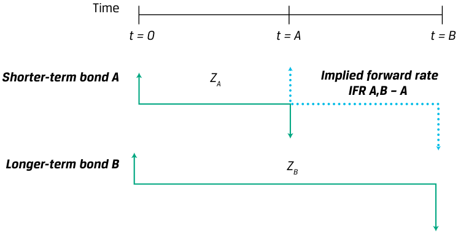
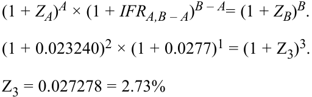
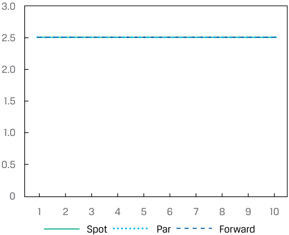
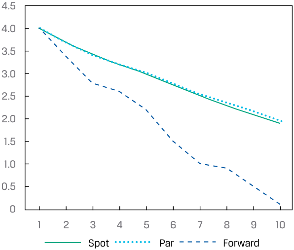

# Volume 6: Fixed Income
## Learning Module 9 The Term Structure of Interest Rates: Spot, Par, and Forward Curves
### Part 2/3: Par and Forward Rates (PDF Pages 231–246)

---

<!-- PDF Page 231 -->

between the two examples, the three-year spot rates are similar. In Example 1, the three-year rate is 0.7977%, and the three-year rate in Question 4 is 0.7951%. As a result of the similarity of the spot rates in the upward- and downward-sloping term structure examples, it is possible to exhibit the same price (and YTM) in upward- and downward-sloping term structure environments. 

#### **PAR AND FORWARD RATES** 

# **<mark>3</mark>** 

define par and forward rates, and calculate par rates, forward rates from spot rates, spot rates from forward rates, and the price of a bond using forward rates 

##### **Par Rates from Spot Rates** 

An important use of spot rates is determining par rates. A **par rate** is a yield-to-maturity that makes the present value of a bond’s cash flows equal to par (100% of face value). Par rates derived for _hypothetical_ government bonds with different times-to-maturity are commonly used for term structure analysis because they control for tax, trading, and other potential distortions associated with actual bonds priced at either a discount or premium. The widely cited US Treasury yield curve published each day by the US Department of the Treasury, for example, is composed of par rates. The most recently issued or on-the-run government securities introduced in an earlier lesson, however, are _actual_ bonds whose yields-to-maturity are close to but not equal to par rates. 

On a coupon payment date, the following equation can be used to calculate a par rate by solving for _PMT_ given a sequence of spot rates _Z_ 1, _Z_ 2, . . . , _Zn_ . Between coupon dates, we set the flat price, rather than the full price, equal to 100. 

<!-- Formula Text: 100  =    PMT _ (1 + z 1) 1  +   PMT _ (1 + z 2) 2  + ⋯  +  PMT + 100 _ (1 + z N) N . (2) -->

This equation is very similar to Equation 1, except _PV_ = _FV_ = 100. Recall that for a bond to trade at par, its coupon rate and yield-to-maturity must be equal. So, by solving for _PMT_ , we also solve for the yield-to-maturity for the bond to trade at par _._ This single rate, divided by 100, is the par rate _per period_ . 

An example illustrates the calculation of par rates given spot rates. Suppose the current one-, two-, three-, and four- year spot rates on government bonds are 5.263%, 5.616%, 6.359%, and 7.008%, respectively. These are effective annual rates. The one-year par rate is 5.263%: 

<!-- Formula Text: 100  =   PMT + 100 _ (1.05263) 1 ; PMT  =  5.263. The two-year par rate is 5.606%. 100  = PMT _ (1.05263) 1  +  PMT + 100 _ (1.05616) 2 ; PMT  =  5.606. -->

The three-year and four-year par rates are 6.306% and 6.899%, respectively. 

<!-- Formula Text: 100  = PMT _ (1.05263) 1  + PMT _ (1.05616) 2  +  PMT + 100 _ (1.06359) 3 ; PMT  =  6.306. 100  = PMT _ (1.05263) 1  + PMT _ (1.05616) 2  + PMT _ (1.06359) 3  +  PMT + 100 _ (1.07008) 4 ; PMT  =  6.899. -->

<!-- PDF Page 232 -->

We can confirm that these are the par rates through the pricing formula. Using these par rates as the coupon and yield-to-maturity, the price of the two-year bond is 100: 5.606/(1.05606)1 + 105.606/(1.05606)2 = 100. 

Likewise, the price of the four-year bond is also 100: 

- 6.899/(1.06899)1 + 6.899/(1.06899)2 + 6.899/(1.06899)3 + 106.899/(1.06899)4 

- = 100. 

###### **EXAMPLE 2** 

##### **Bond Prices and Yields-to-Maturity Based on Par Rates** 

1. The par rate for a bond may be calculated from the set of spot rates reflecting maturities up to and including the maturity of the desired par rate. Using the spot rate data shown in Exhibit 1, calculate the par rate for a three-year Canadian government bond. In this example (and subsequent examples), annual payments and compounding are assumed. **Solution:** Use Equation 2 to solve for _PMT_ , as follows: _ _ _ 100 =  (1 +_PMT_ _z_ 1)1 + (1 +_PMT_ _z_ 2)2 + ⋯ +_PMT_ (1 ++ 100 _zN_ )_N_. ___________ PMT_ __________ PMT_ ____________ 100 =( 1 + 0.003117)1+  ( 1 + 0.00568)2+  ( 1 + 0.007977_PMT_+ 100)3. We can factor out _PMT_ and then solve for it: ____________1 ___________1 ____________1 ____________100 100 = _PMT_ × (( 1 + 0.003117)1+  ( 1 + 0.00568)2+  ( 1 + 0.007977)3) + ( 1 + 0.007977)3. _PMT_ = 0.7952. 

To convert the coupon payment to a par rate per period, we divide by 100 (i.e., 0.7952/100). Thus, the par rate equals 0.7952%. 

##### **Forward Rates from Spot Rates** 

Spot rates can also be used to calculate **implied forward rates** (also known as forward yields), which are breakeven reinvestment rates. They link the return on an investment in a shorter-term zero-coupon bond to the return on an investment in a longer-term zero-coupon bond. 

Suppose that the yields-to-maturity on three-year and four-year zero-coupon bonds are 3.65% and 4.18%, respectively. An analyst would like to know how much extra return is implied by these rates for investing for four rather than three years (i.e., an incremental year). This would be the implied one-year forward yield three years into the future, depicted in Exhibit 4. 

<!-- PDF Page 233 -->

**Exhibit 4: The One-Year Implied Rate, Three Years from Today** 

<!-- Start of picture text -->
Time t = 0 t = 3 t = 4 Implied forward rate = 3-year zero ZA = 3.65% 3y1y 4-year zero ZB = 4.18% <!-- End of picture text -->

The most common market practice is to name this forward rate the “3y1y,” pronounced “three-year into one-year rate,” or simply “3’s, 1’s.” The first number refers to the length of the forward period in years from today, and the second number refers to the **tenor** of the underlying bond, or its remaining time-to-maturity. In the money market, the forward rate is usually expressed in months. 

If the investor’s view on future bond yields is that the one-year yield in three years’ time is likely to be lower than the 3y1y, it might be better to simply invest in the four-year zero-coupon bond. However, if the investor’s view is that the one-year yield will be more than the implied forward rate, the investor might prefer the three-year bond and then reinvest at the expected higher rate for an additional one year. That explains why an implied forward rate is the _breakeven reinvestment rate_ . 

Equation 3 is a general formula for the implied forward rate, _IFRA_ , _B_ – _A_ , for a security begins at _t_ = _A_ and matures at _t_ = _B_ (tenor B – A). To solve for it, we need the spot rate, _zA_ , and the longer-term spot rate, _zB_ . This is illustrated in Exhibit 5. 

(1 + _ZA_ )_A_ × (1 + _IFRA,B_ – _A_ )_B_–_A_ = (1 + _ZB_ )_B_ . 

~~(3)~~ 

**Exhibit 5: Implied Forward Rates** 

<!-- Start of picture text -->
Time t = 0 t = A t = B Shorter-term bond A ZA Implied forward rate IFR A,B – A Longer-term bond B ZB <!-- End of picture text -->

Using Equation 3, let’s solve for the 3y1y since we know that the yields-to-maturity on three-year and four-year zero-coupon bonds are 3.65% and 4.18%, respectively: 

(1 + _ZA_ )_A_ × (1 + _IFRA,B_ – _A_ )_B_–_A_ = (1 + _ZB_ )_B_ . 

(1 + 0.0365)3 × (1 + _IFR_ 3,1)1 = (1 + 0.0418)4 . 

<!-- PDF Page 234 -->

###### _IFR_ 3,1 = 0.057863 = 5.79% 

The “3y1y” implied forward yield is 5.79%. If the investor believes that the one-year yield will be higher than that in three years, she should invest in the three-year bond rather than the four-year bond (and vice versa). 

###### **EXAMPLE 3** 

##### **Deriving Forward Rates from Spot Rates** 

1. Let’s return to the spot rates shown in Exhibit 1. In the following example, we will assume annual compounding (i.e., periodicity of 1). Calculate the 2y1y implied forward rate on Canadian government bonds. 

###### **Solution:** 

To calculate the 2y1y implied forward rate, we recognize that we are estimating the one-year rate at a point two years from Time 0. Therefore, _A_ = 2, _B_ = 3, _ZA_ is the two-year spot rate, and _ZB_ is the three-year spot rate: 

- (1 + _ZA_ )_A_ × (1 + _IFRA,B_ – _A_ )_B_–_A_ = (1 + _ZB_ )_B_ . 

(1 + 0.0188) × (1 + 0.0277) = (1 + Z2)2 . 

IFR2,1 = 0.0126. 

Thus, the implied forward rate for a one-year bond two years from now is 1.26%. 

##### **Spot Rates from Forward Rates and Bond Pricing with Forward Rates** 

While forward rates can be calculated from spot rates, spot rates can also be calculated from forward rates, and either can be used for pricing because they are interconnected. An example will illustrate this process. 

Suppose the current sequence of one-year rates today and the one-year rate one, two, and three years from now are as follows: 

|**Time Period**|**Forward Rate**|
|---|---|
|0y1y|1.88%|
|1y1y|2.77%|
|2y1y|3.54%|
|3y1y|4.12%|

These are annual rates stated for a periodicity of 1. They are effective annual rates. The first rate, the 0y1y, is the one-year spot rate. The others are one-year forward rates. Spot rates can be calculated using Equation 3. The two-year implied spot rate is 2.324%: 

- (1 + _ZA_ )_A_ × (1 + _IFRA,B_ – _A_ )_B_–_A_ = (1 + _ZB_ )_B_ . 

- (1 + 0.0188)2 × (1 + 0.0277)1 = (1 + Z2)3 . 

Z2 = 0.023240 = 2.324% 

<!-- PDF Page 235 -->

Notice how the product of the 0y1y and 1y1y is the two-year spot rate. This property holds in general, because the spot curve can be calculated by taking the geometric average of the forward rates. This is evident if we solve for the implied three- and four-year spot rates. Using Equation 3, we can use the implied two-year spot rate we just found to solve for the three-year spot rate: 

<!-- Formula Text: (1 + ZA)A × (1 + IFRA,B – A)B – A= (1 + ZB)B. (1 + 0.023240)2 × (1 + 0.0277)1 = (1 + Z3)3. Z3 = 0.027278 = 2.73% -->

Or since the two-year spot rate is the product of the 0y1y and 1y1y rates, we can simply multiply across the forward curve for three- and four-year spot rates: 

(1.0188 × 1.0277 × 1.0354) = (1+ Z3)3 ; Z3 = 0.27278 

(1.0188 × 1.0277 × 1.0354 × 1.0412) = (1 + Z4)4 ; Z4 = 0.030741 

Suppose that an analyst needs to value a four-year 3.75% annual coupon payment bond that has the same risks as the bonds used to obtain the forward curve. Using the implied spot rates, the value of the bond is 102.637 per 100 of par value. 

_( 1.01883.75)1+ _( 1.0232403.75)2+ _( 1.0272783.75)3+ _( 1.030741103.75)4= 102.637. 

The bond also can be valued using the forward rates as follows: 

_ _____________3.75 ____________________3.753.75( 1.0188)+  ( 1.0188 × 1.0277)+  ( 1.0188 × 1.0277 × 1.0354) +  __________________________( 1.0188 × 1.0277 × 1.0354 × 1.0412103.75)= 102.637. 

###### **EXAMPLE 4** 

##### **Deriving Spot Rates from Forward Rates and Pricing Bonds Using Forward Rates** 

Suppose we have the following forward rates for Canadian government bonds: 

|**Forward tenor**|**Rates**|
|---|---|
|0y1y|0.3117%|
|1y1y|0.8250%|
|2y1y|1.2587%|
|1y2y|1.0416%|

1. Calculate a three-year spot rate on Canadian government bonds using the forward rate information. 

###### **Solution:** 

The three-year spot rate is calculated using three of the one-year forward rates above: the 0y1y, 1y1y, and 2y1y. 

- (1.003117 × 1.008250 × 1.012587) = (1 + _z_ 3)3 . 

_z_ 3 = 0.7977%. 

<!-- PDF Page 236 -->

2. Calculate the value of a three-year Canadian government bond paying a 0.50% coupon using forward rates. 

###### **Solution:** 

<!-- Formula Text: PV  = 0.5 _ 1.003117  + 0.5 ________________ (1.003117 × 1.008250)  + 100.50 _________________________ (1.003117 × 1.008250 × 1.0012587) -->

PV = 99.126 

This example corresponds to Question 4 in the earlier Lesson Question Set. A review of the solution to that problem indicates that we have shown that the value of the three-year 0.50% coupon Canadian government bond is equal to 99.126 regardless of whether we use spot rates or forward rates. 

###### **QUESTION SET** 

1. Contrast a par rate and a yield-to-maturity. 

   - **Solution:** 

A par rate is the YTM and coupon rate assuming a bond is priced at par value and cash flows are discounted using spot rates, while the yield-to-maturity is the internal rate of return on a bond’s cash flows using a bond’s current price. 

2. Calculate a three-year par rate given the following spot rates. Assume annual compounding: 

|1-year 3.0000%|
|---|
|2-year 2.8000%|
|3-year 2.6000%|

###### **Solution:** 

- 2.607%. 

<!-- Formula Text: 100  =    PMT _ (1 + z 1) 1  +   PMT _ (1 + z 2) 2  + ... +  PMT + 100 _ (1 + z N) N 100  = PMT _ (1 + 0.03) 1  + PMT _ (1 + 0.028) 2  + PMT _ (1 + 0.026) 3  +  PMT + 100 _ (1 + 0.026) 3 100  =  PMT × ( 1 _ (1 + 0.03) 1  + 1 _ (1 + 0.028) 2  + 1 _ (1 + 0.026) 3  ) + 100 _ (1 + 0.026) 3 -->

   - _PMT_ = 2.607% 

3. Match the implied forward rate to the spot rates necessary to calculate it. 

|1. 1y2y|A. Three-year and two-year spot rates|
|---|---|
|2. 3y2y|B. Three-year and one-year spot rates|
|3. 2y1y|h C. Five-year and three-year spot rates|

###### **Solution:** 

1. B. The 1y2y is a two-year forward rate in one year. Thus, we start with the three-year spot rate and use the one-year spot rate to find an implied two- <u>year forward rate.</u> 

<!-- PDF Page 237 -->

   2. C. The 3y2y is a two-year forward rate in three years. Thus, we start with the five-year spot rate and use the three-year spot rate to find an implied two-year forward rate. 

   3. A. The 2y1y is a one-year forward rate in two years. Thus, we start with the three-year spot rate and use the two-year spot rate to find an implied one-year forward rate. 

4. Determine the missing words in the following sentence: An implied forward rate represents a ____________ reinvestment rate such that no arbitrage opportunities exist between spot and forward rates. 

   - **Solution:** 

An implied forward rate represents a breakeven reinvestment rate such that no arbitrage opportunities exist between spot and forward rates. 

5. Calculate the implied forward rate 2y3y given the following spot rates. Assume annual compounding. 

|**Tenor** **Spot Rate**|
|---|
|1-year 2.0%|
|2-year 2.3%|
|3-year 2.5%|
|4-year 2.6%|
|5-year 2.4%|

###### **Solution:** 

2.467%. 

(1 + _ZA_ )_A_ × (1 + _IFRA,B_ – _A_ )_B_–_A_ = (1 + _ZB_ )_B_ 

(1 + 0.023)2 × (1 + _IFR_ 2,3)3 = (1 + 0.024)5 _Z3_ = 2.467% 

6. Calculate the price of a 2% coupon bond with 100 par value maturing in three years given the following forward rates, and demonstrate that this price is equivalent regardless of whether spot rates or forward rates are used as discount rates. Assume annual compounding and the following forward rates. 

|**Tenor** **Forward Rate**|
|---|
|0y1y 1.5%|
|1y1y 2.5%|
|2y1y 3.5%|

###### **Solution:** 

The price is 98.619. Forward rate approach: 

<!-- Formula Text: PV  = 2 _ (1.015)  + 2 ___________ (1.015 × 1.025)  + 102 _________________ (1.015 × 1.025 × 1.035) . -->

<!-- PDF Page 238 -->

_PV_ = 98.6190. 

The implied one-, two-, and three-year spot rates are as follows: One-year = 1.5%. 

Two-year = (1.015 × 1.025)(1/2) – 1 = 1.999%. Three-year = (1.015 × 1.025 × 1.035)(1/3) – 1 = 2.4967%. Using the spot prices to price the bond gives the following: 

_2 _2 _102 _PV_ =( 1.015)1+  ( 1.01999)2+  ( 1.024967)3. _PV_ = 98.6190. 

7. Demonstrate how an investor with a five-year investment horizon would optimally decide between the two following strategies: 

   - Buy a three-year government bond at the 3% spot rate, and then reinvest for two years at the expected future two-year rate. 

   - Buy a five-year government bond at the 4% spot rate. 

###### **Solution:** 

Calculate the implied two-year forward rate in three years: 

- (1 + _ZA_ )_A_ × (1 + _IFRA,B_ – _A_ )_B_–_A_ = (1 + _ZB_ )_B_ _._ 

- (1 + 0.03)3 × (1 + IFR3,2)2 = (1 + 0.04)5 . 

_IFR_ 3,2 = 5.52% 

If the investor believes that the two-year rate in three years will be greater than 5.52%, then the better strategy is to buy the three-year government bond and reinvest at a higher rate. If the investor believes that the two-year rate in three years will be less than 5.52%, then the five-year bond should be purchased. The implied forward rate represents the breakeven reinvestment rate. 

# **<mark>4</mark>** 

#### **SPOT, PAR, AND FORWARD YIELD CURVES AND INTERPRETING THEIR RELATIONSHIP** 

compare the spot curve, par curve, and forward curve 

Because spot, par, and forward rates are interconnected, so are the shapes of the spot, par, and forward curves. This analysis is best illustrated through an example. In an earlier lesson, we used spot rates to compute par rates and forward rates for Canadian and Australian government bonds. We can use these rates to build yield curves across a range of maturities, shown in Exhibit 1. 

<!-- PDF Page 239 -->

###### **Spot, Par, and Forward Curves (Canada and Australia)** 

###### **A. Spot, Par, and Forward Curves: Canadian Government Bonds** 

<!-- Start of picture text -->
2.5 2.0 1.5 1.0 0.5 0 1 2 3 4 5 6 7 8 9 10 Spot Par Forward <!-- End of picture text -->

###### **B. Spot, Par, and Forward Curves: Australian Government Bonds** 

<!-- Start of picture text -->
3.0 2.5 2.0 1.5 1.0 0.5 0 1 2 3 4 5 6 7 8 9 10 Spot Par Forward <!-- End of picture text -->

We can make the following general observations: 

**1.** The spot rates are positive, and the spot curve is upward sloping. 

**2.** The spot and par curves are nearly identical; the par rates are slightly lower than the spot rates, and the (slight) difference between the spot and par curves is greater at longer maturities. 

**3.** Forward rates are greater than the spot and par rates. 

These observations stem from general relationships between the shapes of the curves. If the spot curve is upward sloping, par rates will be near—but below—spot rates, particularly at the long end of the curve. This is because the low short-term spot rates result in higher bond prices, particularly for longer-term bonds, which results in low par rates when we do the calculation that assumes the price is 100% of par. Forward rates being above spot rates, if the spot curve is upward sloping, follows from the prior lesson, which established forward rates as incremental rates of return. 

<!-- PDF Page 240 -->

Exhibit 6 shows the spot, par, and forward curves if the spot curve is flat, assumed to be 2.50% for all maturities. When the spot rate is constant across all maturities, the par and forward rates will equate to the spot rate across all maturities as well. In short, a flat spot rate curve reflects no expectations of changes in future interest rates; thus forward rates equal spot rates. In this particular example, government bonds would pay a 2.5% coupon rate, and the bonds would be priced at par value (thus, the par rate is also 2.5%). 

**Exhibit 6: Flat Term Structure** 

<!-- Start of picture text -->
3.0 2.5 2.0 1.5 1.0 0.5 0 1 2 3 4 5 6 7 8 9 10 Spot Par Forward <!-- End of picture text -->

Exhibit 7 shows the spot, par, and forward curves for a downward-sloping (inverted) spot curve or falling spot rates as maturities lengthen. Starting from a 4% 1-year spot rate, rates fall to 1.90% for a maturity of 10 years. As in the previous examples, the par rates are similar to the spot rates. The inverted term structure of spot rates reflects expectations of significantly lower one-year rates in future years, and this is shown by the forward curve. In this example, the spot rate term structure implies a one-year rate of 0.1175% expected in nine years. 

<!-- PDF Page 241 -->

**Exhibit 7: Inverted Term Structure** 

<!-- Start of picture text -->
4.5 4.0 3.5 3.0 2.5 2.0 1.5 1.0 0.5 0 1 2 3 4 5 6 7 8 9 10 Spot Par Forward <!-- End of picture text -->

We conclude with Exhibit 8, which summarizes the general relationship between the spot, par, and forward curves for different spot curve shapes. 

**Exhibit 8: Spot, Par, and Forward Curve Relationship** 

|**Spot Curve Shape**|**Par Curve**|**Forward Curve**|
|---|---|---|
|Upward Sloping|Below spot curve|Above spot curve|
|Flat|Equal to spot curve|Equal to spot curve|
|Downward Sloping (Inverted)|Above spot curve|Below spot curve|

<!-- PDF Page 242 -->

###### **QUESTION SET** 

1. The chart below shows a spot curve and its implied forward curve. Identify the forward curve, and justify your choice. 

<!-- Start of picture text -->
5.0 4.5 4.0 3.5 3.0 2.5 2.0 1.5 1.0 0.5 0 1 2 3 4 5 6 7 8 9 10 <!-- End of picture text -->

###### **Solution:** 

The forward curve is represented by the line that moves from 3.0% to approximately 1.5% in Year 5 and then slopes dramatically higher from Year 5 to 6, ending at about 4.5% in Year 10. 

When the spot curve is sloping downward (Years 1–5), forward rates will be below spot rates. When the spot curve is sloping upward (Years 6–10), forward rates will be above spot rates. 

For Questions 2 and 3, refer to the spot rate data shown in Exhibit 9. It is important to note that some bonds will trade at negative yield. This was prevalent among developed market sovereign bonds in the wake of the financial crisis as central banks pursued accommodative monetary policy in response to below-target inflation. Negative rates do not change the fundamental mathematics used in bond pricing. 

**Exhibit 9: Negative Spot Rates (Germany and Switzerland)** 

|**Maturity**|**Germany**|**Switzerland**|
|---|---|---|
|1-year|–0.6965%|–0.7882%|
|2-year|–0.7034%|–0.7133%|
|3-year|–0.7021%|–0.6435%|
|4-year|–0.6418%|–0.5615%|
|5-year|–0.5578%|–0.4757%|
|6-year|–0.4796%|–0.4080%|
|7-year|–0.4014%|–0.3402%|
|8-year|–0.3269%|–0.2673%|
|9-year|–0.2524%|–0.1945%|
|10-year|–0.1779%|–0.1216%|

<!-- PDF Page 243 -->

2. Calculate the implied one-year forward rate in nine years in Switzerland. **Solution:** 

The question is requesting the 9y1y forward rate. This is calculated from the 10-year and 9-year spot rates, as follows: 

- (1 + _ZA_ )_A_ × (1 + _IFRA,B_ – _A_ )_B_–_A_ = (1 + _ZB_ )_B_ 

(1 + -0.001945)9 × (1 + _IFR_ 9,1)1 = (1 + -0.001216)10 

_IFR_ 9,1 = 0.537% 

Thus, the implied one-year forward rate in nine years for Swiss government bonds is 0.537%. 

3. Explain why a country with negative spot rates, such as Switzerland, may have positive forward rates. 

###### **Solution:** 

As shown in earlier examples, an upward-sloping spot curve (which Switzerland has) will be characterized by forward rates that are greater than spot rates. As the negative rates become less negative and move closer to zero, the more likely that forward rates will be positive with an upward-sloping spot curve. 

4. The following chart shows spot and forward curves for German sovereign bonds. Explain why the forward curve is close to identical to the spot curve for two and three-year maturities. 

<!-- Start of picture text -->
1.0 0.5 0 –0.5 –1.0 1 2 3 4 5 6 7 8 9 10 Spot Par Forward <!-- End of picture text -->

###### **Solution:** 

In flat term structure environments, forward rates equal spot rates. The spot rates in Germany for two and three-year maturities appear to be approximately equivalent to the one-year spot rate. Thus, Germany’s term structure is flat for the first three years, and forward rates should be approximately equal to spot rates. 

<!-- PDF Page 244 -->

## **~~PRACTICE PROBLEMS~~** 

### **The following information relates to questions 1-9** 

Use the spot rates provided to answer the following questions. 

###### **Government Bond Spot Rates** 

|**Maturity**|**Canada**|**Australia**|**Germany**|**Switzerland**|
|---|---|---|---|---|
|1-year|0.3117%|0.0272%|–0.6965%|–0.7882%|
|2-year|0.5680%|0.0675%|–0.7034%|–0.7133%|
|3-year|0.7977%|0.3003%|–0.7021%|–0.6435%|
|4-year|0.9640%|0.5853%|–0.6418%|–0.5615%|
|5-year|1.1105%|0.8052%|–0.5578%|–0.4757%|
|6-year|1.2052%|0.9877%|–0.4796%|–0.4080%|
|7-year|1.2998%|1.1702%|–0.4014%|–0.3402%|
|8-year|1.3935%|1.2878%|–0.3269%|–0.2673%|
|9-year|1.4872%|1.4054%|–0.2524%|–0.1945%|
|10-year|1.5809%|1.5230%|–0.1779%|–0.1216%|

**1.** Which level of coupon would the Swiss government choose if its goal is to minimize the premium over par value for a five-year debt issue? 

   - **A.** 1.0% 

**B.** 0.5% 

**C.** 0.0% 

**2.** The Australian government is considering issuing three-year bonds with a 3.0% coupon with annual payments. Given the spot rates in Australia, the price is _closest_ to: 

**A.** 108.05. 

**B.** 108.07. 

**C.** 108.69. 

**3.** Suppose the one-year and two-year spot rates in Canada move upward by 20 bps but the three-year Canadian spot rate remains unchanged. Which of the following best reflects the updated three-year Canadian par rate? 

   - **A.** Increases by approximately 13 bps 

   - **B.** Increases by approximately 7 bps 

   - **C.** Increases by approximately 0.16 bps 

<!-- PDF Page 245 -->

**4.** Match the spot rates needed to calculate the corresponding implied forward rates. 

|1. Two-year and five-year spot rates|A. Two-year implied forward rate in five years|
|---|---|
|2. Two-year and seven-year spot rates|B. Three-year implied forward rate in two years|
|3. Five-year and seven-year spot rates|C. Five-year implied forward rate in two years|

**5.** Which of the following choices is the closest to the implied five-year forward rate in two years for Swiss government bonds? 

   - **A.** –0.191% 

   - **B.** –0.001% 

   - **C.** –0.317% 

**6.** Match the sequence of forward rates and the corresponding spot rate that the forward rates will calculate. 

|**Forward rates**|**Spot rate calculation**|
|---|---|
|1. 0y1yx 1y1yx 2y1y|A. Four-year spot rate|
|2. 0y1yx 1y2yx 3y3y|B. Three-year spot rate|
|3. 0y1y x 1y1y x 2y1y x 3y1y|C. Six-year spot rate|

**7.** Which of the following statements about yield curves is true? 

   - **A.** Spot curves are derived from par rates. 

   - **B.** Par curves are derived from forward rates. 

   - **C.** Forward curves are derived from spot rates. 

**8.** Match the following statements about forward rate curves with corresponding statements about spot rate curves. 

|1. The forward rate curve lies above the spot rate curve.|A. The spot rate curve is downward sloping (i.e., inverted).|
|---|---|
|2. The forward rate curve lies below the spot rate curve.|B. The spot rate curve is upward sloping (i.e., normal).|
|3. The forward rate curve is equivalent to|C. The spot rate curve is flat across all|
|h the spot rate curve.|h     l maturities.|

**9.** Match the following statements about par rate curves with corresponding state- 

<!-- PDF Page 246 -->

ments about spot rate curves. 

|1. The par rate curve lies above the spot rate curve.|A. The spot rate curve is upward sloping (i.e., normal), and spot rates are negative.|
|---|---|
|2. The par rate curve lies below the spot rate curve.|B. The spot rate curve is upward sloping (i.e., normal), and spot rates arepositive.|
|3. The par rate curve is equivalent to the spot rate curve.|C. The spot rate curve is flat across all maturities.|

