# Volume 6: Fixed Income
## Learning Module 10 Interest Rate Risk and Return
### Part 1/2: Introduction (PDF Pages 249–264)

---

<!-- PDF Page 249 -->

# L E A R N I N G M O D U L E **<mark>10</mark>** 

### **Interest Rate Risk and Return** 

##### **<mark>LEARNING OUTCOMES</mark>** 

**_Mastery The candidate should be able to:_** calculate and interpret the sources of return from investing in a fixed-rate bond; describe the relationships among a bond’s holding period return, its Macaulay duration, and the investment horizon; define, calculate, and interpret Macaulay duration. 

#### **INTRODUCTION** 

## **<mark>1</mark>** 

Prior lessons on yield measures established that a fixed-income investor’s rate of return will equal a bond’s yield-to-maturity (YTM) under certain assumptions. In these lessons, we explore the sources of return for fixed-income investments and demonstrate investment returns in different scenarios, including the one embedded in the YTM calculations. Prior lessons also established interest rate risk. We show how investment horizon, in relation to a bond’s features, is a key determinant of interest rate risk for investors and how different investors in the same fixed-income investment can have different returns and views on risk. Finally, we introduce Macaulay duration, a weighted-average measure of the time to receipt for a bond’s cash flows, and demonstrate how holding a bond for its Macaulay duration balances reinvestment and price risks. 

###### **LEARNING MODULE OVERVIEW** 

- There are three sources of return for fixed-rate bond investors: (1) coupon and principal payments, (2) reinvestment of coupons, and (3) gain or loss on the sale of the bond if the bond is sold prior to maturity. 

- The rate of return on a fixed-rate bond investment is found by using the holding period, the future value of coupons received, the sale price, and the purchase price to calculate a compounded, annualized rate of return. 

<!-- PDF Page 250 -->

- If all cash flows are received at scheduled dates, coupons are reinvested at the same rate as a bond’s YTM, and the bond is held to maturity, an investor’s annualized compounded rate of return will equal the bond’s YTM. If any of those assumptions do not hold, the investor’s rate of return will vary. 

- Reinvestment risk and price risk are types of interest rate risk and have an inverse relationship. Reinvestment risk is the risk of decreasing reinvestment returns on cash flows, which occurs when interest rates fall. Price risk refers to declining prices and occurs when interest rates rise. 

- The longer the investment horizon, the more important reinvestment risk is relative to price risk. If an investor’s investment horizon equals the Macaulay duration of a bond, the risks equally offset each other. 

- Macaulay duration is the weighted-average time to receipt of a bond’s cash flows, where the weights of each cash flow in the calculation are each cash flow’s share of the bond’s full price (i.e., present value). 

- When the investment horizon is greater than (less than, equal to) a bond’s Macaulay duration, coupon reinvestment risk is higher than (lower than, equal to) the bond’s price risk. 

###### **LEARNING MODULE SELF-ASSESSMENT** 

These initial questions are intended to help you gauge your current level of understanding of the learning module. 

1. A source of risk for a buy-and-hold fixed-income investor, ignoring credit risk, is from: 

   - **A.** capital gain/loss on sale only. 

   - **B.** coupon reinvestment only. 

   - **C.** neither capital gain/loss on sale nor coupon reinvestment. 

   - **Solution:** 

B is correct. Changes in interest rates during the holding period of the bond will impact returns from reinvestment of coupons. 

A is incorrect because for a buy-and-hold investor, there is no risk of capital gain or loss since the investor is not selling the bond prior to maturity and will get the par value of the bond at the maturity date. 

C is incorrect because a buy-and-hold investor’s returns are impacted by the rate earned on the reinvestment of coupons, or reinvestment risk. 

2. A family office purchases a six-year, 5.8% annual coupon eurobond priced at par for settlement on 15 December 2031. The bond matures on 15 December 2037. Immediately after the purchase of the bond, interest rates rise to 6.5%. The family office sells the bond after three years. The family office’s total annualized return on the investment was _closest_ to: 

   - **A.** 5.28%. 

**B.** 5.80%. 

<!-- PDF Page 251 -->

**C.** 6.50%. **Solution:** A is correct. The total annualized return is composed of the (1) coupon payments, (2) reinvestment of coupons, and (3) gain/loss on the sale. This is equal to 5.28%, as shown below. The future value of the coupons including reinvestment is = – _FV_ (0.065, 3, 5.8, 0, 0) = 18.556. The sale price of the bond after three years is = – _PV_ (0.065, 3, 5.8, 100, 0) = 98.146. The realized return, _r_ , is_1  T_ − 1. _r_ =  (_FV_ _PV_)_1 ____________ 3 − 1. _r_ =  (18.556 + 98.146 100 ) _r_ = 0.0528 = 5.28% B is incorrect because it would be the return if interest rates remained at 5.8%. C is incorrect because 6.5% is the interest rate at which the coupons will be reinvested, not the rate of return for the family office on the investment. 3. The risk to an investor who buys a bond at par value and intends to sell it before the receipt of the first coupon payment, ignoring credit risk, is _most likely_ from: **A.** price risk. **B.** reinvestment risk. **C.** neither price risk nor reinvestment risk. **Solution:** A is correct. Changes in interest rates can affect the price of the bond and, therefore, the returns for the investor. B is incorrect because if the investor intends to sell the bond before the receipt of the first coupon, then reinvestment risk is irrelevant because no coupons will be reinvested. C is incorrect because the investor faces price risk. 4. Reinvestment risk and price risk of a bond offset one another if an investor’s investment horizon is: **A.** equal to the bond’s time-to-maturity. **B.** equal to the bond’s Macaulay duration. **C.** less than the bond’s Macaulay duration. **Solution:** B is correct. When the investment horizon is equal to the Macaulay duration, the gain (loss) from coupon reinvestment is offset by the loss (gain) in the price of the bond from changes in interest rates. 

<!-- PDF Page 252 -->

A is incorrect because if an investor holds a bond to maturity (ignoring credit risk), the investor faces no price risk but does face reinvestment risk. Therefore, reinvestment risk will dominate price risk. 

C is incorrect because if the investment horizon is less than the Macaulay duration, price risk dominates reinvestment risk. 

5. Hightest Capital purchases a 15-year, 6.8% annual coupon bond and has an investment horizon of 7.0 years. The Macaulay duration of the bond is 9.85 years. The duration gap at the time of purchase is _closest_ to: 

   - **A.** 2.85. 

   - **B.** 5.15. 

   - **C.** 8.00. 

###### **Solution:** 

A is correct. The duration gap for a bond is the difference between its Macaulay duration and the investor’s investment horizon: 9.85 – 7.0 = 2.85. 

B is incorrect because it is the difference between the bond’s maturity and its Macaulay duration (15 – 9.85 = 5.15). 

C is incorrect because it is the difference between the bond’s maturity and the investor’s investment horizon (15 – 7 = 8.00). 

6. Consider a bond that has two years remaining to maturity, a coupon of 4% paid semiannually, and a yield-to-maturity of 4.60%. Assuming it is 63 days into the first coupon period and a 30/360 basis, the bond’s annualized Macaulay duration is _closest_ to: 

   - **A.** 0.9419 years. 

   - **B.** 1.7666 years. 

   - **C.** 1.9416 years. 

**Solution:** 

B is correct. 

|**Period**|**Time to** **Receipt**|**Cash Flow**|**_PV_**|**Weight**|**Time to** **Receipt ×** **Weight**|
|---|---|---|---|---|---|
|1.0000|0.6500|2.0000|1.9707|0.0198|0.0129|
|2.0000|1.6500|2.0000|1.9264|0.0193|0.0319|
|3.0000|2.6500|2.0000|1.8830|0.0189|0.0501|
|4.0000|3.6500|102.0000|93.8759|0.9420|3.4383|
||||99.6559|1.0000|3.5331|
|||||Annualized|1.7666|
|||||MacDur||

The first cash flow’s time-to-receipt is (180-63)/180 = 0.65 periods from now as it is 63 days into the period. Each subsequent cash flow is received one period later after the first, so time-to-receipt = 0.65 + 1, 0.65 + 2, and so on. 

7. Consider a bond that has five years remaining to maturity, a coupon of 0% <u>paid annually, and a yield-to-maturity of –0.38%. Assuming it is the issuance</u> 

<!-- PDF Page 253 -->

date and a 30/360 basis, the bond’s annualized Macaulay duration is _closest_ to: 

**A.** 3.5361 years. **B.** 5.0000 years. **C.** 6.3412 years. **Solution:** 

B is correct. No calculation is required, because the Macaulay duration of a zero-coupon bond is its time-to-maturity unless it is between coupon dates. To demonstrate, however, see the following table: 

|**Period**|**Time to** **Receipt**|**Cash Flow**|**_PV_**|**Weight**|**Time to** **Receipt ×** **Weight**|
|---|---|---|---|---|---|
|1.0000|1.0000|0.0000|0.0000|0.0000|0.0000|
|2.0000|2.0000|0.0000|0.0000|0.0000|0.0000|
|3.0000|3.0000|0.0000|0.0000|0.0000|0.0000|
|4.0000|4.0000|0.0000|0.0000|0.0000|0.0000|
|5.0000|5.0000|100.0000|100.9554|1.0000|5.0000|
||||100.9554|1.0000|5.0000|

#### **SOURCES OF RETURN FROM INVESTING IN A FIXED-RATE BOND** 

**<mark>2</mark>** 

calculate and interpret the sources of return from investing in a fixed-rate bond; 

Fixed-rate bond investors have three sources of return: (1) receipt of promised coupon and principal payments on the scheduled dates, (2) reinvestment of coupon payments, and (3) potential capital gains or losses on the sale of the bond prior to maturity. We now focus on how interest rate changes affect the reinvestment of coupon payments and a bond’s market price if sold _prior to_ maturity. 

We start with two investors buying BRWA’s new 10-year, 6.2% (annual) coupon eurobond, but each investor has a different time horizon for holding it. Initially, interest rates are unchanged. Then, we demonstrate the impact of higher interest rates on investors’ total return. Finally, we show the effect of lower interest rates. 

###### **EXAMPLE 1** 

The first investor, Viswan Family Office (VFO), is a “buy-and-hold” investor, purchasing BRWA’s new 10-year, 6.2% (annual) coupon eurobond priced at par (settlement: 15 October 2025; maturity: 15 October 2035) and holds it to maturity. If the coupon payments are reinvested at 6.2%, the yield-to-maturity, the future value of the coupons on the bond’s maturity date, is found using Microsoft Excel’s FV function: 

= - _FV_ ( _Rate_ , _Nper_ , _Pmt_ , _Pv_ , _Type_ ), 

<!-- PDF Page 254 -->

where _Type_ indicates payment at the end (0) or beginning (1) of the period. For this bond, 

= - _FV_ (0.062, 10, 6.2, 0, 0) = 82.493 per 100 of par value. 

While 62 (= 6.2 × 10) in total coupons is received, the excess amount, 20.493 (= 82.493 – 62), is the “interest-on-interest” gain from reinvesting and compounding. The investor’s rate of return, expressed as a compound annual growth rate, is 6.20%. 

<!-- Formula Text: r  =  ( FV _ PV ) 1 _ T − 1. r  =  ( 82.493 + 100 _ 100 ) 1 _ 10 − 1. r = 0.0620 = 6.20%. -->

Example 1 demonstrates that yield-to-maturity at the time of purchase equals the investor’s rate of return under three assumptions: (1) the investor holds the bond to maturity, (2) there is no default by the issuer, and (3) the coupon interest payments are reinvested at that same rate of interest. 

Example 2 considers the second investor, Baywhite Financial (Baywhite), which also buys the 10-year, 6.2% annual coupon payment bond and pays the same price. However, Baywhite has a four-year investment horizon, so coupon interest is reinvested for four years, and the bond is sold immediately after receiving the fourth coupon payment. 

###### **EXAMPLE 2** 

Baywhite buys BRWA’s 10-year, 6.2% eurobond but sells after four years. If the coupon payments are reinvested at 6.2% for four years, the future value of the reinvested coupons is 27.20321 per 100 of par value. 

= − _FV_ (0.062, 4, 6.2, 0, 0) = 27.203. 

Interest-on-interest gain from reinvesting and compounding is 2.403 (= 27.203 – 24.800). When the bond is sold, it has six years remaining to maturity. Assuming yield-to-maturity remains 6.2%, the sale price is still 100% of par. 

Baywhite’s annualized rate of return is 6.20%: 

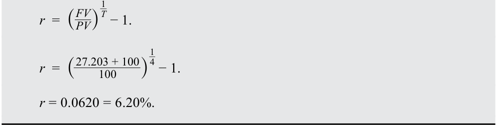

<!-- Formula Text: r  =  ( FV _ PV ) 1 _ T − 1. r  =  ( 27.203 + 100 _ 100 ) 1 _ 4 − 1. r = 0.0620 = 6.20%. -->

**Horizon yield** is an investor’s IRR based on the total return (reinvested coupon payments plus sale price or redemption amount) and the purchase price of the bond. The horizon yield on a bond investment is the annualized holding-period rate of return. 

In Example 2, Baywhite’s horizon yield is 6.2%, which matches the original yield-to-maturity even though Baywhite did not hold the bond until maturity. This example shows that the realized horizon yield matches the original yield-to-maturity if (1) coupon payments are reinvested at the same interest rate as the original yield-to-maturity and (2) the bond is sold at a price on the constant-yield price 

<!-- PDF Page 255 -->

trajectory, implying there is no capital gain or loss when the bond is sold. Importantly, capital gains (losses) arise if a bond is sold at a price above (below) its constant-yield price trajectory, as shown in a prior lesson. 

A point on the trajectory represents the **carrying value** of the bond at that time. The carrying value is the purchase price plus (minus) the amortized amount of the discount (premium) if the bond is purchased at a price below (above) par value. The constant-yield price trajectory for the investors in Example 1 and Example 2 is a flat curve at a price of 100 as the bonds were purchased and sold at par. 

We now demonstrate the impact of _higher_ interest rates on VFO and Baywhite by increasing interest rates by 100 basis points (bps) immediately after investment. The yield on the bond increases from 6.20% to 7.20%, and coupon reinvestment rates go up by 100 bps as well. 

###### **EXAMPLE 3** 

VFO, the buy-and-hold investor, purchases BRWA’s new 10-year, 6.2% (annual) coupon eurobond at par, and then interest rates immediately increase to 7.20%. The future value of the reinvested coupons at 7.20% for 10 years is 

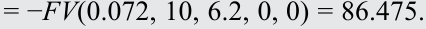

<!-- Formula Text: = −FV(0.072, 10, 6.2, 0, 0) = 86.475. -->

And VFO’s realized rate of return (horizon yield) is 6.43%: 

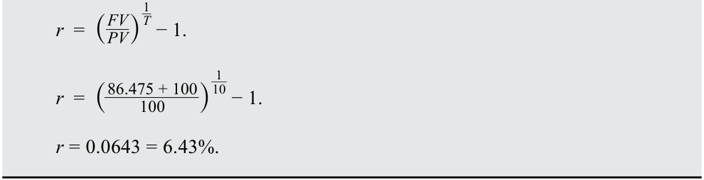

<!-- Formula Text: r  =  ( FV _ PV ) 1 _ T − 1. r  =  ( 86.475 + 100 _ 100 ) 1 _ 10 − 1. r = 0.0643 = 6.43%. -->

VFO benefits from the higher coupon reinvestment rate. The realized horizon yield is 6.43%, 23 bps higher than the outcome in Example 1, when interest rates were constant. Importantly, VFO does not incur a capital gain or loss because it holds the bond until maturity. 

###### **EXAMPLE 4** 

Baywhite buys the same BRWA eurobond at par, interest rates immediately rise to 7.2%, and it sells the bonds four years later. The future value of the reinvested coupons at 7.2% is 

= - _FV_ (0.072, 4, 6.2, 0, 0) = 27.609. 

We must also calculate the sale price of the bond because the change in interest rates affects the bond’s price and, unlike VFO, Baywhite is selling it before maturity. We calculate the sale price after four years as 

<!-- Formula Text: = –PV(0.072, 6, 6.2, 100, 0) = 95.263, -->

resulting in a realized four-year horizon yield of 5.28%: 

<!-- Formula Text: r  =  ( FV _ PV ) 1 _ T − 1. r  =  ( 27.609 + 95.263 ____________ 100 ) 1 _ 4 − 1. -->

<!-- PDF Page 256 -->

_r_ = 0.0528 = 5.28%. 

While Baywhite also benefits from the higher coupon reinvestment rate, it is more than offset by the capital loss from the sale of the bonds at the higher yield (lower price). Thus, Baywhite’s rate of return is lower than in Example 2, where the interest rate remained at 6.2%. 

We now examine the rates of return for these two investors if interest rates _decline_ by 100 bps; the yield on the BRWA bonds fall from 6.20% to 5.20% immediately after they are purchased. 

###### **KNOWLEDGE CHECK** 

Immediately after VFO, the buy-and-hold investor, purchases BRWA’s 10-year eurobonds at par, interest rates fall to 5.20%. 

1. Calculate the future value of reinvested coupons. **Solution:** 

The future value of reinvesting the coupon payments at 5.20% for 10 years is = − _FV_ (0.052, 10, 6.2, 0, 0) = 78.715. 

2. Calculate VFO’s horizon yield (realized rate of return). 

###### **Solution:** 

VFO’s horizon yield is 5.98%: 

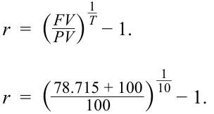

<!-- Formula Text: r  =  ( FV _ PV ) 1 _ T − 1. r  =  ( 78.715 + 100 _ 100 ) 1 _ 10 − 1. -->

_r_ = 0.0598 = 5.98%. 

3. Contrast VFO’s investment outcome in this scenario to Example 1 and Example 3. 

   - **Solution:** 

VFO suffers from the lower coupon reinvestment rate. The realized horizon yield of 5.98% is 22 bps lower than the result in Example 1, when interest rates were unchanged, and 45 bps lower than the result in Example 3. There is no capital gain or loss, because the bonds are held until maturity. VFO’s experience indicates that interest rate risk for a buy-and-hold investor arises entirely from reinvestment risk. 

Baywhite buys BRWA’s 10-year Eurobonds at par, and interest rates fall immediately to 5.20%. Baywhite sells the bonds after four years. 

4. Calculate the future value of the reinvested coupons. 

###### **Solution:** 

The future of the reinvested coupons is 

= – _FV_ <u>(0.052, 4, 6.2, 0, 0) = 26.802.</u> 

<!-- PDF Page 257 -->

5. Calculate Baywhite’s horizon yield (realized rate of return). **Solution:** 

The sale price of the bond after four years is 

- = – _PV_ (0.052, 6, 6.2, 100, 0) = 105.043, 

resulting in a realized four-year horizon yield of 7.16%: 

<!-- Formula Text: r  =  ( FV _ PV ) 1 _ T − 1. r  =  ( 26.802 + 105.043 _____________ 100 ) 1 _ 4 − 1. r = 0.0716 = 7.16% -->

6. Contrast Baywhite’s investment outcome in this scenario to Example 2 and Example 4. 

###### **Solution:** 

The reduction in the future value of the coupons is more than offset by Baywhite’s capital gain from the sale. Consequently, Baywhite’s horizon yield is higher than in both Example 2 and Example 4. 

As just demonstrated, interest income is the return associated with the _passage of time_ , so it includes the receipt of coupon interest, the reinvestment of those coupons, and the amortization of the discount (or premium) from purchase at a price below (or above) par value to realign the return with the market discount rate. A capital gain or loss is the investor’s return associated with the _change in the value_ of the security, which for a fixed-rate bond arises from a change in the yield-to-maturity (i.e., the implied market discount rate). 

This series of examples illustrates an important point about fixed-rate bonds: an investor’s _investment horizon_ is at the heart of understanding interest rate risk and return. There are two offsetting types of interest rate risk that affect the bond investor: reinvestment risk and price risk. The future value of reinvested coupon payments _increases_ when interest rates rise and _decreases_ when rates fall. The sale price on a bond that matures after the horizon date _decreases_ when interest rates rise and _increases_ when rates fall. 

Reinvestment risk matters more when the investor has a long-term investment horizon. A buy-and-hold investor only has reinvestment risk. Price risk matters more when the investor has a short-term investment horizon. An investor who sells before the first coupon is received has only price risk. Thus, two investors holding the same bond can have different exposures to interest rate risk if they have different investment horizons. 

###### **QUESTION SET** 

1. _Fill in the blanks using the two words below:_ 

Reinvestment risk 

Price risk 

<!-- PDF Page 258 -->

An investor who has a long-term investment horizon is more concerned about _____________, while the investor with a short-term investment horizon is more concerned about ____________. 

###### **Solution:** 

An investor who has a long-term investment horizon is more concerned about reinvestment risk, while the investor with a short-term investment horizon is more concerned about price risk. 

2. What is the carrying value of a bond? 

###### **Solution:** 

The carrying value of a bond is the total value of the price at which the bond was purchased plus (minus) the adjustment for amortization of the discount (premium) if the bond is purchased at a price below (above) par value. 

3. _Match the following_ 

|**Future value of coupons**|**Interest rates**|
|---|---|
|A. Increase|Decrease|
|B. Decrease|Increase|

###### **Solution:** 

The answer to A is increase. The future value of coupons has a direct relationship with interest rates. Rising interest rates mean coupons are reinvested at a higher rate, increasing their future value. 

The answer to B is decrease. The future value of coupons has a direct relationship with interest rates. Falling interest rates mean coupons are reinvested at a lower rate, decreasing their future value. 

4. An investor purchases a five-year, 5.6% (annual) coupon priced at par (settlement: 15 December 2031; maturity: 15 December 2036) and sells it after two years. Immediately after the purchase of the bond, interest rates rise to 5.9%. The investor’s total return at the end of two years is _closest_ to: 

   - **A.** 5.23%. 

   - **B.** 5.60%. 

**C.** 5.75%. 

###### **Solution:** 

A is correct. The investor’s total return is composed of the (1) coupons, (2) reinvestment of coupons, and (3) gain/loss on sale prior to maturity. The future value of the coupons assuming reinvestment at 5.90% is 

- = – _FV_ (0.059, 2, 5.6, 0, 0) = 11.5304. 

The sale price of the bond after two years, when three years remain to maturity, is 

- = – _PV_ (0.059, 3, 5.6, 100, 0) = 99.1966. 

The realized rate of return is 5.23%: 

<!-- Formula Text: r  =  ( FV _ PV ) 1 _ T − 1. -->

<!-- PDF Page 259 -->

> _1 ____________ 2 − 1. _r_ =  (11.530 + 99.197 100 ) _r_ = 0.0523 = 5.23%. B is incorrect because it is the rate of return if interest rates remain at 5.60%. C is incorrect because it is the average of the two rates (i.e., the coupon rate, 5.6%, and the new, higher interest rate, 5.9%). 

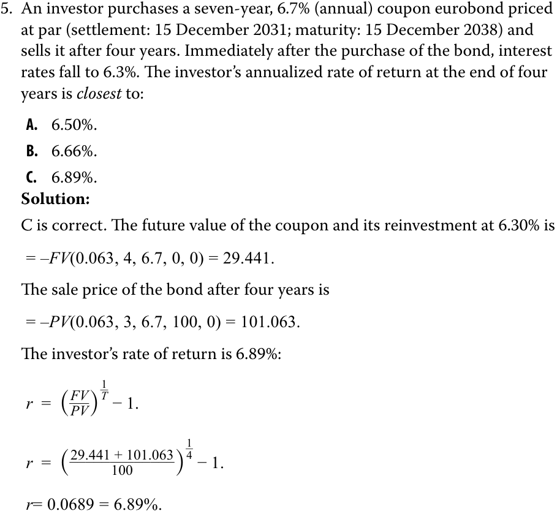

<!-- Formula Text: 5.	 An investor purchases a seven-year, 6.7% (annual) coupon eurobond priced at par (settlement: 15 December 2031; maturity: 15 December 2038) and sells it after four years. Immediately after the purchase of the bond, interest rates fall to 6.3%. The investor’s annualized rate of return at the end of four years is closest to: A.	 6.50%. B.	 6.66%. C.	 6.89%. Solution: C is correct. The future value of the coupon and its reinvestment at 6.30% is = –FV(0.063, 4, 6.7, 0, 0) = 29.441. The sale price of the bond after four years is = –PV(0.063, 3, 6.7, 100, 0) = 101.063. The investor’s rate of return is 6.89%: r  =  ( FV _ PV ) 1 _ T − 1. r  =  ( 29.441 + 101.063 _____________ 100 ) 1 _ 4 − 1. r= 0.0689 = 6.89%. -->

A is incorrect because this is the average of the annual coupon rate and the prevailing interest rate. 

B is incorrect because this calculation does not account for the appreciation in the bond price after interest rates fall. 

## **INVESTMENT HORIZON AND INTEREST RATE RISK** **<mark>3</mark>** 

describe the relationships among a bond’s holding period return, its Macaulay duration, and the investment horizon; define, calculate, and interpret Macaulay duration. 

We now extend the prior discussion by introducing a third investor in BRWA’s 10-year, 6.2% annual eurobonds: Hightest Capital, which has an 8-year time horizon. If interest rates remain at 6.20%, the future value of reinvested coupon interest is 

= –FV(0.062, 8, 6.2, 0, 0) = 61.807. 

<!-- PDF Page 260 -->

When the bond is sold, it has two years remaining to maturity. Assuming yield-to-maturity remains at 6.2% and the sale price is 100, Hightest’s horizon yield (realized rate of return) is 6.20%: 

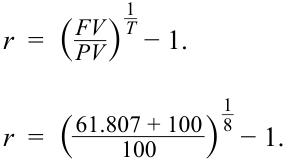

<!-- Formula Text: r  =  ( FV _ PV ) 1 _ T − 1. r  =  ( 61.807 + 100 _ 100 ) 1 _ 8 − 1. -->

<!-- Formula Text: r = 0.0620 = 6.20%. -->

If interest rates immediately rose to 7.20% after the purchase, the future value of coupons would increase: 

<!-- Formula Text: = –FV(0.072, 8, 6.2, 0, 0) = 64.071. -->

And the price of the bond at the time of sale would fall: 

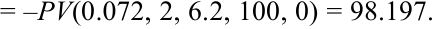

<!-- Formula Text: = –PV(0.072, 2, 6.2, 100, 0) = 98.197. -->

Hightest’s realized eight-year horizon yield is now 6.24%: 

<!-- Formula Text: r  =  ( FV _ PV ) 1 _ T − 1. r  =  ( 64.071 + 98.197 ____________ 100 ) 1 _ 8 − 1. -->

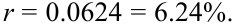

<!-- Formula Text: r = 0.0624 = 6.24%. -->

Notice that the capital loss from the bond sale of 1.803 (= 98.197 – 100.00) is roughly matched by the additional coupon reinvestment income of 2.265 from the increase in interest rates. Therefore, Hightest’s total return is nearly the same as in the stable rate scenario (6.24%, compared with 6.20%). 

Now assume instead that market interest rates _fall_ by 100 bps, to 5.20%. The future value of coupons decreases while the price of the bond at the time of sale increases: = – _FV_ (0.052, 8, 6.2, 0, 0) = 59.630. 

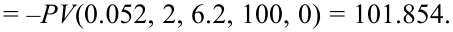

<!-- Formula Text: = –PV(0.052, 2, 6.2, 100, 0) = 101.854. -->

Hightest’s realized eight-year horizon yield is now 6.17%: 

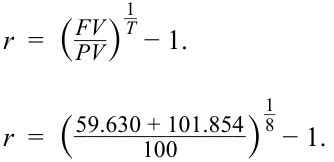

<!-- Formula Text: r  =  ( FV _ PV ) 1 _ T − 1. r  =  ( 59.630 + 101.854 _____________ 100 ) 1 _ 8 − 1. -->

<!-- Formula Text: r = 0.0617 = 6.17%. -->

Notice that the capital gain from the bond sale of 1.854 is roughly matched by the decrease in coupon reinvestment income. Again, Hightest’s total return is nearly the same as in the stable rate scenario (6.17%, compared to 6.20%). 

Hightest’s investment results, along with those of VFO and Baywhite, are summarized in Exhibit 1. They reveal an important outcome for Hightest with the eight-year horizon: _Total returns and horizon yields are nearly the same regardless of interest rates_ . 

<!-- PDF Page 261 -->

###### **Exhibit 1** 

<!-- Start of picture text -->
Investors' Horizon Yields on BRWA's 10-Year Bonds 8% 7% Bond YTM 6% 5% 4% 3% 2% 1% 0% Rates stable Rates rise by 100 bps Rates fall by 100 bps at 6.20% to 7.20% to 5.20% VFO (buy and hold) Baywhite (sells after 4 years) Hightest (sells after 8 years) Horizon yields <!-- End of picture text -->

Hightest’s investment horizon of eight years was chosen to illustrate an important quantity for the BRWA bond and fixed-income instruments generally: **Macaulay duration** , a holding period for a bond that balances coupon reinvestment gain (loss) and price loss (gain) for a one-time instantaneous “parallel” shift in the yield curve once the bond purchase is settled. It is named after Frederick Macaulay, the Canadian economist who introduced the concept in 1938. Given the result for Hightest, we know that the Macaulay duration of this BRWA bond is close to eight years. 

Exhibit 2 illustrates Macaulay duration for a bond initially priced at par value. 

<!-- PDF Page 262 -->

###### **Exhibit 2: Interest Rate Risk, Macaulay Duration, and Investment Horizon** 

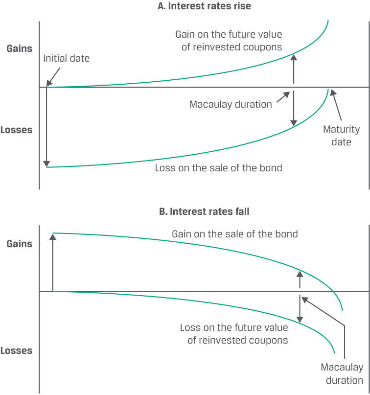

<!-- Start of picture text -->
A. Interest rates rise Gain on the future value Gains of reinvested coupons Initial date Macaulay duration Losses Maturity date Loss on the sale of the bond B. Interest rates fall Gain on the sale of the bond Gains Loss on the future value of reinvested coupons Losses Macaulay duration <!-- End of picture text -->

As shown in Panel A, when interest rates rise, there is an immediate drop in price. Then, as time passes, the bond price is “pulled to par.” The increase in the future value of reinvested coupons starts small but builds over time, and the curve indicates the added future value of reinvested coupons due to the higher interest rate. At the Macaulay duration, the two effects offset each other: the gain on reinvested coupons is equal to the loss from the increase in interest rates. 

The same pattern is shown in Panel B, when interest rates fall. There is an immediate increase in price, but then the “pull-to-par” effect brings the price down as time passes. The impact from reinvesting at a lower rate starts small but becomes significant over time. Again, the Macaulay duration indicates the point when the two effects offset each other, so the gain from the decrease in interest rates equally offsets the loss from coupon reinvestment at lower rates. 

The foregoing discussion allows for statements about the general relationships among interest rate risk, the Macaulay duration, and the investment horizon shown in Exhibit 3: 

<!-- PDF Page 263 -->

**Exhibit 3: Macaulay Duration, Investment Horizon, and Interest Rate Risk** 

||**Dominant Risk**|**Source of Interest Rate** **Risk**|
|---|---|---|
|Investment Horizon > Macaulay|Reinvestment Risk|Falling Interest Rates|
|Duration|||
|Investment Horizon = Macaulay|Price Risk = Reinvestment|—|
|Duration|Risk||
|Investment Horizon < Macaulay|Price Risk|Rising Interest Rates|
|Duration|||

The Macaulay duration of the BRWA bond is 7.7429 years (the calculation will be demonstrated in the next lesson). So, Statement 1 reflects VFO’s situation with its 10-year horizon; Statement 2, Hightest, the investor with the 8-year horizon; and Statement 3, Baywhite, the investor with the 4-year horizon. 

As shown in Equation 1, the **duration gap** for a bond is the difference between its Macaulay duration and the investor’s investment horizon. 

Duration gap = Macaulay duration – Investment horizon. 

~~(1)~~ 

VFO, with a 10-year horizon, has a negative duration gap. Therefore, the primary risk it faces is lower interest rates. Hightest, with the eight-year horizon, has a duration gap of approximately zero, so it is nearly hedged against interest rate risk. Baywhite, with the four-year horizon, has a positive duration gap and is at risk of higher rates. Importantly, as time passes, the investment horizon is reduced and the Macaulay duration of the bond also falls. 

###### **KNOWLEDGE CHECK** 

Three investors, Rook Point Investors, Fyleton Investments, and Amy Investments, purchase a 5.61%, 30-year Romanian eurobond at par value. The bond’s Macaulay duration is 15.16 years. Rook Point’s investment horizon is five years, while Fyleton and Amy have investment horizons of 15 and 30 years, respectively. 

1. Calculate the returns for the three investors for three scenarios: 

Scenario 1: Interest rates fall by 50 bps immediately after the purchase. 

Scenario 2: Interest rates stay stable at 5.61%. 

Scenario 3: Interest rates rise by 50 bps immediately after the purchase. 

###### **Solution:** 

The total returns under the various scenarios for each investor are shown in the table below. 

The key point to note is that when an investor’s investment horizon is 

almost equal to the bond’s Macaulay duration, the returns under various interest rate scenarios remain the same. The gain (loss) from coupon reinvestment risk is offset by the loss (gain) from the price risk. 

|**Rates Stable at 5.61%**|**Rates Rise to 6.11%**|**Rates Fall to 5.11%**|
|---|---|---|
|Rook Point Fyleton Amy|Rook Point Fyleton Amy|Rook Point Fyleton Amy|
|Investment Horizon|Investment Horizon|Investment Horizon|

<!-- PDF Page 264 -->

|**Rates Stable**|**at 5.61%**||**Ra**|**tes Rise to 6.1**|**1%**|**Ra**|**tes Fall to 5.1**|**1%**|
|---|---|---|---|---|---|---|---|---|
|5|15|30|5|15|30|5|15|30|
|MacDur > Horizon|MacDur≅ Horizon|MacDur < Horizon|MacDur > Horizon|MacDur≅ Horizon|MacDur < Horizon|MacDur > Horizon|MacDur≅ Horizon|MacDur < Horizon|
|Futur|e Value of Cou|pons|Futu|re Value of Cou|pons|Futur|e Value of Cou|pons|
|31.379|126.765|414.223|31.694|131.678|452.199|31.067|122.063|379.840|
|Redemp|tion Value or S|ale Price|Redemp|tion Value or S|ale Price|Redemp|tion Value or S|ale Price|
|100.000|100.000|100.000|93.675|95.179|100.000|106.970|105.152|100.000|
||Horizon Yield|||Horizon Yield|||Horizon Yield||
|5.610%|5.610%|5.610%|4.626%|5.613%|5.861%|6.659%|5.624%|5.367%|

###### **QUESTION SET** 

1. Match the following: 

|**Duration Gap**|**Risk Source**|
|---|---|
|A. Negative|Rising interest rates|
|B. Positive|Falling interest rates|

###### **Solution:** 

The answer to A is falling interest rates. A negative duration gap means that the bond’s Macaulay duration is lower than the investor’s investment horizon, which means that reinvestment risk is the dominant source of interest rate risk, from falling interest rates. 

The answer to B is rising interest rates. A positive duration gap means that the bond’s Macaulay duration is higher than the investor’s investment horizon, which means that price risk is the dominant source of interest rate risk, from rising interest rates. 

2. Complete the equation below with the following terms: 

Macaulay duration 

Investment horizon 

Time-to-maturity 

Duration gap = __________ – __________. 

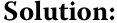

<!-- Start of picture text -->
Solution: <!-- End of picture text -->

Duration gap = Macaulay duration – Investment horizon. 

3. An investor intends to hold a bond with eight years remaining to maturity for eight years. The bond’s Macaulay duration is 6.841. The investor is _primarily_ exposed to which of the following interest rate risks: 

   - **A.** Price risk 

   - **B.** Reinvestment risk 

