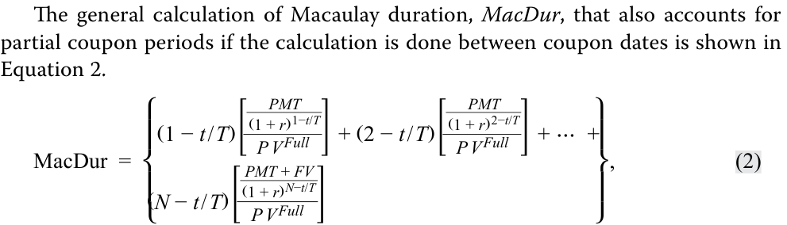
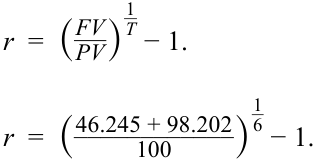

# Volume 6: Fixed Income
## Learning Module 10 Interest Rate Risk and Return
### Part 2/2: Macaulay Duration (PDF Pages 265–276)

---

<!-- PDF Page 265 -->

**C.** Neither price nor reinvestment risk **Solution:** 

B is correct. A buy-and-hold investor is not exposed to price risk, because she does not intend to sell the bond prior to maturity. However, her rate of return is impacted by the rate at which she can reinvest coupons. 

Alternatively, the investor’s investment horizon is eight years, whereas the bond’s Macaulay duration is 6.841. When the investment horizon exceeds the Macaulay duration, reinvestment risk dominates. 

### **MACAULAY DURATION** 

# **<mark>4</mark>** 

define, calculate, and interpret Macaulay duration. 

The prior lesson established Macaulay duration as a holding period for a bond that balances reinvestment and price risk. We now turn to its calculation. 

The most straightforward way to understand the Macaulay duration of a traditional fixed-rate bond is that it is the weighted average of the _time to receipt_ of the bond’s cash flows, where the weights of each cash flow in the calculation are each cash flow’s share of the bond’s full price (i.e., present value). Before we introduce the general equation, let’s take a specific example to demonstrate the calculation of Macaulay duration: BRWA’s 10-year, 6.2% (annual) coupon eurobond used in the previous lessons. 

Exhibit 4 illustrates the calculation of Macaulay duration at issuance, assuming the bond was issued at par, settled on 15 October 2025, and matures on 15 October 2035. Because this is a corporate bond, we assume a 30/360 day-count basis. 

**Exhibit 4: Macaulay Duration of BRWA Corp. 10-Year, 6.2% Annual Eurobond at Issuance** 

|Coupon|6.20%|
|---|---|
|Coupon frequency per year|1|
|Price per 100 par value|100|
|Yield-to-maturity|6.20%|
|Settlement date|15 October 2025|
|Maturity|15 October 2035|
|Years to maturity|10|

<!-- PDF Page 266 -->

|(1)|(2)|(3)|(4)|(5)|(6)|
|---|---|---|---|---|---|
|||||(4) ÷ Sum|(1) × (5)|
|||||of present||
|||||values||

|**Period**|**Time to receipt**|**Cash** **flow**|**Present** **value**|**Weight**|**Time to** **receipt ×** **weight**|
|---|---|---|---|---|---|
|1|1|6.2|5.8380|0.0584|0.0584|
|2|2|6.2|5.4972|0.0550|0.1099|
|3|3|6.2|5.1763|0.0518|0.1553|
|4|4|6.2|4.8741|0.0487|0.1950|
|5|5|6.2|4.5895|0.0459|0.2295|
|6|6|6.2|4.3216|0.0432|0.2593|
|7|7|6.2|4.0693|0.0407|0.2849|
|8|8|6.2|3.8317|0.0383|0.3065|
|9|9|6.2|3.6080|0.0361|0.3247|
|10|10|106.2|58.1942|0.5819|5.8194|
||||100.0000|1.0000|7.7429|

- Columns 1 and 2 show the number of periods and the time to receipt of the cash flow, respectively. If the calculation is done at issuance or on a coupon date, they are equal. 

- Column 3 is the cash flow per 100 of par value, and column 4 is the present value of that cash flow. 

- The fifth column is the weight, or each cash flow’s share of total _PV_ . Notice that the final payment, _PMTN + FVN_ , of 106.2 accounts for 58% of the bond’s _PV._ 

- The sixth column is the time to receipt of the cash flow (Column 2) multiplied by the weight (Column 5). The sum of this column is the Macaulay duration, 7.7429. This is close to Hightest Capital’s investment horizon of eight years from the prior lesson, which means that Hightest has balanced its reinvestment and price risk. 

Macaulay duration is often quoted as an annualized statistic. Since this bond pays coupons annually, no adjustment is needed. If the bond were a semiannual coupon bond, we would divide the Macaulay duration by 2 (two semiannual periods per year) to obtain an annualized Macaulay duration. When quoted as an annualized statistic, the units for Macaulay duration is years. 

Notice how 7.7429 years is less than 10, the time-to-maturity of the bond. This is because Macaulay duration is a present value–weighted average of the time to receipt of the cash flows, while time-to-maturity is the time to receipt of the final cash flow. 

<!-- Formula Text: lil The general calculation of Macaulay duration, MacDur, that also accounts for partial coupon periods if the calculation is done between coupon dates is shown in Equation 2. MacDur  = ⎧ ⎪ ⎨ ⎪ ⎩ (1 − t / T)[ PMT _ (1 + r) 1−t/T _ P V Full  ] + (2 − t / T)[ PMT _ (1 + r) 2−t/T _ P V Full  ] + ⋯  + (N − t / T)[ PMT + FV _ (1 + r) N−t/T _ P V Full  ] ⎫ ⎪ ⎬ ⎪ ⎭ , (2) -->

<!-- PDF Page 267 -->

##### where 

_t_ is the number of days from the last coupon payment to the settlement date; 

_T_ is the number of days in the coupon period; 

- _t_ / _T_ is the fraction of the coupon period that has passed since the last payment; 

_PMT_ is the coupon payment per period; 

- _FV_ is the future value paid at maturity, or the par value of the bond; 

- _r_ is the yield-to-maturity per period; and 

_N_ is the number of evenly spaced periods to maturity as of the beginning of the current period. 

##### **EXAMPLE 5** 

#### **Macaulay Duration between Coupon Dates** 

Now let’s compute the Macaulay duration for the BRWA bond _between_ coupon dates—specifically, on 11 December 2025, 57 days after issuance. The only difference from the prior example is that we are 57 days in the future, so rather than _t_ / _T_ = 0 like at issuance, _t_ / _T_ = 57/360, and each cash flow’s time to receipt is 57 days earlier. 

##### **Macaulay Duration of BRWA Corp. 10-Year, 6.2% Annual Eurobond Settling 57 Days after Issuance** 

|Coupon|6.20%|
|---|---|
|Coupon frequency per year|1|
|Price per 100 par value|100|
|Yield-to-maturity|6.20%|
|Settlement date|11 December 2025|
|Maturity|15 October 2035|
|Years to maturity|10|

|(1)|(2)|(3)|(4)|(5)|(6)|
|---|---|---|---|---|---|
|||||(4) ÷ Sum of|(1) × (5)|
|||||present values||

|**Period**|**Time to** **receipt**|**Cash** **flow**|**Present** **value**|**Weight**|**Time to receipt ×** **weight**|
|---|---|---|---|---|---|
|1|0.8417|6.2|5.8939|0.0584|0.0491|
|2|1.8417|6.2|5.5498|0.0550|0.1012|
|3|2.8417|6.2|5.2258|0.0518|0.1471|
|4|3.8417|6.2|4.9207|0.0487|0.1872|
|5|4.8417|6.2|4.6335|0.0459|0.2222|
|6|5.8417|6.2|4.3630|0.0432|0.2525|
|7|6.8417|6.2|4.1082|0.0407|0.2784|
|8|7.8417|6.2|3.8684|0.0383|0.3005|

<!-- PDF Page 268 -->

|**Period**|**Time to** **receipt**|**Cash** **flow**|**Present** **value**|**Weight**|**Time to receipt ×** **weight**|
|---|---|---|---|---|---|
|9|8.8417|6.2|3.6426|0.0361|0.3190|
|10|9.8417|106.2|58.7511|0.5819|5.7273|
||||100.9570|1.0000|7.5845|

Comparing this example to the prior example, we see that the time to receipt of each flow is lower, reflecting the fact that we are 57 days later, which increases the present value of each cash flow. However, the present value weight of each cash flow remains the same. The Macaulay duration (7.5845) is lower than in the prior example (7.7429), reflecting the lower times to receipt. 

This example demonstrates an important property of Macaulay duration: it is not static; it falls as time elapses and the time to receipt of each cash flow falls. 

Besides a spreadsheet, Macaulay duration also can be calculated using the DURATION function in Microsoft Excel or Google Sheets: 

=DURATION( _Settlement_ , _Maturity_ , _Coupon_ , _Yld_ , _Frequency_ , [ _Basis_ ]) 

where 

_Settlement_ is the date of settlement, in DATE form 

_Maturity_ is the maturity date, in DATE form 

_Coupon_ is the annual coupon rate 

_Yld_ is the annualized yield-to-maturity 

_Frequency_ is the periodicity, typically the number of coupon payments per year; it is 1 for annual, 2 for semiannual, 4 for quarterly 

[ _Basis_ ] is the day-count convention; 0 or omitted is 30/360, 1 is act/act, 2 is act/360, 3 is act/365 

Finally, another approach to calculating Macaulay duration is to use a closed-form equation derived using calculus and algebra, shown as Equation 3: 

<!-- Formula Text: MacDur  =  { 1 + r _ r   − 1 + r + [N × (c − r)] _______________ c × [(1 + r) N − 1] + r } −  t _ T (3) -->

where 

_r_ is the yield-to-maturity per period; 

_N_ is the number of evenly spaced periods to maturity as of the beginning of the current period; 

_c_ is the coupon rate per period; 

_t_ is the number of days from the last coupon payment to the settlement date; 

and 

_T_ is the number of days in the coupon period. 

<!-- PDF Page 269 -->

##### **QUESTION SET** 

1. Consider a bond that has three years remaining to maturity and a coupon of 4% paid semiannually and is priced at 100. The bond’s annualized Macaulay duration is _closest_ to: 

**A.** 2.801 years. 

**B.** 2.857 years. 

**C.** 3.000 years. 

**Solution:** 

B is correct. 

|**Period**|**Time to** **receipt**|**Cash** **flow**|**Present value**|**Weight**|**Time to** **receipt ×** **weight**|
|---|---|---|---|---|---|
|1|1|2|1.961|0.0196|0.01961|
|2|2|2|1.922|0.0192|0.03845|
|3|3|2|1.885|0.0189|0.05654|
|4|4|2|1.848|0.0185|0.07391|
|5|5|2|1.811|0.0181|0.09057|
|6|6|102|90.573|0.9057|5.43438|
||||100.00000|1.00000|5.71346|
|Annualize|d Macaulay|duration|(years)||2.857|

Annualized Macaulay duration (years) 

2. An investor with a three-year investment horizon purchases a bond with four years remaining to maturity, a coupon of 1% paid semiannually, and a yield-to-maturity of 0.90%. With respect to interest rate risk, the investor is _primarily_ concerned about: 

   - **A.** rising interest rates. 

   - **B.** falling interest rates. 

   - **C.** neither rising nor falling interest rates. 

   - **Solution:** 

A is correct. The Macaulay duration of the bond is 3.9312 years. 

|**Period**|**Time to** **Receipt**|**Cash Flow**|**PV**|**Weight**|**Time to** **Receipt ×** **Weight**|
|---|---|---|---|---|---|
|1.0000|1.0000|0.5000|0.4978|0.0050|0.0050|
|2.0000|2.0000|0.5000|0.4955|0.0049|0.0099|
|3.0000|3.0000|0.5000|0.4933|0.0049|0.0147|
|4.0000|4.0000|0.5000|0.4911|0.0049|0.0196|
|5.0000|5.0000|0.5000|0.4889|0.0049|0.0243|
|6.0000|6.0000|0.5000|0.4867|0.0048|0.0291|
|7.0000|7.0000|0.5000|0.4845|0.0048|0.0338|
|8.0000|8.0000|100.5000|96.9542|0.9658|7.7260|

<!-- PDF Page 270 -->

|**Period**|**Time to** **Receipt**|**Cash Flow**|**PV**|**Weight**|**Time to** **Receipt ×** **Weight**|
|---|---|---|---|---|---|
||||100.3920|1.0000|7.8624|
||||Annualized|MacDur (years)|3.9312|

When the Macaulay duration of a bond is longer than the investor’s investment horizon (three years), price risk dominates and the investor’s primary downside concern is rising interest rates. 

3. Consider a bond that has five years remaining to maturity, a coupon of 0.5% paid annually, and a yield-to-maturity of –0.20%. The bond’s annualized Macaulay duration is _closest_ to: 

**A.** 2.4758. 

- **B.** 4.9515. 

**C.** 5.3130. 

**Solution:** 

B is correct. 

|**Period**|**Time to** **Receipt**|**CF**|**PV**|**Weight**|**Time to** **Receipt ×** **Weight**|
|---|---|---|---|---|---|
|1.0000|1.0000|0.5000|0.5010|0.0048|0.0048|
|2.0000|2.0000|0.5000|0.5020|0.0048|0.0097|
|3.0000|3.0000|0.5000|0.5030|0.0049|0.0146|
|4.0000|4.0000|0.5000|0.5040|0.0049|0.0195|
|5.0000|5.0000|100.5000|101.5111|0.9806|4.9029|
||||103.5211|1.0000|4.9515|

4. Consider a bond that has five years remaining to maturity, a coupon of 0.5% paid annually, and a yield-to-maturity of –0.20%. Assume it is 91 days into the first coupon period and a 30/360 basis. The bond’s annualized Macaulay duration is _closest_ to: 

   - **A.** 4.2371. 

   - **B.** 4.5054. 

**C.** 4.6987. 

**Solution:** 

C is correct. 

|**Period**|**Time to** **Receipt**|**Cash Flow**|**PV**|**Weight**|**Time to** **Receipt ×** **Weight**|
|---|---|---|---|---|---|
|1.0000|0.7472|0.5000|0.5007|0.0048|0.0036|
|2.0000|1.7472|0.5000|0.5018|0.0048|0.0085|
|3.0000|2.7472|0.5000|0.5028|0.0049|0.0133|
|4.0000|3.7472|0.5000|0.5038|0.0049|0.0182|

<!-- PDF Page 271 -->

|**Period**|**Time to** **Receipt**|**Cash Flow**|**PV**|**Weight**|**Time to** **Receipt ×** **Weight**|
|---|---|---|---|---|---|
|5.0000|4.7472|100.5000|101.4597|0.9806|4.6550|
||||103.4687|1.0000|4.6987|

Note that a straightforward way to calculate Macaulay duration using a spreadsheet between coupon periods is to set the first cash flow’s time to receipt as 1 – _t_ / _T_ (here = 1 – 91/360) and subsequent times to receipt as the prior plus 1. 

<!-- PDF Page 272 -->

## **~~PRACTICE PROBLEMS~~** 

**1.** Assuming no capital gain or loss when the bond is sold, an investor’s horizon yield is equal to a bond’s yield-to-maturity at the time of investment if coupons are reinvested at a rate: 

   - **A.** lower than the bond’s yield-to-maturity at investment. 

   - **B.** equal to the bond’s yield-to-maturity at investment. 

   - **C.** higher than the bond’s yield-to-maturity at investment. 

**2.** An investor purchases an eight-year, 6.4% annual coupon eurobond priced at par (settlement: 15 June 2031; maturity: 15 December 2039) and sells it after six years. Assuming interest rates rise by 100 bps immediately after purchase, the investor’s rate of return at the end of six years is: 

   - **A.** lower than 6.4%. 

   - **B.** equal to 6.4%. 

   - **C.** higher than 6.4%. 

**3.** The carrying value of a bond purchased at a price below par is equal to the original purchase price: 

   - **A.** minus the accumulated premium amortization. 

   - **B.** minus the accumulated discount amortization. 

   - **C.** plus the accumulated discount amortization. 

**4.** The duration gap at which reinvestment risk and price risk are equal is: 

   - **A.** less than zero. 

   - **B.** equal to zero. 

   - **C.** greater than zero. 

**5.** When an investor’s investment horizon is less than a bond’s Macaulay duration, the investor faces downside risk if, after the purchase of the bond, interest rates: 

   - **A.** decrease. 

   - **B.** increase. 

   - **C.** either decrease or increase. 

**6.** An investor purchases a 12-year, 5.8% annual bond and intends to sell it after 10 years. The Macaulay duration of the bond is 8.97 years. If interest rates fall by 75 bps immediately after the purchase of the bond, the investor faces: 

   - **A.** negative reinvestment risk. 

   - **B.** no reinvestment risk. 

   - **C.** positive reinvestment risk. 

<!-- PDF Page 273 -->

**7.** Consider a bond that has three years remaining to maturity, a coupon of 4% paid semiannually, and a yield-to-maturity of 4.60%. Assuming it is 12 days into the first coupon period and a 30/360 basis, the bond’s annualized Macaulay duration is _closest_ to: 

   - **A.** 1.8764 years. 

   - **B.** 2.8386 years. 

   - **C.** 2.8553 years. 

**8.** Hightest Capital purchases a seven-year, 6.4% coupon bond and has an intended investment horizon of four years. The Macaulay duration of the bond is 5.86 years. If interest rates increase by 50 bps immediately after buying the bond, Hightest Capital faces: 

   - **A.** negative price risk. 

   - **B.** negative reinvestment risk. 

   - **C.** positive price risk. 

<!-- PDF Page 274 -->

## **~~SOLUTIONS~~** 

1. B is correct. For the horizon yield to match the original yield-to-maturity of the bond, two conditions must be met: 

   - (1) The coupon payments are reinvested at the original yield-to-maturity. 

   - (2) The bond is sold at the constant-yield price trajectory, implying no capital gain or loss when the bond is sold. 

Since there is no gain or loss when the bond is sold, the horizon yield will be equal to the yield-to-maturity if the first condition is met (i.e., the coupons are reinvested at the original yield-to-maturity). 

A is incorrect because the horizon yield will be lower than the yield-to-maturity if the coupons are reinvested at a lower rate than the original yield-to-maturity, assuming no capital gain or loss on sale of the bond. 

C is incorrect because the horizon yield will be higher than the yield-to-maturity if the coupons are reinvested at a higher rate than the original yield-to-maturity, assuming no capital gain or loss on sale of the bond. 

2. A is correct. The future value of reinvested coupon interest is 

   - = _FV_ (0.074,6,6.4,0,0) = 46.245. 

The sale price of the bond at the end of six years is 

<!-- Formula Text: = PV(0.054,2,6.40,100,0) = 98.202, -->

which results in a six-year horizon yield of 6.32%, which is lower than 6.40%: 

<!-- Formula Text: r  =  ( FV _ PV ) 1 _ T − 1. r  =  ( 46.245 + 98.202 ____________ 100 ) 1 _ 6 − 1. -->

_r_ = 0.0632 = 6.32%. 

B and C are incorrect, because interest rates have risen and the investor’s investment horizon is not long enough to offset the price decline with additional reinvestment return. 

3. C is correct. A bond purchased at a discount will have its price “pulled to par” as it approaches maturity. Its carrying value at time _t_ is equal to its purchase price plus the accumulated discount amortization. 

A is incorrect because a bond purchased below par is purchased at a discount, not a premium. 

B is incorrect because the accumulated discount amortization is added, not subtracted, from the purchase price to calculate carrying value. 

4. B is correct. Reinvestment risk and price risk equally offset each other when an investor’s investment horizon equals a bond’s Macaulay duration. This is when the duration gap is zero. 

   - A is incorrect because a duration gap of less than zero means that Macaulay duration is less than the investor’s investment horizon and that reinvestment risk is higher than price risk. 

C is incorrect because when the duration gap is greater than zero, the Macaulay duration is greater than the investor’s investment horizon, so price risk is higher than reinvestment risk. 

<!-- PDF Page 275 -->

5. B is correct. If the investment horizon is less than the bond’s Macaulay duration, then the investor’s risk is higher interest rates. For such an investor, the market price risk dominates the coupon reinvestment risk. 

   - A is incorrect because an investor faces risk due to a lower interest rate when the investment horizon is greater than the bond’s Macaulay duration. 

   - C is incorrect because when the investment horizon is less than the Macaulay duration, the investor faces risk due to higher interest rates, not lower interest rates. 

6. A is correct. The investor has an investment horizon of 10 years, which is greater than the Macaulay duration of 8.97 years. Therefore, reinvestment risk dominates price risk. 

   - B is incorrect because the investor faces reinvestment risk because the investment horizon is higher than the Macaulay duration. 

C is incorrect because the investor faces negative coupon reinvestment risk, not positive coupon reinvestment risk, since the coupons will be reinvested at a lower interest rate. 

7. B is correct. 

|**Period**|**Time to** **Receipt**|**Cash Flow**|**PV**|**Weight**|**Time to** **Receipt ×** **Weight**|
|---|---|---|---|---|---|
|1.0000|0.9333|2.0000|1.9580|0.0199|0.0186|
|2.0000|1.9333|2.0000|1.9140|0.0194|0.0376|
|3.0000|2.9333|2.0000|1.8709|0.0190|0.0557|
|4.0000|3.9333|2.0000|1.8289|0.0186|0.0730|
|5.0000|4.9333|2.0000|1.7878|0.0182|0.0896|
|6.0000|5.9333|102.0000|89.1261|0.9050|5.3695|
||||98.4856|1.0000|5.6439|
||||Ann|ualized MacDur|2.8220|

8. A is correct. Hightest Capital’s investment horizon is four years, which is less than the bond’s Macaulay duration of 5.86 years. Therefore, price risk dominates reinvestment risk and Hightest Capital faces price risk from rising interest rates. B is incorrect because the increase in interest rates is beneficial for coupon reinvestment. Therefore, Hightest Capital has positive reinvestment risk. C is incorrect because Hightest Capital faces the risk that the price of the bond will fall as a result of the 50 bp increase in interest rates and therefore has negative price risk. 

<!-- PDF Page 276 -->

