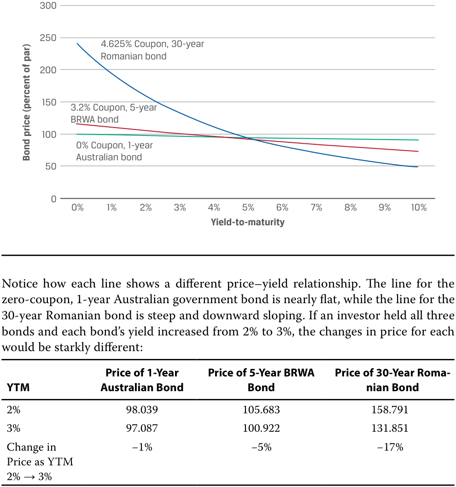
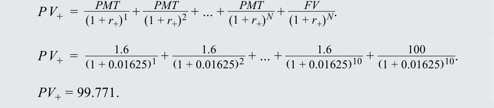
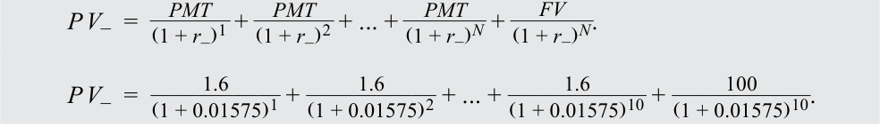

# Volume 6: Fixed Income
## Learning Module 11 Yield-Based Bond Duration Measures and Properties
### Part 1/2: Introduction (PDF Pages 277–290)

---

<!-- PDF Page 277 -->

# L E A R N I N G M O D U L E **<mark>11</mark>** 

### **Yield-Based Bond Duration Measures and Properties** 

##### **<mark>LEARNING OUTCOMES</mark>** 

###### **_Mastery The candidate should be able to:_** 

define, calculate, and interpret modified duration, money duration, and the price value of a basis point (PVBP) explain how a bond’s maturity, coupon, and yield level affect its interest rate risk 

#### **INTRODUCTION** 

**<mark>1</mark>** 

Prior lessons explored two sources of interest rate risk—reinvestment risk and price risk—and demonstrated how holding a bond for its Macaulay duration balances them. This lesson and those that follow extend that discussion by introducing measures of price risk. Two broad categories of such measures exist: those that assume underlying bond cash flows are certain and measure price sensitivity to changes in a bond’s _own yield_ , which are covered in these lessons, and those that introduce the possibility of a bond default and that measure price sensitivity to changes in a _benchmark_ yield curve, which are covered in later lessons. This lesson will illustrate how the interest rate risk of a bond is a function of its features, including its time-to-maturity, coupon rate, and yield. 

Most of the examples and exhibits used throughout the reading can be downloaded as a Microsoft Excel workbook. Each worksheet in the workbook is labeled with the corresponding example or exhibit number in the text. 

###### **LEARNING MODULE OVERVIEW** 

- Duration is a quantitative measure of interest rate risk. There are several duration measures, including those that measure a bond’s price sensitivity to changes in its own yield-to-maturity and assume underlying cash flows are certain (yield duration) and those that measure changes in a benchmark yield curve, with less certain underlying cash flows (curve duration). 

<!-- PDF Page 278 -->

- Macaulay duration, modified duration, money duration, and the price value of a basis point (PVBP) are yield duration measures. 

- Modified duration is the slope or first derivative of the price of a bond with respect to its yield-to-maturity, measuring the sensitivity of a bond’s price to changes in its yield-to-maturity. Modified duration can be calculated using a bond’s Macaulay duration and yield or through approximation. 

- Money duration is an extension of modified duration and incorporates the size of the bond position in currency terms. Related to this measure is the price value of a basis point, which is an estimate of the change in the price of a bond for a 1 bp change in the bond’s yield. 

- Duration can be used to estimate the change in the price of a bond in response to a change in yield, but it assumes a linear relationship between price and yield even though, in fact, the relationship is nonlinear. This is most evident when estimating price changes for large changes in yield and for bonds with certain features. 

- A bond’s features, including its time-to-maturity, coupon rate, and yield-to-maturity, determine its duration. Duration, for a given bond, is not static and decreases as the bond approaches maturity. 

- All else equal, a longer (shorter) time-to-maturity, a lower (higher) coupon rate, or a lower (higher) yield-to-maturity results in higher (lower) duration or higher (lower) interest rate risk. 

###### **LEARNING MODULE SELF-ASSESSMENT** 

These initial questions are intended to help you gauge your current level of understanding of the learning module. 

1. Match each of the following descriptions with the appropriate term: 

|**Description**|**Term**|
|---|---|
|Present-value-weighted average time-to-receipt of a bond’s cash flows|i. Money duration|
|Used to estimate the percentage change in a bond’s price for a given change in the bond’s yield-to-maturity|ii. Price value per basis point|
|The product of the annualized modified duration and the full price of a bond|iii. Macaulay duration|
|Change in the full price of a bond for a 1 bp change inyield|iv. Modified duration|

###### **Solution:** 

Present value weighted average time-to-receipt of a bond cash flows matches with iii. Macaulay duration. 

Used to estimate the percentage change in a bond’s price for a given change in the bond’s yield-to-maturity matches with iv. Modified duration. 

The product of the annualized modified duration and the full price of a bond matches with i. Money duration. 

Change in the full price of a bond for a 1 bp change in yield matches with ii. Price value per basis point. 

<!-- PDF Page 279 -->

2. If all other characteristics of a bond are held constant, an increase in the bond’s yield-to-maturity will _most likely_ result in: **A.** a decrease in the bond’s modified duration. **B.** no change in the bond’s modified duration. **C.** an increase in the bond’s modified duration. **Solution:** A is correct. An increase in the bond’s yield-to-maturity will result in a lower modified duration because future cash flows are discounted at a higher rate, which reduces the present-value-weighted average of their time to receipt. B is incorrect because duration is affected by the present value of the bond’s cash flows, which, in turn, is affected by the bond’s yield. C is incorrect because an increase in the bond’s yield-to-maturity reduces the present value of each cash flow and hence reduces the bond’s duration. 3. Consider a bond with an annualized modified duration of 4, a coupon of 5%, and a price of 95. The expected change in the price of the bond, per 100 of par value, for a 50 bp increase in the bond’s yield-to-maturity is _closest_ to: **A.** 4.75. **B.** 3.80. **C.** 1.90. **Solution:** C is correct. The money duration is 380: _MoneyDur_ = _AnnModDur_ × _PV__Full_ . _MoneyDur_ = 4.0 × 95. _MoneyDur_ = 380. This results in a change in price of –1.90 for a 50 bp increase in the bond’s yield: Δ _PV__Full_ ≈ − _MoneyDur_ × Δ _Yield_ . Δ _PV__Full_ ≈ −380 × 0.005. Δ _PV__Full_ ≈ −1.90. 

The change in price is negative for the increase in the yield-to-maturity. 

4. Two bonds, Bond X and Bond Y, are identical except that Bond X has a lower coupon rate than Bond Y. Therefore: **A.** the bonds will have identical modified duration. **B.** Bond X will have a lower modified duration compared to Bond Y. **C.** Bond Y will have a lower modified duration compared to Bond X. 

**Solution:** C is correct. If two bonds are identical in all other respects (e.g., time-to-maturity, yield, etc.), the bond with the lower coupon rate will have the higher modified duration. This is because, compared to Bond Y, the present value of each of Bond X’s coupon cash flows will make up less of the bond’s price, 

<!-- PDF Page 280 -->

while the contribution to the price of the bond from the face value will be greater. 

5. Estimating the price value per basis point by dividing the difference in the price of a bond for a 0.0001 decrease and a 0.0001 increase by 2 ignores: 

   - **A.** convexity of the bond’s price–yield relationship. 

   - **B.** concavity of the bond’s price–yield relationship. 

   - **C.** symmetry in the bond’s price–yield relationship. 

   - **Solution:** 

A is correct. This formulation of the price value of a basis point does not include an adjustment for convexity. This is important because the price change for increases and decreases in yields is asymmetric, owing to the convex relationship between price and yield. 

6. The change in the price of a bond when its yield increases by 100 bps is best described as: 

   - **A.** less than the change in price for a decrease in its yield by 100 bps. 

   - **B.** the same as the change in price for a decrease in its yield by 100 bps. 

   - **C.** greater than the change in price for a decrease in its yield by 100 bps. 

   - **Solution:** 

A is correct. The price–yield relationship for most bonds is convex, such that the increase in the price of a bond is greater for yield decreases than a decrease in the price for the same yield increase. 

## **<mark>2</mark> MODIFIED DURATION** 

define, calculate, and interpret modified duration, money duration, and the price value of a basis point (PVBP) 

Recall from prior lessons that the price of a bond moves inversely with its yield. We can illustrate this by pricing bonds at varying yields-to-maturity. Exhibit 1 shows prices for three bonds introduced in prior lessons at yields ranging from 0% to 10%. Assume all the bonds are denominated in the same currency. 

- 1-year, zero-coupon Australian government bond, 

- 5-year, 3.2% semiannual coupon Bright Wheels Automotive Corporation (BRWA) bond, and 

- 30-year, 4.625% annual coupon Romanian government bond. 

<!-- PDF Page 281 -->

###### **Exhibit 1: Three Bond Prices at Varying Yields-to-Maturity** 

<!-- Start of picture text -->
300 250 4.625% Coupon, 30-year Romanian bond 200 150 3.2% Coupon, 5-year BRWA bond 100 0% Coupon, 1-year Australian bond 50 0 0% 1% 2% 3% 4% 5% 6% 7% 8% 9% 10% Yield-to-maturity Notice how each line shows a different price–yield relationship. The line for the zero-coupon, 1-year Australian government bond is nearly flat, while the line for the 30-year Romanian bond is steep and downward sloping. If an investor held all three bonds and each bond’s yield increased from 2% to 3%, the changes in price for each would be starkly different: Price of 1-Year  Price of 5-Year BRWA  Price of 30-Year Roma- YTM Australian Bond Bond nian Bond 2% 98.039 105.683 158.791 3% 97.087 100.922 131.851 Change in  −1% −5% −17% Price as YTM 2% → 3% Bond price (percent of par) <!-- End of picture text -->

Notice how each line shows a different price–yield relationship. The line for the zero-coupon, 1-year Australian government bond is nearly flat, while the line for the 30-year Romanian bond is steep and downward sloping. If an investor held all three bonds and each bond’s yield increased from 2% to 3%, the changes in price for each would be starkly different: 

While graphs of the price–yield relationship can help in visualizing different bonds’ interest rate risk, numbers are more useful so that investors can rank bonds by their price sensitivity to changes in yield. 

A logical numerical expression for a bond’s interest rate risk is the slope, or first derivative, of its price–yield line. We would expect the slope of the line for the one-year Australian bond, for example, to be relatively low, since the line is nearly flat. But we would expect the slope of the line for the 30-year Romanian bond to be high since that line is relatively steep. While candidates are not responsible for using calculus, we show the steps required to find the first derivative of the price–yield line to illustrate the logic behind the equations. 

Recall that the price, _PV_ , of an option-free bond is the present value of the bond’s cash flows. 

<!-- Formula Text: PV  =    PMT _ (1 + r) 1  +   PMT _ (1 + r) 2  + ... +   PMT _ (1 + r) N  +   FV _ (1 + r) N . -->

First, we take the derivative with respect to _r_ , the yield-to-maturity: 

<!-- Formula Text: dPV _ dr    =   (− 1 ) PMT _ (1 + r) 2   +  (− 2 ) PMT _ (1 + r) 3   + ... +  (− N ) PMT _ (1 + r) N+1  +  (− N ) FV _ (1 + r) N+1 . Then, we factor out − 1 _ (1 + r)  to get dPV _ dr    =  − 1 _ (1 + r) [ (1 ) PMT _ (1 + r) 1  +  (2 ) PMT _ (1 + r) 2  + ... +  (N ) PMT _ (1 + r) N  +  (N ) FV _ (1 + r) N ]. -->

<!-- PDF Page 282 -->

While this gives us the change in a bond’s price for a change in yield, it does so in terms of _PV_ , but _percentage_ change in price would be more useful. To get percentage change, we divide by _PV_ (price): 

<!-- Formula Text: dPV _ dr _ PV   = − 1 _ (1 + r) [ (1 ) PMT _ (1 + r) 1  +  (2 ) PMT _ (1 + r) 2  + ... +  (N ) PMT _ (1 + r) N  +  (N ) FV _ (1 + r) N ] _____________________________________ PV . Look closely at the term in brackets. Each PMT _ (1 + r) _ PV   is the present value of that cash flow -->

expressed as a percentage of the bond price, which is then multiplied by the time to receipt of that cash flow. In other words, the term in brackets divided by _PV_ is the Macaulay duration, _MacDur_ , introduced in prior lessons. We can substitute _MacDur_ in the equation to obtain 

or 

<!-- Formula Text: dPV _ dr _ PV   =  − 1 _ (1 + r)  × MacDur, dPV _ dr _ PV   =  −  MacDur _ (1 + r) . (1) -->

<!-- Formula Text: Without the negative sign, this is known as a bond’s modified duration, or ModDur: ModDur  =   MacDur _ (1 + r) . (2) -->

_ModDur_ can be annualized, like Macaulay duration, by dividing by the number of coupon periods per year for the bond. 

Since _ModDur_ captures the relationship between a bond’s price and its yield, we can use it to estimate the percentage price change for a bond given a change in its yield-to-maturity, if we substitute – _AnnModDur_ for the right side of Equation 1 and multiply both sides by _dr_ , or the change in annualized yield-to-maturity: 

<!-- Formula Text: %ΔP V Full  ≈  − AnnModDur × ΔAnnYield. (3) -->

For example, if a bond’s modified duration is 5, its price will decrease by an estimated 5% for a 100 bp increase in yield: –5 × 0.01 = –5%. Therefore, the higher a bond’s modified duration, the steeper its price–yield relationship line is and the more sensitive its price is to changes in yield. 

The percentage price change refers to the full price, which includes accrued interest. The ≈ sign indicates that this calculation is an estimation because it is a linear approximation of the nonlinear relationship between price and yield, which will be covered in detail in a later lesson. The negative sign indicates that bond prices and yields-to-maturity move inversely with one another. 

Modified duration can also be obtained directly using the MDURATION function in Microsoft Excel or Google Sheets. The inputs are the same as the DURATION function to calculate Macaulay duration: 

= MDURATION( _Settlement_ , _Maturity_ , _Coupon_ , _Yld_ , _Frequency_ , [ _Basis_ ]). 

###### **EXAMPLE 1** 

##### **Modified Duration for the BRWA Bond** 

We can use Equation 2 to calculate modified duration for the five-year BRWA bond for settlement at issuance and for 57 days after issuance. 

|Coupon|3.20%|
|---|---|
|Coupon frequency per year|2|

<!-- PDF Page 283 -->

|Price per 100 par value|100|
|---|---|
|Yield-to-maturity|3.20%|
|Issuance date|15 Oct. 2025|
|Maturity|15 Oct. 2030|
|Years to maturity|5|

|**Period**|**Time to** **receipt**|**Cash flow**|**_PV_**|**Weight**|**Time ×** **Weight**|
|---|---|---|---|---|---|
|1|1.0000|1.6|1.5748|0.0157|0.0157|
|2|2.0000|1.6|1.5500|0.0155|0.0310|
|3|3.0000|1.6|1.5256|0.0153|0.0458|
|4|4.0000|1.6|1.5016|0.0150|0.0601|
|5|5.0000|1.6|1.4779|0.0148|0.0739|
|6|6.0000|1.6|1.4546|0.0145|0.0873|
|7|7.0000|1.6|1.4317|0.0143|0.1002|
|8|8.0000|1.6|1.4092|0.0141|0.1127|
|9|9.0000|1.6|1.3870|0.0139|0.1248|
|10|10.0000|101.6|86.6875|0.8669|8.6688|
||||100.0000|1.0000|9.3203|

At issuance, the Macaulay duration is 9.3203. To solve for modified duration, we use Equation 2: 

<!-- Formula Text: ModDur  =   MacDur _ (1 + r) . ModDur  = 9.3203 _ 1 + ( 0.032 _ 2  ) . -->

_ModDur_ = 9.17351; _AnnModDur_ = 4.58676. For settlement 57 days after issuance, the Macaulay duration is 9.0036. 

|Coupon|3.20%|
|---|---|
|Coupon frequency per year|1|
|Price per 100 par value|100|
|Yield-to-maturity|3.20%|
|Settlement date|11 Dec. 2025|
|Maturity|15 Oct. 2030|
|Years to maturity|10|

|**Period**|**Time to** **receipt**|**Cash flow**|**_PV_**|**Weight**|**Time ×** **Weight**|
|---|---|---|---|---|---|
|1|0.6833|1.6|1.5827|0.0157|0.0108|
|2|1.6833|1.6|1.5578|0.0155|0.0261|
|3|2.6833|1.6|1.5333|0.0153|0.0409|
|4|3.6833|1.6|1.5091|0.0150|0.0553|

<!-- PDF Page 284 -->

|**Period**|**Time to** **receipt**|**Cash flow**|**_PV_**|**Weight**|**Time ×** **Weight**|
|---|---|---|---|---|---|
|5|4.6833|1.6|1.4854|0.0148|0.0692|
|6|5.6833|1.6|1.4620|0.0145|0.0827|
|7|6.6833|1.6|1.4390|0.0143|0.0957|
|8|7.6833|1.6|1.4163|0.0141|0.1083|
|9|8.6833|1.6|1.3940|0.0139|0.1204|
|10|9.6833|101.6|87.1244|0.8669|8.3942|
||||100.5039|1.0000|9.0036|

To solve for modified duration, we use Equation 2: 

<!-- Formula Text: ModDur  =   MacDur _ (1 + r) . ModDur  = 9.0036 _ 1 + ( 0.032 _ 2  ) . -->

_ModDur_ = 8.86184; _AnnModDur_ = 4.43092. 

If the annual yield on BRWA’s five-year, 3.2% semiannual coupon bond, settling on 15 October 2025 and maturing on 15 October 2030, were to instantaneously (right after issuance) _increase_ by 80 bps, to 4.00%, the estimated change in price would be –3.67%. 

%Δ _PV__Full_ ≈ –4.58676 × 0.0080 = –0.0366941. 

If the yield-to-maturity were to instantaneously (right after issuance) _decrease_ by 80 bps, to 2.40%, the estimated change in price would be +3.67%. 

%Δ _PV__Full_ ≈ –4.58676 × –0.0080 = 0.0366941. 

Notice that the estimates for price changes are equal (in absolute value) for both an increase and a decrease in the yield-to-maturity. However, as we saw in Exhibit 1, the price–yield relationship is not a straight line but, rather, a curved or “convex” line. In a later lesson, we will add a “convexity adjustment” to account for this and improve the accuracy of price change estimations. 

##### **Approximate Modified Duration** 

While modified duration for a fixed-rate bond can be easily obtained if the Macaulay duration is already known, an alternative approach is to _approximate_ modified duration by estimating the slope of the line tangent to the price–yield curve of a bond, as shown in Exhibit 2. This approach is useful for bonds with unknown Macaulay duration, owing to contingency features or default risk, which will be shown in later lessons. 

<!-- PDF Page 285 -->

**Exhibit 2: Approximating Modified Duration** 

<!-- Start of picture text -->
Price Price–yield curve PV – Approximation for the line tangent to the price–yield curve PV 0 Line tangent to the PV + price–yield curve Yield-to-maturity DYield DYield <!-- End of picture text -->

The quoted full price of the bond is denoted _PV_ 0. To estimate the slope, the yield-to-maturity is changed up and down by the same amount—the ΔYield—and is used to calculate corresponding bond prices _PV_ + and _PV_ –. We can use these variables to find the slope of the line tangent to the price–yield curve: the difference between _PV_ + and _PV_ – divided by twice the assumed change in the yield-to-maturity. To find the slope in terms of percentage change in _PV_ 0, we further divide by _PV_ 0. This is shown as Equation 4. 

<!-- Formula Text: AnnModDur  ≈ (P V − ) − (P V +) _______________ 2 × (ΔYield ) × (P V 0) . (4) -->

This equation approximates _annualized_ modified duration; the frequency of coupon payments and the periodicity of the yield-to-maturity are included in the bond price calculations. The following example illustrates the accuracy of this approximation. 

###### **EXAMPLE 2** 

##### **Approximate Modified Duration for the BRWA Bond** 

Consider BRWA’s 3.2% semiannual coupon payment bond for settlement 15 October 2025, maturing 15 October 2030 and yielding 3.2%. The full price ( _PV_ 0) is par or 100.00. 

We can raise the annual yield-to-maturity by 5 bps, from 3.20% to 3.25% (denoted _r_ +), to obtain _PV_ + of 99.771. 

<!-- Formula Text: P V +  =    PMT _ (1 + r +) 1  +   PMT _ (1 + r +) 2  + ... +   PMT _ (1 + r +) N  + FV _ (1 + r +) N . P V +  = 1.6 ___________ (1 + 0.01625) 1  + 1.6 ___________ (1 + 0.01625) 2  + ... + 1.6 ____________ (1 + 0.01625) 10  + 100 ____________ (1 + 0.01625) 10 . PV+ = 99.771. -->

And we can lower the annual yield-to-maturity by 5 bps, from 3.20% to 3.15% (denoted _r_ –), to obtain _PV_ – of 100.230. 

<!-- Formula Text: P V −  =    PMT _ (1 + r −) 1  +   PMT _ (1 + r −) 2  + ... +   PMT _ (1 + r −) N  + FV _ (1 + r −) N . P V −  = 1.6 ___________ (1 + 0.01575) 1  + 1.6 ___________ (1 + 0.01575) 2  + ... + 1.6 ____________ (1 + 0.01575) 10  + 100 ____________ (1 + 0.01575) 10 . -->

<!-- PDF Page 286 -->

###### _PV_ − = 100.230. 

We can substitute these results into Equation 4 for the 5 bp change in the annual yield-to-maturity, or Δ _Yield =_ 0.0005: 

<!-- Formula Text: AnnModDur  ≈ (P V −) − (P V +) _______________ 2 × (ΔYield) × (P V 0) . -->

<!-- Formula Text: AnnModDur  ≈   100.230 − 99.771 _____________ 2 × 0.0005 × 100 . -->

_AnnModDur_ ≈ 4.587. 

The “exact” annual modified duration we calculated for this BRWA bond was 4.58675, and the “approximation” is 4.586765—virtually identical results. Therefore, although duration can be calculated using the Macaulay duration approach, it can also be estimated quite accurately. 

The Macaulay duration also can be approximated by multiplying the approximate modified duration by 1 plus the yield per period. 

- _AnnMacDur_≈_AnnModDur_× (1 +_r_) ~~(5)~~ 

###### **QUESTION SET** 

1. Suppose a 4%, semiannual coupon bond has an annualized Macaulay duration of 3.589. The anticipated percentage change in the bond’s full price if the bond’s yield rises from 5% to 6% is _closest_ to: 

**A.** 3.485%. 

**B.** 3.502%. 

**C.** 3.589%. 

###### **Solution:** 

B is correct. The Macaulay duration in years is 3.589; therefore, the annualized modified duration is 3.502%: 

 ModDur_ =_MacDur_( 1 + _r_) . 

_3.589 _ModDur_ =( 1 + 0.025). 

###### _ModDur_ = 3.502. 

This results in an estimated percentage change in price for a 100 bp increase in yield of –3.502%: 

- %Δ _PV__Full_ ≈ − _AnnModDur_ × Δ _AnnYield_ . 

%Δ _PV__Full_ ≈ −3.502 × 0.01. 

%Δ _PV__Full_ ≈ −3.502%. 

2. True or false: Duration measures are used to measure the sensitivity of flat bond prices to changes in yields. 

**A.** True 

<!-- PDF Page 287 -->

- **B.** False 

- **Solution:** 

B is correct. Duration measures are used to measure the sensitivity of full prices to changes in yields. Also known as the dirty price of a bond, full prices include the appropriate time value of each cash flow, whereas the flat price does not include accrued interest. 

3. Bond C has a coupon rate of 1%, paid semiannually, and matures in five years. If its yield-to-maturity is –0.5%, its Macaulay duration is _most likely_ : 

   - **A.** less than its modified duration. 

   - **B.** the same as its modified duration. 

   - **C.** greater than its modified duration. 

   - **Solution:** 

A is correct. Recall that a bond’s modified duration is equal to its Macaulay duration divided by 1 plus its yield-to-maturity: 

 ModDur_ =_MacDur_ (1 + _r_ ). 

If the yield, _r_ , is negative, the denominator will be less than 1, which results in a _MacDur_ less than the modified duration. 

4. Consider a zero-coupon bond that matures in five years and is priced to yield 3%. The modified duration of this bond is: 

   - **A.** less than five years. 

   - **B.** five years. 

**C.** more than five years. **Solution:** 

A is correct. The Macaulay duration of a zero-coupon bond is its time-to-maturity, because a zero-coupon bond has a single cash flow with a present value weight of 1.0. The modified duration of this zero-coupon bond is less than its Macaulay duration because its yield is positive. 

###### **Questions 5–7 relate to the following information** . 

Deepak Chowdhury, a bond analyst, is evaluating the BRWA bond, the 1-year Australian government bond, and the 30-year Romanian government bond. Assuming that all three bonds were issued on 15 October 2025 and it is currently 15 January 2026, 92 days into the first coupon period, Chowdhury has compiled the following data: 

||**BRWA**|**Australian**|**Romanian**|
|---|---|---|---|
|Coupon|3.200%|0.000%|4.625%|
|Coupon frequency|2|1|1|
|Yield-to-maturity|3.200%|1.000%|4.250%|
|Maturity|15 October 2030|15 October 2026|15 October 2055|

###### 5. Complete the following table: 

||**BRWA**|**Australian**|**Romanian**|
|---|---|---|---|
|Full price (per 100 of par value)||||
|Macaulay duration||||

<!-- PDF Page 288 -->

|**BRWA** **Australian** **Romanian**|
|---|

|Modified duration|
|---|
|i Full price, assuming 5 bp YTM increase|
|Full price, assuming 5 bp YTM decrease|
|Approx. modified duration|

###### **Solution:** 

||**BRWA**|**Australian**|**Romanian**|
|---|---|---|---|
|Full price (per 100 of par value)|100.815|99.262|107.429|
|Annualized Macaulay duration|4.405|0.744|16.939|
|Annualized modified duration|4.335|0.737|16.248|
|Full price, assuming 5 bp YTM increase|100.596|99.225|106.561|
|Full price, assuming 5 bp YTM decrease|101.033|99.299|108.307|
|Approx. annualized modified duration|4.335|0.737|16.249|

The calculations are shown in tabular form. Please refer to the candidate learning ecosystem online for a spreadsheet in the downloadable Microsoft Excel workbook. Note that while solutions are rounded to three decimal places, other quantities are unrounded but shown only to three decimal places for presentation purposes. 

**BRWA Bond: Full Price and Duration** 

|**YTM (peri**|**odic)**|0.01600||||
|---|---|---|---|---|---|
|**Period**|**Time to** **Receipt**|**Cash Flow**|**PV**|**Weight**|**Time ×** **Weight**|
|1|0.489|1.600|1.588|0.016|0.008|
|2|1.489|1.600|1.563|0.016|0.023|
|3|2.489|1.600|1.538|0.015|0.038|
|4|3.489|1.600|1.514|0.015|0.052|
|5|4.489|1.600|1.490|0.015|0.066|
|6|5.489|1.600|1.466|0.015|0.080|
|7|6.489|1.600|1.443|0.014|0.093|
|8|7.489|1.600|1.421|0.014|0.106|
|9|8.489|1.600|1.398|0.014|0.118|
|10|9.489|101.600|87.394|0.867|8.226|
||||100.815|1.000|8.809|
|||An|nualized Mac|aulay Duration|4.405|
||||Modi|ified Duration|8.670|
|||A i|nnualized Modi|ified Duration|4.335|

**BRWA Bond: Full price, assuming 5 bp YTM increase** 

###### **BRWA Bond: Full price, assuming 5 bp YTM decrease** 

**YTM (periodic)** 0.01625 **YTM (periodic)** 0.01575 

<!-- PDF Page 289 -->

|**Period**|**Time to** **Receipt**|**Cash Flow**|**PV+**|**Period**|**Time to** **Receipt**|**Cash Flow**|**PV-**|
|---|---|---|---|---|---|---|---|
|1|0.489|1.600|1.587|1|0.489|1.600|1.588|
|2|1.489|1.600|1.562|2|1.489|1.600|1.563|
|3|2.489|1.600|1.537|3|2.489|1.600|1.539|
|4|3.489|1.600|1.513|4|3.489|1.600|1.515|
|5|4.489|1.600|1.488|5|4.489|1.600|1.492|
|6|5.489|1.600|1.465|6|5.489|1.600|1.468|
|7|6.489|1.600|1.441|7|6.489|1.600|1.446|
|8|7.489|1.600|1.418|8|7.489|1.600|1.423|
|9|8.489|1.600|1.395|9|8.489|1.600|1.401|
|10|9.489|101.600|87.190|10|9.489|101.600|87.598|
||||100.596||||101.033|

|**BRWA Bond: Approx. Ann. Modified Duration**||
|---|---|
|PV0|100.815|
|PV+|100.596|
|PV-|101.033|
|Approximate Ann. ModDur|4.335|

|**Australian Bond: Full Price and Dura**|**tion**|||
|---|---|---|---|
|**YTM (periodic)** 0.010||||
|**Period** **Time to** **Receipt** **Cash** **Flow**|**PV**|**Weight**|**Time ×** **Weight**|
|1 0.744 100.000|99.262|1.000|0.744|
||99.262|1.000|0.744|
||Annua|lized Macaulay Duration|0.744|
||Moi|dified Duration|0.737|
||Annua i|lized Modified Duration|0.737|
|**Australian Bond: Full price, assum-**|**Austral**|**ian Bond: Full pri**|**ce, assuming**|
|**ing 5 bp YTM increase**|**5 bp YT**|**M decrease**||
|**YTM (periodic)** 0.0105|**YTM (p**|**eriodic)** 0.00|95|

<!-- PDF Page 290 -->

||**Time to**|**Cash**|||**Time to**|**Cash**||
|---|---|---|---|---|---|---|---|
|**Period**|**Receipt**|**Flow**|**PV+**|**Period**|**Receipt**|**Flow**|**PV-**|
|1|0.744|100.000|99.225|1|0.744|100.000|99.299|
||||99.225||||99.299|

|**Australian Bond: Approx. Ann. Modified Duration**||
|---|---|
|PV0|99.262|
|PV+|99.225|
|PV-|99.299|
|Approximate Ann. ModDur|0.737|

###### **Romanian Bond: Full Price and Duration YTM (periodic)** 0.0425 

|**Period**|**Time to** **Receipt**|**Cash Flow**|**PV**|**Weight**|**Time ×** **Weight**|
|---|---|---|---|---|---|
|1|0.744|4.625|4.484|0.042|0.031|
|2|1.744|4.625|4.301|0.040|0.070|
|3|2.744|4.625|4.126|0.038|0.105|
|4|3.744|4.625|3.958|0.037|0.138|
|5|4.744|4.625|3.796|0.035|0.168|
|…|…|…|…|…|…|
|29|28.744|4.625|1.398|0.013|0.374|
|30|29.744|104.625|30.337|0.282|8.400|
||||107.429|1.000|16.939|
||||Annualiz|ed Macaulay|16.939|
|||||Duration||
||||Modii|fied Duration|16.248|
||||i Annuali i|i zed Modified Duration|16.248|

|**Romanian Bond: Full price, assum-**|**Romanian Bond: Full price, assuming 5**|
|---|---|
|**ing 5 bp YTM increase**|**bp YTM decrease**|
|**YTM (periodic)** 0.0430|**YTM (periodic)** 0.0420|

||||||**Time**|||
|---|---|---|---|---|---|---|---|
|**Period**|**Time to** **Receipt**|**Cash** **Flow**|**PV+**|**Period**|**to** **Receipt**|**Cash** **Flow**|**PV-**|
|1|0.744|4.625|4.482|1|0.744|4.625|4.485|
|2|1.744|4.625|4.297|2|1.744|4.625|4.305|

