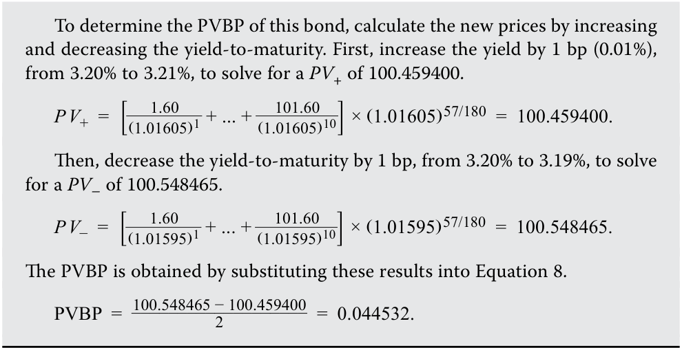
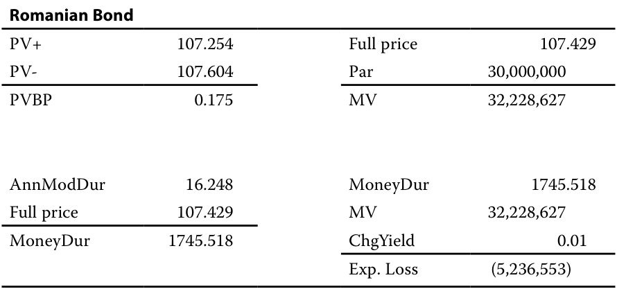
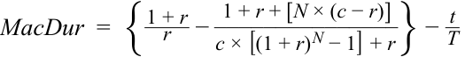
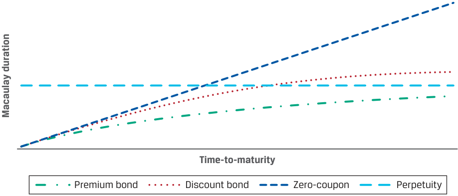
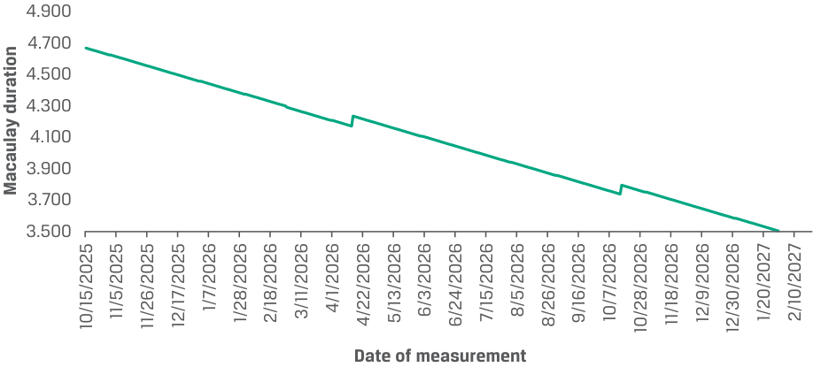
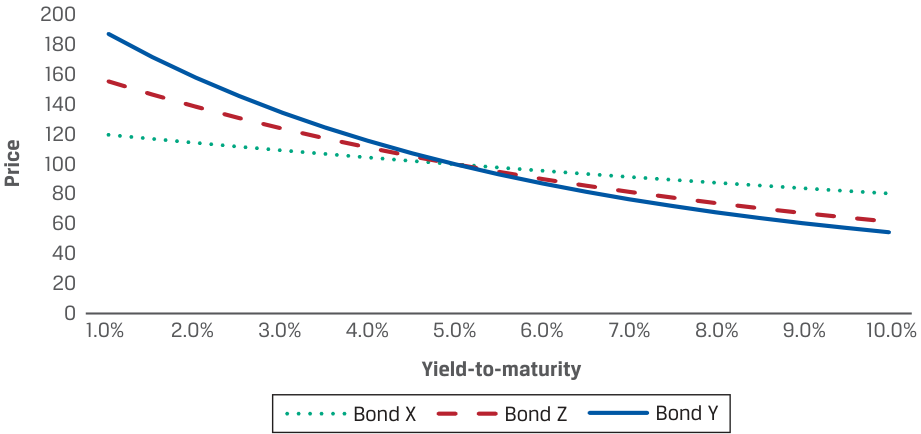

# Volume 6: Fixed Income
## Learning Module 11 Yield-Based Bond Duration Measures and Properties
### Part 2/2: Money Duration and Price Value of a Basis Point (PDF Pages 291–306)

---

<!-- PDF Page 291 -->

|**Period**|**Time to** **Receipt**|**Cash** **Flow**|**PV+**|**Period**|**Time** **to** **Receipt**|**Cash** **Flow**|**PV-**|
|---|---|---|---|---|---|---|---|
|3|2.744|4.625|4.120|3|2.744|4.625|4.131|
|4|3.744|4.625|3.950|4|3.744|4.625|3.965|
|5|4.744|4.625|3.788|5|4.744|4.625|3.805|
|…|…|…|…|…|…|…|…|
|29|28.744|4.625|1.379|29|28.744|4.625|1.417|
|30|29.744|104.625|29.907|30|29.744|104.625|30.773|
||||106.561||||108.307|
|**Romani**|**an Bond: A**|**pprox. An i**|**n. Modifie**|**id Duration**||||
|PV0|||||10|7.429||
|PV+|||||10|6.561||
|PV-|||||10|8.307||
|Approx.|ModDur||||1|6.249||

6. Of these three bonds, identify which has the most and least interest rate risk. Justify your answers. 

###### **Solution:** 

The Romanian bond has the most interest rate risk, reflected in the bond’s Macaulay and modified durations, which are nearly four times that of the BRWA bond. 

The Australian bond has the least interest rate risk, because its Macaulay and modified durations are less than a quarter of that of the BRWA bond. 

7. Chowdhury’s portfolio manager expects interest rates to decrease from current levels. Which of these three bonds would _most likely_ perform best in that environment, all else equal? Justify your answer. 

###### **Solution:** 

The Romanian bond would perform best. A decrease in interest rates would increase bond prices, with those having the greatest interest rate risk or duration having the highest increase. 

#### **MONEY DURATION AND PRICE VALUE OF A BASIS POINT** 

# **<mark>3</mark>** 

- define, calculate, and interpret modified duration, money duration, and the price value of a basis point (PVBP) 

<!-- PDF Page 292 -->

Modified duration is used to measure the _percentage price change_ of a bond given a change in its yield-to-maturity. A related statistic is **money duration** . The money duration of a bond is a measure of the price change in _currency units_ . The money duration can be stated per 100 of par value or in terms of the actual position size. In the United States, money duration is commonly called “dollar duration.” 

Money duration ( _MoneyDur_ ) is the product of the annualized modified duration and the full price ( _PV__Full_ ) of the bond, in either percent of par or the currency value of the position. 

_MoneyDur_ = _AnnModDur_ × _PV__Full_ . ~~(6)~~ 

The estimated change in the bond price in currency units is very similar to Equation 4. The difference is that for a given change in the annual yield-to-maturity (Δ _Yield_ ), modified duration estimates the percentage price change while money duration estimates the change in currency units. 

Δ _PV__Full_ ≈ − _MoneyDur_ × Δ _Yield_ ~~(7)~~ 

BRWA’s five-year, 3.2% semiannual coupon bond, maturing 15 October 2030, is priced to yield 3.2%. Assume it is purchased by an institutional investor for settlement on 11 December 2025, so 57 days into the first coupon period ( _t_ / _T_ = 57/180). 

The full price of the bond is 100.504 per 100 of par value, and the annualized modified duration is 4.43092. Suppose the investor has a position in the bond for a par value of USD100,000,000. Consequently, 

- the market value of the investment is USD100,503,921, and 

- the money duration of the investment is USD445,324,719 (= 4.43092 × USD100,503,921). 

Therefore, if the yield-to-maturity rises by 100 bps—from 3.20% to 4.20%—the expected loss is approximately USD4,453,247 (= –USD445,324,719 × 0.0100). 

A similar measure is the **price value of a basis point (PVBP)** , an estimate of the change in the full price of a bond given a 1 bp change in its yield-to-maturity. The PVBP can be calculated using a formula like that for approximating modified duration. Equation 8 is the formula for the PVBP. _PV_ – and _PV_ + are the full prices calculated by decreasing and increasing the yield-to-maturity by 1 bp. 

<!-- Formula Text: PVBP  = (P V −) − (P V +) ___________ 2 . (8) -->

The PVBP is also called the “PV01,” standing for the “price value of an 01” or “present value of an 01,” where “01” means 1 bp. In the United States, it is commonly called the “DV01” for the “dollar value” of 1 bp. The PVBP is particularly useful for bonds for which future cash flows are uncertain, such as callable bonds. A related statistic called a “basis point value” (BPV) is simply the money duration times 0.0001 (1 bp). 

For a numerical example of the PVBP calculation, again consider BRWA’s fiveyear, 3.2% semiannual coupon bond, maturing 15 October 2030 and priced to yield 3.2%, purchased by the institutional investor for settlement on 11 December 2025, so 57 days into the first coupon period ( _t_ / _T_ = 57/180). 

<!-- PDF Page 293 -->

<!-- Formula Text: To determine the PVBP of this bond, calculate the new prices by increasing and decreasing the yield-to-maturity. First, increase the yield by 1 bp (0.01%), from 3.20% to 3.21%, to solve for a PV+ of 100.459400. P V +  =  [ 1.60 _ (1.01605) 1  + ... +   101.60 _ (1.01605) 10 ] × (1.01605) 57/180  =  100.459400. Then, decrease the yield-to-maturity by 1 bp, from 3.20% to 3.19%, to solve for a PV– of 100.548465. P V −  =  [ 1.60 _ (1.01595) 1  + ... +   101.60 _ (1.01595) 10 ] × (1.01595) 57/180  =  100.548465. The PVBP is obtained by substituting these results into Equation 8. PVBP  =   100.548465 − 100.459400 ___________________ 2 =  0.044532. -->

Exhibit 3 provides a summary of the various yield duration statistics. To recap, they measure the instantaneous change in a bond’s price for a given change in its own yield-to-maturity, assuming all other variables (especially, time-to-maturity) are unchanged and the underlying cash flows are certain. 

**Exhibit 3: Summary of Yield-Based Duration Statistics** 

|**Measure**|**Calculation**|**Use**|
|---|---|---|
|**Macaulay** **duration**|Average time to receipt of prom- ised cash flows, weighted by shares of the full price corresponding to each promised future cash flow|Holding period that would balance reinvestment and price risks for an investor|
|**Modified**|l First derivative of price with|Estimate the percentage price change|
|**i** **duration**|respect to yield; Macaulay duration divided by 1 + yield per period|for a bond given a change in its yield-to-maturity|
|**Money** **duration**|Modified duration multiplied by full price of bond or bond position|Estimate price change in bond invest- ment for a given yield change|
|**Price value** **of a basis** **point**|Difference in price of a 1 bp yield decrease and a 1 bp yield increase, divided by 2|Estimate of the change in the bond price given a 1 bp change in the yield-to-maturity|

##### **Yield Duration of Zero-Coupon and Perpetual Bonds** 

Because zero-coupon bonds have a single payment, the face value at maturity, the present weighted-average time to receipt of cash flows is the same as the time-to-maturity because that single cash flow has a present value weight of 1.0. Therefore, the Macaulay duration of a zero-coupon bond is its time-to-maturity, and modified duration is its time-to-maturity divided by 1 plus its yield. 

A perpetuity or perpetual bond is a bond that does not mature, so there is no face or maturity value received at time _T_ . The investor receives a fixed coupon payment forever unless the bond is called. Non-callable perpetuities are rare, but they have an interesting Macaulay duration: 

_MacDur_ = (1 + _r_ )/ _r_ . 

<!-- PDF Page 294 -->

##### **Duration of Floating-Rate Notes and Loans** 

As described in an earlier lesson, interest on floating-rate instruments varies depending on the level of a market reference rate (MRR) plus a quoted margin. At predetermined dates, payment amounts are reset to reflect changes in the MRR. Therefore, interest rate risk arises only _between_ reset dates, because at the next reset date, coupon payments will adjust to the new MRR. Therefore, the Macaulay duration for a floating-rate note or bond is simply the fraction of a period remaining until the next reset date: 

<!-- Formula Text: MacDu r Floating  =   (T − t) _ T  . (10) -->

If there are 180 days in the coupon period and 57 days have passed since the last coupon, the Macaulay duration is 

<!-- Formula Text: MacDu r Floating  =   (180 − 57) _ 180 =  0.683333. -->

Floating-rate instruments typically have very low duration because coupon periods are typically less than six months in length. As a result, they are commonly used by investors to reduce duration in fixed-income portfolios. 

###### **KNOWLEDGE CHECK** 

An analyst is comparing the interest rate risk of the BRWA 3.2% bond maturing 15 October 2030 to a floating-rate note (FRN) that also matures 15 October 2030 and has its coupon reset semiannually. 

At the last reset, 15 October 2027, the coupon rate of the FRN was 3.2%. The BRWA bond was priced to yield 3.2% at that same date. 

1. Why would you expect the FRN to have a lower duration than the BRWA fixed-rate bond? 

###### **Solution:** 

A floating-rate instrument has a Macaulay duration that reflects the time to the next coupon reset date, while a fixed-rate instrument has a Macaulay duration that primarily reflects time-to-maturity but also its coupon rate, yield, and fraction of the coupon period that has passed. The maximum Macaulay duration the FRN would have is six months, while the BRWA bond has a Macaulay duration slightly lower than its maturity (five years). 

2. Complete the following table: 

||**Macaulay duration**|
|---|---|
||**BRWA** **FRN**|
|15-Oct-2027||
|15-Nov-2027||
|15-Dec-2027||
|15-Jan-2028||
|15-Feb-2028||
|15-Mar-2028||
|15-Apr-2028||

**Solution:** 

<!-- PDF Page 295 -->

||**Macaulay**|**duration**|
|---|---|---|
||**BRWA**|**FRN**|
|15-Oct-2027|2.8843|0.0000|
|15-Nov-2027|2.8002|0.8306|
|15-Dec-2027|2.7169|0.6667|
|15-Jan-2028|2.6336|0.4973|
|15-Feb-2028|2.5502|0.3279|
|15-Mar-2028|2.4669|0.1694|
|15-Apr-2028|2.4221|0.0000|

For example, for 15 December 2027, the number of days since the next coupon is 61 days. The number of days in the coupon period is 183, calculated using Microsoft Excel or Google Sheets as 

- = COUPDAYS(DATE(2027,12,15),DATE(2028,4,15),2,1). 

Therefore, the Macaulay duration is (183 – 61)÷183 = 0.6667. 

###### **QUESTION SET** 

Deepak Chowdhury is evaluating a USD30 million investment in par value terms in the BRWA, Australian, and Romanian bonds. Assume all bonds are denominated in the same currency and that all three bonds were issued on 15 October 2025. 

Chowdhury is evaluating the bonds on 15 January 2026, 92 days into the first coupon period. Chowdhury has compiled the following data. 

|**Characteristic**|**BRWA**|**Australian**|**Romanian**|
|---|---|---|---|
|Coupon|3.200%|0.000%|4.625%|
|Coupon frequency|2|1|1|
|Yield-to-maturity|3.200%|1.000%|4.250%|
|Maturity|15 October 2030|15 October 2026|15 October 2055|
|Full price|100.815|99.262|107.429|
|Ann. Macaulay|4.405|0.744|16.939|
|duration||||
|Ann. modified duration|4.335|0.737|16.248|

As part of his analysis, Chowdhury is evaluating the potential change in the prices of the bond investments for 1 bp and 100 bp changes in yields. 

1. Complete the following table: 

||**Effec**|**ft on a USD30** **investment**|**f    million**|
|---|---|---|---|
||**BRWA**|**Australian**|**Romanian**|
|Price value per basis point||||
|Market value of investment (USD)||||

<!-- PDF Page 296 -->

|**Effect on a USD30 million** **investment**|
|---|
|**BRWA** **Australian** **Romanian**|

|Money duration (percent of par)|
|---|
|Expected loss from a 100 bp YTM|
|increase (USD)|

###### **Solution:** 

||**Effect on a**|**f   USD30 million i**|**f     nvestment**|
|---|---|---|---|
||**BRWA**|**Australia**|**Romania**|
|Price value per basis point|0.044|0.007|0.175|
|Market value of investment (USD)|30,244,381|29,778,597|32,228,627|
|Money duration (percent of par)|437.054|73.163|1745.518|
|Expected loss from a 100 bp YTM increase (USD)|–1,311,163|–219,490|–5,236,553|

The calculations are shown in tabular form. Please refer to the candidate learning ecosystem online for a spreadsheet in the downloadable Microsoft Excel workbook. Note that while solutions are rounded to three decimal places, other quantities are unrounded but shown only to three decimal places for presentation purposes. 

|**BRWA Bond: Full**|**price, assum**|**ing 1 bp YTM i**|**ncrease**|**BRWA Bond: Full**|**price, assumi**|**ng 1 bp YTM d**|**ecrease**|
|---|---|---|---|---|---|---|---|
|**YTM (periodic)**||0.01605||**YTM (periodic)**||0.01595||
|**Period**|**Time to** **Receipt**|**Cash Flow**|**PV+**|**Period**|**Time to** **Receipt**|**Cash Flow**|**PV-**|
|1|0.489|1.600|1.588|1|0.489|1.600|1.588|
|2|1.489|1.600|1.563|2|1.489|1.600|1.563|
|3|2.489|1.600|1.538|3|2.489|1.600|1.538|
|4|3.489|1.600|1.514|4|3.489|1.600|1.514|
|5|4.489|1.600|1.490|5|4.489|1.600|1.490|
|6|5.489|1.600|1.466|6|5.489|1.600|1.467|
|7|6.489|1.600|1.443|7|6.489|1.600|1.444|
|8|7.489|1.600|1.420|8|7.489|1.600|1.421|
|9|8.489|1.600|1.398|9|8.489|1.600|1.399|
|10|9.489|101.600|87.353|10|9.489|101.600|87.435|
||||100.771||||100.858|

|**BRWA Bond**||||
|---|---|---|---|
|PV+|100.771|Full price|100.815|
|PV-|100.858|Par|30,000,000|
|PVBP|0.044|Market value|30,244,381|
|AnnModDur|4.335|MoneyDur|437.054|

<!-- PDF Page 297 -->

|**BRWA Bond**|||||||
|---|---|---|---|---|---|---|
|Fullprice|100.815||MV||30,244,|381|
|MoneyDur|437.054||ChgY|ield||0.01|
||||Exp. L|oss|(1,311,|163)|
|**Australian Bond: F** **ing 1 bp YTM incr**|**ull price, as** **ease**|**sum-**|**Australia** **1 bp YTM**|**n Bond:** **decreas**|**Full price, a** **e**|**ssuming**|
|**YTM (periodic)**|0.0101||**YTM (p**|**eriodic)**|0.0099||
|**Period** **Time to** **Receipt**|**Cash** **Flow**|**PV+**|**Period**|**Time to** **Receipt**| **Cash** **Flow**|**PV-**|
|1 0.744|100.000|99.255|1|0.744|100.000|99.269|
|||99.255||||99.269|

###### **Australian Bond** 

|PV+|99.255|Full price|99.262|
|---|---|---|---|
|PV-|99.269|Par|30,000,000|
|PVBP|0.007|Market value|29,778,597|
|AnnModDur|0.737|MoneyDur|73.163|
|Fullprice|99.262|MV|29,778,597|
|MoneyDur|73.163|ChgYield|0.01|
|||Exp. Loss|(219,490)|

|**Romanian Bon**|**d: Full price, ass**|**uming 1 bp Y**|**TM**|**Romanian Bon**|**d: Full price, a**|**ssuming 1 bp**|**YTM**|
|---|---|---|---|---|---|---|---|
|**increase**||||**decrease**||||
|**YTM**|0.0426|||**YTM**|0.0424|||
|**(periodic)**||||**(periodic)**||||
|**Period**|**Time to** **Receipt**|**Cash Flow**|**PV+**|**Period**|**Time to** **Receipt**|**Cash Flow**|**PV-**|
|1|0.744|4.625|4.484|1|0.744|4.625|4.484|
|2|1.744|4.625|4.300|2|1.744|4.625|4.302|
|3|2.744|4.625|4.125|3|2.744|4.625|4.127|
|4|3.744|4.625|3.956|4|3.744|4.625|3.959|
|5|4.744|4.625|3.794|5|4.744|4.625|3.798|
|…|…|…|…|…|…|…|…|
|29|28.744|4.625|1.394|29|28.744|4.625|1.402|
|30|29.744|104.625|30.251|30|29.744|104.625|30.424|
||||107.254||||107.604|

<!-- PDF Page 298 -->

<!-- Start of picture text -->
Romanian Bond PV+ 107.254 Full price 107.429 PV- 107.604 Par 30,000,000 PVBP 0.175 MV 32,228,627 AnnModDur 16.248 MoneyDur 1745.518 Full price 107.429 MV 32,228,627 MoneyDur 1745.518 ChgYield 0.01 Exp. Loss (5,236,553) <!-- End of picture text -->

2. If the client believes that interest rates will rise in the future, with all else held constant, which bond investment would _most likely_ perform best? **Solution:** 

The Australian bond would perform best. Since it has the lowest duration and PVBP, the expected loss on the investment from an increase in its yield is lower than the BRWA and Romanian bonds. The expected loss from a 100 bp increase in yield on the BRWA bond, for example, is almost six times that for the Australian bond (USD219,490 versus USD1.3 million). 

# **<mark>4</mark>** 

#### **PROPERTIES OF DURATION** 

explain how a bond’s maturity, coupon, and yield level affect its interest rate risk 

The Macaulay and modified yield duration statistics for a traditional fixed-rate bond are primarily functions of the bond’s features: its time-to-maturity, its coupon rate, its yield-to-maturity, and the fraction of the current coupon period that has elapsed. The closed-form formula for Macaulay duration, presented in a prior lesson and again here, is useful in demonstrating the characteristics of duration (the same characteristics hold for modified duration, money duration, and price value of basis point). 

<!-- Formula Text: MacDur  =  { 1 + r _ r   − 1 + r + [N × (c − r)] _______________ c × [(1 + r) N − 1] + r } −  t _ T -->

The relationship between a bond’s duration and its features ( _r_ , _c_ , _N_ , and _t_ / _T_ ) are summarized in Exhibit 4. 

**Exhibit 4: Properties of Yield Duration Statistics** 

||**Effect on duration (interest rate risk) from an**|
|---|---|
||**_increase_ in feature**|
|Coupon rate,_c_|↓(Inverse relationship)|
|Yield to maturity,_r_|↓(Inverse relationship)|

<!-- PDF Page 299 -->

||**Effect on duration (interest rate risk) from an** **_increase_ in feature**|
|---|---|
|Time-to-maturity,_T_|↑(Direct relationship)|
|Fraction of current coupon period that|↓(Inverse relationship)|
|has elapsed,_t_/_T_||

Exhibit 5 illustrates the relationships between Macaulay duration and time-to-maturity for premium, discount, zero-coupon, and perpetual bonds (the same characteristics hold for modified duration, money duration, and price value of basis point). 

**Exhibit 5: Properties of Macaulay Duration** 

<!-- Start of picture text -->
Time-to-maturity Premium bond Discount bond Zero-coupon Perpetuity Macaulay duration <!-- End of picture text -->

All else being equal, 

- _a lower-coupon bond has a higher duration and more interest rate risk than a higher-coupon bond._ 

The same pattern holds for the yield-to-maturity, so, 

- _a lower yield-to-maturity increases the weighted average of the time to receipt of cash flow and thus increases duration_ . 

The reason is that lower coupons and lower yields increase the weight of the maturity value or final cash flow and reduce the weight of nearer-term cash flows in the bond price. 

- _Longer times-to-maturity typically correspond to higher duration_ . 

This pattern always holds for bonds trading at par or at a premium. In the closed-form formula, the second expression within brackets is positive for premium and par bonds, because the coupon rate ( _c_ ) is greater than or equal to the yield-to-maturity ( _r_ ), so ( _c_ – _r_ ) ≥ 0, whereas the denominator is always positive. Therefore, the Macaulay duration is always less than (1 + _r_ )/ _r_ , and it approaches that threshold from below as the time-to-maturity increases. 

A curious result is illustrated in Exhibit 5 for _discount bonds_ : at some point, when the time-to-maturity is high enough, the Macaulay duration will exceed (1 + _r_ )/ _r_ , reach a maximum, and then decrease. This pattern develops when the number of periods ( _N_ ) is large and the coupon rate is below the yield-to-maturity, so ( _c_ – _r_ ) < 0. Then, the numerator of the second expression within braces can become negative. The implication is that for long-dated bonds trading at a discount to par, interest rate risk could be lower than that of a shorter-term bond. 

<!-- PDF Page 300 -->

For a constant yield-to-maturity ( _r_ ), the expression in braces in the closed-form formula is unchanged as time passes _during the period_ . Therefore, the Macaulay duration decreases smoothly as time passes and then jumps upward after the coupon is paid, which creates a “saw-tooth” pattern. This pattern for the BRWA bond with a constant yield-to-maturity is illustrated in Exhibit 6. As time passes, the Macaulay duration decreases smoothly but jumps upward by a small amount on coupon dates. 

**Exhibit 6: Macaulay Duration between Coupon Payments with Constant Yield-to-Maturity for the BRWA 3.2% Bond** 

<!-- Start of picture text -->
4.900 4.700 4.500 4.300 4.100 3.900 3.700 3.500 Date of measurement Macaulay duration 10/15/2025 11/5/2025 11/26/2025 12/17/2025 1/7/2026 1/28/2026 2/18/2026 3/11/2026 4/1/2026 4/22/2026 5/13/2026 6/3/2026 6/24/2026 7/15/2026 8/5/2026 8/26/2026 9/16/2026 10/7/2026 10/28/2026 11/18/2026 12/9/2026 12/30/2026 1/20/2027 2/10/2027 <!-- End of picture text -->

###### **QUESTION SET** 

1. For each pair of bonds, indicate the bond that _most likely_ has greater interest rate risk: 

|**First bond**|**Second bond**|**Which has greater** **interest rate risk?**|
|---|---|---|
||5% coupon, paid semian- nually, and five years to maturity, priced to yield 6%||
|4% coupon, paid semian- nually, and five years to|4% coupon, paid semi- annually, and six years to maturity, priced to yield 6%||
|i maturity, priced to yield 6%|5% coupon, paid semian- nually, and five years to maturity, priced to yield 8%||
||4% coupon, paid semian- nually, and five years to maturity, priced to yield 8%||

**Solution:** 

<!-- PDF Page 301 -->

|**First bond**|**Second bond**|**Which has greater** **interest rate risk?**|
|---|---|---|
||5% coupon, paid semian- nually, and five years to maturity, priced to yield 6%|First bond|
|4% coupon, paid semian- nually, and five years to|4% coupon, paid semi- annually, and six years to maturity, priced to yield 6%|Second bond|
|i maturity, priced to yield 6%|5% coupon, paid semian- nually, and five years to maturity, priced to yield 8%|First bond|
||4% coupon, paid semian- nually, and five years to maturity, priced to yield 8%|First bond|

2. A bond analyst is comparing Bond D, a perpetual bond with a coupon of 5%, with Bond E, a zero-coupon bond maturing in five years. If both bonds are priced to yield 6%, Bond D has: 

   - **A.** lower interest rate risk. 

   - **B.** the same interest rate risk. 

   - **C.** higher interest rate risk. 

   - **Solution:** 

C is correct. The Macaulay duration for Bond D is 1.06/0.06 = 17.667. The Macaulay duration for Bond E is five years. The perpetual bond, Bond D, has higher interest rate risk. 

3. The graph depicts the price–yield relationships for three bonds, Bond X, Bond Y, and Bond Z. The three bonds have the same coupon rate, 5%. 

<!-- Start of picture text -->
200 180 160 140 120 100 80 60 40 20 0 1.0% 2.0% 3.0% 4.0% 5.0% 6.0% 7.0% 8.0% 9.0% 10.0% Yield-to-maturity Bond X Bond Z Bond Y Price <!-- End of picture text -->

Which of the three bonds _most likely_ has the longest time to maturity? 

**A.** Bond X 

- **B.** Bond Y 

<!-- PDF Page 302 -->

###### **C.** Bond Z **Solution:** 

B is correct. Bond Y has the steepest price-yield line, indicating that it has the greatest modified duration and, most likely, the longest time-to-maturity. 

4. Between coupon payments, if the yield-to-maturity does not change, the Macaulay duration of a bond: 

   - **A.** decreases throughout the coupon period. 

   - **B.** is constant throughout the coupon period. 

   - **C.** increases throughout the coupon period. 

   - **Solution:** 

A is correct. During the coupon period, the Macaulay duration declines smoothly until the next coupon period, at which time it jumps. This is illustrated in Exhibit 6. 

5. Two bonds have the same time-to-maturity and yield-to-maturity, but one is trading at a premium to par and the other at a discount. The Macaulay duration for the premium bond is _most likely_ _________ that of the discount bond. 

   - **A.** lower than 

   - **B.** the same as 

   - **C.** higher than 

   - **Solution:** 

A is correct. If two bonds have the same maturity and the same yield-to-maturity but one trades at a premium and one trades at a discount to par, the premium bond must have a higher coupon rate. Therefore, the premium bond has the lower Macaulay duration. 

<!-- PDF Page 303 -->

## **~~PRACTICE PROBLEMS~~** 

**1.** _True or false:_ Curve duration is a type of yield duration. 

   - **A.** True 

   - **B.** False 

### **The following information relates to questions 2-7** 

A portfolio manager is assessing the interest rate risk of three bonds as she considers making an investment of USD50 million. All three bonds are issued on 1 June 2026 and mature on 1 June 2030, and they have the following characteristics: 

|**Characteristic**|**Bond One**|**Bond Two**|**Bond Three**|
|---|---|---|---|
|Coupon (semiannual)|7%|3%|5%|
|Yield-to-maturity|3%|7%|5%|

**2.** The Macaulay duration, in years, for Bond One is _closest_ to: 

   - **A.** 3.54. 

   - **B.** 3.59. 

   - **C.** 3.78. 

**3.** The modified duration for Bond Two is _closest_ to: 

**A.** 3.59. 

**B.** 3.65. 

**C.** 3.78 

**4.** Relative to a five-year zero-coupon bond priced to yield 5%, Bond Three has a modified duration that is _best_ described as: 

   - **A.** lower than the zero-coupon bond’s modified duration. 

   - **B.** the same as the zero-coupon bond’s modified duration. 

   - **C.** greater than the zero-coupon bond’s modified duration. 

**5.** If the yields-to-maturity for all three bonds were to increase by 100 bps, which bond has the greatest anticipated decrease in price? 

   - **A.** Bond One 

   - **B.** Bond Two 

   - **C.** Bond Three 

<!-- PDF Page 304 -->

**6.** Which bond has the highest price value of a basis point? 

   - **A.** Bond One 

   - **B.** Bond Two 

   - **C.** Bond Three 

**7.** The portfolio manager is interested in comparing the interest rate risk of Bond Three to that of Bond Four, a floating-rate note that resets every six months. On 1 June 2026, both bonds were priced to yield 5%. If the yield changes from 5% to 5.25% halfway through the first coupon period, which bond has the greater Macaulay duration? 

   - **A.** Bond Three 

   - **B.** Bond Four 

   - **C.** Neither: The Macaulay duration is the same for both bonds. 

<!-- PDF Page 305 -->

## **~~SOLUTIONS~~** 

1. B is correct. The Macaulay, modified, and money duration measures, as well as the price value of a basis point, are all types of yield duration. The curve duration is not classified as a type of yield duration. 

###### 2. B is correct. 

|**Period**|**Time to** **receipt**|**Cash** **flow**|**Present value**|**Weight**|**Time to receipt** **× weight**|
|---|---|---|---|---|---|
|1|1.0000|3.5|3.44828|0.02999|0.02999|
|2|2.0000|3.5|3.39732|0.02955|0.05910|
|3|3.0000|3.5|3.34711|0.02911|0.08734|
|4|4.0000|3.5|3.29764|0.02868|0.11473|
|5|5.0000|3.5|3.24891|0.02826|0.14129|
|6|6.0000|3.5|3.20090|0.02784|0.16704|
|7|7.0000|3.5|3.15359|0.02743|0.19200|
|8|8.0000|103.5|91.87810|0.79914|6.39308|
||||114.97185|1.00000|7.18458|
|Annualized|Macaulay dura|tion|||3.59229|

###### 3. B is correct. 

|**Period**|**Time to** **receipt**|**Cash** **flow**|**Present value**|**Weight**|**Time to receipt ×** **weight**|
|---|---|---|---|---|---|
|1|1.0000|1.5|1.44928|0.01680|0.01680|
|2|2.0000|1.5|1.40027|0.01623|0.03247|
|3|3.0000|1.5|1.35291|0.01569|0.04706|
|4|4.0000|1.5|1.30716|0.01516|0.06062|
|5|5.0000|1.5|1.26296|0.01464|0.07321|
|6|6.0000|1.5|1.22025|0.01415|0.08488|
|7|7.0000|1.5|1.17899|0.01367|0.09568|
|8|8.0000|101.5|77.08027|0.89366|7.14930|
||||86.25209|1.00000|7.56003|
|Annualized|Macaulay dur|ation|||3.780016|
|Modified d|i uration||||3.652190|

> 4. A is correct. No calculation is necessary, as we know that a five-year zero-coupon bond has a Macaulay duration of 5, which is greater than that of a coupon bond like Bond three. Since they have the same yields, the bond’s modified durations will have the same relationship as their Macaulay duration. Alternatively, we can calculate Bond Three’s modified duration of 3.585: 

<!-- PDF Page 306 -->

|**Period**|**Time to** **receipt**|**Cash** **flow**|**Present value** **Weight**|**Time to receipt** **× weight**|
|---|---|---|---|---|
|1|1.0000|2.5|2.43902 0.02439|0.02439|
|2|2.0000|2.5|2.37954 0.02380|0.04759|
|3|3.0000|2.5|2.32150 0.02321|0.06964|
|4|4.0000|2.5|2.26488 0.02265|0.09060|
|5|5.0000|2.5|2.20964 0.02210|0.11048|
|6|6.0000|2.5|2.15574 0.02156|0.12934|
|7|7.0000|2.5|2.10316 0.02103|0.14722|
|8|8.0000|102.5|84.12652 0.84127|6.73012|
||||100.00000 1.00000|7.34939|
||||Annualized Macaulay duration|3.6747|
||||Modified duration|3.5851|

The zero-coupon’s modified duration is 5/(1 + 0.05) = 4.7619. 

###### 5. B is correct. 

||**Bond One**|**Bond Two**|**Bond Three**|
|---|---|---|---|
|Full price (percent of par)|114.972|86.252|100.000|
|Modified duration|3.539|3.652|3.585|
|Investment (in USD millions)|50|50|50|
|Money duration|176.960|182.609|179.253|
|Change in value (in USD millions)|–1.770|–1.826|–1.793|

###### 6. A is correct. 

||**Bond One**|**Bond Two**|**Bond Three**|
|---|---|---|---|
|Price|114.972|86.252|100.000|
|Price + 1 bp|114.931|86.221|99.964|
|Price – 1 bp|115.013|86.284|100.036|
|PVBP|0.04069|0.03150|0.03585|

7. A is correct. The Macaulay duration for Bond Three is 3.6747. The Macaulay duration for Bond Four is 0.5 because there is exposure to interest rate changes for one-half of the coupon period. 

