# Volume 6: Fixed Income
## Learning Module 12 Yield-Based Bond Convexity and Portfolio Properties
### Part 1/2: Introduction (PDF Pages 307–320)

---

<!-- PDF Page 307 -->

# L E A R N I N G M O D U L E **<mark>12</mark>** 

### **Yield-Based Bond Convexity and Portfolio Properties** 

##### **<mark>LEARNING OUTCOMES</mark>** 

- **_Mastery The candidate should be able to:_** calculate and interpret convexity and describe the convexity adjustment calculate the percentage price change of a bond for a specified change in yield, given the bond’s duration and convexity calculate portfolio duration and convexity and explain the limitations of these measures 

#### **INTRODUCTION** 

## **<mark>1</mark>** 

While duration is a linear approximation of the sensitivity of a bond’s price to changes in yield, the true relationship between a bond’s price and its yield-to-maturity is a curved (convex) line. We introduce convexity as a complementary risk measure to improve bond price change estimates based on modified duration alone to account for this non-linear relationship. The convexity adjustment becomes more important when considering larger moves in yield-to-maturity and longer-maturity bonds. These lessons will also show how to estimate duration and convexity for a portfolio of bonds, as well as highlight limitations due to underlying assumptions. 

Most of the examples and exhibits used throughout the reading can be downloaded as a Microsoft Excel workbook. Each worksheet in the workbook is labeled with the corresponding example or exhibit number in the text. 

###### **LEARNING MODULE OVERVIEW** 

- Convexity is a complementary risk metric that measures the second-order (non-linear) effect of yield changes on price for an option-free fixed-rate bond. The convexity adjustment adds to the linear price estimate provided by modified duration. 

<!-- PDF Page 308 -->

- Convexity is always positive for an option-free fixed-rate bond, such that estimated price increases from a decline in yields are higher than duration alone would suggest and estimated price decreases from an increase in yields are lower than duration alone would suggest. Therefore, convexity is valuable to investors. 

- Convexity has the same relationship with bond features as duration: a fixed-rate bond will have greater convexity the longer its time-to-maturity, the lower its coupon rate, and the lower its yield-to-maturity. 

- Money convexity expresses convexity in terms of currency units or percent of par for a position in a bond because it is the product of a bond’s annual convexity and its full price. 

- Portfolio duration and convexity can be calculated (1) as the weighted average of time to receipt of the aggregate cash flows or (2) by using the weighted averages of the durations and convexities of the individual bonds that make up the portfolio. 

- While the first method is theoretically correct, it is difficult to use in practice. The second method is commonly used by portfolio managers but implicitly assumes parallel shifts in the yield curve, which are rare. 

###### **LEARNING MODULE SELF-ASSESSMENT** 

These initial questions are intended to help you gauge your current level of understanding of the learning module. 

1. The annualized convexity of a four-year, 2.8% (semiannual) coupon bond priced at par at issuance on 1 August 2035 and maturing on 1 August 2039 is _closest_ to: 

   - **A.** 7.624. 

   - **B.** 16.413. 

**C.** 65.651. **Solution:** 

B is correct. 

###### **Four-Year, 2.8% Semiannual Bond at Issuance** 

|**Fixed Coupon (%)**|2.80|
|---|---|
|**Periods p.a.**|2|
|**Price (per 100 Par Value)**|100|
|**Yield-to-Maturity (%)**|2.8000|

<!-- PDF Page 309 -->

|**(1)** **(2)**|**(3)**|**(4)**|**(5)** **(6)**|**= (2) × (5)**|**(7) = Col. 2 × (Col. 2** **+ 1) × Col. 5 × (1 +** **YTM/2)****–2**|
|---|---|---|---|---|---|
|**Period** **Time to** **Receipt**|**Cash Flow**|**Present** **Value**|**Weight** **Tim** **×**|**e to Receipt** **Weight**|**Convexity of Cash** **Flows**|
|1 1.0|1.4|1.380671|0.01381 |0.01381|0.02686|
|2 2.0|1.4|1.361608|0.01362 |0.02723|0.07946|
|3 3.0|1.4|1.342809|0.01343 |0.04028|0.15672|
|4 4.0|1.4|1.324269|0.01324 |0.05297|0.25759|
|5 5.0|1.4|1.305985|0.01306 |0.06530|0.38105|
|6 6.0|1.4|1.287954|0.01288 |0.07728|0.52611|
|7 7.0|1.4|1.270171|0.01270 |0.08891|0.69179|
|8 8.0|101.4|90.726533|0.90727 |7.25812|63.53176|
|||**100.0000**|**1.00000** |**7.62391**|**65.65133**|
|**Annualized Macaulay Duration an**|**d Convexity**|||**3.81195**|**16.41283**|
|Annualized convexity is 16.41 (65.65133) divided by the squ year: 22= 4).|283 and result are of the perio|s from the sum ds per year (tw|of Column 7 o periods per|||
|2. Identify which of the followin    h **A.**is always negative for an  i **B.**accounts for the first-ord f **C.**is added to the bond pri     i duration. **Solution:** C is correct. The convexity ad provided by modified duratio %_ΔP_ _V_ _Full_≈ (−_AnnModDur_|g statements is  h option-free fix ier effect of yie ce change estim   i h  justment is ad i n for a given ch ×_ΔYield_) +[ 1 _ 2|true. The conv ied-rate bond. i f  ld changes on a ate provided b i h    ded to the price i     ange in yield-t ×_AnnConvexity_|h exity adjustment: i f      bond. y modified h        change estimate i       o-maturity: ×  (_ΔYield_) 2 ] .|||
|A is incorrect because convex       i rate bond. B is incorrect because convex     f yield changes on a bond’s pri      i effect.|ity is always po    i ity accounts fo   f ce and duration    i|sitive for an op i r the second-or f accounts for th i|tion-free fixed- der effect of e first-order|||
|Questions 3 and 4 relate to the An investor holds a GBP50,0      i pon bond (semiannual) trading     i 8.376, and annualized convexit   h to decline by 100 bps.|following infor 00,000 positio     i at par value. A i y is 81.701. Th|mation. n in a 10-year,  i nnualized moi he investor expe|3.50% fixed-cou- dified duration is h  cts interest rates|||
|3. The expected percentage cha|h   nge in the price|h       of the bond is|_closest_to:|||
|**A.**7.97%.||||||
|**B.**8.01%.||||||
|**C.**8.78%.||||||
|**Solution:**||||||
|C is correct. The expectedpr|ice change is ca|lculated as follo|ws:|||

<!-- PDF Page 310 -->

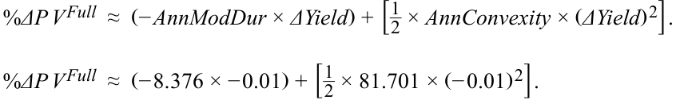

<!-- Formula Text: %ΔP V Full  ≈  (− AnnModDur × ΔYield) + [ 1 _ 2  × AnnConvexity × (ΔYield) 2]. %ΔP V Full  ≈  (− 8.376 × − 0.01) + [ 1 _ 2  × 81.701 × (− 0.01) 2]. -->

%Δ _PV__Full_ ≈ 0.0878 = 8.78% 

4. The addition of money convexity to the estimated change in the value of the bond position using money duration alone is _closest_ to: 

   - **A.** GBP204,252. 

   - **B.** GBP408,503. 

   - **C.** GBP4,188,220. 

###### **Solution:** 

A is correct. This question is asking for the money convexity adjustment. First we calculate money convexity: 

_MoneyCon_ = _AnnConvexity_ × _PV__Full_ . 

_MoneyCon_ = 81.701 × GBP50,000,000. 

_MoneyCon_ = GBP4,085,033,604. 

Then we calculate the money convexity adjustment: 

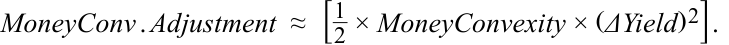

<!-- Formula Text: MoneyConv . Adjustment  ≈  [ 1 _ 2  × MoneyConvexity × (ΔYield) 2]. -->

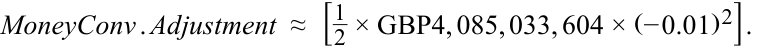

<!-- Formula Text: MoneyConv . Adjustment  ≈  [ 1 _ 2  × GBP4, 085, 033, 604 × (− 0.01) 2]. -->

_MoneyConv.Adjustment_ ≈ GBP204,252. 

5. A EUR100 million bond portfolio contains the following bonds: 

|**Bond**|**Maturity** **(yrs.)**|**YTM (%)**|**Market Value**|**Annualized** **Modified** **Duration**|**Annualized** **Convexity**|
|---|---|---|---|---|---|
|A|3|2.80%|EUR40,000,000|2.858|9.752|
|B|10|3.50%|EUR60,000,000|8.376|81.701|

The expected percentage price change of the bond portfolio given a 50 bp increase in yield-to-maturity is _closest_ to: 

**A.** 3.018%. 

- **B.** 3.085%. 

**C.** 3.151%. 

###### **Solution:** 

A is correct. The weights of Bond A and Bond B are 40% and 60%, respectively. As a result, the portfolio weighted-average duration and convexity measures are 6.169 and 52.921, respectively. The expected portfolio percentage price change given a 50 bp increase in YTM is calculated as follows: 

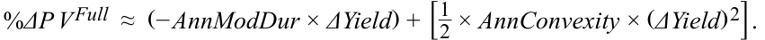

<!-- Formula Text: %ΔP V Full  ≈  (− AnnModDur × ΔYield) + [ 1 _ 2  × AnnConvexity × (ΔYield) 2]. -->

<!-- PDF Page 311 -->

   - % _ΔP V__Full_ ≈( − 6.169 × 0.005) +  [_1 2× 52.921 ×  (0.005)2] . %Δ _PV__Full_ ≈ −3.018% 

6. Using weighted-average duration and convexity measures to estimate bond portfolio interest rate risk: 

   - **A.** is difficult in practice. 

   - **B.** is the theoretically correct approach. 

   - **C.** assumes a parallel shift in the yield curve. 

   - **Solution:** 

C is correct. Using the weighted-average duration and convexity measures to estimate bond portfolio interest rate risk is easy in practice, but it is not the theoretically correct approach (using the weighted average of time to receipt of the aggregate cash flows is theoretically correct). It does, however, implicitly assume a parallel shift in the yield curve. 

#### **BOND CONVEXITY AND CONVEXITY ADJUSTMENT** 

## **<mark>2</mark>** 

calculate and interpret convexity and describe the convexity adjustment 

Interest rate risk, or the sensitivity of a bond’s price to changes in yield, is an important concept used to analyze fixed-income exposures. As a key risk metric, modified duration measures the first-order (linear) effect on a bond’s price change given a yield-to-maturity change. **Convexity** is a complementary risk metric that measures the second-order (non-linear) effect of yield changes on price for an option-free fixed-rate bond, as shown in Exhibit 1. 

###### **Exhibit 1: Convexity of an Option-Free Fixed-Rate Bond** 

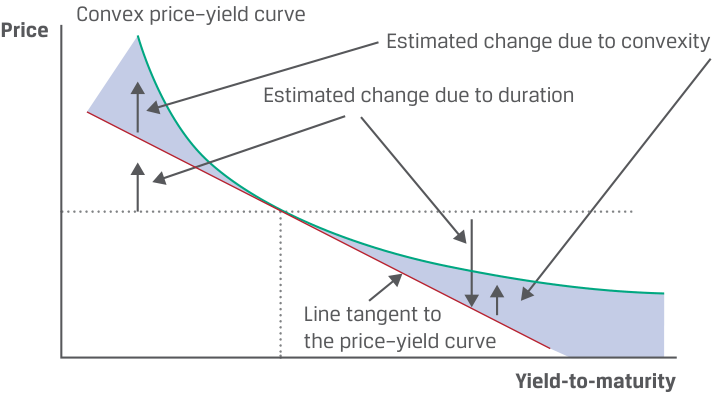

<!-- Start of picture text -->
Convex price–yield curve Price Estimated change due to convexity Estimated change due to duration Line tangent to the price–yield curve Yield-to-maturity <!-- End of picture text -->

<!-- PDF Page 312 -->

The true relationship between a bond’s price and its yield-to-maturity is the curved (convex) line that shows the actual bond price given its market discount rate. Duration (i.e., money duration) estimates the change in the bond price along the straight line tangent to the curved line. For small yield-to-maturity changes, there is little difference between the lines. 

However, for larger yield changes, the difference becomes significant and duration alone is an insufficient risk measure. In such cases, a proper assessment requires capturing the non-linear price effect of convexity. By considering duration and convexity metrics together for relatively large yield changes, the estimated bond prices are substantially closer to the actual bond prices. That is, when including convexity, bond prices rise more when yields decrease and fall less when yields increase than when estimated using duration alone. 

As shown in Equation 1, convexity adds to the estimate of the percentage (full) price change provided when using modified duration by itself, which was used in prior lessons. % _ΔP V__Full_ ≈ (− _AnnModDur_ × _ΔYield_ ) + [_ 21×_AnnConvexity_×  (_ΔYield_) 2] . ~~(1)~~ 

The first expression in parentheses is the effect from modified duration. The expression in brackets is the **convexity adjustment** : the annual convexity statistic, _AnnConvexity_ , times one-half times the change in the yield-to-maturity _squared_ . This term is always positive for an option-free fixed-rate bond, so, as noted, the bond price is higher for either an increase or decrease in yield (see Exhibit 1). 

Similar to Macaulay and modified durations, _AnnConvexity_ can be calculated in several ways: (1) using a Microsoft Excel spreadsheet, (2) using an approximation method, and (3) using a closed-form equation derived from calculus. We will now demonstrate methods 1 and 2. 

Consider once again BRWA’s five-year, 3.2% (semiannual) coupon bond priced at par for settlement on 15 October 2025 and maturity on 15 October 2030. Exhibit 2 is an interactive spreadsheet in the downloadable Microsoft Excel workbook that shows the calculation of _AnnConvexity_ for this bond; notice that it is very similar to the one used to calculate duration. The difference is the inclusion of a new column (Col. 7) for the following operation (where _CF_ means cash flow) to calculate convexity: 

(Time to receipt of _CF_ ) × (Time to receipt of _CF_ + 1) × (Weight of _CF_ ) × (1 + Periodic _YTM_ )(–Periods per year) . 

Note that the intermediate result of multiplying the first two terms introduces non-linearity (Time to receipt of _CF_2 ). Dividing the sum of Column 7 (96.95578) by periods per year squared (22 =4) results in an annualized convexity ( _AnnConvexity_ ) statistic of 24.2389. 

**Exhibit 2: Convexity Calculation for an Option-Free Fixed-Rate Bond** 

|**BRWA Corporation Five-Year, 3.2%** **Issuance**|**Semiannual Bond at**|
|---|---|
|**Principal**|$300,000,000|
|**Fixed Coupon (%)**|3.20|
|**Periods p.a.**|2|
|**Price (per 100 Par Value)**|100|
|**Yield-to-Maturity (%)**|3.20|

<!-- PDF Page 313 -->

|**Col. 1**|**Col. 2**|**Col. 3**|**Col. 4**|**Col. 5**|**Col. 6 = Col.** **2 × Col. 5**|**Col. 7 = Col.** **2 × (Col. 2** **+ 1) × Col.** **5 × (1 +** **YTM/2)****-2**|
|---|---|---|---|---|---|---|
|**Period**|**Time to Receipt**|**Cash** **Flow**|**Present** **Value**|**Weight**|**Time to** **Receipt ×** **Weight**|**Convexity** **of Cash** **Flows**|
|1|1.0|1.6|1.5748|0.0157|0.0157|0.0305|
|2|2.0|1.6|1.5500|0.0155|0.0310|0.0901|
|3|3.0|1.6|1.5256|0.0153|0.0458|0.1774|
|4|4.0|1.6|1.5016|0.0150|0.0601|0.2909|
|5|5.0|1.6|1.4779|0.0148|0.0739|0.4295|
|6|6.0|1.6|1.4546|0.0145|0.0873|0.5919|
|7|7.0|1.6|1.4317|0.0143|0.1002|0.7767|
|8|8.0|1.6|1.4092|0.0141|0.1127|0.9829|
|9|9.0|1.6|1.3870|0.0139|0.1248|1.2093|
|10|10.0|101.6|86.6875|0.8669|8.6688|92.3766|
||||**100.0000**|**1.0000**|**9.3203**|**96.9558**|
|**Annualized Macaulay D**|**uration and Convexity**||||**4.6601**|**24.2389**|

Exhibit 2 can also be viewed as a spreadsheet on the candidate learning ecosystem online in the downloadable Microsoft Excel workbook. 

Alternatively, Equation 2 can be used to approximate annualized convexity ( _ApproxCon_ ). This approach is useful for bonds with uncertain cash flows, such as those with contingency features and default risk, which will be explored in later lessons. Note that this equation uses the same inputs as approximating modified duration. 

<!-- Formula Text: ApproxCon  = (P V −) + (P V +) − [2 × (P V 0)] _____________________ (ΔYield) 2 × (P V 0) . (2) -->

For BRWA’s bond, first raise the annual yield-to-maturity by 5 bps, from 3.20% to 3.25%, and determine _PV_ +. Next, lower it by 5 bps, to 3.15%, and determine _PV_ –. These are the new full prices (original price is _PV_ 0 = 100.00). Using Excel’s PRICE function, 

PRICE( _settlement, maturity, rate, yield, redemption, frequency, [basis]_ ), 

we have the following: 

_PV_ + = PRICE(DATE(2025,10,15),DATE(2030,10,15),0.032,0.0325,100,2,0) = 99.770965. 

_PV_ – = PRICE(DATE(2025,10,15),DATE(2030,10,15),0.032,0.0315,100,2,0) = 100.229641. 

Applying Equation 2, _ApproxCon_ is estimated to be 24.23896, which is a very close approximation to the bond’s _AnnConvexity_ of 24.23895 we calculated in Exhibit 2. 

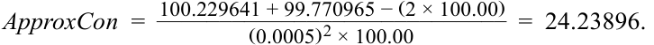

<!-- Formula Text: ApproxCon  =   100.229641 + 99.770965 − (2 × 100.00) ____________________________ (0.0005) 2 × 100.00 =  24.23896. -->

Bond features that lead to greater convexity are the same as for duration. A fixed-rate bond will have greater convexity: 

> ■ the _longer_ its time-to-maturity, 

<!-- PDF Page 314 -->

- the _lower_ its coupon rate, and 

- the _lower_ its yield-to-maturity. 

Another factor is the dispersion of cash flows, meaning the degree to which payments are spread out over time. For two bonds with the same duration, the one with the greater dispersion of cash flows has greater convexity. The positive attributes of convexity for an investor are shown in Exhibit 3. 

**Exhibit 3: Positive Attributes of Bond Convexity on an Option-Free Bond** 

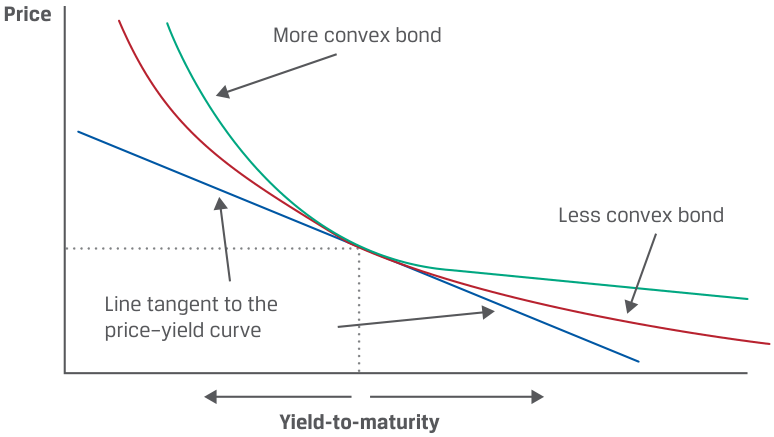

<!-- Start of picture text -->
Price More convex bond Less convex bond Line tangent to the price–yield curve Yield-to-maturity <!-- End of picture text -->

The two bonds depicted in Exhibit 3 are assumed to have the same price, maturity, yield-to-maturity, and modified duration, so they share the same line tangent to their price–yield curves. The benefit of greater convexity arises when their yields change significantly. For the same decrease in yield-to-maturity, the more convex bond _appreciates more_ in price, while for the same increase in yield-to-maturity, the more convex bond _depreciates less_ in price. Consequently, the more convex bond outperforms the less convex bond in both falling and rising yield environments, so it is less risky for investors. 

This conclusion assumes the difference in convexity is not reflected in the price of the more convex bond. If it is priced in, the more convex bond would have a higher price (and lower yield-to-maturity). The key point is that convexity is valuable to investors for risk reduction, so they must pay for it. 

###### **EXAMPLE 1** 

##### **Duration and Convexity of 30-Year Romanian Bond** 

A 30-year bond issued by the government of Romania has a coupon rate of 4.625% (paid annually) and currently trades at a yield-to-maturity of 4.75% on 15 October 2025, with a maturity date of 15 October 2055. 

**1.** Use Excel’s PRICE function to calculate _ApproxModDur_ and _ApproxCon_ using a 5 bp increase and decrease in yield-to-maturity. 

**2.** Compare and interpret the duration and convexity measures of the 30-year Romanian bond and BRWA’s 5-year bond. 

To find _ApproxModDur_ and _ApproxCon_ , we must first calculate _PV_ 0 and then, using a 5 bp increase and decrease in YTM, calculate _PV_ + and _PV_ –: 

<!-- PDF Page 315 -->

###### = 98.022448. 

_PV_ + = PRICE(DATE(2025,10,15),DATE(2055,10,15),0.04625,0.0480,100,1,0) = 97.247386. 

_PV_ – = PRICE(DATE(2025,10,15),DATE(2055,10,15),0.04625,0.0470,100,1,0) = 98.806567. _________________ ApproxModDur_ =  2 ×98.806567 − 97.247386( 0.0005) × 98.022448= 15.90637. _____________________________ ApproxCon_ =98.806567 + 97.247386 −  (2 × 98.022448) = 369.58881.( 0.0005)2 × 98.022448 

###### **Duration and Convexity Comparison: Romanian and BRWA Bonds** 

|**Bond**|**Maturity** **(Years)**|**Coupon (%)**|**YTM (%)**|**_Approx-_** **_ModDur_**|**_ApproxCon_**|
|---|---|---|---|---|---|
|Romanian|30|4.625 Annual Pay|4.75|15.90637|369.64203|
|BRWA|5|3.20 Semi-Annual|3.20|4.58676|24.23896|

The duration and convexity of the Romanian bond are significantly higher than BRWA’s bond primarily due to its much longer time-to-maturity (30 years versus 5 years), which outweighs the Romanian bond’s higher coupon rate and YTM, features that decrease duration and convexity. 

###### **QUESTION SET** 

Questions 1–5 relate to the following information. 

||**Issuance**||**Annual Pay Cou-**||
|---|---|---|---|---|
|**Bond**|**Date**|**Maturity**|**pon (%)**|**YTM (%)**|
|Bond X|7/15/25|7/15/34|2.25|2.25|
|Bond Y|7/15/25|7/15/35|5.33|2.34|

1. Calculate the modified duration and convexity for Bond X at issuance. 

###### **Solution:** 

||**Bond X**||
|---|---|---|
|**Fixed Coupon (%)**||2.25|
|**Periods p.a.**||1|
|**Price (per 100 Par Value)**||100|
|**Yield-to-Maturity (%)**||2.25|

<!-- PDF Page 316 -->

|**Col. 1**|**Col. 2**|**Col. 3**|**Col. 4**|**Col. 5**|**Col. 6 = Col.** **2 × Col. 5**|**Col. 7 = Col. 2** **× (Col. 2 + 1)** **× Col. 5 × (1 +** **YTM)****–1**|
|---|---|---|---|---|---|---|
|**Period**|**Time to** **Receipt**|**Cash** **Flow**|**Present Value**|**Weight**|**Time to** **Receipt ×** **Weight**|**Convexity of** **Cash Flows**|
|1|1.0|2.25|2.200489|0.02200|0.02200|0.04304|
|2|2.0|2.25|2.152067|0.02152|0.04304|0.12628|
|3|3.0|2.25|2.104711|0.02105|0.06314|0.24701|
|4|4.0|2.25|2.058398|0.02058|0.08234|0.40262|
|5|5.0|2.25|2.013103|0.02013|0.10066|0.59064|
|6|6.0|2.25|1.968805|0.01969|0.11813|0.80870|
|7|7.0|2.25|1.925481|0.01925|0.13478|1.05454|
|8|8.0|2.25|1.883111|0.01883|0.15065|1.32601|
|9|9.0|102.25|83.693835|0.83694|7.53245|73.66694|
||||**100.0000**|**1.00000**|**8.24718**|**78.26579**|
|**acaulay Duratio**|**n and Convexity**||||**8.24718**|**78.26579**|
|**i ation**|||||**8.06571**|**—**|

**Annualized Macaulay Duration and Convexity Modified Duration** 

2. Calculate _ApproxModDur_ and _ApproxCon_ for Bond Y using a 5 bp increase and decrease in the yield-to-maturity. 

###### **Solution:** 

To find _ApproxModDur_ and _ApproxCon_ for Bond Y, we must first calculate _PV_ 0, _PV_ +, and _PV_ –. 

_PV_ 0 = PRICE(DATE(2025,7,15),DATE(2035,7,15),0.0533,0.0234,100,1,0) = 126.386358. 

_PV+_ = PRICE(DATE(2025,7,15),DATE(2035,7,15),0.0533,0.0239,100,1,0) = 125.877943. 

_PV_ – = PRICE(DATE(2025,7,15),DATE(2035,7,15),0.0533,0.0229,100,1,0) = 126.897325. 

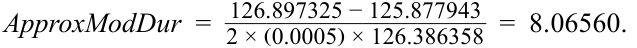

<!-- Formula Text: ApproxModDur  =   126.897325 − 125.877943 ___________________ 2 × (0.0005) × 126.386358   =  8.06560. -->

_______________________________ ApproxCon_ =126.897325 + 125.877943 −  (2 × 126.386358) = 80.76704.( 0.0005)2 × 126.386358 

3. Compare and interpret the risk measures from Questions 1 and 2 relative to a small anticipated change in yield-to-maturity. 

###### **Solution:** 

For a small change in YTM, modified duration is a reasonable estimate of the price change risk of a bond. Since the modified duration (or _ApproxModDur_ ) values of Bond X and Bond Y are virtually identical (8.06571 and 8.06560, respectively), the estimated price change based on a small change in YTM (either positive or negative) would be nearly identical for each bond. 

<!-- PDF Page 317 -->

4. Compare and interpret the risk measures from Questions 1 and 2 relative to a large anticipated change in yield-to-maturity. 

###### **Solution:** 

   - For a large change in YTM, duration alone does not capture the expected price change of a bond. The convexity adjustment accounts for the non-linear nature of the relationship of price to YTM. Since both bonds have virtually the same duration, the higher convexity of Bond Y should result in a smaller percentage drop given a large increase in YTM and a larger percentage increase given a large decrease in YTM. In either case, Bond Y should perform better than Bond X for a large change in YTM. 

5. Compare and interpret each of the following features for its effect on the convexity of Bond X versus Bond Y: 

   - a. Maturity 

   - b. Coupon rate 

c. YTM 

###### **Solution:** 

- a. Bond Y has a longer maturity than Bond X (10 years versus 9 years), which would increase Bond Y’s convexity relative to Bond X. 

- b. Bond X has a lower coupon rate compared to Bond Y (2.25% versus 

- 5.33%), which would increase Bond X’s convexity relative to Bond Y. 

- c. Bond X has a lower YTM compared to Bond Y (2.25% versus 2.34%), which would increase Bond X’s convexity relative to Bond Y. 

#### **BOND RISK AND RETURN USING DURATION AND CONVEXITY** 

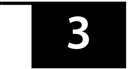

<!-- Start of picture text -->
3 <!-- End of picture text -->

calculate the percentage price change of a bond for a specified change in yield, given the bond’s duration and convexity 

We now show how to estimate the percentage price change of a bond for a specified yield change, given the bond’s duration and convexity. As we will show, such an estimate is substantially closer to the bond’s actual price change than if estimated using duration alone, allowing for more efficient risk management. 

Continuing with our focus on BRWA’s five-year, 3.2% (semiannual) coupon bond priced at par for settlement on 15 October 2025 and maturity on 15 October 2030, if its yield-to-maturity changes by ±100 bps from 3.20%, then the actual prices, using Excel’s PRICE function, would be as follows: 

_PV_ + = PRICE(DATE(2025,10,15),DATE(2030,10,15),0.032,0.0420,100,2,0) = 95.53212. 

_PV_ – = PRICE(DATE(2025,10,15),DATE(2030,10,15),0.032,0.0220,100,2,0) = 104.71035. 

<!-- PDF Page 318 -->

So, the actual price–yield relationship for this bond is as follows: 

- 100 bp increase in yield (4.20%): Price = 95.53212; %∆ _PV__Full_ = –4.46788%. 

- 100 bp decrease in yield (2.20%): Price = 104.71035; %∆ _PV__Full_ = 4.71035%. 

The modified duration for this bond was previously found to be 4.58676, so a 100 bp increase (decrease) in yield-to-maturity results in %∆ _PV__Full_ ≈ –4.58676% (4.58676%). 

We now show the enhanced precision and risk reduction achieved by adding the convexity adjustment to the duration estimate when determining the BRWA bond’s percentage price changes. Using Equation 1 and the _AnnConvexity_ metric, for ±100 bp changes in yield-to-maturity (from 3.20%), we have the following: 

%∆ _PV__Full_ ≈ (–4.58676 × 0.0100) + [½ × 24.23895 × (0.0100)2 ] = –4.46556%. 

<!-- Formula Text: %∆PVFull ≈ (–4.58676 × –0.0100) + [½ × 24.23895 × (–0.0100)2] = 4.70795%. -->

Exhibit 4 compares the estimated percentage changes in BRWA’s bond prices for ±100 bp changes in yield using duration alone and using duration plus convexity against the exact changes from Excel’s PRICE function. It is clear that enhanced precision is achieved by adding the convexity adjustment, because the percentage price difference is less than ¼ of a basis point by adding convexity versus about 12 bps with duration alone. Note that this difference would be substantially greater for larger changes in yield or for longer-maturity or lower-coupon bonds. 

**Exhibit 4: Using Duration and Convexity to Estimate Bond Price Changes** 

|**Change in** **Bond Yield**|**Actual** **%∆****_PV_****_Full_**|**Estimated** **%∆****_PV_****_Full_** **Using** **_ModDur_**|**Difference** **from Actual** **Change**|**Estimated** **%∆****_PV_****_Full_** **Using** **_ModDur_ +** **Convexity**|**Difference** **from Actual** **Change**|
|---|---|---|---|---|---|
|+ 100 bps|–4.46788|–4.58676|–0.11887|–4.46556|0.00232|
|– 100 bps|4.71035|4.58676|–0.12359|4.70795|–0.00239|

Recall that money duration indicates the first-order effect on the full price of a bond in currency units given a change in yield-to-maturity. **Money convexity** ( _MoneyCon_ ) captures the second-order effect in currency terms and is the annual convexity multiplied by the full price, as in Equation 3. 

_MoneyCon_ = _AnnConvexity_ × _PV__Full_ . ~~(3)~~ 

Similar to estimating the percentage change in a bond’s full price, MoneyDur and MoneyCon are combined to achieve a more accurate, thus less risky, estimate of the change in a bond’s full price, as shown in Equation 4. 

<!-- Formula Text: ΔP V Full  ≈  − (MoneyDur × ΔYield) + [ 1 _ 2  × MoneyCon × (ΔYield) 2]. (4) -->

For a money convexity example, consider again BRWA’s five-year, 3.2% semiannual coupon bond, settling 15 October 2025, maturing 15 October 2030, and yielding 3.2%—thus, priced at par. We saw previously that annual modified duration and annual convexity for this bond are 4.58676 and 24.23895, respectively. 

Suppose the investor has a position in the bond with a par value of USD100 million and the yield-to-maturity increases by 100 bps. We saw earlier that the bond’s price declines to 95.53212, so the market value of the position decreases to $95,532,116 (= $100,000,000 × 0.9553212), a decline of $4,467,884. 

Estimating the market value change using _MoneyDur_ alone results in a larger decline, $4,586,759 (= $458,675,875 × 0.0100), a difference of $118,875. 

<!-- PDF Page 319 -->

However, using Equation 3, the _MoneyCon_ for this position is $2,423,894,503 (= 24.23895 × $100,000,000), and if we apply Equation 4, which uses both _MoneyDur_ and _MoneyCon_ , to estimate the market value change, the result is a decline of –$4,465,564, as follows: 

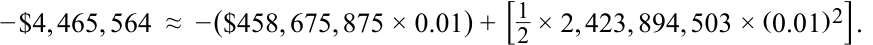

<!-- Formula Text: − $4, 465, 564  ≈  − ($458, 675, 875 × 0.01) + [ 1 _ 2  × 2, 423, 894, 503 × (0.01) 2]. -->

By using both MoneyDur and MoneyCon, the difference in the estimated versus the actual changes in bond position value is only $2,320. Exhibit 5 summarizes these results and shows the estimated and actual changes in position value for a 100 bp decrease in yield. 

**Exhibit 5: Using Money Duration and Money Convexity to Estimate Bond Price Changes** 

|||**Estimated** **∆****_PV_****_Full_**|**Differ-** **ence from**|**Estimated** **∆****_PV_****_Full_****Using**|**Differ-** **ence from**|
|---|---|---|---|---|---|
|**Change in** **Bond Yield**|**Actual** **∆****_PV_****_Full_**|**Using** **_MoneyDur_**|**Actual** **Change**|**_MoneyDur_ +** **_MoneyCon_**|**Actual** **Change**|
|+ 100 BPS|–$4,467,884|–$4,586,759|$118,875|–$4,465,564|–$2,320|
|– 100 BPS|$4,710,348|$4,586,759|–$123,590|4,707,953|–$2,395|

###### **KNOWLEDGE CHECK** 

An investor holds a position in five-year, zero-coupon Federal Republic of Germany bonds settling 11 May 2025 and maturing 11 April 2030. The yield-to-maturity is –0.72%, stated as an effective annual rate on an Act/ Act basis. There are five annual periods, and settlement is 30 days into the 365-day year. 

1. Calculate the full price of the bond per 100 of par value. 

###### **Solution:** 

Because Excel’s PRICE function does not work for negative yields, the equation for _PV_ of a zero-coupon bond must be used. There are five annual periods, settlement is 30 days into the 365-day year, and because 1 + _r_ = 1 + (–0.0072) = 0.9928, the full price of the bond is 103.6175 per 100 of par value: 

<!-- Formula Text: P V 0  =  [ 100 _ (0.9928) 5 ] × (0.9928)  30 _ 365 PV0 = 103.617526. -->

2. Calculate _ApproxModDur_ and _ApproxCon_ using a 1 bp increase and decrease in the yield-to-maturity. 

###### **Solution:** 

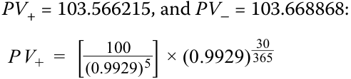

<!-- Formula Text: PV+ = 103.566215, and PV– = 103.668868: P V +  =  [ 100 _ (0.9929) 5 ] × (0.9929)  30 _ 365 -->

_PV_ <u>+ = 103.566215.</u> 

<!-- PDF Page 320 -->

<!-- Formula Text: P V −  =  [ 100 _ (0.9927) 5 ] × (0.9927)  30 _ 365 PV− = 103.668868. -->

The approximate modified duration is 4.9535: 

<!-- Formula Text: ApproxModDur  =   103.668868 − 103.566215 ___________________ 2 × (0.0001) × 103.617526   =  4.9535. -->

The approximate convexity is 29.918: 

_______________________________ ApproxCon_ =103.668868 + 103.566215 −  (2 × 103.617526) = 29.918.( 0.0001)2 × 103.617526 

3. Calculate the estimated convexity-adjusted percentage price change resulting from a 100 bp increase in the yield-to-maturity. 

   - **Solution:** 

The convexity-adjusted percentage price change from a 100 bp increase in yield-to-maturity is estimated as –4.80391%. Modified duration alone estimates the change as –4.9535%. The convexity adjustment adds 14.96 bps. 

<!-- Formula Text: %ΔP V Full  ≈  (− AnnModDur × ΔYield ) + [ 1 _ 2  × AnnConvexity × (ΔYield) 2]. %ΔP V Full  ≈  (− 4.9535 + 0.01 ) + [ 1 _ 2  × 29.918 × (0.01) 2] %ΔPVFull ≈ −0.048039 = −4.8039%. -->

4. Compare the estimated percentage price change with the actual change, assuming the yield-to-maturity jumps 100 bps, to 0.28%, on the settlement date. 

###### **Solution:** 

<!-- Formula Text: The new full price if the yield-to-maturity jumps from –0.72% to 0.28% on the settlement date is 98.634349: P V Full  =  [ 100 _ (1.0028) 5 ] × (1.0028)  30 _ 365 -->

_PV__Full_ = 98.634349 

The actual percentage change in the bond price is –4.80920% (98.634349/103.617526 − 1). The convexity-adjusted estimate is –4.80391%, whereas the estimated change using modified duration alone is –4.95350%. 

###### **QUESTION SET** 

Questions 1–4 relate to the following information. 

An investor purchases a €10 million semi-annual 2.95% coupon bond with a yield-to-maturity of 2.95%, settling 30 June 2025 and maturing 30 June 2032. 

1. Calculate _ApproxModDur_ and _ApproxCon_ for the bond using a 1 bp increase and decrease in yield-to-maturity. 

###### **Solution:** 

_PV_ <u>+ = PRICE(DATE(2025,6,30),DATE(2032,6,30),0.0295,0.0296,100,2,0)</u> 

