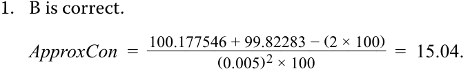

# Volume 6: Fixed Income
## Learning Module 12 Yield-Based Bond Convexity and Portfolio Properties
### Part 2/2: Portfolio Duration and Convexity (PDF Pages 321–330)

---

<!-- PDF Page 321 -->

|= 99.937.  _PV_–= PRICE(DATE(2025,6,30),DATE(2032,6,30),0.0295,0.0294,100,2,0) = 100.063.|
|---|
|_ApproxModDur_=100.063 − 99.937 ______________ 2 ×(0.0001)× 100 = 6.283.|
|_ApproxCon_=100.063 + 99.937 −(2 × 100)  _____________________  (0.0001) 2× 100 = 44.965.|
|2. Calculate_MoneyDur_and_MoneyCon_for the bond position using the results from Question 1. **Solution:**  _MoneyDur_≈ 6.283 × EUR10,000,000 = EUR62,829,180.  _MoneyCon_≈ 44.965 × EUR10,000,000 = EUR449,647,660.|
|3. Calculate the estimated price change in the investor’s position in the bond using_MoneyDur_and_MoneyCon_for a 50 bp decrease in yield-to-maturity. **Solution:** Δ_PV__Full_≈ –(EUR62,829,180 × –0.005) + [½ × EUR449,647,660 × (–0.005)2] = EUR319,767.|
|4. Calculate the difference between the estimated price change and the actual price change given a 50 bp yield-to-maturity decrease. **Solution:**  _PV__Full_= PRICE(DATE(2025,6,30),DATE(2032,6,30),0.0295,0.0345,100,2,0) = 103.198. The actual increase in the bond price is 3.1984%: Δ_PV__Full_= 3.1984% × $10,000,000 = EUR319,840.|
|The difference between the actual and the estimated price change is EUR73 (= 319,840 – 319,767).|

# **PORTFOLIO DURATION AND CONVEXITY** **<mark>4</mark>** 

calculate portfolio duration and convexity and explain the limitations of these measures 

Just as duration and convexity provide measures of the interest rate risk of a single bond, these metrics can also be used to measure the interest rate risk of a portfolio of bonds. There are two ways to calculate the duration and convexity of a bond portfolio: 

**1.** Using the weighted average of time to receipt of the _aggregate_ cash flows 

<!-- PDF Page 322 -->

**2.** Using the weighted averages of the durations and convexities of the individual bonds that make up the portfolio 

The first method is the theoretically correct approach, but it is difficult to use in practice. Our focus will be the second method since it is commonly used by fixed-income portfolio managers. We will also highlight its limitations. 

Suppose an institutional investor holds a two-bond portfolio consisting of $50 million par value each of the BRWA five-year bond and a government of Romania 30-year bond, with details as shown in Exhibit 6. Assume that both bonds are denominated in US dollars. 

**Exhibit 6: Inputs for Determining Portfolio Duration and Convexity** 

||**Maturity**|**Coupon**||**Yield**|||
|---|---|---|---|---|---|---|
|**Bond**|**(Years)**|**(%)**|**Price**|**(%)**|**Duration**|**Convexity**|
|BRWA|5|3.200|100.000|3.200|4.58676|24.23896|
|Romania|30|4.625|98.022|4.750|15.90637|369.64203|

|**Bond**|**Par Value**|**Market Value**|**Portfolio Weight**|
|---|---|---|---|
|BRWA|50,000,000|50,000,000|0.5050|
|Romanian|50,000,000|49,011,224|0.4950|

The total market value for the portfolio is $99,011,224, and the portfolio is nearly evenly weighted in terms of market value between the two bonds. As noted previously, duration and convexity for a portfolio are calculated as the weighted average of the statistics for the individual bonds, with the shares of overall portfolio market value as the weights. This weighted average approximates the theoretically correct portfolio duration and convexity and becomes more accurate when differences in the yields-to-maturity on the bonds are smaller and when the yield curve is flat. 

Given the portfolio weights in this simple example, portfolio duration and convexity are calculated as follows: 

Weighted-average modified duration = (4.58676 × 0.5050) + (15.90637 × 0.4950) = 10.19004. 

Weighted-average convexity = (24.23896 × 0.5050) + (369.64203 × 0.4950) = 195.21581. 

The main advantage of this weighted-average approach is that it is easily used as a measure of interest rate risk. For instance, if yields-to-maturity on each of the bonds in the portfolio increase by 100 bps, then the estimated decline in the portfolio value is 9.214%. 

%∆ _PV__Full_ ≈ (–10.19004 × 0.0100) + [½ × 195.21581 × (0.0100)2 ] = –9.21396%. 

However, this approach also comes with a limitation: These measures of portfolio duration and convexity implicitly assume that yields of all maturities change by the same amount in the same direction, a **parallel shift** in the yield curve. In reality, pure parallel shifts are rare; rather, we frequently observe a steepening, flattening, or even twisting yield curve. 

<!-- PDF Page 323 -->

##### **EXAMPLE 2** 

#### **Portfolio Duration and Convexity** 

An institutional investor considers adding a new USD50 million par value position in a 10-year US Treasury bond to its existing portfolio of BRWA and government of Romania bonds. The relevant data are shown in Exhibit 7. 

**Exhibit 7: Inputs for Determining Portfolio Duration and Convexity** 

|**Bond**|**Maturity** **(Years)**|**Coupon** **(%)**|**Price**|**Yield** **(%)**|**Duration**|**Convexity**|
|---|---|---|---|---|---|---|
|BRWA|5|3.200|100.000|3.200|4.58676|24.23896|
|Romanian|30|4.625|98.022|4.750|15.90637|369.64203|
|US|10|1.500|98.168|1.700|9.23693|93.87376|
|Treasury|||||||

|**Bond**|**Par Value (USD)**|**Market Value** **(USD)**|**Portfolio Weight**|
|---|---|---|---|
|BRWA|50,000,000|50,000,000|0.33762|
|Romania|50,000,000|49,011,224|0.33094|
|US|50,000,000|49,083,948|0.33144|
|Treasury||||

1. Calculate the weighted-average duration and convexity for the proposed portfolio. 

##### **Solution:** 

Given the data in Exhibit 7, the weighted-average modified duration and convexity are calculated as follows: 

Weighted-average modified duration = (4.58676 × 0.33762) + (15.90637 × 0.33094) + (9.23693 × 0.33144) 

= 9.87415. 

Weighted-average convexity = (24.23896 × 0.33762) + (369.64203 × 0.33094) + (93.87376 × 0.33144) 

= 161.62749. 

2. Compare and interpret duration and convexity for the proposed portfolio versus the current portfolio. 

##### **Solution:** 

Adding the US Treasury position would _decrease_ both the portfolio duration (from 10.19004 to 9.87415) and convexity (from 195.21581 to 161.62749). The reduction in duration would reduce the price risk of the portfolio against an upward parallel shift in the yield curve, but due to the lower convexity, this reduction in risk would be lessened for large shifts. 

<!-- PDF Page 324 -->

3. Recommend whether the US Treasury bond position should be added if the investor expects a 100 bp parallel shift downward in yields. 

##### **Solution:** 

Given an expected 100 bp parallel shift down in yields, the investor should not add the position in US Treasury bonds. Adding the position lowers both the portfolio duration and convexity, which would also reduce the expected increase in the value of the portfolio. Given the investor’s yield curve view, it should seek to increase both portfolio duration and convexity. 

##### **QUESTION SET** 

Questions 1–4 relate to the following information. 

An investor purchases EUR10 million par value of a 5-year, zero-coupon bond and a 10-year, fixed-rate semiannual coupon bond. Details of the bonds are shown below. 

##### **Two-Bond Portfolio** 

|**Bond**|**Maturity** **(Years)**|**Coupon (%)**|**Price**|**YTM (%)**|**Duration**|**Convexity**|
|---|---|---|---|---|---|---|
|Zero|5|0.00|83.18777|3.750|4.81928|27.87052|
|Semi- annual|10|5.50|105.91556|4.750|7.71210|72.54897|

1. Calculate the weighted-average modified duration for the portfolio. 

##### **Solution:** 

The market value of the bonds are as follows: 

Zero-coupon: €10,000,000 × 83.18777/100 = €8,318,777. 

Semi-annual: €10,000,000 × 105.91556/100 = €10,591,556. 

Therefore, the weights are 43.991% for the zero-coupon bond and 56.009% for the semi-annual bond. As a result, the weighted-average modified duration is 

   - (4.81928 × 0.43991) + (7.71210 × 0.56009) = 6.43953. 

2. Calculate the weighted-average convexity for the portfolio. 

**Solution:** 

Using the weights calculated previously, 

Weighted-average convexity = (27.87052 × 0.43991) + (72.54897 × 0.56009) 

= 52.89463. 

3. Calculate the estimated percentage price change of the portfolio given a 100 bp increase in yield-to-maturity on each of the bonds. 

   - **Solution:** 

   - %∆ _PV__Full_ ≈ (–6.43953 × 0.0100) + [½ × 52.89463 × (0.0100)2 <u>] = –6.1751%.</u> 

<!-- PDF Page 325 -->

4. Based on rising inflation and tightening monetary policy, the investor expects interest rates to rise. Given that view, which bond should the investor consider replacing the 10-year bond with? 

**A.** A 20-year bond **B.** A 15-year floating-rate bond 

- **C.** A 10-year bond with a lower coupon 

- **Solution:** 

B is correct. With interest rates expected to rise, the investor should choose a bond with lower interest rate risk. Both the 20-year bond and the 10-year bond with a lower coupon should have higher durations than the current 10-year bond, all else equal, and would be expected to experience a larger percentage price decrease if interest rates increase. Floating-rate bonds, however, have low interest rate risk because coupon payments adjust to changing interest rates. 

<!-- PDF Page 326 -->

## **~~PRACTICE PROBLEMS~~** 

**1.** A 5.5% semiannual-pay fixed-coupon bond is issued at par on 1 May 2025 and matures on 1 May 2029. For a 50 bps increase and decrease in yield-to-maturity, _PV_ + and _PV_ – are 99.82283 and 100.177546, respectively. The approximate convexity is _closest_ to: 

   - **A.** 3.548. 

**B.** 15.045. 

   - **C.** 101.793. 

**2.** A bond pays a semiannual fixed coupon of 4.70%. It trades at par on its coupon date of 16 December 2025 and matures on 16 December 2033. The bond’s annualized convexity statistic is _closest_ to: 

   - **A.** 51.670. 

   - **B.** 53.231. 

   - **C.** 206.681. 

**3.** For changes in yield-to-maturity, the convexity adjustment is _most_ needed to account for the: 

   - **A.** first-order effect on bond prices. 

   - **B.** bond price risk due to small changes in yield-to-maturity. 

   - **C.** non-linear relationship of bond prices and yield to maturity. 

### **The following information relates to questions 4-9** 

A bond portfolio consists of the following three option-free, fixed-rate bonds: 

|**Bond**|**Market Value (£)**|**Annual Modified Duration**|**Annual Convexity**|
|---|---|---|---|
|X|5,000,000|3.6239|16.2513|
|Y|5,000,000|9.0036|91.0278|
|Z|10,000,000|12.7512|179.8591|

**4.** If the yield-to-maturity of Bond X increases by 50 bps, the expected percentage price change of Bond X is _closest_ to: 

   - **A.** 1.792%. 

   - **B.** 1.812%. 

   - **C.** 1.832%. 

**5.** Given a 75 bps change in the yields-to-maturity for Bonds Y and Z, the convexity adjustment for Bond Z would be greater than the convexity adjustment of Bond 

<!-- PDF Page 327 -->

Y: 

   - **A.** if the YTM change is positive. 

   - **B.** if the YTM change is negative. 

   - **C.** regardless of the direction of the change in YTM. 

**6.** For a 100 bps increase in yield-to-maturity and using money duration and money convexity, the estimated change in Bond Y’s full price is _closest_ to: 

   - **A.** GBP472,937. 

   - **B.** GBP450,180. 

   - **C.** GBP427,423. 

**7.** For a 100 bps increase in yield-to-maturity and using the weighted average duration and convexity, the expected percentage price change for the bond portfolio is _closest_ to: 

**A.** 7.981%. 

- **B.** 8.949%. 

**C.** 9.533%. 

**8.** The bond portfolio’s benchmark is a fixed-income index with a duration of 9.5325 and convexity of 103.0677. Based on the weighted-average portfolio duration and convexity, the portfolio should outperform its benchmark in which of the following scenarios? 

   - **A.** Only when interest rates are rising 

   - **B.** Only when interest rates are falling 

   - **C.** Both when interest rates are rising and falling 

**9.** The method of using weighted-average portfolio duration and convexity measures to assess price risk of a bond portfolio is _best_ characterized as: 

   - **A.** being theoretically correct. 

   - **B.** being commonly used by portfolio managers. 

   - **C.** accommodating non-parallel shifts in the yield curve. 

<!-- PDF Page 328 -->

## **~~SOLUTIONS~~** 

<!-- Formula Text: 1.	 B is correct. ApproxCon  =   100.177546 + 99.82283 − (2 × 100) _________________________ (0.005) 2 × 100 =  15.04. -->

2. A is correct. 

##### **Eight-Year, 4.70% Semiannual Bond** 

|**Fixed Coupon (%)**|4.70|
|---|---|
|**Periods p.a.**|2|
|**Price (per 100 Par Value)**|100|
|**Yield-to-Maturity (%)**|4.70|

|**Col. 1**|**Col. 2**|**Col. 3**|**Col. 4**|**Col. 5**|**Col. 6 = Col. 2 ×** **Col. 5**|**Col. 7 = Col. 2 × (Col. 2 + 1)** **× Col. 5 × (1 + YTM/2)****–2**|
|---|---|---|---|---|---|---|
|**Period**|**Time to** **Receipt**|**Cash Flow**|**Present Value**|**Weight**|**Time to Receipt ×** **Weight**|**Convexity of Cash Flows**|
|1|1.0|2.35|2.296043|0.02296|0.02296|0.04384|
|2|2.0|2.35|2.243325|0.02243|0.04487|0.12849|
|3|3.0|2.35|2.191817|0.02192|0.06575|0.25108|
|4|4.0|2.35|2.141492|0.02141|0.08566|0.40886|
|5|5.0|2.35|2.092323|0.02092|0.10462|0.59920|
|6|6.0|2.35|2.044282|0.02044|0.12266|0.81962|
|7|7.0|2.35|1.997344|0.01997|0.13981|1.06774|
|8|8.0|2.35|1.951484|0.01951|0.15612|1.34129|
|9|9.0|2.35|1.906677|0.01907|0.17160|1.63811|
|10|10.0|2.35|1.862899|0.01863|0.18629|1.95617|
|11|11.0|2.35|1.820126|0.01820|0.20021|2.29351|
|12|12.0|2.35|1.778336|0.01778|0.21340|2.64827|
|13|13.0|2.35|1.737504|0.01738|0.22588|3.01871|
|14|14.0|2.35|1.697610|0.01698|0.23767|3.40315|
|15|15.0|2.35|1.658632|0.01659|0.24879|3.80002|
|16|16.0|102.35|70.580104|0.70580|11.29282|183.26330|
||||**100.0000**|**1.00000**|**13.51910**|**206.68136**|
|**Annualize**|**d Convexity**|||||**51.67034**|

3. C is correct. The convexity adjustment is a complementary risk measure to duration. It accounts for the second-order (non-linear) effect of yield changes on price. It is most useful for large yield changes, because duration provides a good approximation for small yield changes. 

4. A is correct. The expected price change is calculated as follows: 

   - %Δ _PV__Full_ ≈ (–3.6239 × 0.005) + [½ × 16.2513 × (0.005)2 ] 

<!-- PDF Page 329 -->

= –1.79164% ≈ –1.792%. 

5. C is correct. Since the convexity adjustment uses the square of the change in yield, it is always positive regardless of the direction of the change in yield-to-maturity. As a result, the convexity adjustment for Bond Z will always be greater than the convexity adjustment for Bond Y, given the same change in yields-to-maturity. 

6. C is correct. 

_MoneyDur_ ≈ 9.0036 × 5,000,000 = 45,018,000 

_MoneyCon_ ≈ 91.0278 × 5,000,000 = 455,139,000 

Δ _PV__Full_ ≈ –(45,018,000 × 0.01) + [½ × 455,139,000 × (0.01)2 ] = –GBP427,423. 

7. B is correct. The portfolio weights for Bonds X, Y, and Z are 0.25, 0.25, and 0.50, respectively. The weighted average duration and convexity measures are calculated as follows: 

Weighted-average duration = (0.25 × 3.6239) + (0.25 × 9.0036) + (0.50 × 12.7512) = 9.5325. 

Weighted-average convexity = (0.25 × 16.2513) + (0.25 × 91.0278) + (0.50 × 179.8591) 

= 116.7493. 

%Δ _PV__Full_ ≈ (–9.5325 × 0.01) + [½ × 116.7493 × (0.01)2 ] = –8.9487% ≈ –8.949%. 

8. C is correct. The portfolio has a weighted-average duration of 9.5325, which is identical to the benchmark’s duration. However, the portfolio has higher convexity (116.7493) compared to the benchmark (103.0677). All else equal, the portfolio should outperform the lower convexity benchmark portfolio in both rising and falling interest rate environments. 

9. B is correct. The weighted-average portfolio duration and convexity method is easy to calculate and apply in practice and is commonly used by portfolio managers to assess bond portfolio price risk. It does, however, implicitly assume parallel shifts in the yield curve. Using the weighted average of time to receipt of the aggregate cash flows is the theoretically correct method to calculate portfolio duration and convexity, but it is difficult to use in practice. 

<!-- PDF Page 330 -->

