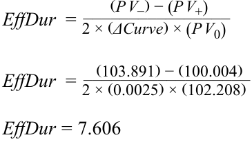
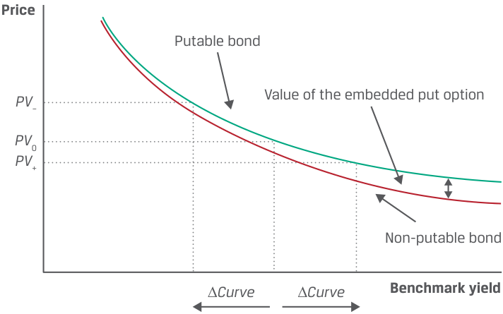
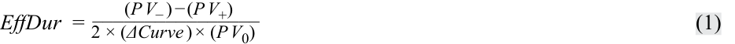
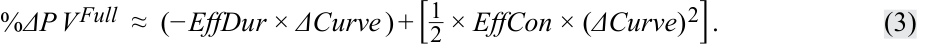
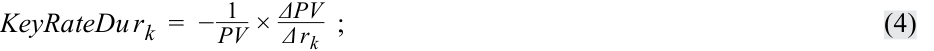
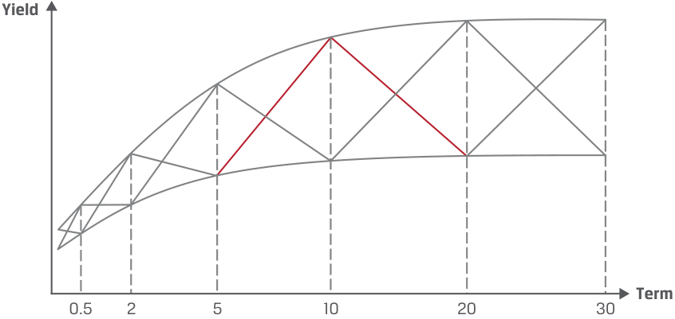

# Volume 6: Fixed Income
## Learning Module 13 Curve-Based and Empirical Fixed-Income Risk Measures
### Part 1/2: Introduction (PDF Pages 331–346)

---

<!-- PDF Page 331 -->

# L E A R N I N G M O D U L E **<mark>13</mark>** 

### **Curve-Based and Empirical Fixed-Income Risk Measures** 

|**LEARNI**|**NG OUTCOMES** |
|---|---|
|**_Mastery_**|**_The candidate should be able to:_**|
||explain why effective duration and effective convexity are the most appropriate measures of interest rate risk for bonds with embedded options|
||calculate the percentage price change of a bond for a specified change in benchmark yield, given the bond’s effective duration and convexity|
||define key rate duration and describe its use to measure price sensitivity of fixed-income instruments to benchmark yield curve changes|
||describe the difference between empirical duration and analytical duration|

<!-- Start of picture text -->
1 <!-- End of picture text -->

#### **INTRODUCTION** 

Having covered yield-based duration and convexity measures, we now introduce curve-based measures of a bond’s price sensitivity to changes in a benchmark yield curve and when cash flows are uncertain. We show how the change in a bond’s full price is estimated by combining curve-based duration and convexity sensitivity measures, discuss uses of these approximate measures by issuers and investors, and explain their benefits and limitations. We also introduce key rate duration as a measure of interest rate risk across the term structure. Finally, we show that benchmark yield changes and credit spreads for issuers of lower credit quality are negatively correlated, especially during periods of market distress, establishing the benefit of an empirical versus analytical approach. 

<!-- PDF Page 332 -->

###### **LEARNING MODULE OVERVIEW** 

- Yield duration and convexity estimates of interest rate risk are useful only for small changes in yields. Effective duration and effective convexity are valid for both small and large changes in yields. 

- Effective duration and effective convexity are useful for gauging the interest rate risk of bonds whose future cash flows are uncertain. 

- Effective duration and effective convexity can be used to estimate the percentage change in a bond’s full price for a given shift in the benchmark yield curve. 

- A key rate (or partial) duration is a measure of a bond’s sensitivity to a change in the benchmark yield at a specific maturity. Key rate duration data, along with forecasted shifts in the benchmark curve, allow a portfolio to be rebalanced to improve its return. 

- The sum of weighted key rate durations of the bonds in a portfolio are equal to the effective duration of the entire portfolio. 

- Analytical duration and convexity are estimated duration and convexity statistics using mathematical formulas. Empirical duration and convexity are estimated using historical data that incorporate various factors affecting bond prices. 

- When deciding whether to use an empirical or analytical measure, the correlation between benchmark yields and credit spreads must be considered. 

###### **LEARNING MODULE SELF-ASSESSMENT** 

These initial questions are intended to help you gauge your current level of understanding of the learning module. 

1. For which of the following-fixed income instruments would an investor _most likely_ use yield duration and convexity to measure interest rate risk rather than effective duration and effective convexity? 

   - **A.** 30-year fixed-rate bond 

   - **B.** Callable bond 

   - **C.** Mortgage-backed security 

   - **Solution:** 

A is correct. The callable bond and mortgage-backed security have embedded options, which yield duration and convexity cannot account for. The 30-year fixed-rate bond does not, so either method could be applied. 

2. Calculate the effective duration of a bond given the following: 

   - _PV_ 0 = 102.208. 

   - Price with the benchmark yield curve shifted up 25 bps: _PV_ + = 100.004. 

   - Price with the benchmark yield curve shifted down by 25 bps: _PV_ – = 103.891. 

###### **Solution:** 

<!-- PDF Page 333 -->

<!-- Formula Text: EffDur  = (P V −) − (P V +) ________________ 2 × (ΔCurve) × (P V 0) EffDur  =    (103.891) − (100.004) __________________ 2 × (0.0025) × (102.208) EffDur = 7.606 -->

3. Calculate the effective convexity of a bond given the following: ■ _PV_ 0 = 102.208. ■ Price with the benchmark yield curve shifted up 25 bps: _PV_ + = 100.004. 

■ Price with the benchmark yield curve shifted down by 25 bps: _PV_ – = 103.891. 

**Solution:** ______________________[( _P V_ −) +  ( _P V_ +)] −  [2 ×  ( _P V_ 0)] 

_EffCon_ =( _ΔCurve_)2 ×  ( _P V_ 0) 

_____________________________ 

_EffCon_ =[(103.891) +  (100.004)] −  [2 ×  (102.208)]( 0.0025)2 ×( 102.208) 

EffCon = −815.592 

4. If the benchmark yield curve shifted by 50 bps, what would be the percentage change in the full price of a bond if its effective duration is 6.094 and its effective convexity is –230.097? **Solution:** % _ΔP V__Full_ ≈  (− _EffDur_ × _ΔCurve_ ) +  [_ 21×_EffCon_×  (_ΔCurve_)2] % _ΔP V__Full_ ≈( − 6.094 × 0.005) +  [_1 2× − 230.097 ×  (0.005)2] %Δ _PV__Ful_l ≈ 3.33% 

|5. The table below contains yield curve by tenor.|h    forecasts of|h      expected cha|h       nges in the|h          benchmark|
|---|---|---|---|---|
|**Maturity** **1 year**|**5 years**|**10 years**|**20 years**|**30 years**|
|Curve shift at maturity +100 bps|+150 bps|+200 bps|+250 bps|+300 bps|

Your portfolio contains equally sized positions in Bond A and Bond B, which have the following key rate durations. 

<!-- PDF Page 334 -->

||**Tenor**|**Key Rate Duration**|
|---|---|---|
|Bond A|5 years|1.706|
|Bond B|10 years|3.195|

Given the information and expected changes in yields, identify the bond that could be sold to improve returns. 

###### **Solution:** 

Bond B, because its expected price decline from the expected change in benchmark yields is more than twice that of Bond A. 

For Bond A, ∆ _PV_ / _PV_ = –1.706 × 0.015 = –2.56%. 

For Bond B, ∆ _PV_ / _PV_ = –3.195 × 0.020 = –6.39%. 

6. Explain why yield duration and convexity are less useful for bonds with contingency features, such as callable bonds. 

###### **Solution:** 

Yield duration and convexity assume cash flows are received on scheduled dates. Cash flows from bonds with contingency features may _not_ be received on scheduled dates—if, for example, a callable bond is called by the issuer following a decrease in interest rates. Therefore, yield duration and convexity would not correctly measure the price sensitivity to interest rates. 

7. When comparing analytical duration versus empirical duration, which of the following statements is correct? 

   - **A.** Analytical duration and convexity are estimated duration and convexity statistics using mathematical formulas. 

   - **B.** Empirical duration and convexity are estimated using historical data in non-statistical models that incorporate various factors affecting bond prices. 

   - **C.** Both A and B 

###### **Solution:** 

A is correct. Analytical duration and convexity are estimated duration and convexity statistics using mathematical formulas. 

B is incorrect because statistical models are primarily used to determine empirical duration and convexity. 

C is incorrect because B is incorrect. 

8. True or false: Analytical duration is superior to empirical duration for bonds with credit risk. 

###### **Solution:** 

False. If government bond yields are driven lower in a market stress scenario, the “flight to safety” will also cause credit spreads to widen because of an increase in expected default risk. Since credit spreads and benchmark yields are negatively correlated under this scenario, wider credit spreads will partially or fully offset the decline in government benchmark yields, resulting in lower empirical duration estimates than analytical duration estimates. Therefore, empirical duration estimates are a more accurate method of forecasting bond price changes for bonds with credit risk. 

<!-- PDF Page 335 -->

#### **CURVE-BASED INTEREST RATE RISK MEASURES** 

## **<mark>2</mark>** 

explain why effective duration and effective convexity are the most appropriate measures of interest rate risk for bonds with embedded options 

Yield duration and convexity assume a bond’s cash flows are certain. However, if a bond has contingency features, such as embedded options, as with a callable (or puttable) bond, then future cash flows are _uncertain_ since option exercise depends on the level of market interest rates relative to coupon interest being paid (or received). For example, the duration of a callable bond does _not_ reflect the sensitivity of the bond price to a change in the yield-to-worst, since this represents only one of several possible outcomes based on future interest rates. 

Consequently, bonds with embedded options do not have well-defined yields-to-maturity, so Macaulay and modified durations are not appropriate interest rate risk measures for such bonds. Rather, the appropriate measure of interest rate risk is the sensitivity of the bond’s price to a change in a _benchmark yield curve_ —for example, the government par curve—known as **effective duration** , a _curve_ duration rather than a _yield_ duration statistic. 

Exhibit 1 shows the impact of an instantaneous change in the benchmark yield curve (Δ _Curve_ ) on the price of a callable bond compared with that on a comparable non-callable bond. The two bonds have the same features (i.e., coupon rate, payment frequency, time-to-maturity, and credit risk). Note that the horizontal axis is a benchmark yield—a point on the par curve for government bonds. 

###### **Exhibit 1: Interest Rate Risk Characteristics of a Callable Bond** 

<!-- Start of picture text -->
Price Value of the embedded call option PV _ PV 0 Non-callable bond PV + Callable bond ∆ Curve ∆ Curve Benchmark yield <!-- End of picture text -->

The price of the non-callable bond is always greater than that of the comparable callable bond. The difference is the value of the embedded call option, which is held by the bond issuer (not the investor). When interest rates are high relative to the coupon rate, the value of the call option is low. When rates are low, the value of the call option is high since the issuer is more likely to exercise the option to refinance the debt at the lower prevailing rates. The investor bears the “call risk” since if the bond is called, the investor must reinvest the proceeds at a lower interest rate. 

<!-- PDF Page 336 -->

Exhibit 1 shows that, given parallel shifts in the benchmark yield curve, when benchmark yields are high (Δ _Curve_ is positive), the _effective durations_ of the callable and non-callable bonds are very similar. But when interest rates are low (Δ _Curve_ is negative), the effective duration of the callable bond is lower than that of the otherwise comparable non-callable bond, since the callable bond price does not increase as much when benchmark yields fall; the presence of the call option limits price appreciation. Thus, an embedded call option reduces the effective duration of the bond, especially when interest rates are falling and the bond is more likely to be called. The lower effective duration can be interpreted as a shorter expected life—a reduced weighted average of time to receipt of cash flow. 

Analogous to effective duration, the second-order effect of a parallel shift in the benchmark yield curve is measured by **effective convexity** , a _curve convexity_ statistic. In Exhibit 1, as the benchmark yield declines, the slope of the line tangent to the curve for the non-callable bond steepens, indicating positive convexity. But the slope of the line tangent to the callable bond flattens as the benchmark yield declines and reaches an inflection point, after which the effective convexity becomes negative. 

When the benchmark yield is high and the value of the embedded call option is low, the callable and the non-callable bonds experience very similar effects from interest rate changes and both have positive convexity. But as the benchmark yield declines, the curves diverge, and at some point, the callable bond moves into the range of negative convexity, since the embedded call option has more value to the issuer and is more likely to be exercised. This situation further limits the potential price appreciation of the bond arising from lower benchmark yields. 

Exhibit 2 shows characteristics of a bond with an embedded put option. 

**Exhibit 2: Interest Rate Risk Characteristics of a Putable Bond** 

<!-- Start of picture text -->
Price Putable bond Value of the embedded put option PV – PV 0 PV + Non-putable bond ∆ Curve ∆ Curve Benchmark yield <!-- End of picture text -->

A putable bond allows the investor to sell the bond back to the issuer before maturity, usually at par value, protecting the investor from higher benchmark yields that would otherwise drive the bond’s price below par. So, the price of a putable bond is always higher than that of an otherwise comparable non-putable bond, the price difference being the value of the embedded put option. 

An embedded put option reduces the effective duration of the bond, especially when rates are rising. Given a parallel shift in the benchmark yield curve, if interest rates are low compared to the coupon rate, the value of the put option is low and the impact of a change in the benchmark yield on the bond’s price is very similar to that for a non-putable bond. But when benchmark interest rates rise, the put option 

<!-- PDF Page 337 -->

becomes more valuable to the investor, since the ability to sell the bond back to the issuer at par limits the price depreciation as rates rise. Importantly, putable bonds always have positive effective convexity. 

Effective duration and effective convexity are also relevant for mortgage-backed securities (MBSs), which arise from a residential (or commercial) loan portfolio securitization and are covered in later lessons. MBS cash flows are contingent on homeowners’ ability to refinance or pay off an existing mortgage with the proceeds from a new mortgage. Refinancing is a common feature of mortgages in the United States and some other jurisdictions that borrowers tend to exercise if interest rates fall. 

Calculating effective duration ( _EffDur_ ) is very similar to calculating approximate modified duration, as shown in Equation 1. 

<!-- Formula Text: EffDur  = (P V − ) − (P V +) ________________ 2 × (ΔCurve ) × (P V 0) (1) -->

The formula for calculating effective convexity ( _EffCon_ ) is also very similar to the formula for approximate convexity, as shown in Equation 2. 

<!-- Formula Text: EffCon  = [(P V − ) + (P V + ) ] − [2 × (P V 0 ) ] ______________________ (ΔCurve) 2 × (P V 0) (2) -->

The differences are that Δ _Curve_ is in the denominator—since effective duration is a _curve duration_ statistic, it measures interest rate risk in terms of a parallel shift in the benchmark yield curve—and that _PV_ – and _PV_ + are calculated using option pricing models. These models are covered in more detail in later modules but include such inputs as (1) the length of the call protection period, (2) the schedule of call prices and call dates, (3) an assumption about credit spreads over benchmark yields (which also includes any liquidity spread), (4) an assumption about future interest rate volatility, and (5) the level of market interest rates (e.g., the government par curve). The analyst holds the first four inputs constant and then raises and lowers the fifth input (i.e., parallel shifts) to derive _PV_ + and _PV_ –, respectively. 

Although effective duration and effective convexity are the appropriate interest rate risk measure for bonds with embedded options, they may also be useful with option-free bonds to supplement yield duration. Importantly, small differences may arise between a bond’s effective duration and its modified duration because when the government par curve is shifted in the model, the government spot (i.e., zero) curve is also shifted, but not in the same parallel manner. Thus, the change in the bond price is not the same as it would be if its yield-to-maturity changed by the same amount as the change in the par curve. 

In general, modified duration and effective duration on an option-free bond are not identical. However, the difference narrows when the yield curve is flatter, the time-to-maturity is shorter, and the bond is priced closer to par value; the difference disappears only in the rare circumstance of a flat yield curve. 

For example, consider BRWA’s five-year, 3.2% (semiannual) coupon bond priced at par for settlement on 15 October 2025 and maturity on 15 October 2030. Using _PV_ 0 = 100.00 and ∆ _Yield_ = 0.0005, in an earlier lesson, we found 

_PV_ + = 99.771 and _PV_ –  = 100.230, 

resulting in yield duration and convexity statistics as follows: 

_ApproxModDur_ = 4.587 and _ApproxCon_ = 24.239. 

Instead of a change in the bond’s yield-to-maturity, assume there is an upward and downward shift of the benchmark government par curve (∆ _Curve_ ) by 5 bps, which causes spot rates to move in a slightly non-parallel manner. Using _PV_ 0 = 100.00 and ∆ _Curve_ = 0.0005 and assuming the following new prices, 

_PV_ + = 99.760 and _PV_ – = 100.241, 

<!-- PDF Page 338 -->

then using Equation 1, effective duration is 4.816: 

<!-- Formula Text: EffDur  = (P V −) − (P V +) ________________ 2 × (ΔCurve) × (P V 0) EffDur  =   (100.241) − (99.760) _______________ 2 × (0.0005) × (100) EffDur = 4.816 -->

Using the same inputs in Equation 2, effective convexity is 40.000: 

<!-- Formula Text: EffCon  = [(P V −) + (P V +)] − [2 × (P V 0)] ______________________ (ΔCurve) 2 × (P V 0) EffCon  =   [(100.241) + (99.760)] − [2 × (100)] __________________________ (0.0005) 2 × (100) -->

_EffCon_ = 40.000 

###### **EXAMPLE 1** 

##### **Effective Duration and Convexity** 

The portfolio manager asks you, the analyst on a fixed-income team, to determine the interest rate sensitivity of a callable bond she is considering. The portfolio manager is seeking to invest in a bond with a duration between 7.0 and 8.0 and positive convexity. 

Suppose the full price of the callable bond is 101.060 per 100 of par value. When the government par curve is raised and lowered by 25 bps, the new full prices for this callable bond from your option valuation model are 99.050 and 102.891, respectively. Therefore, 

- _PV_ 0 = 101.060, 

- _PV_ + = 99.050, 

- _PV_ – = 102.891, and 

- Δ _Curve =_ 0.0025. 

You determine effective duration and effective convexity for this callable bond as follows: ________________( _P V_ −) −  ( _P V_ +) EffDur = 2 ×( ΔCurve) ×  ( _P V_ 0). __________________ EffDur =  2 ×(102.891( 0.0025)) − ×((99.050 101.060)). _EffDur_ = 7.601. EffCon =  _____________________[( _P V_ −) +  ( _P V_ +) − 2 ×  ( _P V_ 0)].( ΔCurve)2 ×  ( _P V_ 0) EffCon =  _____________________________[(102.891) +  (99.050)] −  [2 ×  (101.060)] .( 0.0025)2 ×( 101.060) _EffCon_ = −283. 

You recommend that the portfolio manager not buy this callable bond. While its effective duration meets her criteria, the bond has negative effective convexity. 

<!-- PDF Page 339 -->

###### **QUESTION SET** 

###### 1. Match each scenario to the interest rate risk measures below. 

|**Scenario**|**Interest rate risk measure**|
|---|---|
|A. Bond’s percentage price change given a change in its yield-to-maturity|Money duration|
|B. Linear approximation of the bond’s price change in currency, given a 1% change in yield|Modified duration|
|C. Callable bond|Effective duration|

###### **Solution:** 

The match for A is modified duration. Modified duration is used to estimate the percentage price change given a change in yield-to-maturity. The match for B is money duration. Money duration expresses modified duration in currency units, which can be used to estimate the currency unit change in the position of a bond. 

The match for C is effective duration. Callable bonds have uncertain future cash flows with respect to future interest rates. Therefore, a curve duration statistic, such as effective duration, would be best to measure interest rate risk. 

Questions 2–5 relate to the following information: 

As a member of a fixed-income team, you are asked to examine pricing data for a Viviyu Inc. callable bond. The current full price, the price assuming the benchmark yield curve shifts up 25 bps, and the price assuming the benchmark yield curve shifts down by 25 bps, are as follows: 

> ■ _PV_ 0 = 102.208, 

> ■ _PV_ + = 100.004, and 

> ■ _PV_ – = 103.891. 

2. Calculate the effective duration of the Viviyu Inc. callable bond. 

###### **Solution:** 

________________2 ×(( _P_ ΔCurve _V_ −) −) ( × _P V_ (+ _P_ ) _V_ 0). 

EffDur = 

__________________ EffDur =  2 ×(103.891( 0.0025) −  ) ×(100.004( 102.208)). _EffDur_ = 7.6061. 

3. In an audit of the data, it was determined that _PV_ + was incorrect and that the correct value of _PV_ <u>+ is 100.50426. All other data values were correct.</u> 

<!-- PDF Page 340 -->

Explain whether the updated data would increase or decrease the value of effective duration. 

###### **Solution:** 

There is no need to recalculate the effective duration. Since the updated _PV_ + value is larger than the prior one, with all else constant, the numerator would be lower; thus, effective duration would decrease. 

4. Calculate the effective convexity of the Viviyu Inc. callable bond using the following: 

   - _PV_ 0 = 102.208, 

   - _PV_ + = 98.504, 

   - _PV_ – = 103.891, and 

   - Δ _Curve_ = 0.0025. 

###### **Solution:** 

EffCon =  ______________________[( _P V_ −) +  ( _P V_ +)] −  [2 ×  ( _P V_ 0)].( ΔCurve)2 ×  ( _P V_ 0) EffCon =  _____________________________[(103.891) +  (98.504)] −  [2 ×  (102.208)] .( 0.0025)2 ×( 102.208) _EffCon_ = −3,164. 

5. In Question 4, the effective convexity was negative, not positive as it was for the effective duration. Explain what negative effective convexity implies. **Solution:** 

Negative effective convexity implies that the bond price will decline by a greater amount with an upward shift in benchmark yield than it will increase with a decline in the benchmark yield. 

## **<mark>3</mark>** 

#### **BOND RISK AND RETURN USING CURVE-BASED DURATION AND CONVEXITY** 

calculate the percentage price change of a bond for a specified change in benchmark yield, given the bond’s effective duration and convexity 

As we have seen, effective duration and effective convexity are curve-based metrics that are useful for gauging the interest rate risk of complex instruments—such as those with embedded contingency provisions—whose future cash flows are uncertain. These metrics are typically determined from bond prices derived using an option valuation model, given specific (parallel) changes in the underlying benchmark government yield curve. 

Just as with yield-based interest rate risk measures, effective duration and effective convexity can be used to estimate the percentage change in a bond’s full price for a given shift in the benchmark yield curve (∆ _Curve_ ), as shown in Equation 3. 

<!-- PDF Page 341 -->

<!-- Formula Text: %ΔP V Full  ≈  (− EffDur × ΔCurve ) + [ 1 _ 2  × EffCon × (ΔCurve) 2]. (3) -->

Let’s return to BRWA’s five-year, 3.2% (semiannual) coupon bond priced at par for settlement on 15 October 2025 and maturity on 15 October 2030. Using Equation 3 and previously derived effective duration and effective convexity, 

_EffDur_ = 4.816 and _EffCon_ = 26.723, 

the percentage changes in the bond’s full price for ±100 bp shifts in the benchmark government par curve are estimated as follows: 

%∆ _PV__Full_ ≈ (–4.816 × 0.01) + [½ × 26.723 × (0.01)2 ] = –4.68%. 

%∆ _PV__Full_ ≈ (–4.816 × –0.01) + [½ × 26.723 × (–0.01)2 ] = 4.95%. 

These bond price changes compare with the previously derived estimates of –4.47% and 4.71% for this BRWA bond when using _ApproxModDur_ alone and _ApproxModDur_ and _ApproxCon_ , respectively, with yield-to-maturity changes of ±100 bps. 

As noted earlier, the differences in results using the curve-based measures versus the yield-based interest rate risk measures are due to slightly different bond prices ( _PV_ + and _PV_ –) and, therefore, _EffDur_ and _EffCon_ metrics (versus _ApproxModDur_ and _ApproxCon_ metrics) since a parallel shift in the government par curve produces a non-parallel shift in spot (zero) rates and one-year forward rates. 

Curve-based interest rate risk measures are important for both issuers and investors. For example, as noted previously, for a callable bond, when the benchmark curve shifts downward and interest rates are low relative to the bond’s coupon rate, effective duration declines and effective convexity may even turn from positive to negative. From an investor’s perspective, these results severely limit the bond’s price appreciation in a declining interest rate environment. From the issuer’s perspective, the bonds can be bought back at the call price and refinanced at lower market rates. 

As for a putable bond, when the benchmark curve shifts upward and interest rates are high relative to the bond’s coupon rate, both effective duration and effective convexity decline (but effective convexity always remains positive), which, from an investor’s perspective, limits the bond’s price depreciation in a rising interest rate environment. This is because the investor can sell the bonds back to issuer at the put price (typically par), rather than at a discounted price, and reinvest the proceeds at the higher prevailing market rates. 

A practical consideration in using effective duration and effective convexity is setting the change in the benchmark yield curve. With approximate modified duration, accuracy is improved by choosing a smaller yield-to-maturity change. The pricing models used for more complex securities, such as callable bonds issued by corporations and asset-backed securities (ABSs), include assumptions about the behavior of corporate issuers or the borrowers whose loans make up the underlying ABS assets under different interest rate scenarios. For example, a corporate issuer’s decision to call a bond and refinance depends in part on issuer-specific credit spreads. For mortgage borrowers, changes in the value of the underlying asset financed will affect the decision to refinance a mortgage and therefore call an MBS bond. Therefore, estimates of interest rate risk using effective duration and effective convexity are not necessarily improved by choosing a smaller change in benchmark rates. Curve-based interest rate risk measures have become an important tool in the financial analysis of not only traditional bonds but also financial liabilities. 

<!-- PDF Page 342 -->

###### **EXAMPLE 2** 

##### **Using Effective Duration and Convexity to Estimate Bonds’ Price Changes Given Benchmark Rate Changes** 

Continuing from Example 1, to bolster your recommendation that the portfolio manager (PM) not buy the callable bond trading at 101.060, you want to demonstrate the price impact of the bond’s negative effective convexity. You assume the benchmark government par curve increases and decreases by 100 bps and use Equation 3, with _EffDur_ and _EffCon_ estimates based on bond prices from your option valuation model, to derive the following results: 

- %∆ _PV__Full_ ≈ (–7.601 × 0.01) + [½ × –285.168 × (0.0100)2 ] = –9.03%. 

- %∆ _PV__Full_ ≈ (–7.601 × –0.01) + [½ × –285.168 × (–0.0100)2 ] = 6.17%. 

In discussing these results with the PM, you conclude that the negative effective convexity adds to the bond’s price decline when benchmark rates increase and subtracts from the bond’s price rise when benchmark rates decrease. If the PM’s forecast is an equal probability that the benchmark par curve will increase or decrease, the PM would not invest. However, if the PM’s forecast is that the probability for the benchmark decreasing is greater, such that expected gain is greater than zero, she may decide to invest in the bond. 

###### **QUESTION SET** 

Questions 1–5 relate to the following information: 

As a fixed-income analyst, you are asked to consider the impact of the benchmark government par curve shifting upward by 200 bps on two bonds, as part of an internal stress scenario. From a bond pricing model, the following information on effective duration and effective convexity were obtained. 

Bond A: Effective duration = 9.369; Effective convexity = –353.752. Bond B: Effective duration = 8.517; Effective convexity = –321.756. 

1. Calculate the estimated percentage change in the full price of bond A for the 200 bps curve shift. 

**Solution:** 

   - % _ΔP V__Full_ ≈  (− _EffDur_ × _ΔCurve_ ) +  [_ 21×_EffCon_×  (_ΔCurve_)2] . % _ΔP V__Full_ ≈( − 9.369 × 0.02) +  [_1 2× − 353.752 ×  (0.02)2] . %Δ _PV__Full_ ≈ −25.81%. 

2. Calculate the estimated percentage change in the full price of Bond B for the 200 bps curve shift. **Solution:** 

   - % _ΔP V__Full_ ≈  (− _EffDur_ × _ΔCurve_ ) +  [_ 21×_EffCon_×  (_ΔCurve_)2] . % _ΔP V__Full_ ≈( − 8.517 × 0.02) +  [_1 2× − 321.756 ×  (0.02)2] . %Δ _PV__Full_ ≈ −23.47%. 

<!-- PDF Page 343 -->

|3. Based on Questions 1 and 2, if both bonds were in a portfolio and a decision to sell one of them had to be made in light of a forecast of sharply rising interest rates, recommend Bond A or Bond B to sell. Justify your answer. **Solution:** Sell Bond A since it has the more negative percentage change in the full price of the bond. For every 200 bps increase in the benchmark curve, the full price of the bond drops 25.81%.|
|---|
|4. If you were forecasting the benchmark yield curve to shift downward by 200 basis points, recommend Bond A or Bond B to add to the portfolio in antici- pation of the curve shift. Justify your answer. **Solution:** Add Bond A, since when you calculate the percentage change in the full price for Bonds A and B, Bond A has the higher positive percentage change. %∆_PV__Full_Bond A ≈ (–9.369 × –0.02) + [½ × –353.752 × (–0.0200)2] = 11.66%. %∆_PV__Full_Bond B ≈ (–8.517 × –0.02) + [½ × –321.756 × (–0.0200)2] = 10.60%.|
|5. Explain why the estimated percentage change in the price of the bond from a 200 bps upward shift in the benchmark yield curve is more than twice the estimated percentage change in the price of the bond from a 200 bps down- ward yield curve shift. **Solution:** Because effective convexity is negative, an upward shift in the yield curve results in a higher absolute price change than a downward shift in the yield curve. For the upward shift, the duration contribution is positive and con- vexity contribution is negative, offsetting each other.|

#### **KEY RATE DURATION AS A MEASURE OF YIELD CURVE RISK** 

## **<mark>4</mark>** 

define key rate duration and describe its use to measure price sensitivity of fixed-income instruments to benchmark yield curve changes 

As we have seen, effective duration measures a bond’s sensitivity to changes in the benchmark yield curve if all yields change by the same amount. Key rate duration provides further insight into a bond’s sensitivity to _non_ - _parallel_ benchmark yield curve changes. **Key rate duration** (or partial duration) is a measure of a bond’s sensitivity to a change in the benchmark yield at a specific maturity. Such a measure is important to isolate the price responses of bonds to changes in the rates of key maturities on the benchmark yield curve. 

<!-- PDF Page 344 -->

Key rate durations define a security’s price sensitivity over a set of maturities along the yield curve, with the sum of key rate durations being equal to the effective duration, as shown in Equation 4 and Equation 5: 

<!-- Formula Text: KeyRateDu r k  =  −  1 _ PV  ×  ΔPV _ Δ r k   ; (4) -->

<!-- Formula Text: ∑ k=1 n KeyRateDu r k  =  EffDur, (5) -->

where _rk_ represents the _k_ th key rate. In contrast to effective duration, key rate durations help identify “shaping risk” for a bond—that is, a bond’s sensitivity to changes in the shape of the benchmark yield curve (e.g., the yield curve becoming steeper or flatter or twisting). 

The procedure for the calculation of key rate durations is similar to that used in the calculation of effective duration, but instead of shifting the entire benchmark yield curve, only key points on the curve are shifted, one at a time, as shown in Exhibit 3. The _k_ th key rate, which could be a 0.5-, 2-, 5-, 10-, 20-, or 30-year rate, is shifted up (as shown in Exhibit 3) and down by 1 bp, and then new bond prices are generated ( _PV_ + and _PV_ –) and the key rate duration at that specific maturity is calculated using Equation 4. Thus, the effective duration for each maturity point shift is calculated in isolation. 

**Exhibit 3: Key Rate Shift** 

<!-- Start of picture text -->
Δ Yield Key rate shift Δ r k Term k  – 1 k k  + 1 <!-- End of picture text -->

Exhibit 4 depicts the process of successively shifting the benchmark rate up and down at each of the key maturities along the benchmark yield to generate the key rate duration at maturity. 

<!-- PDF Page 345 -->

**Exhibit 4: Key Rate Shifts across the Benchmark Yield Curve** 

<!-- Start of picture text -->
Yield Term 0.5 2 5 10 20 30 <!-- End of picture text -->

As for practical uses of key rate duration, the analyst may want to know how the price of a callable bond is expected to change if short-term benchmark rates—for example, the rate on the two-year Treasury note, with modified duration of 1.99—rise by 25 bps but longer-maturity benchmark rates remain unchanged. Given that the yield curve is upward sloping, this scenario represents a flattening of the curve. 

Equation 6 rearranges terms from Equation 4 to solve for ∆ _PV_ / _PV_ (or %∆ _PV__Full_ ): 

__ΔPV_ _PV_= −_KeyRateDurk_×_Δrk_. ~~(6)~~ 

Using Equation 6, the expected estimated price change would be -0.4975%: ∆ _PV_ / _PV_ = –1.99 × 0.0025. 

Now, consider the simple portfolio of government bonds shown in Exhibit 5. 

**Exhibit 5: Simple Government Bond Portfolio** 

|**Tenor** **(Years)**|**Coupon**|**Annualized** **Yield (%)**|**Price**|**Position Size**|**Modified** **Duration**|**Key Rate** **Duration**|
|---|---|---|---|---|---|---|
|2|0.00|0.50|99.006|$99,006,219|1.990|0.711|
|5|0.00|1.25|93.960|$93,959,580|4.938|1.675|
|10|0.00|1.75|84.010|$84,009,625|9.828|2.981|
|||||$276,975,424|5.368|5.368|

Assume the portfolio is weighted by the prices of the respective 2-, 5-, and 10-year bonds for a total portfolio value of $277 million, or $1 million × (99.006 + 93.96 + 81.01). The portfolio’s modified duration is calculated as 

5.368 = [1.990 × (99.006/277)] + [4.938 × (93.96/277)] + [9.828 × (84.01/277)]. 

Alternatively, we could calculate each key rate duration by maturity. For example, the two-year key rate duration ( _KeyRateDur_ 2) is 

0.711 = 1.990 × (99.006/277). 

Note that the three key rate duration values sum to the portfolio duration value of 5.368. 

If we assume this portfolio represents an “index,” then a manager attempting to outperform the index could vary (or tilt) the key rate durations to capitalize on her view of expected changes in the shape of the benchmark yield curve, as demonstrated in the following example. 

<!-- PDF Page 346 -->

###### **EXAMPLE 3** 

##### **Using Key Rate Duration Estimate Interest Rate Risk for Bonds in a Portfolio** 

Continuing from Example 2, the portfolio manager asks you to determine if the bond portfolio may need rebalancing to improve overall return, given the tenor of the portfolio’s bonds, key rate duration information, and forecasted benchmark government par curve shifts at the various maturities. All four bonds have the same benchmark government par curve. Current information for the bonds are as follows: 

|**Bond**|**Tenor**|**Position Size**|**Key Rate Duration**|
|---|---|---|---|
|A|1 year|$200,565,245|0.645|
|B|5 years|$201,042,132|1.483|
|C|10 years|$202,673,298|2.158|
|D|20 years|$202,588,801|2.982|

Information on the forecasted benchmark government par curve changes at the various maturities are as follows: 

|**Maturity**|**1 year**|**5 years**|**10 years**|**20 years**|
|---|---|---|---|---|
|Expected|–23 bps|–25 bps|–18 bps|–10 bps|
|change|||||

If we take the product of the key rate duration and curve shift at a certain maturity, we can forecast the change in the price of the bond. For example, for the one-year maturity, this would be –0.645 × –0.0023 = 0.148%. The calculation for all the bonds is shown below: 

||**1 year (Bond**|**5 years (Bond**|**10 years**|**20 years**|
|---|---|---|---|---|
|**Maturities**|**A)**|**B)**|**(Bond C)**|**(Bond D)**|
|% change in|0.148%|0.371%|0.388%|0.298%|
|bondprice|||||

Therefore, since the forecasted price change in the bonds favor Bonds B and C, it would be advisable to increase the weightings for these bonds, taking more from the Bond A position than the Bond D position, since Bond A is forecasted to give the least gain of all the bonds. 

###### **QUESTION SET** 

Questions 1–3 relate to the following information. 

The analysis you performed previously on the consideration of the impact of the benchmark government par curve increasing by 200 bps on two bonds has now been expanded for a more complicated scenario. You are asked to consider the scenario of a non-parallel shift in the benchmark government par curve, where a steepening of the curve is occurring at longer maturities. Below are the details on non-parallel shifts to the benchmark government par curve: 

