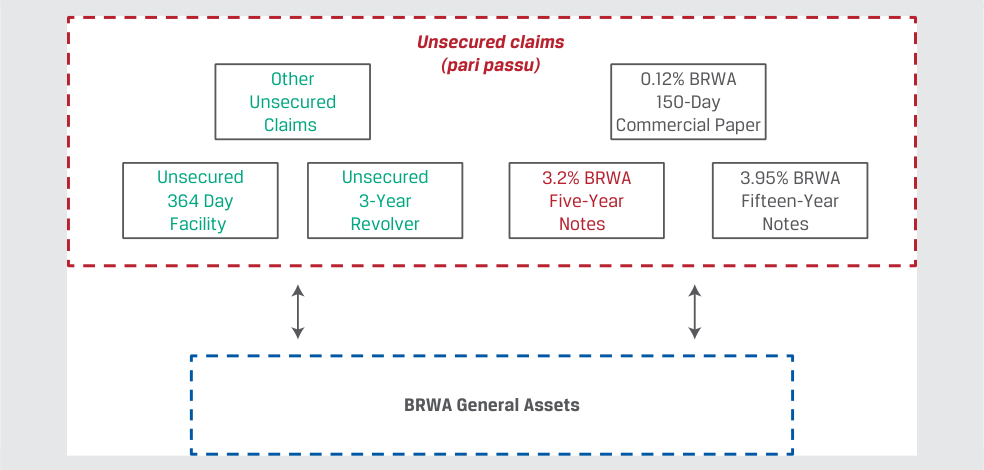
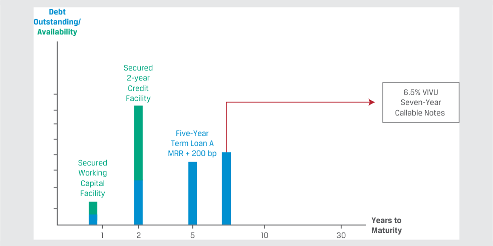
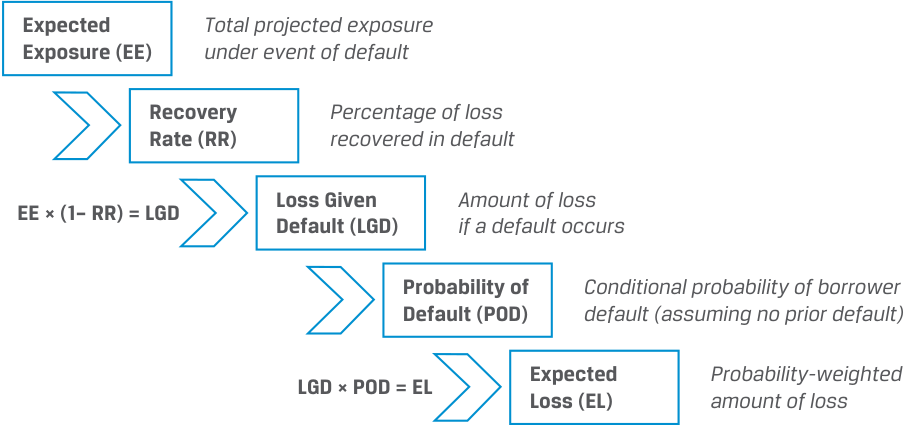
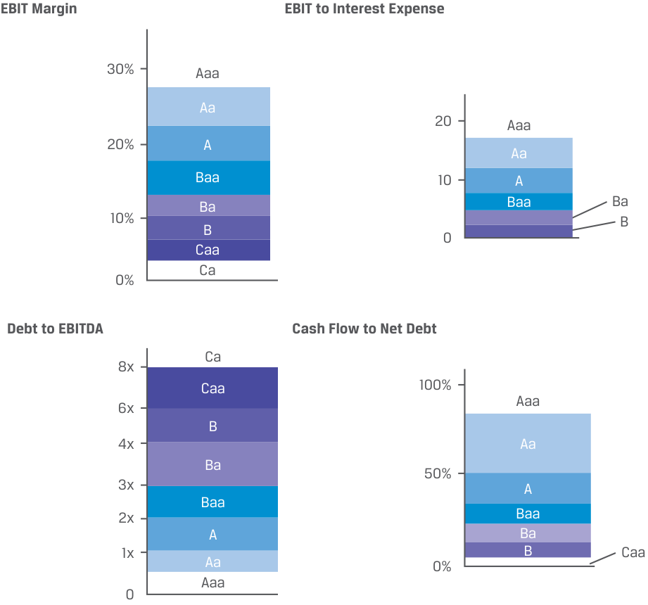
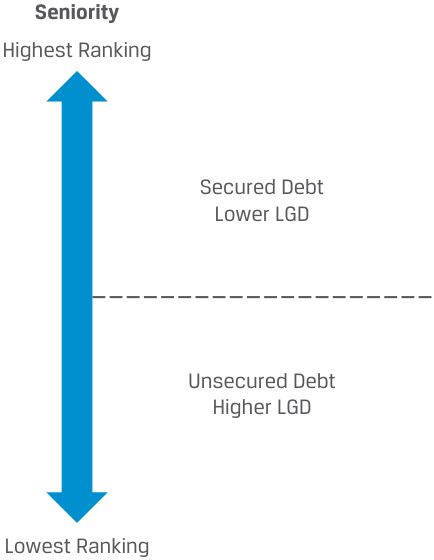

# Volume 6: Fixed Income
## Learning Module 14 Credit Risk
### Part 1/4: Introduction (PDF Pages 355–368)

---

<!-- PDF Page 355 -->

#### L E A R N I N G M O D U L E 

# **<mark>14</mark>** 

### **Credit Risk** 

###### **<mark>LEARNING OUTCOMES</mark>** 

**_Mastery The candidate should be able to:_** describe credit risk and its components, probability of default and loss given default describe the uses of ratings from credit rating agencies and their limitations describe macroeconomic, market, and issuer-specific factors that influence the level and volatility of yield spreads 

##### **INTRODUCTION** 

## **<mark>1</mark>** 

Credit analysis plays a critical role in fixed-income markets. Proper evaluation and pricing of credit risk facilitates the efficient allocation of capital. This is a dynamic process as credit risk components are continuously re-evaluated and fixed-income instruments repriced according to market conditions. This learning module covers the basic principles of credit analysis. First, we introduce the concepts of credit risk and expected loss and interpret what credit ratings mean. We compare bond issuer creditworthiness within a given industry as well as across industries, and we explore how financial markets price credit risk. This lesson focuses primarily on the analysis of credit risk, while subsequent lessons discuss credit analysis of sovereign and non-sovereign government issuers as well as corporate debt 

###### **LEARNING MODULE OVERVIEW** 

- Credit risk is the risk of economic loss resulting from borrower failure to make full and timely payments of interest and principal. The key components of credit risk are the probability of default and the loss given default, and their product is expected loss. 

- Chief sources of credit risk include adverse macroeconomic conditions, a financing mismatch between resources and obligations, and issuer-specific factors in corporate and sovereign debt markets. 

<!-- PDF Page 356 -->

- Nearly every bond issue in developed debt markets carries credit ratings classifying creditworthiness. Credit ratings enable comparisons of the credit risk of debt issues and issuers within and across industries. 

- Bonds or issuers with an investment-grade (IG) credit rating pose the lowest risk of default and are rated Baa3 by Moody’s and BBB– or higher by S&P and Fitch. In contrast, non-investment-grade or highyield (HY) bonds or issuers are rated BB+ or lower by S&P/Fitch and Ba1 or less by Moody’s and represent substantial to very high credit risk. 

- Pitfalls of relying solely on credit ratings in making investment decisions include that rating agency decisions may lag market pricing of credit risk, overlook key financial risks, and/or involve miscalculations or unforeseen changes not fully captured in a rating agency’s forward-looking analysis. 

- The premium, or yield spread, at which corporate bonds trade relative to default risk-free assets widens when credit risk rises and narrows if credit risk falls. 

- Credit spread changes affect holding period returns via two primary factors: a) the basis point spread change and b) the sensitivity of price to yield as reflected by end-of-period modified duration and convexity. Spread narrowing increases holding period returns. 

###### **LEARNING MODULE SELF-ASSESSMENT** 

These initial questions are intended to help you gauge your current level of understanding of this learning module. 

1. Credit risk is: 

   - **A.** activated upon a borrower’s default. 

   - **B.** the spread an investor receives above the risk-free rate. 

   - **C.** experienced in several ways by lenders. 

   - **Solution:** 

The correct answer is C. Lenders are impacted by credit risk in several ways, including failure to receive principal and interest payments in a timely manner, the inability to sell collateral at a market price sufficient to meet an issuer’s obligations in the case of secured debt, or the potential incurrence of legal or other costs to collect debt. A is incorrect because while a borrower default initiates a realized loss, expected loss exists prior to the occurrence of any actual loss. B is incorrect because it refers to the credit spread, which compensates investors for assuming credit risk. 

2. A EUR500,000 loan has the following characteristics: 

   - Probability of default 5% 

   - Recovery rate 90% 

   - Expected exposure EUR400,000 

The expected loss for this loan is: 

- **A.** EUR1,500 

<!-- PDF Page 357 -->

|**B.**EUR2,000|
|---|
|**C.**EUR20,000 **Solution:**|
|The correct answer is B. We solve for expected loss (EL) as follows:|
|EL = POD × LGD = POD × EE × (1 – RR).|
|Since probability of default (POD) is 5%, expected exposure (EE) is EUR400,000, and the recovery rate (RR) is 90%:|
|EL = EUR2,000 = 0.05 × (400,000) × (1 – 0.9).|
|A is incorrect as it fails to reduce the expected exposure by the collateral, while C is incorrect as it simply multiplies EE and POD.|
|3. Credit ratings are:|
|**A.**developed on behalf of investors.|
|**B.**a symbol-based measure of the potential default risk of a bond issue or issuer.|
|**C.**measures of credit risk that are used to determine bond market pricing. **Solution:**|
|The correct answer is B: Credit ratings are a symbol-based measure of the potential default risk of a bond issue or issuer. A is incorrect because credit ratings are developed on behalf of the issuer. C is incorrect because credit ratings are not used to determine bond prices.|
|4. Which of the following statements best describes risks that are difficult to capture in credit ratings?|
|**A.**Environmental risks are captured by ESG ratings rather than credit ratings.|
|**B.**Debt-financed acquisitions are usually captured in credit ratings.|
|i **C.**Split ratings demonstrate that credit rating agencies may view complex risks very differently. **Solution:** The correct answer is C. A is incorrect as environmental risks may affect credit ratings. B is incorrect since debt-financed acquisitions are difficult to anticipate.|
|5._Determine the correct answers to fill in the blanks:_Spreads are __________ at or near the top of the credit cycle, when market participants perceive credit risk to be at its lowest; they are __________ at or near the bottom of the credit cycle, when financial markets believe credit risk has reached its peak. **Solution:**|
|Spreads are**narrowest (or lowest)**at or near the top of the credit cycle, when market participants perceive credit risk to be at its lowest; they are **widest (or highest)**at or near the bottom of the credit cycle, when financial markets believe credit risk has reached its peak.|
|6. A portfolio manager assessing a downside case believes that HY bond spreads will rise 100 bps in a recession. If an observed HY bond has modi-|

<!-- PDF Page 358 -->

fied duration of 4.5 and reported convexity of 0.23, the expected change in the HY bond’s price under this scenario would be _closest to_ : 

**A.** 4.5%. 

**B.** 4.385%. 

**C.** 4.615%. 

###### **Solution:** 

The correct answer is B. Bond price changes based upon modified duration, convexity, and the spread change are calculated as follows: 

%∆PVFull = −(AnnModDur × ∆Spread) + ½AnnConvexity × (∆Spread)2 . 

With AnnModDur = 4.5 and reported convexity of 0.23, rescaling convexity to 23 and substituting values to solve for spread results in 

∆PVFull = − (4.5 × 1.00%) + ½ (23) × (1.00%)2 

∆PVFull = −4.385%. 

## **<mark>2</mark>** 

##### **SOURCES OF CREDIT RISK** 

describe credit risk and its components, probability of default and loss given default 

Fixed-income investors face credit risk, a form of performance risk in a contractual relationship. A borrower that fails to meet its promised interest and/or principal payment obligations under a bond or loan contract is said to be in **default** . A fixed-income investor seeks compensation for the expected economic loss under a potential borrower default over the life of the contract known as **credit risk** . 

Credit risk depends upon specific factors related to the borrower itself as well as general economic conditions and is subject to change over the life of the contract. Credit risk exposes the lender or investor to potential losses and underperformance. 

Traditionally, many analysts evaluated creditworthiness based on what are often called the “Cs of credit analysis,” as shown in Exhibit 1: 

<!-- PDF Page 359 -->

**Exhibit 1: The Cs of Credit Analysis** 

<!-- Start of picture text -->
Top-Down Factors Conditions Country Currency Cs of Capacity Collateral Credit Capital Covenants Character Bottom-Up Factors <!-- End of picture text -->

Five of these criteria—capacity, capital, collateral, covenants, and character—are related to the specific bottom-up factors applicable to an individual borrower. **Capacity** refers to the ability of the borrower to make its debt payments on time. **Capital** addresses other company resources available that reduce reliance on debt. **Collateral** refers to the quality and value of the assets supporting the issuer’s indebtedness, while **covenants** are the legal terms of debt agreements that an issuer must comply with. **Character** refers to the quality of management and the willingness of repay indebtedness. 

While capacity and capital are generally quantitative metrics based on financial statements, collateral, covenants, and character are largely qualitative measures that analysts assess based on historical company performance, credit relationships and the reputation of current management. 

The remaining three criteria—conditions, country, and currency—involve general top-down factors that apply to all borrowers to a greater or lesser extent. **Conditions** refers to the general economic, competitive, and business environment faced by all borrowers that may affect their ability to service or refinance debt. **Country** involves the geopolitical environment as well as the legal and political system faced by all issuers in a jurisdiction that may affect debt payment. **Currency** affects issuers whose cash flows are affected by exchange rate changes or who borrow in a currency outside of their jurisdiction, such as sovereign issuers with foreign currency debt. 

A borrower’s inability to make timely payments may be due to several underlying and contributing factors, but it ultimately results from a lack of sufficient cash available to make a current debt payment. Lenders, as fixed-income investors, are impacted by credit risk. They may lose some or all of the principal and interest due, suffering a capital loss or income shortfall. This disruption to their cash flows may impact their own ability to repay debt, and payment delays as well as increased legal and collection costs may further reduce their income and margins. 

<!-- PDF Page 360 -->

###### **Sources of Credit Risk** 

Changes in credit risk due to issuer-based or overall economic conditions are affected by the source of repayment, which differs among issuer types. Exhibit 2 shows the main sources of repayment for corporate and sovereign bonds. 

**Exhibit 2: Sovereign and Corporate Bond Sources of Repayment** 

<!-- Start of picture text -->
Operating Cash Flows Secured Bond Corporate Bond Investor Collateral Cash Flows or Sale Operating Unsecured Bond Cash Flows Corporate Bond Investor Tax Sovereign Bond Revenues Bond Investor <!-- End of picture text -->

A corporation may not generate sufficient cash flow from its operations, financing activities, and investments to make timely payments on its debt, increasing the risk of default. Similarly, a sovereign borrower may not generate sufficient revenue through taxes, incomes, and fees to make timely payments. 

Borrowers that lack the resources to meet debt obligations as they come due are often described as illiquid. An illiquid borrower is unable to raise the necessary funds to fulfill a debt obligation. They may not be able to tap credit lines, sell assets, or otherwise raise funding to make a timely debt payment. That is different from an _insolvent_ borrower whose assets are worth less than its liabilities. An illiquid borrower just does not have, or is unable to secure, the liquidity needed to make timely payment. 

Credit risk analysis focuses on understanding how a borrower generates cash, how and when cash is used, and what events and risks may impede the borrower’s ability to repay the debt. In earlier lessons, we encountered _unsecured_ debt, where the primary source of repayment is the cash flow generated by the business. In the case of _secured_ debt, the primary source of repayment remains the firm’s cash flows, but it is also supported by collateral pledged by the company. The following example involves an investor considering an unsecured bond versus a secured bond. 

###### **EXAMPLE 1** 

###### **Risk Comparison of BRWA and VIVU Notes** 

The hypothetical car manufacturer Bright Wheel Automotive (BRWA) is an investment-grade (IG) issuer with ready access to unsecured debt, while Vivivyu Inc. (VIVU) is a hypothetical high-yield (HY) issuer that borrows on a secured basis. Let us compare 3.2% senior unsecured and unsubordinated BRWA notes to 6.5% secured unsubordinated VIVU notes. Consider BRWA’s debt profile: 

<!-- PDF Page 361 -->

<!-- Start of picture text -->
BRWA Corporation Debt Profile <!-- End of picture text -->

<!-- Start of picture text -->
Debt Outstanding/ Availability 0.12% BRWA 150-day Commercial Paper Unsecured 364 Day Facility Unsecured 3.2% BRWA 3-year Five-Year Revolving Notes Credit Facility 3.95% BRWA Fifteen-Year Notes Years to 1 2 5 10 30 Maturity <!-- End of picture text -->

If BRWA fails to make an interest or principal payment on the note, BRWA is in default. Since its bonds are unsecured and unsubordinated obligations with pari passu and cross-default language in its bond indenture, failure to repay unsecured indebtedness means that all its debt obligations are in default and investors must rely on BRWA’s general asset pool to satisfy their obligations, as shown below. 

<!-- Start of picture text -->
Unsecured claims (pari passu) Other 0.12% BRWA Unsecured 150-Day Claims  Commercial Paper Unsecured Unsecured 3.2% BRWA 3.95% BRWA 364 Day 3-Year Five-Year Fifteen-Year Facility  Revolver Notes   Notes BRWA General Assets <!-- End of picture text -->

As an HY issuer, on the other hand, VIVU is limited to secured debt market access, as shown in its debt profile. 

<!-- PDF Page 362 -->

###### **VIVU Debt Profile** 

<!-- Start of picture text -->
Debt Outstanding/ Availability Secured 2-year Credit 6.5% VIVU Facility Seven-Year Callable Notes Five-Year Term Loan A MRR + 200 bp Secured Working Capital Facility Years to 1 2 5 10 30 Maturity <!-- End of picture text -->

_Note:_ MRR stands for market reference rate. 

VIVU’s failure to make timely payments due on the note will also result in default. The pari passu clause and cross-default language in its bond indenture with other unsecured indebtedness also sends all VIVU debt obligations into default. While _all_ of VIVU’s debt investors have access to any unpledged assets, specific pledged assets serve as a secondary source of repayment for specific debt, as shown below. 

<!-- Start of picture text -->
VIVU Unpledged Assets Secured claims (pari passu) Five-Year 6.5% VIVU Secured Working Secured 2-Year Term Loan A Seven-Year Capital Facility Credit Facility MRR + 200 bp Callable Notes Pledged Pledged Inventory Assets <!-- End of picture text -->

In this example, VIVU’s secured claims include its working capital facility secured by short-term assets (in this case inventory), while its long-term secured debt including the callable notes are backed by a claim to specific long-term assets pledged. As a secondary source of repayment, only when the value of the pledged assets falls below the total amount of pari passu secured debt will VIVU noteholders begin to suffer a credit loss. 

While the _likelihood of default_ for investment-grade borrowers, such as BRWA, is typically well below that of a high-yield issuer such as VIVU, the investor’s _loss in the event of a default_ for secured debt is usually lower than unsecured debt due to the secondary source of repayment for secured bonds. 

We encountered the Government of Romania’s EUR1.95 billion 30-year debt issue in an earlier lesson. For a sovereign government, the right to tax economic activity within its borders means that the sources of repayment are the personal and corporate income taxes, sales taxes, and other revenue generated by the government. In the 

<!-- PDF Page 363 -->

specific case of Romania’s EUR-denominated debt, the government’s ability to generate reserve currency cash flows based upon its institutional and economic profile, use of monetary and fiscal policy, and exchange rate regime are additional considerations. The main borrower types and their primary sources of repayment and credit risk are listed in Exhibit 3. 

**Exhibit 3: Borrower Types, Sources of Repayment, and Sources of Credit Risk** 

|**Borrower Type**|**Primary Source of Cash Flow** **Generation**|**Secondary Source of Cash** **Flow Generation**|**Sources of Credit Risk**|
|---|---|---|---|
|Corporate|■Business operations ■Investment and financing activities|■Asset sales ■Divestitures ■Additional debt issuance ■Equity issuance|■Economic contraction ■Strategic shifts in the business and market environment ■Increased competition ■Reduced pricing power ■Shrinking operating margins, increased losses ■Excessive debt service needs|
|Sovereign or public entity|■Corporate and personal income taxes, sales tax and VAT revenue, capital gains and wealth-based taxes ■Tariffs, fees, and other gov- ernment revenue|■Newly issued debt ■Sale of public assets, privatization|■Economic contraction ■Political uncertainty ■Excessive debt service needs ■Expansionary economic policies ■Budget deficits ■Tax cuts ■Limited ability to collect taxes|

While many factors affect the primary and secondary sources of repayment for different fixed-income issuers, investors seek to measure and compare credit risk among different borrowers for similar maturities as well as across maturities for the same borrower. 

For example, consider the comparison of BRWA and VIVU notes in Example 1. If we set aside both the VIVU maturity difference and call feature (which the issuer may exercise any time from year three through maturity in year seven) by assuming a similar expected maturity to the BRWA bond for the time being, compare the 6.5% VIVU debt coupon to the 3.2% fixed rate of the BRWA bond. How can we assess whether the additional 3.3% (= 6.5% − 3.2%) in interest adequately compensates an investor for the additional risk? We turn to measures of credit risk, which help answer this question in the next section. 

###### **Measuring Credit Risk** 

Fixed-income investors face credit risk, or the risk that an issuer does not make promised interest and principal payments. This probability-weighted shortfall known as the **expected loss (EL)** for a given period has two components, as shown in Exhibit 4. 

<!-- PDF Page 364 -->

**Exhibit 4: Components of Credit Risk** 

<!-- Start of picture text -->
Expected Total projected exposure Exposure (EE) under event of default Recovery Percentage of loss Rate (RR) recovered in default Loss Given Amount of loss EE × (1– RR) = LGD Default (LGD) if a default occurs Probability of Conditional probability of borrower Default (POD) default (assuming no prior default) Expected Probability-weighted LGD × POD = EL Loss (EL) amount of loss <!-- End of picture text -->

The first is known as the **probability of default (POD)** , which is the likelihood that an issuer fails to make full and timely payments of principal and interest. The probability of default is typically an annualized measure. 

The second component is the **loss given default (LGD)** , or the investor’s loss conditional on an issuer event of default. The loss given default combines the severity of loss under a default scenario with the amount of the investor’s claim at the time of default. The **recovery rate (RR)** represents the percentage of an outstanding debt claim recovered when an issuer defaults, while the **loss severity** of (1 − RR) represents the unrecovered portion of the claim. The size of the investor’s claim at the time of default is known as the **expected exposure (EE)** or **exposure at default (EAD)** . This is the amount an investor may expect to lose in the case of default, which is usually equal to the loan or bond face value plus accrued interest less the current market value of available collateral. In most instances, in the event of default, bondholders will usually recover some proportion of their investment. 

The expected loss is shown in Equation 1: 

EL = POD × LGD, ~~(1)~~ 

where LGD = EE × (1 – RR). 

The LGD can be expressed either in currency terms (e.g., EUR450,000) or as a percentage of principal (e.g., 45%). The latter form of expression is more useful for analysis since it allows comparison across borrowers and investments of different sizes. 

One way to interpret the expected loss on a fixed-income security for a given period is to compare it to the compensation an investor expects for taking on the credit risk of a borrower over that period, which is the credit spread. Recall from an earlier lesson that the G-spread is equal to yield spread in basis points over an actual or interpolated government bond. This approximation may be expressed as follows: 

Credit Spread ≈ POD × LGD. ~~(2)~~ 

Therefore, we can say that the investor is fairly compensated if the expected loss is equal to the credit spread for a given period. The following example uses this information to assess the expected loss versus compensation for the BRWA and VIVU bonds from Example 1. 

<!-- PDF Page 365 -->

###### **EXAMPLE 2** 

###### **Comparing Expected Loss and Credit Spreads** 

Recall from Example 1 that Bright Wheel Automotive (BRWA) issued an unsecured five-year bond with a 3.2% fixed coupon. The yield-to-maturity difference between BRWA’s five-year bond and the comparable US Treasury bond is 90 bps (= 3.2% – 2.3%), which reflects BRWA’s credit spread over Treasuries, known as the G-spread. Vivivyu Inc. (VIVU) issued a 6.5% fixed-rate bond, which the issuer has the right to call at a fixed price any time from three years from the issuance date until final maturity in seven years. 

1. Assuming the BRWA bond has a probability of default of 1% and a loss given default of 80%, estimate whether BRWA bond investors are adequately compensated for assuming BRWA credit risk. 

###### **Solution:** 

Using Equation 1, we may solve for BRWA’s expected loss in percentage terms as follows: 

###### EL = POD × LGD, or 0.8% = [0.01 × 80%]. 

Given BRWA’s credit spread of 0.9%, we may conclude based upon the approximation in Equation 2 that BRWA investors are fairly compensated for assuming the credit risk since: 

###### Credit Spread > POD × LGD. 

Investors earn a 90 bps spread per year and have an expected loss of 80 bps per year. 

2. If we assume that VIVU has issued a five-year non-callable bond, as in the case of BRWA, with a probability of default of 6% and a loss given default of 50%, compare investor compensation for assuming the credit risk of the 6.5% VIVU debt coupon to that of the 3.2% fixed rate of the BRWA bond. 

###### **Solution:** 

Using Equation 1, we may solve for VIVU’s expected loss in percentage terms as follows: 

###### EL = POD × LGD, or 3.0% = [0.06 × 50%]. 

We may calculate VIVU’s five-year credit spread by subtracting its 6.5% coupon from the 2.3% five-year US Treasury to solve for a G-spread of 4.2%. Based upon the approximation in Equation 2, we may conclude that VIVU investors are fairly compensated for assuming the credit risk since: 

###### Credit Spread > POD × LGD. 

Investors earn a 420 bps per year spread and have an expected loss of 300 bps per year. 

3. How would the determination of the spread as well as investor’s view of the risk versus compensation for the VIVU bond change from Question 2 if we 

<!-- PDF Page 366 -->

consider the VIVU bond’s _actual_ maturity and call feature with the original 6.5% coupon? 

###### **Solution:** 

VIVU investors face both call risk and greater maturity risk on the original bond terms versus a five-year, non-callable bond. As described in earlier lessons, bonds callable at a fixed price prior to maturity are advantageous to issuers and disadvantageous to investors, so investors expect to be compensated via a higher yield versus a similar non-callable bond given the uncertain maturity and limited price appreciation known as call risk. This option-adjusted yield is the required market discount rate for which the bond’s price is adjusted for the value of the embedded option. Investors would also expect to be compensated for a longer time to maturity with a higher credit spread. 

We may further consider the drivers of expected loss for BRWA’s unsecured investment-grade debt as compared to VIVU’s secured high-yield debt in Example 2. The POD is driven by an issuer’s ability to service debt based on both qualitative and quantitative factors, including: 

- Profitability: Stable, predictable cash flows and profits; 

- Coverage: Sufficient cash flows/profits to make debt payments; and 

- Leverage: Relative reliance on debt financing. 

Higher profitability (as measured, for example, by EBIT margin) and higher coverage (EBIT to interest expense) coupled with lower leverage (debt to earnings or cash flow ratios, such as debt/EBITDA or cash flow to net debt) are associated with lower POD and higher credit quality. While financial ratios are one of several factors used to assess credit risk, and their relative level by rating category varies widely across industries and over time, Exhibit 5 provides a generic example of these relationships. 

<!-- PDF Page 367 -->

###### **Exhibit 5: Key Financial Ratios for Corporate Credit Risk and Ratings** 

<!-- Start of picture text -->
EBIT Margin EBIT to Interest Expense 30% Aaa Aa 20 Aaa 20% A Aa Baa 10 A Ba Baa Ba 10% B B 0 Caa Ca 0% Debt to EBITDA Cash Flow to Net Debt Ca 8x Caa 100% Aaa 6x B 4x Aa Ba 50% 3x A Baa 2x Baa A Ba 1x B Caa Aa 0% Aaa 0 <!-- End of picture text -->

As Exhibit 5 shows, changes in profitability (EBIT margin), coverage (EBIT to interest expense), and leverage (debt/EBITDA and cash flow to net debt) ratios over time may result in ratings upgrades or downgrades as well as changing credit spreads. The LGD for a given exposure, on the other hand, is largely a function of the nature and seniority of a creditor’s claim in a default scenario, as shown in Exhibit 6: 

<!-- PDF Page 368 -->

###### **Exhibit 6: Seniority and LGD** 

<!-- Start of picture text -->
Seniority Highest Ranking Secured Debt Lower LGD Unsecured Debt Higher LGD Lowest Ranking <!-- End of picture text -->

For investors in unsecured investment-grade bonds or loans with a high LGD, the greatest risk of expected loss arises due to a rise in POD. On the other hand, high-yield investors expecting a greater likelihood of default seek to minimize EL by seeking covenant restrictions and/or security to lower LGD. 

###### **QUESTION SET** 

1. _Determine the correct answers to fill in the blanks:_ The two components of credit risk are the _________________, typically measured over a 12-month horizon, and the _________________, which together with the recovery rate determine the _________________. 

###### **Solution:** 

The two components of credit risk are the **probability of default** , typically measured over a 12-month horizon, and the **exposure at default (or expected exposure)** , which together with the recovery rate determine the **loss given default** . 

2. Which of the following statements best describes the difference between unsecured and secured debt obligations in the event of issuer default? 

   - **A.** Unsecured debtholders only have access to issuer cash flows, while secured debtholders only have access to specific pledged assets. 

   - **B.** Both unsecured and secured debtholders have access to unpledged assets, while only secured debtholders have access to specific pledged assets as a secondary repayment source. 

   - **C.** Only unsecured debtholders have access to pledged assets, while only secured debtholders have access to specific pledged assets. 

   - **Solution:** 

B is correct. While all debtholders receive interest and principal payments from issuer cash flows, in an event of default both unsecured and secured 

